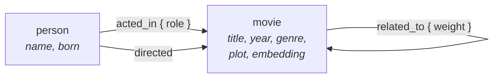

本手册的所有示例都使用同一个名为 `moviekb` 的小型图，内容是电影及其创作者。设置一次，后续各页就都可以使用。

图中有两个顶点标签和三个边标签：



旁边还有一个普通的关系表 `rating`，供[组合 SQL 和 Cypher](/zh/agensgraph/querying/combining-sql-and-cypher/)中的示例连接真实的关系数据。

## 创建图 {#create-the-graph}

```cypher
CREATE GRAPH moviekb;
SET graph_path = moviekb;

CREATE VLABEL movie;
CREATE VLABEL person;
CREATE ELABEL acted_in;
CREATE ELABEL directed;
CREATE ELABEL related_to;
```

`graph_path` 告诉当前会话，未限定的标签名属于哪张图。这是会话级设置，需要在每个新会话中重新设置，也可以为数据库设置默认值：

```sql
ALTER DATABASE mydb SET graph_path = moviekb;
```

## 加载电影 {#load-the-films}

每部电影都有 `plot` 属性，以及情节的 `embedding`。实际嵌入向量由模型生成，通常有数百维；示例降到四维，以便在页面上理解几何关系。[向量搜索](/zh/agensgraph/guides/search/vector/)和[混合搜索](/zh/agensgraph/guides/search/hybrid/)直接使用这些向量。

```cypher
CREATE (:movie {title: 'The Matrix', year: 1999, genre: 'Action', plot: 'A computer hacker learns about the true nature of reality and joins a rebellion to free humanity from a simulated world controlled by machines.', embedding: [-0.07594558, 0.04081754, 0.29592122, -0.11921061]}),
       (:movie {title: 'The Matrix Reloaded', year: 2003, genre: 'Action', plot: 'The rebels continue their fight against the machines, uncovering deeper truths about the Matrix and the nature of their mission.', embedding: [0.30228977, -0.22839354, 0.35070436, 0.01262819]}),
       (:movie {title: 'The Matrix Revolutions', year: 2003, genre: 'Action', plot: 'The final battle between humans and machines reaches its climax as the fate of both worlds hangs in the balance.', embedding: [0.12240622, -0.29752459, 0.22620453, 0.24454723]}),
       (:movie {title: 'The Matrix Resurrections', year: 2021, genre: 'Action', plot: 'Neo returns to a new version of the Matrix and must once again fight to save the people from the control of the machines.', embedding: [0.34717246, -0.13820869, 0.29214213, 0.08090488]}),
       (:movie {title: 'Inception', year: 2010, genre: 'Sci-Fi', plot: 'A skilled thief is given a chance at redemption if he can successfully perform an inception: planting an idea into someone''s subconscious.', embedding: [0.03923657, 0.39284106, -0.20927092, -0.17770818]}),
       (:movie {title: 'Interstellar', year: 2014, genre: 'Sci-Fi', plot: 'A group of explorers travel through a wormhole in space in an attempt to ensure humanity''s survival.', embedding: [-0.29302418, -0.39615033, -0.23393948, -0.09601383]}),
       (:movie {title: 'Avatar', year: 2009, genre: 'Sci-Fi', plot: 'A paraplegic Marine is sent to the moon Pandora, where he becomes torn between following orders and protecting the world he feels is his home.', embedding: [-0.13663386, 0.00635589, -0.03038832, -0.08252723]}),
       (:movie {title: 'Blade Runner', year: 1982, genre: 'Sci-Fi', plot: 'A blade runner must pursue and terminate four replicants who have stolen a ship in space and returned to Earth.', embedding: [0.27215557, -0.1479577, -0.09972772, -0.08234394]}),
       (:movie {title: 'Blade Runner 2049', year: 2017, genre: 'Sci-Fi', plot: 'A new blade runner unearths a long-buried secret that has the potential to plunge what''s left of society into chaos.', embedding: [0.21560573, -0.07505179, -0.01331814, 0.13403069]}),
       (:movie {title: 'Minority Report', year: 2002, genre: 'Sci-Fi', plot: 'In a future where a special police unit can arrest murderers before they commit their crimes, a top officer is accused of a future murder.', embedding: [0.24008012, 0.44954908, -0.30905488, 0.15195407]}),
       (:movie {title: 'Total Recall', year: 1990, genre: 'Sci-Fi', plot: 'A construction worker discovers that his memories have been implanted and becomes embroiled in a conspiracy on Mars.', embedding: [-0.17471036, 0.14695261, -0.06272433, -0.21795064]}),
       (:movie {title: 'Elysium', year: 2013, genre: 'Sci-Fi', plot: 'In a future where the rich live on a luxurious space station while the rest of humanity lives in squalor, a man fights to bring equality.', embedding: [-0.33280967, 0.07733926, 0.11015328, 0.53382836]}),
       (:movie {title: 'Gattaca', year: 1997, genre: 'Sci-Fi', plot: 'In a future where genetic engineering determines social class, a man defies his fate to achieve his dreams.', embedding: [-0.21629286, 0.31114665, 0.08303899, 0.46199759]}),
       (:movie {title: 'The Fifth Element', year: 1997, genre: 'Sci-Fi', plot: 'In a futuristic world, a cab driver becomes the key to saving humanity from an impending cosmic threat.', embedding: [-0.11528205, -0.0208782, -0.0735215, 0.14327449]}),
       (:movie {title: 'The Terminator', year: 1984, genre: 'Action', plot: 'A cyborg assassin is sent back in time to kill the mother of the future resistance leader.', embedding: [0.33666933, 0.18040994, -0.01075103, -0.11117851]}),
       (:movie {title: 'Terminator 2: Judgment Day', year: 1991, genre: 'Action', plot: 'A reprogrammed Terminator is sent to protect the future leader of the human resistance from a more advanced Terminator.', embedding: [0.34698868, 0.06439331, 0.06232323, -0.19534876]}),
       (:movie {title: 'Jurassic Park', year: 1993, genre: 'Adventure', plot: 'Scientists clone dinosaurs to create a theme park, but things go awry when the creatures escape.', embedding: [0.01794725, -0.11434246, -0.46831815, -0.01049593]}),
       (:movie {title: 'The Avengers', year: 2012, genre: 'Action', plot: 'Superheroes assemble to face a global threat from an alien invasion led by Loki.', embedding: [0.00546514, -0.37005171, -0.42612838, 0.07968612]});
```

## 加载人物 {#load-the-people}

```cypher
CREATE (:person {name: 'Keanu Reeves', born: 1964}),
       (:person {name: 'Laurence Fishburne', born: 1961}),
       (:person {name: 'Carrie-Anne Moss', born: 1967}),
       (:person {name: 'Lana Wachowski', born: 1965}),
       (:person {name: 'Lilly Wachowski', born: 1967}),
       (:person {name: 'Leonardo DiCaprio', born: 1974}),
       (:person {name: 'Matthew McConaughey', born: 1969}),
       (:person {name: 'Christopher Nolan', born: 1970}),
       (:person {name: 'Harrison Ford', born: 1942}),
       (:person {name: 'Ryan Gosling', born: 1980}),
       (:person {name: 'Ridley Scott', born: 1937}),
       (:person {name: 'Denis Villeneuve', born: 1967}),
       (:person {name: 'Tom Cruise', born: 1962}),
       (:person {name: 'Sam Neill', born: 1947}),
       (:person {name: 'Steven Spielberg', born: 1946}),
       (:person {name: 'Arnold Schwarzenegger', born: 1947}),
       (:person {name: 'Linda Hamilton', born: 1956}),
       (:person {name: 'James Cameron', born: 1954}),
       (:person {name: 'Sam Worthington', born: 1976}),
       (:person {name: 'Paul Verhoeven', born: 1938}),
       (:person {name: 'Matt Damon', born: 1970}),
       (:person {name: 'Neill Blomkamp', born: 1979}),
       (:person {name: 'Ethan Hawke', born: 1970}),
       (:person {name: 'Andrew Niccol', born: 1964}),
       (:person {name: 'Bruce Willis', born: 1955}),
       (:person {name: 'Luc Besson', born: 1959}),
       (:person {name: 'Robert Downey Jr.', born: 1965}),
       (:person {name: 'Joss Whedon', born: 1964});
```

## 建立关系 {#connect-them}

```cypher
-- Cast: acted_in carries the character name as an edge property.
MATCH (p:person {name:'Keanu Reeves'}),          (m:movie {title:'The Matrix'})                 CREATE (p)-[:acted_in {role:'Neo'}]->(m);
MATCH (p:person {name:'Keanu Reeves'}),          (m:movie {title:'The Matrix Reloaded'})        CREATE (p)-[:acted_in {role:'Neo'}]->(m);
MATCH (p:person {name:'Keanu Reeves'}),          (m:movie {title:'The Matrix Revolutions'})     CREATE (p)-[:acted_in {role:'Neo'}]->(m);
MATCH (p:person {name:'Keanu Reeves'}),          (m:movie {title:'The Matrix Resurrections'})   CREATE (p)-[:acted_in {role:'Neo'}]->(m);
MATCH (p:person {name:'Laurence Fishburne'}),    (m:movie {title:'The Matrix'})                 CREATE (p)-[:acted_in {role:'Morpheus'}]->(m);
MATCH (p:person {name:'Laurence Fishburne'}),    (m:movie {title:'The Matrix Reloaded'})        CREATE (p)-[:acted_in {role:'Morpheus'}]->(m);
MATCH (p:person {name:'Carrie-Anne Moss'}),      (m:movie {title:'The Matrix'})                 CREATE (p)-[:acted_in {role:'Trinity'}]->(m);
MATCH (p:person {name:'Carrie-Anne Moss'}),      (m:movie {title:'The Matrix Resurrections'})   CREATE (p)-[:acted_in {role:'Trinity'}]->(m);
MATCH (p:person {name:'Leonardo DiCaprio'}),     (m:movie {title:'Inception'})                  CREATE (p)-[:acted_in {role:'Dom Cobb'}]->(m);
MATCH (p:person {name:'Matthew McConaughey'}),   (m:movie {title:'Interstellar'})               CREATE (p)-[:acted_in {role:'Cooper'}]->(m);
MATCH (p:person {name:'Harrison Ford'}),         (m:movie {title:'Blade Runner'})               CREATE (p)-[:acted_in {role:'Rick Deckard'}]->(m);
MATCH (p:person {name:'Harrison Ford'}),         (m:movie {title:'Blade Runner 2049'})          CREATE (p)-[:acted_in {role:'Rick Deckard'}]->(m);
MATCH (p:person {name:'Ryan Gosling'}),          (m:movie {title:'Blade Runner 2049'})          CREATE (p)-[:acted_in {role:'K'}]->(m);
MATCH (p:person {name:'Tom Cruise'}),            (m:movie {title:'Minority Report'})            CREATE (p)-[:acted_in {role:'John Anderton'}]->(m);
MATCH (p:person {name:'Sam Neill'}),             (m:movie {title:'Jurassic Park'})              CREATE (p)-[:acted_in {role:'Alan Grant'}]->(m);
MATCH (p:person {name:'Arnold Schwarzenegger'}), (m:movie {title:'The Terminator'})             CREATE (p)-[:acted_in {role:'The Terminator'}]->(m);
MATCH (p:person {name:'Arnold Schwarzenegger'}), (m:movie {title:'Terminator 2: Judgment Day'}) CREATE (p)-[:acted_in {role:'The Terminator'}]->(m);
MATCH (p:person {name:'Arnold Schwarzenegger'}), (m:movie {title:'Total Recall'})               CREATE (p)-[:acted_in {role:'Douglas Quaid'}]->(m);
MATCH (p:person {name:'Linda Hamilton'}),        (m:movie {title:'The Terminator'})             CREATE (p)-[:acted_in {role:'Sarah Connor'}]->(m);
MATCH (p:person {name:'Linda Hamilton'}),        (m:movie {title:'Terminator 2: Judgment Day'}) CREATE (p)-[:acted_in {role:'Sarah Connor'}]->(m);
MATCH (p:person {name:'Sam Worthington'}),       (m:movie {title:'Avatar'})                     CREATE (p)-[:acted_in {role:'Jake Sully'}]->(m);
MATCH (p:person {name:'Matt Damon'}),            (m:movie {title:'Elysium'})                    CREATE (p)-[:acted_in {role:'Max Da Costa'}]->(m);
MATCH (p:person {name:'Ethan Hawke'}),           (m:movie {title:'Gattaca'})                    CREATE (p)-[:acted_in {role:'Vincent Freeman'}]->(m);
MATCH (p:person {name:'Bruce Willis'}),          (m:movie {title:'The Fifth Element'})          CREATE (p)-[:acted_in {role:'Korben Dallas'}]->(m);
MATCH (p:person {name:'Robert Downey Jr.'}),     (m:movie {title:'The Avengers'})               CREATE (p)-[:acted_in {role:'Tony Stark'}]->(m);

-- Directors.
MATCH (p:person {name:'Lana Wachowski'}),    (m:movie {title:'The Matrix'})                 CREATE (p)-[:directed]->(m);
MATCH (p:person {name:'Lilly Wachowski'}),   (m:movie {title:'The Matrix'})                 CREATE (p)-[:directed]->(m);
MATCH (p:person {name:'Lana Wachowski'}),    (m:movie {title:'The Matrix Reloaded'})        CREATE (p)-[:directed]->(m);
MATCH (p:person {name:'Lilly Wachowski'}),   (m:movie {title:'The Matrix Reloaded'})        CREATE (p)-[:directed]->(m);
MATCH (p:person {name:'Lana Wachowski'}),    (m:movie {title:'The Matrix Revolutions'})     CREATE (p)-[:directed]->(m);
MATCH (p:person {name:'Lilly Wachowski'}),   (m:movie {title:'The Matrix Revolutions'})     CREATE (p)-[:directed]->(m);
MATCH (p:person {name:'Lana Wachowski'}),    (m:movie {title:'The Matrix Resurrections'})   CREATE (p)-[:directed]->(m);
MATCH (p:person {name:'Christopher Nolan'}), (m:movie {title:'Inception'})                  CREATE (p)-[:directed]->(m);
MATCH (p:person {name:'Christopher Nolan'}), (m:movie {title:'Interstellar'})               CREATE (p)-[:directed]->(m);
MATCH (p:person {name:'Ridley Scott'}),      (m:movie {title:'Blade Runner'})               CREATE (p)-[:directed]->(m);
MATCH (p:person {name:'Denis Villeneuve'}),  (m:movie {title:'Blade Runner 2049'})          CREATE (p)-[:directed]->(m);
MATCH (p:person {name:'Steven Spielberg'}),  (m:movie {title:'Minority Report'})            CREATE (p)-[:directed]->(m);
MATCH (p:person {name:'Steven Spielberg'}),  (m:movie {title:'Jurassic Park'})              CREATE (p)-[:directed]->(m);
MATCH (p:person {name:'James Cameron'}),     (m:movie {title:'The Terminator'})             CREATE (p)-[:directed]->(m);
MATCH (p:person {name:'James Cameron'}),     (m:movie {title:'Terminator 2: Judgment Day'}) CREATE (p)-[:directed]->(m);
MATCH (p:person {name:'James Cameron'}),     (m:movie {title:'Avatar'})                     CREATE (p)-[:directed]->(m);
MATCH (p:person {name:'Paul Verhoeven'}),    (m:movie {title:'Total Recall'})               CREATE (p)-[:directed]->(m);
MATCH (p:person {name:'Neill Blomkamp'}),    (m:movie {title:'Elysium'})                    CREATE (p)-[:directed]->(m);
MATCH (p:person {name:'Andrew Niccol'}),     (m:movie {title:'Gattaca'})                    CREATE (p)-[:directed]->(m);
MATCH (p:person {name:'Luc Besson'}),        (m:movie {title:'The Fifth Element'})          CREATE (p)-[:directed]->(m);
MATCH (p:person {name:'Joss Whedon'}),       (m:movie {title:'The Avengers'})               CREATE (p)-[:directed]->(m);

-- related_to keeps the search pages' edges and adds a weight for weighted-path examples.
MATCH (a:movie {title:'The Matrix'}),             (b:movie {title:'The Matrix Reloaded'})       CREATE (a)-[:related_to {weight: 1}]->(b);
MATCH (a:movie {title:'The Matrix Reloaded'}),    (b:movie {title:'The Matrix Revolutions'})    CREATE (a)-[:related_to {weight: 1}]->(b);
MATCH (a:movie {title:'The Matrix Revolutions'}), (b:movie {title:'The Matrix Resurrections'})  CREATE (a)-[:related_to {weight: 1}]->(b);
MATCH (a:movie {title:'The Matrix'}),             (b:movie {title:'Total Recall'})              CREATE (a)-[:related_to {weight: 4}]->(b);
MATCH (a:movie {title:'The Matrix'}),             (b:movie {title:'The Terminator'})            CREATE (a)-[:related_to {weight: 3}]->(b);
MATCH (a:movie {title:'Total Recall'}),           (b:movie {title:'Inception'})                 CREATE (a)-[:related_to {weight: 2}]->(b);
MATCH (a:movie {title:'The Terminator'}),         (b:movie {title:'Terminator 2: Judgment Day'})CREATE (a)-[:related_to {weight: 1}]->(b);
MATCH (a:movie {title:'Blade Runner'}),           (b:movie {title:'Blade Runner 2049'})         CREATE (a)-[:related_to {weight: 1}]->(b);
MATCH (a:movie {title:'Interstellar'}),           (b:movie {title:'Avatar'})                    CREATE (a)-[:related_to {weight: 5}]->(b);
MATCH (a:movie {title:'Jurassic Park'}),          (b:movie {title:'The Avengers'})              CREATE (a)-[:related_to {weight: 5}]->(b);
MATCH (a:movie {title:'Minority Report'}),        (b:movie {title:'Inception'})                 CREATE (a)-[:related_to {weight: 2}]->(b);
```

## 添加关系表 {#add-the-relational-table}

```sql
CREATE TABLE rating (title text, source text, score numeric(3,1));

INSERT INTO rating VALUES
  ('The Matrix', 'critics', 8.7),                 ('The Matrix', 'audience', 9.1),
  ('The Matrix Reloaded', 'critics', 7.2),        ('The Matrix Revolutions', 'critics', 6.7),
  ('The Matrix Resurrections', 'critics', 5.7),   ('Inception', 'critics', 8.8),
  ('Inception', 'audience', 9.0),                 ('Interstellar', 'critics', 8.7),
  ('Interstellar', 'audience', 8.6),              ('Blade Runner', 'critics', 8.1),
  ('Blade Runner 2049', 'critics', 8.0),          ('Jurassic Park', 'critics', 8.2),
  ('The Terminator', 'critics', 8.0),             ('Terminator 2: Judgment Day', 'critics', 8.6),
  ('Avatar', 'critics', 7.9),                     ('Total Recall', 'critics', 7.5),
  ('Minority Report', 'critics', 7.6),            ('Gattaca', 'critics', 7.8),
  ('The Fifth Element', 'critics', 7.6),          ('Elysium', 'critics', 6.6),
  ('The Avengers', 'critics', 8.0);
```

## 检查加载结果 {#check-what-you-loaded}

```cypher
MATCH (n) RETURN label(n) AS label, count(*) AS n ORDER BY label;
```

| label | n |
| --- | --- |
| `"movie"` | 18 |
| `"person"` | 28 |

```cypher
MATCH ()-[e]->() RETURN label(e) AS label, count(*) AS n ORDER BY label;
```

| label | n |
| --- | --- |
| `"acted_in"` | 25 |
| `"directed"` | 21 |
| `"related_to"` | 11 |

## 以表的形式查看同一份数据 {#the-same-data-as-tables}

图是模式，标签是表，因此刚创建的图也对应八张可用 SQL 查询的普通表。`\dGv` 列出顶点标签，`\dGe` 列出边标签，`\d` 显示标签的结构：

```sql
SELECT id, properties->>'title' AS title FROM moviekb.movie ORDER BY id LIMIT 3;
```

```
 id  |         title
-----+------------------------
 3.1 | The Matrix
 3.2 | The Matrix Reloaded
 3.3 | The Matrix Revolutions
```

边表还包含两个端点的 ID：

```sql
SELECT id, start, "end", properties FROM moviekb.acted_in ORDER BY id LIMIT 3;
```

```
 id  | start | end |   properties
-----+-------+-----+-----------------
 5.1 | 4.1   | 3.1 | {"role": "Neo"}
 5.2 | 4.1   | 3.2 | {"role": "Neo"}
 5.3 | 4.1   | 3.3 | {"role": "Neo"}
```

[图的存储方式](/zh/agensgraph/concepts/graph-on-postgresql/)介绍了这些列的含义，以及随它们创建的索引。

## 重新开始 {#start-over}

```cypher
DROP GRAPH moviekb CASCADE;
```

```sql
DROP TABLE rating;
```
