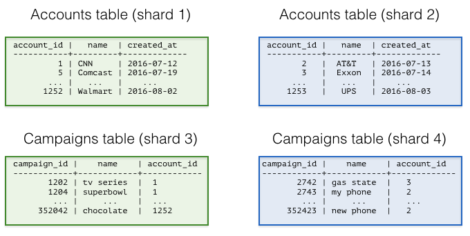
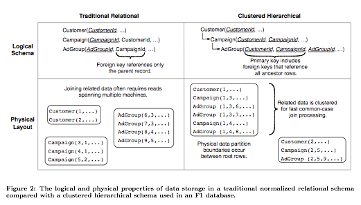
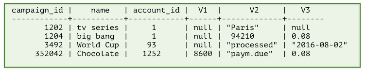
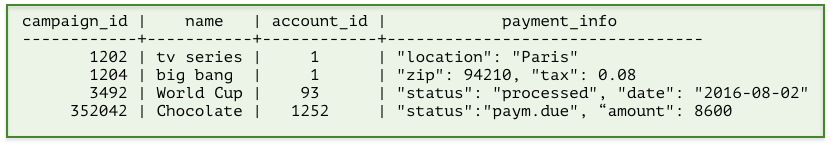

**原始文章：** [Ozgun Erdogan · 2016 年 10 月 3 日](https://www.citusdata.com/blog/2016/10/03/designing-your-saas-database-for-high-scalability/)。中文整理：[PGSTY](https://pgsty.com/)。

构建 SaaS 应用时，你的数据模型可能已经包含租户概念。信息通常归属于租户、客户或账户，数据库表也会体现这种天然的关系。

数据量较小时（几十 GB），增加硬件、纵向扩展数据库就能轻松解决问题。但随着这些表不断增长，你需要考虑如何将多租户数据库扩展到几十台乃至几百台机器上。

本文讨论多租户数据库的架构模式，以及各自适用的场景。总体而言，开发者有三种选择：

- 为每个租户创建一个数据库
- 为每个租户创建一个模式
- 让所有租户共享同一张或多张表

你的选择会影响可扩展性、租户间差异化数据的处理、隔离性以及维护的难易程度。

实践中，这三种设计都能应对规模、租户间差异化数据和隔离方面的问题。如何选择取决于你主要针对哪个维度进行构建或优化。简而言之：

- 如果以可扩展性为目标：让所有租户共享同一张或多张表
- 如果以隔离性为目标：为每个租户创建一个数据库

本文重点讨论可扩展性，也会介绍隔离方面的考量。

如果你的 B2B 应用计划支持 5 个或 50 个租户，而数据库遇到了扩展性问题，可以为每个租户创建并维护独立的数据库。但如果计划支持数千个租户，按 `tenant_id`/`account_id` 列对表进行分片会是更好的扩展方式。

让所有租户共享同一个数据库，通常有以下好处：

资源池化（降低成本）：如果为每个租户创建独立的数据库，就需要为该数据库分配资源。而且，数据库通常会对可用资源作出假设。例如，PostgreSQL 有 `shared_buffers`，会充分利用操作系统缓存，提供连接数设置，在后台运行进程，并将日志和数据写入磁盘。如果在几台物理机器上运行 50 个这样的数据库，即便采用当时的虚拟化技术，资源池化也会变得棘手。

分布式数据库可以管理所有租户。按 `tenant_id` 对表进行分片，就能轻松支持数千乃至数万个租户。

[Google 的 F1 论文](http://static.googleusercontent.com/media/research.google.com/en//pubs/archive/41344.pdf)很好地展示了以这种方式扩展的多租户数据库。论文讨论了横向扩展 Google AdWords 平台面临的技术挑战，其核心描述的就是一个多租户数据库。F1 论文还着重介绍了如何建模，才能在分布式数据库中更好地支持大量租户或客户。

左侧的数据模型遵循关系数据库模型，使用外键约束来保证数据库中的数据完整性。不过，这种严格的关系模型在分布式环境中存在一些不足。

具体来说，你在数据库上执行的大多数事务和连接，以及希望跨表实施的约束，都有客户或租户这一维度。如果按关系模型中各表的主键列进行分片，那么大多数分布式事务、连接和约束的代价都会变高。网络和机器故障还会进一步增加这些代价。

右侧的图提出了层次数据库模型。F1 使用的就是这种模型，它解决了上述问题。最简单的做法是在各表中添加 `customer_id`/`tenant_id` 列，并按 `customer_id` 分片。这样就能确保同一客户的数据[共置在一起](https://citusdata.com/blog/2016/08/10/sharding-for-a-multi-tenant-app-with-postgres/)。共置大幅降低了分布式事务、连接和[外键约束](https://github.com/citusdata/citus/issues/698)的代价。

易于维护：支持 100 到 100,000 个租户的另一个挑战是模式变更（Alter Table）和索引创建（Create Index）。随着应用的发展，你会不断迭代和改进数据库模型。

如果采用每个租户一个独立数据库的架构，就需要实现一套基础设施，确保每次模式变更在所有租户上都成功，否则最终回滚。设想一下，在 10,000 个租户中完成了 5,000 个租户的模式变更后发生失败，该怎么办？你会如何处理？

按多租户方式对表进行分片，就可以把这项工作交给数据库。数据库要么确保 Alter Table 在所有分片上成功执行，要么将其回滚。

如何处理租户间差异化的数据？扩展到数千个租户还面临另一个挑战：处理不同租户各自需要的数据。多租户应用自然会有一套标准数据库配置，包含适合该解决方案的默认表、字段、查询和关系。但不同租户或组织可能有独特需求，僵化且不可扩展的默认数据模型无法满足。例如，一个组织可能需要用邮政编码追踪其在美国的门店；另一个欧洲客户可能不关心美国邮政编码，却希望记录每家门店的税率。

过去，每个租户一个数据库的方案在这方面最灵活，代价是开发者需要承担额外的维护工作。你可以在各数据库中为租户创建专用的表或列，并持续维护这些差异。

如果还想将基础设施扩展到数千个租户，就会创建一张包含大量字符串列（Value0、Value1、...、Value500）的大表。

在这种数据库模型中，表里预先设置了一组自定义列，图中标为 V1、V2 和 V3。日期和数字以字符串存储，其格式允许转换回原生类型。存储某个租户的数据时，就可以按该租户的需求使用这些自定义列。

好在引入半结构化数据类型后，为数据库设计“灵活”的列变得更容易了。PostgreSQL 提供了丰富的半结构化数据类型，包括 [hstore、json 和 jsonb](https://citusdata.com/blog/2016/07/14/choosing-nosql-hstore-json-jsonb/)。现在只需声明一个 jsonb 列，就能表达前面的数据库模式，并扩展到数千个租户。

如果对数据库表进行分片，还需要考虑如何处理隔离，以及如何与对象关系映射（ORM）库集成。也要考虑：如果有一张表不容易添加 `tenant_id` 列，该怎么办？

更多信息请参阅[用例](/citus/overview/use-cases/)。

## 相关内容 {#related-content}

- [专题概览](/citus/articles/)
- [使用 PostgreSQL 对多租户应用进行分片](/citus/articles/sharding-mt-app/)
- [什么是 Citus？](/citus/overview/what-is-citus/)
