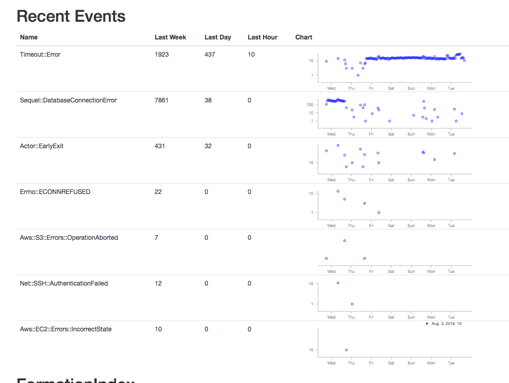

**原始文章：** [Will Leinweber · 2016 年 8 月 30 日](https://www.citusdata.com/blog/2016/08/30/citus-clouds-usage-of-citus-cloud/)。中文整理：[PGSTY](https://pgsty.com/)。

几乎从 [Citus Cloud](https://www.citusdata.com/product/cloud/) 服务推出之初，Citus 就一直使用由该服务自身创建和管理的内部集群。以这种方式[使用自己的产品](http://blog.launchdarkly.com/tag/dogfooding/)，能带来常见的诸多好处，例如积累运维经验、理解客户的感受等。

创建分布式表比创建普通 PostgreSQL 表需要更多事先规划。分片列的选择，会影响能够对数据执行哪些查询和连接。

本文介绍两个案例：时序指标表和事件表。

## 时序指标 {#time-series-metrics}

第一张是指标表，保存来自 Amazon CloudWatch 的所有服务器和托管卷的指标数据。这些信息会以图表形式展示在内部仪表板和面向客户的仪表板中。表结构如下，按 `server_id` 分片。主键由多个列组成，既作为唯一约束防止重复数据点，也为这些列提供索引。

```text
    .
                      Table "public.cw_metrics"
        Column    |           Type           |     Modifiers
    --------------+--------------------------+--------------------
     server_id    | uuid                     | not null
     aws_id       | text                     | collate C not null
     name         | text                     | collate C not null
     timestamp    | timestamp with time zone | not null
     sample_count | bigint                   | not null
     average      | double precision         | not null
     sum          | double precision         | not null
     minimum      | double precision         | not null
     maximum      | double precision         | not null
     unit         | text                     | collate C not null
    Indexes:
        "cw_metrics_pkey" PRIMARY KEY, btree (server_id, "timestamp", aws_id, name)
```

部分示例行如下：

```text
    citus=> select * from cw_metrics order by timestamp desc limit 2;
    -[ RECORD 1 ]+-------------------------------------
    server_id    | f2239a4b-7297-4b66-b9e3-851291760b70
    aws_id       | i-723a927805464ac8b
    name         | NetworkOut
    timestamp    | 2016-07-28 14:13:00-07
    sample_count | 5
    average      | 127505
    sum          | 637525
    minimum      | 111888
    maximum      | 144385
    unit         | Bytes
    -[ RECORD 2 ]+-------------------------------------
    server_id    | f2239a4b-7297-4b66-b9e3-851291760b70
    aws_id       | i-723a927805464ac8b
    name         | NetworkIn
    timestamp    | 2016-07-28 14:13:00-07
    sample_count | 5
    average      | 32930.8
    sum          | 164654
    minimum      | 18771
    maximum      | 46584
    unit         | Bytes
```

这张表当时只有两类查询。第一类是在定期从 Amazon CloudWatch 获取数据后，将数据插入表中。

另一类为内部管理站点和面向客户的控制台中的图表获取数据，形式类似于 `select ... where server_id in (?,) and name in (?,) and timestamp > now()-'? hours'::interval`。由于 Citus 分片是普通的 PostgreSQL 表，该查询只需访问 `server_id` 列表涉及的分片，即可并行执行。到达各分片后，查找数据很快，因为另外两个 where 条件都被主键索引覆盖。

按 `server_id` 分片的主要缺点是，清理过期数据稍显麻烦。必须访问每个分片，执行 `delete ... where timestamp > '?'`。这可能需要一些时间，具体取决于要清理的时间窗口有多大，还会留下膨胀的表，需要进行清理（vacuum）。另一种做法是对每个分片采用标准的按时间分区方式，这样就可以直接删除旧的时间分区表。

## 事件 {#events}

另一张表是通用事件表。我们使用托管的异常跟踪服务来发现生产环境中的问题。但有些“异常”其实并不异常：它们是预期内的错误，例如无法通过 ssh 连接到仍在启动的服务器。某类异常以正常的基线频率出现并无大碍，但其发生率上升有时就意味着存在问题。

不过，异常跟踪服务并不适合保存这类信息。这些事件存放在如下 Citus 分布式表中：

```text
    .
                   Table "public.events"
       Column   |           Type           | Modifiers
    ------------+--------------------------+-----------
     id         | uuid                     | not null
     name       | text                     | not null
     created_at | timestamp with time zone | not null
     data       | jsonb                    |
    Indexes:
        "events_pkey" PRIMARY KEY, btree (id)
        "events_created_at_idx" brin (created_at)
        "events_data_idx" gin (data jsonb_path_ops)
        "events_name_idx" btree (name)
```

`id` 列是随机生成的 uuid，也是分片键，因此事件不断进入时，能在各分片间大致均匀分布。另外，Citus 只是 PostgreSQL 上的一个扩展，因此我们可以利用强大的 `jsonb` 数据类型及其对应的 gin 索引，快速查找任意键，也可以使用当时新增的 brin 索引类型。

下面是事件表中的一些示例行：

```text
    citus=> select * from events order by created_at desc limit 2;
    -[ RECORD 1 ]-
    id         | 9a3dfdbd-c395-40bb-8d25-45ee7c913662
    name       | Timeout::Error
    created_at | 2016-07-28 13:18:47.289917-07
    data       | {"id": "5747a999-9768-429c-b13c-c7c0947dd950", "class": "Server", "message": "execution expired"}
    -[ RECORD 2 ]-
    id         | ba9d6a13-0832-47fb-a849-02f1362c9019
    name       | Sequel::DatabaseConnectionError
    created_at | 2016-07-28 12:58:40.506267-07
    data       | {"id": "232835ec-31a1-44d0-ae5b-edafb2cf6978", "class": "Timeline", "message": "PG::ConnectionBad: could not connect to server: Connection refused\n\tIs the server running on host \"ec2-52-207-18-20.compute-1.amazonaws.com\" (52.207.18.20) and accepting\n\tTCP/IP connections on port 5432?\n"}
```

这些数据用于在管理仪表板上绘制图表，帮助发现异常值。为图表获取数据的查询如下：

```sql
SELECT count(*), name, date_trunc('hour', created_at) as hour
FROM events
WHERE created_at > now()-'1 week'::interval
GROUP BY name, hour;
```

图表如下所示：



本例展示的时间段并不完整。当某类错误频繁发生时，有时会在 psql 中查看 [jsonb](https://www.citusdata.com/blog/2016/07/14/choosing-nosql-hstore-json-jsonb/) 中的详情，以确定是哪台服务器引起的。这一过程需要手动完成，也可以将 JSON 内容示例放到用户界面中。

## 相关内容 {#related-content}

- [专题概览](/citus/articles/)
- [诊断查询](/citus/operations/diagnostic-queries/)
