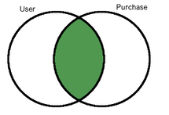
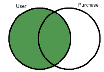
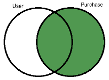
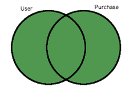
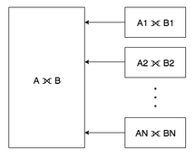

**原始文章：** [Eren Basak · 2016 年 10 月 10 日](https://www.citusdata.com/blog/2016/10/10/outer-joins-in-citus/)。中文整理：[PGSTY](https://pgsty.com/)。

SQL 是用于数据分析和报表的强大语言。连接是 SQL 的核心概念之一，用来将不同的表组合起来。当你希望保留在另一侧找不到匹配项的行时，外连接就很有用。

最常见的连接类型是内连接。对表 A 和表 B 执行内连接，只会返回两侧能够匹配的元组。而外连接可以保留表 A 中的所有行，即便它们在表 B 中没有对应的匹配项。例如，一张表保存客户，另一张表保存购买记录。当你查看客户的所有购买记录时，可能希望结果包含所有客户，包括尚未购买过任何东西的客户。这时就需要外连接。本文介绍外连接的含义，以及 Citus 如何以分布式方式支持外连接。

例如，现有 customer 和 purchase 两张表：

```sql
customer table:
 customer_id |      name
-------------+-----------------
           1 | Corra Ignacio
           3 | Warren Brooklyn
           2 | Jalda Francis

purchase table:
 purchase_id | customer_id | category |           comment
-------------+-------------+----------+------------------------------
        1000 |           1 | books    | Nice to Have!
        1001 |           1 | chairs   | Comfortable
        1002 |           2 | books    | Good Read, cheap price
        1003 |          -1 | hardware | Not very cheap
        1004 |          -1 | laptops  | Good laptop but expensive...
```

下面的查询和结果有助于说明内连接与外连接的行为：

```sql
SELECT customer.name, purchase.comment
FROM customer JOIN purchase ON customer.customer_id = purchase.customer_id
ORDER BY purchase.comment;

     name      |        comment
---------------+------------------------
 Corra Ignacio | Comfortable
 Jalda Francis | Good Read, cheap price
 Corra Ignacio | Nice to Have!
```



```sql
SELECT customer.name, purchase.comment
FROM customer INNER JOIN purchase ON customer.customer_id = purchase.customer_id
ORDER BY purchase.comment;

     name      |        comment
---------------+------------------------
 Corra Ignacio | Comfortable
 Jalda Francis | Good Read, cheap price
 Corra Ignacio | Nice to Have!
```



```sql
SELECT customer.name, purchase.comment
FROM customer LEFT JOIN purchase ON customer.customer_id = purchase.customer_id
ORDER BY purchase.comment;

      name       |        comment
-----------------+------------------------
 Corra Ignacio   | Comfortable
 Jalda Francis   | Good Read, cheap price
 Corra Ignacio   | Nice to Have!
 Warren Brooklyn |
```



```sql
SELECT customer.name, purchase.comment
FROM customer RIGHT JOIN purchase ON customer.customer_id = purchase.customer_id
ORDER BY purchase.comment;

     name      |           comment
---------------+------------------------------
 Corra Ignacio | Comfortable
 Jalda Francis | Good Read, cheap price
               | Good laptop but expensive...
 Corra Ignacio | Nice to Have!
               | Not very cheap
```



```sql
SELECT customer.name, purchase.comment
FROM customer FULL JOIN purchase ON customer.customer_id = purchase.customer_id
ORDER BY purchase.comment;

      name       |           comment
-----------------+------------------------------
 Corra Ignacio   | Comfortable
 Jalda Francis   | Good Read, cheap price
                 | Good laptop but expensive...
 Corra Ignacio   | Nice to Have!
                 | Not very cheap
 Warren Brooklyn |
```

## Citus 中的分布式外连接 {#distributed-outer-joins-with-citus}

Citus 扩展可以将 PostgreSQL 大表分布为称作“分片”的小片段。在这些分布式表上执行外连接会更困难一些，因为将各分片之间的外连接结果合并，并不总能得到正确结果。文章所述的 Citus 在以下条件下支持分布式外连接：

- 外连接只能在分布式（已分片）表之间执行。不能对分片表和普通 PostgreSQL 表执行外连接。
- 连接条件应使用分布式表的[分区列](https://docs.citusdata.com/en/v5.2/dist_tables/concepts.html)。
- 查询应根据分区列相等的条件（table1.a = table2.a）连接分布式表。
- 分布式表的分片应一一匹配，即表 A 的每个分片应与表 B 中且仅与其中一个分片的范围重叠。

例如，假设有三个按哈希分布的表 X、Y 和 Z，其中 X 和 Y 各有 4 个分片，Z 有 8 个分片。

```sql
CREATE TABLE user (user_id int, name text);
SELECT create_distributed_table('user', 'user_id');

CREATE TABLE purchase (user_id int, amount int);
SELECT create_distributed_table('purchase', 'user_id');

CREATE TABLE comment (user_id int, comment text, rating int);
SELECT create_distributed_table('comment', 'user_id');
```

下面的查询可以执行，因为分布式表 user 和 purchase 的分片数量相同，而且连接条件是分区列相等：

```sql
SELECT * FROM user OUTER JOIN purchase ON user.user_id = purchase.user_id;
```

以下查询则不能直接支持：

```sql
-- user and comment tables doesn't have the same number of shards:
SELECT * FROM user OUTER JOIN comment ON user.user_id = comment.user_id;

-- join condition is not on the partition columns:
SELECT * FROM user OUTER JOIN purchase ON user.user_id = purchase.amount;

-- join condition is not equality:
SELECT * FROM user OUTER JOIN purchase ON user.user_id < purchase.user_id;
```

## Citus 如何处理 OUTER JOIN {#how-citus-processes-outer-joins}

当分片之间一一匹配时，对大表执行外连接，就等价于合并各对相应分片的外连接结果。



例如，看看 Citus 如何处理下面的外连接查询：

```sql
SELECT table1.a, table1.b AS b1, table2.b AS b2, table3.b AS b3, table4.b AS b4
FROM table1
FULL JOIN table2 ON table1.a = table2.a
FULL JOIN table3 ON table1.a = table3.a
FULL JOIN table4 ON table1.a = table4.a;
```

首先，查询经过标准的 PostgreSQL 规划器。Citus 利用该计划生成分布式计划，其间会进行各种检查，判断是否支持该查询。然后，针对分布式表的各个分片生成单独的查询，并将其发送到工作节点。

```sql
SELECT table1.a, table1.b AS b1, table2.b AS b2, table3.b AS b3, table4.b AS b4
FROM (((table1_102359 table1
FULL JOIN table2_102363 table2 ON ((table1.a = table2.a)))
FULL JOIN table3_102367 table3 ON ((table1.a = table3.a)))
FULL JOIN table4_102371 table4 ON ((table1.a = table4.a))) WHERE true
```

```sql
SELECT table1.a, table1.b AS b1, table2.b AS b2, table3.b AS b3, table4.b AS b4
FROM (((table1_102360 table1
FULL JOIN table2_102364 table2 ON ((table1.a = table2.a)))
FULL JOIN table3_102368 table3 ON ((table1.a = table3.a)))
FULL JOIN table4_102372 table4 ON ((table1.a = table4.a))) WHERE true
```

```sql
SELECT table1.a, table1.b AS b1, table2.b AS b2, table3.b AS b3, table4.b AS b4
FROM (((table1_102361 table1
FULL JOIN table2_102365 table2 ON ((table1.a = table2.a)))
FULL JOIN table3_102369 table3 ON ((table1.a = table3.a)))
FULL JOIN table4_102373 table4 ON ((table1.a = table4.a))) WHERE true
```

```sql
SELECT table1.a, table1.b AS b1, table2.b AS b2, table3.b AS b3, table4.b AS b4
FROM (((table1_102362 table1
FULL JOIN table2_102366 table2 ON ((table1.a = table2.a)))
FULL JOIN table3_102370 table3 ON ((table1.a = table3.a)))
FULL JOIN table4_102374 table4 ON ((table1.a = table4.a))) WHERE true
```

生成的查询乍看可能很复杂，但本质上与原查询相同，只是表名略有不同。Citus 将数据存储在称为分片的标准 PostgreSQL 表中（英文此处将名称格式记为 _）。当分片一一匹配时，分布式外连接就等价于合并所有匹配分片的外连接结果。如果按某个共同的 ID 分片——这在某些[用例](https://www.citusdata.com/blog/2016/08/10/sharding-for-a-multi-tenant-app-with-postgres/)中很常见——Citus 就能在相应节点上执行连接，无需工作节点之间进行通信。

## 相关内容 {#related-content}

- [专题概览](/citus/articles/)
- [SQL 支持](/citus/reference/reference-sql/)
