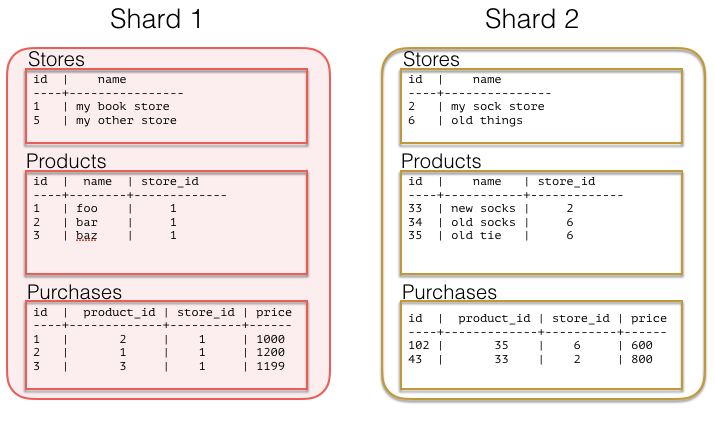

**原始文章：** [Craig Kerstiens · 2016 年 8 月 10 日](https://www.citusdata.com/blog/2016/08/10/sharding-for-a-multi-tenant-app-with-postgres/)。中文整理：[PGSTY](https://pgsty.com/)。

如果你开发的应用面向企业客户，多租户通常是标准做法。无论是营销分析工具、电商网站门户，还是服务学校的应用，都可以采用多租户方式。所有客户运行相同的代码，但除某些内部综合报表场景外，每个客户只能看到自己的私有数据集。

应用早期，客户数据的结构通常很简单，并随着业务自然演变。所有信息往往都关联到一张核心的客户、用户或租户表。数据量较小时（几十 GB），增加硬件就能轻松扩展应用。但当业务取得成功，数据再也放不进单台机器的内存时，就需要考虑横向扩展；需要更高并发能力时也是如此。

如果以合适的方式为多租户数据建模，分片就会更简单，同时仍能获得数据库所需的连接、索引等能力。Citus 可以横向扩展处理能力和内存，而数据建模方式决定了系统使用起来有多方便、多灵活。如果你正在构建多租户 SaaS 应用，下面的示例展示了如何提前为扩展做好规划。

## 租户模型 {#tenancy}

大多数不面向个人消费者的应用，其核心本就包含租户概念。如前所述，你可能已经有一张用户表。请看下面的 SaaS 模式：

```sql
CREATE TABLE stores (
  id UUID,
  owner_email VARCHAR(255),
  owner_password VARCHAR(255),
  name VARCHAR(255),
  url VARCHAR(255),
  last_login_at TIMESTAMPTZ,
  created_at TIMESTAMPTZ
)

CREATE TABLE products (
  id UUID,
  name VARCHAR(255),
  description TEXT,
  price INTEGER,
  quantity INTEGER,
  store_id UUID,
  created_at TIMESTAMPTZ,
  updated_at TIMESTAMPTZ
)

CREATE TABLE purchases (
  id UUID,
  product_id UUID,
  customer_id UUID,
  store_id UUID,
  price INTEGER,
  purchased_at TIMESTAMPTZ,
)
```

上述模式展示了一个简化的多租户电商网站。例如，对于某个选定的网站，你可能会运行许多查询：

列出某家商店的产品：

```sql
SELECT id,
       name,
       price
FROM products
WHERE store_id = 'foo';
```

如果想统计某家商店每周的购买情况：

```sql
SELECT date_trunc('week', purchased_at),
       sum(price * quantity)
FROM purchases,
     stores
WHERE stores.id = products.stores_id
  AND store_id = 'foo'
```

在此基础上，你可以规划如何为每家商店提供独立的展示和分析功能。最容易横向扩展的层级是租户层级，也就是按商店 ID 扩展。在上述数据模型中，随着时间推移，最大的表很可能是 products 和 purchases。两者都可以分片。但如果选择按产品或购买记录分片，就会遇到一个难题：你可能需要针对商店这样的上层对象进行查询。如果选择商店 ID，同一家商店的所有数据就会位于同一节点上，从而可以将所有计算直接下推到单个节点。

## 多租户与共置，天作之合 {#multi-tenancy-and-colocation-a-perfect-pair}

将数据共置在同一物理实例中，可以避免连接时通过网络传输数据，从而提高操作速度。Citus 允许移动数据，以灵活地进行连接和查询。对于这类多租户 SaaS 应用，如果能确保相关数据落在同一分片上，事情就简单了。要做到这一点，需要将商店 ID 带到所有表中。

在所有表中包含 `store_id`，就可以方便地对数据进行分片，让同一商店的数据落在同一分片上。上述数据模型的各表中都有 `store_id`；如果没有，也可以添加。这样就为分布数据、将相关数据存放在相同节点上做好了准备。现在可以尝试对租户（本例中的商店）进行分片：

```sql
SELECT create_distributed_table('stores', 'id');
SELECT create_distributed_table('products', 'store_id');
SELECT create_distributed_table('purchases', 'store_id');
```

上述示例按 `store_id` 分片，使查询能够路由到单个 PostgreSQL 实例。只要查询包含 `store_id`，之前的查询就应该仍然可用。数据布局可能如下图所示：



另一种选择是不采用这种共置方式，而是使用订单或产品等更低层级的分片键。这样会使连接和查询变得更复杂，因为需要通过网络传输更多数据，还要确保操作能以分布式方式执行。对于面向个人消费者的数据集，如果分析总是针对整个数据集，那么较低层级的键也可能有用；以指标为中心的场景往往就是如此。

## 结论 {#in-conclusion}

不同的分布模型各有优势和取舍。在某些场景下，按产品或购买记录等较低层级的实体 ID 建模可能是正确选择。这样能提高分析的并行度，代价是查询单家商店时不再那么简单。要构建可扩展的模型，可以选择多租户数据模型，也可以采用半结构化数据。更多信息请参阅[使用半结构化数据对 PostgreSQL 分片及其性能影响](/citus/articles/semi-structured-data/)。

## 相关内容 {#related-content}

- [专题概览](/citus/articles/)
- [设计可扩展的 SaaS 数据库](/citus/articles/designing-saas/)
- [教程：设计多租户数据库](/citus/tutorials/tutorial-multi-tenant/)
