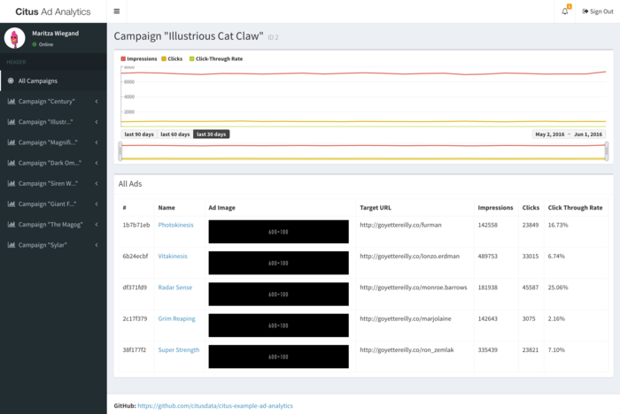

本文介绍如何将多租户 Rails 应用迁移到 Citus 存储后端。我们使用 [activerecord-multi-tenant](https://github.com/citusdata/activerecord-multi-tenant) Ruby gem，让横向扩展更加容易。

这个 Ruby gem 源于我们帮助客户横向扩展多租户应用的经验。它弥补了 ActiveRecord 和 Rails 目前在自动构建查询方面的一些限制。该 gem 基于优秀的 [acts_as_tenant](https://github.com/ErwinM/acts_as_tenant) 库，并针对 Citus 这类分布式多租户数据库的特定场景进行了扩展。

## 为多租户应用的横向扩展做准备 {#preparing-to-scale-out-a-multitenant-application}

最初，通常会将所有租户的数据放在单个数据库节点上。处理返回租户数据的 Web 请求时，再通过 Ruby on Rails 和 ActiveRecord 等框架加载该租户的数据。

ActiveRecord 对数据存储做出的一些假设，限制了横向扩展的选择。具体来说，ActiveRecord 通常采用这样一种模式：将数据规范化并拆分为多个独立模型，每个模型由单个 `id` 列标识，再通过多个 `belongs_to` 关系将对象关联到租户或客户：

```ruby
# typical pattern with multiple belongs_to relationships

class Customer < ActiveRecord::Base
  has_many :sites
end
class Site < ActiveRecord::Base
  belongs_to :customer
  has_many :page_views
end
class PageView < ActiveRecord::Base
  belongs_to :site
end
```

上例中，这种模式的棘手之处在于：要找到某个客户的全部页面访问记录，必须先查出该客户的所有网站。一旦开始对数据分片，这种查询就会带来问题，尤其是在页面访问记录这样的嵌套模型上执行 UPDATE 或 DELETE 查询时。

现在就可以采取以下措施，让将来的横向扩展更容易：

**1. 为每条属于租户的记录添加 tenant_id 列**

要横向扩展多租户模型，必须能够快速找到属于某个租户的全部记录。最简单的方法是为每个属于租户的对象添加 `tenant_id` 列（也可以是“customer_id”等），并回填现有数据，确保该列的值正确。

将来迁移到 Citus 这类分布式多租户数据库时，这一步必不可少。如果提前完成这项修改，届时只需用 COPY 复制数据，而无需再修改数据。

**2. 使用包含 tenant_id 的 UNIQUE 约束**

在任何分布式系统中，对 tenant_id 之外的值施加唯一约束或外键约束都会带来问题，因为很难确保两个节点不会接受同一个应当唯一的值。强制执行这类约束需要扫描所有节点上的数据，代价高昂。

对于逻辑上属于某家商店（本应用中的租户）的模型，应将 store_id 加入约束，以解决这一问题。这样，对象的唯一性范围就被限定在单家商店内，也为模型引入了租户概念，使多租户系统更加稳健。

例如，Rails 默认创建的主键只包含记录的 `id`：

```ruby
Indexes:
  "page_views_pkey" PRIMARY KEY, btree (id)
```

应修改这个主键，使其同时包含 tenant_id：

```sql
ALTER TABLE page_views DROP CONSTRAINT page_views_pkey;
ALTER TABLE page_views ADD PRIMARY KEY(id, customer_id);
```

users 表中的电子邮件或用户名列可能是这一规则的例外，除非每个租户都有自己的登录页面。因此，横向扩展后，我们通常建议将这些列从分布式表中拆出，作为本地表存放在 Citus 协调节点上。

**3. 所有查询都包含 tenant_id，即使可以通过对象自身的 object_id 找到它**

在分布式系统中不受限制地执行普通 SQL 查询，最简单的方法是始终访问单个节点上的数据，该节点由所访问的租户决定。

因此，使用 Citus 这类分布式系统后，建议查询时始终同时指定 tenant_id 和对象自身的 ID。tenant_id 让协调节点能够快速定位数据，并将查询路由到单个分片。否则，协调节点必须逐一访问系统中的每个分片，询问其是否包含给定的 object_id。

## 更新 Rails 应用 {#updating-the-rails-application}

首先将 `gem 'activerecord-multi-tenant'` 加入 Gemfile，运行 `bundle install`，然后按如下方式为 ActiveRecord 模型添加声明：

```ruby
class PageView < ActiveRecord::Base
  multi_tenant :customer
  # ...
end
```

在这个例子中，`customer` 是租户模型，`page_views` 表必须有一个 `customer_id` 列，用于引用该页面访问记录所属的客户。

[activerecord-multi-tenant](https://github.com/citusdata/activerecord-multi-tenant) Ruby gem 旨在帮助你更轻松地在常规 Rails 应用中实现上述数据变更。

> [!NOTE]
> 该库要求存在 tenant_id 列，且每一行的值都非空。不过，往往可以先让库为*新*记录设置 tenant_id，同时通过后台任务回填现有记录中缺失的 tenant_id。这样更容易开始使用 activerecord-multi-tenant。
> 
> 为支持这种做法，该库提供了只写模式。在此模式下，查询不会按 tenant_id 列过滤，但新记录会正确设置该列。要启用它，请在 Rails 初始化器中添加以下设置：
> 
> ```ruby
> MultiTenant.enable_write_only_mode
> ```
> 
> 准备好强制按租户隔离后，为 tenant_id 列添加 NOT NULL 约束，并删除初始化器中的上述设置。

如前所述，为模型添加 `multi_tenant :customer` 声明后，该库会自动在所有查询中包含 tenant_id。

要使其正常工作，必须始终指定正在访问的租户。可以在每个请求中指定：

```ruby
class ApplicationController < ActionController::Base
  # Opt-into the "set_current_tenant" controller helpers by specifying this:
  set_current_tenant_through_filter

  before_filter :set_customer_as_tenant

  def set_customer_as_tenant
    customer = Customer.find(session[:current_customer_id])
    set_current_tenant(customer) # Set the tenant
  end
end
```

也可以将代码包装在一个块中，例如用于后台任务和维护任务：

```ruby
customer = Customer.find(session[:current_customer_id])
# ...
MultiTenant.with(customer) do
  site = Site.find(params[:site_id])

  # Modifications automatically include tenant_id
  site.update! last_accessed_at: Time.now

  # Queries also include tenant_id automatically
  site.page_views.count
end
```

准备好使用 Citus 这样的分布式多租户数据库后，只需稍微调整迁移脚本即可：

```ruby
class InitialTables < ActiveRecord::Migration
  def up
    create_table :page_views, partition_key: :customer_id do |t|
      t.references :customer, null: false
      t.references :site, null: false

      t.text :url, null: false
      ...
      t.timestamps null: false
    end
    create_distributed_table :page_views, :account_id
  end

  def down
    drop_table :page_views
  end
end
```

我们的库为 Rails 的 `create_table` 添加了 `partition_key: :customer_id` 选项，确保主键包含 tenant_id 列；同时提供 `create_distributed_table`，让 Citus 能够将数据横向扩展到多个节点。

## 更新测试套件 {#updating-the-test-suite}

如果 Rails 应用的测试套件使用 `database_cleaner` gem 在每次运行之间重置测试数据库，请务必使用“truncation”策略，而非“transaction”策略。我们偶尔会遇到测试中事务回滚失败的情况。如何修改清理策略，请参阅 database_cleaner [文档](https://www.rubydoc.info/gems/database_cleaner#How_to_use)。

### 持续集成 {#continuous-integration}

在持续集成中运行 Citus 集群，最简单的方法是使用官方 Citus Docker 容器。下面以 Circle CI 为例介绍具体做法。

1. 将 [https://github.com/citusdata/docker/blob/master/docker-compose.yml](https://github.com/citusdata/docker/blob/master/docker-compose.yml) 复制到 Rails 项目中，并命名为 `citus-docker-compose.yml`。
2. 更新 `.circleci/config.yml` 中的 `steps:` 部分。以下代码会启动一个协调节点和一个工作节点：

   ```yaml
   steps:
     - setup_remote_docker:
         docker_layer_caching: true
     - run:
         name: Install Docker Compose
         command: |
           curl -L https://github.com/docker/compose/releases/download/1.19.0/docker-compose-`uname -s`-`uname -m` > ~/docker-compose
           chmod +x ~/docker-compose
           mv ~/docker-compose /usr/local/bin/docker-compose
   
     - checkout
   
     - run:
         name: Starting Citus Cluster
         command: docker-compose -f citus-docker-compose.yml up -d
   ```
3. 让测试套件连接 Docker 中的数据库，地址为 `localhost:5432`。

## 示例应用 {#example-application}

如果希望查看更完整的示例，请参考我们的[示例应用](https://github.com/citusdata/citus-example-ad-analytics)，它展示了一个用于广告分析的简化 SaaS 应用。



如图所示，大部分数据都关联到当前登录的客户。即使是复杂的分析数据，所有访问也都在单个客户或租户的上下文中进行。

## 相关内容 {#related-content}

- [多租户模式迁移](/citus/migration/migration-schema/)
- [多租户查询迁移](/citus/migration/migration-query/)
- [迁移概述](/citus/migration/migration/)
