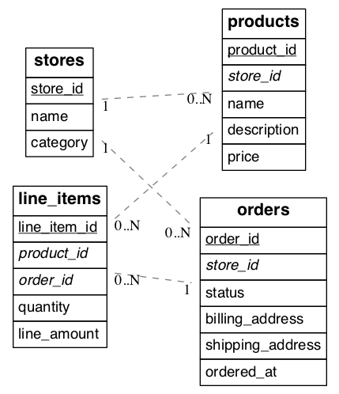

将多租户应用迁移到 Citus 的第一步，是确定合适的分布键，并据此规划表的分布方式。

## 选择分布键 {#pick-a-distribution-key}

在多租户应用中，分布键通常是租户的内部标识符，我们一般称之为*租户 ID*。具体使用场景可能不同，因此建议在这一步充分评估。

相关指导请参阅：

- [确定应用程序类型](/citus/modeling/app-type/)
- [选择分布列](/citus/modeling/data-modeling/)

我们很乐意帮助你评估环境，确保选择理想的分布键。通常会检查模式布局、大表、长时间运行或存在问题的查询、常见使用场景等。

## 确定表类型 {#identify-types-of-tables}

确定分布键后，检查数据库模式，明确每张表的处理方式，以及是否需要修改表结构。我们通常建议使用电子表格跟踪这项工作。

表通常可分为以下几类：

- **可直接分布**。这些表已经包含分布键，可以直接进行分布。
- **需要回填**。这些表在逻辑上按所选键分布，但没有直接引用该键的列。下一节会修改这些表，添加所需的列。
- **参考表**。这些表通常较小，且不包含分布键。它们经常与分布式表连接，或由多个租户共享。所有节点上都会维护每张参考表的一个副本。常见示例包括国家或地区代码查询表、产品类别表等。
- **本地表**。这些表通常不与其他表连接，也不包含分布键，仅保存在协调节点上。常见示例包括管理员用户查询表和其他辅助表。

以一个类似 Etsy 或 Shopify 的多租户应用为例，每个租户是一家商店。下图展示了这个示例应用的部分简化模式。带下划线的项目是主键，斜体项目是外键。



在这个例子中，商店天然就是租户，租户 ID 就是 store_id。将表分布到集群后，我们希望同一家商店的相关行存放在同一节点上。

## 准备用于迁移的源表 {#prepare-source-tables-for-migration}

确定数据库需要修改的范围后，下一个主要步骤是修改应用现有数据库的数据结构。首先，为需要回填的表添加分布键列。

### 添加分布键 {#add-distribution-keys}

在商店示例中，stores 和 products 表已包含 store_id，可以直接分布。由于采用了规范化设计，line_items 表缺少商店 ID。如果要按 store_id 分布，就必须为该表添加这一列。

```sql
-- denormalize line_items by including store_id

ALTER TABLE line_items ADD COLUMN store_id uuid;
```

务必检查所有表中分布列的类型是否相同，例如不能混用 `int` 和 `bigint`。只有列类型匹配，才能正确实现数据共置。

### 回填新创建的列 {#backfill-newly-created-columns}

更新模式后，需要为新添 tenant_id 列的表回填缺失值。在这个例子中，line_items 需要填入 store_id 的值。

通过与 orders 表执行连接查询，取得缺失值并回填：

```sql
UPDATE line_items
   SET store_id = orders.store_id
  FROM line_items
 INNER JOIN orders
 WHERE line_items.order_id = orders.order_id;
```

一次性回填整张表可能给数据库带来过大负载，影响其他查询。可以放慢回填速度：例如创建一个每次只回填一小批数据的函数，再用 [pg_cron](https://github.com/citusdata/pg_cron) 反复调用。

```sql
-- the function to backfill up to ten
-- thousand rows from line_items

CREATE FUNCTION backfill_batch()
RETURNS void LANGUAGE sql AS $$
  WITH batch AS (
    SELECT line_items_id, order_id
      FROM line_items
     WHERE store_id IS NULL
     LIMIT 10000
       FOR UPDATE
      SKIP LOCKED
  )
  UPDATE line_items AS li
     SET store_id = orders.store_id
    FROM batch, orders
   WHERE batch.line_item_id = li.line_item_id
     AND batch.order_id = orders.order_id;
$$;

-- run the function every quarter hour
SELECT cron.schedule('*/15 * * * *', 'SELECT backfill_batch()');

-- ^^ note the return value of cron.schedule
```

回填完成后，就可以禁用该 cron 作业：

```sql
-- assuming 42 is the job id returned
-- from cron.schedule

SELECT cron.unschedule(42);
```

## 相关内容 {#related-content}

- [多租户查询迁移](/citus/migration/migration-query/)
- [迁移概述](/citus/migration/migration/)
