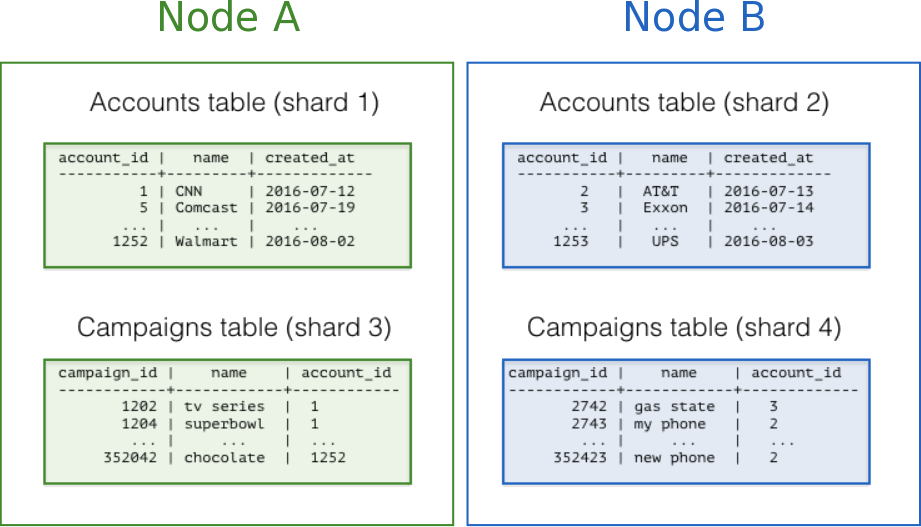
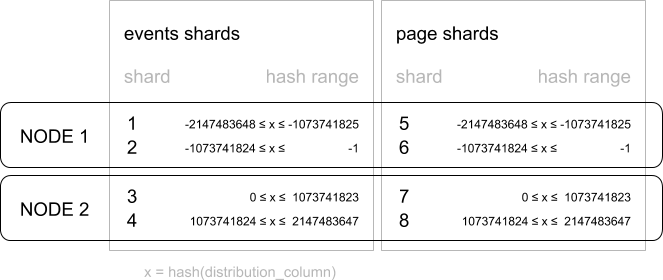
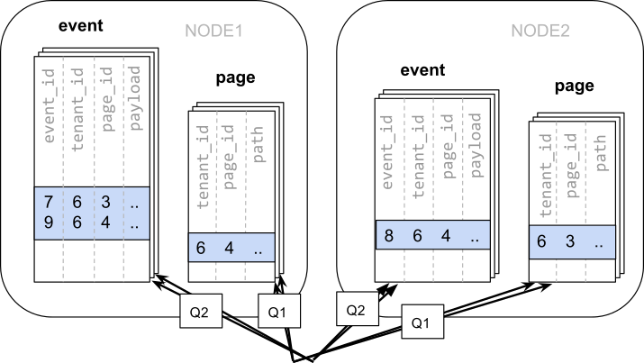
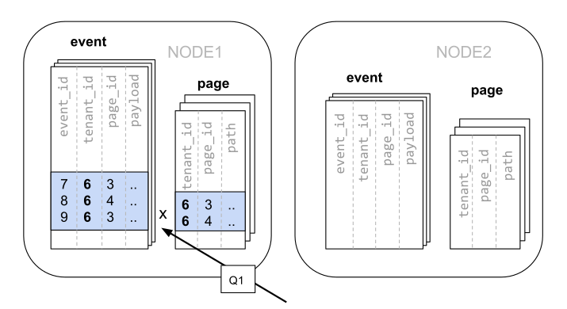

Citus 根据分布式表的分布列，将表中的行分配到各个分片。为每张表选择分布列，是**最重要的建模决策之一**，因为它决定了数据如何分散到各个节点。

选择合适的分布列后，相关数据可以在同一物理节点上完成连接。这既能加快查询，也能支持所有 SQL 功能。如果分布列选择不当，系统运行就会缓慢，并且无法跨节点支持所有 SQL 功能。

本节针对两种最常见的 Citus 使用场景，介绍选择分布列的建议，最后深入讨论“共置”：将相关数据合理地放在同一节点上。

## 多租户应用 {#multitenant-apps}

多租户架构采用分层数据库建模，将查询分配给分布式集群中的各个节点。数据层次的顶层是*租户 ID*，每张表都需要有一列保存它。Citus 会检查查询涉及哪个租户 ID，再将查询路由到保存该租户数据分片的单个工作节点上处理。将所有相关数据放在同一节点上执行查询，称为[共置](/citus/modeling/data-modeling/#table-colocation)。

下图展示了多租户数据模型中的共置。图中包含 Accounts 和 Campaigns 两张表，均按 `account_id` 分布。带颜色的方框表示分片，颜色表示分片所在的工作节点：绿色分片存放在一个工作节点上，蓝色分片存放在另一个工作节点上。注意，如果连接 Accounts 和 Campaigns 时，将两张表都限定为同一个 account_id，那么查询所需的全部数据就都在同一节点上。



要在自己的数据库模式中采用这种设计，首先要确定应用中的租户是什么。常见的租户包括公司、账户、组织或客户，列名通常类似于 `company_id` 或 `customer_id`。逐一检查查询：如果增加 WHERE 子句，将所有涉及的表都限制为具有相同租户 ID 的行，查询是否仍能满足需求？多租户模型中的查询范围限于单个租户，例如销售或库存查询只涉及某一家商店。

### 最佳实践 {#best-practices}

- **按共同的 tenant_id 列划分分布式表。** 例如，租户为公司的 SaaS 应用中，tenant_id 很可能就是 `company_id`。
- **将跨租户共享的小表转换为参考表。** 如果多个租户共享一张小型信息表，就将它作为参考表分布。
- **所有应用查询都应按 tenant_id 过滤。** 每次查询应只请求一个租户的信息。

构建这类应用的详细示例，请参阅[使用场景](/citus/overview/use-cases/)指南。

## 实时应用 {#real-time-apps}

多租户架构采用层次结构，并借助数据共置按租户路由查询；实时架构则依赖数据特定的分布特征，实现高度并行处理。

我们将实时模型中的分布列称为“实体 ID”，以区别于多租户模型中的租户 ID。典型的实体包括用户、主机和设备。

实时查询通常计算按日期或类别分组的数值聚合。Citus 将查询发送到各个分片以获取部分结果，再在协调节点上汇总出最终结果。参与处理的节点越多、各节点的工作量越均衡，查询就越快。

### 最佳实践 {#best-practices-1}

- **选择高基数列作为分布列。** 例如，订单表中的“status”字段如果只有“new”“paid”和“shipped”三个取值，就不适合作为分布列。不同值的数量决定了有多少分片可以承载数据，以及有多少节点可以参与处理。在高基数列中，应选择经常用于 group-by 子句或作为连接键的列。
- **选择值分布均匀的列。** 如果按某些值特别常见的列来分布表，数据就容易集中在少数分片上，使这些分片所在节点的工作量超过其他节点。
- **按共同的列分布事实表和维度表。** 事实表只能有一个分布键。通过其他键与事实表连接的表，不会与事实表共置。应根据连接频率和参与连接的行大小，选择一个维度进行共置。
- **将部分维度表转换为参考表。** 如果某张维度表无法与事实表共置，可以将它作为参考表，将副本分布到各个节点，以提高查询性能。

构建这类应用的详细示例，请参阅[使用场景](/citus/overview/use-cases/)指南。

## 时序数据 {#time-series-data}

在时序工作负载中，应用查询近期信息，并将旧信息归档。

在 Citus 中对时序数据建模时，最常见的错误是直接用时间戳作为分布列。按时间进行哈希分布，会将不同时间的数据看似随机地分散到各个分片，而不会把同一时间范围的数据放在一起。然而，时间查询通常涉及一段时间范围，例如最新的数据，因此这种哈希分布会带来网络开销。

### 最佳实践 {#best-practices-2}

- **不要将时间戳作为分布列。** 应选择其他分布列：多租户应用使用租户 ID，实时应用使用实体 ID。
- **改用 PostgreSQL 表分区来按时间划分数据。** 利用表分区，将按时间排列的大表拆成多个继承表，每张表包含不同时间范围的数据。在 Citus 中分布 PostgreSQL 分区表，会为这些继承表创建分片。

构建这类应用的详细示例，请参阅[时序数据](/citus/tutorials/tutorial-time-series/)。

## 表共置 {#table-colocation}

关系数据库具有很高的灵活性和可靠性，是许多应用的首选数据存储。过去，人们对关系数据库的一项批评是它只能在单台机器上运行；当数据存储需求的增长超过服务器性能的提升时，这就形成了固有限制。分布式部署可以解决数据库快速扩展的问题，却也带来了新的性能问题：连接等关系运算需要跨越网络。共置是一种有策略的数据划分方式，将相关信息保存在同一台机器上，以高效执行关系运算，同时让整个数据集具备横向扩展能力。

数据共置的原则是：数据库中的所有表使用共同的分布列，并以相同方式跨机器分片。这样，即使行来自不同的表，只要分布列的值相同，就始终位于同一台机器上。只要分布列能对数据进行有意义的分组，就可以在各组内部执行关系运算。

### Citus 中哈希分布表的数据共置 {#data-colocation-in-citus-for-hash-distributed-tables}

Citus 作为 PostgreSQL 扩展，其独特之处在于能将多个数据库组成一个分布式数据库。Citus 集群中的每个节点都是功能完整的 PostgreSQL 数据库，而 Citus 在其上提供了使用单一、同构数据库的体验。虽然 Citus 无法以分布式方式提供 PostgreSQL 的全部功能，但在许多情况下，它可以通过共置充分利用 PostgreSQL 的单机功能，包括完整的 SQL 支持、事务和外键。

在 Citus 中，如果某行分布列值的哈希落入某个分片的哈希范围，该行就存储在该分片中。为保证共置，哈希范围相同的分片始终放在同一节点上，即使经过再均衡也不例外。因此，不同表中分布列值相同的行始终位于同一节点。



多租户应用的租户 ID 是实践中很有效的分布列。例如，SaaS 应用通常有许多租户，但每次查询都只针对一个租户。虽然可以为每个租户提供独立的数据库或模式，但这通常成本高昂且不切实际。许多操作可能需要跨用户执行，例如数据加载、迁移、聚合、分析、模式变更和备份；随着租户增多，这些操作会越来越难以管理。

### 共置的实际示例 {#a-practical-example-of-colocation}

考虑以下两张表，它们可能来自一个提供 Web 分析服务的多租户 SaaS 应用：

```sql
CREATE TABLE event (
  tenant_id int,
  event_id bigint,
  page_id int,
  payload jsonb,
  primary key (tenant_id, event_id)
);

CREATE TABLE page (
  tenant_id int,
  page_id int,
  path text,
  primary key (tenant_id, page_id)
);
```

现在，你需要处理面向客户的仪表板所发起的查询，例如：“返回租户 6 中所有路径以 '/blog' 开头的页面在过去一周的访问次数。”

### 使用普通 PostgreSQL 表 {#use-regular-postgresql-tables}

如果数据位于单个 PostgreSQL 节点上，就可以利用 SQL 丰富的关系运算轻松表达该查询：

```sql
SELECT page_id, count(event_id)
FROM
  page
LEFT JOIN  (
  SELECT * FROM event
  WHERE (payload->>'time')::timestamptz >= now() - interval '1 week'
) recent
USING (tenant_id, page_id)
WHERE tenant_id = 6 AND path LIKE '/blog%'
GROUP BY page_id;
```

只要该查询的[工作集](https://en.wikipedia.org/wiki/Working_set)能放入内存，这种方案就适用于许多应用，因为它提供了最大的灵活性。不过，即使暂时还不需要扩展，也值得考虑横向扩展对数据模型的影响。

### 按 ID 分布表 {#distribute-tables-by-id}

随着租户数量和每个租户的数据量增长，工作集可能无法再放入内存，或者 CPU 成为瓶颈，查询耗时通常也会增加。此时可以使用 Citus 将数据分片到多个节点。分片时，首要且最重要的决策是选择分布列。先从一个简单直接的选择开始：事件表使用 `event_id`，`page` 表使用 `page_id`：

```sql
-- naively use event_id and page_id as distribution columns

SELECT create_distributed_table('event', 'event_id');
SELECT create_distributed_table('page', 'page_id');
```

由于数据分散在不同的工作节点上，无法像在单个 PostgreSQL 节点上那样执行连接，而需要发出两个查询：

查询 page 表的所有分片（Q1）：

```sql
SELECT page_id FROM page WHERE path LIKE '/blog%' AND tenant_id = 6;
```

查询 event 表的所有分片（Q2）：

```sql
SELECT page_id, count(*) AS count
FROM event
WHERE page_id IN (/*...page IDs from first query...*/)
  AND tenant_id = 6
  AND (payload->>'time')::date >= now() - interval '1 week'
GROUP BY page_id ORDER BY count DESC LIMIT 10;
```

随后，应用需要合并这两个步骤的结果。

查询所需的数据分散在不同节点的分片上，因此必须查询每一个相关分片：



这种数据分布方式存在明显缺点：

- 查询每个分片以及执行多个查询带来的开销
- Q1 向客户端返回大量行带来的开销
- Q2 查询变得庞大
- 必须将查询拆成多个步骤并合并结果，因此需要修改应用

相关数据分散存储的潜在好处是，Citus 可以并行执行查询。但只有在查询本身的工作量远大于访问多个分片的开销时，才能获得这一收益。最好避免直接在应用中执行这类繁重操作，例如可以预先聚合数据。

### 按租户分布表 {#distribute-tables-by-tenant}

重新观察查询，可以发现它需要的所有行都有一个共同维度：`tenant_id`。仪表板只查询某个租户自己的数据。将该租户的数据始终共置于单个 PostgreSQL 节点后，这个节点就能通过在 `tenant_id` 和 `page_id` 上执行连接，一步完成原始查询。

Citus 保证分布列值相同的行位于同一节点。对于分布式表中的每个分片，其他分布式表中实际上都有一组与之共置的分片，它们包含相同的分布列值，即同一租户的数据。重新开始，这次使用 `tenant_id` 作为分布列创建表。

```sql
-- co-locate tables by using a common distribution column
SELECT create_distributed_table('event', 'tenant_id');
SELECT create_distributed_table('page', 'tenant_id', colocate_with => 'event');
```

此时，Citus 可以直接执行与单个 PostgreSQL 节点上相同的查询，无需修改（Q1）：

```sql
SELECT page_id, count(event_id)
FROM
  page
LEFT JOIN  (
  SELECT * FROM event
  WHERE (payload->>'time')::timestamptz >= now() - interval '1 week'
) recent
USING (tenant_id, page_id)
WHERE tenant_id = 6 AND path LIKE '/blog%'
GROUP BY page_id;
```

由于查询按租户 ID 过滤，并在租户 ID 上连接，Citus 知道只需使用包含该租户数据的一组共置分片即可完成查询。PostgreSQL 节点可以一步完成整个查询，从而提供完整的 SQL 支持。



在某些情况下，需要对查询和表模式做少量修改，确保唯一约束和连接条件始终包含 tenant_id。不过，这种修改很直接，可以避免不采用共置时所需的大规模重写。

上例由于使用 tenant_id = 6 这一过滤条件，只查询了一个节点。即使仍有 SQL 限制，共置也能让我们在所有节点之间高效执行基于 tenant_id 的分布式连接。

### 共置带来更完整的功能支持 {#colocation-means-better-feature-support}

共置所支持的 Citus 功能完整列表如下：

- 对单组共置分片的查询提供完整的 SQL 支持
- 对单组共置分片的修改支持多语句事务
- 通过 `INSERT..SELECT` 进行聚合
- 外键
- 分布式外连接
- 下推 CTE（要求 PostgreSQL >=12）

数据共置是一种兼顾横向扩展与关系数据模型支持的强大技术。使用通过共置支持关系运算的分布式数据库来迁移或构建应用，其成本通常远低于改用限制较多的数据模型，例如 NoSQL。与单节点数据库不同，它可以随业务规模横向扩展。有关迁移现有数据库的更多信息，请参阅[将现有应用迁移到 Citus](/citus/migration/migration/)。

### 查询性能 {#query-performance}

Citus 将传入查询拆分成多个片段查询（“任务”），在工作节点的分片上并行执行。这样，每个查询都能利用集群中所有节点以及各节点上各个 CPU 核心的处理能力。并行执行使查询能够发挥整个集群所有核心的综合算力，与 PostgreSQL 相比，大幅缩短查询时间。

Citus 使用两阶段优化器规划 SQL 查询。第一阶段将 SQL 查询转换为可交换、可结合的形式，以便下推到工作节点并行执行。如前几节所述，选择合适的分布列和分布方法，能让分布式查询规划器应用多种优化，通过减少网络 I/O 来影响查询性能。

Citus 的分布式执行器将查询片段发送给工作节点上的 PostgreSQL 实例。分布式规划器和执行器都有多个方面可以调优，以提高性能。查询片段发送到工作节点后，就进入查询优化的第二阶段。工作节点运行的是扩展后的 PostgreSQL 服务器，使用 PostgreSQL 的标准规划与执行逻辑来处理这些 SQL 查询片段。因此，对 PostgreSQL 有效的优化对 Citus 同样有效。PostgreSQL 默认的资源配置比较保守，调整这些配置可以显著缩短查询时间。

[性能调优](/citus/operations/performance-tuning/)介绍了相关的调优步骤。

## 相关内容 {#related-content}

- [确定应用程序类型](/citus/modeling/app-type/)
- [什么是 Citus？](/citus/overview/what-is-citus/)
- [多租户应用教程](/citus/tutorials/tutorial-multi-tenant/)
