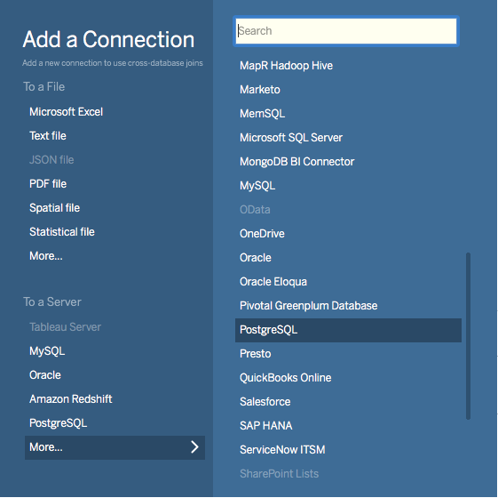
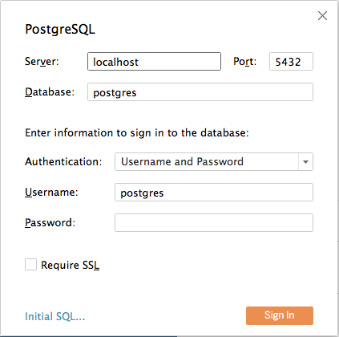
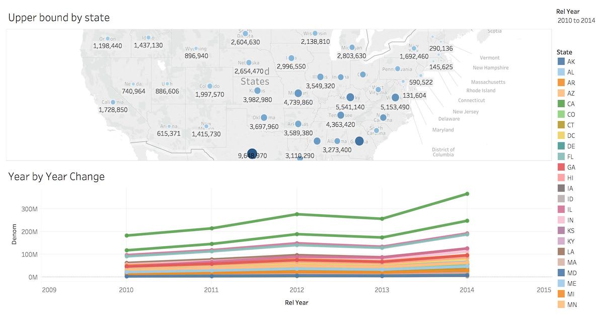

## 变更数据捕获（CDC） {#change-data-capture-cdc}

> [!NOTE]
> 分布式表的逻辑解码自 Citus v11.3 起属于预览功能。

### 与单节点 PostgreSQL 的差异 {#differences-from-single-node-postgresql}

PostgreSQL 提供[逻辑解码](https://www.postgresql.org/docs/current/logicaldecoding.html)，将其预写式日志（WAL）中的相关事件导出到其他程序或数据库。WAL 记录 PostgreSQL 实例上所有已提交的数据事务，是所有数据变更的权威记录。应用可以订阅逻辑复制槽，实时接收变更通知。

从 Citus 集群而不是单节点 PostgreSQL 中消费变更事件，会带来两组挑战：

1. **客户端订阅的复杂性。** 必须在所有节点上分别创建逻辑解码发布，感兴趣的应用也必须订阅所有这些发布。此外，每个发布中的事件都保证按其所在节点上的发生顺序发出；但对于来自多个节点的事件，则不保证这一顺序。
2. **分片的复杂性。**（启用全局用户配置参数（GUC）`enable_change_data_capture` 后，Citus v11.3 及更高版本会自动处理这部分。）Citus 节点将分片存储为物理表。例如，名为 `foo` 的分布式表会分布在多个表中，表名类似 `foo_102027`、`foo_102028` 等。CDC 需要将底层分片名称还原为分布式表的概念名称。此外，在工作节点之间移动分片等管理操作会产生 WAL 事件，但这些无关事件应从 CDC 中隐藏。

启用 `enable_change_data_capture` GUC 后，Citus 会自动规范化分片名称，并抑制分片创建和移动产生的事件。客户端仍需负责处理订阅方面的问题。

### 将分布式表逻辑复制到 PostgreSQL 表 {#logical-replication-of-distributed-tables-to-postgresql-tables}

带逻辑解码的 PostgreSQL CDC 是[逻辑复制](https://www.postgresql.org/docs/current/logical-replication.html)的基础，可将一台 PostgreSQL 服务器上的表变更复制到另一台服务器。下面以订阅 Citus 集群中分布式表的变更，并将其写入单节点 PostgreSQL 服务器上的普通表为例。

首先，在所有 Citus 节点上启用逻辑解码，并在每个节点的 postgresql.conf 文件中配置 WAL 和复制槽：

```ini
# add to postgresql.conf on all nodes

# include enough information in WAL for logical decoding

wal_level = logical

# we need at least one replication slot, but leave headroom

max_replication_slots = 10

# enable Citus' logical decoding improvements for dist tables

citus.enable_change_data_capture = 'on'
```

修改配置文件后，重启每个 Citus 节点上的 PostgreSQL 服务器。

在协调节点上创建一个示例分布式表和一个用于发布表变更的发布：

```sql
-- example distributed table

CREATE TABLE items (
  key TEXT PRIMARY KEY,
  value TEXT
);

SELECT create_distributed_table('items', 'key');

-- citus will propagate to workers, creating publications there too

CREATE PUBLICATION items_pub FOR TABLE items;

-- fill with sample data

INSERT INTO items SELECT generate_series(1,10), 'a value';
```

> [!NOTE]
> **注意：不要**为所有表创建发布。
> 
> ```sql
> -- don't do this!
> CREATE PUBLICATION FOR ALL TABLES;
> ```
> 
> 为所有表创建发布会包含 Citus 自己的 [元数据表](/citus/reference/api-metadata/)，可能导致问题。

检查工作节点上为协调节点设置的主机名是否正确，必要时使用 `set_coordinator_host` 进行调整。然后在协调节点上运行以下代码，在所有节点上创建逻辑复制槽：

```sql
-- create replication slots on all nodes, and choose the pgoutput format

SELECT * FROM run_command_on_all_nodes($$
  SELECT pg_create_logical_replication_slot('cdc_slot', 'pgoutput', false)
$$);
```

最后，在单节点 PostgreSQL 服务器上创建 `items` 表，并设置订阅，从所有 Citus 节点读取行。

```sql
-- on the standalone PostgreSQL server

-- match the table structure we have on Citus

CREATE TABLE items (
  key TEXT PRIMARY KEY,
  value TEXT
);

-- subscribe to coordinator

CREATE SUBSCRIPTION subc
  CONNECTION 'dbname=<dbname> host=<coordinator host> user=<username> port=<coordinator port>'
  PUBLICATION items_pub
  WITH (copy_data=true,create_slot=false,slot_name='cdc_slot');

-- subscribe to each worker (assuming there are two workers)

CREATE SUBSCRIPTION subw0
  CONNECTION 'dbname=<dbname> host=<worker1 host> user=<user> port=<worker1 port>'
  PUBLICATION items_pub
  WITH (copy_data=false,create_slot=false,slot_name='cdc_slot');

CREATE SUBSCRIPTION subw1
  CONNECTION 'dbname=<dbname> host=<worker2 host> user=<user> port=<worker2 port>'
  PUBLICATION items_pub
  WITH (copy_data=false,create_slot=false,slot_name='cdc_slot');
```

> [!NOTE]
> 订阅协调节点时，应将 `copy_data` 参数设为 true，以便将现有数据复制到 CDC 客户端。订阅工作节点时则应将 `copy_data` 设为 false，否则会向 CDC 客户端写入重复数据并导致复制错误。

### 逻辑解码的注意事项 {#logical-decoding-caveats}

- **目前只支持 pgoutput 和 wal2json 格式。** 如果已安装，可以使用这两种解码器。其他解码器不会对分布式表名称进行规范化。
- **必须在每个节点上单独创建复制槽。** 虽然初次创建可以通过 [run_command_on_all_nodes](/citus/reference/reference-propagation/#running-on-all-workers) 轻松完成，但添加新节点时仍需额外处理。在重新均衡分片前，必须创建复制槽（或订阅）。
- **跨节点变更到达时可能乱序。** 同一节点上的变更始终按相同顺序到达；但由于客户端分别监听每个节点，无法保证不同节点上发生的变更顺序。
- **修改分布式表有限制。** 使用 `alter_distributed_table` 会中断复制流。
- **不支持列存表。** 逻辑解码不能用于 `columnar`。
- **必须有消费者。** 无论是否使用 Citus，执行逻辑解码时都应确保订阅者正在消费发布，否则 WAL 数据会持续累积，给发布数据库带来问题。

## 从 Kafka 摄入数据 {#ingesting-data-from-kafka}

Citus 可以使用现有的 PostgreSQL 数据摄入工具。例如，可以使用 [kafka-sink-pg-json](https://github.com/justonedb/kafka-sink-pg-json) 将 Kafka 主题中的 JSON 消息复制到数据库表。下面创建一个 `kafka_test` 表，并通过 JSON 键到表列的自定义映射，从 `test` 主题摄入数据。

使用 Kafka 进行试验最简单的方法是使用 [Confluent Platform](https://www.confluent.io/product/confluent-platform/)，它包含 Kafka、Zookeeper 以及版本经过验证、可以协同工作的相关工具。

```bash
# we're using Confluent 2.0 for kafka-sink-pg-json support
curl -L http://packages.confluent.io/archive/2.0/confluent-2.0.0-2.11.7.tar.gz \
  | tar zx

# Now get the jar and conf files for kafka-sink-pg-json
mkdir sink
curl -L https://github.com/justonedb/kafka-sink-pg-json/releases/download/v1.0.2/justone-jafka-sink-pg-json-1.0.zip -o sink.zip
unzip -d sink $_ && rm $_
```

kafka-sink-pg-json 的下载内容包含一些配置文件。我们要连接到 Citus 的协调节点，因此需要编辑配置文件 `sink/justone-kafka-sink-pg-json-connector.properties`：

```sh
# add to sink/justone-kafka-sink-pg-json-connector.properties

# the kafka topic we will use
topics=test

# db connection info
# use your own settings here
db.host=localhost:5432
db.database=postgres
db.username=postgres
db.password=bar

# the schema and table we will use
db.schema=public
db.table=kafka_test

# the JSON keys, and columns to store them
db.json.parse=/@a,/@b
db.columns=a,b
```

注意 `db.columns` 和 `db.json.parse`。两个列表中的元素彼此对应，其中 `db.json.parse` 中的项目指定了从传入 JSON 对象中查找值的位置。

> [!NOTE]
> `db.json.parse` 中的路径使用一种允许灵活提取 JSON 值的语言。给定以下 JSON：
> 
> ```json
> {
> "identity":71293145,
> "location": {
> "latitude":51.5009449,
> "longitude":-2.4773414
> },
> "acceleration":[0.01,0.0,0.0]
> }
> ```
> 
> 以下是一些示例路径及其匹配的值：
> 
> - `/@identity` - 元素 71293145 的路径。
> - `/@location/@longitude` - 元素 -2.4773414 的路径。
> - `/@acceleration/#0` - 元素 0.01 的路径。
> - `/@location` - 元素 `{"latitude":51.5009449, "longitude":-2.4773414}` 的路径。

我们的场景很简单：事件是类似 `{"a":1, "b":2}` 的对象，解析器会将这些值提取到同名列中。

配置文件准备好后，就可以准备数据库了。使用 psql 连接到协调节点并运行：

```psql
-- create metadata tables for kafka-sink-pg-json
\i sink/install-justone-kafka-sink-pg-1.0.sql

-- create and distribute target ingestion table
create table kafka_test ( a int, b int );
select create_distributed_table('kafka_test', 'a');
```

启动 Kafka：

```bash
# save some typing
export C=confluent-2.0.0

# start zookeeper
$C/bin/zookeeper-server-start \
  $C/etc/kafka/zookeeper.properties

# start kafka server
$C/bin/kafka-server-start \
  $C/etc/kafka/server.properties

# create the topic we'll be reading/writing
$C/bin/kafka-topics --create --zookeeper localhost:2181   \
                    --replication-factor 1 --partitions 1 \
                    --topic test
```

运行摄入程序：

```bash
# the jar files for this are in "sink"
export CLASSPATH=$PWD/sink/*

# Watch for new events in topic and insert them
$C/bin/connect-standalone \
  sink/justone-kafka-sink-pg-json-standalone.properties \
  sink/justone-kafka-sink-pg-json-connector.properties
```

此时，Kafka-Connect 会监视 `test` 主题，解析其中的事件并将其插入 `kafka_test`。让我们从命令行发送一个事件。

```bash
echo '{"a":42,"b":12}' | \
  $C/bin/kafka-console-producer --broker-list localhost:9092 --topic test
```

稍等片刻，新行就会出现在数据库中。

`select * from kafka_test;`

```text
┌────┬────┐
│ a  │  b │
├────┼────┤
│ 42 │ 12 │
└────┴────┘
```

### 注意事项 {#caveats}

- 在本文撰写时，kafka-sink-pg-json 要求 Kafka 0.9 或更早版本。
- kafka-sink-pg-json 连接器配置文件不提供 SSL 连接方式，因此无法用于要求安全连接的 `cloud_topic`。
- Kafka 主题中的格式错误的 JSON 字符串会使工具卡住。要继续处理更多事件，必须手动处理该主题。

## 从 Spark 摄入数据 {#ingesting-data-from-spark}

人们有时会使用 Spark 转换 Kafka 数据，例如添加计算值。本节介绍如何将 Spark 数据帧摄入 Citus 分布式表。

首先启动本地 Spark 集群。它包含多个组件，因此最简单的方法是使用 docker-compose 运行这些组件。

```bash
wget https://raw.githubusercontent.com/gettyimages/docker-spark/master/docker-compose.yml

# this may require "sudo" depending on the docker daemon configuration
docker-compose up
```

要将数据摄入 PostgreSQL，我们会编写自定义 Scala 代码，然后使用 Scala 构建工具（SBT）加载依赖项并运行代码。请[下载 SBT](https://www.scala-sbt.org/download/)并安装到你的机器上。

接下来为项目创建一个新目录。

```bash
mkdir sparkcitus
```

创建 `sparkcitus/build.sbt` 文件，声明 SBT 项目配置，并加入以下代码：

```scala
// add this to build.sbt

name := "sparkcitus"
version := "1.0"

scalaVersion := "2.10.4"

resolvers ++= Seq(
  "Maven Central" at "http://central.maven.org/maven2/"
)

libraryDependencies ++= Seq(
  "org.apache.spark" %% "spark-core" % "2.2.1",
  "org.apache.spark" %% "spark-sql"  % "2.2.1",
  "org.postgresql"   %  "postgresql" % "42.2.2"
)
```

接下来创建一个通过 Java 数据库连接（JDBC）执行摄入的 Scala 辅助类，将以下内容加入 `sparkcitus/copy.scala`：

```scala
import java.io.InputStream
import java.sql.DriverManager
import java.util.Properties

import org.apache.spark.sql.{DataFrame, Row}
import org.postgresql.copy.CopyManager
import org.postgresql.core.BaseConnection

object CopyHelper {

  def rowsToInputStream(rows: Iterator[Row]): InputStream = {
    val bytes: Iterator[Byte] = rows.map { row =>
      (row.toSeq
        .map { v =>
          if (v == null) {
            """\N"""
          } else {
            "\"" + v.toString.replaceAll("\"", "\"\"") + "\""
          }
        }
        .mkString("\t") + "\n").getBytes
    }.flatten

    new InputStream {
      override def read(): Int =
        if (bytes.hasNext) {
          bytes.next & 0xff // make the signed byte an unsigned int
        } else {
          -1
        }
    }
  }

  def copyIn(url: String, df: DataFrame, table: String):Unit = {
    var cols = df.columns.mkString(",")

    df.foreachPartition { rows =>
      val conn = DriverManager.getConnection(url)
      try {
        val cm = new CopyManager(conn.asInstanceOf[BaseConnection])
        cm.copyIn(
          s"COPY $table ($cols) " + """FROM STDIN WITH (NULL '\N', FORMAT CSV, DELIMITER E'\t')""",
          rowsToInputStream(rows))
        ()
      } finally {
        conn.close()
      }
    }
  }
}
```

继续完成设置，将一些示例数据保存到 `people.json`。注意，这里有意省略了外层方括号；稍后我们会根据这些数据创建 Spark 数据帧。

```js
{"name":"Tanya Rosenau"   , "age": 24},
{"name":"Rocky Slay"      , "age": 85},
{"name":"Tama Erdmann"    , "age": 48},
{"name":"Jared Olivero"   , "age": 42},
{"name":"Gudrun Shannon"  , "age": 53},
{"name":"Quentin Yoon"    , "age": 32},
{"name":"Yanira Huckstep" , "age": 53},
{"name":"Brendon Wesley"  , "age": 19},
{"name":"Minda Nordeen"   , "age": 79},
{"name":"Katina Woodell"  , "age": 83},
{"name":"Nevada Mckinnon" , "age": 65},
{"name":"Georgine Mcbee"  , "age": 56},
{"name":"Mittie Vanetten" , "age": 17},
{"name":"Lecia Boyett"    , "age": 37},
{"name":"Tobias Mickel"   , "age": 69},
{"name":"Jina Mccook"     , "age": 82},
{"name":"Cassidy Turrell" , "age": 37},
{"name":"Cherly Skalski"  , "age": 29},
{"name":"Reita Bey"       , "age": 69},
{"name":"Keely Symes"     , "age": 34}
```

最后，在 Citus 中创建并分布一个表：

```sql
create table spark_test ( name text, age integer );
select create_distributed_table('spark_test', 'name');
```

现在可以把所有组件连接起来了。启动 `sbt`：

```bash
# run this in the sparkcitus directory

sbt
```

进入 sbt 后，编译项目，然后进入 *console*；这是一个会加载代码和依赖项的 Scala REPL：

```text
sbt:sparkcitus> compile
[success] Total time: 3 s

sbt:sparkcitus> console
[info] Starting scala interpreter...

scala>
```

在控制台中输入以下 Scala 命令：

```scala
// inside the sbt scala interpreter

import org.apache.spark.sql.SparkSession

// open a session to the Spark cluster
val spark = SparkSession.builder().appName("sparkcitus").config("spark.master", "local").getOrCreate()

// load our sample data into Spark
val df = spark.read.json("people.json")

// this is a simple connection url (it assumes Citus
// is running on localhost:5432), but more complicated
// JDBC urls differ subtly from PostgreSQL urls, see:
// https://jdbc.postgresql.org/documentation/head/connect.html
val url = "jdbc:postgresql://localhost/postgres"

// ingest the data frame using our CopyHelper class
CopyHelper.copyIn(url, df, "spark_test")
```

这段代码使用 CopyHelper 摄入数据。此时，数据已出现在分布式表中。

> [!NOTE]
> 这种摄入数据帧的方法很直接，但无法防范 Spark 错误。Spark 保证“至少一次”语义，也就是说，一次读取出错可能导致后续读取再次遇到已经读取过的数据。
> 
> 更复杂但更可靠的方法是使用自定义 Spark 分区器 [spark-citus](https://github.com/koeninger/spark-citus)，使分区与 Citus 分片完全对应。Spark 分区器允许直接在工作节点上运行事务，读取失败时可以回滚。更多信息请参阅该仓库中链接的演示文稿。

## 使用 Tableau 进行商业智能 {#business-intelligence-with-tableau}

[Tableau](https://www.tableau.com/) 是常用的数据库商业智能和分析工具。Citus 与 Tableau 可以顺畅地进行即席报告和分析。

现在可以按以下步骤使用 Tableau。

- 从**添加连接**菜单中选择 PostgreSQL。

  
- 输入 Citus 集群协调节点的连接详细信息。（如果连接到 `cloud_topic`，请务必选择**要求 SSL**。）

  
- 连接到 Tableau 后，可以看到数据库中的表。你可以从**表**窗格拖放表来定义数据源，也可以通过**新建自定义 SQL**运行自定义查询。
- 你可以拖放维度、度量和筛选器来创建自己的工作表。要使用 Tableau 创建交互式用户界面，可以让 Tableau 自动选择数据的日期范围，然后使用 Citus 在近实时条件下计算该范围的聚合。



## 相关内容 {#related-content}

- [什么是 Azure Cosmos DB for PostgreSQL？](/citus/overview/what-is-citus/)
- [设计多租户 SaaS 数据库](/citus/tutorials/tutorial-multi-tenant/)
