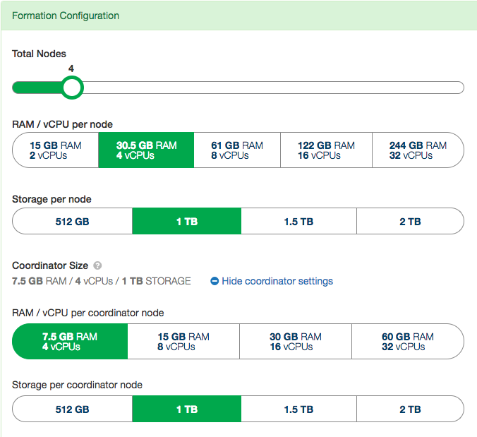

本文逐步介绍如何测试 Citus 的写入吞吐量。测试中使用 [Citus Cloud](/citus/installation/citus-cloud/) 创建测试集群，并使用标准基准测试工具 [pgbench](https://www.postgresql.org/docs/current/static/pgbench.html)。

> [!NOTE]
> Amazon Web Services（AWS）上的 Citus Cloud 已不再接受新用户。Citus 仍以开源形式提供，也可在 Microsoft Azure 云上以完全集成的方式部署。
> 
> 请参阅 [托管服务](/citus/installation/citus-cloud/)。

有关基于这些测试得出的吞吐量数据，请参阅[迁移生产数据](/citus/migration/migration-data/)。

## 创建 Citus 集群 {#create-citus-cluster}

启动 Citus 集群最简单的方法是访问 Citus Cloud 控制台。控制台支持选择不同的协调节点和工作节点配置，按小时计费。选择所需的集群配置后，点击 **Create New Formation** 按钮。



弹出窗口会询问集群所在的 AWS 区域（美国东部或美国西部）。请记住创建 Citus Cloud 集群时选择的区域，下一步会用到。

Citus Cloud 会根据硬件配置自动调优集群。如果在自己的集群上执行以下步骤，请确保在协调节点和工作节点上将配置调高至 `max_connections = 300`。

## 创建实例以运行 pgbench {#create-an-instance-to-run-pgbench}

pgbench 是 PostgreSQL 提供的标准基准测试工具。它反复执行给定的 SQL 命令，并测量每秒完成的事务数。

pgbench 本身会消耗 CPU 资源，因此应将其部署在独立于 Citus 集群的机器上。pgbench 文档也指出，与被测数据库运行在同一台机器上可能使测试结果失真。

在这些测试中，创建单独的 EC2 实例来运行 pgbench，并将该实例放置在 Citus 集群所在的同一 AWS 区域中。 使用大型 EC2 (m4.16xlarge) 实例来确保 pgbench 本身不会成为性能瓶颈。

## 安装 pgbench {#install-pgbench}

创建新的 EC2 实例后，在实例上安装 pgbench。pgbench 10 可用于所有 Citus 版本，以下说明假定使用 pgbench 10。

- 对于基于 **Debian** 的系统：

  ```bash
  sudo sh -c 'echo "deb http://apt.postgresql.org/pub/repos/apt/ $(lsb_release -cs)-pgdg main" > /etc/apt/sources.list.d/pgdg.list'
  sudo apt-get install wget ca-certificates
  wget --quiet -O - https://www.postgresql.org/media/keys/ACCC4CF8.asc | sudo apt-key add -
  sudo apt-get update
  sudo apt-get install postgresql-10
  ```
- 对于基于 **RedHat** 的系统：

  请按照 [yum 安装指南](https://www.postgresql.org/download/linux/redhat/)操作。

## INSERT 吞吐量基准测试 {#benchmark-insert-throughput}

本节介绍如何测试 Citus 集群上的 INSERT 吞吐量：创建分布式表，为 pgbench 配置自定义 SQL 文件，然后并行执行 INSERT 操作，测量每秒完成的事务数。

### 初始化表并将其分布 {#initialize-and-distribute-tables}

首先，让 pgbench 创建测试表以初始化基准测试环境。然后连接 Citus 协调节点，将要执行 INSERT 基准测试的表转换为分布式表。

要初始化测试环境并将相关表分布，先从 Citus Cloud 控制台获取集群连接字符串，然后运行以下两条命令：

```bash
pgbench -i connection_string_to_coordinator

psql connection_string_to_coordinator -c "SELECT create_distributed_table('pgbench_history', 'aid');"
```

### 为 pgbench 创建 SQL 文件 {#create-sql-file-for-pgbench}

pgbench 会反复执行给定的 SQL 命令并报告结果。本次基准测试使用 pgbench 自带的 INSERT 命令。

创建名为 `insert.sql` 的文件，将以下 SQL 命令粘贴到文件中：

```psql
\set nbranches :scale
\set ntellers 10 * :scale
\set naccounts 100000 * :scale
\set aid random(1, :naccounts)
\set bid random(1, :nbranches)
\set tid random(1, :ntellers)
\set delta random(-5000, 5000)
INSERT INTO pgbench_history (tid, bid, aid, delta, mtime) VALUES (:tid, :bid, :aid, :delta, CURRENT_TIMESTAMP);
```

## 执行 INSERT 基准测试 {#benchmark-insert-commands}

默认情况下，pgbench 只建立一个数据库连接，通过该连接发送 INSERT 命令。要测试写入吞吐量，需要建立多个并行连接并并发执行命令。使用 pgbench 的 `-j` 参数指定并发线程数，`-c` 参数指定并发连接数，`-T` 参数将测试持续时间设为 30 秒。

若要使用这些参数运行 pgbench，请键入：

```bash
pgbench connection_string_to_coordinator -j 64 -c 256 -f insert.sql -T 30
```

这些参数会建立 256 个到 Citus 的并发连接。如果在自己的实例上运行 Citus，需要调高默认的 `max_connections` 设置。

## UPDATE 吞吐量基准测试 {#benchmark-update-throughput}

本节介绍如何测试 Citus 集群上的 UPDATE 吞吐量：创建分布式表，为 pgbench 配置自定义 SQL 文件，然后并行执行 UPDATE 操作，测量每秒完成的事务数。

### 初始化表并将其分布 {#initialize-and-distribute-tables-1}

首先，让 pgbench 创建测试表以初始化基准测试环境。然后连接 Citus 协调节点，将要执行 UPDATE 基准测试的表转换为分布式表。

要初始化测试环境并将相关表分布，先从 Citus Cloud 控制台获取集群连接字符串，然后运行以下两条命令：

```bash
pgbench -i connection_string_to_coordinator

# INSERT and UPDATE tests run on different distributed tables
psql connection_string_to_coordinator -c "SELECT create_distributed_table('pgbench_accounts', 'aid');"
```

### 为 pgbench 创建 SQL 文件 {#create-sql-file-for-pgbench-1}

pgbench 会反复执行给定的 SQL 命令并报告结果。本次基准测试使用 pgbench 自带的一条 UPDATE 命令。

创建名为 `update.sql` 的文件，将以下 SQL 命令粘贴到文件中：

```psql
\set naccounts 100000 * :scale
\set aid random(1, :naccounts)
\set delta random(-5000, 5000)
UPDATE pgbench_accounts SET abalance = abalance + :delta WHERE aid = :aid;
```

## 执行 UPDATE 基准测试 {#benchmark-update-commands}

默认情况下，pgbench 只建立一个数据库连接，通过该连接发送 UPDATE 命令。要测试写入吞吐量，需要建立多个并行连接并并发执行命令。使用 pgbench 的 `-j` 参数指定并发线程数，`-c` 参数指定并发连接数，`-T` 参数将测试持续时间设为 30 秒。

若要使用这些参数运行 pgbench，请键入以下命令：

```bash
pgbench connection_string_to_coordinator -j 64 -c 256 -f update.sql -T 30
```

这些参数会建立 256 个到 Citus 的并发连接。如果在自己的实例上运行 Citus，需要调高默认的 `max_connections` 设置。

## 相关内容 {#related-content}

- [性能优化](/citus/operations/performance-tuning/)
- [什么是 Citus？](/citus/overview/what-is-citus/)
