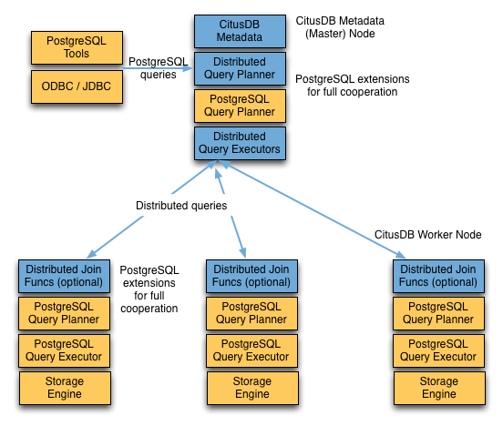

Citus 集群由一个协调节点实例和多个工作节点实例组成。数据分片存储在工作节点上，协调节点则保存这些分片的元数据。客户端可以连接协调节点，也可以在 MX 模式下连接任意工作节点，并向其提交查询。接收查询的节点将查询拆分为较小的片段，每个片段都能在一个分片上独立运行。该节点将查询片段分配给持有相应分片的工作节点，监督执行、合并结果，并将最终结果返回客户端。下图简要展示了查询处理架构。



Citus 的查询处理流水线包括两个组件：

- **分布式查询规划器与执行器**
- **PostgreSQL 规划器与执行器**

以下各节详细介绍这两个组件。

## 查询入口与 MX 模式 {#query-entry-points-and-mx-mode}

在早期版本的 Citus 中，协调节点是客户端查询的唯一入口。从 Citus 11 开始，客户端也可以直接连接任意工作节点并提交查询。这项能力称为 *MX 模式*（多租户或大规模并行扩展），在托管 Citus 集群中默认启用。

MX 模式解决了两个扩展性问题：

- **协调节点热点。** 当所有客户端都连接同一个节点时，该节点的连接槽位、CPU 和网络会成为瓶颈。允许工作节点接受客户端连接，可以将这些负载分散到整个集群。
- **分片本地查询的延迟。** 当客户端连接的工作节点恰好存有相关分片时，Citus 可以直接针对本地分片表规划和执行查询，无需额外的网络跳转。

MX 模式要求每个节点都持有最新的集群元数据副本，即分布式表和分片放置的目录。Citus 自动将这些元数据同步到所有节点；同步方式由 `citus.metadata_sync_mode` 设置控制。

工作节点接收到查询后，承担的角色与传统拓扑中的协调节点相同：

- 如果查询涉及其他工作节点上的分片，接收节点会连接这些工作节点、分发查询片段，并合并结果后返回客户端。
- 如果目标分片位于接收节点本地，该节点通过 `citus.local_hostname` 连接自身并在本地执行片段。[延迟快速路径规划（Citus 13.2）](#delayed-fast-path-planning-citus-132)在此基础上复用缓存的计划，跳过分片查询的反解析、解析和规划步骤。

对分布式表和参考表的写入遵循相同路径：无论接收节点是协调节点还是工作节点，都使用标准的分布式事务协议。

## 分布式查询规划器 {#distributed-query-planner}

Citus 的分布式查询规划器接收 SQL 查询，并为其生成分布式执行计划。规划器运行在接收查询的节点上：传统拓扑中是协调节点，MX 模式下则可以是任意工作节点。

对于 `SELECT` 查询，规划器先生成输入查询的计划树，再利用交换律和结合律将其转换为可并行执行的形式。规划器还会应用多种优化，以保证查询的可扩展性，并尽量减少网络 I/O。

接着，规划器将查询拆成两部分：在接收节点上运行的顶层查询，以及在各工作节点的单个分片上运行的查询片段。规划器将这些片段分配给工作节点，以充分利用各节点的资源。随后，分布式查询计划交给分布式执行器执行。

按分布列进行的键值查找或修改查询只命中一个分片，因此规划过程略有不同。规划器收到查询后，会提取输入行的分布列并查阅元数据，确定应将查询路由到哪个分片。然后重写该命令的 SQL，使其引用分片表而非原始表，再将重写后的计划交给分布式执行器。

### 延迟快速路径规划（Citus 13.2） {#delayed-fast-path-planning-citus-132}

在 Citus 13.2 中，规划器会等到确定分片后才构建快速路径占位计划。在 MX 模式下，如果分片放置位于处理客户端查询的节点本地，Citus 就能复用缓存的计划，省去分片查询的反解析、解析和规划步骤，从而提高吞吐量。

适用条件：

- 查询是对分布式表（按模式或按列分片）或 Citus 管理的本地表执行的 `SELECT` 或 `UPDATE`。
- 不包含易变函数。
- 能在规划时确定分片，且该分片位于接收节点本地。
- 目前不支持参考表。

执行行为：

- 如果分片位于本地且满足安全条件，执行器会用分片 OID 替换分布式表 OID，调用 `standard_planner`，并在任务中缓存计划。
- 否则，执行器退回使用快速路径占位计划。

GUC 配置项：

- `citus.enable_local_fast_path_query_optimization`（默认值为 `on`）。

## 分布式查询执行器 {#distributed-query-executor}

Citus 的分布式执行器负责运行分布式查询计划并处理故障。它适合快速执行包含过滤、聚合和共置连接的查询，也适合运行需要完整 SQL 支持的单租户查询。执行器运行在接收节点上，针对每个分片向持有该分片的工作节点建立一个连接，并发送所有查询片段。在 MX 模式下，接收节点可能是工作节点，其本地分片上的片段无需网络跳转即可执行。执行器随后获取各片段的结果，合并后将最终结果返回客户端。

### 子查询与 CTE 的推送—拉取执行 {#subquery-and-cte-push-pull-execution}

必要时，Citus 可以先将子查询和公共表表达式（CTE）的结果汇集到接收节点，再推送到各工作节点，供外层查询使用。这种架构使 Citus 能够支持更多种 SQL 结构。

例如，WHERE 子句中的子查询不一定能与主查询内联执行，有时必须单独运行。假设一个网站分析应用维护着按 `page_id` 分区的 `page_views` 表。要统计访问量最高的 20 个页面各有多少访客主机，可以先用子查询找出页面列表，再由外层查询统计主机数量。

```sql
SELECT page_id, count(distinct host_ip)
FROM page_views
WHERE page_id IN (
  SELECT page_id
  FROM page_views
  GROUP BY page_id
  ORDER BY count(*) DESC
  LIMIT 20
)
GROUP BY page_id;
```

执行器按 `page_id` 在各分片上运行查询片段，统计不同的 `host_ip`，再到协调节点合并结果。不过，由于子查询中包含 `LIMIT`，它不能作为片段的一部分执行。Citus 通过递归规划，可以单独执行子查询，将结果推送到所有工作节点，再执行主查询片段，最后把结果拉回协调节点。这种*推送—拉取*设计支持上例中的子查询。

查看此查询的 [EXPLAIN](https://www.postgresql.org/docs/current/static/sql-explain.html) 输出，可以了解推送—拉取执行的具体过程。

```sql
GroupAggregate (cost=0.00..0.00 rows=0 width=0)
  Group Key: remote_scan.page_id
  -> Sort (cost=0.00..0.00 rows=0 width=0)
    Sort Key: remote_scan.page_id
    -> Custom Scan (Citus Adaptive) (cost=0.00..0.00 rows=0 width=0)
      -> Distributed Subplan 6_1
        -> Limit (cost=0.00..0.00 rows=0 width=0)
          -> Sort (cost=0.00..0.00 rows=0 width=0)
            Sort Key: COALESCE((pg_catalog.sum((COALESCE((pg_catalog.sum(remote_scan.worker_column_2))::bigint, '0'::bigint))))::bigint, '0'::bigint) DESC
            -> HashAggregate (cost=0.00..0.00 rows=0 width=0)
              Group Key: remote_scan.page_id
              -> Custom Scan (Citus Adaptive) (cost=0.00..0.00 rows=0 width=0)
                Task Count: 32
                Tasks Shown: One of 32
                -> Task
                  Node: host=localhost port=9701 dbname=postgres
                  -> HashAggregate (cost=54.70..56.70 rows=200 width=12)
                    Group Key: page_id
                    -> Seq Scan on page_views_102008 page_views (cost=0.00..43.47 rows=2247 width=4)
      Task Count: 32
      Tasks Shown: One of 32
      -> Task
        Node: host=localhost port=9701 dbname=postgres
        -> HashAggregate (cost=84.50..86.75 rows=225 width=36)
          Group Key: page_views.page_id, page_views.host_ip
          -> Hash Join (cost=17.00..78.88 rows=1124 width=36)
            Hash Cond: (page_views.page_id = intermediate_result.page_id)
            -> Seq Scan on page_views_102008 page_views (cost=0.00..43.47 rows=2247 width=36)
            -> Hash (cost=14.50..14.50 rows=200 width=4)
              -> HashAggregate (cost=12.50..14.50 rows=200 width=4)
                Group Key: intermediate_result.page_id
                -> Function Scan on read_intermediate_result intermediate_result (cost=0.00..10.00 rows=1000 width=4)
```

这个过程比较复杂，下面逐部分说明。

```sql
GroupAggregate (cost=0.00..0.00 rows=0 width=0)
  Group Key: remote_scan.page_id
  -> Sort (cost=0.00..0.00 rows=0 width=0)
    Sort Key: remote_scan.page_id
```

树的根节点表示协调节点如何处理工作节点返回的结果。本例中，协调节点对结果进行分组，而 `GroupAggregate` 要求先排序。

```sql
    -> Custom Scan (Citus Adaptive) (cost=0.00..0.00 rows=0 width=0)
      -> Distributed Subplan 6_1
```

自定义扫描有两个较大的子树，第一个是*分布式子计划*。

```sql
        -> Limit (cost=0.00..0.00 rows=0 width=0)
          -> Sort (cost=0.00..0.00 rows=0 width=0)
            Sort Key: COALESCE((pg_catalog.sum((COALESCE((pg_catalog.sum(remote_scan.worker_column_2))::bigint, '0'::bigint))))::bigint, '0'::bigint) DESC
            -> HashAggregate (cost=0.00..0.00 rows=0 width=0)
              Group Key: remote_scan.page_id
              -> Custom Scan (Citus Adaptive) (cost=0.00..0.00 rows=0 width=0)
                Task Count: 32
                Tasks Shown: One of 32
                -> Task
                  Node: host=localhost port=9701 dbname=postgres
                  -> HashAggregate (cost=54.70..56.70 rows=200 width=12)
                    Group Key: page_id
                    -> Seq Scan on page_views_102008 page_views (cost=0.00..43.47 rows=2247 width=4)
```

工作节点对 32 个分片分别执行这一子计划（Citus 选择其中一个代表进行显示）。其中可以看到 `IN (...)` 子查询的所有部分：排序、分组和行数限制。所有工作节点完成查询后，将输出发回协调节点，由协调节点合并成*中间结果*。

```sql
      Task Count: 32
      Tasks Shown: One of 32
      -> Task
        Node: host=localhost port=9701 dbname=postgres
        -> HashAggregate (cost=84.50..86.75 rows=225 width=36)
          Group Key: page_views.page_id, page_views.host_ip
          -> Hash Join (cost=17.00..78.88 rows=1124 width=36)
            Hash Cond: (page_views.page_id = intermediate_result.page_id)
```

在第二个子树中，Citus 启动了另一个执行器作业，统计 `page_views` 中不同的主机数。它通过 JOIN 连接中间结果，将范围限制在访问量最高的 20 个页面。

```sql
            -> Seq Scan on page_views_102008 page_views (cost=0.00..43.47 rows=2247 width=36)
            -> Hash (cost=14.50..14.50 rows=200 width=4)
              -> HashAggregate (cost=12.50..14.50 rows=200 width=4)
                Group Key: intermediate_result.page_id
                -> Function Scan on read_intermediate_result intermediate_result (cost=0.00..10.00 rows=1000 width=4)
```

工作节点在内部通过 `read_intermediate_result` 函数读取中间结果，该函数从协调节点复制过来的文件中加载数据。

本例展示了 Citus 如何借助分布式子计划分步执行查询，以及如何通过 EXPLAIN 了解分布式查询的执行过程。

## PostgreSQL 规划器与执行器 {#postgresql-planner-and-executor}

分布式执行器派发查询片段后，各工作节点像处理普通 PostgreSQL 查询一样处理收到的片段。在 MX 模式下，接收查询的工作节点还会执行本地分片上的片段。各工作节点的 PostgreSQL 规划器为相应分片表上的本地查询选择最优计划，PostgreSQL 执行器运行查询并将结果返回分布式执行器。有关 PostgreSQL [规划器](http://www.postgresql.org/docs/current/static/planner-optimizer.html)和[执行器](http://www.postgresql.org/docs/current/static/executor.html)的更多信息，请参阅 PostgreSQL 手册。最后，分布式执行器将结果交给接收节点进行最终聚合，并返回客户端。

## 相关内容 {#related-content}

- [命令传播参考](/citus/reference/reference-propagation/)
- [Citus SQL 参考概述](/citus/reference/)
