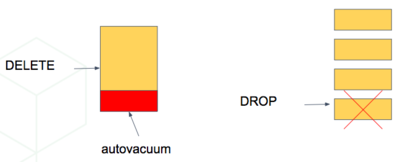
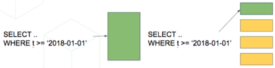
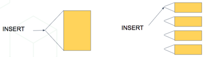
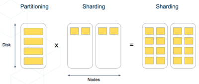

在时序负载中，应用（例如某些[实时应用](/citus/modeling/data-modeling/#real-time-apps)）查询近期数据，同时归档旧数据。

对于单节点 PostgreSQL，处理这类负载通常会使用[表分区](https://www.postgresql.org/docs/current/static/ddl-partitioning.html)，将按时间排序的大表拆成多个继承表，每张表包含不同时间范围的数据。

将数据存储在多张物理表中可以加快过期数据的清理。在一个大表中删除行，需要扫描以找到待删除的行，再对清空的空间执行 [VACUUM](https://www.postgresql.org/docs/current/static/routine-vacuuming.html)。而删除分区是与数据量无关的快速操作，相当于移除磁盘上保存该范围数据的文件。



对表分区还可以让各个时间范围内的索引更小、更快。查询近期数据时，通常只需访问能放入内存的“热”索引，因此读取更快。



插入操作需要更新的索引更小，因此也更快。



以下情况最适合按时间分区：

1. 大多数查询只访问近期数据中的一小部分。
2. 旧数据会定期清理（删除数据行或删除分区）。

需要注意，在不适合的场景中，读取所有分区产生的开销可能超过收益；在合适的场景中则很有帮助。例如，保留一年的时序数据，但只定期查询最近一周。

## 在 Citus 上扩展时序数据 {#scale-time-series-data-on-citus}

可以将单节点表分区技术与 Citus 的分布式分片结合，构建可扩展的时序数据库，兼得两者的优势，尤其适合基于 PostgreSQL 声明式表分区的方案。



GitHub 数据集中的每条记录代表 GitHub 中产生的一个事件，包含事件类型、创建时间和创建者用户等关键信息。

第一步是像在单节点 PostgreSQL 中一样，创建表并按时间分区：

```sql
-- declaratively partitioned table
CREATE TABLE github_events (
  event_id bigint,
  event_type text,
  event_public boolean,
  repo_id bigint,
  payload jsonb,
  repo jsonb,
  actor jsonb,
  org jsonb,
  created_at timestamp
) PARTITION BY RANGE (created_at);
```

注意 `PARTITION BY RANGE (created_at)`。这表示 PostgreSQL 按 `created_at` 的有序范围对表分区，但此时还没有创建具体范围的分区。

创建具体分区之前，先在 Citus 中分布该表。按 `repo_id` 分片，也就是让事件按仓库聚集到分片中：

```sql
SELECT create_distributed_table('github_events', 'repo_id');
```

此时 Citus 会在工作节点间创建该表的分片。内部而言，每个分片都是一张名为 `github_events_N` 的表，其中 N 是分片标识符。Citus 还会传播分区信息，每个分片都会声明 `Partition key: RANGE (created_at)`。

分区表不能直接保存数据，更像是跨越其分区的视图。因此分片此时还不能保存数据。需要先创建分区并指定时间范围，之后才能插入落在这些范围内的数据。

## 自动创建分区 {#automate-partition-creation}

Citus 提供分区管理辅助函数。可以使用 `create_time_partitions()` 批量创建按月分区：

```sql
SELECT create_time_partitions(
  table_name         := 'github_events',
  partition_interval := '1 month',
  end_at             := now() + '12 months'
);
```

Citus 还提供 `time_partitions` 视图，便于查看已创建的分区：

```text
SELECT partition
  FROM time_partitions
 WHERE parent_table = 'github_events'::regclass;

┌────────────────────────┐
│       partition        │
├────────────────────────┤
│ github_events_p2021_10 │
│ github_events_p2021_11 │
│ github_events_p2021_12 │
│ github_events_p2022_01 │
│ github_events_p2022_02 │
│ github_events_p2022_03 │
│ github_events_p2022_04 │
│ github_events_p2022_05 │
│ github_events_p2022_06 │
│ github_events_p2022_07 │
│ github_events_p2022_08 │
│ github_events_p2022_09 │
│ github_events_p2022_10 │
└────────────────────────┘
```

随着时间推进，需要创建新分区并删除旧分区。可以使用 [pg_cron](https://github.com/citusdata/pg_cron) 等扩展，设置定期任务运行维护函数：

```sql
-- set two monthly cron jobs:

-- 1. ensure we have partitions for the next 12 months

SELECT cron.schedule('create-partitions', '0 0 1 * *', $$
  SELECT create_time_partitions(
      table_name         := 'github_events',
      partition_interval := '1 month',
      end_at             := now() + '12 months'
  )
$$);

-- 2. (optional) ensure we never have more than one year of data

SELECT cron.schedule('drop-partitions', '0 0 1 * *', $$
  CALL drop_old_time_partitions(
      'github_events',
      now() - interval '12 months' /* older_than */
  );
$$);
```

完成定期维护设置后，无须再手动关注分区，它们会自动正常工作。

> [!NOTE]
> PostgreSQL 原生分区仍较新，存在一些细节问题。对分区表执行维护操作会获取较强的锁，可能短暂阻塞查询。PostgreSQL 社区正在解决这些问题，时间分区的体验会继续改善。

## 使用列式存储归档 {#archive-with-columnar-storage}

有些应用的数据可以分成较小的可更新部分和较大的“冻结”部分，例如日志、点击流或销售记录。此时可以将分区与 [列式表存储](/citus/tutorials/tutorial-time-series/#archive-with-columnar-storage)（Citus 10 引入）结合，在磁盘上压缩历史分区。Citus 列式表目前只支持追加写入，不支持更新或删除，但适合保存不可变的历史分区。

分区表可以任意组合行式分区与列式分区。按时间戳键进行范围分区时，可以让最新分区使用行式表，并定期将其滚动为历史列式分区。

继续使用 GitHub 事件作为示例。创建名为 `github_columnar_events` 的新表，以区别于前面的示例；为了专注于列式存储，不分布这张表。

接下来下载示例数据：

```bash
wget http://examples.citusdata.com/github_archive/github_events-2015-01-01-{0..5}.csv.gz
gzip -c -d github_events-2015-01-01-*.gz >> github_events.csv
```

```psql
-- our new table, same structure as the example in
-- the previous section

CREATE TABLE github_columnar_events ( LIKE github_events )
PARTITION BY RANGE (created_at);

-- create partitions to hold two hours of data each

SELECT create_time_partitions(
  table_name         := 'github_columnar_events',
  partition_interval := '2 hours',
  start_from         := '2015-01-01 00:00:00',
  end_at             := '2015-01-01 08:00:00'
);

-- fill with sample data
-- (note that this data requires the database to have UTF8 encoding)

\COPY github_columnar_events FROM 'github_events.csv' WITH (format CSV)

-- list the partitions, and confirm they're
-- using row-based storage (heap access method)

SELECT partition, access_method
  FROM time_partitions
 WHERE parent_table = 'github_columnar_events'::regclass;
```

```text
┌─────────────────────────────────────────┬───────────────┐
│                partition                │ access_method │
├─────────────────────────────────────────┼───────────────┤
│ github_columnar_events_p2015_01_01_0000 │ heap          │
│ github_columnar_events_p2015_01_01_0200 │ heap          │
│ github_columnar_events_p2015_01_01_0400 │ heap          │
│ github_columnar_events_p2015_01_01_0600 │ heap          │
└─────────────────────────────────────────┴───────────────┘
```

```sql
-- convert older partitions to use columnar storage

CALL alter_old_partitions_set_access_method(
  'github_columnar_events',
  '2015-01-01 06:00:00' /* older_than */,
  'columnar'
);

-- the old partitions are now columnar, while the
-- latest uses row storage and can be updated

SELECT partition, access_method
  FROM time_partitions
 WHERE parent_table = 'github_columnar_events'::regclass;
```

```text
┌─────────────────────────────────────────┬───────────────┐
│                partition                │ access_method │
├─────────────────────────────────────────┼───────────────┤
│ github_columnar_events_p2015_01_01_0000 │ columnar      │
│ github_columnar_events_p2015_01_01_0200 │ columnar      │
│ github_columnar_events_p2015_01_01_0400 │ columnar      │
│ github_columnar_events_p2015_01_01_0600 │ heap          │
└─────────────────────────────────────────┴───────────────┘
```

使用 `VACUUM VERBOSE` 查看列式表的压缩率。三个列式分区的压缩效果良好：

```sql
VACUUM VERBOSE github_columnar_events;
```

```text
INFO: statistics for "github_columnar_events_p2015_01_01_0000":
storage id: 10000000003
total file size: 4481024, total data size: 4444425
compression rate: 8.31x
total row count: 15129, stripe count: 1, average rows per stripe: 15129
chunk count: 18, containing data for dropped columns: 0, zstd compressed: 18

INFO: statistics for "github_columnar_events_p2015_01_01_0200":
storage id: 10000000004
total file size: 3579904, total data size: 3548221
compression rate: 8.26x
total row count: 12714, stripe count: 1, average rows per stripe: 12714
chunk count: 18, containing data for dropped columns: 0, zstd compressed: 18

INFO: statistics for "github_columnar_events_p2015_01_01_0400":
storage id: 10000000005
total file size: 2949120, total data size: 2917407
compression rate: 8.51x
total row count: 11756, stripe count: 1, average rows per stripe: 11756
chunk count: 18, containing data for dropped columns: 0, zstd compressed: 18
```

分区表 `github_columnar_events` 的一个优势是可以像普通表一样查询整张表。

```sql
SELECT COUNT(DISTINCT repo_id)
  FROM github_columnar_events;
```

```text
┌───────┐
│ count │
├───────┤
│ 16001 │
└───────┘
```

只要 WHERE 子句按分区键将范围完全限制在行式表分区内，就可以更新或删除数据。

### 将行式分区归档到列式存储 {#archive-a-row-partition-to-columnar-storage}

行式分区填满其时间范围后，可以将其归档为压缩的列式存储。可以使用 pg_cron 自动执行：

```sql
-- a monthly cron job

SELECT cron.schedule('compress-partitions', '0 0 1 * *', $$
  CALL alter_old_partitions_set_access_method(
    'github_columnar_events',
    now() - interval '6 months' /* older_than */,
    'columnar'
  );
$$);
```

更多信息见 [Citus 列式存储快速入门](https://www.citusdata.com/blog/2021/03/06/citus-10-columnar-compression-for-postgres/)。

## 相关内容 {#related-content}

- [分析与仪表盘教程](/citus/tutorials/tutorial-analytics/)
- [使用 HyperLogLog 高效汇总](/citus/articles/efficient-rollup/)
- [什么是 Citus？](/citus/overview/what-is-citus/)
