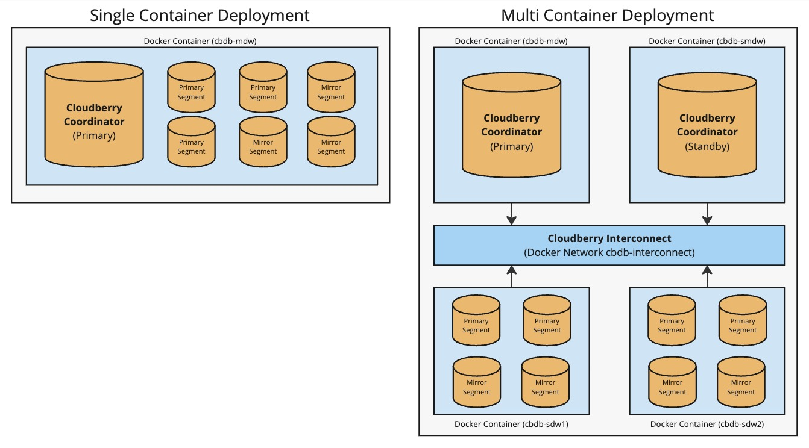

> [!TIP] 提示
> 沙箱文件已从 `apache/cloudberry-bootcamp` 迁移至 [`apache/cloudberry/devops/sandbox`](https://github.com/apache/cloudberry/tree/main/devops/sandbox)。本地模式从 2.1.0 版本起可用。

本文介绍如何在 Docker 环境中快速搭建并连接 Apache Cloudberry。你可以执行一些基本操作和 SQL 命令，试用 Apache Cloudberry。

> [!WARNING] 警告
> 本指南仅用于测试或开发，切勿用于生产环境。

## 前提条件 {#prerequisites}

请确保环境满足以下要求：

- 平台要求：任何支持 Docker 运行时的平台。详见 [Docker 入门](https://www.docker.com/get-started/)。
- 其他依赖：Git、SSH 和互联网连接。

## 构建沙箱 {#build-the-sandbox}

在 Docker 中构建和部署 Cloudberry 时，有两种不同的部署选项，以及不同的构建选项。

**部署选项**

1. **建议大多数用户采用**：使用 `-c local`，直接从当前本地源码构建。这种方式复用已有的本地代码副本，无需在容器内重新下载代码，是最快的入门方式，也很适合开发者测试本地修改。
2. 使用最新版 Apache Cloudberry 的源码编译（已发布版本见 [Apache Cloudberry 发布页面](https://github.com/apache/cloudberry/releases)）。基础操作系统使用 Rocky Linux 9 Docker 镜像。
3. 使用 Apache Cloudberry 最新的 [main](https://github.com/apache/cloudberry/tree/main) 分支编译。基础操作系统使用 Rocky Linux 9 Docker 镜像。



**构建选项**

1. 使用最新版 Apache Cloudberry 的源码编译（已发布版本见 [Apache Cloudberry 发布页面](https://cloudberry.apache.org/releases)）。基础操作系统使用 Rocky Linux 9 Docker 镜像。
2. 方法二：使用 Apache Cloudberry 最新的 [main](https://github.com/apache/cloudberry/tree/main) 分支编译。基础操作系统使用 Rocky Linux 9 Docker 镜像。

构建和部署步骤：

1. 启动 Docker Desktop，并确保它在主机平台上正常运行。

2. 将 Apache Cloudberry 仓库克隆到目标机器。

    ```shell
    git clone https://github.com/apache/cloudberry.git
    ```

3. 进入仓库目录，运行 `run.sh` 脚本以启动 Docker 容器，随后会开始自动安装。根据环境不同，可能需要使用 sudo 命令运行该脚本。

    - **推荐：从当前本地源码构建（单容器）**

        对新用户和开发者而言，这是效率最高的方式。它直接使用本地代码副本，省去在容器内下载代码的步骤，并可立即测试本地代码修改。

    ```shell
    cd cloudberry/devops/sandbox
    ./run.sh -c local
    ```

    - **推荐：从当前本地源码构建（多容器）**

        与上面相同，但部署的是多容器集群，适合使用本地代码测试分布式功能或高可用性。

    ```shell
    cd cloudberry/devops/sandbox
    ./run.sh -c local -m
    ```

    - 在单个容器中运行最新 Apache Cloudberry 发布版本

    ```shell
    cd cloudberry/devops/sandbox
    ./run.sh -c 2.0.0
    ```

    - 在多个容器中运行最新 Apache Cloudberry 发布版本

    ```shell
    cd cloudberry/devops/sandbox
    ./run.sh -c 2.0.0 -m
    ```

    - 在单个容器中运行最新 main 分支

    ```shell
    cd cloudberry/devops/sandbox
    ./run.sh -c main
    ```

    - 在多个容器中运行最新 main 分支

    ```shell
    cd cloudberry/devops/sandbox
    ./run.sh -c main -m
    ```

    脚本无错误执行完毕后，沙箱即已成功构建并运行。`docker run` 和 `docker compose` 命令使用 --detach 选项，因此可以通过 SSH 或其他远程方式访问运行中的 Apache Cloudberry 实例。

    可查看 run.sh 脚本了解其他选项（例如设置容器内的时区、仅构建容器）。也可以执行 `./run.sh -h` 查看用法。

## 连接数据库 {#connect-to-the-database}

> [!NOTE] 注意
> 部署多容器 Cloudberry 环境时，数据库初始化可能需要额外时间，因此可能要等待几分钟才能成功进入 psql 提示符。可运行 `docker logs cbdb-cdw -f` 查看数据库初始化过程的当前状态；看到“Deployment Successful”输出即表示初始化完成。

现在可以连接数据库，并尝试一些基本操作。

1. 从宿主机连接 Docker 容器：

    ```shell
    docker exec -it cbdb-cdw /bin/bash
    ```

    成功后，将看到以下提示符：

    ```shell
    [gpadmin@cdw /]$
    ```

2. 登录 Docker 中的 Apache Cloudberry。命令和示例输出如下：

    ```shell
    [gpadmin@cdw ~]$ psql  # Connects to the database with the default database name "gpadmin".
    
    # psql (14.4, server 14.4)
    # Type "help" for help.
    ```

    ```sql
    gpadmin=# SELECT VERSION();  -- Checks the database version.
            
    PostgreSQL 14.4 (Apache Cloudberry 1.0.0 build dev) on aarch64-unknown-linux-gnu, compiled by gcc (GCC) 10.2.1 20210130 (Red Hat 10.2.1-11), 64-bit compiled on Oct 24 2023 10:24:28
    (1 row)
    ```

现在 Apache Cloudberry 已经就绪，可以继续阅读[基于 Docker 安装的 Apache Cloudberry 教程](/cloudberry/tutorials/)。祝使用愉快！

## 使用 Apache Cloudberry Docker 环境 {#working-with-your-apache-cloudberry-docker-environment}

使用 Apache Cloudberry Docker 环境时，以下几个命令会很有帮助。

### 使用 Docker 停止单容器部署 {#stopping-your-single-container-deployment-with-docker}

要停止**单容器**部署并 _保留容器内的数据和状态_，可运行以下命令。之后可以再次启动该容器，在容器内作出的修改会保留下来。

```shell
docker stop cbdb-cdw
```

要停止**单容器**部署并删除属于该容器的卷，可运行以下命令。请注意，这会删除卷及关联的容器，因此容器内的所有修改和数据库状态都将被清除，且无法恢复。

```shell
docker rm -f cbdb-cdw
```

### 使用 Docker 停止多容器部署 {#stopping-your-multi-container-deployment-with-docker}

要停止**多容器**部署并 _保留容器内的数据和状态_，可运行以下命令。之后可以再次启动这些容器，在容器内作出的修改会保留下来。

```shell
docker compose -f docker-compose-rockylinux9.yml stop
```

要停止**多容器**部署并删除属于这些容器的网络和卷，可运行以下命令。该命令会删除容器及其关联的卷，因此容器内的所有修改和数据库状态都将被清除，且无法恢复。

```shell
docker compose -f docker-compose-rockylinux9.yml down -v
```

### 启动已停止的单容器 Cloudberry Docker 部署 {#starting-a-stopped-single-container-cloudberry-docker-deployment}

如果使用上述保留 Docker 卷的命令关闭了容器，可运行以下命令，按原有状态重新启动同一部署。

要启动已停止的**单容器**部署，只需运行以下命令：

```shell
docker start cbdb-cdw
```

### 启动已停止的多容器 Cloudberry Docker 部署 {#starting-a-stopped-multi-container-cloudberry-docker-deployment}

要启动已停止的**多容器**部署，可运行以下命令：

```shell
docker compose -f docker-compose-rockylinux9.yml start
```

> [!NOTE] 注意
> 启动先前停止的 Cloudberry Docker 环境后，还需要手动重新启动数据库。容器恢复运行后，执行以下命令即可。`gpstart` 用于启动数据库，-a 标志表示不显示交互提示，直接启动数据库（非交互模式）。
>
> ```shell
> docker exec -it cbdb-cdw /bin/bash
>
> [gpadmin@cdw /] gpstart -a
> ```
