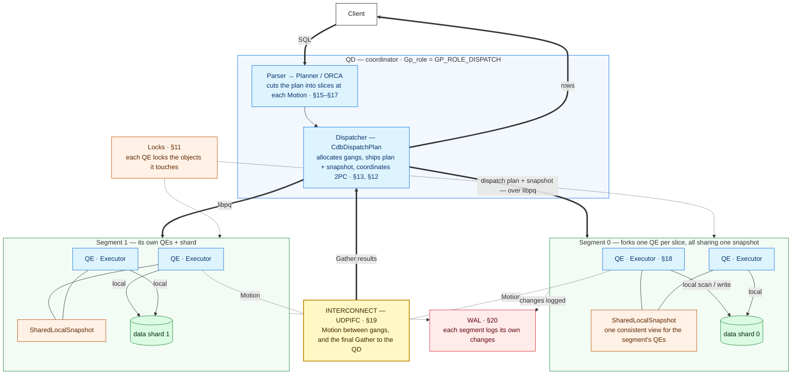
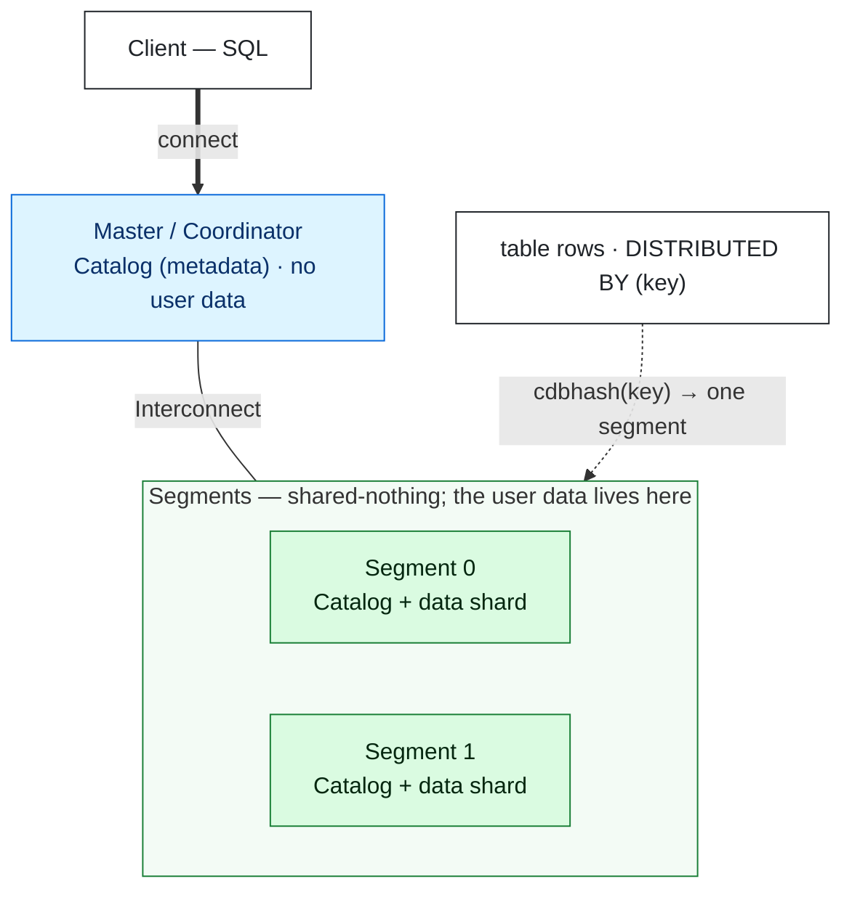
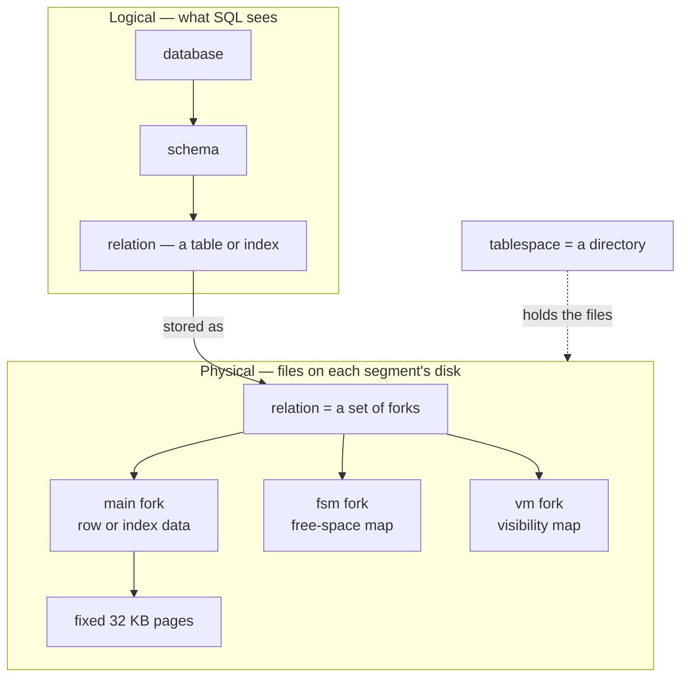
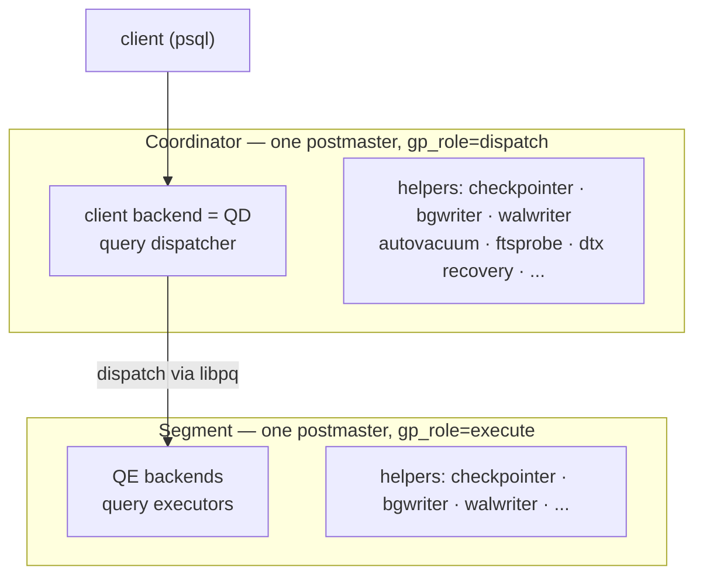
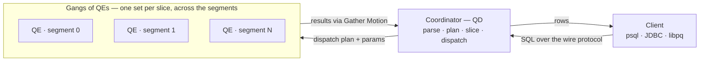
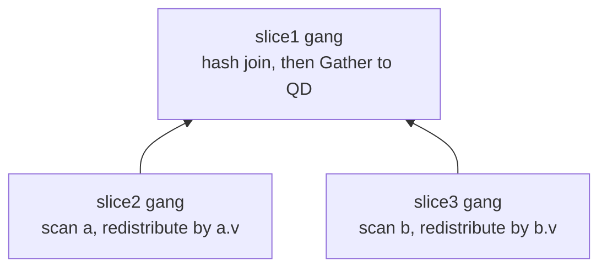

> [!NOTE] 源码与内核版本
> 本手册对应 Apache Cloudberry main 分支的 `c2baef0`（`3.0.0-devel`），基于 PostgreSQL 16.9 内核。Cloudberry 2.2.0-incubating 使用 PostgreSQL 14.10；2.0 和 2.1 版本使用 PostgreSQL 14.4。

<style>
/*
 * Licensed to the Apache Software Foundation (ASF) under one
 * or more contributor license agreements.  See the NOTICE file
 * distributed with this work for additional information
 * regarding copyright ownership.  The ASF licenses this file
 * to you under the Apache License, Version 2.0 (the
 * "License"); you may not use this file except in compliance
 * with the License.  You may obtain a copy of the License at
 *
 *   http://www.apache.org/licenses/LICENSE-2.0
 *
 * Unless required by applicable law or agreed to in writing,
 * software distributed under the License is distributed on an
 * "AS IS" BASIS, WITHOUT WARRANTIES OR CONDITIONS OF ANY
 * KIND, either express or implied.  See the License for the
 * specific language governing permissions and limitations
 * under the License.
 */

/* Layout for the HTML-and-CSS figures, lifted from the handbook's own
   stylesheet so the figures render identically here. */

/* These four come from the handbook's own stylesheet; a consuming site has no
   such definitions, and an undefined custom property invalidates its whole
   declaration. Define them here, scoped to the figure.

   Deliberately NOT themed. The artwork below is light-only: band and tile
   backgrounds are hard-coded pastels, and the injected markup carries some 800
   more hard-coded light colours in inline styles. Giving --fg a dark-theme
   value paints near-white text onto a near-white band -- measured at 1.08:1,
   worse than the bug that replaced. The handbook's light values are correct in
   both themes; what changes for dark mode is the surface underneath. */
.cloudberry-core-figure {
  --border: #d8dee4;
  --soft:   #f6f8fa;
  --fg:     #1f2328;
  --muted:  #636c76;
  margin: 1.4rem 0;
}

/* Light-only artwork needs a light ground AND a dark ink, or it bleeds into a
   dark page. Setting only the ground is not enough: any text in these figures
   without its own inline colour inherits the site's near-white body colour, so
   it lands white-on-pastel -- measured at 1.03:1 across 184 text nodes. The
   colour has to be restored at the same place the ground is. */
[data-bs-theme='dark'] .cloudberry-core-figure > div {
  background: #ffffff;
  color: #1f2328;
  border-radius: 8px;
  padding: 10px;
}
/* Descendants that inherit rather than carry an inline colour. */
[data-bs-theme='dark'] .cloudberry-core-figure > div :not([style*="color"]) {
  color: inherit;
}
.cloudberry-core-figure figcaption {
  margin-top: .5rem;
  font-size: .9em;
  /* --ifm-color-emphasis-600 resolves to rgb(141,148,158) in the light theme,
     which is 3.06:1 on white -- below WCAG AA for the 37 figure captions.
     (The dark theme's value is fine, so only light is overridden.) */
  color: #636b75;
}
[data-bs-theme='dark'] .cloudberry-core-figure figcaption {
  color: #a6adb4;
}

/* Selective highlight: the handbook wraps a key token so it stands out.
   Scoped to the component. The class name .hl is two letters and this file
   lands in the consuming site's single global stylesheet, so an unscoped
   rule would style every page of that site. The standalone edition's
   figure.code / figure.session variants are dropped: those classes do not
   occur anywhere in this tree. */
.cloudberry-core-figure .hl { border-radius: 2px; font-weight: 700;
                   background: #fff8c5; color: #1f2328; padding: 0 2px; }

/* Layered module map and the banded brick figures. */
.cloudberry-core-figure .bricks { border:1px solid var(--border);border-radius:12px;overflow:hidden;background:var(--soft) }
.cloudberry-core-figure .bk-band { display:flex;align-items:stretch;border-top:1px solid var(--border) }
.cloudberry-core-figure .bk-band:first-child { border-top:none }
.cloudberry-core-figure .bk-lbl { flex:0 0 116px;display:flex;flex-direction:column;justify-content:center;gap:2px;padding:10px 13px }
.cloudberry-core-figure .bk-lbl b { font-size:12.5px;font-weight:800;color:var(--fg);line-height:1.2 }
.cloudberry-core-figure .bk-lbl span { font-size:9.5px;font-weight:700;color:var(--muted);text-transform:uppercase;letter-spacing:.5px }
.cloudberry-core-figure .bk-row { flex:1 1 auto;display:flex;flex-wrap:wrap;gap:7px;padding:9px 10px }
.cloudberry-core-figure .bk { flex:1 1 118px;min-width:104px;display:flex;flex-direction:column;justify-content:center;gap:2px; padding:8px 11px;border-radius:7px;border:1px solid;background:#fff;text-decoration:none;transition:.13s }
.cloudberry-core-figure .bk-t2 { font-size:12.5px;font-weight:700;line-height:1.25 }
.cloudberry-core-figure .bk-ch { font-size:10.5px;font-weight:700;font-variant-numeric:tabular-nums;opacity:.8 }
.cloudberry-core-figure a.bk:hover { transform:translateY(-2px);box-shadow:0 4px 12px #0000001f;text-decoration:none }
.cloudberry-core-figure .bk-q { background:#eef6ff }
.cloudberry-core-figure .bk-q .bk { border-color:#54aeff66;color:#0a3069;background:#ddf4ff }
.cloudberry-core-figure .bk-s { background:#eefcf2 }
.cloudberry-core-figure .bk-s .bk { border-color:#4ac26b80;color:#04260f;background:#dafbe1 }
.cloudberry-core-figure .bk-t { background:#fff6ef }
.cloudberry-core-figure .bk-t .bk { border-color:#fb8f4480;color:#5e2700;background:#fff1e5 }
.cloudberry-core-figure .bk-h { background:#fff4f3 }
.cloudberry-core-figure .bk-h .bk { border-color:#ff818280;color:#5c0011;background:#ffebe9 }
.cloudberry-core-figure .bk-r { background:#f3f5f8 }
.cloudberry-core-figure .bk-r .bk { border-color:#afb8c1;color:#1f2328;background:#eaeef2 }
@media (max-width: 560px) {
  .cloudberry-core-figure .bk-band { flex-direction:column }
  .cloudberry-core-figure .bk-lbl { flex-basis:auto;border-bottom:1px solid var(--border) }
}

</style>

<!--
  Licensed to the Apache Software Foundation (ASF) under one
  or more contributor license agreements.  See the NOTICE file
  distributed with this work for additional information
  regarding copyright ownership.  The ASF licenses this file
  to you under the Apache License, Version 2.0 (the
  "License"); you may not use this file except in compliance
  with the License.  You may obtain a copy of the License at

    http://www.apache.org/licenses/LICENSE-2.0

  Unless required by applicable law or agreed to in writing,
  software distributed under the License is distributed on an
  "AS IS" BASIS, WITHOUT WARRANTIES OR CONDITIONS OF ANY
  KIND, either express or implied.  See the License for the
  specific language governing permissions and limitations
  under the License.
-->


<a id="1-introduction-the-big-picture"></a>

*Apache Cloudberry 内核原理：21 章、104 个小节。本章为
入口页；[§1.5.2](#152-module-to-chapter-guide) 将各模块映射到
介绍它们的章节。*



*查询究竟如何运行。Coordinator 上的单个 **QD**（`Gp_role = GP_ROLE_DISPATCH`）解析并规划查询，在每个 Motion 处分割成 **slice**；其 **Dispatcher**（`CdbDispatchPlan`）分配由 QE 组成的 **gang**，通过 **libpq** 把计划和**分布式快照**发送给它们，然后协调 2PC 提交（[§13](/cloudberry/core-internals/part-4-query-processing/ch13/)、[§12](/cloudberry/core-internals/part-3-transactions-mvcc-concurrency/ch12/)）。一个 Segment 可以 **fork 出多个 QE**（每个 slice 一个），这些 QE 共享一个 **SharedLocalSnapshot**，因此看到相同的数据；每个 **Executor** 在本地扫描并写入所在 Segment 的 **shard**（[§18](/cloudberry/core-internals/part-4-query-processing/ch18/)），获取所需的**锁**（[§11](/cloudberry/core-internals/part-3-transactions-mvcc-concurrency/ch11/)），并把更改记录到该 Segment 的 **WAL**（[§20](/cloudberry/core-internals/part-5-high-availability-recovery/ch20/)）。访问另一个 Segment 的数据，以及把最终结果 **Gather** 到 QD，都通过 **Interconnect**（UDPIFC）以 **Motion** 形式传输，这条路径与 libpq 分发路径分开（[§19](/cloudberry/core-internals/part-4-query-processing/ch19/)）。*

## 1.1 MPP 集群：Coordinator、Segment 与分布 {#11-the-mpp-cluster-coordinator-segments--distribution}



*最简单的集群形态。一个 **Master** 保存目录（系统元数据），但不保存用户数据；每个 **Segment** 同时保存目录和一部分用户数据，因此目录在各处都有副本，而数据则被分片。表的行按照分布键的哈希值分散到各个 Segment：`cdbhash(key)` 确定性地把每一行发送到一个 Segment（[§1.1.2](#112-three-distribution-policies)–[§1.1.3](#113-how-a-row-finds-its-segment)）。Master 与 Segment 通过 Interconnect 通信（[§19](/cloudberry/core-internals/part-4-query-processing/ch19/)）。*

### 1.1.1 无共享集群 {#111-a-shared-nothing-cluster}

Cloudberry 是一个逻辑数据库，分布在许多彼此*不共享任何资源*的 PostgreSQL 进程上：没有共享内存，也没有共享磁盘。其中一个进程是 **Coordinator**：它接受连接、解析并规划查询、分发工作和汇总结果，但**不存储用户数据**。其余进程是 **Segment**；每个 Segment 都是一个完整的 PostgreSQL 实例，拥有自己的 CPU、内存和磁盘，保存每个分布式表的一部分数据，并在这部分数据上并行执行计划。横向扩展就是添加 Segment。

为了实现高可用，每个主 Segment 都可以有一个 **镜像**：另一台主机上的流复制副本，随时可以接管（第 [20](/cloudberry/core-internals/part-5-high-availability-recovery/ch20/) 章）。整个集群由一个目录 `gp_segment_configuration` 描述，可以从 Coordinator 读取：

*集群映射。`content` 为 −1 的是 Coordinator；`content` 为 0 及以上的是 Segment。这是一个演示集群：一个 Coordinator、三个主 Segment，没有镜像。*

```sql
SELECT content, role, preferred_role, mode, status, port
FROM gp_segment_configuration ORDER BY content;
```

```text {hl_lines="3 4" title="output"}
 content | role | preferred_role | mode | status | port
---------+------+----------------+------+--------+------
      -1 | p    | p              | n    | u      | 7100
       0 | p    | p              | n    | u      | 7102
       1 | p    | p              | n    | u      | 7103
       2 | p    | p              | n    | u      | 7104
(4 rows)
```

- **content** — Segment 的逻辑 ID：**−1** 是 Coordinator，**0 … N−1** 是数据 Segment。一个主 Segment 与其镜像共享同一个 content。
- **role / preferred_role** — `p` 表示主 Segment，`m` 表示镜像：前者是当前角色，后者是健康状态下应有的角色；发生故障切换后两者可能不同。
- **mode / status** — 同步状态（`s` 表示同步，`n` 表示未复制）和存活状态（`u` 表示运行，`d` 表示宕机），由容错服务维护（第 [20](/cloudberry/core-internals/part-5-high-availability-recovery/ch20/) 章）。

> [!NOTE]
> 生产集群通常有许多 Segment，每个 Segment 都在另一台主机上配置一个镜像。下面的模型只需在这张表中增加行即可扩展；本演示集群有三个 Segment，因此每个分布式表都分片到 `content` 0、1 和 2。

### 1.1.2 三种分布策略 {#112-three-distribution-policies}

每张表都有一个**分布策略**，决定其行如何分散到各个 Segment。可以在 `CREATE TABLE` 时选择三种策略之一：

- **`DISTRIBUTED BY (cols)`** — **哈希分布**。对每一行的键列计算哈希值，以选择其 Segment。这是默认策略，也是大表通常应使用的策略：数据分布均匀，按该键连接时无需移动数据。
- **`DISTRIBUTED REPLICATED`** — **复制分布**。每个 Segment 都保存完整的表副本。适合小型维度表，因此与其连接时无需重分布。
- **`DISTRIBUTED RANDOMLY`** — **随机分布**。没有键，行以轮询方式发送到各个 Segment。数据分布均匀，但针对它的每个连接都需要一次重分布 Motion（第 [19](/cloudberry/core-internals/part-4-query-processing/ch19/) 章）。

该策略按表记录在 `gp_distribution_policy` 中：`policytype` 为 `p`（分区式：哈希或随机）或 `r`（复制式）；`distkey` 列出键列编号，随机表和复制表的该字段为空：

*三种策略并列对比。`c1dist` 按第 1 列计算哈希；复制副本是 `r`；随机表是 `p`，且 `distkey` 为空。*

```sql
CREATE TABLE c1dist(id int, payload text) DISTRIBUTED BY (id);
CREATE TABLE c1dist_rep(id int)            DISTRIBUTED REPLICATED;
CREATE TABLE c1dist_rand(id int)           DISTRIBUTED RANDOMLY;

SELECT localoid::regclass AS relname, policytype, distkey
FROM gp_distribution_policy
WHERE localoid IN ('c1dist'::regclass,'c1dist_rep'::regclass,'c1dist_rand'::regclass)
ORDER BY relname;
```

```text {hl_lines="3 4 5" title="output"}
   relname   | policytype | distkey
-------------+------------+---------
 c1dist      | p          | 1
 c1dist_rep  | r          |
 c1dist_rand | p          |
(3 rows)
```

> [!NOTE]
> `policytype` 背后的枚举是 `POLICYTYPE_PARTITIONED`（`p`）与 `POLICYTYPE_REPLICATED`（`r`）——定义位于 `src/include/catalog/gp_distribution_policy.h` 的 `GpPolicyType`；目录行由 `gp_distribution_policy.h` 中的 `policytype` 和 `distkey`（`FormData_gp_distribution_policy`）组成。第三个值 `POLICYTYPE_ENTRY` 表示只存在于 Coordinator 上的（entry）表，例如某些目录表。

### 1.1.3 行如何找到其 Segment {#113-how-a-row-finds-its-segment}

对于哈希分布表，拥有某一行的 Segment 是计算出来的，而不是查找出来的。键列先经过 `cdbhash` 生成 32 位哈希值；然后 `cdbhashreduce` 将该哈希值折叠为 Segment 编号：

`行的分布键` → `cdbhash(key) → 32 位哈希值` → `cdbhashreduce → Segment ID` → `路由到该 Segment`

```c {title="src/backend/cdb/cdbhash.c"}
/* cdbhashreduce: map the 32-bit hash down to one segment */
case REDUCE_LAZYMOD:
    result = (h->hash) % (h->numsegs);   /* hash mod number-of-segments */
```

由于这个映射完全由键上的算术运算决定，Coordinator 规划器和所有 Segment 上的进程都能在无需协调的情况下得到相同的结果。插入 100 000 行，然后询问每个 Segment 保存了多少行；在这个三 Segment 集群中，`cdbhash` 会把它们大致均匀地分散开：

*通过 `gp_segment_id` 系统列统计每个 Segment 的行数。在三个 Segment 上，`cdbhash` 将 100 000 行大致均匀地分布到 content 0、1 和 2。*

```sql
INSERT INTO c1dist SELECT g, 'x' FROM generate_series(1,100000) g;
SELECT gp_segment_id, count(*) FROM c1dist GROUP BY gp_segment_id ORDER BY gp_segment_id;
```

```text {hl_lines="3" title="output"}
 gp_segment_id | count
---------------+--------
             0 | 33462
             1 | 33327
             2 | 33211
(3 rows)
```

> [!NOTE]
> `cdbhash` 位于 `src/backend/cdb/cdbhash.c`；`cdbhashreduce` 使用位掩码、lazy-mod 和 jump-hash 归约器；无键随机表则调用 `cdbhashrandomseg`。正是这个哈希机制，使按同一键分布的两张表能够在 Segment 本地完成连接，无需移动数据。

### 1.1.4 集群目录 {#114-the-cluster-catalogs}

三个小型目录把这个模型连接起来：集群映射、每张表的策略，以及每个进程对自身身份的认知：

- **`gp_segment_configuration`** — 集群映射：每个 Segment（以及 Coordinator）一行，包含角色、模式、状态、主机和端口。这是共享目录，定义见 `src/include/catalog/gp_segment_configuration.h`（`FormData_gp_segment_configuration`）。
- **`gp_distribution_policy`** — 每个分布式表一行：记录其 `policytype` 和 `distkey`（[§1.1.2](#112-three-distribution-policies)），定义见 `gp_distribution_policy.h`（`FormData_gp_distribution_policy`）。
- **`GpIdentity` / `gp_id`** — 每个进程都知道自己的 `content` ID。Coordinator 的值为 `MASTER_CONTENT_ID`（−1），这正是 `IS_QUERY_DISPATCHER()` 的定义方式，见 `src/include/cdb/cdbvars.h`。刚才分组使用的 `gp_segment_id` 列，就是按行暴露出的这个身份。

> [!NOTE]
> 这三个目录回答了集群的基本问题：**Segment 在哪里**（gp_segment_configuration）、**这张表如何分布**（gp_distribution_policy）以及**我是谁**（GpIdentity）。后续章节中的所有操作——规划 Motion、分发 gang、恢复故障 Segment——都从它们读取信息。

## 1.2 数据组织 {#12-data-organization}



*从 SQL 到字节。数据库包含模式，模式包含关系；每个关系在物理上是一组由固定大小 32 KB 页面组成的分支（main、fsm、vm），存放在表空间目录中。在 MPP 集群里，这套物理结构独立存在于每个 Segment 上（[§1.1](#11-the-mpp-cluster-coordinator-segments--distribution)）。*

在运行任何查询之前，了解 Cloudberry 如何组织数据会很有帮助：从客户端连接的数据库，一直到 Segment 磁盘上的文件。本节自上而下介绍这条路径。

### 1.2.1 数据库、模式和表空间 {#121-databases-schemas-and-tablespaces}

运行中的 Apache Cloudberry 系统（按 PostgreSQL 的术语称为一个*集群*）提供一组**数据库**。客户端恰好连接其中一个数据库，其他数据库中的对象不能直接看到。在数据库内部，**模式**是对表、索引、视图和函数进行分组的命名空间（每个数据库都会以 `public` 模式和系统的 `pg_catalog` 开始）。一个新集群包含熟悉的三个数据库：供你工作的 `postgres`，以及 `initdb` 创建的两个 `template` 数据库：

*新集群中的数据库和表空间。*

```sql
SELECT datname FROM pg_database ORDER BY 1;
SELECT spcname FROM pg_tablespace ORDER BY 1;
```

```text {title="output"}
  datname
-----------
 postgres
 template0
 template1
(3 rows)

  spcname
------------
 pg_default
 pg_global
(2 rows)
```

模式在*逻辑上*组织对象，而**表空间**决定其文件在磁盘上的*物理位置*：它本质上是一个命名目录。两个内置表空间是 `pg_default`（数据目录的 `base/`）和 `pg_global`（共享目录）。在更快的磁盘上创建表空间并将热点表放入其中，是一种物理布局决策，不会改变任何 SQL 名称。

`pg_default` 或 `pg_global` 在每台主机上都是同一个*名称*，但它解析到的*目录*按 Segment 区分：每个 Segment 都是一个独立实例，拥有自己的数据目录，关系位于该目录下的同一相对路径中。`gp_segment_configuration` 显示了这些根目录：

*两个内置表空间，以及每个实例自己的数据目录——Coordinator（content −1）和 Segment 0 位于不同的根目录下，但下面的相对路径相同。*

```sql
SELECT oid, spcname FROM pg_tablespace ORDER BY oid;
SELECT role, content, datadir FROM gp_segment_configuration ORDER BY content;
```

```text {hl_lines="9 10" title="output"}
 oid  |  spcname
------+------------
 1663 | pg_default
 1664 | pg_global
(2 rows)

 role | content |                   datadir
------+---------+------------------------------------------------
 p    |      -1 | …/gpdemo/datadirs/qddir/demoDataDir-1
 p    |       0 | …/gpdemo/datadirs/dbfast1/demoDataDir0
 p    |       1 | …/gpdemo/datadirs/dbfast2/demoDataDir1
 p    |       2 | …/gpdemo/datadirs/dbfast3/demoDataDir2
(4 rows)
```

> [!NOTE]
> **MPP 的变化。** 这些名称在集群范围内统一，但它们背后的*存储*并未集中：每个 Segment 本身都是完整的 PostgreSQL 实例，各自拥有这些数据库、模式和表空间目录的副本，并保存自己的数据分片。Coordinator 负责协调；Segment 负责存储。这种分工就是 [§1.1](#11-the-mpp-cluster-coordinator-segments--distribution) 的全部内容。

### 1.2.2 关系、文件和分支 {#122-relations-files-and-forks}

PostgreSQL（因此 Cloudberry 也是如此）将表或索引称为**关系**，而关系*并不是*单个文件。每个关系由一个三元组在磁盘上标识：表空间 OID、数据库 OID，以及自身的 `relfilenode`（一个 `RelFileNumber`）。这个三元组就是 `RelFileLocator`：

```c {title="src/include/storage/relfilelocator.h"}
typedef struct RelFileLocator
{
    Oid           spcOid;     /* tablespace */
    Oid           dbOid;      /* database */
    RelFileNumber relNumber;  /* relation (the relfilenode) */
} RelFileLocator;
```

`GetRelationPath`（`src/common/relpath.c`）将这个三元组转换为数据目录下的路径。`pg_relation_filepath` 可以把它暴露出来——这里的表位于默认表空间（`base/`）中，路径包含数据库 OID，文件名则由 relfilenode 给出：

*关系在磁盘上的路径：base / 数据库 OID / relfilenode。*

```sql
SELECT pg_relation_filepath('c1org');
```

```text {hl_lines="3" title="output"}
 pg_relation_filepath
----------------------
 base/5/16479
(1 row)
```

不过，这个文件只是关系的**主分支**。关系由多个 *分支* 存储：它们是共享 relfilenode、只通过后缀区分的独立文件。文件名来自固定表 `forkNames[]`（`src/common/relpath.c`），其索引是 `ForkNumber` 枚举（`src/include/common/relpath.h`）：

*关系的分支。主分支没有后缀；其他分支追加 _fsm / _vm / _init。*

- `main` — 实际的行数据或索引数据
- `fsm` — 空闲空间映射，记录哪些页面有空间
- `vm` — 可见性映射，记录 all-visible / all-frozen 位
- `init` — 未记录日志关系使用的空模板

数据位于 Segment 上，因此要*看到* 分支文件，就要在某个 Segment 上查看。加载并对 `c1org` 执行清理后，Segment 0 为它保存了三个文件：主分支，以及空闲空间映射和可见性映射：

*Segment 0（utility 模式）：relfilenode 16479 的三个分支文件——main、_fsm、_vm。*

```bash
PGOPTIONS='-c gp_role=utility' psql -p 7102 -d postgres

SELECT d AS file, pg_size_pretty((pg_stat_file('base/5/'||d)).size) AS size
FROM pg_ls_dir('base/5') d
WHERE d = '16479' OR d LIKE '16479\_%'
ORDER BY 1;
```

```text {hl_lines="4 5" title="output"}
   file    |  size
-----------+---------
 16479     | 4608 kB
 16479_fsm | 96 kB
 16479_vm  | 32 kB
(3 rows)
```

> [!NOTE]
> relfilenode 并非永久固定：重写表的操作（`VACUUM FULL`、`CLUSTER` 和某些 `ALTER TABLE`）会为其分配新的 relfilenode，因而产生新文件；这正是这些命令可以干净回滚的原因。

### 1.2.3 页面和 TOAST {#123-pages-and-toast}

在主分支中，数据不是字节流，而是一系列固定大小的**页面**（也称为块），它们是每次磁盘读取和缓冲区缓存槽位的单位（[§3](/cloudberry/core-internals/part-2-storage-data-layout/ch03/)）。PostgreSQL 默认页面大小为 8 KB；Cloudberry 将其提高到 **32 KB**，以适应分析型工作负载常见的大型顺序扫描：

```c {title="src/include/pg_config.h — BLCKSZ"}
#define BLCKSZ 32768   /* 32 KB pages (PostgreSQL default is 8192) */
```

一行必须放入单个页面，但列可以包含数 MB 的数据。解决办法是 **TOAST**（The Oversized-Attribute Storage Technique，超长属性存储技术）：当一行大约会超过页面的四分之一（`TOAST_TUPLE_THRESHOLD`，由 `TOAST_TUPLES_PER_PAGE = 4` 推导，见 `src/include/access/heaptoast.h`）时，超大字段会先压缩；如果仍然很大，就会被移出行，存入配套的 **TOAST 表**（`pg_toast.pg_toast_<oid>`），行中只留下一个小指针。这个过程对 SQL 自动且透明：

*一个包含 90 000 个字符的值被压缩并移入 TOAST 表——存储约 1 KB，而不是 90 KB。*

```sql
CREATE TABLE c1org_toast(id int, doc text) DISTRIBUTED BY (id);
INSERT INTO c1org_toast VALUES (1, repeat('Apache Cloudberry ', 5000));

SELECT reltoastrelid::regclass AS toast_table
  FROM pg_class WHERE relname = 'c1org_toast';

SELECT length(doc) AS logical_chars, pg_column_size(doc) AS stored_bytes
  FROM c1org_toast WHERE id = 1;
```

```text {hl_lines="10" title="output"}
CREATE TABLE
INSERT 0 1
       toast_table
-------------------------
 pg_toast.pg_toast_17244
(1 row)

 logical_chars | stored_bytes
---------------+--------------
         90000 |         1060
(1 row)
```

> [!NOTE]
> 这份 90 000 字符的文档在行存储中只占 **1060 字节**：高度可压缩的文本会被压缩，剩余部分存放在 TOAST 表中。因此，即使页面固定为 32 KB，`text` 或 `jsonb` 列的有效大小仍几乎不受限制。

## 1.3 进程与内存 {#13-processes-and-memory}



*进程模型。每个节点有一个 postmaster，由它 fork 出下面的所有进程。在 Coordinator 上，客户端后端进程变成 QD（查询分发器）；它通过 libpq 将工作分发给 QE（查询执行器）后端，而这些 QE 由 Segment 自己的 postmaster fork 出来。每个节点还运行自己的一组辅助进程。*

### 1.3.1 postmaster 与进程树 {#131-the-postmaster-and-the-process-tree}

与 PostgreSQL 一样，Cloudberry 是按连接创建进程的系统：每个节点只有一个 **postmaster** 监听连接，并为每个客户端和每个辅助进程 *fork* 一个子进程。postmaster 自身不接触数据，纯粹负责监管。Cloudberry 的新特点是存在*许多* postmaster：Coordinator 上一个、每个 Segment 上一个，每个 postmaster 都监管自己的进程树。这个演示集群中的 `ps` 显示了 Coordinator（端口 7100）的进程树：

*Coordinator postmaster（PID 16983）及其 fork 出的一部分进程。注意 ftsprobe 进程和 dtx recovery 进程：这两个进程只在 Coordinator 上运行。*

```bash
ps -eo pid,ppid,cmd | grep '[p]ostgres:.*7100'
```

```text {hl_lines="6 7" title="output"}
16983  ... postgres -D .../qddir/demoDataDir-1 -p 7100 -c gp_role=dispatch
16990 16983 postgres:  7100, checkpointer
16991 16983 postgres:  7100, background writer
16993 16983 postgres:  7100, walwriter
16994 16983 postgres:  7100, autovacuum launcher
16996 16983 postgres:  7100, dtx recovery process
16997 16983 postgres:  7100, ftsprobe process
17006 16983 postgres:  7100, sweeper process
5014 16983 postgres:  7100, gpadmin postgres [local] con382 cmd3 INSERT
```

除了最后一个进程，其余都是共享辅助进程（[§1.3.3](#133-background-workers)）；最后一个是为会话服务的客户端后端。在 Coordinator 上，这个后端还承担下面介绍的另一项工作。

### 1.3.2 QD 和 QE 后端 {#132-qd-and-qe-backends}

客户端只连接 Coordinator。为它服务的后端就是**查询分发器（QD）**：它规划查询，随后打开到各个 Segment 的 libpq 连接，请求每个 Segment 的 postmaster fork 出一个**查询执行器（QE）**，执行各自的计划片段。一组协调工作的 QE 称为一个 *gang*（见 [§1.4](#14-clients-the-wire-protocol--dispatch)，第 [19](/cloudberry/core-internals/part-4-query-processing/ch19/) 章有深入介绍）。QD 及其 QE 共享同一个**会话 ID**（`con<N>`），借此可以在整个集群中跟踪一条语句：

*同一个会话 con382 正在运行 INSERT：QD 位于 Coordinator（端口 7100），其 QE 位于 Segment 0、1、2（端口 7102/7103/7104）；各 Segment 的 postmaster fork 出这些 QE 来执行分发的工作（MPPEXEC）。*

```bash
ps -eo pid,ppid,cmd | grep 'con382'
```

```text {hl_lines="1 2 3 4" title="output"}
5014 16983 postgres:  7100, gpadmin postgres [local] con382 cmd3 INSERT
5016 16931 postgres:  7102, gpadmin postgres 10.100.0.3 con382 seg0 cmd4 MPPEXEC INSERT
5017 16936 postgres:  7103, gpadmin postgres 10.100.0.3 con382 seg1 cmd4 MPPEXEC INSERT
5018 16939 postgres:  7104, gpadmin postgres 10.100.0.3 con382 seg2 cmd4 MPPEXEC INSERT
```

PID 5014（父进程为 16983，即 Coordinator postmaster）是 QD；PID 5016、5017 和 5018（父进程分别为 16931、16936、16939，即各个 *Segment* postmaster）是它的 QE。QD 并没有 fork QE，而是请求每个 Segment 的 postmaster 创建 QE，然后通过 Interconnect 驱动它们。这种分裂正是 Cloudberry 后端比 PostgreSQL 后端更复杂的原因。

> [!NOTE]
> 在 Coordinator 上的 `pg_stat_activity` 中，QD 显示 `gp_segment_id = -1`；QE 位于各个 Segment 自己的视图中。由于数据是分片的，QD 几乎不读取表数据，它负责分发、汇总并返回结果。

### 1.3.3 后台工作进程 {#133-background-workers}

辅助进程分为两类。**继承自 PostgreSQL 的进程集合**——`checkpointer`、`background writer`（[§3.5](/cloudberry/core-internals/part-2-storage-data-layout/ch03/#35-background-writer--checkpointer)）、`walwriter` 和 `autovacuum launcher`——在每个节点上运行，Coordinator 和 Segment 都一样。在此基础上，postmaster 从固定表 **Cloudberry 专用辅助进程** `PMAuxProcList` 中启动进程：

```c {title="src/backend/postmaster/postmaster.c"}
static BackgroundWorker PMAuxProcList[MaxPMAuxProc] =
{
#ifdef USE_INTERNAL_FTS
    {"ftsprobe process", ..., "FtsProbeMain", ..., FtsProbeStartRule},
#endif
    {"global deadlock detector process", ..., "GlobalDeadLockDetectorMain", ...},
    {"dtx recovery process", ..., "DtxRecoveryMain", ..., DtxRecoveryStartRule},
    {"sweeper process", ...},
    ...
};
```

每个条目都有一个**启动规则**，决定它在哪里运行。`FtsProbeStartRule`（`src/backend/fts/fts.c`）和 `DtxRecoveryStartRule`（`src/backend/cdb/cdbdtxrecovery.c`）仅在 `GP_ROLE_DISPATCH` 下返回 true，因此 [§1.3.1](#131-the-postmaster-and-the-process-tree) 看到 `ftsprobe` 和 `dtx recovery` 在 Coordinator 上运行，而不在 Segment 上运行。FTS 是集群故障检测器（第 [20](/cloudberry/core-internals/part-5-high-availability-recovery/ch20/) 章）；DTX recovery 则在崩溃后完成处于不确定状态的分布式事务。

`pg_stat_activity` 会报告节点上当前附着的所有进程的后端类型：

*Coordinator 上的后端类型（Segment 运行一组近似相同的进程，但不包含 Coordinator 专用工作进程）。*

```sql
SELECT backend_type, count(*) FROM pg_stat_activity GROUP BY 1 ORDER BY 1;
```

```text {hl_lines="7" title="output"}
         backend_type         | count
------------------------------+-------
 autovacuum launcher          |     1
 background writer            |     1
 checkpointer                 |     1
 client backend               |     1
 dtx recovery process       |     1
 logical replication launcher |     1
 login monitor                |     1
 walwriter                    |     1
```

> [!NOTE]
> 经典辅助进程各自都有一个 `*Main` 入口点，通过 postmaster 的 `StartChildProcess` 宏（`src/backend/postmaster/postmaster.c` 中的 `StartBackgroundWriter`）到达：`BackgroundWriterMain`（`bgwriter.c`）、`CheckpointerMain`（`checkpointer.c`）和 `WalWriterMain`（`walwriter.c`）。`PMAuxProcList` 中的 Cloudberry 工作进程则作为后台工作进程启动。

### 1.3.4 共享内存与私有内存 {#134-shared-versus-private-memory}

每个 postmaster 在启动时都会划出一块**共享内存**区域，所有由它 fork 出的后端都能看到这块区域。最大的使用者是缓冲区缓存（`shared_buffers`，第 [3](/cloudberry/core-internals/part-2-storage-data-layout/ch03/) 章）；共享内存还保存锁表、WAL 缓冲区、进程数组和集群范围的 DTX 状态。在这个集群中，每个节点的共享内存大小为：

*每个节点独立确定自己的共享内存大小。*

```sql
SHOW shared_buffers;
```

```text {hl_lines="3" title="output"}
 shared_buffers
----------------
 125MB
```

后端所需的其他内存都属于该进程的**私有内存**：包括它分配内存时使用的内存上下文堆，以及由 `work_mem`（排序、哈希）和 `maintenance_work_mem` 限制的各操作工作区。将数据溢出到磁盘的排序只消耗*一个后端*的 `work_mem`，而不是共享内存；因此在 N 个 Segment 的集群上，一条查询同时可能在整个集群中使用最多 N × `work_mem`。

> [!NOTE]
> **MPP 的影响：** 集群没有一个统一的共享内存区域，而是有 N+1 个共享内存区域，每个 postmaster 一个；它们使用相同的 GUC 计算大小，但分别分配和记账。这正是我们在 [§3.1.2](/cloudberry/core-internals/part-2-storage-data-layout/ch03/#312-not-one-cache-but-n1) 的缓冲区缓存中看到的按节点独立性，只是现在上升到了更高一层。

## 1.4 客户端、线协议与分发 {#14-clients-the-wire-protocol--dispatch}



*从客户端 SQL 到分布式工作。客户端通过普通的 PostgreSQL 线协议与 Coordinator 通信；Coordinator（QD）规划、切分并将计划分发给 Segment 上的查询执行器（QE）gang；QE 执行自己的 slice，并通过 Gather Motion 将结果流式传回。*

### 1.4.1 客户端与线协议 {#141-the-client-and-the-wire-protocol}

客户端（`psql`、JDBC/ODBC 驱动，以及任何基于 `libpq` 构建的程序）连接 **Coordinator**，并使用未改变的 PostgreSQL 前端/后端协议。Cloudberry 在客户端边界完全继承了这个协议；真正特殊的部分发生在 Coordinator 得到计划*之后*。该协议有两种形式：

- **简单查询** — 一个 `Query` 消息携带 SQL 文本；后端在一次往返中解析、规划并执行它。这就是 `psql` 为普通输入语句发送的形式。
- **扩展查询** — 将 `Parse` → `Bind` → `Execute` 分成独立步骤，因此一条语句只需规划一次，就可以使用不同的绑定参数执行多次（预备语句和大多数驱动都使用这种方式）。它把规划与参数值分开。

两者在 [§13.1](/cloudberry/core-internals/part-4-query-processing/ch13/#131-the-simple-query-protocol)–[§13.2](/cloudberry/core-internals/part-4-query-processing/ch13/#132-the-extended-query-protocol) 中有详细介绍；这里我们只需要关注交接点：Coordinator 最终得到一个完整计划，现在必须把它转换为分布在整个集群上的工作。

### 1.4.2 QD→QE 分发模型 {#142-the-qdqe-dispatch-model}

Coordinator 不会独自执行计划。它变成**查询分发器（QD）**，把计划发送给**查询执行器（QE）**——这些是每个 Segment 上创建的普通后端进程。Coordinator 运行在 `GP_ROLE_DISPATCH` 角色下；每个 Segment 后端运行在 `GP_ROLE_EXECUTE` 角色下（`src/include/cdb/cdbvars.h` 中的 `GpRoleValue`）：

```c {title="src/include/cdb/cdbvars.h — GpRoleValue"}
GP_ROLE_UTILITY,    /* a plain, single-node database engine */
GP_ROLE_DISPATCH,   /* the coordinator: parallel query dispatcher (QD) */
GP_ROLE_EXECUTE,    /* a segment backend: parallel query executor (QE) */
```

分发由 `CdbDispatchPlan`（`src/backend/cdb/dispatcher/cdbdisp_query.c`）→ `cdbdisp_dispatchX`（`cdbdisp_query.c`）→ `cdbdisp_dispatchToGang` 驱动：序列化后的计划和参数被发送到 Segment，Segment 执行并把元组流式传回。任何分布式计划都能看出这种分工——`Gather Motion` 标志着 Segment 工作向 Coordinator 汇聚的边界：

`CdbDispatchPlan` → `cdbdisp_dispatchX` → `cdbdisp_dispatchToGang` → `QE 执行查询切片`

*一个简单的 `count(*)`：Segment 执行 Seq Scan 和 Partial Aggregate；Coordinator 执行 Finalize Aggregate。Gather Motion 是 QE 工作（下方）与 QD 工作（上方）之间的接缝。*

```sql
CREATE TABLE c1disp(id int, v int) DISTRIBUTED BY (id);
INSERT INTO c1disp SELECT g, g % 100 FROM generate_series(1,100000) g;

EXPLAIN (costs off) SELECT count(*) FROM c1disp;
```

```text {hl_lines="2" title="output"}
 Finalize Aggregate
   ->  Gather Motion 3:1  (slice1; segments: 3)
         ->  Partial Aggregate
               ->  Seq Scan on c1disp
 Optimizer: GPORCA
```

> [!NOTE]
> 这个演示集群有三个 Segment，因此扫描会同时在三个 Segment 上运行，Gather Motion 的读数是 **3:1**。在 N 个 Segment 的集群上，同样的扫描会在所有 N 个 Segment 上运行，Gather Motion 的读数是 **N:1**。

### 1.4.3 直观理解 gang 与 slice {#143-gangs-and-slices-at-a-glance}

计划会在每个 Motion 处分割成 **slice**，Coordinator 为每个 slice 分配一个 **gang**——一组 QE，每个 Segment 上一个——来执行它（gang 的分配由 `AllocateGang` 完成，见 `src/backend/cdb/dispatcher/cdbgang.c`；slice 的 gang 类型，如 `GANGTYPE_PRIMARY_WRITER`，位于 `src/include/nodes/plannodes.h` 的 `GangType`）。必须重分区数据的查询会显示多个 slice；下面这个按非分布列 `v` 连接的查询就会分成三个 slice：

*按非分布键连接：slice2 和 slice3 分别扫描一侧，并按连接键重分布；slice1 执行连接并将结果 Gather 到 Coordinator。每个 slice 都由自己的 gang 执行。*

```sql
EXPLAIN (costs off)
SELECT count(*) FROM c1disp a JOIN c1disp b ON a.v = b.v;
```

```text {hl_lines="6 10" title="output"}
 Finalize Aggregate
   ->  Gather Motion 3:1  (slice1; segments: 3)
         ->  Partial Aggregate
               ->  Hash Join
                     Hash Cond: (a.v = b.v)
                     ->  Redistribute Motion 3:3  (slice2; segments: 3)
                           Hash Key: a.v
                           ->  Seq Scan on c1disp a
                     ->  Hash
                           ->  Redistribute Motion 3:3  (slice3; segments: 3)
                                 Hash Key: b.v
                                 ->  Seq Scan on c1disp b
 Optimizer: GPORCA
```



*上面这个连接的三个 slice 对应三个 gang。两个重分布 slice 为连接 slice 提供输入，连接 slice 再把结果 Gather 到 Coordinator。*

> [!NOTE]
> 这是面向全局的视图。分发器如何序列化并发送计划，见 [§13.3](/cloudberry/core-internals/part-4-query-processing/ch13/#133-dispatch-from-coordinator-plan-to-segment-execution)；Motion 如何通过 Interconnect 在 gang 之间实际移动元组（Gather、Redistribute、Broadcast），见第 [19](/cloudberry/core-internals/part-4-query-processing/ch19/) 章。

## 1.5 主要模块总览 {#15-the-major-modules--a-map}

<figure class="cloudberry-core-figure">
<div><div class="bricks"> <div class="bk-band bk-q"><div class="bk-lbl"><b>查询处理</b><span>第 III 部分</span></div><div class="bk-row"> <span class="bk"><span class="bk-t2">派发器与进程组</span><span class="bk-ch">§13</span></span> <span class="bk"><span class="bk-t2">统计信息</span><span class="bk-ch">§14</span></span> <span class="bk"><span class="bk-t2">Postgres 规划器</span><span class="bk-ch">§15</span></span> <span class="bk"><span class="bk-t2">分布式规划</span><span class="bk-ch">§16</span></span> <span class="bk"><span class="bk-t2">ORCA 优化器</span><span class="bk-ch">§17</span></span> <span class="bk"><span class="bk-t2">执行器</span><span class="bk-ch">§18</span></span> <span class="bk"><span class="bk-t2">Motion 与 Interconnect</span><span class="bk-ch">§19</span></span> </div></div> <div class="bk-band bk-s"><div class="bk-lbl"><b>存储与数据</b><span>第 I 部分</span></div><div class="bk-row"> <span class="bk"><span class="bk-t2">堆 — 行存储</span><span class="bk-ch">§4</span></span> <span class="bk"><span class="bk-t2">AO / AOCS</span><span class="bk-ch">§5</span></span> <span class="bk"><span class="bk-t2">PAX 列存储</span><span class="bk-ch">§6</span></span> <span class="bk"><span class="bk-t2">索引</span><span class="bk-ch">§7</span></span> <span class="bk"><span class="bk-t2">缓冲区缓存</span><span class="bk-ch">§3</span></span> <span class="bk"><span class="bk-t2">存储管理器 — smgr / VFD</span><span class="bk-ch">§2</span></span> <span class="bk"><span class="bk-t2">系统目录</span><span class="bk-ch">§8</span></span> </div></div> <div class="bk-band bk-t"><div class="bk-lbl"><b>事务</b><span>第 II 部分</span></div><div class="bk-row"> <span class="bk"><span class="bk-t2">事务</span><span class="bk-ch">§9</span></span> <span class="bk"><span class="bk-t2">MVCC 与快照</span><span class="bk-ch">§10</span></span> <span class="bk"><span class="bk-t2">锁与 GDD</span><span class="bk-ch">§11</span></span> <span class="bk"><span class="bk-t2">分布式 2PC</span><span class="bk-ch">§12</span></span> </div></div> <div class="bk-band bk-h"><div class="bk-lbl"><b>高可用</b><span>第 IV 部分</span></div><div class="bk-row"> <span class="bk"><span class="bk-t2">WAL</span><span class="bk-ch">§20</span></span> <span class="bk"><span class="bk-t2">复制</span><span class="bk-ch">§20</span></span> <span class="bk"><span class="bk-t2">恢复</span><span class="bk-ch">§20</span></span> <span class="bk"><span class="bk-t2">FTS 故障检测器</span><span class="bk-ch">§20</span></span> </div></div> <div class="bk-band bk-r"><div class="bk-lbl"><b>资源管理</b><span>第 V 部分</span></div><div class="bk-row"> <span class="bk"><span class="bk-t2">资源组 — CPU / 内存 / I/O</span><span class="bk-ch">§21</span></span> </div></div> </div></div>
<figcaption>分层展示数据库引擎：从上到下阅读——先处理查询，再从存储中提供数据；事务、高可用和资源组是整个引擎赖以运行的基础。目录和统计信息贯穿始终，为优化器提供输入。每个方块都链接到对应章节。</figcaption>
</figure>

### 1.5.1 阅读这张图 {#151-reading-the-map}

从这里开始，本手册将按层次逐一介绍这个引擎。一条语句进入 Coordinator 上的 **分发器**，由 **Postgres 规划器**（或 **ORCA**）利用**目录**和**统计信息**转换成计划，再由 **执行器** 执行；执行器驱动 **Motion** 在 Segment 之间移动元组，并驱动**访问方法**在 Segment 内读写行。访问方法位于**缓冲区缓存**之上，缓冲区缓存位于**存储管理器**之上，而存储管理器最终访问各个 Segment 的本地磁盘。

贯穿这条流水线的还有图中作为侧层绘出的三个关注点。**事务、MVCC 和锁**（[§9](/cloudberry/core-internals/part-3-transactions-mvcc-concurrency/ch09/)–[§11](/cloudberry/core-internals/part-3-transactions-mvcc-concurrency/ch11/)）保证并发执行正确，**分布式事务**（[§12](/cloudberry/core-internals/part-3-transactions-mvcc-concurrency/ch12/)）把提交扩展到各个 Segment。**高可用**（[§20](/cloudberry/core-internals/part-5-high-availability-recovery/ch20/)）把每个缓冲的更改转换为 WAL，用于复制、恢复和镜像，同时由 FTS 监视故障。**资源组**（[§21](/cloudberry/core-internals/part-6-resource-management/ch21/)）决定哪些查询可以进入，以及它们可以使用多少 CPU 和内存。全书反复出现三个依赖关系：优化器必须依靠**目录**（[§8](/cloudberry/core-internals/part-2-storage-data-layout/ch08/)）和**统计信息**（[§14](/cloudberry/core-internals/part-4-query-processing/ch14/)）才能规划；执行器同时驱动 Motion（[§19](/cloudberry/core-internals/part-4-query-processing/ch19/)，跨 Segment）和访问方法（[§4](/cloudberry/core-internals/part-2-storage-data-layout/ch04/)–[§7](/cloudberry/core-internals/part-2-storage-data-layout/ch07/)，在 Segment 内）；每项更改都只有通过**缓冲区缓存**进入 **WAL** 才能持久化（[§20](/cloudberry/core-internals/part-5-high-availability-recovery/ch20/)）。

### 1.5.2 模块与章节指南 {#152-module-to-chapter-guide}

*各模块在哪些章节介绍——可以按顺序阅读，也可以从上面的总览图跳转。*

| 层次 | 模块 | 章节 |
| --- | --- | --- |
| 存储与数据 | 数据文件与存储管理器（smgr、VFD） | [2](/cloudberry/core-internals/part-2-storage-data-layout/ch02/) |
|  | 缓冲区缓存 | [3](/cloudberry/core-internals/part-2-storage-data-layout/ch03/) |
|  | 堆——行存储 | [4](/cloudberry/core-internals/part-2-storage-data-layout/ch04/) |
|  | 追加优化表（AO / AOCS） | [5](/cloudberry/core-internals/part-2-storage-data-layout/ch05/) |
|  | PAX——原生列存储 | [6](/cloudberry/core-internals/part-2-storage-data-layout/ch06/) |
|  | 索引（B-树 … BRIN、位图） | [7](/cloudberry/core-internals/part-2-storage-data-layout/ch07/) |
|  | 系统目录 | [8](/cloudberry/core-internals/part-2-storage-data-layout/ch08/) |
| 事务 | 事务与隔离 | [9](/cloudberry/core-internals/part-3-transactions-mvcc-concurrency/ch09/) |
|  | MVCC、快照与清理 | [10](/cloudberry/core-internals/part-3-transactions-mvcc-concurrency/ch10/) |
|  | 锁与全局死锁检测器 | [11](/cloudberry/core-internals/part-3-transactions-mvcc-concurrency/ch11/) |
|  | 分布式事务与 2PC | [12](/cloudberry/core-internals/part-3-transactions-mvcc-concurrency/ch12/) |
| 查询处理 | 查询处理阶段 | [13](/cloudberry/core-internals/part-4-query-processing/ch13/) |
|  | 统计信息与选择率 | [14](/cloudberry/core-internals/part-4-query-processing/ch14/) |
|  | Postgres 规划器 | [15](/cloudberry/core-internals/part-4-query-processing/ch15/) |
|  | 分布式规划 | [16](/cloudberry/core-internals/part-4-query-processing/ch16/) |
|  | ORCA——Cascades 优化器 | [17](/cloudberry/core-internals/part-4-query-processing/ch17/) |
|  | 执行器 | [18](/cloudberry/core-internals/part-4-query-processing/ch18/) |
|  | Motion 与 Interconnect | [19](/cloudberry/core-internals/part-4-query-processing/ch19/) |
| 可用性 | 高可用与恢复（WAL、复制、FTS） | [20](/cloudberry/core-internals/part-5-high-availability-recovery/ch20/) |
| 资源 | 资源管理 | [21](/cloudberry/core-internals/part-6-resource-management/ch21/) |
