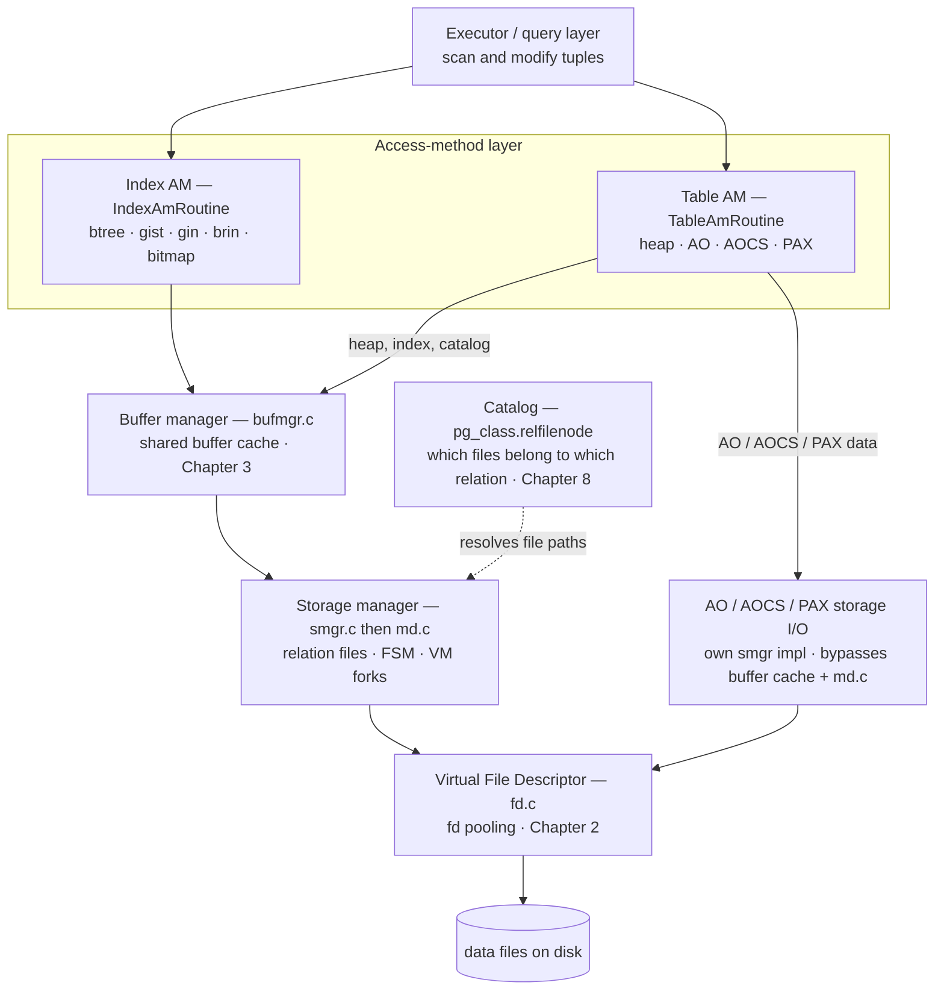
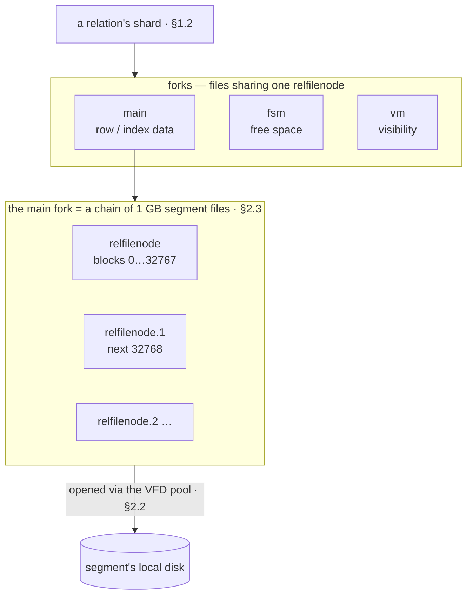
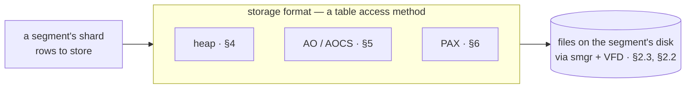
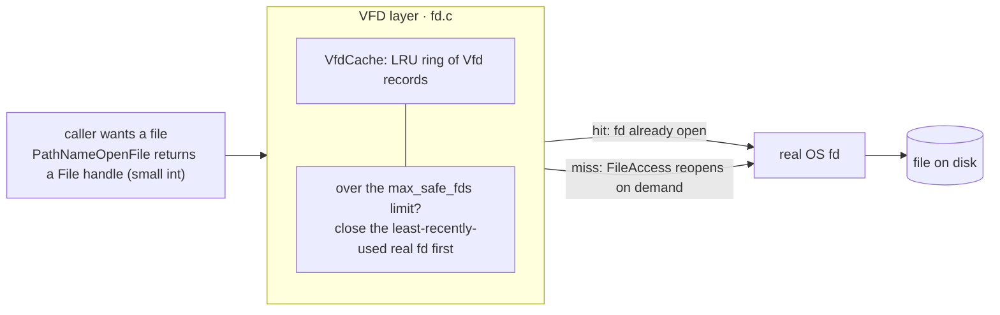
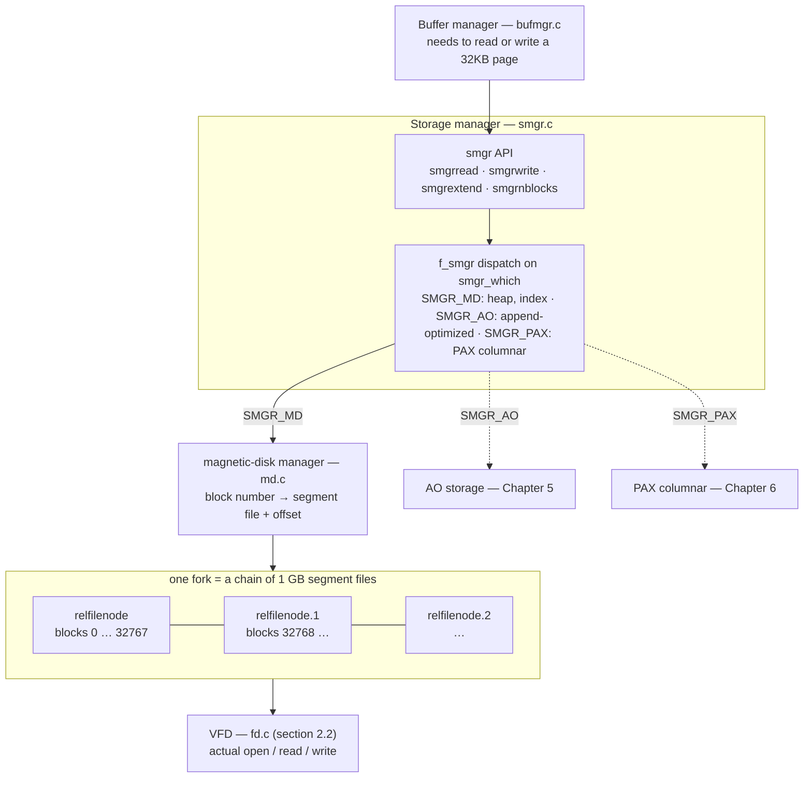

<!--
  Licensed to the Apache Software Foundation (ASF) under one
  or more contributor license agreements.  See the NOTICE file
  distributed with this work for additional information
  regarding copyright ownership.  The ASF licenses this file
  to you under the Apache License, Version 2.0 (the
  "License"); you may not use this file except in compliance
  with the License.  You may obtain a copy of the License at

    http://www.apache.org/licenses/LICENSE-2.0

  Unless required by applicable law or agreed to in writing,
  software distributed under the License is distributed on an
  "AS IS" BASIS, WITHOUT WARRANTIES OR CONDITIONS OF ANY
  KIND, either express or implied.  See the License for the
  specific language governing permissions and limitations
  under the License.
-->

<a id="2-data-files--the-storage-manager"></a>

Cloudberry 存储的*所有*内容——每个堆元组、索引条目、AO 块和 PAX 微分区——最终都会成为 Segment 本地磁盘上文件中的字节。本部分自上而下追踪这条路径。

**访问方法层**（第 [4](/cloudberry/core-internals/part-2-storage-data-layout/ch04/)–[7](/cloudberry/core-internals/part-2-storage-data-layout/ch07/) 章）确定各关系的*磁盘存储形式*，并响应执行器的元组请求。其下有两条 I/O 路径。**缓冲区管理器**（第 [3](/cloudberry/core-internals/part-2-storage-data-layout/ch03/) 章）为使用缓冲区的引擎——堆、索引和目录表——在共享内存中缓存固定大小的 32 KB 页面；**AO 和 PAX 引擎则自行执行块 I/O**，绕过共享缓冲区。两条路径都经过**存储管理器**（`smgr`/`md.c`）和**虚拟文件描述符**层（第 2 章），将页面和块请求转换为实际文件读写。**系统目录**（第 [8](/cloudberry/core-internals/part-2-storage-data-layout/ch08/) 章）则记录哪些文件属于哪个关系。



*存储层自上而下的结构。执行器通过表访问方法和索引访问方法 API 访问数据；缓冲式引擎（堆、索引和目录）经过缓冲区管理器与存储管理器，而 AO/AOCS/PAX 使用自己的存储管理器实现，绕过缓冲区缓存和 md.c 的块映射——两条路径最终都会在 VFD 层和磁盘文件处汇合。*



*第 2 章对应的磁盘对象。一个关系不是单个文件，而是一组分支（main 数据，以及空闲空间映射和可见性映射），而主分支自身又是一串 1 GB 的段文件。存储管理器（[§2.3](#23-storage-manager-smgr--mdc)）将块映射到正确的段文件；VFD 池（[§2.2](#22-virtual-file-descriptor-vfd)）负责打开它。*

## 2.1 数据分片与存储格式 {#21-data-sharding--storage-formats}



*本节在 [§1.1](/cloudberry/core-internals/#11-the-mpp-cluster-coordinator-segments--distribution) 基础上的补充：Segment 的分片采用若干存储格式之一布局，而每种格式最终都会落成文件。堆和索引使用缓冲区（第 [3](/cloudberry/core-internals/part-2-storage-data-layout/ch03/) 章）；AO/AOCS 和 PAX 自己执行块 I/O，但它们都通过存储管理器和 VFD 访问磁盘（[§2.3](#23-storage-manager-smgr--mdc)、[§2.2](#22-virtual-file-descriptor-vfd)）。*

第 [1](/cloudberry/core-internals/) 章介绍了由 Coordinator 和 Segment 组成的集群。本章继续跟踪表数据向下的路径：进入 Segment 磁盘上的文件，以及把数据放入这些文件的机制——**存储管理器**（[§2.3](#23-storage-manager-smgr--mdc)）和**虚拟文件描述符**层（[§2.2](#22-virtual-file-descriptor-vfd)）。在此之前，有两个事实决定每个 Segment 存储什么：*表如何分割到各个 Segment*（见 [§1.1](/cloudberry/core-internals/#11-the-mpp-cluster-coordinator-segments--distribution)），以及*每个分片采用什么格式布局*；本节就从后一个问题开始。

### 2.1.1 从逻辑表到每个 Segment 的分片 {#211-from-a-logical-table-to-per-segment-shards}

[§1.1](/cloudberry/core-internals/#11-the-mpp-cluster-coordinator-segments--distribution) 展示了如何通过对分布键进行哈希，把一行路由到某个 Segment。这里继续追踪这些字节的落点：每个 Segment 保存表的一个切片，即自己的 **分片**，它是一个普通的磁盘关系，拥有自己的文件；Coordinator 只保存目录，不保存数据。

因此，分片是一个可以实际测量的关系。通过 `gp_dist_random` 在各个 Segment 上展开执行 `pg_relation_size`，可以报告每个分片自己的文件大小；在 Coordinator 上它是空的：

*分片在其 Segment 上占用实际文件；Coordinator 不保存表数据。*

```sql
CREATE TABLE c2shard(id int, v text) DISTRIBUTED BY (id);
INSERT INTO c2shard SELECT g, repeat('x',50) FROM generate_series(1,100000) g;

SELECT gp_segment_id, pg_size_pretty(pg_relation_size('c2shard')) AS shard_size
FROM gp_dist_random('gp_id');
```

```text {hl_lines="5" title="output"}
CREATE TABLE
INSERT 0 100000
 gp_segment_id | shard_size
---------------+------------
             0 | 8256 kB
(1 row)
```

### 2.1.2 存储格式：堆、AO、AOCS、PAX {#212-storage-formats-heap-ao-aocs-pax}

分片中的行仍然需要以某种方式布局在文件中，Cloudberry 针对不同工作负载提供了几种格式。格式就是一种**表访问方法**：在 `CREATE TABLE` 中通过 `USING`（或旧式的 `WITH (appendonly=…, orientation=…)`）选择，记录在 `pg_class.relam`（`src/include/catalog/pg_class.h` 中的 `FormData_pg_class`）中，并通过 `pg_am` 解析。本集群公开了三种：

*`pg_am` 中注册的表访问方法——每一种都是由回调组成的 `TableAmRoutine`。*

```sql
SELECT amname, amhandler FROM pg_am WHERE amtype = 't' ORDER BY amname;
```

```text {hl_lines="3 4 5" title="output"}
  amname   |         amhandler
-----------+---------------------------
 ao_column | ao_column_tableam_handler
 ao_row    | ao_row_tableam_handler
 heap      | heap_tableam_handler
(3 rows)
```

分别使用每个 `USING` 子句创建表，再读回 `relam`，即可确认这种绑定关系：

*`relam` 记录每张表使用的格式；默认格式是堆。*

```sql
CREATE TABLE c2shard    (id int);                 -- default
CREATE TABLE c2shard_ao (id int) USING ao_row;     -- append-optimized row
CREATE TABLE c2shard_co (id int) USING ao_column;  -- append-optimized column

SELECT c.relname, a.amname AS storage_format
FROM pg_class c JOIN pg_am a ON a.oid = c.relam
WHERE c.relname LIKE 'c2shard%' ORDER BY 1;
```

```text {title="output"}
  relname   | storage_format
------------+----------------
 c2shard    | heap
 c2shard_ao | ao_row
 c2shard_co | ao_column
(3 rows)
```

每种格式都适合不同的访问模式，并分别在后续章节介绍：

- **heap** — PostgreSQL 的**行存储**：一行的每一列一起存放在一个页面上，就地更新和读取。适合点查和频繁更新。处理器为 `heapam_methods`（`src/backend/access/heap/heapam_handler.c`）。见第 [4](/cloudberry/core-internals/part-2-storage-data-layout/ch04/) 章。
- **ao_row（AO）** — **追加优化行存储**：紧凑、批量追加，不带逐行 MVCC 头；面向一次写入、反复扫描的 OLAP。处理器为 `ao_row_tableam_handler`（`src/backend/access/appendonly/appendonlyam_handler.c`）。见第 [5](/cloudberry/core-internals/part-2-storage-data-layout/ch05/) 章。
- **ao_column（AOCS）** — 追加优化的**列存储**：每一列都在自己的文件中，因此扫描只需读取所需的列。处理器为 `ao_column_tableam_handler`（`src/backend/access/aocs/aocsam_handler.c`）。见第 [5](/cloudberry/core-internals/part-2-storage-data-layout/ch05/) 章。
- **PAX** — Cloudberry 的**原生列式**引擎（类似 ORC 的微分区，支持 min/max 和 Bloom 跳过扫描）。它是一个 contrib 访问方法，不属于本演示集群内置组件，因此不会出现在上面的 `pg_am` 中。见第 [6](/cloudberry/core-internals/part-2-storage-data-layout/ch06/) 章。

> [!NOTE]
> 无论分片使用哪种格式，其字节最终都会成为**文件**；访问这些文件的路径对所有格式都相同：请求经过**存储管理器**（[§2.3](#23-storage-manager-smgr--mdc)），由**虚拟文件描述符**池（[§2.2](#22-virtual-file-descriptor-vfd)）完成。它们是本章剩余的两层；缓冲式格式（堆、索引）还会经过 [§3.1.2](/cloudberry/core-internals/part-2-storage-data-layout/ch03/#312-not-one-cache-but-n1) 的缓冲区缓存。

## 2.2 虚拟文件描述符（VFD）{#22-virtual-file-descriptor-vfd}



*VFD 层向调用者提供一个稳定的 File 句柄，背后是可复用、可重新打开的 OS 文件描述符池。一个后端可以持有数千个打开的 File，但同一时刻实际存在的描述符不超过 max_safe_fds；最久未使用的描述符会被关闭，下次访问时透明地重新打开。*

### 2.2.1 问题：文件数量超过操作系统允许打开的数量 {#221-the-problem-more-files-than-the-os-will-allow-open}

操作系统会限制单个进程同时持有的文件描述符数量。Cloudberry 的一个 Segment 通常需要远多于这个上限的*逻辑*打开文件：每个堆和索引的段文件，尤其是 AO/AOCS 和 PAX 表的众多按列、按段划分的文件，都可能同时使用。如果每次 `open()` 都要在整个生命周期内占用一个真实描述符，繁忙的 Segment 就会遇到 `EMFILE`（打开的文件过多）并失败。

这个主机上的内核限制很宽松——`ulimit -n` 报告的值超过一百万——但 Cloudberry 有意**不**信任或消耗全部限制。它会探测实际可用的描述符数量，并维护自己的上限 `max_safe_fds`，为后端其他用途留出余量：

*每个进程的文件预算。`max_files_per_process` 是配置上限；OS 硬上限高得多，但 Cloudberry 会把自身限制在远低于它的范围内。*

```sql
SHOW max_files_per_process;
```

```text {hl_lines="3" title="output"}
 max_files_per_process
-----------------------
 1000
(1 row)
```

启动时，`set_max_safe_fds`（`src/backend/storage/file/fd.c`）调用 `count_usable_fds`，不断实际打开描述符直到无法继续，然后设置工作上限，并为紧急情况预留几个描述符：

```c {title="src/backend/storage/file/fd.c — set_max_safe_fds()"}
max_safe_fds = Min(usable_fds, max_files_per_process - already_open);
...
max_safe_fds -= NUM_RESERVED_FDS;      /* NUM_RESERVED_FDS = 10 */
```

> [!NOTE]
> 因此，有效上限取 OS 实际允许的数量和 `max_files_per_process` GUC（默认值为 **1000**）中较小者，再减去 10 个描述符的预留值（`NUM_RESERVED_FDS`，见 `fd.c`）。VFD 层的工作是让调用者看起来像拥有无限的打开文件，同时永远不超过这个数量的*真实*描述符。

### 2.2.2 VFD 池：可重新打开描述符的 LRU 环 {#222-the-vfd-pool-an-lru-ring-of-reopenable-descriptors}

调用者得到的不是原始 OS 描述符，而是一个 `File`：它是 `VfdCache`（`fd.c`）中的一个小整数索引，指向一组**虚拟文件描述符**记录。每个 `Vfd` 都记住按需重新打开文件所需的全部信息，并按使用新旧程度连接到双向 **LRU 环**中：

```c {title="src/backend/storage/file/fd.c — Vfd"}
typedef struct vfd
{
    int            fd;               /* current real FD, or VFD_CLOSED if none */
    unsigned short fdstate;          /* state bitflags */
    ResourceOwner  resowner;         /* owner, for automatic cleanup */
    File           nextFree;         /* freelist link */
    File           lruMoreRecently;  /* doubly linked recency-of-use ring */
    File           lruLessRecently;
    off_t          fileSize;
    char          *fileName;         /* remembered so the file can be reopened */
    int            fileFlags;        /* open(2) flags for reopening */
    mode_t         fileMode;
} Vfd;
```

*Vfd 记录：一个当前可能持有、也可能不持有真实 OS fd 的逻辑 File。*

- `fd` — 真实 OS 描述符，或 VFD_CLOSED
- `fileName · fileFlags · fileMode` — 足以透明地重新打开文件
- `lruMoreRecently / lruLessRecently` — 在 LRU 环中的位置
- `fdstate` — 标志位（例如临时文件关闭时删除）

当逻辑文件打开数量超过预算时，池会先关闭其他文件的真实描述符。`ReleaseLruFiles`（`fd.c`）从冷端开始驱逐，直到腾出空间；逻辑 `File` 仍然有效，只是暂时失去其真实 `fd`，直到下一次访问：

```c {title="src/backend/storage/file/fd.c — ReleaseLruFiles()"}
while (nfile + numAllocatedDescs + numExternalFDs >= max_safe_fds)
{
    if (!ReleaseLruFile())     /* closes VfdCache[0].lruMoreRecently, the LRU file */
        break;
}
```

> [!NOTE]
> `nfile` 统计 VFD 环当前持有的真实描述符数量；它还会与直接分配的描述符（`numAllocatedDescs`）和外部计数的描述符（`numExternalFDs`）一起计算，确保进程总量不超过 `max_safe_fds`。临时文件（排序、哈希、溢出文件）也通过同一个池打开，因此包含大量溢出文件的查询不会耗尽缓存可用的描述符。

### 2.2.3 通过 File 打开和读取 {#223-opening-and-reading-through-a-file}

`PathNameOpenFile`（`fd.c`）分配一个 `Vfd`，记录路径和标志，并打开真实描述符。之后每次 `FileRead` / `FileWrite` / `FileSeek` 都会先调用 `FileAccess`（`fd.c`）；如果真实 `fd` 在此期间被回收，FileAccess 会重新打开文件，并把它移动到 LRU 环的热端：

`FileRead / FileWrite` → `FileAccess` → `FileIsNotOpen? → LruInsert（重新打开）` → `否则移到 LRU 表头`

```c {title="src/backend/storage/file/fd.c"}
if (FileIsNotOpen(file))
{
    returnValue = LruInsert(file);   /* ReleaseLruFiles(), then reopen, ++nfile */
    if (returnValue != 0)
        return returnValue;          /* could not get a descriptor */
}
```

重新打开对调用者不可见：`File` 句柄从不改变，改变的只是它当前是否拥有内核描述符。这种间接层还允许 Cloudberry 在原始 OS API 之上加入多项功能——事务或资源所有者清理时自动关闭、临时文件删除和记账——因此从 `md.c`（[§2.3](#23-storage-manager-smgr--mdc)）到 AO 存储和临时溢出文件，几乎所有引擎 I/O 都通过 VFD 层打开文件，而不是直接调用 `open()`。

> [!NOTE]
> **为什么它对 MPP 很重要：** 一条分析查询在每个 Segment 上可能同时访问数千个列文件和段文件。没有 VFD 池，这会超过 OS 描述符上限；有了它，Segment 只需在有界的 `max_safe_fds` 下运行，最冷的文件偶尔重新打开即可。

## 2.3 存储管理器（smgr / md.c）{#23-storage-manager-smgr--mdc}



*存储管理器位于缓冲区管理器和文件系统之间。smgr.c 中面向块的小型 API 通过 f_smgr 方法表进行分发：SMGR_MD（堆和索引）路由到 md.c，后者将每个块映射到通过 VFD 层打开的 1 GB 段文件；AO 关系走独立的 SMGR_AO 路径，PAX 关系走 SMGR_PAX 路径。*

### 2.3.1 smgr API 及其分发 {#231-the-smgr-api-and-its-dispatch}

缓冲区管理器从不自行打开文件。当它必须读取缺失页面或写入脏页面（[§3.3](/cloudberry/core-internals/part-2-storage-data-layout/ch03/#33-cache-misses-eviction--clock-sweep)、[§3.5](/cloudberry/core-internals/part-2-storage-data-layout/ch03/#35-background-writer--checkpointer)）时，会调用**存储管理器**——`smgr.c` 中的薄层，通过一个小型、严格面向块的 API 隐藏关系块存放的*方式和位置*。每次调用都指定一个关系、一个分支和一个块号：

`smgropen(rlocator)` → `smgrread / smgrwrite / smgrextend` → `smgrnblocks` → `smgrcreate / smgrunlink`

`smgropen`（`src/backend/storage/smgr/smgr.c`）返回一个 `SMgrRelation`，其中包含关系的*物理*身份——由表空间、数据库和 `relfilenode` 组成的 `RelFileLocator`——以及一个函数指针方法表 `f_smgr`（`src/include/storage/smgr.h`）：

```c {title="src/include/storage/smgr.h"}
typedef struct f_smgr
{
    const char *smgr_name;
    void        (*smgr_open)   (SMgrRelation reln);
    void        (*smgr_create) (SMgrRelation reln, ForkNumber forknum, bool isRedo);
    void        (*smgr_extend) (SMgrRelation reln, ForkNumber forknum,
                                BlockNumber blocknum, const void *buffer, bool skipFsync);
    void        (*smgr_read)   (SMgrRelation reln, ForkNumber forknum,
                                BlockNumber blocknum, void *buffer);
    void        (*smgr_write)  (SMgrRelation reln, ForkNumber forknum,
                                BlockNumber blocknum, const void *buffer, bool skipFsync);
    BlockNumber (*smgr_nblocks)(SMgrRelation reln, ForkNumber forknum);
    /* ... create/unlink/truncate/prefetch/writeback/immedsync ... */
} f_smgr;
```

关系使用哪个方法表由 `smgr_get_impl` 选择，默认是**磁盘管理器** `SMGR_MD`。Cloudberry 增加了标准 PostgreSQL 没有的两个实现：`SMGR_AO` 用于追加优化存储，以及 `SMGR_PAX` 用于第 [6](/cloudberry/core-internals/part-2-storage-data-layout/ch06/) 章的 PAX 列存储：

```c {title="src/include/storage/smgr.h — SMgrImpl"}
typedef enum SMgrImplementation
{
    SMGR_INVALID = -1,
    SMGR_MD = 0,    /* magnetic disk — heap, indexes, catalog (this section) */
    SMGR_AO = 1,    /* append-optimized row and column storage (Chapter 5)   */
    SMGR_PAX = 2,   /* PAX (Chapter 6)                                       */
} SMgrImpl;
```

> [!NOTE]
> 分发表 `smgrsw[]`（`smgr.c`）以这个枚举作为索引；除非扩展或 AO/AOCS 关系另行选择，否则 `smgr_get_impl`（`smgr.c`）返回 `SMGR_MD`。因此，本章中的所有内容——堆表、索引和目录——最终都汇入 **md.c**；追加优化数据是另一条路径（第 [5](/cloudberry/core-internals/part-2-storage-data-layout/ch05/) 章），PAX 又是另一条路径（第 [6](/cloudberry/core-internals/part-2-storage-data-layout/ch06/) 章）。

### 2.3.2 md.c：把块号转换为文件 {#232-mdc-turning-a-block-number-into-a-file}

`md.c` 回答一个问题：这个分支的第 N 个块在磁盘上的什么位置？它从关系的物理路径开始；`GetRelationPath` 根据 `RelFileLocator`（`src/include/common/relpath.h` 中的 `relpathbackend` 宏，实现在 `src/common/relpath.c`）构造该路径：`base/<database-oid>/<relfilenode>`。我们可以直接向服务器询问：

*关系在磁盘上的路径是 `base/<dbOid>/<relfilenode>`。该路径相对于每个节点自己的 `data_directory`，因此 Coordinator 和每个 Segment 在不同根目录下使用相同的相对路径。*

```sql
CREATE TABLE c2smgr(id int, v text) DISTRIBUTED BY (id);
INSERT INTO c2smgr SELECT g, repeat('x',900) FROM generate_series(1,4000000) g;
SELECT pg_relation_filepath('c2smgr');
```

```text {hl_lines="5" title="output"}
CREATE TABLE
INSERT 0 4000000
 pg_relation_filepath
----------------------
 base/5/16558
```

在一个分支内，`md.c` 维护打开的段文件数组，通过将块号除以段大小找到正确的文件——`_mdfd_getseg`（`src/backend/storage/smgr/md.c`）计算 `targetseg = blkno / RELSEG_SIZE`。`mdnblocks`（`md.c`）通过累加各段的大小报告分支长度；`mdextend`（`md.c`）扩展最后一个段，并在边界处转到新文件；`mdread`/`mdwrite`（`md.c`）则在找到的段内定位。

*堆/索引文件路径的组成（相对于 data_directory）。*

- `base` — 默认表空间目录
- `5` — 数据库 OID
- `16558` — relfilenode，即关系的文件编号
- `.1 / .2` — 段编号（第 0 段省略）

### 2.3.3 段文件：1 GB 规则 {#233-segment-files-the-1-gb-rule}

一个分支绝不会是一个巨大的单文件。`md.c` 将每个段限制为 **`RELSEG_SIZE` 个块**；在此构建中该值为 `32768`（`src/include/pg_config.h`），而一个块为 32 KB（[§3.1](/cloudberry/core-internals/part-2-storage-data-layout/ch03/#31-caching--buffer-cache-design)），因此每个文件恰好是 **1 GB**。块 0–32767 位于 `relfilenode` 中，块 32768 及以后位于 `relfilenode.1` 中，依此类推。这个上限使单个文件足够小，适合各种文件系统和常用工具。

上面的 `c2smgr` 在其 Segment 上增长超过了 1 GB，因此可以在磁盘上看到分割结果。该 Segment 为它存储了 39 170 个块：

*在 Segment 0（utility 模式）上：该关系占用 39 170 个块，超过一个 32768 块的段文件所能容纳的大小。*

```bash
PGOPTIONS='-c gp_role=utility' psql -p 7102 -d postgres

SELECT pg_relation_size('c2smgr') / 32768 AS blocks;
```

```text {hl_lines="3" title="output"}
 blocks
--------
  39170
```

列出该 Segment 上的文件，可以看到 md.c 的工作结果：一个完整的 1 GB 文件、一个溢出段文件，以及空闲空间映射分支：

*39 170 个块跨越两个段文件：`16550` 恰好为 1 GB（RELSEG_SIZE），`16550.1` 保存剩余的 6 402 个块，`16550_fsm` 则是空闲空间映射分支。（在 Segment 上 relfilenode 是 `16550`，而不是 Coordinator 上的 `16558`，因为每个节点会分别分配自己的编号。）*

```text {hl_lines="2 3" title="output"}
$ ls -l  $SEG/base/5/16550*
-rw------- 1 gpadmin gpadmin 1073741824 16550
-rw------- 1 gpadmin gpadmin  209780736 16550.1
-rw------- 1 gpadmin gpadmin     163840 16550_fsm
```

计算结果是精确的：`16550` 保存前 32 768 个块（32768 × 32 KB = 1 073 741 824 字节 = 1 GB），`16550.1` 保存剩余的 6 402 个块（6402 × 32 KB = 209 780 736 字节），而 `16550_fsm` 是一个独立的 *分支*，用于记录关系内部的空闲空间（分支将在第 [4](/cloudberry/core-internals/part-2-storage-data-layout/ch04/) 章随堆一起介绍）。

> [!NOTE]
> **追加优化关系会绕过这一切。** 它们使用 `SMGR_AO` 实现（`f_smgr_ao` 表，`md.c` 中的 `mdcreate_ao`），拥有自己的段文件编号和并发规则——没有共享缓冲区，也没有 md.c 的块计算。该引擎在第 [5](/cloudberry/core-internals/part-2-storage-data-layout/ch05/) 章介绍；这里描述的缓冲路径服务于堆、索引和目录。
