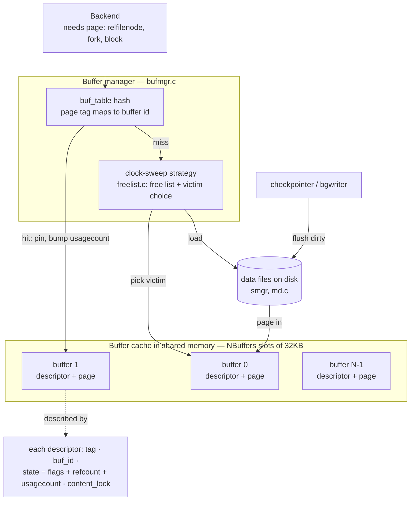
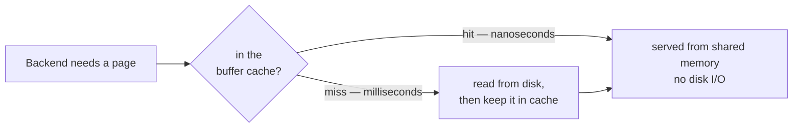
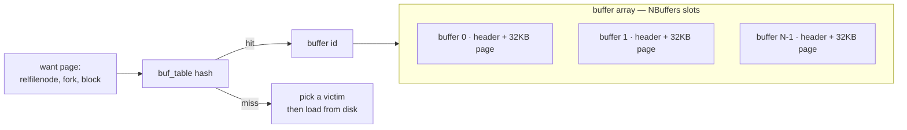
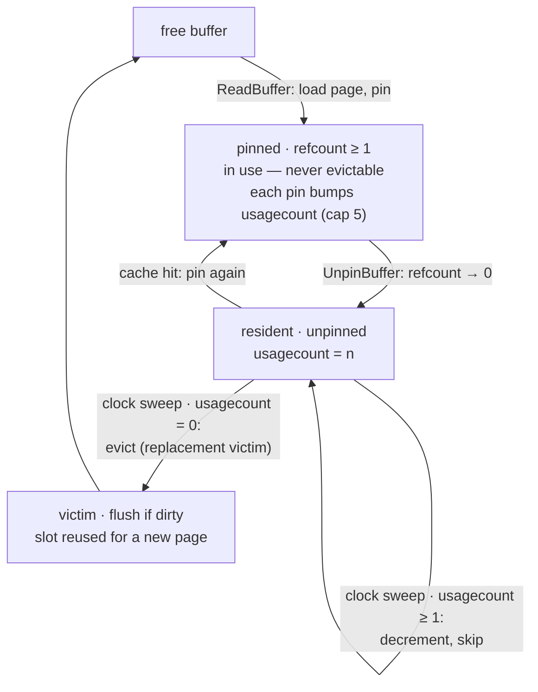
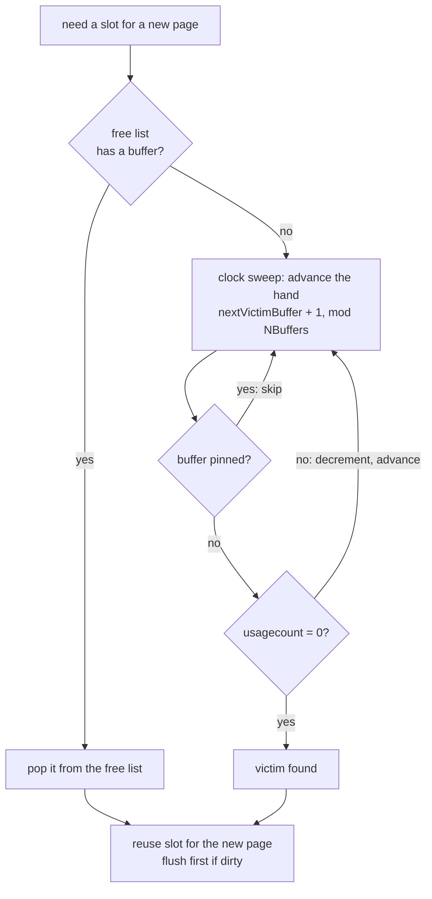
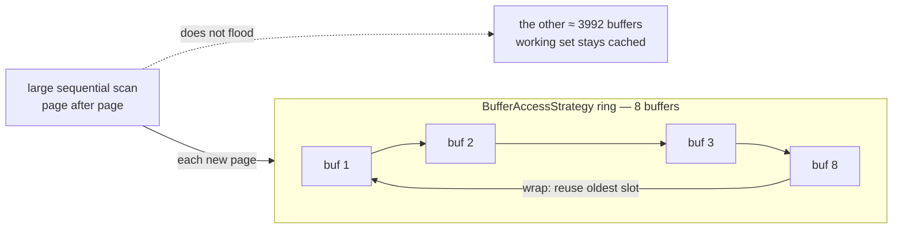
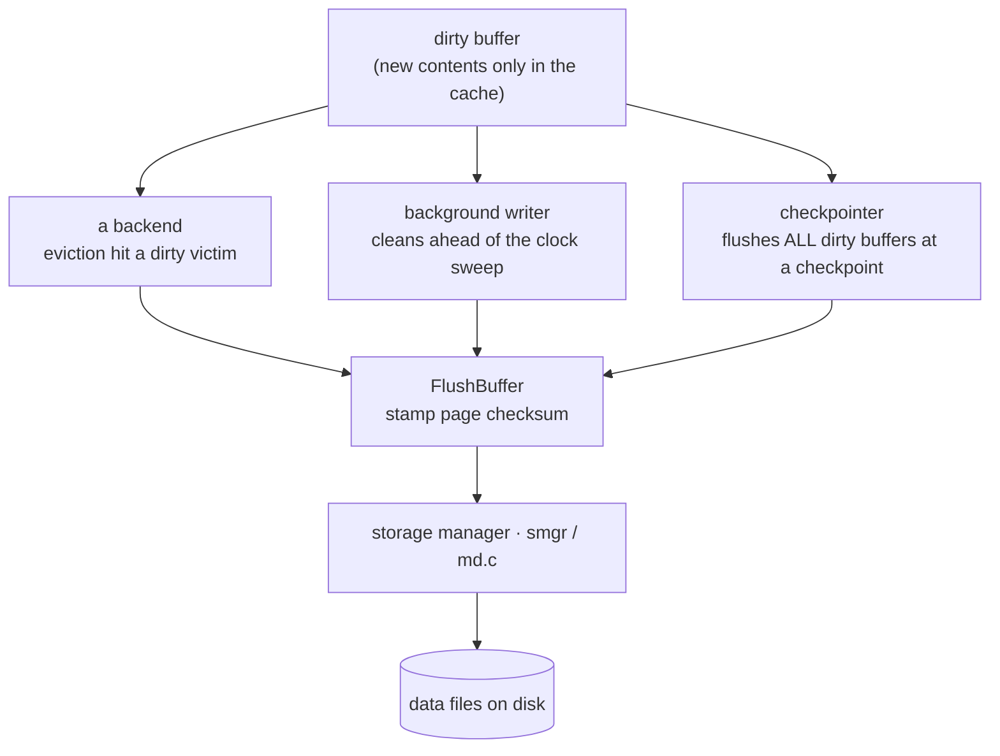
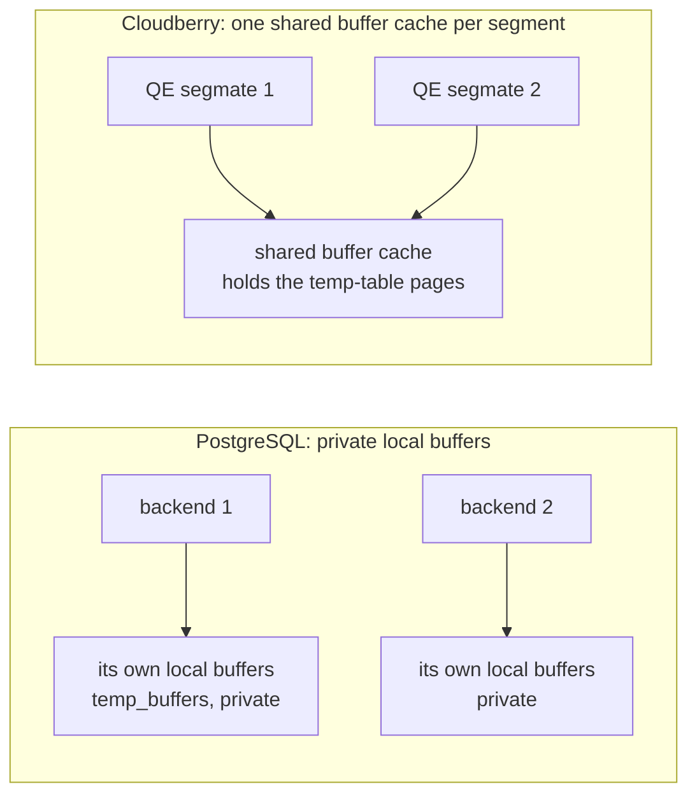

<!--
  Licensed to the Apache Software Foundation (ASF) under one
  or more contributor license agreements.  See the NOTICE file
  distributed with this work for additional information
  regarding copyright ownership.  The ASF licenses this file
  to you under the Apache License, Version 2.0 (the
  "License"); you may not use this file except in compliance
  with the License.  You may obtain a copy of the License at

    http://www.apache.org/licenses/LICENSE-2.0

  Unless required by applicable law or agreed to in writing,
  software distributed under the License is distributed on an
  "AS IS" BASIS, WITHOUT WARRANTIES OR CONDITIONS OF ANY
  KIND, either express or implied.  See the License for the
  specific language governing permissions and limitations
  under the License.
-->

<a id="3-buffer-cache"></a>



*单个缓冲区缓存的构成。后端按标签请求页面；buf_table 哈希表将其映射到 NBuffers 槽共享内存数组中的一个槽位。命中时固定该槽位并增加 usagecount；未命中时，时钟扫描策略选择一个牺牲者，并通过 smgr 从磁盘加载页面。检查点进程和后台写入器将脏页面写回。每个 Segment 和 Coordinator 都独立执行这一过程，这就是 [§3.1.2](#312-not-one-cache-but-n1) 所说的 N+1 个缓存。*

## 3.1 缓存与缓冲区缓存设计 {#31-caching--buffer-cache-design}

### 3.1.1 数据库为什么需要缓存 {#311-why-a-database-keeps-a-cache}

Segment 的表和索引数据位于磁盘文件中，但磁盘访问以毫秒计，而内存访问只需纳秒。如果每条查询都要为每个页面访问磁盘，吞吐量会急剧下降。因此 Cloudberry 和 PostgreSQL 一样，会把最近使用的页面保存在一块称为**缓冲区缓存**的共享内存区域中，并从 RAM 为重复访问提供服务。操作系统也会缓存同一批文件；Cloudberry 通过普通的带缓冲文件操作读写文件，接受双重缓存的代价，以换取可移植性。



*缓存存在的原因：命中时从共享内存以纳秒级速度返回；只有未命中才需要承担毫秒级磁盘成本，而且取回的页面会保留在缓存中，因此下一次访问就会命中。*

缓存的单位是**页面**。在此构建中，一个页面为 **32 KB**；Cloudberry 将 PostgreSQL 默认的 8 KB 提高到这个大小，以适应分析型工作负载常见的大型顺序扫描：

```c {title="src/include/pg_config.h — BLCKSZ"}
#define BLCKSZ 32768   /* 32 KB pages (PostgreSQL default is 8192) */
```

### 3.1.2 不是一个缓存，而是 N+1 个缓存 {#312-not-one-cache-but-n1}

这里是 MPP 第一次偏离教科书模型的地方。Cloudberry 集群由一个 Coordinator 和一组 Segment 组成，每个 Segment 都是一个拥有**自己**共享内存的 PostgreSQL 进程，因此每个 Segment 有一个独立的缓冲区缓存，Coordinator 上另外还有一个。Coordinator 的缓存保存目录页面，以及偶尔使用的只存在于 Coordinator 上或已复制的表；**用户表数据缓存在保存它的 Segment 上**，永远不会缓存在 Coordinator 上。我们将在 [§3.2](#32-cache-hits-pinning--usage-count) 直接看到这一点。

`shared_buffers` 独立确定每个缓存的大小。在这个演示集群中，Coordinator 的缓存为 125 MB；由于页面为 32 KB，这正好是 4000 个缓冲区：

*按页面计算的 `shared_buffers`：125 MB ÷ 32 KB = 4000 个缓冲区。*

```sql
SELECT current_setting('block_size') AS block_size,
       pg_size_pretty(pg_size_bytes(current_setting('shared_buffers'))) AS shared_buffers,
       pg_size_bytes(current_setting('shared_buffers'))
       / pg_size_bytes(current_setting('block_size')) AS nbuffers;
```

```text {hl_lines="3" title="output"}
 block_size | shared_buffers | nbuffers
------------+----------------+----------
 32768      | 125 MB         |     4000
```

### 3.1.3 结构：缓冲区数组 {#313-the-structure-an-array-of-buffers}

每个缓存本质上都是一个 `NBuffers` 个**缓冲区**组成的数组；缓冲区 *i* 是一个固定大小为 32 KB、容纳一个页面的槽位，同时配有一个**缓冲区描述符**（头部），记录槽位包含什么，以及它当前如何使用。描述符被刻意设计得很小，使头部数组对 CPU 缓存行更友好：

```c {title="src/include/storage/buf_internals.h — BufferDesc"}
typedef struct BufferDesc
{
    BufferTag        tag;            /* which page: relfilenode, fork, block */
    int              buf_id;         /* buffer index, from 0 */
    pg_atomic_uint32 state;          /* flags + refcount + usagecount, packed */
    int              wait_backend_pgprocno;
    int              freeNext;       /* link in the free list */
    LWLock           content_lock;   /* guards the page contents */
} BufferDesc;
```

*缓冲区描述符跟踪的信息。*

- `tag` — 页面身份：relfilenode · fork · block
- `buf_id` — 数组中的槽位索引
- `state` — 脏/有效标志 + 固定引用计数 + usagecount
- `content_lock` — 页面共享锁/排他锁

要判断某个页面是否已缓存，管理器不能扫描 4000 个描述符。它使用一个哈希表——**buf_table**——将页面身份（其 `BufferTag`）映射到保存它的缓冲区 ID：



*定位页面：buf_table 哈希表将（relfilenode、fork、block）映射到数组中的缓冲区 ID。*

> [!NOTE]
> 哈希表位于 `src/backend/storage/buffer/buf_table.c`（`BufTableLookup`，`buf_table.c`）；描述符数组和缓存则在 `buf_init.c` 中建立。相同的结构——数组加哈希表——还会在引擎各处重复出现，例如 clog 和分布式日志背后的 SLRU 缓存（[§10.5](/cloudberry/core-internals/part-3-transactions-mvcc-concurrency/ch10/#105-distributed-snapshots--the-distributed-log)）。

### 3.1.4 使用 pg_buffercache 检查缓存 {#314-inspecting-the-cache-with-pg_buffercache}

`pg_buffercache` 扩展为每个缓冲区公开一行，因此我们可以把缓存当作一张表来观察。下面复用一个小型辅助函数，它只显示保存指定关系的缓冲区，并把分支编号解码为名称：

*参照 Rogov 的 `buffercache` 辅助函数，为单个关系的缓冲区提供可复用的查看方式。*

```sql
CREATE EXTENSION IF NOT EXISTS pg_buffercache;

CREATE FUNCTION buffercache(rel regclass) RETURNS TABLE(
  bufferid int, relfork text, relblk bigint,
  isdirty bool, usagecount smallint, pins int) AS $$
  SELECT bufferid,
    CASE relforknumber WHEN 0 THEN 'main' WHEN 1 THEN 'fsm' WHEN 2 THEN 'vm' END,
    relblocknumber, isdirty, usagecount, pinning_backends
  FROM pg_buffercache
  WHERE relfilenode = pg_relation_filenode(rel)
  ORDER BY relforknumber, relblocknumber;
$$ LANGUAGE sql;
```

```text {title="output"}
CREATE EXTENSION
CREATE FUNCTION
```

[§3.2](#32-cache-hits-pinning--usage-count) 将使用这个函数，并立即遇到 N+1 缓存的现实。

## 3.2 缓存命中、固定与使用计数 {#32-cache-hits-pinning--usage-count}



*缓存缓冲区的生命周期——[§3.2](#32-cache-hits-pinning--usage-count) 的主线。页面被加载并固定以供使用；取消固定后，它仍驻留在缓存中并保留 usagecount；当时钟扫描稍后发现它未固定且 usagecount 为 0 时，该缓冲区就成为替换牺牲者（详见 [§3.3](#33-cache-misses-eviction--clock-sweep)）。*

### 3.2.1 页面进入缓存 {#321-a-page-enters-the-cache}

创建一张只有一行的表，查找它所在的页面。按照 Rogov 的做法，我们关闭 autovacuum，避免后台进程在我们不知情的情况下访问这张表：

*创建分布式表并插入一行。*

```sql
CREATE TABLE cacheme(id integer)
  WITH (autovacuum_enabled = off) DISTRIBUTED BY (id);
INSERT INTO cacheme VALUES (2);
```

```text {title="output"}
CREATE TABLE
INSERT 0 1
```

在单节点 PostgreSQL 上，新页面此时会位于缓冲区缓存中，`buffercache('cacheme')` 会显示它。在 Cloudberry 上，Coordinator 显示**空结果**：

*Coordinator 的缓存不包含分布式表的数据页面。*

```sql
SELECT * FROM buffercache('cacheme');
```

```text {title="output"}
 bufferid | relfork | relblk | isdirty | usagecount | pins
----------+---------+--------+---------+------------+------
(0 rows)
```

这一行被哈希到某个 Segment，因此页面在那里创建并缓存。直接连接 Segment 0（utility 模式，使用它自己的端口）就能找到它：

*对 Segment 0（端口 7102，utility 模式）执行相同的查找：主分支的块 0 为脏，usagecount 为 1。*

```bash
PGOPTIONS='-c gp_role=utility' psql -p 7102 -d postgres

SELECT bufferid, relblocknumber AS relblk, isdirty, usagecount,
       pinning_backends AS pins
FROM pg_buffercache
WHERE relfilenode = (SELECT relfilenode FROM pg_class WHERE relname='cacheme');
```

```text {title="output"}
 bufferid | relblk | isdirty | usagecount | pins
----------+--------+---------+------------+------
      292 |      0 | t       |          1 |    0
```

> [!NOTE]
> **要点：** 不存在一个可以从集群整体角度推理的单一缓冲区缓存。每个 Segment 缓存它所保存的数据；Coordinator 缓存目录和驻留在 Coordinator 上的数据。缓存命中率、预热和驱逐都是**按 Segment**计算的属性——查询的速度只能与它等待的缓存最冷的 Segment 一样快。

页面是**脏的**（`isdirty = t`）：插入操作修改了内存中的页面，而页面尚未写回；这正是检查点进程和后台写入器的工作（[§3.5](#35-background-writer--checkpointer)）。它的 **usagecount** 为 1，当前没有后端将其**固定**。

### 3.2.2 固定与使用计数 {#322-pinning-and-the-usage-count}

描述符的 `state` 中有两个计数器决定缓冲区的命运。**pin**（上面显示的引用计数 `pins`）表示缓冲区正在使用：后端读写页面时会固定缓冲区，已固定的缓冲区绝不会被驱逐。**usagecount** 是一个热度分数——每次缓冲区被固定时增加，驱逐时钟扫过它时减少（[§3.3](#33-cache-misses-eviction--clock-sweep)）。重新读取页面会增加该计数，最高到一个较小的上限 `BM_MAX_USAGE_COUNT = 5`：

*在 Segment 0 上再次扫描 `cacheme` 两次；usagecount 从 1 增加到 3。*

```sql
SELECT count(*) FROM cacheme;   -- once
SELECT count(*) FROM cacheme;   -- twice
SELECT usagecount, isdirty, pinning_backends AS pins FROM pg_buffercache
WHERE relfilenode = (SELECT relfilenode FROM pg_class WHERE relname='cacheme');
```

```text {hl_lines="3" title="output"}
 usagecount | isdirty | pins
------------+---------+------
          3 | t       |    0
```

由于当前没有正在进行的扫描，pin 计数回到了 0，但 usagecount 现在为 3。缓存填满时，时钟扫描算法正是使用这个原始数据来选择牺牲者（[§3.3](#33-cache-misses-eviction--clock-sweep)）。

`ReadBuffer` → `ReadBuffer_common` → `BufTableLookup（哈希查找）` → `PinBuffer + 递增 usagecount`

> [!NOTE]
> 读取路径：`ReadBuffer` → `ReadBuffer_common`（`src/backend/storage/buffer/bufmgr.c`）→ `BufTableLookup`；命中时固定缓冲区并增加 usagecount，最大值为 `BM_MAX_USAGE_COUNT`（`buf_internals.h`；增加操作位于 `bufmgr.c` 的 `PinBuffer()`）。

### 3.2.3 使用 EXPLAIN 统计页面访问 {#323-counting-page-accesses-with-explain}

实际工作中，你很少逐个 Segment 查询 `pg_buffercache`。日常使用的工具是 `EXPLAIN (analyze, buffers)`，它报告查询发现已经缓存的页面数量（**hit**）以及必须从磁盘读取的页面数量（**read**）：

*对一个包含 50 000 行的分布式表执行 `EXPLAIN (analyze, buffers)`。*

```sql
EXPLAIN (analyze, buffers, costs off, timing off, summary off)
SELECT count(*) FROM demo_t;
```

```text {title="output"}
 Aggregate (actual rows=1 loops=1)
   ->  Gather Motion 3:1  (slice1; segments: 3) (actual rows=50000 loops=1)
         ->  Seq Scan on demo_t (actual rows=16718 loops=1)
 Planning:
   Buffers: shared hit=2427
 Optimizer: GPORCA
```

该计划是分布式的——`Gather Motion` 将行从三个 Segment 拉回 Coordinator（Motion 是 [§19](/cloudberry/core-internals/part-4-query-processing/ch19/) 的主题）。这里的 `Buffers: shared hit=2427` 行表示 **Coordinator** 在规划阶段访问目录的情况；Segment 的扫描缓冲区在各自的 Segment 上统计。与缓存本身一样，MPP 计划中的缓冲区统计也是按节点计算的。

> [!NOTE]
> **读取数字。** `shared hit` = 由缓冲区缓存提供的页面；`shared read` = 从 OS 获取的页面（仍然可能命中 OS 缓存）。缓存已预热的稳定工作负载主要是命中；冷缓存或过大的扫描会显示读取。由于每个 Segment 都有自己的缓存（[§3.1.2](#312-not-one-cache-but-n1)），同一条查询在已预热的 Segment 上可能以命中为主，在刚重启的 Segment 上则可能以读取为主。

## 3.3 缓存未命中、驱逐与时钟扫描 {#33-cache-misses-eviction--clock-sweep}



*为新页面寻找槽位。首先查询空闲列表；只有空闲列表为空时才运行时钟扫描，沿缓冲区数组移动一根指针——跳过已固定的缓冲区，降低未固定缓冲区的 usagecount，并取走遇到的第一个 usagecount 为 0 的缓冲区。*

### 3.3.1 未命中路径：先空闲列表，再驱逐 {#331-the-miss-path-free-list-then-eviction}

在 [§3.2](#32-cache-hits-pinning--usage-count) 中，后端需要的页面已经驻留。当 `buf_table` 查找发生*未命中*时，管理器必须腾出一个槽位，用来存放即将读入的页面。`BufferAlloc`（`src/backend/storage/buffer/bufmgr.c`）把选择工作交给 `StrategyGetBuffer`（`src/backend/storage/buffer/freelist.c`），后者按顺序从两个来源获取槽位：

`BufferAlloc` → `GetVictimBuffer` → `StrategyGetBuffer` → `空闲链表 ·否则· 时钟扫描`

**先查空闲列表。** 启动时每个缓冲区都是空闲的；`VACUUM` 以及被删除或截断的关系也会把缓冲区归还给列表。无锁的 `have_free_buffer` 探查（`freelist.c`）和 `firstFreeBuffer` 头指针（`freelist.c` 中的 `StrategyGetBuffer()`）无需扫描就能返回槽位。只有空闲列表为空，也就是内存已经完全填充后，才会运行时钟扫描。

在这个 Segment 上，4000 个缓冲区中仍有 3711 个空闲，因此当前的分配可以直接从空闲列表满足；时钟扫描还没有运行过：

*Segment 0：已占用的缓冲区数量，以及仍在空闲列表中的数量。*

```bash
PGOPTIONS='-c gp_role=utility' psql -p 7102 -d postgres

SELECT count(*) FILTER (WHERE relfilenode IS NOT NULL) AS used,
       count(*) FILTER (WHERE relfilenode IS NULL)     AS free
FROM pg_buffercache;
```

```text {title="output"}
 used | free
------+------
  289 | 3711
(1 row)
```

> [!NOTE]
> 空闲列表是快速路径——只要存在空闲缓冲区，就不会驱逐页面。驱逐是让**已完全填满**的缓存保持有用的后备机制：通过移走冷页面，为热页面腾出空间。

### 3.3.2 时钟扫描算法 {#332-the-clock-sweep-algorithm}

真正的 LRU 必须在*每次*页面访问时重排一个列表，这对热路径来说代价太高。Cloudberry 改用**时钟扫描**来近似实现。可以想象 `NBuffers` 个槽位排列成一个圆，只有一根指针 `nextVictimBuffer`；`ClockSweepTick`（`freelist.c`）每次调用将指针原子地向前移动一个槽位，以 `NBuffers` 为模循环，并在每次转完一整圈时增加 `completePasses` 计数器。

```c {title="src/backend/storage/buffer/freelist.c — StrategyGetBuffer()"}
/* Nothing on the freelist, so run the "clock sweep" algorithm */
for (;;)
{
    buf = GetBufferDescriptor(ClockSweepTick());        /* advance the hand */
    local_buf_state = LockBufHdr(buf);

    if (BUF_STATE_GET_REFCOUNT(local_buf_state) == 0)   /* not pinned?      */
    {
        if (BUF_STATE_GET_USAGECOUNT(local_buf_state) != 0)
            local_buf_state -= BUF_USAGECOUNT_ONE;      /* decay, keep going */
        else
            return buf;                                 /* victim found      */
    }
    UnlockBufHdr(buf, local_buf_state);
}
```

指针在每个槽位应用一条规则。**已固定**的缓冲区（引用计数非零）正在使用，直接跳过，不做任何改变。未固定但 **usagecount 大于 0** 的缓冲区会减少 usagecount，然后跳过；指针每经过一次，其热度就衰减一格。第一个已经是 **usagecount 0** 的未固定缓冲区会成为牺牲者。`trycounter` 被重置为 `NBuffers`（`freelist.c` 中的 `StrategyGetBuffer()`），用于防止所有缓冲区都被固定时陷入异常情况；此时它会抛出错误，而不是无限循环。

usagecount 列正是扫描读取的衰减状态。一个实时快照显示，热工作集的 usagecount 达到 5 的上限（`BM_MAX_USAGE_COUNT`，`src/include/storage/buf_internals.h`）；这些缓冲区需要指针将计数递减五次才可被替换，同时空闲列表仍然很长，扫描还没有触及它：

*Segment 0：缓存中 usagecount 的分布（NULL 表示空闲、未使用的缓冲区）。*

```sql
SELECT usagecount, count(*)
FROM pg_buffercache
GROUP BY usagecount
ORDER BY usagecount;
```

```text {hl_lines="7 8" title="output"}
 usagecount | count
------------+-------
          1 |    10
          2 |    35
          3 |     9
          4 |     8
          5 |   227
            |  3711
(6 rows)
```

> [!NOTE]
> 把它看作时钟扫描的输入。227 个 usagecount 为 5 的缓冲区构成热工作集——指针要将它们递减五次后它们才有资格被驱逐，因此几乎总能存活一轮扫描。3711 个 NULL 仍在空闲列表中，这正是当前还没有扫描发生的原因：只要有空闲缓冲区，就不会为了回收页面而把某个页面衰减到 usagecount 0。

### 3.3.3 驱逐牺牲者：脏时先写回，再重新标记 {#333-evicting-the-victim-flush-if-dirty-then-re-tag}

选中的牺牲者可能仍然持有一个**脏**页面——页面在内存中被修改但尚未写出。`GetVictimBuffer`（`src/backend/storage/buffer/bufmgr.c`）检查 `BM_DIRTY`，如果已设置，就在槽位重用**之前**通过 `FlushBuffer` 写出页面。根据预写式规则（第 [20](/cloudberry/core-internals/part-5-high-availability-recovery/ch20/) 章），该页面的 WAL 已经持久化，因此这里只是延迟的数据写入终于发生。

```c {title="src/backend/storage/buffer/bufmgr.c — GetVictimBuffer()"}
if (buf_state & BM_DIRTY)
{
    /* take a share lock, recheck, then write the page out */
    FlushBuffer(buf_hdr, NULL, IOOBJECT_RELATION, io_context);
    ...
}
```

页面干净（或者本来就干净）后，缓冲区会从 `buf_table` 中以旧标签删除，并以新页面的标签重新插入；槽位现在保存新读入的页面，请求它的后端将其固定，重新进入 [§3.2](#32-cache-hits-pinning--usage-count) 所述的生命周期。干净的牺牲者可以直接驱逐；脏牺牲者需要执行一次写入，这正是后台写入器和检查点进程（[§3.5](#35-background-writer--checkpointer)）努力在指针到达之前写出脏页面的原因。

> [!NOTE]
> **这里会产生一个风险：** 一次大型顺序扫描可能让指针绕完整个缓存，把整个工作集换成只会读取一次的缓存页面。Cloudberry 使用**环形缓冲区**防止这种情况——详见 [§3.4](#34-ring-buffers--bulk-eviction)。

## 3.4 环形缓冲区与批量驱逐 {#34-ring-buffers--bulk-eviction}



*批量读取限制在一个很小的 BufferAccessStrategy 环中，并循环复用自己的槽位，因此一次性扫描巨大表时，不会驱逐缓存其余部分中的热工作集。*

### 3.4.1 批量读取为什么需要环 {#341-why-bulk-reads-need-a-ring}

[§3.3](#33-cache-misses-eviction--clock-sweep) 中的时钟扫描假设被缓存的页面值得保留。一次性的大扫描会破坏这个假设。设想一个报告顺序读取一张 72 MB 的表——在这个 Segment 上是 2299 个页面。如果走普通路径，这 2299 个页面会不断进入 4000 缓冲区的缓存，并驱逐并发 OLTP 查询所依赖的大部分*热*工作集；而这些被缓存的页面只会被扫描读取一次，之后再也不会访问。一个批量读取者就可能把缓存**冲垮**。

Cloudberry 与 PostgreSQL 一样，通过给批量操作分配一个小型、固定的**缓冲区访问策略**来避免这种情况：它只包含少量缓冲区，组成一个循环使用的*环*，而不是从整个缓存中借用槽位。其他缓冲区中的热工作集不受影响。

> [!NOTE]
> 这在 MPP 分析型数据库中更加重要：大型顺序扫描在这里是*常见情况*，而不是例外；限制它们的范围，才能让繁忙 Segment 的缓存继续服务其他查询。

### 3.4.2 BufferAccessStrategy 环 {#342-the-bufferaccessstrategy-ring}

知道自己会一次性访问很多页面的调用者，会使用 `GetAccessStrategy(btype)` 请求一个策略，再将其传递给 `ReadBufferExtended`。共有四种策略类型，其中三种会构造环，大小在 `freelist.c` 中定义：

```c {title="src/include/storage/bufmgr.h — BufferAccessStrategyType"}
typedef enum BufferAccessStrategyType
{
    BAS_NORMAL,     /* normal random access — no ring, uses the whole cache */
    BAS_BULKREAD,   /* large read-only scan */
    BAS_BULKWRITE,  /* large multi-block write, e.g. COPY IN */
    BAS_VACUUM      /* VACUUM */
} BufferAccessStrategyType;
```

`GetAccessStrategy` 选择一个以*千字节*为单位的环大小；`GetAccessStrategyWithSize` 随后将其除以页面大小转换为缓冲区数量，并将上限设为缓存的八分之一。由于此构建使用 32 KB 页面，这些环的缓冲区数量比标准 PostgreSQL 使用 8 KB 页面时更少：

*本集群中的缓冲区访问策略及其环大小（32 KB 页面，shared_buffers = 4000 个缓冲区）。*

| 策略 | 用途 | 环大小 | 32 KB 下的缓冲区数 |
| --- | --- | --- | --- |
| `BAS_BULKREAD` | 大型只读顺序扫描 | 256 KB | 8 |
| `BAS_BULKWRITE` | `COPY IN`、`CREATE TABLE AS` | 16 MB | 512 → 500（上限 = NBuffers/8） |
| `BAS_VACUUM` | `VACUUM` | 256 KB | 8 |
| `BAS_NORMAL` | 随机访问 | — 无 — | 使用完整的 4000 缓冲区缓存 |

`GetAccessStrategy(BAS_BULKREAD)` → `ReadBufferExtended(rel, blk, RBM_NORMAL, strategy)` → `StrategyGetBuffer 复用环中的槽位`

仅仅复用还不够。如果扫描希望回收的环槽位中有一个**脏**页面，写出它可能必须先刷新 WAL，这会给读取带来昂贵的意外开销。`StrategyRejectBuffer` 负责处理这种情况：在 bulkread 模式下，它将这个脏缓冲区从环中移除，改为请求一个新的牺牲者，因此读取不会因 WAL 停顿。

> [!NOTE]
> 来源——策略类型见 `src/include/storage/bufmgr.h`（`BufferAccessStrategyType`）；环大小和缓存八分之一上限见 `src/backend/storage/buffer/freelist.c`（`GetAccessStrategy()`）、（`GetAccessStrategy`）以及 `freelist.c` 中的 `GetAccessStrategyWithSize()`；脏缓冲区拒绝见 `freelist.c` 中的 `StrategyRejectBuffer()`（`StrategyRejectBuffer`）。`COPY` 在 `src/backend/access/heap/heapam.c`（`GetBulkInsertState()`）中请求批量写环。

### 3.4.3 顺序扫描何时切换到环 {#343-when-a-sequential-scan-switches-to-the-ring}

顺序扫描并不总是使用环——对于小表，缓存每个页面正是你想要的行为。切换在 `initscan` 中按扫描决定：只有当关系大于缓存的四分之一时，堆扫描才采用 bulkread 环。

```c {title="src/backend/access/heap/heapam.c — initscan()"}
if (!RelationUsesLocalBuffers(scan->rs_base.rs_rd) &&
    scan->rs_nblocks > NBuffers / 4)
{
    allow_strat = ...;           /* large enough — use a strategy */
}
...
scan->rs_strategy = GetAccessStrategy(BAS_BULKREAD);   /* heapam.c:301 */
```

在这个集群上，缓存有 4000 个缓冲区，因此阈值是 **1000 个块**（约 31 MB）。我们可以看到两张表分别落在哪一侧——直接查询 Segment 0，因为阈值是针对每个 Segment 自己的分片应用的：

*在 Segment 0 上：bc_small（231 个块）通过普通缓存扫描；bc_ring（2299 个块）超过 1000 块阈值，使用 bulkread 环。*

```sql
-- on segment 0 (PGOPTIONS='-c gp_role=utility' … -p 7102)
SELECT relname,
       pg_relation_size(oid)/32768 AS blocks,           -- 32 KB pages
       4000/4 AS ring_threshold_blocks,                 -- NBuffers/4
       CASE WHEN pg_relation_size(oid)/32768 > 4000/4
            THEN 'BAS_BULKREAD ring' ELSE 'normal strategy' END AS seqscan_uses
FROM pg_class WHERE relname IN ('bc_ring','bc_small') ORDER BY blocks;
```

```text {hl_lines="4" title="output"}
 relname  | blocks | ring_threshold_blocks |   seqscan_uses
----------+--------+-----------------------+-------------------
 bc_small |    231 |                  1000 | normal strategy
 bc_ring  |   2299 |                  1000 | BAS_BULKREAD ring
(2 rows)
```

在 Segment 上再次使用 `EXPLAIN (analyze, buffers)` 读取 `bc_ring`（扫描实际发生在这里），可以确认扫描访问了全部 2299 个页面：

*顺序扫描访问 bc_ring 的全部 2299 个页面（这里全部命中，因为缓存已预热）。如果没有环，这 2299 个页面各自都会占用一个缓冲区，一次性读取就会为单个查询驱逐超过一半的 4000 缓冲区缓存；环将扫描限制在 8 个缓冲区内。*

```sql
-- on segment 0 (utility mode)
EXPLAIN (analyze, buffers, costs off, timing off, summary off)
SELECT count(*) FROM bc_ring;
```

```text {title="output"}
 Aggregate (actual rows=1 loops=1)
   Buffers: shared hit=2299
   ->  Seq Scan on bc_ring (actual rows=399919 loops=1)
         Buffers: shared hit=2299
 Planning:
   Buffers: shared hit=153
 Optimizer: Postgres query optimizer
(7 rows)
```

> [!NOTE]
> 这里全是 `hit`，反映的是已预热的缓存（刚刚加载过这些行）。关键在于数量：一次扫描有 **2299 个页面**。环阻止这 2299 个页面驱逐工作集，无论表有多大，都将批量读取者限制在 8 个缓冲区内。并且由于每个 Segment 都针对自己的分片计算 `rs_nblocks > NBuffers/4`，同一张表可能在保存较多数据的 Segment 上使用环，在只保存少量数据的 Segment 上使用普通缓存。

## 3.5 后台写入器与检查点进程 {#35-background-writer--checkpointer}



*三个角色会把脏页面写回磁盘。当驱逐遇到脏牺牲者时，后端同步写出页面；后台写入器在时钟扫描之前清理缓冲区；检查点进程在检查点刷新所有脏缓冲区。三者都经过 FlushBuffer，由它写入页面校验和，然后交给 smgr。*

### 3.5.1 写脏页面的三个角色 {#351-three-writers-of-dirty-pages}

在缓存中被修改的页面是**脏页面**：其新内容只存在于共享内存中。提交并不会写回该页面，而只刷新 WAL（NO-FORCE 策略，见 [§20.1](/cloudberry/core-internals/part-5-high-availability-recovery/ch20/#201-overview--recovery-foundations)）。因此脏页面会不断积累，最终必须有人把它们移到磁盘。可以执行这项工作的是三个角色，但它们并不等价：

- **驱逐时的后端** — 当后端需要空闲槽位，而时钟扫描找到一个*脏*牺牲者时，后端必须在重用槽位前自行写出该页面——这是直接位于查询关键路径上的同步磁盘写入。其他两个角色存在的目的，就是避免这种慢情况。
- **后台写入器** — 一个专门进程，在时钟扫描前方主动清理脏缓冲区，使后端通常能找到干净的牺牲者，很少因写入而阻塞。
- **检查点进程** — 在检查点处一次刷新**所有**脏缓冲区，使截至该点的所有更改都持久化到磁盘；这样崩溃恢复可以从检查点开始，而不是从日志开头开始。

> [!NOTE]
> 三者都汇入一个 `FlushBuffer`（`src/backend/storage/buffer/bufmgr.c`）；它先用 `PageSetChecksumCopy`（`bufmgr.c` 中的 `FlushBuffer()`）写入页面的**校验和**，再将页面交给存储管理器。后台写入器和检查点进程共享辅助函数 `SyncOneBuffer`（`bufmgr.c`）。

### 3.5.2 后台写入器循环 {#352-the-background-writer-loop}

后台写入器运行 `BackgroundWriterMain`（`src/backend/postmaster/bgwriter.c`）：它定期唤醒并调用 `BgBufferSync`（`src/backend/storage/buffer/bufmgr.c`）。它不扫描整个缓冲池，而是查看时钟扫描即将分配的位置，并在那条路径上清理有限数量的脏缓冲区，使下一个需要槽位的后端能直接找到已清理的槽位。当扫描已经绕过后台写入器且分配趋于安静时，它会进入休眠。

`BackgroundWriterMain` → `BgBufferSync` → `SyncOneBuffer` → `FlushBuffer` → `smgr 写入`

`bgwriter_flush_after`（这里是 **64 个页面 = 2 MB**）限制后台写入器在请求内核刷新前写入 OS 的数据量，从而平滑它向下游提交的写入速率。

### 3.5.3 检查点进程 {#353-the-checkpointer}

检查点进程（`CheckpointerMain`，`src/backend/postmaster/checkpointer.c`）会在 `checkpoint_timeout` 到期、WAL 量超过 `max_wal_size` 阈值，或显式执行 `CHECKPOINT` 时启动检查点。它在缓冲区缓存方面使用 `BufferSync`（`src/backend/storage/buffer/bufmgr.c`），遍历整个缓冲池并刷新**每个**脏缓冲区。为避免写入风暴，它会在该时间间隔的 `checkpoint_completion_target` 范围内分散这项工作。

*本集群中控制检查点和后台写入节奏的参数。*

```sql
SELECT name, setting, unit FROM pg_settings
WHERE name IN ('checkpoint_timeout','checkpoint_completion_target',
               'max_wal_size','bgwriter_flush_after')
ORDER BY name;
```

```text {title="output"}
             name             | setting | unit
------------------------------+---------+------
 bgwriter_flush_after         | 64      | 32kB
 checkpoint_completion_target | 0.9     |
 checkpoint_timeout           | 300     | s
 max_wal_size                 | 1024    | MB
(4 rows)
```

> [!NOTE]
> 为什么要一次刷新全部页面？检查点是恢复可以安全开始的位置：此前的每项更改都已经在磁盘上，因此只需重放检查点*之后*写入的 WAL。这部分故事——检查点记录、重做点、恢复——见 [§20.2.6](/cloudberry/core-internals/part-5-high-availability-recovery/ch20/#2026-checkpoints-online-vs-shutdown-triggering-and-restartpoints)。

### 3.5.4 使用 pg_stat_bgwriter 监控 {#354-monitoring-with-pg_stat_bgwriter}

`pg_stat_bgwriter` 持续统计是谁写了什么。由于表数据位于 Segment 上，应当在那里观察；Coordinator 的写进程几乎处于空闲状态。下面是一个 Segment 在向 `bc_bgw` 插入 200,000 行并强制执行检查点前后的状态：

*Segment 0（utility 模式）在插入和 CHECKPOINT 前后的状态。检查点进程和后端都发生变化；由于空闲列表始终未耗尽，后台写入器在这里保持空闲。*

```sql
-- on segment 0: snapshot, then INSERT 200000 rows + CHECKPOINT on the coordinator, then snapshot again
SELECT checkpoints_req, buffers_checkpoint, buffers_clean, buffers_backend
FROM pg_stat_bgwriter;
```

```text {title="output"}
 checkpoints_req | buffers_checkpoint | buffers_clean | buffers_backend
-----------------+--------------------+---------------+-----------------
               2 |               1673 |          8176 |           34006     -- before
               3 |               4324 |          8176 |           35841     -- after
```

检查点写出了 **2 651** 个缓冲区（`buffers_checkpoint` 从 1673 增加到 4324）；后台写入器没有在扫描前清理任何缓冲区（`buffers_clean` 未改变——仍有空闲缓冲区可用，时钟扫描从未运行，因此没有需要它提前清理的页面）；插入运行期间，后端在驱逐时自行写出了 **1 835** 个页面（`buffers_backend` 增加 1835）。

> [!NOTE]
> **健康检查：** 希望 `buffers_backend` 相对于 `buffers_checkpoint + buffers_clean` 较小。后端占比较大意味着查询正在停下来写入自己的脏牺牲者；解决方法是让后台写入器更积极，或更频繁地执行检查点。而且这也是**按 Segment**计算的：每个 Segment 都运行自己的后台写入器和检查点进程，因此单个落后的 Segment 就可能拖慢一条查询。

## 3.6 本地缓存与临时表 {#36-local-cache--temp-tables}



*临时表的页面存放在哪里。PostgreSQL 为每个后端提供自己的私有本地缓存来保存临时表页面；Cloudberry 没有可用的本地缓存，临时表页面位于 Segment 的一个共享缓冲区缓存中，因此同一 gang 的所有 QE segmate 都能看到相同的数据。*

### 3.6.1 PostgreSQL 的私有本地缓冲区 {#361-postgresqls-private-local-buffers}

临时表只对创建它的会话可见，因此 PostgreSQL 从不通过共享缓冲区缓存路由它的页面。相反，每个后端都维护自己的**本地缓冲区缓存**：这是一个由 `temp_buffers`（这里为 1024 个页面，即 32 MB）确定大小、在 `localbuf.c` 中管理的私有数组。由于页面只属于后端自身，本地缓冲区不需要共享缓存为安全性提供的任何机制：没有缓冲区映射分区锁、没有原子固定计数，也没有进程间协调。

> [!NOTE]
> 在 PostgreSQL 中，路由很直接：临时关系的 `RelationUsesLocalBuffers()` 为 **true**，因此缓冲区管理器将读取发送给 `LocalBufferAlloc`，而不是共享缓存。

### 3.6.2 Cloudberry 为什么使用共享缓冲区 {#362-why-cloudberry-uses-shared-buffers-instead}

Cloudberry 打破了临时表只属于单个进程的假设。Segment 上的一条语句由一组查询执行器（QE）进程组成的 *gang* 执行，其中一些 QE（**segmate**）会在同一个 Segment 上并行运行，并且都需要看到同一份临时数据。后端私有的本地缓冲区无法给它们提供共享视图。因此，Cloudberry 将临时表页面缓存到 Segment 的**共享**缓冲区缓存中，和普通表完全一样。

这个选择是硬编码的：对于*所有*关系，无论是否为临时关系，`RelationUsesLocalBuffers()` 都是常量 `false`。

```c {title="src/include/utils/rel.h"}
/*
 * In GPDB, we do not use local buffers for temp tables because segmates need
 * to share temp table contents.  Currently, there is no other reason to use
 * local buffers.
 */
#define RelationUsesLocalBuffers(relation) false
```

由于该常量为 false，任何内容都不会被路由到本地缓存。PostgreSQL 的 `localbuf.c` 只作为继承下来的机制保留；它的入口以 `Assert(false)` 开始，这是对它们绝不能被调用的明确保证：

```c {title="src/backend/storage/buffer/localbuf.c — LocalBufferAlloc()"}
/*
 * Local buffers are used for temp tables in PostgreSQL.  As temp tables
 * use shared buffers in Cloudberry, we shouldn't be useing local buffers
 * for anything.
 */
Assert(false);
```

> [!NOTE]
> **在 Cloudberry 中，`temp_buffers` 实际上已成为遗留参数。** 这个 GUC 仍然存在，但它确定大小的本地池从未填充；临时表内存反而进入共享缓冲区缓存。

### 3.6.3 在共享缓存中观察临时页面 {#363-seeing-temp-pages-in-the-shared-cache}

`pg_buffercache` 报告**共享**缓冲区缓存的内容。如果临时表页面确实位于其中，就必须能通过该扩展看到它们。分布式临时表的数据位于 Segment 上，因此我们使用 `gp_dist_random()` 将 `pg_buffercache` 分发到各个 Segment，并且仍在*同一会话*中执行，这样 Segment 上负责保存临时表的 QE 就会回答：

*临时表页面位于共享缓冲区缓存中：将查询分发到 Segment 后，`pg_buffercache` 找到保存 `bc_temp` 的 22 个缓冲区；Coordinator 上没有缓存这张表的缓冲区。*

```sql
CREATE TEMP TABLE bc_temp(id int) DISTRIBUTED BY (id);
INSERT INTO bc_temp SELECT generate_series(1, 20000);

-- pg_buffercache reports SHARED buffers; dispatch it to the segments:
SELECT count(*) AS shared_buffers_on_segments
FROM gp_dist_random('pg_buffercache')
WHERE relfilenode = (SELECT relfilenode FROM pg_class WHERE relname = 'bc_temp');

-- and on the coordinator alone:
SELECT count(*) AS buffers_on_coordinator
FROM pg_buffercache
WHERE relfilenode = (SELECT relfilenode FROM pg_class WHERE relname = 'bc_temp');
```

```text {hl_lines="5 10" title="output"}
CREATE TABLE
INSERT 0 20000
 shared_buffers_on_segments
----------------------------
                         22
(1 row)

 buffers_on_coordinator
------------------------
                      0
(1 row)
```

各个 Segment 的共享缓冲区中共有 22 个保存临时表，这直接证明其数据位于共享缓存中。Coordinator 上没有缓存该表的缓冲区，原因与普通分布式表相同：表数据位于 Segment，而不是 Coordinator（[§3.1.2](#312-not-one-cache-but-n1)）。

> [!NOTE]
> **调优影响。** 创建大型临时表的会话会与该 Segment 上的所有其他查询竞争**同一**共享缓冲区；没有独立的 `temp_buffers` 池来吸收这些页面，而 PostgreSQL 有这样的池。对于临时表密集型工作负载，重要的是调整 `shared_buffers`，而不是 `temp_buffers`。
