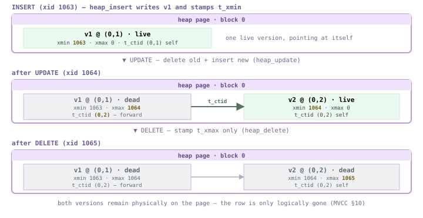
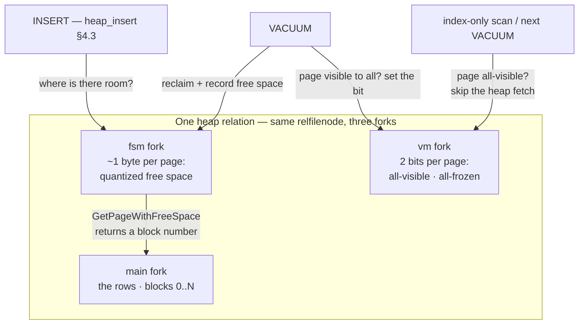
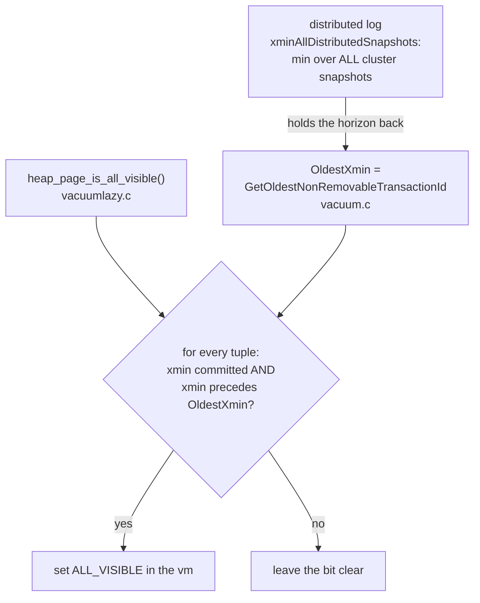
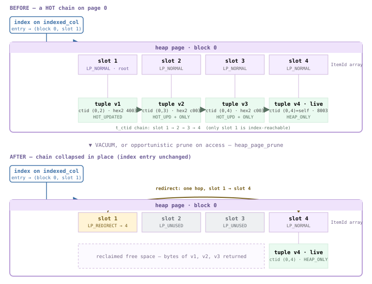
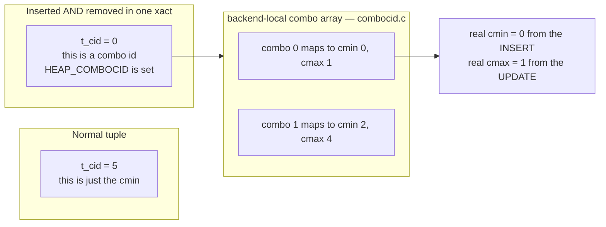

<style>
/*
 * Licensed to the Apache Software Foundation (ASF) under one
 * or more contributor license agreements.  See the NOTICE file
 * distributed with this work for additional information
 * regarding copyright ownership.  The ASF licenses this file
 * to you under the Apache License, Version 2.0 (the
 * "License"); you may not use this file except in compliance
 * with the License.  You may obtain a copy of the License at
 *
 *   http://www.apache.org/licenses/LICENSE-2.0
 *
 * Unless required by applicable law or agreed to in writing,
 * software distributed under the License is distributed on an
 * "AS IS" BASIS, WITHOUT WARRANTIES OR CONDITIONS OF ANY
 * KIND, either express or implied.  See the License for the
 * specific language governing permissions and limitations
 * under the License.
 */

/* Layout for the HTML-and-CSS figures, lifted from the handbook's own
   stylesheet so the figures render identically here. */

/* These four come from the handbook's own stylesheet; a consuming site has no
   such definitions, and an undefined custom property invalidates its whole
   declaration. Define them here, scoped to the figure.

   Deliberately NOT themed. The artwork below is light-only: band and tile
   backgrounds are hard-coded pastels, and the injected markup carries some 800
   more hard-coded light colours in inline styles. Giving --fg a dark-theme
   value paints near-white text onto a near-white band -- measured at 1.08:1,
   worse than the bug that replaced. The handbook's light values are correct in
   both themes; what changes for dark mode is the surface underneath. */
.cloudberry-core-figure {
  --border: #d8dee4;
  --soft:   #f6f8fa;
  --fg:     #1f2328;
  --muted:  #636c76;
  margin: 1.4rem 0;
}

/* Light-only artwork needs a light ground AND a dark ink, or it bleeds into a
   dark page. Setting only the ground is not enough: any text in these figures
   without its own inline colour inherits the site's near-white body colour, so
   it lands white-on-pastel -- measured at 1.03:1 across 184 text nodes. The
   colour has to be restored at the same place the ground is. */
[data-bs-theme='dark'] .cloudberry-core-figure > div {
  background: #ffffff;
  color: #1f2328;
  border-radius: 8px;
  padding: 10px;
}
/* Descendants that inherit rather than carry an inline colour. */
[data-bs-theme='dark'] .cloudberry-core-figure > div :not([style*="color"]) {
  color: inherit;
}
.cloudberry-core-figure figcaption {
  margin-top: .5rem;
  font-size: .9em;
  /* --ifm-color-emphasis-600 resolves to rgb(141,148,158) in the light theme,
     which is 3.06:1 on white -- below WCAG AA for the 37 figure captions.
     (The dark theme's value is fine, so only light is overridden.) */
  color: #636b75;
}
[data-bs-theme='dark'] .cloudberry-core-figure figcaption {
  color: #a6adb4;
}

/* Selective highlight: the handbook wraps a key token so it stands out.
   Scoped to the component. The class name .hl is two letters and this file
   lands in the consuming site's single global stylesheet, so an unscoped
   rule would style every page of that site. The standalone edition's
   figure.code / figure.session variants are dropped: those classes do not
   occur anywhere in this tree. */
.cloudberry-core-figure .hl { border-radius: 2px; font-weight: 700;
                   background: #fff8c5; color: #1f2328; padding: 0 2px; }

/* Layered module map and the banded brick figures. */
.cloudberry-core-figure .bricks { border:1px solid var(--border);border-radius:12px;overflow:hidden;background:var(--soft) }
.cloudberry-core-figure .bk-band { display:flex;align-items:stretch;border-top:1px solid var(--border) }
.cloudberry-core-figure .bk-band:first-child { border-top:none }
.cloudberry-core-figure .bk-lbl { flex:0 0 116px;display:flex;flex-direction:column;justify-content:center;gap:2px;padding:10px 13px }
.cloudberry-core-figure .bk-lbl b { font-size:12.5px;font-weight:800;color:var(--fg);line-height:1.2 }
.cloudberry-core-figure .bk-lbl span { font-size:9.5px;font-weight:700;color:var(--muted);text-transform:uppercase;letter-spacing:.5px }
.cloudberry-core-figure .bk-row { flex:1 1 auto;display:flex;flex-wrap:wrap;gap:7px;padding:9px 10px }
.cloudberry-core-figure .bk { flex:1 1 118px;min-width:104px;display:flex;flex-direction:column;justify-content:center;gap:2px; padding:8px 11px;border-radius:7px;border:1px solid;background:#fff;text-decoration:none;transition:.13s }
.cloudberry-core-figure .bk-t2 { font-size:12.5px;font-weight:700;line-height:1.25 }
.cloudberry-core-figure .bk-ch { font-size:10.5px;font-weight:700;font-variant-numeric:tabular-nums;opacity:.8 }
.cloudberry-core-figure a.bk:hover { transform:translateY(-2px);box-shadow:0 4px 12px #0000001f;text-decoration:none }
.cloudberry-core-figure .bk-q { background:#eef6ff }
.cloudberry-core-figure .bk-q .bk { border-color:#54aeff66;color:#0a3069;background:#ddf4ff }
.cloudberry-core-figure .bk-s { background:#eefcf2 }
.cloudberry-core-figure .bk-s .bk { border-color:#4ac26b80;color:#04260f;background:#dafbe1 }
.cloudberry-core-figure .bk-t { background:#fff6ef }
.cloudberry-core-figure .bk-t .bk { border-color:#fb8f4480;color:#5e2700;background:#fff1e5 }
.cloudberry-core-figure .bk-h { background:#fff4f3 }
.cloudberry-core-figure .bk-h .bk { border-color:#ff818280;color:#5c0011;background:#ffebe9 }
.cloudberry-core-figure .bk-r { background:#f3f5f8 }
.cloudberry-core-figure .bk-r .bk { border-color:#afb8c1;color:#1f2328;background:#eaeef2 }
@media (max-width: 560px) {
  .cloudberry-core-figure .bk-band { flex-direction:column }
  .cloudberry-core-figure .bk-lbl { flex-basis:auto;border-bottom:1px solid var(--border) }
}

</style>

<!--
  Licensed to the Apache Software Foundation (ASF) under one
  or more contributor license agreements.  See the NOTICE file
  distributed with this work for additional information
  regarding copyright ownership.  The ASF licenses this file
  to you under the Apache License, Version 2.0 (the
  "License"); you may not use this file except in compliance
  with the License.  You may obtain a copy of the License at

    http://www.apache.org/licenses/LICENSE-2.0

  Unless required by applicable law or agreed to in writing,
  software distributed under the License is distributed on an
  "AS IS" BASIS, WITHOUT WARRANTIES OR CONDITIONS OF ANY
  KIND, either express or implied.  See the License for the
  specific language governing permissions and limitations
  under the License.
-->


<a id="4-heap-the-row-store"></a>

<figure class="cloudberry-core-figure">
<div><div style="max-width:680px;margin:2px auto;font:11.5px/1.45 ui-monospace,SFMono-Regular,Menlo,monospace;color:#1f2328"> <div style="border:1px solid #9cc3e6;background:#eaf3fb;border-radius:6px;padding:7px;text-align:center;font-weight:600;color:#1f4e79">堆访问方法 — heapam.c<div style="font-weight:400;color:#3a6a96;font-size:10px">插入 · 删除 · 更新 · 扫描（§4.3）</div></div> <div style="text-align:center;color:#656b72;font-size:10px;padding:2px">↓ 通过缓冲区管理器读写页面（§3）</div> <div style="display:flex;gap:6px"> <div style="flex:1;border:1px solid #9cc3e6;background:#eaf3fb;border-radius:6px;padding:6px;text-align:center">main 分支<div style="color:#3a6a96;font-size:10px">行 · §4.1 §4.2</div></div> <div style="flex:1;border:1px solid #b7d5b0;background:#eef7ea;border-radius:6px;padding:6px;text-align:center">fsm 分支<div style="color:#4a7a4a;font-size:10px">空闲空间 · §4.4</div></div> <div style="flex:1;border:1px solid #b7d5b0;background:#eef7ea;border-radius:6px;padding:6px;text-align:center">vm 分支<div style="color:#4a7a4a;font-size:10px">全可见 · §4.4</div></div></div> <div style="text-align:center;color:#656b72;font-size:10px;padding:2px">↓ main 分支由一系列 32 KB 页面组成</div> <div style="border:2px solid #cdb4db;border-radius:6px;overflow:hidden"> <div style="background:#f3e8ff;color:#6b5b95;font-weight:600;text-align:center;padding:3px;border-bottom:1px solid #cdb4db">单个 32 KB 堆页面 — §4.1</div> <div style="background:#f5edff;text-align:center;padding:6px;border-bottom:1px solid #e3d5f5">页头 — 24 B · pd_lower · pd_upper · pd_prune_xid</div> <div style="background:#faf6ff;text-align:center;padding:6px;border-bottom:1px solid #e3d5f5">行指针 — pd_linp[] · 每个指针指向一个元组</div> <div style="background:#fcfaff;text-align:center;padding:11px;color:#73658b;border-top:1px dashed #cdb4db;border-bottom:1px dashed #cdb4db">空闲空间</div> <div style="display:flex;background:#eafaf0"> <div style="flex:1;text-align:center;padding:7px;border-right:1px solid #cfead9">元组 #3</div> <div style="flex:1;text-align:center;padding:7px;border-right:1px solid #cfead9">元组 #2</div> <div style="flex:1;text-align:center;padding:7px">元组 #1</div></div> <div style="background:#eef0f2;text-align:center;padding:4px;color:#656b72;border-top:1px solid #cdb4db">特殊区域 · 堆页面中为空（元组从页面末尾向上增长 ↑）</div></div> <div style="text-align:center;color:#656b72;font-size:10px;padding:2px">↓ 每个行指针的 lp_off 指向一个元组</div> <div style="display:flex;gap:6px"> <div style="flex:1;border:1px solid #d9c08f;background:#fdf6e3;border-radius:6px;padding:6px;text-align:center">每个元组 = HeapTupleHeaderData<div style="color:#7a6a3a;font-size:10px">t_xmin · t_xmax · t_ctid · t_infomask (§4.2)</div></div> <div style="flex:1;border:1px solid #e0a9a9;background:#fdeeee;border-radius:6px;padding:6px;text-align:center">各版本通过 t_ctid 链接<div style="color:#9a5a5a;font-size:10px">HOT + 页内剪枝（§4.5）· ComboCID（§4.6）</div></div></div> </div></div>
<figcaption>堆关系的结构。堆访问方法（heapam.c）通过第 3 章的缓冲区管理器读写页面，从不直接访问文件。一个关系由三个分支组成，页面大小均为 32 KB：主分支保存行，fsm 分支跟踪空闲空间，vm 分支标记全可见页面。在单个页面内，行指针从头部向下增长，元组从末尾向上增长，中间留出空闲空间。每个元组都带有一个 HeapTupleHeaderData，其中的 t_xmin/t_xmax/t_ctid 支撑着 MVCC、版本链、HOT 和页内剪枝；这些就是本章要讨论的内容。</figcaption>
</figure>

## 4.1 页面组织与项指针 {#41-page-organization--item-pointers}

堆关系是一个划分为固定大小**页面**的文件（[§2.3](/cloudberry/core-internals/part-2-storage-data-layout/ch02/#23-storage-manager-smgr--mdc)）——大小为 32 KB，是 Cloudberry 的默认值（PostgreSQL 为 8 KB）（[§3.1](/cloudberry/core-internals/part-2-storage-data-layout/ch03/#31-caching--buffer-cache-design)）。页面既是缓冲区管理器缓存的单位，也是 WAL 保护的单位，因此每个堆页面无论保存多少行，都共享一个严格固定的骨架：最前方是固定头部，下面是向下增长的 **行指针** 数组，页面末尾向上增长的是行数据，中间则是空闲空间。下面各节将拆解这些字节；本节先建立它们共同使用的框架。

<figure class="cloudberry-core-figure">
<div><div style="max-width:660px;margin:2px auto;font:11.5px/1.45 ui-monospace,SFMono-Regular,Menlo,monospace;color:#1f2328"> <div style="border:2px solid #b79ad6;border-radius:7px;overflow:hidden"> <div style="background:#efe3fb;color:#5e4b86;font-weight:600;text-align:center;padding:5px;border-bottom:1px solid #cdb4db">单个 32 KB 堆页面 — 32768 字节</div> <div style="display:flex;color:#776a88;font-size:10px;background:#faf6ff;border-bottom:1px solid #e3d5f5"> <div style="flex:1;padding:2px;text-align:center;border-right:1px solid #efe6f8">字节 0</div><div style="flex:1;padding:2px;text-align:center;border-right:1px solid #efe6f8">字节 1</div><div style="flex:1;padding:2px;text-align:center;border-right:1px solid #efe6f8">字节 2</div><div style="flex:1;padding:2px;text-align:center">字节 3</div></div> <div style="background:#f5edff"> <div style="display:flex;border-bottom:1px solid #e3d5f5"><div style="flex:1;padding:4px;text-align:center">pd_lsn — xlogid</div></div> <div style="display:flex;border-bottom:1px solid #e3d5f5"><div style="flex:1;padding:4px;text-align:center">pd_lsn — xrecoff</div></div> <div style="display:flex;border-bottom:1px solid #e3d5f5"><div style="flex:1;padding:4px;text-align:center;border-right:1px solid #e3d5f5">pd_checksum</div><div style="flex:1;padding:4px;text-align:center">pd_flags</div></div> <div style="display:flex;border-bottom:1px solid #e3d5f5"><div style="flex:1;padding:4px;text-align:center;border-right:1px solid #e3d5f5">pd_lower</div><div style="flex:1;padding:4px;text-align:center">pd_upper</div></div> <div style="display:flex;border-bottom:1px solid #e3d5f5"><div style="flex:1;padding:4px;text-align:center;border-right:1px solid #e3d5f5">pd_special</div><div style="flex:1;padding:4px;text-align:center">pd_pagesize_version</div></div> <div style="display:flex"><div style="flex:1;padding:4px;text-align:center">pd_prune_xid</div></div></div> <div style="text-align:right;color:#73658b;font-size:10px;padding:1px 5px;background:#f5edff;border-bottom:2px solid #cdb4db">↑ 页头 · 24 字节</div> <div style="background:#fbf7ff"> <div style="display:flex;border-bottom:1px solid #e3d5f5"><div style="flex:0 0 48%;padding:4px;text-align:center;border-right:1px solid #e3d5f5">lp_off (15b)</div><div style="flex:0 0 14%;padding:4px;text-align:center;border-right:1px solid #e3d5f5">flags（标志）</div><div style="flex:1;padding:4px;text-align:center">lp_len (15b) · 1</div></div> <div style="display:flex;border-bottom:1px solid #e3d5f5"><div style="flex:0 0 48%;padding:4px;text-align:center;border-right:1px solid #e3d5f5">lp_off (15b)</div><div style="flex:0 0 14%;padding:4px;text-align:center;border-right:1px solid #e3d5f5">flags（标志）</div><div style="flex:1;padding:4px;text-align:center">lp_len (15b) · 2</div></div> <div style="display:flex"><div style="flex:0 0 48%;padding:4px;text-align:center;border-right:1px solid #e3d5f5">lp_off (15b)</div><div style="flex:0 0 14%;padding:4px;text-align:center;border-right:1px solid #e3d5f5">flags（标志）</div><div style="flex:1;padding:4px;text-align:center">lp_len (15b) · 3</div></div></div> <div style="text-align:right;color:#73658b;font-size:10px;padding:1px 5px;background:#fbf7ff;border-bottom:2px solid #cdb4db">↑ pd_linp[] — 行指针 · 在 pd_lower 处结束</div> <div style="background:#fcfaff;text-align:center;padding:18px;color:#776a88;border-bottom:2px solid #cdb4db">空闲空间（pd_lower … pd_upper）</div> <div style="display:flex;background:#eafaf0"> <div style="flex:1;padding:7px;text-align:center;border-right:1px solid #cfead9">元组 #3</div><div style="flex:1;padding:7px;text-align:center;border-right:1px solid #cfead9">元组 #2</div><div style="flex:1;padding:7px;text-align:center">元组 #1</div></div> <div style="color:#587161;font-size:10px;padding:1px 5px;background:#eafaf0;border-bottom:1px solid #cdb4db">↑ 元组 · 从页面末尾（pd_upper）写入，向上增长</div> <div style="background:#eef0f2;text-align:center;padding:3px;color:#656b72">特殊区域 · 堆页面中为空（长度 0）</div> </div></div></div>
<figcaption>一个 32 KB 的堆页面：整个页面是一个矩形，前端的小矩形分别表示固定头部和 pd_linp 行指针数组，接着是空闲空间，再往后是元组（从页面末尾写入，向上增长），最后是空的特殊区域。每个 32 位字从左向右读取；pd_lower 是最后一个行指针之后的边界，pd_upper 是最后写入的元组之前的边界，两者相遇时页面就满了。堆页面的特殊区域为空，只有索引（第 7 章）才使用它。</figcaption>
</figure>

在磁盘上，这是 `PageHeaderData` 后面跟着可变部分。这个结构是系统中*每种*页面类型的公共前缀——堆、索引、FSM 和可见性映射——因此缓冲区管理器无需知道页面保存什么，就可以为页面计算校验和并用 WAL 保护它：

```c {title="src/include/storage/bufpage.h — PageHeaderData"}
typedef struct PageHeaderData
      {
          PageXLogRecPtr pd_lsn;          /* LSN of last change — WAL ordering (§20) */
          uint16      pd_checksum;        /* page checksum, if enabled */
          uint16      pd_flags;           /* flag bits */
          LocationIndex pd_lower;         /* offset to start of free space */
          LocationIndex pd_upper;         /* offset to end of free space */
          LocationIndex pd_special;       /* offset to start of special space */
          uint16      pd_pagesize_version;/* page size + layout version */
          TransactionId pd_prune_xid;     /* oldest prunable XID, or 0 (§4.5) */
          ItemIdData  pd_linp[FLEXIBLE_ARRAY_MEMBER]; /* line pointer array */
      } PageHeaderData;
```

### 4.1.1 活跃页面上的头部 {#411-the-header-on-a-live-page}

头部恰好是 **24 字节**：`SizeOfPageHeaderData`（`src/include/storage/bufpage.h`）是 `offsetof(PageHeaderData, pd_linp)`，也就是行指针数组的起点。我们创建一张小型分布式表，读取其第一个页面的头部。与 [§3.2](/cloudberry/core-internals/part-2-storage-data-layout/ch03/#32-cache-hits-pinning--usage-count) 一样，数据位于 Segment 上，因此通过 utility 模式（端口 7102）检查，并关闭 autovacuum。表按 `id` 分布到三个 Segment，因此五行会分散开；Segment 0 在其第一个页面上收到其中三行：

*Segment 0 的第一个页面上有三行；使用 `pageinspect` 读取它的头部。*

```sql
-- coordinator, port 7100
      CREATE TABLE heappage(id int, name text)
        WITH (autovacuum_enabled=off) DISTRIBUTED BY (id);
      INSERT INTO heappage SELECT g, 'row-'||g FROM generate_series(1,5) g;

      -- segment 0, port 7102, utility mode
      SELECT lower, upper, special, pagesize, version, prune_xid
      FROM page_header(get_raw_page('heappage',0));
```

```text {hl_lines="3" title="output"}
 lower | upper | special | pagesize | version | prune_xid
      -------+-------+---------+----------+---------+-----------
          36 | 32648 |   32768 |    32768 |      14 |         0
```

对照示意图读取这些偏移量。`pagesize` 正是预期的 32 KB。`lower = 36` 是行指针结束的位置：24 字节头部加上 Segment 0 保存的**三个** 4 字节行指针，即 `24 + 3×4 = 36`，完全吻合。`upper = 32648` 是最低处元组开始的位置；36 和 32648 之间全部是空闲空间。`special = 32768` 是页面末尾，因此 special 区域长度为 *0*，因为堆页面始终如此。`prune_xid = 0` 表示这里还没有元组成为剪枝候选（[§4.5](#45-page-pruning--hot-updates)）。

*控制页面布局的头部字段。*

- `pd_lower` — 行指针结束、空闲空间开始的偏移量
- `pd_upper` — 元组开始、空闲空间结束的偏移量
- `pd_special` — special 空间的起点（对堆来说等于页面末尾）
- `pd_lsn` — 最近一次更改的 WAL 位置（预写式顺序）
- `pd_prune_xid` — 可进行剪枝的最旧 XID，是 [§4.5](#45-page-pruning--hot-updates) 的提示

### 4.1.2 行指针：一层间接寻址 {#412-line-pointers-a-layer-of-indirection}

元组从不直接寻址。每个元组都通过一个 4 字节的 **行指针**（`ItemIdData`）访问；一对 *(块号、行指针索引)* 就是元组的永久地址，即 [§4.2](#42-row-version-layout) 中的 **TID** 和 `t_ctid`，也是每条索引条目保存的目标。行指针将三个位字段压缩到 32 位中：

```c {title="src/include/storage/itemid.h — ItemIdData"}
typedef struct ItemIdData
      {
          unsigned    lp_off:15,   /* offset to tuple, from start of page */
                      lp_flags:2,  /* state of the line pointer */
                      lp_len:15;   /* byte length of the tuple */
      } ItemIdData;
```

`lp_flags` 记录槽位状态——`LP_UNUSED`（0，空闲）、`LP_NORMAL`（1，指向真实元组）、`LP_REDIRECT`（2，HOT 重定向，[§4.5](#45-page-pruning--hot-updates)）和 `LP_DEAD`（3，已死亡，可回收）——都定义在 `src/include/storage/itemid.h`（`LP_UNUSED`）中。读取同一页面的行指针，可以直接看到向上增长的元组：

*三个 `LP_NORMAL` 行指针；元组偏移量从页面尾部向下排列。*

```sql
-- segment 0, utility mode
      SELECT lp, lp_off, lp_len, lp_flags
      FROM heap_page_items(get_raw_page('heappage',0));
```

```text {hl_lines="3" title="output"}
 lp | lp_off | lp_len | lp_flags
      ----+--------+--------+----------
        1 |  32728 |     34 |        1
        2 |  32688 |     34 |        1
        3 |  32648 |     34 |        1
```

行指针 1 对应最先写入的元组，该元组位于**最高**偏移量（`32728`）；后续元组放在前一个元组的下方，因此 `lp_off` 下降到 `32648 = pd_upper`。相反，行指针数组从前向后填充，因此其末端是 `pd_lower = 36`。两个数组向彼此靠近的方向增长，汇合时页面就满了。

正是这种间接寻址让堆后续的技巧成为可能。由于索引条目指向的是 *行指针* 而不是元组字节，页面剪枝可以把活元组移动到新的偏移量，或将死亡链的头部替换为 `LP_REDIRECT`，却**不会使任何索引条目失效**——它只需改写 4 字节指针（[§4.5](#45-page-pruning--hot-updates)）。同一属性也使元组的稳定 TID 在物理字节移动后仍能保持有效。

> [!NOTE]
> 按照约定，`lp_len = 0` 表示行指针不占用存储空间：可能是 `LP_UNUSED`、`LP_REDIRECT`，或者字节已经回收的 `LP_DEAD`（`src/include/storage/itemid.h`）。因此，`heap_page_items` 中 `lp_len > 0` 的行表示物理上存在一个元组，无论它是否仍然存活。

## 4.2 行版本布局 {#42-row-version-layout}

页面内部的每个行版本都是一个 **堆元组**：固定的 23 字节头部、可选的 NULL 位图、对齐填充，之后是用户数据。头部主要用于 MVCC 记账——哪个事务创建了这个版本、哪个事务删除了它、下一个版本位于哪里——因此第 4 章和第 [10](/cloudberry/core-internals/part-3-transactions-mvcc-concurrency/ch10/) 章的大量内容都会回到这几个字节。我们将直接从活跃页面读取它们。

<figure class="cloudberry-core-figure">
<div><div style="max-width:780px;margin:2px auto;font:11px/1.4 ui-monospace,SFMono-Regular,Menlo,monospace;color:#1f2328;overflow-x:auto"> <div style="min-width:720px"> <div style="display:flex;font-size:10px;color:#6b5b95;font-weight:600;margin:0 0 1px"> <div style="flex:12;text-align:center">t_choice — 12 字节（联合体：磁盘上的 MVCC 字段）</div><div style="flex:11;text-align:center">… 补齐 23 字节的固定头部 → t_hoff</div></div> <div style="display:flex;border:1px solid #cdb4db;background:#f5edff;text-align:center"> <div style="flex:4;border-right:1px solid #e3d5f5;padding:6px 2px">t_xmin<div style="font-size:9px;color:#6c6c6c">4 B · 插入事务的 xid</div></div> <div style="flex:4;border-right:1px solid #e3d5f5;padding:6px 2px">t_xmax<div style="font-size:9px;color:#6c6c6c">4 B · 删除事务的 xid</div></div> <div style="flex:4;border-right:2px solid #b79ad6;padding:6px 2px">t_field3<div style="font-size:9px;color:#6c6c6c">4 B · t_cid / t_xvac</div></div> <div style="flex:6;border-right:1px solid #e3d5f5;padding:6px 2px">t_ctid<div style="font-size:9px;color:#6c6c6c">6 B · 本版本／下一版本的 TID</div></div> <div style="flex:2;border-right:1px solid #e3d5f5;padding:6px 1px">t_infomask2<div style="font-size:9px;color:#6c6c6c">2 B</div></div> <div style="flex:2;border-right:1px solid #e3d5f5;padding:6px 1px">t_infomask<div style="font-size:9px;color:#6c6c6c">2 B</div></div> <div style="flex:1;padding:6px 1px">t_hoff<div style="font-size:9px;color:#6c6c6c">1 B</div></div></div> <div style="text-align:center;color:#73658b;font-size:10px;padding:1px 2px">↑ HeapTupleHeaderData — 23 字节，填充至 t_hoff（1 字节的 NULL 位图被填充空间容纳时，等于 24）</div> <div style="display:flex;text-align:center"> <div style="flex:5;border:1px solid #cdb4db;border-top:none;background:#faf6ff;padding:6px 2px">NULL 位图（t_bits）<div style="font-size:9px;color:#6c6c6c">可选 · ⌈natts/8⌉ B · 仅设置 HEAP_HASNULL 时存在</div></div> <div style="flex:3;border:1px solid #cdb4db;border-top:none;border-left:none;background:#eef0f2;padding:6px 2px;color:#656b72">填充 → 8 字节对齐</div></div> <div style="color:#73658b;font-size:10px;text-align:center;padding:1px 2px">↓ 用户数据从偏移量 t_hoff 开始</div> <div style="display:flex;border:1px solid #cdb4db;border-top:none;background:#eafaf0;text-align:center"> <div style="flex:1;border-right:1px solid #cfead9;padding:7px 2px">属性 1</div> <div style="flex:1;border-right:1px solid #cfead9;padding:7px 2px">属性 2</div> <div style="flex:0 0 44px;border-right:1px solid #cfead9;padding:7px 2px;color:#656b72">填充</div> <div style="flex:1;border-right:1px solid #cfead9;padding:7px 2px">属性 3</div> <div style="flex:1;padding:7px 2px">属性 4</div></div> <div style="text-align:center;color:#587161;font-size:10px;padding:1px 2px">↑ 用户数据 — 属性按 pg_attribute 定义排列，各自按类型要求对齐填充</div> </div></div></div>
<figcaption>一个堆元组的字节布局。前 12 字节是 t_choice 联合体（磁盘上的 MVCC 字段 t_xmin / t_xmax / t_field3）；后面的 t_ctid、两个标志字和 t_hoff 共同构成 23 字节的固定头部，并填充到 8 字节边界。其后是可选的 NULL 位图和对齐填充；用户数据从偏移量 t_hoff 开始，各属性按 pg_attribute 的定义排列，并遵循各自类型的对齐要求。</figcaption>
</figure>

该结构将磁盘上的 MVCC 字段与内存中的 Datum 字段组成联合体，因此在存储元组和在执行器节点之间传递的元组中，同样的 12 个字节可以表示不同的含义：

```c {title="src/include/access/htup_details.h — HeapTupleHeaderData"}
struct HeapTupleHeaderData
      {
          union {
              HeapTupleFields  t_heap;    /* t_xmin, t_xmax, t_cid  — on disk */
              DatumTupleFields t_datum;   /* used when passed as a Datum */
          } t_choice;
          ItemPointerData t_ctid;         /* this or a newer tuple's TID (§4.3) */
          uint16  t_infomask2;            /* number of attributes + flags */
          uint16  t_infomask;             /* status hint bits */
          uint8   t_hoff;                 /* header size incl. bitmap + padding */
          /* ^ - 23 bytes - ^ */
          bits8   t_bits[FLEXIBLE_ARRAY_MEMBER];  /* NULL bitmap */
      };
```

<figure class="cloudberry-core-figure">
<div><div style="max-width:760px;margin:2px auto;font:11px/1.35 ui-monospace,SFMono-Regular,Menlo,monospace;color:#1f2328;overflow-x:auto"> <div style="min-width:700px"> <div style="color:#6b5b95;font-weight:600;margin:0 0 2px">t_infomask2 — 16 位（属性数量 + HOT 状态）</div> <div style="display:flex;border:1px solid #cdb4db;text-align:center"> <div style="flex:0 0 40%;border-right:1px solid #e3d5f5;background:#f5edff;padding:4px 2px"><div style="color:#6b5b95">位 0–10 · 0x07FF</div><div style="font-size:9.5px;color:#444">HEAP_NATTS_MASK — natts</div></div> <div style="flex:1;border-right:1px solid #e3d5f5;background:#fff4d6;padding:4px 1px"><div style="color:#6b5b95">0x0800</div><div style="font-size:9px;color:#444">XMIN_DSI</div></div> <div style="flex:1;border-right:1px solid #e3d5f5;background:#fff4d6;padding:4px 1px"><div style="color:#6b5b95">0x1000</div><div style="font-size:9px;color:#444">XMAX_DSI</div></div> <div style="flex:1;border-right:1px solid #e3d5f5;background:#faf6ff;padding:4px 1px"><div style="color:#6b5b95">0x2000</div><div style="font-size:9px;color:#444">KEYS_UPD</div></div> <div style="flex:1;border-right:1px solid #e3d5f5;background:#faf6ff;padding:4px 1px"><div style="color:#6b5b95">0x4000</div><div style="font-size:9px;color:#444">HOT_UPD</div></div> <div style="flex:1;background:#faf6ff;padding:4px 1px"><div style="color:#6b5b95">0x8000</div><div style="font-size:9px;color:#444">ONLY_TUP</div></div></div> <div style="color:#6b5b95;font-weight:600;margin:8px 0 2px">t_infomask — 16 位（可见性 + 元组结构）</div> <div style="display:flex;border:1px solid #cdb4db;text-align:center"> <div style="flex:1;border-right:1px solid #e3d5f5;background:#eafaf0;padding:4px 1px"><div style="color:#6b5b95">0x0001</div><div style="font-size:9px;color:#444">HASNULL</div></div> <div style="flex:1;border-right:1px solid #e3d5f5;background:#eafaf0;padding:4px 1px"><div style="color:#6b5b95">0x0002</div><div style="font-size:9px;color:#444">HASVARW</div></div> <div style="flex:1;border-right:1px solid #e3d5f5;background:#eafaf0;padding:4px 1px"><div style="color:#6b5b95">0x0004</div><div style="font-size:9px;color:#444">HASEXT</div></div> <div style="flex:1;border-right:1px solid #e3d5f5;background:#f4f5f6;padding:4px 1px"><div style="color:#5f6b76">0x0008</div><div style="font-size:9px;color:#5f6b76">HASOID_OLD</div></div> <div style="flex:1;border-right:1px solid #e3d5f5;background:#fff;padding:4px 1px"><div style="color:#6b5b95">0x0010</div><div style="font-size:9px;color:#444">KEYSHR_LK</div></div> <div style="flex:1;border-right:1px solid #e3d5f5;background:#fde8ef;padding:4px 1px"><div style="color:#6b5b95">0x0020</div><div style="font-size:9px;color:#444">COMBOCID</div></div> <div style="flex:1;border-right:1px solid #e3d5f5;background:#fff;padding:4px 1px"><div style="color:#6b5b95">0x0040</div><div style="font-size:9px;color:#444">EXCL_LK</div></div> <div style="flex:1;border-right:1px solid #e3d5f5;background:#fff;padding:4px 1px"><div style="color:#6b5b95">0x0080</div><div style="font-size:9px;color:#444">LOCK_ONLY</div></div> <div style="flex:1;border-right:1px solid #e3d5f5;background:#fff;padding:4px 1px"><div style="color:#6b5b95">0x0100</div><div style="font-size:9px;color:#444">XMIN_CMT</div></div> <div style="flex:1;border-right:1px solid #e3d5f5;background:#fff;padding:4px 1px"><div style="color:#6b5b95">0x0200</div><div style="font-size:9px;color:#444">XMIN_INV</div></div> <div style="flex:1;border-right:1px solid #e3d5f5;background:#fff;padding:4px 1px"><div style="color:#6b5b95">0x0400</div><div style="font-size:9px;color:#444">XMAX_CMT</div></div> <div style="flex:1;border-right:1px solid #e3d5f5;background:#fff;padding:4px 1px"><div style="color:#6b5b95">0x0800</div><div style="font-size:9px;color:#444">XMAX_INV</div></div> <div style="flex:1;border-right:1px solid #e3d5f5;background:#fff;padding:4px 1px"><div style="color:#6b5b95">0x1000</div><div style="font-size:9px;color:#444">IS_MULTI</div></div> <div style="flex:1;border-right:1px solid #e3d5f5;background:#fff;padding:4px 1px"><div style="color:#6b5b95">0x2000</div><div style="font-size:9px;color:#444">UPDATED</div></div> <div style="flex:1;border-right:1px solid #e3d5f5;background:#f4f5f6;padding:4px 1px"><div style="color:#5f6b76">0x4000</div><div style="font-size:9px;color:#5f6b76">MOVED_OFF</div></div> <div style="flex:1;background:#f4f5f6;padding:4px 1px"><div style="color:#5f6b76">0x8000</div><div style="font-size:9px;color:#5f6b76">MOVED_IN</div></div></div> <div style="font-size:10px;color:#73658b;margin:4px 0 0">琥珀色 = Cloudberry 特有的分布式快照位 · 灰色 = 历史遗留／本构建未使用（没有 OID 系统列；HEAP_MOVED_* 用于 9.0 之前的 VACUUM FULL）· 粉色 = HEAP_COMBOCID（§4.6）。</div> </div></div></div>
<figcaption>逐位展示的两个 16 位标志字，取自当前源码（`src/include/access/htup_details.h:191` 和 `:276`）。`t_infomask2` 的低 11 位存放属性数量，高位记录 HOT 和键更新状态；`t_infomask` 保存可见性和元组结构标志。两个琥珀色位为 <strong>Cloudberry 独有</strong>：`HEAP_XMIN/XMAX_DISTRIBUTED_SNAPSHOT_IGNORE`（`htup_details.h:279`、`:285`）允许 Segment 对已在本地确定状态的事务跳过分布式快照检查；单节点 PostgreSQL 中没有对应的标志。</figcaption>
</figure>

### 4.2.1 活跃页面上的头部 {#421-the-header-on-a-live-page}

两行数据，其中一行包含 NULL 列。按照 [§4.1](#41-page-organization--item-pointers) 的方法，我们读取 Segment 0 上的原始元组：

*两个元组；`pageinspect` 直接公开它们的头部。*

```sql
-- coordinator, port 7100
      CREATE TABLE heaptup(id int, a int, b text)
        WITH (autovacuum_enabled=off) DISTRIBUTED BY (id);
      INSERT INTO heaptup VALUES (1, NULL, 'hello');   -- a is NULL
      INSERT INTO heaptup VALUES (2, 99,   'world');   -- no NULLs

      -- segment 0, port 7102, utility mode
      SELECT lp, t_xmin, t_xmax, t_ctid, t_infomask2,
             to_hex(t_infomask) AS infomask, t_hoff, t_bits
      FROM heap_page_items(get_raw_page('heaptup',0));
```

```text {hl_lines="3 4" title="output"}
 lp | t_xmin | t_xmax | t_ctid | t_infomask2 | infomask | t_hoff |  t_bits
      ----+--------+--------+--------+-------------+----------+--------+----------
        1 |   1046 |      0 | (0,1)  |           3 |    903 |     24 | 10100000
        2 |   1047 |      0 | (0,2)  |           3 |    902 |     24 |
```

`t_xmin` 是插入该元组的 xid；`t_xmax = 0` 表示两个版本都没有被删除；`t_ctid` 分别指向元组自身（还没有更新版本，见 [§4.3](#43-operations-on-tuples)）。`t_infomask2 = 3` 的低位是属性数量，即三列。两个有趣的差异是 **infomask**（`0x903` 对 `0x902`）和 **NULL 位图**（`t_bits`），下面两个小节将拆开说明。

### 4.2.2 infomask：缓存的提交提示 {#422-infomask-cached-commit-hints}

`t_infomask` 是一组状态位（`src/include/access/htup_details.h` 中的 `HEAP_HASNULL`）。逐位解码这两个值：

*根据标志定义解码演示中的 infomask 值。*

| 位 | 标志 | 含义 | 0x903（行 1） | 0x902（行 2） |
| --- | --- | --- | --- | --- |
| 0x0001 | HEAP_HASNULL | 元组包含 NULL 属性 | 已设置 | — |
| 0x0002 | HEAP_HASVARWIDTH | 包含可变宽度列（`text`） | 已设置 | 已设置 |
| 0x0100 | HEAP_XMIN_COMMITTED | 已知插入者已提交 | 已设置 | 已设置 |
| 0x0800 | HEAP_XMAX_INVALID | t_xmax 不是实际的删除者 | 已设置 | 已设置 |

两行的区别只有 `HEAP_HASNULL`——`0x903 − 0x902 = 0x001`——正好对应包含 NULL 的那一行。其他位是**提示位**：第一个检查版本可见性的事务会根据提交日志解析 `t_xmin`/`t_xmax`，然后在这里记录结论（`HEAP_XMIN_COMMITTED`、`HEAP_XMAX_INVALID`），因此后续每次可见性检查只需进行一次掩码比较，不再查询 clog。这就是 [§4.3.4](#434-scanning-and-visibility) 和第 [10](/cloudberry/core-internals/part-3-transactions-mvcc-concurrency/ch10/) 章所依赖的优化。

### 4.2.3 NULL 位图与 t_hoff {#423-the-null-bitmap-and-t_hoff}

列是否为 NULL 并不存储在列本身，而是元组的 **NULL 位图**（`t_bits`）中的一个位；只有设置 `HEAP_HASNULL` 时才存在该位图。行 1 的位图为 `10100000`：每列一个位，低位在前，`1` 表示*存在*。列为 `id, a, b`，因此分别是 `1`（id 存在）、`0`（a 为 NULL）、`1`（b 存在）；末尾的 0 是填充到一个字节的结果。行 2 没有 NULL，所以 `HEAP_HASNULL` 被清除，`t_bits` 为空。

注意，**两行**的 `t_hoff = 24`。固定头部为 23 字节，向上取整到 `MAXALIGN` = 24；行 1 的单字节 NULL 位图被吸收到同一段对齐填充中，因此这里一个 NULL 列不会增加额外的头部空间。只有当位图和填充越过下一个 8 字节边界时，`t_hoff` 才会增长。

*t_hoff 按顺序计算的内容。*

- `23 bytes` — 固定的 HeapTupleHeaderData
- `t_bits` — NULL 位图，⌈natts/8⌉ 字节，仅在 HASNULL 时存在
- `padding` — 填充到下一个 MAXALIGN 边界，最多若干字节
- `→ t_hoff` — 用户数据开始的偏移量

### 4.2.4 TOAST：值无法放入页面时 {#424-toast-when-a-value-will-not-fit}

元组必须放入一个页面，因此单个超大属性不能内嵌存储。当一行超过 `TOAST_TUPLE_THRESHOLD`（`src/include/access/heaptoast.h`，约为页面的四分之一）时，存储管理器会压缩其中的可变长度属性；如果仍然太大，就把它们移到配套的 *TOAST 表*中，主元组只留下一个 18 字节的指针。每个包含可 TOAST 化列的表都会自动获得一张这样的表：

*一个包含 100 000 个字符的值被压缩并移出行内存储。*

```sql
CREATE TABLE heaptoast(id int, big text)
        WITH (autovacuum_enabled=off) DISTRIBUTED BY (id);
      INSERT INTO heaptoast VALUES (1, repeat('x',100000));

      SELECT reltoastrelid::regclass AS toast_table
      FROM pg_class WHERE relname='heaptoast';
      SELECT length(big) AS logical_chars, pg_column_size(big) AS stored_bytes
      FROM heaptoast WHERE id=1;
```

```text {hl_lines="7" title="output"}
      toast_table
      -----------------------
       pg_toast.pg_toast_17308

       logical_chars | stored_bytes
      ---------------+--------------
              100000 |        1156
```

用户看到的值仍然有 100 000 个字符，但压缩后只占 **1156 字节**的存储空间——这些字节位于 `pg_toast.pg_toast_17308` 中，而不是主堆元组内；主元组只保留指针。这就是 [§1.1](/cloudberry/core-internals/#11-the-mpp-cluster-coordinator-segments--distribution) 从列的角度测量的同一套机制；这里我们看到字节实际去了哪里。TOAST 对用户透明：读取时，`SELECT` 会重新组装该值。

> [!NOTE]
> `HEAP_HASEXTERNAL`（`0x0004`）位于 t_infomask 中，表示元组包含移出行外的属性；`HEAP_HASVARWIDTH`（`0x0002`，上面的两行都设置了该位）表示存在任意可变宽度列。规划器和元组解构器会读取这些位，以判断是否需要 NULL 位图或 detoast 步骤。

## 4.3 元组操作 {#43-operations-on-tuples}

理解页面（[§4.1](#41-page-organization--item-pointers)）和行版本（[§4.2](#42-row-version-layout)）后，我们可以观察四种堆操作的运行过程。核心思想是，Cloudberry 和 PostgreSQL 一样，是一个**多版本**存储：`INSERT` 添加一个版本，`UPDATE` 和 `DELETE` 从不就地覆盖或擦除数据，而是给现有版本的 `t_xmax` 加上标记并让它继续存在，使拥有较旧快照的事务仍然可以看到它。回收空间是另一个稍后执行的工作（[§4.5](#45-page-pruning--hot-updates)，第 10 章）。在集群中，这些操作都在拥有该行分片的 **Segment** 上执行（[§1.3](/cloudberry/core-internals/#13-processes-and-memory)）；我们即将跟踪的版本链完全位于一个 Segment 的堆页面内。



*一行数据在 INSERT → UPDATE → DELETE 之间的生命周期，使用下面演示中的真实 xid。任何操作都不会就地覆盖：UPDATE 给 v1 的 t_xmax 加标记，并将其 t_ctid 向前指向 v2（绿色链箭头），然后写入 v2；DELETE 只给活版本的 t_xmax 加标记。两个版本都继续物理存在于页面上，只是这一行在逻辑上已经消失。琥珀色值表示每条命令写入标记的字段。*

我们将修改一行数据，并在每一步之后读取原始行指针。表是分布式的，因此其页面位于 Segment 0；我们通过 utility 模式检查它（[§3.2](/cloudberry/core-internals/part-2-storage-data-layout/ch03/#32-cache-hits-pinning--usage-count)），并关闭 autovacuum，避免后台进程在我们观察时重写页面：

*一张分布式表、一行数据；通过 Segment 0 上的 `pageinspect` 检查。*

```sql
-- coordinator, port 7100
      CREATE TABLE heapops (id int, v text)
        WITH (autovacuum_enabled=off) DISTRIBUTED BY (id);
      INSERT INTO heapops VALUES (1,'first');
      SELECT gp_segment_id, id, v FROM heapops;
```

```text {hl_lines="3" title="output"}
 gp_segment_id | id |   v
      ---------------+----+-------
                   0 |  1 | first
```

### 4.3.1 INSERT——写入新版本 {#431-insert--stamping-a-new-version}

`heap_insert`（`src/backend/access/heap/heapam.c`）向 `RelationGetBufferForTuple`（`src/backend/access/heap/hio.c`）请求有足够空闲空间的页面——查询空闲空间映射（[§4.4](#44-fsm--visibility-map)）——然后把元组写入页面高端，在低端添加行指针，使用当前事务 ID 写入 `t_xmin`，令 `t_xmax` 保持为 0，并将更改记录到 WAL。批量加载（`COPY`、多行 `INSERT`）采用批处理路径 `heap_multi_insert`（`heapam.c`），一次填充一个页面中的许多元组，并一次性写入 WAL。

`heap_insert` → `RelationGetBufferForTuple` → `RelationPutHeapTuple` → `XLogInsert (WAL)`

*INSERT 之后：一个活跃版本，指向自身。*

```sql
-- segment 0, port 7102, utility mode
      SELECT lp, lp_flags, t_xmin, t_xmax, t_ctid
      FROM heap_page_items(get_raw_page('heapops',0)) WHERE lp_len>0;
```

```text {hl_lines="3" title="output"}
 lp | lp_flags | t_xmin | t_xmax | t_ctid
      ----+----------+--------+--------+--------
        1 |        1 |   1063 |      0 | (0,1)
```

`lp_flags = 1` 是 `LP_NORMAL`（指向真实元组的行指针）。`t_xmax = 0` 表示版本仍然存活，`t_ctid = (0,1)` 指向*自身*——该行目前是自己版本链的头和尾。

### 4.3.2 UPDATE——串联一个新版本 {#432-update--a-new-version-chained}

`heap_update`（`heapam.c`）本质上是“删除旧版本再插入新版本”。它使用更新事务的 xid 写入旧版本的 `t_xmax`，把新版本写入一个页面（如果放得下，也可以是同一页面），并且——这是关键——将旧版本的 `t_ctid` 设置为**新版本的 TID**。这个前向指针就是**版本链**：落到旧元组上的索引条目或正在进行的扫描可以沿着 `t_ctid` 向前查找当前行。

`heap_update` → `RelationGetBufferForTuple（新版本）` → `标记旧版本：t_xmax + 将 t_ctid 指向后续版本` → `log_heap_update (WAL)`

*UPDATE 之后：页面上有两个版本。旧版本已死亡，其 t_ctid 向前指向新版本。*

```sql
UPDATE heapops SET v='second' WHERE id=1;
      -- segment 0, utility mode
      SELECT lp, lp_flags, t_xmin, t_xmax, t_ctid
      FROM heap_page_items(get_raw_page('heapops',0)) WHERE lp_len>0;
```

```text {hl_lines="3" title="output"}
 lp | lp_flags | t_xmin | t_xmax | t_ctid
      ----+----------+--------+--------+--------
        1 |        1 |   1063 |   1064 | (0,2)
        2 |        1 |   1064 |      0 | (0,2)
```

把两行一起读取。行指针 1 是原始版本：其 `t_xmax` 现在为 `1064`（已死亡，被更新事务删除），而 `t_ctid` 不再指向自身，而是**向前指向 `(0,2)`**，形成版本链。行指针 2 是新版本，其 `t_xmin = 1064`（与删除旧版本的 xid **相同**），并且活跃的 `t_xmax = 0`。一次 `UPDATE` 产生了两个物理元组；只要某个快照仍有权看到旧版本，它就会继续留在页面上。

> [!NOTE]
> 由于这里没有改变被索引的列，因此本次操作本可以是 HOT 更新——创建新版本，但**不**创建新的索引条目。这个优化，以及页面剪枝如何稍后回收死亡版本，见 [§4.5](#45-page-pruning--hot-updates)。

### 4.3.3 DELETE——标记，而不是移除 {#433-delete--marking-not-removing}

`heap_delete`（`heapam.c`）是最简单的操作：它不释放行指针，也不缩小页面，只使用删除事务的 xid 写入活版本的 `t_xmax`，并设置相应的 infomask 位（[§4.2](#42-row-version-layout)）。元组会原封不动地留在原位置——旧快照可见，新快照不可见——直到剪枝或清理最终将其移除。

*DELETE 之后：活版本被标记为死亡，但两个元组仍然物理存在于页面上。*

```sql
DELETE FROM heapops WHERE id=1;
      -- segment 0, utility mode
      SELECT lp, lp_flags, t_xmin, t_xmax, t_ctid
      FROM heap_page_items(get_raw_page('heapops',0)) WHERE lp_len>0;
```

```text {hl_lines="4" title="output"}
 lp | lp_flags | t_xmin | t_xmax | t_ctid
      ----+----------+--------+--------+--------
        1 |        1 |   1063 |   1064 | (0,2)
        2 |        1 |   1064 |   1065 | (0,2)
```

当前版本 `(0,2)` 现在带有 `t_xmax = 1065`——`DELETE` 的事务 ID——但 `lp_flags` 仍为 `LP_NORMAL`，字节也仍然存在。没有任何内容被擦除；该行只是从 xid 1065 起被标记为不再存活。对于逻辑上为空的表，`heap_page_items` 中仍会保留两个行。

### 4.3.4 扫描与可见性 {#434-scanning-and-visibility}

顺序扫描通过 `heap_getnext`（`heapam.c`）逐页驱动 `heapgettup` / `heapgettup_pagemode`（`heapam.c`）。对于每个元组，执行器会请求 `HeapTupleSatisfiesVisibility`（`src/include/access/heapam.h`）判断*这个*版本对当前快照是否可见——将 `t_xmin` / `t_xmax` 与快照的 xid 视界比较。对一个版本的第一次可见性检查成本较高（可能需要查询提交日志）；其结果会作为 **提示位** 写回元组的 `t_infomask`（[§4.2](#42-row-version-layout) 的 `XMIN_COMMITTED` / `XMAX_COMMITTED` 位），因此后续扫描只需进行一次掩码比较。

这就是为什么被删除的行仍然占据页面，却不会为查询返回任何行：物理元组存在，但对于 xid 1065 之后的每个快照，`HeapTupleSatisfiesVisibility` 都会拒绝它。存储与可见性是有意分开的两个关注点——堆保存版本；快照机制（第 10 章）决定事务可以看到哪个版本。

*逻辑上为空，物理上不为空——直到执行剪枝（[§4.5](#45-page-pruning--hot-updates)）。*

```sql
SELECT count(*) FROM heapops;   -- coordinator
```

```text {title="output"}
 count
      -------
           0
```

## 4.4 FSM 与可见性映射 {#44-fsm--visibility-map}

### 4.4.1 数据旁边的另外两个分支 {#441-two-more-forks-beside-the-data}

堆关系不是单个文件。正如 [§2.3](/cloudberry/core-internals/part-2-storage-data-layout/ch02/#23-storage-manager-smgr--mdc) 所示，行位于 **主分支** 中，即由 32 KB 页面组成的块 `0..N`；但同一个 `relfilenode` 还带有两个小型配套分支，它们的存在只是为了让主分支更快写入、更便宜读取：**空闲空间映射**（`fsm`）和**可见性映射**（`vm`）。两者都是普通的块结构文件，和数据一样经过 [§3](/cloudberry/core-internals/part-2-storage-data-layout/ch03/) 的缓冲区管理器。



*一个堆关系的三个分支，以及谁会查询它们。INSERT 向 FSM 询问哪里有空间；VACUUM 记录空闲空间，并在页面满足条件时设置可见性位；仅索引扫描和后续清理读取 VM，从而完全跳过堆。*

分支由 `ForkNumber` 标识；按照磁盘命名约定，三个值分别对应（main 使用 `<relfilenode>`，其余使用 `<relfilenode>_fsm`、`<relfilenode>_vm`）：

```c {title="src/include/common/relpath.h — ForkNumber"}
typedef enum ForkNumber
      {
          MAIN_FORKNUM = 0,     /* the table data itself */
          FSM_FORKNUM,          /* free space map  -> <relfilenode>_fsm */
          VISIBILITYMAP_FORKNUM,/* visibility map  -> <relfilenode>_vm  */
          ...
      } ForkNumber;
```

配套分支是延迟创建的。批量加载之后，在该 Segment 上，Segment 0 的主分支有 10 个块，FSM 已经存在；但 `vm` 分支仍为空，因为还没有对表执行清理：

*Segment 0（utility 模式，端口 7102）：`heapfsm` 的三个分支。`vm` 分支大小为 0 字节，第一次 VACUUM 前不会创建它。*

```sql
-- coordinator (port 7100) built the table and dispatched the rows:
      --   CREATE TABLE heapfsm(id int, v text)
      --     WITH (autovacuum_enabled=off) DISTRIBUTED BY (id);
      --   INSERT INTO heapfsm SELECT g, repeat('x',200)
      --     FROM generate_series(1,4000) g;
      SELECT pg_relation_size('heapfsm','main')/32768 AS main_blks,
             pg_relation_size('heapfsm','fsm')         AS fsm_bytes,
             pg_relation_size('heapfsm','vm')          AS vm_bytes;
```

```text {hl_lines="3" title="output"}
 main_blks | fsm_bytes | vm_bytes
      -----------+-----------+----------
              10 |     98304 |        0
      (1 row)
```

> [!NOTE]
> 下面所有页面检查都在 **Segment 上**执行——堆数据位于 Segment，永远不在 Coordinator 上（[§3.2](/cloudberry/core-internals/part-2-storage-data-layout/ch03/#32-cache-hits-pinning--usage-count)）。我们通过 utility 模式进入 Segment 0：`PGOPTIONS='-c gp_role=utility' psql -p 7102`，并确保那里安装了 `pageinspect`、`pg_freespacemap` 和 `pg_visibility` 扩展。

### 4.4.2 空闲空间映射 {#442-the-free-space-map}

当 `heap_insert`（[§4.3](#43-operations-on-tuples)）需要放置新元组时，不能扫描整张表来寻找有空间的页面。FSM 通过一次查找回答这个问题。它是一棵独立于堆的小型页面树，为每个堆块记录其*大致*拥有多少空闲空间。

说“大致”，是因为 FSM 每个页面只保存 **一个字节**：空闲空间被量化为 `FSM_CATEGORIES` = 256 个等级，因此一个字节就足以比较页面并选择其中一个。近似值足够了——插入者取得页面后还会重新检查真实的空闲空间。

```c {title="src/backend/storage/freespace/freespace.c — FSM_CATEGORIES"}
#define FSM_CATEGORIES  256   /* free space quantized to one byte per page */
```

插入路径调用 `GetPageWithFreeSpace`（`freespace.c`）寻找候选块，并调用 `RecordAndGetPageWithFreeSpace`（`freespace.c`）更新一个页面的条目，同时请求下一个候选页面。映射采用延迟维护：VACUUM 会刷新它；当 FSM 认为有空间的页面后来被发现已满时，也会修正它。

*`pg_freespace` 在 Segment 上解码 FSM：每个块都报告仍有 128 字节空闲，这是页面装入 200 字节行后量化得到的剩余空间。*

```sql
SELECT * FROM pg_freespace('heapfsm') ORDER BY blkno LIMIT 4;
```

```text {hl_lines="3" title="output"}
 blkno | avail
      -------+-------
           0 |   128
           1 |   128
           2 |   128
           3 |   128
      (4 rows)
```

### 4.4.3 可见性映射 {#443-the-visibility-map}

可见性映射回答另一个问题：*这个页面上的每个元组是否对每个事务都可见？* 它为每个堆页面保存 **两个位**——`ALL_VISIBLE` 和 `ALL_FROZEN`——因此大型表的整张映射只需占用少量页面。

```c {title="src/include/access/visibilitymapdefs.h — BITS_PER_HEAPBLOCK"}
#define BITS_PER_HEAPBLOCK      2

      #define VISIBILITYMAP_ALL_VISIBLE   0x01  /* every tuple visible to all txns */
      #define VISIBILITYMAP_ALL_FROZEN    0x02  /* every tuple frozen */
```

- **ALL_VISIBLE** — 页面上没有元组需要针对快照进行可见性检查。**仅索引扫描**可以直接从索引返回值，无需读取堆页面；非激进 VACUUM 也可以完全跳过该页面。
- **ALL_FROZEN** — 所有元组都已冻结，因此即使是防止事务 ID 回卷的（激进）VACUUM 也可以跳过该页面。

只有 VACUUM 会*设置*位（`visibilitymap_set`，由 `vacuumlazy.c` 中的 `lazy_scan_heap()` 调用）；任何触碰该页面的 INSERT/UPDATE/DELETE 都会再次*清除*位（`visibilitymap_clear`，`visibilitymap.c`）。因此，这个位是保守提示：不会在不应该设置时设置，但有时会在本来可以设置时被清除。

第一次清理之前，没有页面被标记；`pg_visibility` 报告全可见块数为 0：

*Segment 0，VACUUM 之前：没有内容被标记为全可见。*

```sql
SELECT count(*) FILTER (WHERE all_visible) AS all_visible_blks,
             count(*)                          AS total_blks
        FROM pg_visibility('heapfsm');
```

```text {title="output"}
 all_visible_blks | total_blks
      ------------------+------------
                      0 |         10
      (1 row)
```

现在从 Coordinator（端口 7100）对表执行 VACUUM；该操作会被分发到 Segment，然后再次检查。在没有其他操作运行时，10 个块都会同时变成全可见 **和** 全冻结，`vm` 分支也已经物化：

*`VACUUM FREEZE heapfsm` 之后（从 Coordinator 分发）：每个块都变成全可见和全冻结。*

```sql
-- on the coordinator:  VACUUM FREEZE heapfsm;
      -- back on segment 0:
      SELECT count(*) FILTER (WHERE all_visible) AS all_visible_blks,
             count(*) FILTER (WHERE all_frozen)  AS all_frozen_blks,
             count(*)                            AS total_blks
        FROM pg_visibility('heapfsm');
```

```text {hl_lines="3" title="output"}
 all_visible_blks | all_frozen_blks | total_blks
      ------------------+-----------------+------------
                    10 |            10 |         10
      (1 row)
```

### 4.4.4 全可见是一个分布式视界 {#444-all-visible-is-a-distributed-horizon}

这个干净的翻转隐藏了可见性映射不再是单节点问题的地方。设置位的代码与 PostgreSQL 逐字节相同，但它提出的问题——“这个页面对每个人可见吗？”——在 MPP 集群中含义不同，因为“每个人”包括在其他节点上协调的事务。

只有当 `heap_page_is_all_visible`（`vacuumlazy.c`）发现每个元组的插入者都已提交，且其 `xmin` 足够旧、不会再有人需要检查它时，VACUUM 才会将页面标记为全可见：

```c {title="src/backend/access/heap/vacuumlazy.c — heap_page_is_all_visible()"}
/* The inserter must have committed... */
      if (!HeapTupleHeaderXminCommitted(tuple.t_data))
          { all_visible = false; *all_frozen = false; break; }

      /* ...and be old enough that everyone sees it as committed. */
      xmin = HeapTupleHeaderGetXmin(tuple.t_data);
      if (!TransactionIdPrecedes(xmin, vacrel->cutoffs.OldestXmin))
          { all_visible = false; *all_frozen = false; break; }
```

在 Segment 上，元组很容易通过第一个测试——它们带有 `HEAP_XMIN_COMMITTED` 提示位（[§4.2](#42-row-version-layout)）：

*这些行带有已提交提示（`t_infomask & 0x0100`）；因此页面是否全可见完全取决于第二个测试——`xmin < OldestXmin`。*

```sql
SELECT lp, t_xmin, (t_infomask & 256) > 0 AS xmin_committed
        FROM heap_page_items(get_raw_page('heapfsm',0))
       WHERE lp_len > 0 LIMIT 2;
```

```text {hl_lines="3" title="output"}
 lp | t_xmin | xmin_committed
      ----+--------+----------------
        1 |   1073 | t
        2 |   1073 | t
      (2 rows)
```

因此，决定性的量是 `OldestXmin`。在单节点 PostgreSQL 中，它就是本地后端持有的最旧快照。在 Cloudberry 中，它由 `GetOldestNonRemovableTransactionId`（`vacuum.c` 中的 `vacuum_get_cutoffs()`）计算，并纳入**分布式日志**：在事务早于 `xminAllDistributedSnapshots` 之前，Segment 不能认为该事务已经消失；后者是集群中*所有位置的分布式快照*的最小 xmin（`DistributedLog_AdvanceOldestXmin`，`distributedlog.c`）。



*Segment 无法独自决定页面全可见的原因。本地测试是 PostgreSQL 的测试，但 OldestXmin 会被集群范围的分布式快照视界推迟；因此，任意节点上的长事务都会让所有 Segment 的页面无法进入可见性映射。*

实际结果很明显：上面的演示只在没有其他事务运行时将全部 10 个块翻转。先在 Coordinator 上打开一个长事务，再执行同样的 `VACUUM FREEZE`，这些位就会保持**清除**状态；原因不是这些行没有被访问，而是集群最旧的分布式快照仍然早于它们。“对所有人可见”是一个全局问题，Segment 会保守地回答它。这也解释了为什么在 MPP 集群中，仅索引扫描（[§7](/cloudberry/core-internals/part-2-storage-data-layout/ch07/)）不如单节点上那么容易获益：跳过堆依赖一个分布式视界不愿授予的位。

## 4.5 页面剪枝与 HOT 更新 {#45-page-pruning--hot-updates}

[§4.3](#43-operations-on-tuples) 中的每个 UPDATE 都留下旧行版本并增加了一个新版本；[§4.3](#43-operations-on-tuples) 也提示了代价：一张整天被更新的表会持续增长，而且它的**每个索引**都必须为每个新版本增加条目。两个机制可以降低这种成本。**HOT**（堆内元组（Heap-Only Tuples））允许不触碰索引列的更新在同一页面上放置新版本，**无需新的索引条目**，并将它串在旧版本后面。随后，**页面剪枝** 就地折叠这些链，回收死亡版本，而且从不触碰索引。HOT 建立链；剪枝拆除链。



*一个页面在剪枝前后的状态。索引位于页面外部，其唯一条目指向槽位 1，从不指向元组。BEFORE：槽位 1–4 是一条 HOT 链，每个元组的 t_ctid 都转发到下一个元组（绿色箭头）；t_infomask2 带有 HEAP_HOT_UPDATED（0x4000）和 HEAP_ONLY_TUPLE（0x8000），只有槽位 1 可以由索引访问。执行 heap_page_prune 之后：槽位 1 变为 LP_REDIRECT（lp_off=4、lp_len=0），一步跳转到槽位 4 的活元组（琥珀色弧线）；槽位 2 和 3 变为 LP_UNUSED，字节被回收。两半中指向槽位 1 的索引箭头完全相同——剪枝保留了索引知道的唯一 TID。*

### 4.5.1 HOT：跳过索引的更新 {#451-hot-an-update-that-skips-the-index}

回顾 [§4.3](#43-operations-on-tuples)：UPDATE 是删除加插入，旧版本的 `t_ctid` 指向新版本。当被更新的列**不属于任何索引**时，Cloudberry 可以走捷径：如果页面放得下，就在**同一页面**写入新版本；在旧元组上设置 `HEAP_HOT_UPDATED`，在新元组上设置 `HEAP_ONLY_TUPLE`，并且不创建任何索引条目。索引扫描像以前一样落到原始（根）行指针，然后沿堆中的 `t_ctid` 链找到活版本。这两个标志不在 `t_infomask` 中，而在 **`t_infomask2`** 中（它还压缩存放列数量）：

```c {title="src/include/access/htup_details.h — HEAP_HOT_UPDATED"}
#define HEAP_HOT_UPDATED   0x4000  /* tuple was HOT-updated */
      #define HEAP_ONLY_TUPLE    0x8000  /* this is a heap-only tuple */
```

我们来构造一条链。表只有 `indexed_col` 上的索引；我们反复更新没有索引的 `payload`，因此每次更新都应当是 HOT，并停留在页面 0 上。（和往常一样，行位于 Segment 上；我们通过 utility 模式下端口 7102 的 `pageinspect` 检查。）

*一个行的四个版本都在页面 0 上。解码 `t_infomask2`：位 `0x4000` = HEAP_HOT_UPDATED，`0x8000` = HEAP_ONLY_TUPLE。*

```sql
CREATE TABLE heaphot(id int, indexed_col int, payload text)
        WITH (autovacuum_enabled=off, fillfactor=90) DISTRIBUTED BY (id);
      CREATE INDEX heaphot_ix ON heaphot(indexed_col);
      INSERT INTO heaphot VALUES (1, 100, 'version 1');
      UPDATE heaphot SET payload='version 2' WHERE id=1;   -- payload is not indexed
      UPDATE heaphot SET payload='version 3' WHERE id=1;
      UPDATE heaphot SET payload='version 4' WHERE id=1;

      -- on the segment (PGOPTIONS='-c gp_role=utility' psql -p 7102):
      SELECT lp, t_ctid, to_hex(t_infomask2) AS hex2,
             (t_infomask2 & 16384) <> 0 AS hot_updated,
             (t_infomask2 & 32768) <> 0 AS heap_only
      FROM heap_page_items(get_raw_page('heaphot',0)) ORDER BY lp;
```

```text {hl_lines="3 6" title="output"}
 lp | t_ctid | hex2 | hot_updated | heap_only
      ----+--------+------+-------------+-----------
        1 | (0,2)  | 4003 | t           | f          -- root: index points here
        2 | (0,3)  | c003 | t           | t          -- heap-only, superseded
        3 | (0,4)  | c003 | t           | t          -- heap-only, superseded
        4 | (0,4)  | 8003 | f           | t          -- heap-only, live (t_ctid = self)
```

沿 `t_ctid` 读取这条链：lp 1 → lp 2 → lp 3 → lp 4，全部位于块 0。只有 **lp 1** 被索引引用；其他三个是堆内（`0x8003`/`0xc003` 都带有 `0x8000`）。低位 `0x003` 是三个列的属性数量，不是标志。每次更新只增加一个堆槽位，索引大小**完全不增长**。

> [!NOTE]
> 为什么相信这些标志而不是统计信息？刚刚更新的表中，`pg_stat_all_tables` 的累计计数器 `n_tup_hot_upd` 可能在统计收集器追上之前仍然为 0。物理元组上的 `HEAP_ONLY_TUPLE` 位才是事实来源——它由 `heap_update` 在写入时设置。

### 4.5.2 页面剪枝：就地折叠链 {#452-page-pruning-collapsing-the-chain-in-place}

HOT 链构造成本低，但仍会占用槽位。**剪枝** 会回收这些槽位。它有两种触发方式：VACUUM 延迟执行，或普通扫描**机会性地**执行——读取页面时会运行 `heap_page_prune_opt`，但只有确实能获得收益才会执行。页面头部的 `pd_prune_xid` 记录可能可剪枝的最旧 XID；如果它未设置，或页面没有空间压力，则跳过剪枝：

```c {title="src/backend/access/heap/pruneheap.c — heap_page_prune_opt()"}
/* heap_page_prune_opt: bail out unless the page is worth pruning */
      prune_xid = ((PageHeader) page)->pd_prune_xid;
      if (!TransactionIdIsValid(prune_xid))
          return;                       /* nothing marked prunable */
      ...
      if (PageIsFull(page) || PageGetHeapFreeSpace(page) < minfree)
          /* ... take the cleanup lock and prune ... */
```

运行时，`heap_page_prune`（`src/backend/access/heap/pruneheap.c`）遍历每条 HOT 链。死亡的中间版本变成 `LP_UNUSED`，其存储空间被回收；索引仍然引用的**根** 行指针被重写为 `LP_REDIRECT`，通过 `ItemIdSetRedirect`（`src/include/storage/itemid.h`）指向幸存的活元组。整个过程不会查询索引。对我们的表执行清理，可以准确看到这一点：

*剪枝之后：根（lp 1）现在重定向到 lp 4；死亡的中间版本被回收。lp_flags 0=UNUSED，1=NORMAL，2=REDIRECT，3=DEAD。*

```sql
VACUUM heaphot;   -- dispatched from the coordinator (port 7100)

      -- on the segment again:
      SELECT lp, lp_flags,
        CASE lp_flags WHEN 0 THEN 'UNUSED' WHEN 1 THEN 'NORMAL'
                      WHEN 2 THEN 'REDIRECT' WHEN 3 THEN 'DEAD' END AS flag,
        lp_off, lp_len, t_ctid
      FROM heap_page_items(get_raw_page('heaphot',0)) ORDER BY lp;
```

```text {hl_lines="3" title="output"}
 lp | lp_flags |   flag   | lp_off | lp_len | t_ctid
      ----+----------+----------+--------+--------+--------
        1 |        2 | REDIRECT |      4 |      0 |          -- root → line pointer 4
        2 |        0 | UNUSED   |      0 |      0 |          -- reclaimed
        3 |        0 | UNUSED   |      0 |      0 |          -- reclaimed
        4 |        1 | NORMAL   |  32720 |     42 | (0,4)    -- the live version
```

重定向本身不带元组——`lp_len = 0`，而 `lp_off = 4` 不是字节偏移量，而是它转发到的 **行指针编号**。索引扫描到达 lp 1 后，一步就会跳到 lp 4；死亡版本消失了，它们之间的空间可以用于新元组。关键是，指向 `(block 0, lp 1)` 的索引条目仍然有效——剪枝保留了索引知道的唯一 TID。

- **LP_NORMAL (1)** — 带有真实元组的活行指针（lp_off、lp_len）
- **LP_REDIRECT (2)** — HOT 链根，转发到同一页面上的另一个行指针；lp_off 是目标 lp 编号，lp_len = 0
- **LP_DEAD (3)** — 已知死亡；在清理移除它们之前，索引条目仍可能指向这里
- **LP_UNUSED (0)** — 空槽位，可供重用

### 4.5.3 剪枝不是 VACUUM——两者都要等待视界 {#453-pruning-is-not-vacuum--and-both-wait-for-the-horizon}

剪枝是一种**单页面、不访问索引**的操作：它折叠链并释放页面内空间，但留下 `LP_DEAD` 存根，从不访问索引。完整的 **VACUUM**（第 10 章）是更重的版本——它扫描整个关系，移除相应的索引条目，将 `LP_DEAD` 转为 `LP_UNUSED`，并更新 [§4.4](#44-fsm--visibility-map) 的空闲空间映射和可见性映射。剪枝以很低的成本延长两次清理之间的可用时间。

两者共享一个严格限制：只有当某个版本对**所有**活跃快照都不可见时，才能移除它。`heap_page_prune_opt` 在触碰候选版本前，会针对全局可见性视界进行检查：

```c {title="src/backend/access/heap/pruneheap.c — heap_page_prune_opt()"}
if (!GlobalVisTestIsRemovableXid(vistest, prune_xid))
          return;   /* some snapshot might still need these versions */
```

> [!NOTE]
> 在 MPP 集群中，这个视界是**集群范围的**：Coordinator 或**任意** Segment 上的最旧快照都会把它推迟。一个长时间运行或被遗弃的事务——即使只是一个保持打开的只读事务——也会固定这个视界，静默地阻止整个系统中的剪枝和清理，使死亡版本不断积累。当一张表拒绝缩小时，首先应检查 `pg_stat_activity` 中较早的 `xact_start` 时间。该视界的分布式维度见 [§10](/cloudberry/core-internals/part-3-transactions-mvcc-concurrency/ch10/) 和 [§12.2](/cloudberry/core-internals/part-3-transactions-mvcc-concurrency/ch12/#122-cloudberrys-2pc-cdbtm-dtxstate--dtxcontext)。

HOT 链被折叠、死亡空间被回收后，堆页面恢复到 [§4.1](#41-page-organization--item-pointers) 的干净形态——一个头部、少量行指针，以及等待下一次插入的空闲空间。

## 4.6 ComboCID {#46-combocid}

### 4.6.1 一个字段，两个命令 ID {#461-one-field-two-command-ids}

堆元组以事务的方式记录它*何时诞生*、*何时死亡*——`t_xmin` 和 `t_xmax`（[§4.2](#42-row-version-layout)）。除此之外，MVCC 还需要**命令 ID**：事务内部的哪条语句创建或删除了该行。PostgreSQL 的规则是：一条命令不能看到同一事务中*后续*命令产生的行，但必须继续看到较早命令删除的行，直到执行删除命令。为此，可见性检查会将元组的 *cmin*（创建命令）和 *cmax*（删除命令）与当前命令计数器比较。

问题在于：元组头部只有**一个**位置可存放这些内容。`t_field3` 是 `t_cid` 和 `t_xvac` 的联合体，因此那里只能容纳一个 `CommandId`：

```c {title="src/include/access/htup_details.h — HeapTupleFields"}
typedef struct HeapTupleFields
      {
          TransactionId t_xmin;        /* inserting xact ID */
          TransactionId t_xmax;        /* deleting or locking xact ID */
          union
          {
              CommandId   t_cid;       /* inserting or deleting command ID, or both */
              TransactionId t_xvac;    /* old-style VACUUM FULL xact ID */
          }           t_field3;
      } HeapTupleFields;
```

对大多数元组而言，一个槽位就足够：在同一事务中插入后再未被修改的行，只需要它的 *cmin*。但如果一行**先被插入，再由同一事务的后续命令更新或删除**，就需要同时保存 cmin *和* cmax，而一个槽位放不下这两个值。



*一个 `t_cid` 槽位，两种情况。普通元组直接保存 cmin。在同一事务中创建并删除的元组则保存一个 *组合 ID* 并设置 HEAP_COMBOCID；组合 ID 是后端本地数组的索引，通过它可以恢复真实的 cmin 和 cmax。*

### 4.6.2 Combo 数组 {#462-the-combo-array}

解决办法是增加一层间接寻址。当一条命令试图在已经带有同一事务 cmin 的元组上设置 *cmax* 时，系统不会覆盖该字段，而是分配一个**组合命令 ID**：这是一个代表 `(cmin, cmax)` 对的小整数。该 组合 ID 被写入 `t_cid`，并设置 `HEAP_COMBOCID` 提示位，以便读取者知道这里保存的是 组合 ID，而不是字面命令 ID：

```c {title="src/include/access/htup_details.h — HEAP_COMBOCID"}
#define HEAP_COMBOCID    0x0020    /* t_cid is a combo CID */
```

这些配对按需保存在后端本地表中，由 `GetComboCommandId`（`src/backend/utils/time/combocid.c`）构建：一个用于查找的哈希表，以及一个按 组合 ID 索引的 `comboCids` 数组。当可见性检查需要真正的创建或删除命令时，`HeapTupleHeaderGetCmin`（`combocid.c`）和 `HeapTupleHeaderGetCmax`（`combocid.c`）会检查 `HEAP_COMBOCID`；如果已设置，就通过数组将 组合 ID 转换回来。`HeapTupleHeaderAdjustCmax`（`combocid.c`）负责在第二条命令给元组加标记时生成 组合 ID。

- **通常的 t_cid** — 插入命令的字面 cmin。
- **带 HEAP_COMBOCID 的 t_cid** — 后端 组合 ID 数组的索引；该数组将它映射为真实的（cmin、cmax）对。
- **生命周期** — 数组属于后端私有内存，在事务结束时丢弃；组合 ID 只在创建它的后端、创建它的事务内有意义。这些 ID 无需在磁盘上具有任何含义。

> [!NOTE]
> 这样每个元组头部仍保持相同的固定大小：常见情况不付出任何代价，只有在一个事务中诞生并死亡的罕见元组才占用一个数组槽位。这是标准 PostgreSQL 机制，Cloudberry 的堆原封不动地继承了它；其中唯一的 MPP 变化将在 [§4.6.4](#464-cloudberry-sharing-combo-ids-across-segmates) 介绍。

### 4.6.3 在页面上观察它 {#463-seeing-it-on-the-page}

我们可以在**一个事务内**插入一行并更新它，从而强制生成 组合 ID，然后在 Segment 上读取原始页面（[§4.1](#41-page-organization--item-pointers)）。记住，堆位于 Segment，而不是 Coordinator：

*在一个事务中先插入、再更新同一行——两条命令触碰原始元组。*

```sql
CREATE TABLE heapcombo(id int, v text)
           WITH (autovacuum_enabled=off) DISTRIBUTED BY (id);
      BEGIN;
      INSERT INTO heapcombo VALUES (1,'a');   -- command 0
      UPDATE heapcombo SET v='b' WHERE id=1;  -- command 1
      COMMIT;
```

```text {title="output"}
CREATE TABLE
      BEGIN
      INSERT 0 1
      UPDATE 1
      COMMIT
```

现在在 utility 模式下检查 Segment 0 上的页面。原始元组（行指针 1）由命令 0 插入，又被同一事务中的命令 1 取代，因此它带有 组合 ID 和 `HEAP_COMBOCID` 位；新版本（行指针 2）只需要一个普通 cmin：

*Segment 上的 `heap_page_items`：行指针 1 设置了 组合 CID 位；`t_xmin` 和 `t_xmax` 是**同一个** xid（1086），说明两项操作由一个事务完成。`t_cid` 为 0，表示 组合 ID，而不是字面命令 ID。*

```sql
-- on the segment: PGOPTIONS='-c gp_role=utility' psql -p 7102
      SELECT lp, t_xmin, t_xmax, t_field3 AS t_cid,
                t_infomask,
                (t_infomask & 32) <> 0 AS combocid_set
         FROM heap_page_items(get_raw_page('heapcombo',0));
```

```text {hl_lines="3" title="output"}
 lp | t_xmin | t_xmax | t_cid | t_infomask | combocid_set
      ----+--------+--------+-------+------------+--------------
        1 |   1086 |   1086 |   0 |       1314 | t
        2 |   1086 |      0 |     1 |      10498 | f
      (2 rows)
```

行指针 1 是被删除的原始版本：`t_xmax = t_xmin` 证明同一事务既创建又删除了它，`combocid_set = t` 表示它的 `t_cid` 为 0，是一个映射到 *(cmin = 0, cmax = 1)* 的 组合 ID。行指针 2 是幸存版本——`t_xmax = 0`，没有 combo 位，其 `t_cid` 为 1，正是插入它的命令。

### 4.6.4 Cloudberry：在 segmate 之间共享 组合 ID {#464-cloudberry-sharing-combo-ids-across-segmates}

在单节点 PostgreSQL 中，组合 ID 数组完全属于后端私有内存，这已经足够，因为写入元组的后端也会负责读回它。Cloudberry 打破了这个假设。在一个 Segment 上，查询的一个 slice 作为一组进程 **gang** 运行——一个*写入者* QE，以及可能的多个*读取者* QE——它们共享一个快照，必须在可见性判断上达成一致（即 [§1.3](/cloudberry/core-internals/#13-processes-and-memory) 的 segmate 模型）。读取者 QE 可能遇到一个由写入者 QE 生成 组合 ID 的元组，而它自己的本地 组合 ID 数组并不知道这个 ID。

因此，Cloudberry 的 `combocid.c` 会将 组合 ID 数组的副本保存在一个 **DSM 共享内存段** 中，由写入者发布、由读取者加载，从而所有 segmate 都能将同一个 组合 ID 解析为同一个 `(cmin, cmax)`：

```c {title="src/backend/utils/time/combocid.c"}
/*
       * To share the combocids array from QE writer to QE readers, we keep a
       * copy of the 'comboCids' array in a DSM segment. ...
       * dumpSharedComboCommandIds() updates the shared copy with any new
       * entries; loadSharedComboCommandIds() loads the local array from it.
       */
      static dsm_segment *shared_comboCids = NULL;
```

这使用了 PostgreSQL 已有的、向并行工作进程传递 combo 状态的同一套序列化格式——`SerializeComboCIDState` / `RestoreComboCIDState`（`combocid.c`）。这是本章主题的一个小而典型的例子：忠实保留单节点存储机制，然后悄悄扩展它，使 Cloudberry 在每个 Segment 上运行的*多个进程*仍然看到同一个一致的事实版本。

> [!NOTE]
> 通过 ComboCID，我们把堆讲完整了：[§4.1](#41-page-organization--item-pointers)–[§4.2](#42-row-version-layout) 展示页面和行，[§4.3](#43-operations-on-tuples) 在 MVCC 下修改它们，[§4.4](#44-fsm--visibility-map) 跟踪空闲空间和可见性，[§4.5](#45-page-pruning--hot-updates) 就地回收并串联版本；而命令级可见性这一最细粒度，依赖的正是这层间接寻址。追加优化表（第 5 章）完全走另一条路径，绕过缓冲区管理器；但对于每张堆表，以及目录本身，这就是行存储。
