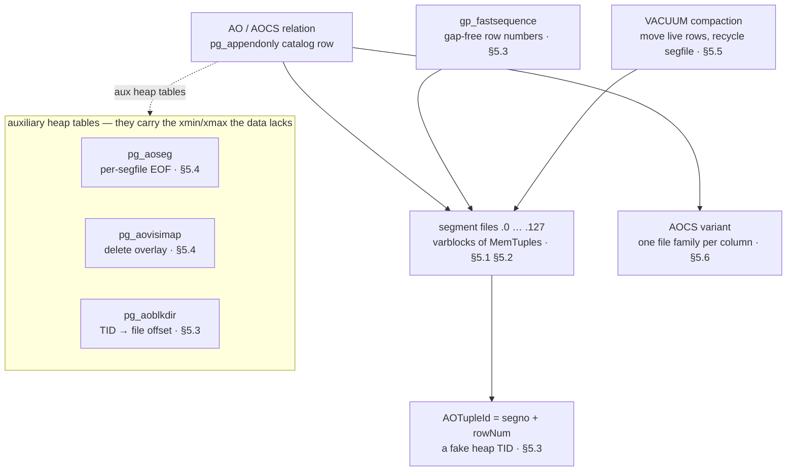
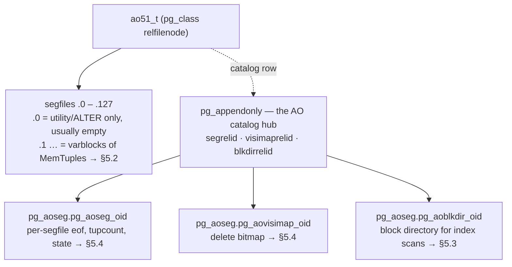
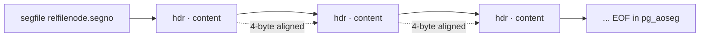
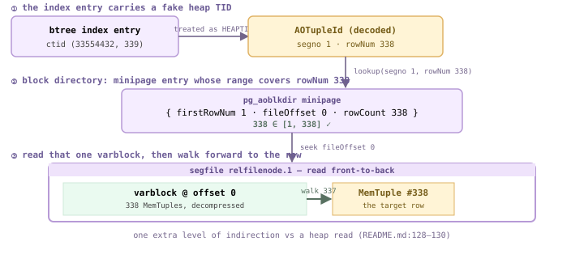
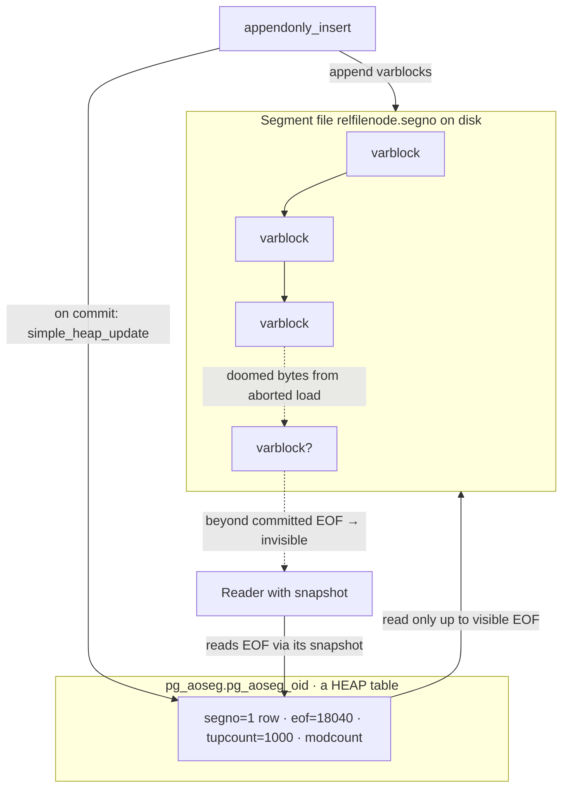
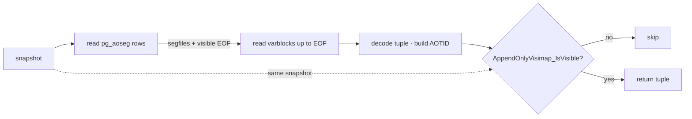
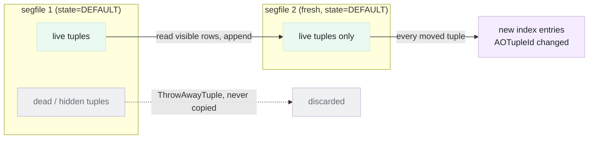
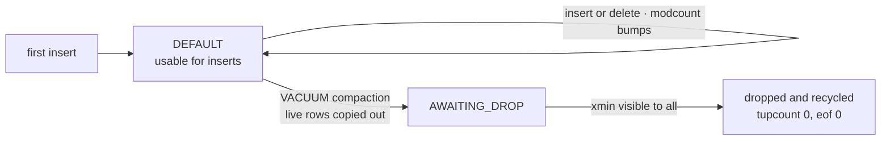
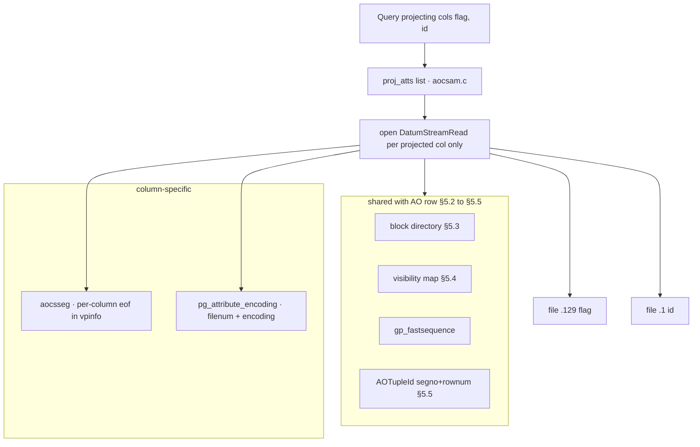

<style>
/*
 * Licensed to the Apache Software Foundation (ASF) under one
 * or more contributor license agreements.  See the NOTICE file
 * distributed with this work for additional information
 * regarding copyright ownership.  The ASF licenses this file
 * to you under the Apache License, Version 2.0 (the
 * "License"); you may not use this file except in compliance
 * with the License.  You may obtain a copy of the License at
 *
 *   http://www.apache.org/licenses/LICENSE-2.0
 *
 * Unless required by applicable law or agreed to in writing,
 * software distributed under the License is distributed on an
 * "AS IS" BASIS, WITHOUT WARRANTIES OR CONDITIONS OF ANY
 * KIND, either express or implied.  See the License for the
 * specific language governing permissions and limitations
 * under the License.
 */

/* Layout for the HTML-and-CSS figures, lifted from the handbook's own
   stylesheet so the figures render identically here. */

/* These four come from the handbook's own stylesheet; a consuming site has no
   such definitions, and an undefined custom property invalidates its whole
   declaration. Define them here, scoped to the figure.

   Deliberately NOT themed. The artwork below is light-only: band and tile
   backgrounds are hard-coded pastels, and the injected markup carries some 800
   more hard-coded light colours in inline styles. Giving --fg a dark-theme
   value paints near-white text onto a near-white band -- measured at 1.08:1,
   worse than the bug that replaced. The handbook's light values are correct in
   both themes; what changes for dark mode is the surface underneath. */
.cloudberry-core-figure {
  --border: #d8dee4;
  --soft:   #f6f8fa;
  --fg:     #1f2328;
  --muted:  #636c76;
  margin: 1.4rem 0;
}

/* Light-only artwork needs a light ground AND a dark ink, or it bleeds into a
   dark page. Setting only the ground is not enough: any text in these figures
   without its own inline colour inherits the site's near-white body colour, so
   it lands white-on-pastel -- measured at 1.03:1 across 184 text nodes. The
   colour has to be restored at the same place the ground is. */
[data-bs-theme='dark'] .cloudberry-core-figure > div {
  background: #ffffff;
  color: #1f2328;
  border-radius: 8px;
  padding: 10px;
}
/* Descendants that inherit rather than carry an inline colour. */
[data-bs-theme='dark'] .cloudberry-core-figure > div :not([style*="color"]) {
  color: inherit;
}
.cloudberry-core-figure figcaption {
  margin-top: .5rem;
  font-size: .9em;
  /* --ifm-color-emphasis-600 resolves to rgb(141,148,158) in the light theme,
     which is 3.06:1 on white -- below WCAG AA for the 37 figure captions.
     (The dark theme's value is fine, so only light is overridden.) */
  color: #636b75;
}
[data-bs-theme='dark'] .cloudberry-core-figure figcaption {
  color: #a6adb4;
}

/* Selective highlight: the handbook wraps a key token so it stands out.
   Scoped to the component. The class name .hl is two letters and this file
   lands in the consuming site's single global stylesheet, so an unscoped
   rule would style every page of that site. The standalone edition's
   figure.code / figure.session variants are dropped: those classes do not
   occur anywhere in this tree. */
.cloudberry-core-figure .hl { border-radius: 2px; font-weight: 700;
                   background: #fff8c5; color: #1f2328; padding: 0 2px; }

/* Layered module map and the banded brick figures. */
.cloudberry-core-figure .bricks { border:1px solid var(--border);border-radius:12px;overflow:hidden;background:var(--soft) }
.cloudberry-core-figure .bk-band { display:flex;align-items:stretch;border-top:1px solid var(--border) }
.cloudberry-core-figure .bk-band:first-child { border-top:none }
.cloudberry-core-figure .bk-lbl { flex:0 0 116px;display:flex;flex-direction:column;justify-content:center;gap:2px;padding:10px 13px }
.cloudberry-core-figure .bk-lbl b { font-size:12.5px;font-weight:800;color:var(--fg);line-height:1.2 }
.cloudberry-core-figure .bk-lbl span { font-size:9.5px;font-weight:700;color:var(--muted);text-transform:uppercase;letter-spacing:.5px }
.cloudberry-core-figure .bk-row { flex:1 1 auto;display:flex;flex-wrap:wrap;gap:7px;padding:9px 10px }
.cloudberry-core-figure .bk { flex:1 1 118px;min-width:104px;display:flex;flex-direction:column;justify-content:center;gap:2px; padding:8px 11px;border-radius:7px;border:1px solid;background:#fff;text-decoration:none;transition:.13s }
.cloudberry-core-figure .bk-t2 { font-size:12.5px;font-weight:700;line-height:1.25 }
.cloudberry-core-figure .bk-ch { font-size:10.5px;font-weight:700;font-variant-numeric:tabular-nums;opacity:.8 }
.cloudberry-core-figure a.bk:hover { transform:translateY(-2px);box-shadow:0 4px 12px #0000001f;text-decoration:none }
.cloudberry-core-figure .bk-q { background:#eef6ff }
.cloudberry-core-figure .bk-q .bk { border-color:#54aeff66;color:#0a3069;background:#ddf4ff }
.cloudberry-core-figure .bk-s { background:#eefcf2 }
.cloudberry-core-figure .bk-s .bk { border-color:#4ac26b80;color:#04260f;background:#dafbe1 }
.cloudberry-core-figure .bk-t { background:#fff6ef }
.cloudberry-core-figure .bk-t .bk { border-color:#fb8f4480;color:#5e2700;background:#fff1e5 }
.cloudberry-core-figure .bk-h { background:#fff4f3 }
.cloudberry-core-figure .bk-h .bk { border-color:#ff818280;color:#5c0011;background:#ffebe9 }
.cloudberry-core-figure .bk-r { background:#f3f5f8 }
.cloudberry-core-figure .bk-r .bk { border-color:#afb8c1;color:#1f2328;background:#eaeef2 }
@media (max-width: 560px) {
  .cloudberry-core-figure .bk-band { flex-direction:column }
  .cloudberry-core-figure .bk-lbl { flex-basis:auto;border-bottom:1px solid var(--border) }
}

</style>

<!--
  Licensed to the Apache Software Foundation (ASF) under one
  or more contributor license agreements.  See the NOTICE file
  distributed with this work for additional information
  regarding copyright ownership.  The ASF licenses this file
  to you under the Apache License, Version 2.0 (the
  "License"); you may not use this file except in compliance
  with the License.  You may obtain a copy of the License at

    http://www.apache.org/licenses/LICENSE-2.0

  Unless required by applicable law or agreed to in writing,
  software distributed under the License is distributed on an
  "AS IS" BASIS, WITHOUT WARRANTIES OR CONDITIONS OF ANY
  KIND, either express or implied.  See the License for the
  specific language governing permissions and limitations
  under the License.
-->


<a id="5-append-optimized-tables-ao--aocs"></a>



*AO 表的组成。数据存放在不可变的段文件流中；使它支持事务、删除和索引的机制都位于普通的辅助堆表中，由这些堆表承载 AO 元组自身省去的 MVCC 信息。AOCS 复用全部机制，只是将数据拆分为每列一组文件。*

## 5.1 MemTuple 与 AO 文件格式 {#51-memtuple--the-ao-file-format}

第 [4](/cloudberry/core-internals/part-2-storage-data-layout/ch04/) 章介绍了堆：每行都有一个 23 字节的头部（xmin、xmax、t_ctid、infomask 等），位于经过缓冲的 32 KB 页内，并通过缓冲区管理器读取（[§2](/cloudberry/core-internals/part-2-storage-data-layout/ch02/)、[§3](/cloudberry/core-internals/part-2-storage-data-layout/ch03/)）。**AO 表省去了其中大部分结构。** 行被序列化为更精简的磁盘形式，称为 **MemTuple**，紧密排列在 *varblock*（变长块）中，再写入普通的**段文件**。AO 代码使用*自己的*块 I/O 读写这些文件，完全绕过共享缓冲池。元组中不再保存每行的可见性信息（xmin/xmax），而是将其放在单独的可见性映射表中（[§5.4](#54-dml-scan--multi-version-control)）。这样得到的元组更小，批量加载更快；代价是需要一组辅助目录表和堆表，才能支持更新和索引。

虽然名称沿袭了历史用法，但在 SQL 层面，AO 表*并非*真正只能追加：可以对它执行 `UPDATE` 和 `DELETE`。这个名称描述的是*存储方式*：段文件只能追加写入，已有字节从不原地重写（`src/backend/access/appendonly/README.md`）。

### 5.1.1 AO 关系由 N 个段文件及其配套元数据组成 {#511-an-ao-relation-is-n-segment-files-plus-a-halo-of-metadata}

与堆相同，AO 表的数据保存在数据库目录下名为 `<relfilenode>.<segno>` 的文件中。*与堆不同*的是，这些段并非统一大小的 1 GB 文件块，也不按 BLCKSZ 分页：每个 AO 段文件都是独立的变长块流，大小可以不同，可以缺失，也可以超过 1 GB。一张表最多有 **128** 个段文件（`src/include/access/appendonlywriter.h` 中的 `MAX_AOREL_CONCURRENCY`）。

```c {title="src/include/access/appendonlywriter.h — MAX_AOREL_CONCURRENCY"}
#define MAX_AOREL_CONCURRENCY 128
```

**编号为 0 的段文件有特殊用途。** 它通常为空：普通插入写入编号 1..127 的段文件，每个并发写入者占一个。段文件 0（`src/include/access/appendonlywriter.h` 中的 `RESERVED_SEGNO`）保留给无需考虑并发的写入。过去只有 utility 模式使用它；现在，`ALTER TABLE` 有时执行的表重写，以及对目标表持有独占锁的 `CREATE TABLE AS`，也会使用它（`appendonlywriter.c` 中的 `choose_segno_internal()`）。下文会在磁盘上验证：编号 0 的段文件大小为 0 字节。



*[§5.1](#51-memtuple--the-ao-file-format) 所关注的局部结构：作为目录枢纽的 pg_appendonly，以及它引用的三个辅助堆表（最多 128 个数据段文件，其中编号 0 保留）。本章涉及的完整机制见章首图。*

*Coordinator（端口 7100）：新建 AO 表的 pg_appendonly 行。checksum 已开启，columnstore=f（使用 ao_row，而非 ao_column），blkdirrelid 仍为 0；块目录会在首次 CREATE INDEX 时按需创建。*

```sql
CREATE TABLE ao51_t (id int, name text, amount numeric)
        USING ao_row DISTRIBUTED BY (id);
      INSERT INTO ao51_t SELECT g,'row_'||g,g*1.5 FROM generate_series(1,1000) g;
      SELECT blocksize, compresstype, checksum, columnstore,
             segrelid, blkdirrelid, visimaprelid, version
      FROM pg_appendonly WHERE relid='ao51_t'::regclass;
```

```text {hl_lines="3" title="output"}
 blocksize | compresstype | checksum | columnstore | segrelid | blkdirrelid | visimaprelid | version
      -----------+--------------+----------+-------------+----------+-------------+--------------+---------
           32768 |              | t        | f          |    17325 |           0 |        17326 |       2
      (1 row)
```

通过 OID 列关联 `pg_class`，即可找到辅助表。它们位于 `pg_aoseg` 模式中，名称以 AO 关系的 OID 为后缀（这个后缀*不是* segrelid 的值，应通过 `::regclass` 查找）：

*Coordinator：三个辅助堆表。执行 CREATE INDEX 之后，blkdirrelid 才会指向实际的表。*

```sql
SELECT segrelid::regclass     AS aoseg_table,
             visimaprelid::regclass AS visimap_table
      FROM pg_appendonly WHERE relid='ao51_t'::regclass;
      CREATE INDEX ao51_idx ON ao51_t(id);
      SELECT blkdirrelid::regclass AS blkdir_table
      FROM pg_appendonly WHERE relid='ao51_t'::regclass;
```

```text {hl_lines="9" title="output"}
       aoseg_table       |        visimap_table
      -------------------------+-----------------------------
       pg_aoseg.pg_aoseg_17322 | pg_aoseg.pg_aovisimap_17322
      (1 row)

      CREATE INDEX
              blkdir_table
      ----------------------------
       pg_aoseg.pg_aoblkdir_17322
      (1 row)
```

数据文件位于 **Segment 上**，而非 Coordinator 上。以 utility 模式连接一个主 Segment，可以看到编号 0 的段文件为空、大小为 0 字节，而插入的 1000 行写入了段文件 `.1`：

*Segment（端口 7102，utility 模式）：磁盘上的段文件。16532 对应编号 0，为空；16532.1 存放数据。*

```sql
SELECT pg_relation_filepath('ao51_t');   -- run on the segment
      -- then in a shell, ls the data dir:
      --   16532      0 bytes   (segno 0)
      --   16532.1  11384 bytes (segno 1)
```

```text {title="output"}
   filepath
      --------------
       base/5/16532
      (1 row)
```

> [!NOTE]
> 本章所有 AO 数据检查都**在 Segment 上以 utility 模式**运行（`PGOPTIONS='-c gp_role=utility' psql -p 7102`）。Coordinator 只保存目录（pg_appendonly 及辅助表定义）；段文件及其元组只存在于 Segment 上。

### 5.1.2 MemTuple：头部精简的磁盘元组 {#512-the-memtuple-a-header-light-on-disk-tuple}

在 varblock 内，一行就是一个 `MemTupleData`。它的内存声明极为精简：一个表示长度和标志的 32 位字，后面跟着变长载荷（`src/include/access/memtup.h` 中的 `MemTupleData`）：

```c {title="src/include/access/memtup.h — MemTupleData"}
typedef struct MemTupleData
      {
          uint32        PRIVATE_mt_len;
          unsigned char PRIVATE_mt_bits[1]; /* varlen */
      } MemTupleData;
```

相比之下，堆元组有固定的 23 字节 `HeapTupleHeaderData`。MemTuple **没有逐元组的事务信息**，不含 `t_xmin`、`t_xmax`、`t_ctid` 和 `t_infomask`。AO 行的可见性由外部的 aovisimap 表和 pg_aoseg 行的 MVCC 状态决定（[§5.3](#53-block-directory--fastsequence)、[§5.4](#54-dml-scan--multi-version-control)）。仅这一点，每行就能节省约 20 字节；对于批量加载的事实表，这正是关键所在。

第一个字承担多种用途。真实元组的**最高位**（`MEMTUP_LEAD_BIT`）始终置位，让读取代码在流式处理时区分元组长度字与 varblock 长度。**长度**占据中间各位，由 `MEMTUP_LEN_MASK = 0x3FFFFFF8` 提取（注意最低 3 位为零：元组按 8 字节对齐，因此长度始终是 8 的倍数）。腾出的**最低 3 位用于保存标志**（`src/include/access/memtup.h` 中的 `MEMTUP_LEAD_BIT`）：

```c {title="src/include/access/memtup.h — MEMTUP_LEAD_BIT"}
#define MEMTUP_LEAD_BIT    0x80000000
      #define MEMTUP_LEN_MASK    0x3FFFFFF8
      #define MEMTUP_HASNULL       1   /* a null bitmap is present  */
      #define MEMTUP_LARGETUP      2   /* len > 0xFFF0: 4-byte offsets */
      #define MEMTUP_HASEXTERNAL   4   /* has a TOAST pointer       */
```

<figure class="cloudberry-core-figure">
<div><div style="max-width:760px;margin:2px auto;font:11px/1.4 ui-monospace,SFMono-Regular,Menlo,monospace;color:#1f2328;overflow-x:auto"> <div style="min-width:680px"> <div style="color:#6b5b95;font-weight:600;margin:0 0 2px">PRIVATE_mt_len — 一个 uint32，4 字节（按位打包的长度与标志）</div> <div style="display:flex;border:1px solid #cdb4db;text-align:center"> <div style="flex:0 0 90px;border-right:1px solid #e3d5f5;background:#f5edff;padding:5px 2px"><div style="color:#6b5b95">位 31</div><div style="font-size:9px;color:#444">LEAD · 0x80000000</div></div> <div style="flex:1;border-right:1px solid #e3d5f5;background:#f5edff;padding:5px 2px"><div style="color:#6b5b95">位 30–3</div><div style="font-size:9px;color:#444">长度，按 8 字节对齐 · MEMTUP_LEN_MASK <span class="hl">0x3FFFFFF8</span></div></div> <div style="flex:0 0 120px;background:#fff4d6;padding:5px 2px"><div style="color:#6b5b95">位 2–0</div><div style="font-size:9px;color:#444">标志 · EXT·LARGE·NULL</div></div></div> <div style="text-align:center;color:#73658b;font-size:10px;padding:1px 2px">↑ PRIVATE_mt_len — 4 字节 ↑</div> <div style="display:flex;text-align:center;margin-top:2px"> <div style="flex:0 0 220px;border:1px solid #cdb4db;background:#fff4d6;padding:6px 2px">空值位图（PRIVATE_mt_bits[]）<div style="font-size:9px;color:#6c6c6c">可选 · 仅在 HASNULL 时存在；前约 4 字节复用长度字中的空闲空间，额外空间由 null_bitmap_extra_size 计算</div></div> <div style="flex:1;border:1px solid #cdb4db;border-left:none;background:#eafaf0;padding:6px 2px">属性数据 — 定长在前、变长在后，重排并按 8 字节对齐<div style="font-size:9px;color:#6c6c6c">偏移量来自 MemTupleBinding，不存储在元组中</div></div></div> <div style="text-align:center;color:#587161;font-size:10px;padding:1px 2px">↑ 没有 23 字节事务头部 — 堆的 t_xmin / t_xmax / t_ctid 均不存在 ↑</div> </div></div></div>
<figcaption>MemTupleData 的字节布局。淡紫色为按位打包的 4 字节长度/标志字；琥珀色为可选的内联空值位图；绿色为紧密排列、按 8 字节对齐的属性数据。堆的 23 字节事务头部在这里完全省去。</figcaption>
</figure>

关键在于，MemTuple *只保存值*，内部没有逐属性的偏移量数组。偏移量、对齐填充和空值位的位置针对每个关系计算一次，缓存到从 `TupleDesc` 构建的 **`MemTupleBinding`** 中（`src/include/access/memtup.h`）。绑定还维护两套布局：元组不超过 `0xFFF0` 字节时使用带 2 字节偏移量的紧凑布局 `bind`，更大的元组使用带 4 字节偏移量的 `large_bind`；`MEMTUP_LARGETUP` 标志正是用来选择这两套布局的。

```c {title="src/include/access/memtup.h — MemTupleBinding"}
typedef struct MemTupleBinding
      {
          TupleDesc tupdesc;
          int       column_align;          /* 4 or 8 */
          int       null_bitmap_extra_size;
          MemTupleBindingCols bind;        /* 2-byte offsets */
          MemTupleBindingCols large_bind;  /* 4-byte offsets (large tup) */
      } MemTupleBinding;
```

行由 `memtuple_form_to()` 构造（`src/backend/access/common/memtuple.c`）：设置带最高标志位的长度字，按大小选择 `bind` 或 `large_bind`，*先*写空值位图（因为每个值的位置取决于前面哪些属性为空），再将值复制到绑定指定的偏移量处。空值位图开销很小：如果位图能放入长度字后面已有的 4 字节空隙，`compute_null_bitmap_extra_size()`（`src/backend/access/common/memtuple.c`）就会返回 **0 个额外字节**。因此，列数较少的表无需为允许空值付出额外空间。

### 5.1.3 这种格式如何接入系统 {#513-where-the-format-plugs-into-the-system}

以 `USING ao_row` 声明的表通过表访问方法处理器接入 AO 访问方法。处理器返回包含函数指针的 `TableAmRoutine`；入口是 `ao_row_tableam_handler`（`src/backend/access/appendonly/appendonlyam_handler.c`）：

```c {title="src/backend/access/appendonly/appendonlyam_handler.c — ao_row_tableam_handler()"}
Datum
      ao_row_tableam_handler(PG_FUNCTION_ARGS)
      {
          PG_RETURN_POINTER(&ao_row_methods);
      }
```

- **pg_appendonly**：每张 AO 表对应一行目录记录，可视为“pg_class 的扩展”。它保存 blocksize、compresstype/level、checksum，以及定位辅助表的 OID（segrelid / visimaprelid / blkdirrelid）。定义见 `src/include/catalog/pg_appendonly.h`（`FormData_pg_appendonly`）。
- **aoseg 表**：pg_aoseg.pg_aoseg_`<oid>`。每个段文件对应一行，记录 eof（已提交长度）、tupcount、modcount 和 state。eof 是 AO 能在崩溃后安全恢复、正确遵循 MVCC 的关键（[§5.3](#53-block-directory--fastsequence)）。
- **aovisimap 表**：pg_aovisimap_`<oid>`。用覆盖位图标记已删除的行，使 DELETE/UPDATE 无需修改不可变的段文件（[§5.4](#54-dml-scan--multi-version-control)）。
- **aoblkdir 表**：pg_aoblkdir_`<oid>`。将行的 TID 映射为（段文件，偏移量）；在首次 CREATE INDEX 时按需建立，以支持随机访问和索引访问（[§5.5](#55-vacuum--compaction)）。

*Segment（utility 模式）：aoseg 行印证了磁盘上的情况。只有编号 1 的段文件有数据，其 eof 为 11384，与文件 16532.1 的大小完全一致；分布到各处的 1000 行中，有 338 行位于此 Segment。*

```sql
SELECT segno, eof, tupcount, modcount, state
      FROM pg_aoseg.pg_aoseg_17322 ORDER BY segno;
```

```text {hl_lines="3" title="output"}
 segno |  eof  | tupcount | modcount | state
      -------+-------+----------+----------+-------
           1 | 11384 |      338 |        1 |     1
      (1 row)
```

> [!NOTE]
> 这幅图景还缺少段文件的*内部*结构：包裹这些 MemTuple 的 varblock 头部、校验和及压缩机制。这些内容将在 [§5.2](#52-variable-length-block-format) 介绍。

## 5.2 变长块格式 {#52-variable-length-block-format}

堆关系是一串大小相同的 32 KB 页（[§4.1](/cloudberry/core-internals/part-2-storage-data-layout/ch04/#41-page-organization--item-pointers)），每页大小相同，且能自我描述。AO 段文件采用完全不同的前提。如 [§5.1](#51-memtuple--the-ao-file-format) 所述，它是一串紧密排列的**变长块**（*varblock*），每块只占据容纳写入者交付内容所需的空间。`src/backend/access/appendonly/README.md:36` 对格式的描述是：*“仅追加段文件由一系列变长块依次组成。varblock 按 4 字节对齐。每块以头部开始。”*

这里没有页目录、空闲空间槽位数组，也没有逐页的行指针。读取者若要访问第 *n* 块，不能直接跳到 `n * BLCKSZ`，而必须从文件开头遍历，读取每个头部以确定下一块的距离。这是紧密存储的代价，也是每块都要在头部保存自身长度的原因。

<figure class="cloudberry-core-figure">
<div><div style="max-width:780px;margin:2px auto;font:11px/1.4 ui-monospace,SFMono-Regular,Menlo,monospace;color:#1f2328;overflow-x:auto"> <div style="min-width:720px"> <div style="color:#6b5b95;font-weight:600;margin:0 0 2px">基本头部 — 8 字节（两个 uint32，按位打包）→ 1 + 3 + 1 + 3 + 14 + 21 + 21 = <span class="hl">64</span> 位</div> <div style="display:flex;border:1px solid #cdb4db;text-align:center"> <div style="flex:0 0 48px;border-right:1px solid #e3d5f5;background:#f4f5f6;padding:5px 1px"><div style="color:#5f6b76">1 位</div><div style="font-size:9px;color:#5f6b76">保留</div></div> <div style="flex:0 0 92px;border-right:1px solid #e3d5f5;background:#f5edff;padding:5px 1px"><div style="color:#6b5b95">3 位</div><div style="font-size:9px;color:#444">类型 · SmallContent</div></div> <div style="flex:0 0 84px;border-right:1px solid #e3d5f5;background:#fff4d6;padding:5px 1px"><div style="color:#6b5b95">1 位</div><div style="font-size:9px;color:#444">hasFirstRowNum</div></div> <div style="flex:0 0 92px;border-right:1px solid #e3d5f5;background:#f5edff;padding:5px 1px"><div style="color:#6b5b95">3 位</div><div style="font-size:9px;color:#444">executorKind · AO 行存</div></div> <div style="flex:1;border-right:1px solid #e3d5f5;background:#f5edff;padding:5px 1px"><div style="color:#6b5b95">14 位</div><div style="font-size:9px;color:#444">rowCount</div></div> <div style="flex:1;border-right:1px solid #e3d5f5;background:#f5edff;padding:5px 1px"><div style="color:#6b5b95">21 位</div><div style="font-size:9px;color:#444">dataLength · 未压缩长度</div></div> <div style="flex:1;background:#f5edff;padding:5px 1px"><div style="color:#6b5b95">21 位</div><div style="font-size:9px;color:#444">compressedLength · 未压缩时为 0</div></div></div> <div style="text-align:center;color:#73658b;font-size:10px;padding:1px 2px">↑ 基本头部 = 8 字节 ↑</div> <div style="display:flex;text-align:center;margin-top:2px"> <div style="flex:0 0 210px;border:1px solid #cdb4db;background:#fff4d6;padding:6px 2px">firstRowNumber<div style="font-size:9px;color:#6c6c6c">int64 · 8 B · 仅在 hasFirstRowNum 时存在</div></div> <div style="flex:1;border:1px solid #cdb4db;border-left:none;background:#fff4d6;padding:6px 2px">头部校验和<div style="font-size:9px;color:#6c6c6c">pg_crc32 · 4 B · 可选</div></div> <div style="flex:1;border:1px solid #cdb4db;border-left:none;background:#fff4d6;padding:6px 2px">块校验和<div style="font-size:9px;color:#6c6c6c">pg_crc32 · 4 B · 可选</div></div></div> <div style="border:1px solid #cdb4db;border-top:none;background:#eafaf0;padding:9px 8px;text-align:center;margin-top:2px">内容 = 紧密排列的 MemTuple（§5.1），可压缩或保持原样 · 长度 = compressedLength 或 dataLength · 填充至 4 字节边界</div> <div style="text-align:center;color:#73658b;font-size:10px;padding:2px">大于单个块的一行 → LargeContent 头部（无数据），后接多个 SmallContent 片段</div> </div></div></div>
<figcaption>一个 SmallContent varblock（建表时启用了校验和）。淡紫色为 8 字节基本头部，七个位字段合计 64 位，注意开头的保留位和 hasFirstRowNum 标志；琥珀色为可选的 firstRowNumber 和两个校验和；绿色为紧密排列、可能经过压缩的 MemTuple（§5.1）。所有内容均向上填充到 4 字节边界。</figcaption>
</figure>

这个布局并不是单一固定的 C 结构体，而是由一小组头部类型组成。读取引擎首先解码头部类型，再信任其他字段。本节余下部分将介绍这些头部类型、两个校验和，以及压缩究竟如何改变上图的绿色区域。

### 5.2.1 段文件是由 4 字节对齐的 varblock 组成的链 {#521-a-segfile-is-a-chain-of-4-byte-aligned-varblocks}

直接比较两种物理布局：堆段文件以 `BLCKSZ`（32768 字节）为单位增长，通过算术运算寻址；AO 段文件则依次*追加* varblock，每块都填充到下一个 4 字节倍数，且没有全局槽位表。要定位第 *k* 块，必须从开头依次读取头部，这正是 `cdbappendonlystorageread.c` 的扫描方式。



*AO 段文件是一条只能向前遍历的链。每个头部记录自身长度，因此读取者按“头部 → 内容 → 下一头部”前进。这里没有跳转表。*

基本头部为 **8 字节**，由两个 `uint32` 字组成。由于字段不按字节边界排列，必须按位打包（`src/include/cdb/cdbappendonlystorage.h` 中的 `AoHeader_RegularSize`）。其后是可选内容：需要时记录*首行行号*（`int64`），建表时使用 `WITH (checksum=true)` 则还会记录两个校验和。总长度由 `AoHeader_Size` 根据三个布尔值计算：

```c {title="src/include/cdb/cdbappendonlystorage.h — AoHeader_RegularSize"}
#define AoHeader_RegularSize 8
      #define AoHeader_LongSize   16
      /* AoHeader_Size: base (regular|long) + 2*sizeof(pg_crc32) if checksums
       *                                    + sizeof(int64)      if hasFirstRowNum */
```

### 5.2.2 头部类型：基本头部、SmallContent、LargeContent {#522-the-header-family-basic-small-content-large-content}

所有头部的前四位都相同：1 个保留位和 3 位的**头部类型**。这个公共前缀构成 `AOHeader` 基“类”（`src/include/cdb/cdbappendonlystorage_int.h`）；类型告诉读取者，其余 60 位应按哪一种专用布局解释。

```c {title="src/include/cdb/cdbappendonlystorage.h — AoHeaderKind"}
typedef enum AoHeaderKind {
          AoHeaderKind_None = 0,
          AoHeaderKind_SmallContent = 1,
          AoHeaderKind_LargeContent = 2,
          AoHeaderKind_NonBulkDenseContent = 3,
          AoHeaderKind_BulkDenseContent = 4,
      } AoHeaderKind;
```

最常用的是 **SmallContent**，即 `AOSmallContentHeader`（`src/include/cdb/cdbappendonlystorage_int.h`）。它的 60 个专用位打包了 `hasFirstRowNum`（1 位）、`executorBlockKind`（3 位）、`rowCount`（14 位）、`dataLength`（21 位）和 `compressedLength`（21 位）。注意这些位数限制：`rowCount` 只有 14 位，`dataLength`/`compressedLength` 只有 21 位，因此一个 SmallContent 块最多容纳 blocksize 字节的内容，行数也有上限。

如果单行大于整个块，会怎样处理？它会成为 **LargeContent**。写入者先输出一个 `AOLargeContentHeader`（`src/include/cdb/cdbappendonlystorage_int.h`），其中只有总长度 `largeContentLength`（30 位，最大约 1 GB）和 25 位的 `largeRowCount`，*再*写入足够多的 SmallContent 块来容纳字节。`AOSmallContentHeader` 的注释明确说明：大内容头部给出内容长度，后续的 SmallContent 片段负责存储内容。另外，面向列存 AOCS 的 `NonBulkDenseContent` 和 `BulkDenseContent` 是另外两种类型；后者是唯一使用 16 字节*长*头部的类型，见 `src/include/cdb/cdbappendonlystorage.h` 中的 `AoHeader_IsLong`。

- **SmallContent**：所有能放入单块的内容，以及跨块大行的片段。头部定义在第 64 行。
- **LargeContent**：不含数据的标记，记录超大行的总长度和行数，其后跟着 SmallContent 片段。头部定义在第 172 行。
- **NonBulk/BulkDense**：AOCS 列块，每块需要容纳更多行；Bulk 使用 16 字节的长头部。

公开 API 与这些头部类型对应。写入者调用 `AppendOnlyStorageFormat_MakeSmallContentHeader`（`src/include/cdb/cdbappendonlystorageformat.h`）和 `MakeLargeContentHeader`（`AppendOnlyStorageFormat_MakeLargeContentHeader()`）；读取者先调用 `GetHeaderInfo`（`AppendOnlyStorageFormat_GetHeaderInfo()`）获知类型和头部长度，再调用 `GetSmallContentHeaderInfo`（`AppendOnlyStorageFormat_GetSmallContentHeaderInfo()`）或 `GetLargeContentHeaderInfo`（`AppendOnlyStorageFormat_GetLargeContentHeaderInfo()`）解包其余字段。写入路径位于 `src/backend/cdb/cdbappendonlystoragewrite.c`（`AppendOnlyStorageWrite_CompressAppend()`）和 `AppendOnlyStorageWrite_Content()`；读取路径位于 `cdbappendonlystorageread.c`。

### 5.2.3 每块两个校验和：头部与内容 {#523-two-checksums-per-block--header-and-content}

使用 `WITH (checksum=true)` 建表时，每块都会保存**两个** CRC-32 校验和，保护的内容各不相同。`src/backend/access/appendonly/README.md:42` 只提到 *“头部还包含两个校验和”*；其原因见格式头文件：**头部校验和**会*先*验证，只有通过后，头部字段（长度、类型、rowCount）才可信；然后**块校验和**覆盖包含内容在内的整个块。

```c {title="src/include/cdb/cdbappendonlystorage_int.h"}
/* 64 bit header + [ block checksum + header checksum ].
       * ... The header checksum protects the header and the block
       * checksum. If it is valid, the header fields can be used. */
```

两个验证函数分别是 `AppendOnlyStorageFormat_VerifyHeaderChecksum`（`src/include/cdb/cdbappendonlystorageformat.h`）和 `VerifyBlockChecksum`（`AppendOnlyStorageFormat_VerifyBlockChecksum()`）；读取引擎在解码任何内容前先校验头部（写入/验证路径则见 `src/backend/cdb/cdbappendonlystoragewrite.c` 中的 `AppendOnlyStorageWrite_VerifyWriteBlock()`）。关闭校验和时，这两个校验和都**不存在**：8 字节头部后直接就是内容，`AoHeader_Size` 不会为校验和增加空间。

*Coordinator：两张 ao52_\* 表均使用默认的 checksum=t 创建，因此这里每块都包含两个 CRC。*

```sql
SELECT c.relname, a.blocksize, a.compresstype,
             a.compresslevel, a.checksum
      FROM pg_appendonly a JOIN pg_class c ON c.oid = a.relid
      WHERE c.relname IN ('ao52_plain','ao52_zstd')
      ORDER BY c.relname;
```

```text {hl_lines="3 4" title="output"}
  relname   | blocksize | compresstype | compresslevel | checksum 
      ------------+-----------+--------------+---------------+----------
       ao52_plain |     32768 |              |             0 | t
       ao52_zstd  |     32768 | zstd         |             5 | t
      (2 rows)
```

### 5.2.4 压缩：绿色区域缩小 {#524-compression--the-green-region-shrinks}

`blocksize` 和 `compresstype`/`compresslevel` 直接来自 `pg_appendonly`（即上面的列）。块大小默认为 `32768`，限制每块*未压缩*内容的大小。压缩仅作用于绿色的内容区域：由 `compresstype` 选择 `none`、`zlib`、`zstd` 或 `rle_type`，级别由 `compresslevel` 决定。头部记录两个大小：`dataLength` 是未压缩大小，`compressedLength` 是磁盘大小，让读取者知道要读多少字节，以及解压后应有多少字节。

如果压缩没能真正缩小缓冲区，写入者会原样保存，并设置 `compressedLength = 0`（`src/backend/cdb/cdbappendonlystoragewrite.c` 中的 `AppendOnlyStorageWrite_CompressAppend()`）；零值就是磁盘上表示 *“此块未压缩”* 的标志。读取者通过 `AppendOnlyStorageFormat_GetCompressedLen`（`src/include/cdb/cdbappendonlystorageformat.h`）提取磁盘长度，该函数只有一行位提取操作：

```c {title="src/backend/cdb/cdbappendonlystorageformat.c — AppendOnlyStorageFormat_GetCompressedLen()"}
AppendOnlyStorageFormat_GetCompressedLen(uint8 *headerPtr) {
          AOSmallContentHeader *blockHeader = (AOSmallContentHeader *) headerPtr;
          return AOSmallContentHeaderGet_compressedLength(blockHeader);
      }
```

对于可压缩数据，效果很明显。我们向 `ao52_plain` 和 `ao52_zstd` 插入了**相同的 50,000 行**，每行都是 800 字节的重复字符串；两表唯一的区别是后者使用 `compresstype=zstd, compresslevel=5`。随后测量单个 Segment 上的段文件：

*Segment（端口 7102，utility 模式）：相同的行，zstd 将段文件从 13 MB 缩小到 127 kB。本例约缩小 105 倍，因为重复载荷具有很高的可压缩性。*

```sql
SELECT 'ao52_plain' AS tbl,
             pg_size_pretty(pg_relation_size('ao52_plain')) AS segfile,
             pg_relation_size('ao52_plain') AS bytes
      UNION ALL
      SELECT 'ao52_zstd',
             pg_size_pretty(pg_relation_size('ao52_zstd')),
             pg_relation_size('ao52_zstd');
```

```text {hl_lines="4" title="output"}
    tbl     | segfile |  bytes   
      ------------+---------+----------
       ao52_plain | 13 MB   | 13672344
       ao52_zstd  | 127 kB |   130288
      (2 rows)
```

> [!NOTE]
> 逻辑行、blocksize 和校验和都相同，变化的只有各 varblock 的内容。块格式不变；压缩只是作用于绿色载荷的逐块变换，由两个头部字段记录，无需扫描文件其余部分就能逆向还原。

## 5.3 块目录与 fastsequence {#53-block-directory--fastsequence}

### 5.3.1 问题：堆能随机读取，AO 段文件只能从前向后读取 {#531-the-problem-a-heap-reads-anywhere-an-ao-segfile-reads-front-to-back}

[§5.1](#51-memtuple--the-ao-file-format) 已说明，AO 数据保存在 **varblock** 中，块在段文件内首尾相接，没有槽位数组，也没有逐块寻址机制；读取时从文件的第 0 字节开始流式向前处理。这非常适合顺序扫描，却不利于其他访问方式。索引项指出 *“目标行在那里”*，并期望能够**直接跳到该行**。堆可以这样做：堆 TID 为 `(block#, offset)`，将块号乘以 `BLCKSZ` 即可得到文件内的位置。AO 行没有这样的地址，只知道自己是*段文件 K 中的第 N 行*。

Cloudberry 用两套机制弥合这一差距。首先，行需要一个系统其他部分可以保存和传递的**身份标识**，即伪装成堆 TID 的 `AOTupleId`。其次，这个标识必须能**解析**为物理文件偏移量，这由按需建立的额外间接层——**块目录**——完成。**README.md:128-130** 的说法是：*“与堆表相比，对 AO 表的索引扫描多了一层间接寻址。”* 本节沿着“索引 → AOTupleId → 块目录 → varblock → 元组”的路径展开。



*额外的一层间接寻址：AO 索引探测通过块目录将伪堆 TID 解析为文件偏移量，然后只读取并遍历一个 varblock。ao53_t 示例中的实际值为：id=1000 → ctid (33554432, 339) → segno 1、rowNum 338。*

### 5.3.2 AOTupleId：以堆 TID 形式表示（段文件号，行号） {#532-aotupleid--a-rows-identity-is-segfile-row-wearing-a-heap-tid-costume}

索引、执行器、触发器代码、EXPLAIN 等 *“系统的大部分其他组件，都期望每个元组具有唯一的物理标识符”*（**README.md:138-139**）。这个标识符是 6 字节的 `ItemPointer`，其中块号占 4 字节，偏移量占 2 字节。AO 没有堆块，因此构造了一个 48 位值：它*看起来*像合法的 `ItemPointer`，实际编码的是 `(segfile#, rowNum)`。**appendonlytid.h 中的 AOTupleId** 结构体由三个 `uint16` 组成，大小和对齐方式刻意与 `ItemPointer` 相同：

```c {title="src/include/access/appendonlytid.h — AOTupleId"}
typedef struct AOTupleId
      {
          uint16  bytes_0_1;
          uint16  bytes_2_3;
          uint16  bytes_4_5;
      } AOTupleId;
```

> [!NOTE]
> 头文件 appendonlytid.h 中有一条警告：*“在 appendonly AM 代码之外，AOTID 被当作 HEAPTID 处理！”* 该结构体绝不能生成看起来像*无效* ItemPointer 的值，因此偏移量字段加了 1，使其永远不为零。

这 48 位分为三部分。**最高 7 位**是段文件号（**appendonlytid.h** 中的 `AOTupleIdGet_segmentFileNum`，表达式为 `(bytes_0_1 & 0xFE00) >> 9`），由此得到 **128** 个段文件的上限（[§5.1](#51-memtuple--the-ao-file-format)）。其余 **40 位**是行号（**appendonlytid.h** 中的 `AOTupleIdGet_rowNum`），上限为 `AOTupleId_MaxRowNum = 1099511627775`（**appendonlytid.h**），即每个段文件约 1.1 万亿行。巧妙之处在于，这 40 位跨越字边界分布，使得*整体*仍然可以被解读为合理的 `(block#, offset)`：

<figure class="cloudberry-core-figure">
<div><div style="max-width:760px;margin:2px auto;font:11px/1.4 ui-monospace,SFMono-Regular,Menlo,monospace;color:#1f2328;overflow-x:auto"> <div style="min-width:680px"> <div style="display:flex;text-align:center;color:#6b5b95;font-size:10px;font-weight:600;margin-bottom:2px"> <div style="flex:16;border-right:2px solid #fff">bytes_0_1（16 位）</div><div style="flex:16;border-right:2px solid #fff">bytes_2_3（16 位）</div><div style="flex:16">bytes_4_5（16 位）</div></div> <div style="color:#6b5b95;font-weight:600;font-size:10px;margin:0 0 1px">堆视角 — 通用 ItemPointer 代码看到的布局</div> <div style="display:flex;border:1px solid #cdb4db;text-align:center"> <div style="flex:32;border-right:1px solid #e3d5f5;background:#f5edff;padding:5px 2px">BlockNumber（32 位）</div> <div style="flex:16;background:#eafaf0;padding:5px 2px">ip_posid（16 位）</div></div> <div style="color:#6b5b95;font-weight:600;font-size:10px;margin:6px 0 1px">AO 视角 — 实际的（segfile#, rowNum）编码</div> <div style="display:flex;border:1px solid #cdb4db;text-align:center"> <div style="flex:7;border-right:1px solid #e3d5f5;background:#fff4d6;padding:5px 1px"><div style="color:#735a16;font-weight:700">segno</div><div style="font-size:9px;color:#444">7 位</div></div> <div style="flex:9;border-right:1px solid #e3d5f5;background:#faf6ff;padding:5px 1px"><div style="color:#6b5b95">rowNum 高位</div><div style="font-size:9px;color:#444">9 位 · &amp; 0x01FF</div></div> <div style="flex:16;border-right:1px solid #e3d5f5;background:#faf6ff;padding:5px 1px"><div style="color:#6b5b95">rowNum 中间位</div><div style="font-size:9px;color:#444">16 位 · bytes_2_3</div></div> <div style="flex:16;background:#faf6ff;padding:5px 1px"><div style="color:#6b5b95">rowNum 低位</div><div style="font-size:9px;color:#444">15 位 <span class="hl">+ 1 偏置</span> · bytes_4_5</div></div></div> <div style="text-align:center;color:#73658b;font-size:10px;padding:2px">↑ 7 位 segfile# + 40 位 rowNum（9 │ 16 │ 15）— 偏移量永不为零 ↑</div> </div></div></div>
<figcaption>将 48 位 AOTupleId 叠加在堆 ItemPointer 上。7 位段文件号与 40 位 rowNum（按 9 │ 16 │ 15 分布在三个 uint16 字中）合在一起，仍然可解读为合法的（块号，偏移量）：rowNum 的最低 15 位放入堆代码视为 ip_posid 的偏移量字中，加 1 则保证偏移量不为零。</figcaption>
</figure>

```c {title="src/include/access/appendonlytid.h — AOTupleIdGet_segmentFileNum"}
segno  = (bytes_0_1 & 0xFE00) >> 9;                  /* top 7 bits          */
rowNum = ((int64)(bytes_0_1 & 0x01FF) << 31)         /* high  9 bits        */
       | ((int64) bytes_2_3 << 15)                   /* middle 16 bits      */
       | (bytes_4_5 - 1);                            /* low 15, +1 bias off */
```

因此，*伪 CTID* `(33554432, 2)` 并非随机值：`33554432 = 1 << 25` 表示段文件号为 **1**，行号高位为零，偏移量为 `2 = rowNum 0 + 1`。同一张示例表可以验证这一点；请注意 `1 << 25` 的块号以及偏移量的 `+1` 偏置：

*AO 表的 ctid 列是合成的 AOTupleId。id=1 在所属 Segment 上的 rowNum 为 1（偏移量 2），id=1000 的 rowNum 为 338（偏移量 339）。*

```sql
SELECT gp_segment_id, ctid, id FROM ao53_t WHERE id IN (1, 1000) ORDER BY id;
```

```text {hl_lines="3" title="output"}
 gp_segment_id |      ctid      |  id
      ---------------+----------------+------
                   1 | (33554432,2)   |    1
                   0 | (33554432,339) | 1000
      (2 rows)
```

`33554432 >> 25 = 1` 表示两行都位于**段文件 1**；偏移量 `2` 和 `339` 分别解码为 rowNum `1` 和 `338`。没有任何行的偏移量为 0，满足堆体系中“合法 TID 的偏移量必须非零”的不变量（**appendonlytid.h**）。

### 5.3.3 gp_fastsequence：无需重量级序列的连续行号 {#533-gp_fastsequence--gap-free-row-numbers-without-a-heavyweight-sequence}

这些 rowNum 从何而来？它们在**每个段文件内必须密集且单调递增**，因为块目录保存的是行号*范围*。INSERT 期间，每个 Segment 都要在关系扩展锁保护下分配它们，次数可能多达数百万。真正的 `SEQUENCE` 对象有自己的 relfilenode、WAL 和缓冲区访问，开销过大。Cloudberry 使用精简计数器 **`gp_fastsequence`**（目录 OID 为 7023，定义见 **gp_fastsequence.h 中的 FormData_gp_fastsequence**），只有三列：

*FormData_gp_fastsequence — gp_fastsequence.h*

| 字段 | 类型 | 含义 |
| --- | --- | --- |
| objid | Oid | aoseg 关系的 OID（pg_appendonly.segrelid），用于确定是哪张 AO 表 |
| objmod | int8 | 段文件号（segno），因此每个段文件恰好对应一行计数器 |
| last_sequence | int8 | 此（segrelid，segno）迄今已分配的最大 rowNum |

分配通过 **`GetFastSequences`**（**gp_fastsequence.c**）进行：在 `RowExclusiveLock` 下查找 `(objid, objmod)` 行，将 `last_sequence` 增加请求的数量，并返回新一批号码的起始值。AO 插入以当前写入的段文件为参数调用它，每批分配 **`NUM_FAST_SEQUENCES` = 100** 个号码（**gp_fastsequence.h**）：

```c {title="src/backend/access/appendonly/appendonlyam.c — appendonly_insert_init()"}
firstSequence = GetFastSequences(aoInsertDesc->segrelid, segno,
                                       ...,
                                       NUM_FAST_SEQUENCES);
```

这是**原地**堆更新（`heap_inplace_update`，见 **gp_fastsequence.c 中的 insert_or_update_fastsequence()**），不是 MVCC 插入：不会不断产生新版本，计数器只向前增长。新建 AO 表通过 `InsertInitialFastSequenceEntries`（**gp_fastsequence.c**，`RESERVED_SEGNO = 0`）为保留的段文件号 0 创建一行已冻结的占位记录。在 **Segment** 上读取目录可以看到每个段文件对应一行，计数器与数据保存在同一位置：

*每个段文件对应一行计数器。编号 0 是保留的占位记录；此 Segment 上编号 1 已分配到第 400 行，因为每次分配 100 个号码，338 个存活行对应的分配量向上取整为 400。*

```sql
-- segment, utility mode (PGPORT=7102)
      SELECT objid::regclass AS aoseg, objmod AS segno, last_sequence
      FROM gp_fastsequence
      WHERE objid = (SELECT segrelid FROM pg_appendonly
                     WHERE relid = 'ao53_t'::regclass)
      ORDER BY objmod;
```

```text {hl_lines="4" title="output"}
          aoseg          | segno | last_sequence
      -------------------------+-------+---------------
       pg_aoseg.pg_aoseg_17377 |     0 |             0
       pg_aoseg.pg_aoseg_17377 |     1 |           400
      (2 rows)
```

> [!NOTE]
> 分批取整正是不同块目录项之间的行号可能出现空隙的*原因*。**cdbappendonlyblockdirectory.h 中 AppendOnlyBlockDirectoryEntry** 的注释说明，fastsequence *“按预定大小分配一批行号，这个大小可能超过正在插入的块数。”* 块目录通过显式保存范围来容忍这些空隙。

### 5.3.4 块目录：（segno，rowNum 范围）→ 文件偏移量，在首次 CREATE INDEX 时建立 {#534-the-block-directory--segno-rownum-range--file-offset-built-on-first-create-index}

AOTupleId 为行赋予*标识*，块目录将标识转换为*位置*。块目录本身是普通堆表 `pg_aoseg.pg_aoblkdir_<oid>`，由 **`pg_appendonly.blkdirrelid`** 指向，并在 `(segno, columngroup, firstRowNum)` 上建立自己的 B-树索引。关键是它采用**惰性创建**：刚加载、从未建立索引的 AO 表根本没有块目录。**README.md:132-133** 写道：*“只有需要时，首次 CREATE INDEX 命令才会创建块目录。”* 下面观察 `blkdirrelid` 从 0 变为实际关系：

*创建任何索引之前，blkdirrelid 为 0。尚无随机访问机制，因为还没有组件需要它。*

```sql {hl_lines="2"}
SELECT relid::regclass AS aotable, segrelid,
             blkdirrelid, visimaprelid
      FROM pg_appendonly WHERE relid = 'ao53_t'::regclass;
```

```text {hl_lines="3" title="output"}
 aotable | segrelid | blkdirrelid | visimaprelid
      ---------+----------+-------------+--------------
       ao53_t  |    17380 |           0 |        17381
      (1 row)
```

*CREATE INDEX 按需建立块目录；此时 blkdirrelid 指向实际的 pg_aoblkdir 堆表。*

```sql
CREATE INDEX ao53_t_id_idx ON ao53_t (id);

      SELECT blkdirrelid, blkdirrelid::regclass AS blkdir_table
      FROM pg_appendonly WHERE relid = 'ao53_t'::regclass;
```

```text {hl_lines="3" title="output"}
 blkdirrelid |        blkdir_table
      -------------+----------------------------
             17385 | pg_aoseg.pg_aoblkdir_17377
      (1 row)
```

每个块目录行保存一个紧凑的 **minipage**，即 `MinipageEntry` 数组。每个元素为 `{firstRowNum, fileOffset, rowCount}`（**cdbappendonlyblockdirectory.h**），描述一段 varblock 大小的行序列。写入数据时追加目录项（`AppendOnlyBlockDirectory_InsertEntry`，**appendonlyblockdirectory.c**）。查找则运行 **`AppendOnlyBlockDirectory_GetEntry`**（**appendonlyblockdirectory.c**），拆解 AOTupleId，寻找范围包含 `rowNum` 的目录项：

```c {title="src/backend/access/appendonly/appendonlyblockdirectory.c — AppendOnlyBlockDirectory_GetEntry()"}
int   segmentFileNum = AOTupleIdGet_segmentFileNum(aoTupleId);
      int64 rowNum         = AOTupleIdGet_rowNum(aoTupleId);
      /* ... search the minipage for the entry covering rowNum,
         then return range.fileOffset / range.firstRowNum */
```

范围覆盖检查就是 `rowNum >= firstRowNum && rowNum <= lastRowNum`（**appendonlyblockdirectory.c 中的 AppendOnlyBlockDirectoryEntry_RangeHasRow()**）。找到目录项后，扫描会在段文件中执行定位（`seeks`），跳到 `fileOffset`，读取并解压该 varblock，然后向前遍历 `(rowNum - firstRowNum)` 个元组。这是剩下唯一的顺序操作，且已限制在单个块内。`gp_aoblkdir()` UDF（**appendonly_blkdir_udf.c**）将这些 minipage 展开为每个目录项一行；对于示例中包含 338 行的段文件，在 Segment 上可以看到单个目录项覆盖了整个块：

*一个 varblock，对应一个 minipage 目录项：段文件 1 的第 1..338 行位于 file_offset 0。对其中任意一行的索引探测都会解析到这里，然后只读取这一块。*

```sql
-- segment, utility mode (PGPORT=7102)
      SELECT tupleid, segno, columngroup_no AS colgrp, entry_no,
             first_row_no, file_offset, row_count
      FROM gp_toolkit.__gp_aoblkdir('ao53_t')
      ORDER BY segno, first_row_no;
```

```text {hl_lines="3" title="output"}
 tupleid | segno | colgrp | entry_no | first_row_no | file_offset | row_count
      ---------+-------+--------+----------+--------------+-------------+-----------
       (0,1)   |     1 |      0 |        0 |            1 |           0 |       338
      (1 row)
```

还有两个相关细节。对于 **AOCO** 表，每个*列组*都有一个 minipage，因为不同列存放在不同段文件中；`GetEntry` 接收 `columnGroupNo`（**appendonlyblockdirectory.c 中的 AppendOnlyBlockDirectory_GetEntry()**），AOCO 获取数据时会为每列重新扫描块目录。对于**唯一索引**，块目录还承担第二项职责：AO 元组没有 xmin/xmax，因此唯一性检查借用块目录堆行自身的可见性，并预先插入占位目录项，覆盖尚未写入的行（**README.md:189-224**）。这层间接寻址不仅支持索引扫描，也让 AO 表能够实现唯一约束。

## 5.4 DML、扫描与多版本控制 {#54-dml-scan--multi-version-control}

### 5.4.1 核心做法：追加字节，提交元数据 {#541-the-trick-append-the-bytes-but-commit-the-metadata}

AO 段文件在**磁盘上只能追加**，字节从不原地更新或覆盖（`src/backend/access/appendonly/README.md` 开头的说明）。但表仍支持具有完整事务可见性的 `INSERT`、`DELETE` 和 `UPDATE`。整个设计的基础是：持久保存、在原处维护且受 MVCC 管理的对象*不是*段文件，而是普通辅助**堆表**中的一行。加载器将 varblock 流式写入段文件末尾，但在加载器**更新堆元组**、记录段文件新的逻辑末尾（**EOF**）之前，这些字节不具有已提交数据的意义。这次堆更新就是数据提交的依据。下文的插入、删除、可见性和崩溃安全性，都源于让 aoseg / aovisimap 堆元组承载 AO 元组自身没有的 xmin/xmax。



*INSERT 先向段文件追加原始字节，再通过更新 pg_aoseg 中的 EOF 行来“提交”。读取者只信任自己快照可见的 EOF，因此未推进 EOF 就中止的加载会被直接忽略。*

每张 AO 表都由三个辅助堆表支撑（README 的“Aosegments table”一节）：**pg_aoseg**（每个段文件一行，包含 EOF、tupcount、modcount 和 state）、**pg_aovisimap**（删除覆盖层）和块目录（用于索引访问，见 [§5.5](#55-vacuum--compaction)）。通过 `pg_appendonly.segrelid` / `visimaprelid` 可以找到它们。由于都是普通堆表，*它们的*元组具有真正的 xmin/xmax；AO 正是借助这些 MVCC 信息支持事务。

> [!NOTE]
> AO 元组没有逐元组的 xmin/xmax。可见性完全由两项信息决定：（1）段文件已提交的 **EOF**，用于插入；（2）**visimap** 覆盖层，用于删除。两者都以 MVCC 堆元组的形式存储。本节介绍这两套机制。

### 5.4.2 INSERT：每个写入者使用自己的段文件 {#542-insert-every-writer-gets-its-own-segfile}

追加之前，写入者必须选择目标段文件。`src/backend/access/appendonly/appendonlywriter.c` 中的 `ChooseSegnoForWrite` → `choose_segno_internal`（**第 381 行**）扫描 pg_aoseg，寻找处于 `AOSEG_STATE_DEFAULT`、尚未写满（`tupcount <= segfileMaxRowThreshold`）、且未被其他事务锁定的段文件。然后通过 `heap_lock_tuple(... LockTupleExclusive, LockWaitSkip ...)`（**第 230 行**）对选中段文件的 pg_aoseg 行加**行锁**，防止其他后端并发占用它。扫描本身由短暂持有的关系级锁 `LockDatabaseObject(... ExclusiveLock)`（**第 414 行**）串行化，获得元组锁后立即释放该锁（README 的“Locking and snapshots”一节）。

由此得到一个主要特性：**两个并发插入者不会相互阻塞**，因为它们锁住的是*不同*的 pg_aoseg 行，并追加到*不同*的物理段文件。同一时刻，每个段文件最多由一个写入事务占有。

```c {title="src/backend/access/appendonly/appendonlywriter.c — LockSegnoForWrite()"}
/* lock the chosen segfile's pg_aoseg row; skip if busy */
      result = heap_lock_tuple(pg_aoseg_rel, &locktup,
                   GetCurrentCommandId(true),
                   LockTupleExclusive, LockWaitSkip,
                   false, &buf, &hufd);
      if (result != TM_Ok)
          elog(ERROR, "could not lock segfile %d", segno);
```

随后，`src/backend/access/appendonly/appendonlyam.c` 中的 `appendonly_insert` 流式写入元组，将行打包成 varblock，并通过 `AOTupleIdInit`（**第 3269 行**）根据 `(cur_segno, lastSequence)` 为每行分配 TID；行号来自能够在崩溃后安全恢复的计数器 `gp_fastsequence`。此时 pg_aoseg 尚未发生变化。只有在插入结束时，`CloseWritableFileSeg`（**第 438 行**）才刷写文件并调用 `UpdateFileSegInfo`（**第 450 行**），后者对段文件的 pg_aoseg 行执行 `simple_heap_update`（`aosegfiles.c` 中的 `UpdateFileSegInfo_internal()`），写入新的 EOF、tupcount，并递增 modcount。**这次堆更新构成数据的提交点。**

*两个并发事务分别向 ao54_t 执行 INSERT。它们运行时互不阻塞，并分别写入自己的段文件：每个 Segment 上的 segno 1 有 1000 行，segno 2 有 2000 行。表使用 DISTRIBUTED REPLICATED，因此 segment_id 0/1/2 各自保存完整副本。*

```sql
-- session A: BEGIN; INSERT 1000 'A-' rows; (sleep) COMMIT;
      -- session B (concurrent): BEGIN; INSERT 2000 'B-' rows; COMMIT;
      SELECT segment_id, segno, eof, tupcount, modcount, state
      FROM   gp_toolkit.__gp_aoseg('ao54_t')
      ORDER  BY segment_id, segno;
```

```text {title="output"}
 segment_id | segno |  eof  | tupcount | modcount | state
      ------------+-------+-------+----------+----------+-------
                0 |     1 | 18040 |     1000 |        1 |     1
                0 |     2 | 44080 |     2000 |        1 |     1
                1 |     1 | 18040 |     1000 |        1 |     1
                1 |     2 | 44080 |     2000 |        1 |     1
                2 |     1 | 18040 |     1000 |        1 |     1
                2 |     2 | 44080 |     2000 |        1 |     1
      (6 rows)
```

### 5.4.3 基于 EOF 快照的 MVCC：中止后留下的字节 {#543-eof-snapshot-mvcc-the-abort-that-left-bytes-behind}

由于 EOF 存在于 MVCC 堆元组中，插入可见性无需另建机制。读取者取得快照，**通过该快照**读取 pg_aoseg 行，然后读取段文件时**只读到所见的 EOF 为止**（README 的“Aosegments table”和“Locking and snapshots”两节）。如果事务快照早于插入者提交，它看到的是*旧* EOF，于是会忽略新追加的字节，即使这些字节已经实际写在磁盘上。相应地，**中止或崩溃**的加载没有执行 `UpdateFileSegInfo`，EOF 因而保持不变，所追加的字节便永久成为孤立数据。

这一点可以直接观察。批量插入被 `ROLLBACK` 回滚之后，段文件的实际大小大于 pg_aoseg 记录的 EOF，证明字节已经写入，却从未“提交”：

*回滚一次 5000 行的加载。tupcount 和存活行数保持不变：EOF 没有推进，因此追加的字节不可见。*

```sql
BEGIN;
      INSERT INTO ao54_t SELECT g, 'DOOMED-'||g FROM generate_series(1,5000) g;
      ROLLBACK;

      SELECT segno, eof, tupcount FROM gp_toolkit.__gp_aoseg('ao54_t')
        WHERE segment_id = 0 ORDER BY segno;
      SELECT count(*) FROM ao54_t;
```

```text {title="output"}
 segno |  eof  | tupcount
      -------+-------+----------
           1 | 18040 |     1000
           2 | 44080 |     2000
      (2 rows)

       count
      -------
        2500   -- unchanged (3000 inserted minus 500 deleted in 5.4.4)
```

*磁盘上的直接证据（Segment 0，relfilenode 16556）：段文件 .1 实际有 148176 字节，但 pg_aoseg 记录的 EOF 只有 18040；约 130 KB 的差值就是被回滚的加载，字节仍在，但逻辑上位于 EOF 之后。段文件 .2 的大小则与其 EOF 完全一致。*

```bash
-- logical EOF recorded in pg_aoseg:
      --   segno 1 -> 18040    segno 2 -> 44080
      $ ls -l base/5/16556.1 base/5/16556.2   # physical bytes
```

```text {title="output"}
148176  base/5/16556.1     <- 18040 live + ~130KB doomed/aborted
       44080  base/5/16556.2     <- == EOF, fully committed
```

> [!NOTE]
> 这也解释了 AO 的崩溃安全性：恢复时无需针对段文件内容执行 AO 专用的重做。最后一次已提交 EOF 之后的内容不会被读取。与其他堆修改一样，EOF 堆行的更新会记入 WAL，因此与事务保持原子性。

### 5.4.4 DELETE 与 UPDATE：通过覆盖层标记，无需重写 {#544-delete--update-an-overlay-not-a-rewrite}

段文件不可变，因此 `DELETE` 不能擦除行，而是在可见性映射 `pg_aovisimap_<oid>` 中将该行记录为死亡元组。这个映射是*单独的堆表*（README 的“Visibility map table”一节），数据块保持不动。每个 visimap 堆元组覆盖一个段文件内的一段行号，并保存位图；删除行时翻转对应的位（从 `appendonly_visimap.c` 中的 `AppendOnlyVisimapDelete_Hide()` 调用 `AppendOnlyVisimapEntry_HideTuple`）。

这里与插入采用相同的思路：将行标记为死亡元组，是通过**更新 visimap 堆元组**（`simple_heap_update`）实现的，即设置旧元组的 xmax，再写入新版本。因此，*删除*本身也遵循 MVCC。使用旧快照的读取者仍能看到**旧** visimap 元组，其对应位尚未置位，因此仍将 AO 行视为存活行。数据元组不需要 xmin/xmax，这些信息由 visimap 堆元组承载。

<figure class="cloudberry-core-figure">
<div><div style="max-width:680px;margin:2px auto;font:11px/1.45 ui-monospace,SFMono-Regular,Menlo,monospace;color:#1f2328;overflow-x:auto"> <div style="min-width:560px"> <div style="border:1px solid #b79ad6;border-radius:6px;padding:8px;background:#faf6ff"> <div style="color:#6b5b95;font-weight:700">段文件（不可变）— 字节永不改变</div> <div style="display:flex;gap:4px;margin-top:6px"> <div style="border:1px solid #cfead9;background:#eafaf0;padding:4px 10px">行 0</div> <div style="border:1px solid #cfead9;background:#eafaf0;padding:4px 10px">…</div> <div style="border:1px solid #e0b365;background:#fff4d6;padding:4px 10px;color:#735a16;font-weight:700">行 N</div> <div style="border:1px solid #cfead9;background:#eafaf0;padding:4px 10px">…</div> </div> </div> <div style="text-align:center;color:#73658b;font-size:10px;padding:3px">↑ “行 N 是否可见？”— 查询 visimap，而非数据块 ↑</div> <div style="border:1px solid #b79ad6;border-radius:6px;padding:8px;background:#f5edff"> <div style="color:#6b5b95;font-weight:700">pg_aovisimap（堆，MVCC）</div> <div style="margin-top:6px">旧元组：segno=1, firstrow=0, bitmap=<span class="hl">00000000</span> <span style="color:#6c6c6c">— DELETE 时设置 xmax</span></div> <div>新元组：segno=1, firstrow=0, bitmap=0000<b style="color:#735a16">1</b>000 <span style="color:#6c6c6c">— 位 N = 死亡</span></div> <div style="margin-top:6px;color:#587161">旧快照 → 读取旧元组 → 行 N 仍可见</div> <div style="color:#587161">新快照 → 读取新元组 → 行 N 被隐藏</div> </div> </div></div></div>
<figcaption>visimap 覆盖层。数据 varblock 始终不被修改；第 N 行的死亡状态记录在单独的 visimap 堆元组中。该元组自身受 MVCC 版本控制，因此旧快照仍能看到这行。</figcaption>
</figure>

*从段文件 1 删除 500 行。eof 仍为 18040，没有重写；modcount 从 1 增加到 2；visimap 报告 1000 行中隐藏了 500 行。字节保留不动，只改变覆盖层。*

```sql
DELETE FROM ao54_t WHERE id <= 500 AND payload LIKE 'A-%';

      SELECT segno, eof, tupcount, modcount FROM gp_toolkit.__gp_aoseg('ao54_t')
        WHERE segment_id = 0 ORDER BY segno;
      SELECT segno, hidden_tupcount, total_tupcount
        FROM gp_toolkit.__gp_aovisimap_hidden_info('ao54_t') LIMIT 2;
```

```text {title="output"}
 segno |  eof  | tupcount | modcount
      -------+-------+----------+----------
           1 | 18040 |     1000 |        2     <- eof same, modcount 1->2
           2 | 44080 |     2000 |        1
      (2 rows)

       segno | hidden_tupcount | total_tupcount
      -------+-----------------+----------------
           1 |             500 |           1000
           2 |               0 |           2000
```

`UPDATE` 就是 `DELETE`+`INSERT`：在 visimap 中隐藏旧行，再向段文件追加新行。README 的“Visibility map table”一节特别指出一项限制：AO 元组**不保存 ctid 更新链**。因此，在 `READ COMMITTED` 下，如果某行*刚刚*被一个并发的已提交事务更新，再更新该行时，行为如同它已经被**删除**。与堆不同，AO 没有指向新版本的前向指针可供追踪。

- **modcount**：每个段文件的单调递增计数器，保存在 pg_aoseg 行中。每次修改该段文件的 DML 都会递增它：插入时 `UpdateFileSegInfo` 传入 `+1`，DELETE/UPDATE 也会递增。它用于增量备份和变更检测（`AORelIncrementModCount`，文件：src/backend/access/appendonly/appendonlywriter.c）。
- **state**：段文件生命周期状态，为 AOSEG_STATE_DEFAULT（1，可用）或 AWAITING_DROP（由 VACUUM 压实设置，见 [§5.6](#56-aocs-the-column-store-variant)）。写入者不会使用不处于 DEFAULT 状态的段文件。
- **eof**：逻辑文件末尾，表示已提交数据所达到的字节偏移量，是插入可见性中最重要的 MVCC 值。

### 5.4.5 SCAN：以 EOF 为界读取字节，再由 visimap 过滤 {#545-scan-live-bytes-gated-by-eof-filtered-by-the-visimap}

顺序扫描将两套机制结合起来：使用自己的快照读取 pg_aoseg，获知哪些段文件存在，以及每个段文件的可见 EOF（README 的“Locking and snapshots”一节），再从段文件开头读取 varblock，直到该 EOF。对于解码出的每个元组，`appendonly_getnext` 都会先查询 visimap，再决定是否返回它：相关调用是 `src/backend/access/appendonly/appendonlyam.c` 中的 `AppendOnlyVisimap_IsVisible`（`appendonlygettup()`）。隐藏元组会被跳过，可见元组则被输出。

```c {title="src/backend/access/appendonly/appendonlyam.c — appendonlygettup()"}
/* decoded a tuple from the varblock; is it deleted? */
      if (!isSnapshotAny &&
          !AppendOnlyVisimap_IsVisible(&scan->visibilityMap, aoTupleId))
      {
          /* invisible: skip it */
      }
      else
          return true;          /* visible: hand it up */
```



*读取路径：快照 → pg_aoseg（哪些段文件、读到哪个 EOF）→ 解码 varblock → visimap 过滤 → 存活元组。*

一次读取，两次查询快照：**EOF** 检查通过 pg_aoseg 堆元组决定哪些*插入*可见；**visimap** 检查通过 pg_aovisimap 堆元组决定哪些*删除*可见。两者都复用扫描的普通 MVCC 快照，因此 AO 无需为任何数据元组标记事务信息，就能继承数据库的隔离语义。这就是 AO 存储的全部多版本控制机制，源于 README 的一句话：*“追加的是字节，提交则通过元数据行更新完成。”* 块目录如何在此顺序模型之上支持随机访问和索引访问，见 [§5.5](#55-vacuum--compaction)；VACUUM 如何回收 visimap 仅仅隐藏起来的死亡字节，见 [§5.6](#56-aocs-the-column-store-variant)。

## 5.5 清理与压实 {#55-vacuum--compaction}

### 5.5.1 不释放空间的删除 {#551-a-delete-that-frees-nothing}

[§5.4](#54-dml-scan--multi-version-control) 已说明，删除 AO 行不会修改行本身。段文件**只能追加**，字节保留原位，visimap 只将对应位翻转为*隐藏*。这样 DELETE 的成本很低，却留下了后续负担：表使用得越久，段文件中没人能看到的元组就越多。它们占用磁盘，每次顺序扫描仍须读过它们。`src/backend/access/appendonly/README.md` 的 *Vacuum* 一节明确指出：“仅追加段文件写入后就是只读的，因此 Vacuum 也无法修改它们。”

那么空间如何回收？不是通过编辑文件，而是 **VACUUM 从旧段文件读取存活元组，将它们追加到*另一个*段文件，再删除原文件**，与堆上的 `VACUUM FULL` 类似。这称为**压实**。由于每个存活元组都实际移动到新位置，其 AOTupleId（[§5.3](#53-block-directory--fastsequence)）会发生变化，因此必须为每个移动的行创建新索引项。



*物理移动过程：压实将可见行读出并写入新的段文件，丢弃死亡元组。源文件从不原地编辑，每个移动的行都因 AOTupleId 改变而需要新索引项。源段文件自身的 DEFAULT → AWAITING_DROP → 回收生命周期，见 [§5.5.3](#553-segfile-states-default--awaiting_drop--recycled) 的状态机。*

### 5.5.2 压实循环 {#552-the-compaction-loop}

移动逻辑位于 `src/backend/access/appendonly/appendonly_compaction.c`。`AppendOnlyCompact()` 使用 **`SnapshotAny`** 对源 segno 打开范围扫描，因为必须看到*每个*物理元组，无论它是否存活；随后打开表的索引，逐个遍历元组。对每个元组的处理由一个分支决定：

```c {title="src/backend/access/appendonly/appendonly_compaction.c — AppendOnlySegmentFileFullCompaction()"}
while (appendonly_getnextslot(..., slot)) {
        aoTupleId = (AOTupleId *) &slot->tts_tid;
        if (AppendOnlyVisimap_IsVisible(&scanDesc->visibilityMap, aoTupleId))
            AppendOnlyMoveTuple(slot, mt_bind, insertDesc, resultRelInfo, estate);
        else
            AppendOnlyThrowAwayTuple(aorel, slot, mt_bind);   /* not copied */
      }
```

`AppendOnlyMoveTuple()`（`appendonly_compaction.c`）重新构造元组，调用 `appendonly_insert()` 将其写入*目标*段文件，并获得一个**新** `AOTupleId`；然后以该值覆盖 `slot->tts_tid`，再运行 `ExecInsertIndexTuples()`。最后这次调用正是 README 所说“每个移动的元组都会创建新索引项”的原因：行的标识发生变化，所有索引都必须记录新 TID。死亡元组则进入 `AppendOnlyThrowAwayTuple()`（`appendonly_compaction.c`），该函数只释放经过 TOAST 处理的值，除此之外直接丢弃该行。

> [!NOTE]
> 移动期间会刻意关闭唯一性检查（`estate->gp_bypass_unique_check = true`，见 `appendonly_compaction.c` 中的 `AppendOnlySegmentFileFullCompaction()`），否则移动后的元组与尚未删除的原元组会被视为重复值。

### 5.5.3 段文件状态：DEFAULT → AWAITING_DROP → 回收 {#553-segfile-states-default--awaiting_drop--recycled}

存活行复制完成后，不能立即删除段文件，因为旧事务可能仍持有需要读取原行的快照。因此，压实分为两个阶段，由 aoseg 元数据的 `state` 列跟踪。枚举定义位于 `src/include/access/aosegfiles.h`：

- **AOSEG_STATE_DEFAULT (1)**：正常状态，允许插入，也可作为压实的目标。内容是否可见取决于 visimap 和 eof。
- **AOSEG_STATE_AWAITING_DROP (2)**：内容已经搬迁，不再接受插入。只保留到所有运行中的事务都不再能看到它为止。
- **AOSEG_STATE_USECURRENT (0)**：伪状态，是更新辅助函数中表示“不改变状态”的哨兵值，从不写入磁盘。

移动循环结束时，`AppendOnlyCompact()` 调用 `MarkFileSegInfoAwaitingDrop()`（`aosegfiles.c`），将源文件从 DEFAULT 改为 AWAITING_DROP。后续的**删除阶段**由 `AppendOptimizedDropDeadSegments()` / `AppendOnlyCompaction_DropSegmentFile()`（`appendonly_compaction.c`）执行，检查每个 AWAITING_DROP 段的 xmin；一旦其对所有事务都可见，就删除文件、重置 aoseg 行（`ClearFileSegInfo`），让 segno 可供未来插入复用。每次状态变化和每批 DML 还会递增 aoseg 行中的 **modcount**，即 README 的 *Aosegments table* 一节所述的累计操作计数。



*单个段文件在 DML 与 VACUUM 过程中的生命周期。*

### 5.5.4 阈值：VACUUM 何时执行压实 {#554-the-threshold-when-vacuum-bothers}

复制每个存活元组并重建索引项都有成本，因此普通（惰性）`VACUUM` 不会压实只有少量死亡元组的段文件。`AppendOnlyCompaction_ShouldCompact()`（`appendonly_compaction.c`）计算**隐藏比例**，即隐藏行数 ÷ 总行数 × 100；未超过以下 GUC 阈值时就跳过该段文件：

```c {title="src/backend/access/appendonly/appendonly_compaction.c — AppendOnlyCompaction_ShouldCompact()"}
hideRatio = AppendOnlyCompaction_GetHideRatio(hiddenTupcount, segmentTotalTupcount);
      if (hideRatio <= gp_appendonly_compaction_threshold || gp_appendonly_compaction_threshold == 0)
          result = false;   /* "Ratio of obsolete tuples below threshold" */
```

`gp_appendonly_compaction_threshold` 是 `PGC_USERSET` 整数参数，**默认值为 10**（百分比），范围为 0–100，定义见 `guc_gp.c` 的 `config_int`。死亡元组比例低于约 10% 的段文件保持不动。**`VACUUM FULL`** 忽略该比例：条件 `isFull && hiddenTupcount > 0` 会强制压实所有至少含一个死亡元组的段文件（`appendonly_compaction.c` 中的 `AppendOnlyCompaction_ShouldCompact()`）。将阈值设为 `0` 会完全禁用压实。相关的 GUC `gp_appendonly_compaction = false` 可从全局关闭此功能，见 `guc_gp.c` 的 `config_bool`。

### 5.5.5 观察段文件的压实 {#555-watch-a-segfile-compact}

采用复制分布的 `ao_row` 表将完整数据集放在每个 Segment 上，因此可以在 utility 模式下观察一个段文件。先看 GUC 和刚加载的表：只有一个段文件，`state=1`（DEFAULT）：

*默认阈值，以及加载 1 万行后的段文件。在 Coordinator 上运行，端口为 7100。*

```sql
SHOW gp_appendonly_compaction_threshold;
      CREATE TABLE ao55_t (id int, payload text) USING ao_row DISTRIBUTED REPLICATED;
      INSERT INTO ao55_t SELECT g, repeat('x',200) FROM generate_series(1,10000) g;
```

```text {title="output"}
 gp_appendonly_compaction_threshold
      ------------------------------------
       10
      (1 row)
      CREATE TABLE
      INSERT 0 10000
```

*在 Segment 上检查原始段文件元数据：segno 1，10000 个元组，eof 约 2.18 MB，状态为 DEFAULT。连接命令为 PGOPTIONS='-c gp_role=utility' psql -p 7102。*

```sql
SELECT segno, tupcount, eof, modcount, state
        FROM gp_toolkit.__gp_aoseg('ao55_t');
```

```text {title="output"}
 segno | tupcount |   eof   | modcount | state
      -------+----------+---------+----------+-------
           1 |    10000 | 2182408 |        1 |     1
      (1 row)
```

现在删除 60% 的行。DELETE 只修改 visimap（[§5.4](#54-dml-scan--multi-version-control)）：**tupcount 和 eof 不变**，死亡字节仍在磁盘上；只有 modcount 递增，visimap 报告 10000 行中有 6000 行被隐藏：

*删除 6000 行后，物理段文件不变，但其中 60% 已成为无用数据。*

```sql
DELETE FROM ao55_t WHERE id <= 6000;
      -- segment view:
      SELECT segno, tupcount, eof, modcount, state FROM gp_toolkit.__gp_aoseg('ao55_t');
      SELECT segno, hidden_tupcount, total_tupcount
        FROM gp_toolkit.__gp_aovisimap_hidden_info('ao55_t'::regclass);
```

```text {title="output"}
DELETE 6000
       segno | tupcount |   eof   | modcount | state
      -------+----------+---------+----------+-------
           1 |    10000 | 2182408 |        2 |     1
      (1 row)

       segno | hidden_tupcount | total_tupcount
      -------+-----------------+----------------
           1 |            6000 |          10000
      (1 row)
```

60% 远大于 10% 的阈值，因此 `VACUUM` 会执行压实。存活的 4000 个元组搬到全新的 **segno 2**（eof 约 873 KB，为原来的约 40%），源 **segno 1 被清空并回收**（tupcount 为 0，eof 为 0；它经历 AWAITING_DROP 状态，因为没有其他快照再需要它，所以在同一次 VACUUM 中被删除），visimap 也被清理干净：

*VACUUM 完成压实：存活行进入新的段文件，原文件被回收，死亡数据占据的空间消失。*

```sql
VACUUM ao55_t;
      SELECT segno, tupcount, eof, modcount, state FROM gp_toolkit.__gp_aoseg('ao55_t');
      SELECT count(*) FROM ao55_t;
```

```text {title="output"}
VACUUM
       segno | tupcount |  eof   | modcount | state
      -------+----------+--------+----------+-------
           1 |        0 |      0 |        2 |     1
           2 |     4000 | 872968 |        0 |     1
      (2 rows)

       count
      -------
        4000
      (1 row)
```

再看未达到阈值的情况。仅删除 4000 行中的 200 行（5%，**低于 10%**），VACUUM 就不会改动段文件：eof 和 tupcount 保持不变，这 200 行仍只是被隐藏，正如 `AppendOnlyCompaction_ShouldCompact()` 的判断：

*低于阈值的死亡数据保留原位，惰性 VACUUM 跳过该段文件。*

```sql
DELETE FROM ao55_t WHERE id > 6000 AND id <= 6200;   -- 200 / 4000 = 5%
      VACUUM ao55_t;
      SELECT segno, tupcount, eof, state FROM gp_toolkit.__gp_aoseg('ao55_t') WHERE tupcount>0;
      SELECT segno, hidden_tupcount, total_tupcount
        FROM gp_toolkit.__gp_aovisimap_hidden_info('ao55_t'::regclass) WHERE total_tupcount>0;
```

```text {title="output"}
DELETE 200
      VACUUM
       segno | tupcount |  eof   | state
      -------+----------+--------+-------
           2 |     4000 | 872968 |     1
      (1 row)

       segno | hidden_tupcount | total_tupcount
      -------+-----------------+----------------
           2 |             200 |           4000
      (1 row)
```

> [!NOTE]
> 若要在 5% 的情况下仍强制压实，可使用 `VACUUM FULL ao55_t`（忽略阈值），或降低阈值。`SET gp_appendonly_compaction_threshold = 0` 中的零是*禁用*哨兵值；应改为例如 `1`，让死亡元组比例超过 1% 时就执行压实。

## 5.6 AOCS：列存变体 {#56-aocs-the-column-store-variant}

### 5.6.1 元数据相同，磁盘形态不同 {#561-same-metadata-a-different-shape-on-disk}

[§5.1](#51-memtuple--the-ao-file-format)–[§5.5](#55-vacuum--compaction) 介绍的所有机制，包括**仅追加**段文件、aoseg 元数据表、块目录（[§5.3](#53-block-directory--fastsequence)）、可见性映射（[§5.4](#54-dml-scan--multi-version-control)）、`gp_fastsequence`，以及将（segno，rownum）伪装成堆 TID 的 `AOTupleId`，描述的都是**完整**存储行的表：元组依次写入同一组段文件。AOCS（追加优化**列**存储）保留**全部**机制，只改变一点：将每行拆成各列，把**每列写入各自的段文件**，而不再写入完整行。README 明确说明，AOCS *“采用类似布局，但增加了元数据，用于跟踪段文件与列之间的对应关系”*，其代码 *“最初由仅追加存储代码复制而来”*，见 `src/backend/access/appendonly/README.md:10`。

这样做有什么价值？一张分析型宽表可能有 80 列，但像 `SELECT count(flag) WHERE flag` 这样的查询只访问**一列**。行存必须从磁盘读出全部 80 列的每个字节，再丢弃其中 79 列。列存的扫描器只打开投影列的文件。这正是列存的核心优势，也引出了 Cloudberry 的原生列存引擎 PAX（[§6](/cloudberry/core-internals/part-2-storage-data-layout/ch06/)）。

<figure class="cloudberry-core-figure">
<div><div style="max-width:720px;margin:2px auto;font:11px/1.4 ui-monospace,SFMono-Regular,Menlo,monospace;color:#1f2328;overflow-x:auto"> <div style="min-width:600px"> <div style="display:flex;gap:6px;align-items:center;background:#f5edff;border:1px solid #cdb4db;border-radius:6px;padding:7px 10px"> <b style="color:#6b5b95">一行 →</b> <span style="background:#fff;border:1px solid #cdb4db;border-radius:4px;padding:2px 8px">id=42</span> <span style="background:#fff4d6;border:1px solid #e0b365;border-radius:4px;padding:2px 8px;color:#735a16;font-weight:700">flag=t</span> <span style="background:#fff;border:1px solid #cdb4db;border-radius:4px;padding:2px 8px">descr='row 42'</span> <span style="background:#fff;border:1px solid #cdb4db;border-radius:4px;padding:2px 8px">amount=63.0</span> </div> <div style="display:grid;grid-template-columns:repeat(4,1fr);gap:10px;text-align:center;font-size:12px;color:#73658b;margin:1px 0"><div>▼</div><div style="color:#735a16;font-weight:700">▼</div><div>▼</div><div>▼</div></div> <div style="display:grid;grid-template-columns:repeat(4,1fr);gap:10px"> <div style="border:1px solid #cdb4db;border-radius:6px;padding:8px;text-align:center;background:#faf6ff;opacity:.6"> <div style="font-weight:600;color:#6b5b95">id 列 · attnum 1</div> <div style="color:#6c6c6c;font-size:9.5px">filenum 1 · zstd-3</div> <div style="margin-top:6px;background:#eef0f2;border-radius:4px;padding:6px">16562<b>.1</b></div> </div> <div style="border:2px solid #e0b365;border-radius:6px;padding:8px;text-align:center;background:#fff4d6"> <div style="font-weight:600;color:#735a16">flag 列 · attnum 2</div> <div style="color:#735a16;font-size:9.5px">filenum 2 · RLE</div> <div style="margin-top:6px;background:#fdebbf;border-radius:4px;padding:6px">16562<b>.129</b></div> <div style="color:#735a16;font-size:9.5px;margin-top:4px">◄ 扫描只打开此文件</div> </div> <div style="border:1px solid #cdb4db;border-radius:6px;padding:8px;text-align:center;background:#faf6ff;opacity:.6"> <div style="font-weight:600;color:#6b5b95">descr 列 · attnum 3</div> <div style="color:#6c6c6c;font-size:9.5px">filenum 3 · zstd</div> <div style="margin-top:6px;background:#eef0f2;border-radius:4px;padding:6px">16562<b>.257</b></div> </div> <div style="border:1px solid #cdb4db;border-radius:6px;padding:8px;text-align:center;background:#faf6ff;opacity:.6"> <div style="font-weight:600;color:#6b5b95">amount 列 · attnum 4</div> <div style="color:#6c6c6c;font-size:9.5px">filenum 4 · 无压缩</div> <div style="margin-top:6px;background:#eef0f2;border-radius:4px;padding:6px">16562<b>.385</b></div> </div> </div> </div></div></div>
<figcaption>ao56_t 的一个逻辑行拆分到四组相互独立的列文件中。投影扫描 count(flag) 只打开 `flag` 列的文件（.129），其余三个文件仍留在磁盘上，无需打开。</figcaption>
</figure>

AOCS 使用 `USING ao_column` 创建，也可使用完整写法 `WITH (appendoptimized=true, orientation=column)`。其表访问方法处理器为 **`ao_column_tableam_handler`**，位于 `src/backend/access/aocs/aocsam_handler.c`；扫描和插入引擎位于 `src/backend/access/aocs/aocsam.c`，逐列元数据代码位于 `src/backend/access/aocs/aocssegfiles.c`。

*创建包含 4 列的 AOCS 表，每列都有自己的 ENCODING 子句。flag 使用适合布尔值的 RLE，文本使用 zstd。*

```sql
CREATE TABLE ao56_t (
          id     int     ENCODING (compresstype=zstd, compresslevel=3),
          flag   boolean ENCODING (compresstype=rle_type),
          descr  text    ENCODING (compresstype=zstd),
          amount numeric
      ) USING ao_column DISTRIBUTED BY (id);
      INSERT INTO ao56_t
        SELECT g, (g%3=0), 'row number '||(g%50), (g*1.5)::numeric
        FROM generate_series(1,200000) g;
```

```text {title="output"}
CREATE TABLE
      INSERT 0 200000
```

### 5.6.2 查找列文件：attnum → filenum → segno 范围 {#562-finding-a-columns-files-attnum--filenum--segno-range}

AO 行存表有一组编号为 `<relfilenode>.1 … .127` 的段文件，编号 0 是 utility 模式使用的特殊段文件。AOCS 必须让**每列**都使用同样的 0–127 逻辑段号空间，因此按列划分物理段文件号。关键是 `pg_attribute_encoding` 中为每列保存的 **filenum**（`src/include/catalog/pg_attribute_encoding.h` 中的 `FormData_pg_attribute_encoding`）。README 直接给出了规则（`README.md:30`）：

> [!NOTE]
> *“同样，AOCS 表每列最多可以有 128 个段文件。segno 的范围取决于 pg_attribute_encoding 中的 filenum 值：`segno 0,1-127 (filenum=1), segno 128,129-255 (filenum=2), …`”*

计算公式位于 **`FormatAOSegmentFileName`**（`src/backend/access/appendonly/aomd.c`），只有一行：物理段文件号为 `pseudoSegNo = (filenum − 1) * AOTupleId_MultiplierSegmentFileNum + segno`，其中乘数为 **128**（`src/include/access/appendonlytid.h`）。因此，查找某列的文件分三步：（1）取得该列的 **attnum**；（2）通过 `GetFilenumForAttribute(relid, attnum)`（`src/backend/catalog/pg_attribute_encoding.c`）查出 **filenum**；（3）遍历逻辑段号，列文件名即为 `<relfilenode>.<(filenum−1)·128 + segno>`。

```c {title="src/backend/access/appendonly/aomd.c — FormatAOSegmentFileName()"}
/* Column oriented Append-only. */
      pseudoSegNo = ((filenum - 1)
         * AOTupleId_MultiplierSegmentFileNum)  /* = 128 */
         + segno;
      sprintf(filepathname, "%s.%u", basepath, pseudoSegNo);
```

*物理段文件号 =（filenum−1）·128 + 逻辑 segno。每列占据一个宽度为 128 的编号区间。*

| 列（attnum） | filenum | 逻辑 segno | 物理文件名及后缀 |
| --- | --- | --- | --- |
| id (1) | 1 | 1 | 16562.1 |
| flag (2) | 2 | 1 | 16562.129 |
| descr (3) | 3 | 1 | 16562.257 |
| amount (4) | 4 | 1 | 16562.385 |

*目录确认每列具有独立的 filenum 和编码选项。filenum 连续取值 1、2、3、4，与上述编号区间一致。*

```sql
SELECT a.attnum, a.attname, e.filenum, e.attoptions
      FROM pg_attribute a
      JOIN pg_attribute_encoding e
        ON e.attrelid=a.attrelid AND e.attnum=a.attnum
      WHERE a.attrelid='ao56_t'::regclass AND a.attnum>0
      ORDER BY a.attnum;
```

```text {title="output"}
 attnum | attname | filenum |                  attoptions
      --------+---------+---------+-----------------------------------------------------
            1 | id      |       1 | {compresstype=zstd,compresslevel=3,blocksize=32768}
            2 | flag    |       2 | {compresstype=rle_type,compresslevel=1,blocksize=32768}
            3 | descr   |       3 | {compresstype=zstd,compresslevel=1,blocksize=32768}
            4 | amount  |       4 | {compresstype=none,compresslevel=0,blocksize=32768}
      (4 rows)
```

*在 Segment 上，磁盘文件与上表完全对应：后缀为 .1 / .129 / .257 / .385。RLE 压缩后的布尔列（.129，53 KB）远小于 zstd 压缩的文本列（.257）或未压缩的 numeric 列（.385）。使用 PGOPTIONS='-c gp_role=utility' psql -p 7102 运行。*

```bash
-- relfilenode 16562; ls base/5/16562*
      $ ls -l base/5/16562*
             0  16562        -- segment 0 (utility-mode), empty
        174704  16562.1      -- col id   (filenum 1)
         53832  16562.129    -- col flag (filenum 2, RLE)
         85080  16562.257    -- col descr(filenum 3, zstd)
        529272  16562.385    -- col amount (filenum 4, none)
```

```text {title="output"}
(per-column files, one band of 128 apart each)
```

### 5.6.3 复用的机制：aocsseg 保存逐列 EOF {#563-the-shared-machinery-an-aocsseg-with-per-column-eofs}

AO 行存的 aoseg 表为每个段文件保存一组 EOF 和 tupcount（[§5.2](#52-variable-length-block-format)）。AOCS 需要**逐列**保存这些信息，因为各列文件的结束位置不同。因此，它的元数据表 **aocsseg** 为每个逻辑段保存紧凑的 `vpinfo` 数组，其中**每列**对应一个 `AOCSVPInfoEntry { eof, eof_uncompressed }`（`src/include/access/aocssegfiles.h`）。`gp_toolkit.__gp_aocsseg()` 可以将其展开：

*aocsseg 中逐列的 EOF/tupcount。column_num 从 0 开始；physical_segno 1/129/257/385 对应四个编号区间。注意 descr（第 2 列）的 eof_uncompressed 约为 920 KB，压缩后 eof 为 85 KB，这正是 zstd 的效果。*

```sql
SELECT physical_segno, column_num, tupcount, eof, eof_uncompressed
      FROM gp_toolkit.__gp_aocsseg('ao56_t'::regclass)
      ORDER BY column_num, physical_segno LIMIT 12;
```

```text {title="output"}
 physical_segno | column_num | tupcount |  eof   | eof_uncompressed
      ----------------+------------+----------+--------+------------------
                    1 |          0 |    66653 | 174704 |           267008
                    1 |          0 |    66636 | 174648 |           266936
                    1 |          0 |    66711 | 174984 |           267240
                  129 |          1 |    66711 |  54096 |            66815
                  129 |          1 |    66653 |  53832 |            66744
                  129 |          1 |    66636 |  53968 |            66732
                  257 |          2 |    66636 |  85440 |           920840
                  257 |          2 |    66711 |  85208 |           921856
                  257 |          2 |    66653 |  85080 |           921096
                  385 |          3 |    66653 | 529272 |           529272
                  385 |          3 |    66711 | 529944 |           529944
                  385 |          3 |    66636 | 529648 |           529648
      (12 rows)
```

除 aocsseg 外，**其余机制都没有变化**。块目录（[§5.3](#53-block-directory--fastsequence)）将 TID 中的 rownum 映射为逐列文件偏移量，以支持索引扫描；可见性映射（[§5.4](#54-dml-scan--multi-version-control)）通过覆盖层标记已删除的行；`gp_fastsequence` 分配行号；`AOTupleId` 将（segno，rownum）打包成堆 TID 的形式，与 AO 行存完全一致。扫描器只遍历投影列：`aocsam.c` 维护 `proj_atts[]` / `num_proj_atts` 投影列表（`src/backend/access/aocs/aocsam.c` 中的 `open_all_datumstreamread_segfiles()`），**只**为这些属性打开 `DatumStreamRead`；`aocsam.c` 中的 `open_datumstreamread_segfile()` 根据每个投影列的 filenum 解析出文件。



*AOCS 整体复用 [§5.1](#51-memtuple--the-ao-file-format)–[§5.5](#55-vacuum--compaction) 的机制；只有框中的部分是列存专用的。*

### 5.6.4 AOCS 的优势：逐列压缩与投影 {#564-where-aocs-shines-per-column-compression-and-projection}

各列独立存放，因此每列都可以使用**自己的** `compresstype`/`compresslevel` 和编码，作为 `attoptions` 保存在 `pg_attribute_encoding` 中。低基数的布尔列适合 **RLE**（`flag`：未压缩 67 K → eof 为 54 KB）；重复文本适合 **zstd**（`descr`：约 920 KB → 85 KB）；高熵列则可以不压缩。行存无法这样做，因为所有列的字节交织在一起，必须共同使用一种编解码算法。

第二项收益是**投影**：只需要一列的扫描只打开一组文件，忽略其余文件。下面的计划对 200 000 行的 `flag` 列计数；执行器只打开 `.129`（54 KB），从不读取 `.1`、`.257` 或大小为 517 KB 的 `.385`：

*单列聚合。Seq Scan 只访问投影列 `flag` 的文件，无需读取整张表的 2.4 MB 数据。对于 80 列的宽表，省略的列越多，节省的 I/O 就越多。*

```sql
EXPLAIN (ANALYZE, COSTS off, TIMING off, SUMMARY off)
        SELECT count(flag) FROM ao56_t WHERE flag;
```

```text {title="output"}
                          QUERY PLAN
      ----------------------------------------------------------------
       Aggregate (actual rows=1 loops=1)
         ->  Gather Motion 3:1  (slice1; segments: 3) (actual rows=66666 loops=1)
               ->  Seq Scan on ao56_t (actual rows=22259 loops=1)
                     Filter: flag
       Optimizer: GPORCA
      (5 rows)
```

> [!NOTE]
> **本章小结。** [§5.1](#51-memtuple--the-ao-file-format)–[§5.5](#55-vacuum--compaction) 构建了 AO 行存的完整图景：段文件与 varblock、aoseg/visimap/blkdir 辅助表、fastsequence，以及 AOTupleId。[§5.6](#56-aocs-the-column-store-variant) 说明 AOCS 复用全部机制，只将存储拆分为每列一组文件，从而支持逐列编解码和投影扫描。Cloudberry 的原生列存引擎 **PAX（[§6](/cloudberry/core-internals/part-2-storage-data-layout/ch06/)）** 进一步发展了这一思路：将各列放入内置统计信息、能够自我描述的文件中，而不是沿用这里每列一个 128 段编号区间的方案。
