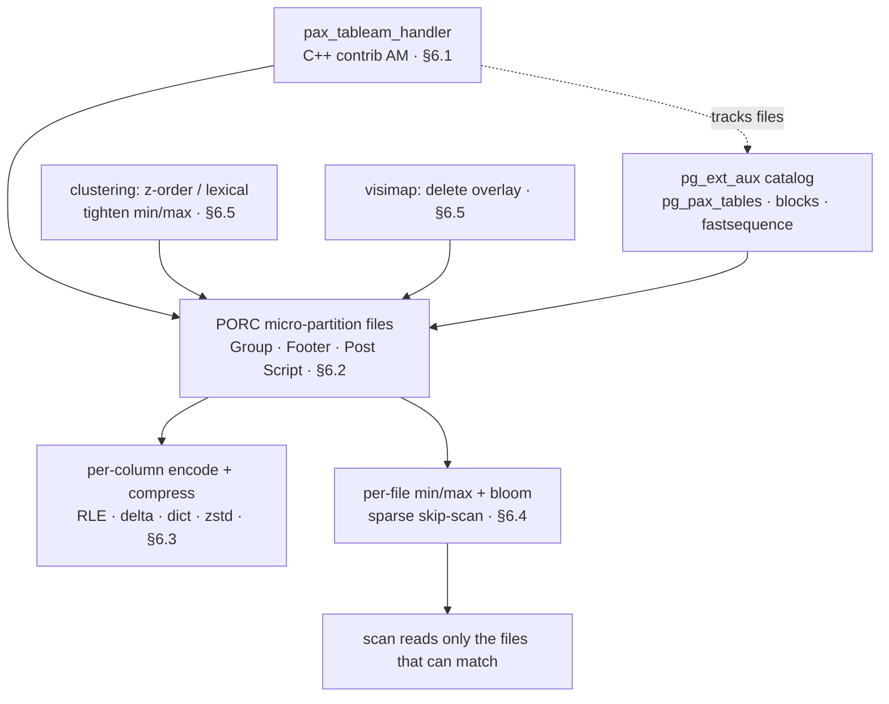
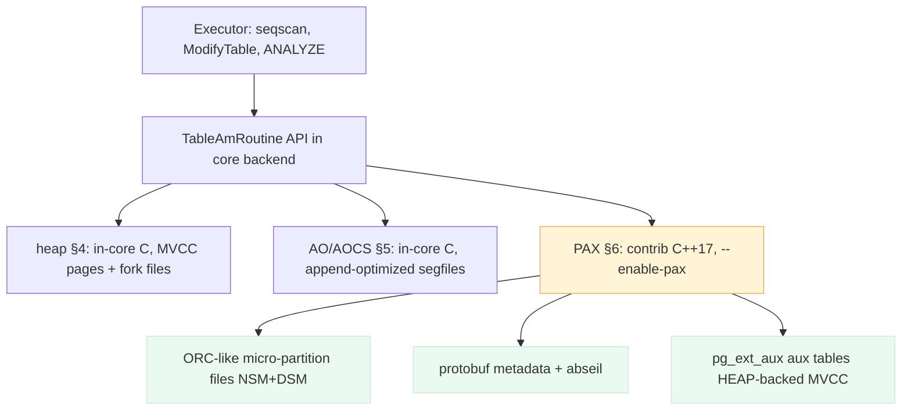
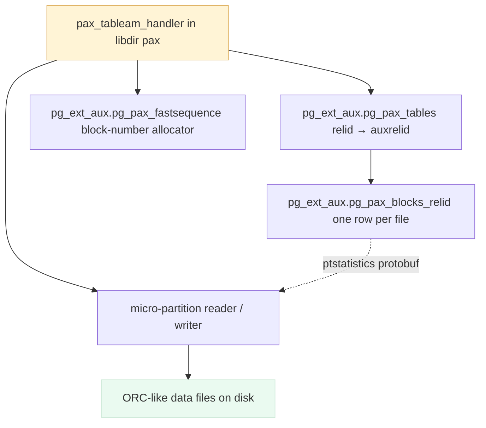
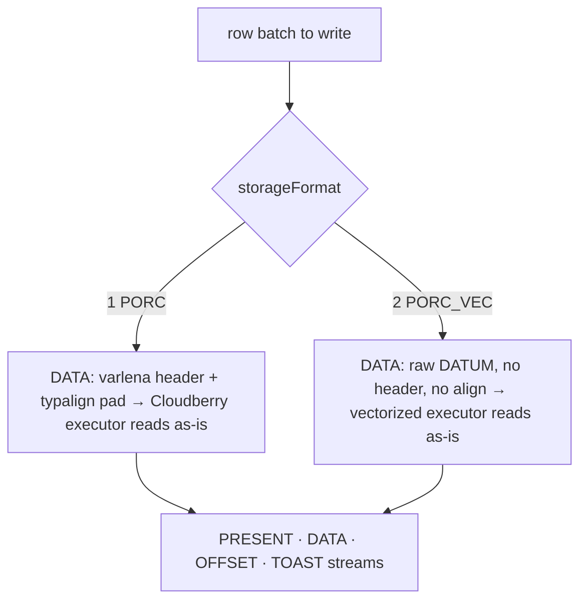
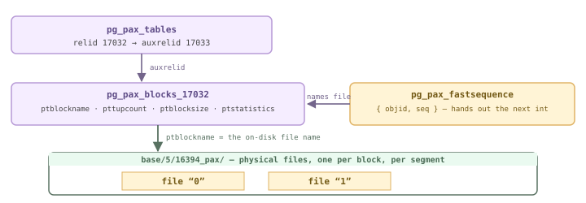
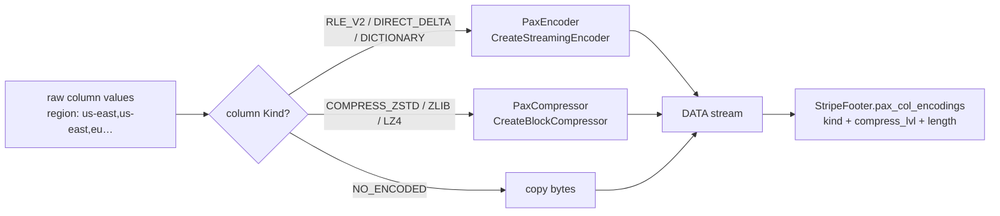
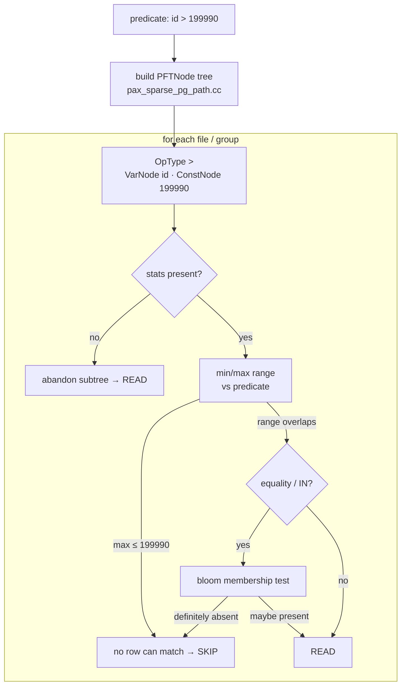
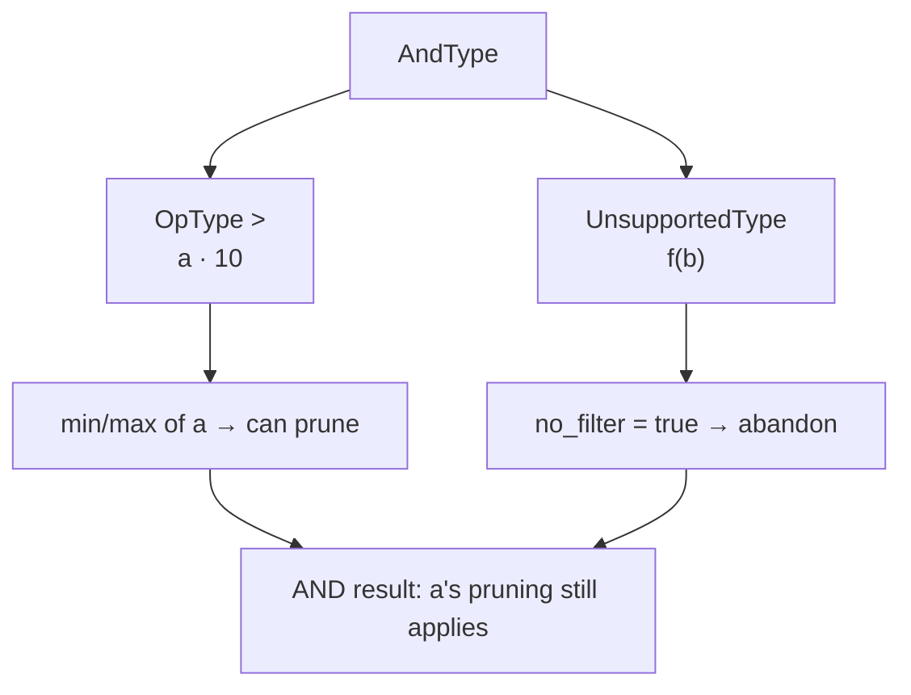
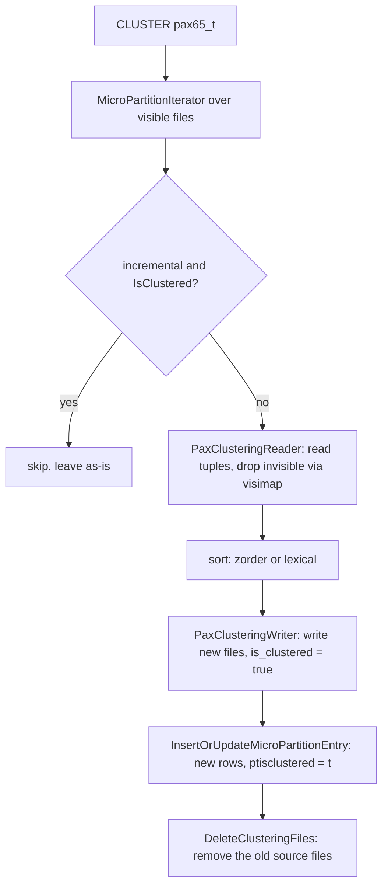

<style>
/*
 * Licensed to the Apache Software Foundation (ASF) under one
 * or more contributor license agreements.  See the NOTICE file
 * distributed with this work for additional information
 * regarding copyright ownership.  The ASF licenses this file
 * to you under the Apache License, Version 2.0 (the
 * "License"); you may not use this file except in compliance
 * with the License.  You may obtain a copy of the License at
 *
 *   http://www.apache.org/licenses/LICENSE-2.0
 *
 * Unless required by applicable law or agreed to in writing,
 * software distributed under the License is distributed on an
 * "AS IS" BASIS, WITHOUT WARRANTIES OR CONDITIONS OF ANY
 * KIND, either express or implied.  See the License for the
 * specific language governing permissions and limitations
 * under the License.
 */

/* Layout for the HTML-and-CSS figures, lifted from the handbook's own
   stylesheet so the figures render identically here. */

/* These four come from the handbook's own stylesheet; a consuming site has no
   such definitions, and an undefined custom property invalidates its whole
   declaration. Define them here, scoped to the figure.

   Deliberately NOT themed. The artwork below is light-only: band and tile
   backgrounds are hard-coded pastels, and the injected markup carries some 800
   more hard-coded light colours in inline styles. Giving --fg a dark-theme
   value paints near-white text onto a near-white band -- measured at 1.08:1,
   worse than the bug that replaced. The handbook's light values are correct in
   both themes; what changes for dark mode is the surface underneath. */
.cloudberry-core-figure {
  --border: #d8dee4;
  --soft:   #f6f8fa;
  --fg:     #1f2328;
  --muted:  #636c76;
  margin: 1.4rem 0;
}

/* Light-only artwork needs a light ground AND a dark ink, or it bleeds into a
   dark page. Setting only the ground is not enough: any text in these figures
   without its own inline colour inherits the site's near-white body colour, so
   it lands white-on-pastel -- measured at 1.03:1 across 184 text nodes. The
   colour has to be restored at the same place the ground is. */
[data-bs-theme='dark'] .cloudberry-core-figure > div {
  background: #ffffff;
  color: #1f2328;
  border-radius: 8px;
  padding: 10px;
}
/* Descendants that inherit rather than carry an inline colour. */
[data-bs-theme='dark'] .cloudberry-core-figure > div :not([style*="color"]) {
  color: inherit;
}
.cloudberry-core-figure figcaption {
  margin-top: .5rem;
  font-size: .9em;
  /* --ifm-color-emphasis-600 resolves to rgb(141,148,158) in the light theme,
     which is 3.06:1 on white -- below WCAG AA for the 37 figure captions.
     (The dark theme's value is fine, so only light is overridden.) */
  color: #636b75;
}
[data-bs-theme='dark'] .cloudberry-core-figure figcaption {
  color: #a6adb4;
}

/* Selective highlight: the handbook wraps a key token so it stands out.
   Scoped to the component. The class name .hl is two letters and this file
   lands in the consuming site's single global stylesheet, so an unscoped
   rule would style every page of that site. The standalone edition's
   figure.code / figure.session variants are dropped: those classes do not
   occur anywhere in this tree. */
.cloudberry-core-figure .hl { border-radius: 2px; font-weight: 700;
                   background: #fff8c5; color: #1f2328; padding: 0 2px; }

/* Layered module map and the banded brick figures. */
.cloudberry-core-figure .bricks { border:1px solid var(--border);border-radius:12px;overflow:hidden;background:var(--soft) }
.cloudberry-core-figure .bk-band { display:flex;align-items:stretch;border-top:1px solid var(--border) }
.cloudberry-core-figure .bk-band:first-child { border-top:none }
.cloudberry-core-figure .bk-lbl { flex:0 0 116px;display:flex;flex-direction:column;justify-content:center;gap:2px;padding:10px 13px }
.cloudberry-core-figure .bk-lbl b { font-size:12.5px;font-weight:800;color:var(--fg);line-height:1.2 }
.cloudberry-core-figure .bk-lbl span { font-size:9.5px;font-weight:700;color:var(--muted);text-transform:uppercase;letter-spacing:.5px }
.cloudberry-core-figure .bk-row { flex:1 1 auto;display:flex;flex-wrap:wrap;gap:7px;padding:9px 10px }
.cloudberry-core-figure .bk { flex:1 1 118px;min-width:104px;display:flex;flex-direction:column;justify-content:center;gap:2px; padding:8px 11px;border-radius:7px;border:1px solid;background:#fff;text-decoration:none;transition:.13s }
.cloudberry-core-figure .bk-t2 { font-size:12.5px;font-weight:700;line-height:1.25 }
.cloudberry-core-figure .bk-ch { font-size:10.5px;font-weight:700;font-variant-numeric:tabular-nums;opacity:.8 }
.cloudberry-core-figure a.bk:hover { transform:translateY(-2px);box-shadow:0 4px 12px #0000001f;text-decoration:none }
.cloudberry-core-figure .bk-q { background:#eef6ff }
.cloudberry-core-figure .bk-q .bk { border-color:#54aeff66;color:#0a3069;background:#ddf4ff }
.cloudberry-core-figure .bk-s { background:#eefcf2 }
.cloudberry-core-figure .bk-s .bk { border-color:#4ac26b80;color:#04260f;background:#dafbe1 }
.cloudberry-core-figure .bk-t { background:#fff6ef }
.cloudberry-core-figure .bk-t .bk { border-color:#fb8f4480;color:#5e2700;background:#fff1e5 }
.cloudberry-core-figure .bk-h { background:#fff4f3 }
.cloudberry-core-figure .bk-h .bk { border-color:#ff818280;color:#5c0011;background:#ffebe9 }
.cloudberry-core-figure .bk-r { background:#f3f5f8 }
.cloudberry-core-figure .bk-r .bk { border-color:#afb8c1;color:#1f2328;background:#eaeef2 }
@media (max-width: 560px) {
  .cloudberry-core-figure .bk-band { flex-direction:column }
  .cloudberry-core-figure .bk-lbl { flex-basis:auto;border-bottom:1px solid var(--border) }
}

</style>

<!--
  Licensed to the Apache Software Foundation (ASF) under one
  or more contributor license agreements.  See the NOTICE file
  distributed with this work for additional information
  regarding copyright ownership.  The ASF licenses this file
  to you under the Apache License, Version 2.0 (the
  "License"); you may not use this file except in compliance
  with the License.  You may obtain a copy of the License at

    http://www.apache.org/licenses/LICENSE-2.0

  Unless required by applicable law or agreed to in writing,
  software distributed under the License is distributed on an
  "AS IS" BASIS, WITHOUT WARRANTIES OR CONDITIONS OF ANY
  KIND, either express or implied.  See the License for the
  specific language governing permissions and limitations
  under the License.
-->


<a id="6-pax-the-native-columnar-engine"></a>



*PAX 的完整流程。C++ contrib 访问方法（[§6.1](#61-the-c-contrib-access-method)）将行写入源自 ORC 的微分区文件（[§6.2](#62-micro-partition-file-format--manifest-catalog)），其中的列经过编码和压缩（[§6.3](#63-column-encoding--compression)）；各文件的最小值、最大值和布隆过滤器统计信息让扫描可以跳过整个文件（[§6.4](#64-sparse-filters-minmax--bloom-skip-scan)）；聚簇通过重排数据使跳过机制真正奏效，各文件的可见性映射则负责处理删除（[§6.5](#65-clustering-z-order--lexical-visimap)）。pg_ext_aux 堆目录表将每个文件关联回所属表。*

## 6.1 C++ contrib 访问方法 {#61-the-c-contrib-access-method}

第 [4](/cloudberry/core-internals/part-2-storage-data-layout/ch04/) 章和第 [5](/cloudberry/core-internals/part-2-storage-data-layout/ch05/) 章介绍了两种用 C 编写、位于后端**内部**的存储引擎：**堆**（[§4](/cloudberry/core-internals/part-2-storage-data-layout/ch04/)）与追加优化的 **AO/AOCS** 系列（[§5](/cloudberry/core-internals/part-2-storage-data-layout/ch05/)）。PAX 是第三种存储引擎，但实现方式不同。**PAX = Partition Attributes Across**：这种混合布局兼具行存储（NSM）的*批量写入*速度和列存储（DSM）的*按列读取*速度，采用源自 ORC 的磁盘格式，并包含丰富的块级统计信息。PAX 作为 **C++17 contrib 扩展**提供，位于 `contrib/pax_storage/`，并非后端核心代码；只有配置 Cloudberry 时指定 `--enable-pax` 才会将它编译进去。

本节介绍 PAX *是什么*、数千行 C++ 代码*如何*将自身注册为正式的表访问方法，以及各个组件*位于何处*。磁盘文件格式，即类似 ORC 的微分区，留到 [§6.2](#62-micro-partition-file-format--manifest-catalog) 介绍；这里先关注底层组件如何衔接。



*PAX 是第三种表访问方法，与堆和 AO/AOCS 一样通过执行器 → TableAmRoutine API 接入；不过它以核心代码树之外的 C++ 代码实现，拥有自己的文件格式和系统目录。*

> [!NOTE]
> [§5](/cloudberry/core-internals/part-2-storage-data-layout/ch05/) 的 AO/AOCS 是编译进 `postgres` 的 C 代码，PAX 则是按需加载的 `.so`（`$libdir/pax`）。这一区别贯穿本节。

在内部，这棵 C++ 源码树分为**五层**，每层各司其职。执行器从顶层的访问处理器进入，每次读写都逐层向下，最终到达磁盘文件；统计信息与过滤位于微分区层（[§6.4](#64-sparse-filters-minmax--bloom-skip-scan)），编码与压缩位于列层（[§6.3](#63-column-encoding--compression)）：

<figure class="cloudberry-core-figure">
<div><div style="max-width:720px;margin:2px auto;font:11px/1.4 ui-monospace,SFMono-Regular,Menlo,monospace;color:#1f2328;overflow-x:auto"> <div style="min-width:560px"> <div style="display:flex;justify-content:center;gap:8px;margin-bottom:5px"> <div style="background:#eef0f2;border:1px solid #cdb4db;border-radius:5px;padding:4px 16px;font-weight:700;color:#5e4b86">执行器 · Table-AM 接口约定</div> <div style="background:#fff4d6;border:1px solid #e0b365;border-radius:5px;padding:4px 10px;color:#735a16">META · pg_ext_aux 辅助表 · 清单</div> </div> <div style="border:1px solid #b79ad6;border-radius:6px;overflow:hidden"> <div style="display:flex;align-items:center;background:#f5edff;padding:6px 8px"><div style="flex:0 0 156px;font-weight:700;color:#5e4b86">访问处理器（Access Handler）</div><div style="flex:1;color:#555">AM 接口 · 事务上下文 · 异常转换 · 资源生命周期</div></div> <div style="display:flex;align-items:center;background:#faf6ff;border-top:1px solid #cdb4db;padding:6px 8px"><div style="flex:0 0 156px;font-weight:700;color:#5e4b86">表层（Table）</div><div style="flex:1;color:#555">TableWriter / Reader / Deleter · 索引访问器（Index Accessor）· TablePartitionWriter · Cluster 聚簇（§6.5）</div></div> <div style="display:flex;align-items:center;background:#f5edff;border-top:1px solid #cdb4db;padding:6px 8px"><div style="flex:0 0 156px;font-weight:700;color:#5e4b86">微分区层（MicroPartition）</div><div style="flex:1;color:#555">管理文件及各行组的 <b style="color:#735a16">统计信息</b> （min/max · bloom）· <b style="color:#735a16">过滤器</b> （§6.4）· PORC / PORC_VEC 写入器与读取器 · 可见性映射 · Toast</div></div> <div style="display:flex;align-items:center;background:#faf6ff;border-top:1px solid #cdb4db;padding:6px 8px"><div style="flex:0 0 156px;font-weight:700;color:#5e4b86">列层（Column）</div><div style="flex:1;color:#555">内存中的列数据 · <b style="color:#735a16">编码／解码 · 压缩／解压</b> （§6.3）— 定长列、变长列与 PAX 列</div></div> <div style="display:flex;align-items:center;background:#eafaf0;border-top:1px solid #cdb4db;padding:6px 8px"><div style="flex:0 0 156px;font-weight:700;color:#4a6b55">文件层（File）</div><div style="flex:1;color:#555">文件系统接口 — 数据文件 · 元数据 · 可见性映射（Visimap）的持久化</div></div> </div> <div style="text-align:center;color:#73658b;font-size:10px;padding:3px">各层依次调用下一层 — 执行器 → 访问处理器 → 表 → 微分区 → 列 → 文件</div> </div></div></div>
<figcaption>PAX 的五层引擎（`contrib/pax_storage/src/cpp/`）。执行器通过访问处理器进入，各层依次调用下一层，最终到达文件。META，即 pg_ext_aux 辅助表与清单（§6.1.3），位于处理器旁，记录有哪些文件。</figcaption>
</figure>

### 6.1.1 返回 TableAmRoutine 的 C++ 访问方法 {#611-a-c-access-method-that-returns-a-tableamroutine}

Cloudberry 的表访问方法接口约定与 PostgreSQL 核心定义相同：标记为 `amhandler` 的函数返回一个指向 `TableAmRoutine` 的指针，后者包含一组回调，`pg_am` 则记录映射关系。PAX 在 C++ 中实现这一约定。处理函数为 `pax_tableam_handler`，使用常见的 `PG_FUNCTION_INFO_V1` 宏声明。注意 `// NOLINT`：它表明这里是 C++ 文件中的 C ABI 边界（`contrib/pax_storage/src/cpp/access/pax_access_handle.cc`）。

```c {title="contrib/pax_storage/src/cpp/access/pax_access_handle.cc"}
PG_MODULE_MAGIC;
      PG_FUNCTION_INFO_V1(pax_tableam_handler);
      Datum pax_tableam_handler(PG_FUNCTION_ARGS) {  // NOLINT
        PG_RETURN_POINTER(&kPaxColumnMethods);
      }
```

`kPaxColumnMethods` 是一个静态初始化的 `TableAmRoutine`。其槽位由**两个 C++ 命名空间**中的函数填充：`paxc::PaxAccessMethod` 是与后端交互的薄层 C 接口适配代码，`pax::CCPaxAccessMethod` 则是 C++ 扫描与 DML 引擎。结构体末尾清楚地展示了这一区分：位图扫描、采样扫描以及 `dml_init`/`dml_fini` 都进入 `pax::CCPaxAccessMethod`，选项处理则仍位于 `paxc::`（`contrib/pax_storage/src/cpp/access/pax_access_handle.cc` — `kPaxColumnMethods`）。

```c {title="contrib/pax_storage/src/cpp/access/pax_access_handle.cc — kPaxColumnMethods"}
.scan_bitmap_next_block = pax::CCPaxAccessMethod::ScanBitmapNextBlock,
      .scan_sample_next_block = pax::CCPaxAccessMethod::ScanSampleNextBlock,
      .dml_init = pax::CCPaxAccessMethod::ExtDmlInit,
      .dml_fini = pax::CCPaxAccessMethod::ExtDmlFini,
      .amoptions = paxc::PaxAccessMethod::AmOptions,
```

因此，`USING pax` 走的执行器路径与堆或 AOCS *完全相同*，执行器无需知道自己跨越了 C/C++ 边界。`pg_am` 中有一行将 `amhandler` 指向该处理函数，并令 `amtype = 't'`（表），执行器由此找到它：

*Coordinator：`pax` 访问方法对应一条实际的 `pg_am` 记录，处理函数为 `pax_tableam_handler`，类型为 t（表）。*

```sql
SELECT oid, amname, amhandler, amtype FROM pg_am WHERE amname='pax';
```

```text {hl_lines="3" title="output"}
  oid  | amname |      amhandler      | amtype 
      ------+--------+---------------------+--------
       7047 | pax    | pax_tableam_handler | t
      (1 row)
```

有了这条记录，创建 PAX 表只需普通的 DDL：`USING pax`。下面在 Coordinator 上建表、插入 1000 行并查询；规划器与执行器将其当作普通关系处理：

*Coordinator：PAX 表与其他关系一样，支持创建、插入、聚合和过滤。*

```sql
CREATE TABLE pax61_t(id int, region text, amount numeric)
        USING pax DISTRIBUTED BY (id);
      INSERT INTO pax61_t
        SELECT g, (ARRAY['NA','EU','APAC'])[1+g%3], (g*1.5)::numeric
        FROM generate_series(1,1000) g;
      SELECT count(*), sum(amount) FROM pax61_t;
      SELECT relname, amname FROM pg_class c
        JOIN pg_am a ON c.relam=a.oid WHERE relname='pax61_t';
```

```text {hl_lines="8" title="output"}
CREATE TABLE
      INSERT 0 1000
       count |   sum    
      -------+----------
        1000 | 750750.0
       relname | amname 
      ---------+--------
       pax61_t | pax
      (1 row)
```

### 6.1.2 在 initdb 时初始化到每个 Segment {#612-bootstrapped-into-every-segment-at-initdb}

PAX **不通过** `CREATE EXTENSION` 安装，用户也无需运行 SQL 安装脚本。相反，在 **initdb** 期间，生成的 cdbinit 脚本 `contrib/pax_storage/pax-cdbinit--1.0.sql` 会将 `pg_am` 记录、`pax_tableam_handler` 函数条目和整个辅助命名空间写入每个 Coordinator 与 Segment。该 SQL 又由 C 程序 `contrib/pax_storage/tools/gen_sql.c` 生成，因此硬编码的系统目录 OID（如访问方法 OID 7047、处理函数 OID 7600）只需在一处维护。

生成的脚本执行三项操作：插入处理函数和 `pg_am` 记录，创建 `pg_ext_aux` 命名空间及其全局辅助表，并为新对象指定**固定 OID**。以下函数和访问方法的插入语句逐字取自生成文件（`contrib/pax_storage/pax-cdbinit--1.0.sql`）：

```c {title="contrib/pax_storage/pax-cdbinit--1.0.sql"}
INSERT INTO pg_proc VALUES(7600,'pax_tableam_handler',11,10,13,1,...,
        'pax_tableam_handler','$libdir/pax',...);
      INSERT INTO pg_am   VALUES(7047,'pax',7600,'t');
      COMMENT ON FUNCTION pax_tableam_handler IS
        'column-optimized PAX table access method handler';
```

`gen_sql.c` 根据编译时常量 `PAX_TABLE_AM_OID`、`PAX_AMNAME`、`PAX_AM_HANDLER_OID` 构建 `pg_proc`/`pg_am` 元组，并设置 `amtype = 't'`（`contrib/pax_storage/tools/gen_sql.c` — `main()`）。

```c {title="contrib/pax_storage/tools/gen_sql.c — main()"}
printf("INSERT INTO pg_am   VALUES(%u,'%s',%u,'%c');\n",
             PAX_TABLE_AM_OID,   /* pg_am.oid */
             PAX_AMNAME,         /* pg_am.amname */
             PAX_AM_HANDLER_OID, /* pg_am.amhandler */
             't' /* pg_am.amtype: TABLE */);
```

因为此脚本在 initdb 时运行，**PAX 在任何用户连接之前就已经存在于新集群中**——无需加载、启用或版本管理。同一脚本还创建了下文所述的两个集群范围的辅助表。

### 6.1.3 pg_ext_aux 系统目录：PAX 表元数据的位置 {#613-the-pg_ext_aux-catalog-where-a-pax-tables-metadata-lives}

PAX 关系的*数据*位于磁盘上类似 ORC 的文件中（[§6.2](#62-micro-partition-file-format--manifest-catalog)）。*元数据*，即文件清单、各文件行数、各列统计信息和可见性，存放在 `pg_ext_aux` 命名空间下以普通堆存储实现的目录表中。这是默认的**辅助表目录模式**：构建时将 `USE_PAX_CATALOG` 设为 ON（`contrib/pax_storage/CMakeLists.txt:39`）。此外还有一种**清单**模式，即 `src/cpp/manifest/` 下的 JSON 目录，由 `USE_MANIFEST_API` 控制，但默认关闭；本章始终采用辅助表模式。

- **pg_ext_aux.pg_pax_tables** — 集群范围的映射 `relid → auxrelid`。每张 PAX 表一行；`auxrelid` 指向该表的私有块目录表。在 initdb 时创建（`pax-cdbinit--1.0.sql`）。
- **pg_ext_aux.pg_pax_fastsequence** — 集群范围的 `(objid, seq)` 分配器——为每个 PAX 关系分配单调递增的块编号，无需争用普通序列（`pax-cdbinit--1.0.sql`）。
- **pg_ext_aux.pg_pax_blocks_`<relid>`** — 每张表一个块目录表，在创建 PAX 表时生成（`pax_aux_table.cc` — `CPaxCreateMicroPartitionTable()`）。每行描述一个微分区文件：块名称、元组数量、大小、统计信息、可见性映射、TOAST/聚簇标志。

每张表的块目录表都动态创建。`pax_aux_table.cc` 将其命名为 `pg_pax_blocks_<pax_relid>`，列包括块名称、元组数、块大小、protobuf 编码的 `ptstatistics` 以及可见性映射名称（`contrib/pax_storage/src/cpp/catalog/pax_aux_table.cc` — `CPaxCreateMicroPartitionTable()`）。

```c {title="contrib/pax_storage/src/cpp/catalog/pax_aux_table.cc — CPaxCreateMicroPartitionTable()"}
snprintf(aux_relname, sizeof(aux_relname), "pg_pax_blocks_%u", pax_relid);
      // columns: ptblockname, pttupcount, ptblocksize,
      //          ptstatistics, ptvisimapname, ptexistexttoast, ptisclustered
```



*PAX 的组成部分：加载的访问方法处理器驱动文件读写器，并查询 pg_ext_aux 系统目录。*

在实际系统中沿这条链查看：Coordinator 的 `pg_pax_tables` 将表映射到其辅助关系，但*数据*及其块记录位于 **Segment** 上。这是一张分布式表，因此要在 utility 模式下查询 Segment 才能看到它们：

*Coordinator → Segment：relid 映射到每张表的块目录表 `pg_pax_blocks_<relid>`。*

```sql
SELECT relid, auxrelid FROM pg_ext_aux.pg_pax_tables
        WHERE relid='pax61_t'::regclass;
```

```text {title="output"}
 relid | auxrelid 
      -------+----------
       17025 |    17026
      (1 row)
```

*Segment（PGOPTIONS gp_role=utility，端口 7102）：辅助关系为 pg_pax_blocks_17025，每个微分区文件对应一行。*

```sql
SELECT relid::regclass AS rel, auxrelid::regclass AS aux
        FROM pg_ext_aux.pg_pax_tables WHERE relid='pax61_t'::regclass;
      SELECT ptblockname, pttupcount, ptblocksize
        FROM pg_ext_aux.pg_pax_blocks_17025 ORDER BY ptblockname;
```

```text {hl_lines="3" title="output"}
   rel   |              aux               
      ---------+--------------------------------
       pax61_t | pg_ext_aux.pg_pax_blocks_17025
       ptblockname | pttupcount | ptblocksize 
      -------------+------------+-------------
                 0 |        338 |        2706
      (1 row)
```

> [!NOTE]
> 1000 行分布在三个 Segment 上，其中本 Segment 收到了约 338 行，打包在一个 2706 字节的块（编号 `0`）中。继续加载数据时，这里会出现更多块；每个块都是独立的类 ORC 文件，带有自己的统计信息。

### 6.1.4 源代码树概览 {#614-the-source-tree-at-a-glance}

PAX 的全部代码位于 `contrib/pax_storage/src/cpp/`。目录与前述各层清晰对应：适配代码、系统目录、文件格式和分析功能。

*PAX C++ 源码布局（contrib/pax_storage/src/cpp/）*

| 目录 | 职责 |
| --- | --- |
| access/ | 表访问方法适配层：`pax_access_handle.cc`（处理函数与 `TableAmRoutine`），以及插入器、扫描器、删除器、更新器和 DML 状态。 |
| catalog/ | `pg_ext_aux` 辅助表 — `pg_pax_tables.cc`、`pax_aux_table.cc`、`pax_fastsequence.cc` — 以及目录/清单抽象（`pax_catalog.h`）。 |
| storage/ | 类 ORC 引擎（[§6.2](#62-micro-partition-file-format--manifest-catalog)）：微分区读写器、各类型的列编解码器、稀疏过滤器和行过滤器、TOAST、WAL，以及保存 protobuf 模式定义的 `proto/` 目录。 |
| storage/proto/ | `pax.proto`、`orc_proto.proto`、`micro_partition_stats.proto` — 磁盘上的元数据为 protobuf 格式，构建时编译。 |
| clustering/ | Z-order 和字典序数据聚簇（[§6.5](#65-clustering-z-order--lexical-visimap)）。 |
| manifest/ | 可选的 JSON 清单目录（默认关闭）。 |
| comm/, exceptions/ | C++ 工具和跨 C 边界的异常→`elog(ERROR)` 桥接。 |

依赖项也反映出 PAX 与 ORC 的渊源：PAX 链接 **protobuf** 来处理磁盘元数据，链接 **abseil** 来使用 C++ 容器和字符串工具；调试构建还为 `test_main` 测试套件链接 googletest。处理器的 `.so` 是 `$libdir/pax`，与前述 `pg_proc` 记录中写入的路径相同。了解了访问方法、系统目录和总体布局之后，[§6.2](#62-micro-partition-file-format--manifest-catalog) 将打开微分区文件，查看这种源自 ORC、让 NSM 与 DSM 在磁盘上结合的格式。

## 6.2 微分区文件格式与清单目录 {#62-micro-partition-file-format--manifest-catalog}

### 6.2.1 微分区是一个自描述文件，从尾部读取 {#621-a-micro-partition-is-a-self-describing-file-read-from-the-tail}

PAX 表将行存储在**微分区**文件中。磁盘格式称为 **PORC**，源自 Apache ORC，但精简为适合 Cloudberry 执行器的 protobuf 框架（`contrib/pax_storage/doc/README.format.md`）。每个文件按如下次序构成：一个或多个列数据**组（Group）**，描述它们的**文件尾部（File Footer）**，以及末端固定位置的 **Post Script**。读取器先打开文件*末尾*：Post Script 给出 Footer 长度，Footer 给出组、统计信息和模式，然后才读取需要的组。

这一框架由 `contrib/pax_storage/src/cpp/storage/proto/orc_proto.proto` 中的三个 protobuf 消息定义：`message PostScript`（orc_proto.proto）、`message Footer`（orc_proto.proto），以及每个组的 `message StripeFooter`（orc_proto.proto）。orc_proto.proto 的注释块给出了尾部的确切排列顺序，并说明元数据的大小设计为通常可以通过**一次 32 KB I/O** 一并读入 Footer 和 Post Script。

<figure class="cloudberry-core-figure">
<div><div style="max-width:720px;margin:2px auto;font:11px/1.45 ui-monospace,SFMono-Regular,Menlo,monospace;color:#1f2328;overflow-x:auto"> <div style="min-width:560px"> <div style="border:2px solid #b79ad6;border-radius:6px;overflow:hidden"> <div style="background:#efe3fb;color:#5e4b86;font-weight:700;text-align:center;padding:4px">单个 PORC 微分区文件 — 从上向下写入，从下向上读取</div> <div style="background:#eafaf0;border-top:1px solid #cfead9;padding:5px 8px">Stripe 1（行组）= 行数据 + 条带尾部</div> <div style="background:#eafaf0;border-top:1px solid #cfead9;padding:5px 8px">Stripe 2（行组）= 行数据 + 条带尾部</div> <div style="text-align:center;color:#73658b;font-size:10px;padding:1px">⋮ 更多条带 ⋮</div> <div style="background:#eafaf0;border-top:1px solid #cfead9;padding:5px 8px">Stripe n（行组）= 行数据 + 条带尾部</div> <div style="display:flex;align-items:center;background:#f5edff;border-top:1px solid #cdb4db;padding:5px 8px"><div style="flex:1">文件尾部（FILE FOOTER）— 每个条带对应一份 <b>条带信息</b> ：各列统计（null · count · min/max/sum · bloom）· 条带偏移量 · 长度 · storageFormat</div><div style="color:#73658b;font-weight:700">↑3</div></div> <div style="display:flex;align-items:center;background:#f5edff;border-top:1px solid #cdb4db;padding:5px 8px"><div style="flex:1">文件后记（POST SCRIPT）— version · footerLength · magic</div><div style="color:#73658b;font-weight:700">↑2</div></div> <div style="display:flex;align-items:center;background:#fff4d6;border-top:1px solid #e0b365;padding:5px 8px;color:#735a16;font-weight:700"><div style="flex:1">psLen（1 字节）+ magic <span class="hl">PORC</span> ← 读取从这里开始</div><div>↑1</div></div> </div> <div style="text-align:center;color:#73658b;font-size:10px;padding:6px 0 3px">↓ 放大一个 Stripe 的行数据 — 按列存储（DSM）↓</div> <div style="border:1px solid #cfead9;border-radius:6px;overflow:hidden"> <div style="background:#eafaf0;padding:4px 8px;color:#4a6b55;font-weight:700">行数据</div> <div style="display:flex;gap:3px;padding:3px 8px"> <div style="flex:1;background:#faf6ff;border:1px solid #cdb4db;text-align:center;padding:4px 2px">列 1</div> <div style="flex:1;background:#faf6ff;border:1px solid #cdb4db;text-align:center;padding:4px 2px">列 2</div> <div style="flex:0 0 40px;background:#faf6ff;border:1px solid #cdb4db;text-align:center;padding:4px 2px;color:#656b72">…</div> <div style="flex:1;background:#faf6ff;border:1px solid #cdb4db;text-align:center;padding:4px 2px">列 m</div> </div> <div style="padding:3px 8px 2px;color:#6b5b95">一列 = 一组流：</div> <div style="display:flex;gap:3px;padding:0 8px 8px"> <div style="flex:1;background:#faf6ff;border:1px solid #cdb4db;text-align:center;padding:4px 2px">PRESENT<div style="font-size:9px;color:#6c6c6c">NULL 位图</div></div> <div style="flex:1;background:#eafaf0;border:1px solid #cfead9;text-align:center;padding:4px 2px">OFFSET<div style="font-size:9px;color:#6c6c6c">变长行偏移量</div></div> <div style="flex:1;background:#fff4d6;border:1px solid #e0b365;text-align:center;padding:4px 2px;color:#735a16">DATA<div style="font-size:9px;color:#735a16">值 · 始终位于最后</div></div> <div style="flex:1;background:#faf6ff;border:1px solid #cdb4db;text-align:center;padding:4px 2px">TOAST<div style="font-size:9px;color:#6c6c6c">外部值索引</div></div> </div> </div> </div></div></div>
<figcaption>一个 PORC 微分区。上半图：文件依次由多个 Stripe（行组）、File Footer 和 Post Script 组成，读取方向由下向上（↑1 psLen → ↑2 Post Script → ↑3 File Footer → 各 Stripe）。下半图：放大一个 Stripe，其行数据按列存储（DSM），每列又由一组流组成。</figcaption>
</figure>

最底部就是我们在磁盘上看到的内容：实际文件的最后几个字节为 `… 50 4f 52 43`，即 ASCII 字符 **PORC**（见 [§6.2.3](#623-the-catalog-half-pg_ext_aux-tracks-every-file)）。它上方的 Post Script 包含 `footerLength`，读取器据此直接定位 Footer（orc_proto.proto — PostScript）；Footer 的 `stripes`（orc_proto.proto）给出各组的偏移量和长度。

### 6.2.2 流，以及两种格式 PORC / PORC_VEC {#622-streams-and-the-two-formats-porc--porc_vec}

在一个 Group 内部，列 **不是** 一个单一的数据块 — 它是一组 **流**，每条流由 `Stream.Kind`（`enum Kind`，orc_proto.proto）标记。规则（orc_proto.proto）：一列可以包含多个流，但其 *最后一个* 流始终为 **DATA**。

- **PRESENT (0)** — 空值位图 — 每行一个比特。当列中没有空值时，该流完全省略，因此非空数据的位图字节开销为零。
- **DATA (1)** — 原始值缓冲区。固定宽度类型以无空值间隙的方式存储打包值。
- **OFFSET (2)** — 变长列的每行偏移量，用于定位 DATA 中的第 i 行。（格式说明文档称其为“长度/偏移”流；实际枚举名称为 `OFFSET`。）
- **TOAST (3)** — Toast 索引流 — 仅当过大值被推送到外部 toast 文件时才存在（与目录中的 `ptexistexttoast` 相对应）。

```c {title="contrib/pax_storage/src/cpp/storage/proto/orc_proto.proto — Stream"}
enum Kind { PRESENT = 0; DATA = 1; OFFSET = 2; TOAST = 3; }
```

`message Footer` 以 `required uint32 storageFormat`（orc_proto.proto）结尾：**1 = 原始格式 (PORC)**，**2 = 向量化格式 (PORC_VEC)**。两种格式共享相同的文件结构和相同的流类型——仅 DATA 流中的字节不同。PORC 存储 Cloudberry 执行器直接消费的值（保留 varlena 头部，`typalign` 填充）；PORC_VEC 存储无头部、未对齐的原始 DATUM，专为向量化执行器准备，以写入时的转换代价换取向量化读取时的零转换（README.format.md §Format）。



*相同的框架，两种载荷。Footer 中的 storageFormat 告诉读取器，DATA 流是为哪种执行器写入的。*

### 6.2.3 系统目录这一侧：pg_ext_aux 跟踪每个文件 {#623-the-catalog-half-pg_ext_aux-tracks-every-file}

PAX 以**辅助表模式**运行：元数据存放在 **`pg_ext_aux`** 命名空间下的普通堆目录表中，因而自然继承堆的 MVCC 机制（README.catalog.md §MVCC）。每个集群有 `pg_pax_tables` 和 `pg_pax_fastsequence` 两张表，此外还会按需为**每张表**创建一张块表。

- **pg_pax_tables (relid, auxrelid)** —— 每个 PAX 表一行，将表 OID 映射到其块表的 OID。由 `GetPaxTablesEntryAttributes`、`contrib/pax_storage/src/cpp/catalog/pg_pax_tables.cc` 读取；由 `InsertPaxTablesEntry`、pg_pax_tables.cc 写入。
- **pg_pax_blocks_`<relid>`** —— 每个微分区 *文件* 一行 —— 列包括 ptblockname/pttupcount/ptblocksize/ptstatistics/ptvisimapname/ptexistexttoast/ptisclustered。列名是 `PAX_AUX_PT*` 宏在 `catalog/pax_catalog_columns.h` 中的定义（`PAX_AUX_PTBLOCKNAME`）；共 7 个属性（NATTS_PG_PAX_BLOCK_TABLES, :46）。
- **pg_pax_fastsequence (objid, seq)** —— 每个表一个计数器；`seq` 是下一个用于 *命名* 新文件的整数。锁路径在 `catalog/pax_fastsequence.cc` —— `CPaxOpenFastSequenceTable()`（CPaxOpenFastSequenceTable，objid 上的扫描键）。



*从系统目录到文件的解析链：pg_pax_tables 将关系映射到其块表；pg_pax_fastsequence 分配一个整数，同时用作 ptblockname 和 `<relfilenode>`_pax/ 下的物理文件名。图中实际值来自下方的 pax62_t 演示。*

> [!NOTE]
> 各 Segment 保存自己的 pg_pax_blocks_`<relid>` 记录，只包含该 Segment 生成的文件。要从 Coordinator 检查它们，可通过 gp_dist_random 查询该表。

*创建一个 PAX 表，然后查找其块表 OID。17033 是 auxrelid。*

```sql
CREATE TABLE pax62_t (id int, name text, amount numeric) USING pax;
      INSERT INTO pax62_t SELECT g,'name_'||g,g*1.5 FROM generate_series(1,1000) g;
      SELECT relid, auxrelid, auxrelid::regclass
      FROM pg_ext_aux.pg_pax_tables WHERE relid='pax62_t'::regclass;
```

```text {hl_lines="3" title="output"}
 relid | auxrelid |            auxrelid
      -------+----------+--------------------------------
       17032 |    17033 | pg_ext_aux.pg_pax_blocks_17032
      (1 row)
```

*每个 Segment 的每个数据文件对应一行。插入 1000 行后，每个 Segment 都写出了一个名为 0 的文件。*

```sql
SELECT gp_segment_id, ptblockname, pttupcount, ptblocksize, ptexistexttoast
      FROM gp_dist_random('pg_ext_aux.pg_pax_blocks_17032')
      ORDER BY gp_segment_id, ptblockname;
```

```text {hl_lines="3 4 5" title="output"}
 gp_segment_id | ptblockname | pttupcount | ptblocksize | ptexistexttoast
      ---------------+-------------+------------+-------------+-----------------
                   0 |           0 |        338 |        3067 | f
                   1 |           0 |        322 |        2925 | f
                   2 |           0 |        340 |        3072 | f
      (3 rows)
```

*第二次插入。每个 Segment 的 fastsequence 都从 1 增至 2，并新增一个名为 1 的文件。*

```sql
INSERT INTO pax62_t SELECT g,'name_'||g,g*1.5 FROM generate_series(1001,2000) g;
      SELECT gp_segment_id, objid, seq FROM gp_dist_random('pg_ext_aux.pg_pax_fastsequence')
      WHERE objid='pax62_t'::regclass ORDER BY gp_segment_id;
```

```text {hl_lines="3 4 5" title="output"}
 gp_segment_id | objid | seq
      ---------------+-------+-----
                   0 | 17032 |   2
                   1 | 17032 |   2
                   2 | 17032 |   2
      (3 rows)
```

*每个 Segment 现在有两行记录，分别对应文件 0 和新文件 1。*

```sql
SELECT gp_segment_id, ptblockname, pttupcount, ptblocksize
      FROM gp_dist_random('pg_ext_aux.pg_pax_blocks_17032')
      ORDER BY gp_segment_id, ptblockname;
```

```text {hl_lines="3 4" title="output"}
 gp_segment_id | ptblockname | pttupcount | ptblocksize
      ---------------+-------------+------------+-------------
                   0 |           0 |        338 |        3067
                   0 |           1 |        335 |        3106
                   1 |           0 |        322 |        2925
                   1 |           1 |        334 |        3119
                   2 |           0 |        340 |        3072
                   2 |           1 |        331 |        3096
      (6 rows)
```

整数 `ptblockname` 就是磁盘上的文件名。在 Segment 2 上（utility 模式），这些文件位于 `base/<dboid>/<relfilenode>_pax/` 下，名称分别为 `0` 和 `1`；文件 `0` 的磁盘大小为 **3072 字节**，与该块的 `ptblocksize` 完全一致。文件尾部的十六进制转储以魔数结尾，印证了 [§6.2.1](#621-a-micro-partition-is-a-self-describing-file-read-from-the-tail) 中从尾部读取的布局：

*Segment 本地视图：目录中的块 0（ptblocksize 3072）↔ 以 PORC 结尾的 3072 字节文件。*

```sql
-- on segment (PGOPTIONS='-c gp_role=utility' psql -p 7102):
      SELECT ptblockname, ptblocksize FROM pg_ext_aux.pg_pax_blocks_17032 WHERE ptblockname=0;
      -- shell: ls -l base/5/16394_pax/0 ; xxd base/5/16394_pax/0 | tail -1
```

```text {hl_lines="3 5" title="output"}
 ptblockname | ptblocksize
      -------------+-------------
                 0 |        3072
      -rw------- 1 gpadmin gpadmin 3072  base/5/16394_pax/0
      00000bf0: 82f4 0304 504f 5243 1000 0000 0000 0000   ....504f 5243........  (= "PORC")
```

至此各环节连接起来：`pg_pax_fastsequence` 分配一个整数 → 该整数作为写入 `<relfilenode>_pax/` 下的 PORC 文件名 → `pg_pax_blocks_<relid>` 中的一行记录其元组数、大小和统计信息 → `pg_pax_tables` 将块表关联回用户关系。Footer 中各 Stripe 的 `colStats`（orc_proto.proto — StripeInformation）以及目录行中的 `ptstatistics`，使 PAX 后续可以在扫描时**跳过**整个微分区（[§6.3](#63-column-encoding--compression)）。

## 6.3 列编码与压缩 {#63-column-encoding--compression}

### 6.3.1 两层结构，逐列处理 {#631-two-layers-one-column-at-a-time}

PAX 按列式引擎的方式缩小表：**按列处理，绝不按行处理**。列值的处理涉及*两个独立层次*：首先是利用值的*分布特征*进行的**轻量级编码**（长重复序列 → RLE，单调整数 → 差分，少量不同值 → 字典），然后是对编码字节进行**通用压缩**（zstd / zlib / lz4）。不过，在 PAX 当前设计中，这两个层次对*同一列*互斥：列级选项指定一个 `Kind`，这一 `Kind` 被分派给编码器**或**块压缩器，**不会同时使用两者**。参见 `pax_encoding_column.cc` 的编码器路径及其后续转入的 `pax_encoding_column.cc` 压缩器路径。

所有操作均由一个极小的 protobuf 记录 `pax.ColumnEncoding` 驱动，该记录按列存储在 StripeFooter 中。其 `kind` 指明了*运行了哪一层/算法*；`compress_lvl` 携带压缩等级；`length` 记录**编码前大小**，以便读取器在解码前可预先分配输出缓冲区（`storage/proto/pax.proto` — `ColumnEncoding`）。

```c {title="contrib/pax_storage/src/cpp/storage/proto/pax.proto — ColumnEncoding"}
message ColumnEncoding {
        enum Kind {
          NO_ENCODED = 0;     RLE_V2 = 1;      DIRECT_DELTA = 2;
          COMPRESS_ZSTD = 3;  COMPRESS_ZLIB = 4;
          DICTIONARY = 5;     COMPRESS_LZ4 = 6;
        }
        optional Kind   kind = 1;
        optional uint64 length = 2;       // origin (pre-encode) size
        optional uint64 compress_lvl = 3; // level, for the compressors
        // ... offset_stream_kind/length/compress_lvl for varlen LENGTH stream
      }
```



*一列的写入流水线：原始值 → 一种编码或压缩 Kind → 磁盘上的 DATA 流；Kind 记录在 StripeFooter.pax_col_encodings 中。*

> [!NOTE]
> 分发逻辑实际上是针对一个枚举的 `switch`。`PaxEncoder::CreateStreamingEncoder` (`storage/columns/pax_encoding.cc`) 对 RLE_V2 返回 `PaxOrcEncoder`，对 DIRECT_DELTA 返回 `PaxDeltaEncoder`，对 DICTIONARY 返回 `PaxDictEncoder` — 否则返回 nullptr。当返回 nullptr 时，`InitEncoder` 会向 `PaxCompressor::CreateBlockCompressor` (`pax_compress.cc`) 请求 zstd/zlib/lz4 块压缩器。

### 6.3.2 编码器：利用值的特征，开销低 {#632-the-encoders-shape-aware-cheap}

三个编码器各自针对一种值的*分布特征*。它们都不是默认选项：`PaxEncodingColumn<T>::GetDefaultColumnType()` 返回 `NO_ENCODED`（`pax_encoding_column.cc`），因此除非显式指定编码或压缩器，否则列值保持原样。注意**定长与变长**的区别：非定长（变长）列的白名单中只有字典编码器；RLE 和差分编码处理的是定长整数流（`pax_encoding.cc` — `non_fixed_column_white_list`，即 `non_fixed_column_white_list`）。

- **RLE_V2 (`rle`)** — 游程编码，采用 ORC 的 RLE-v2 子编码。一段包含 N 个相同值或较短的固定差值序列，变为一个头字节加上一个或多个值。由 `PaxOrcEncoder` 基于 `pax_rlev2_encoding.cc` 实现。适合 `status` 这种同一个值会重复数千行的列。
- **DIRECT_DELTA (`delta`)** — 存储首个值，后续存储连续差值。单调或缓慢变化的整数（如时间戳、序列 ID）可压缩为小的差值，能紧密位打包。`PaxDeltaEncoder<uint32_t>` (`pax_delta_encoding.cc`)。
- **DICTIONARY (`dict`)** — 建立包含各个不同值的字典；DATA 流变为指向该字典的窄整数编码。**唯一** 允许用于变长/文本列的编码方式。`PaxDictEncoder` (`pax_dict_encoding.cc`)。非常适合低基数文本，例如 `region`（仅 4 个不同值）。

<figure class="cloudberry-core-figure">
<div><div style="max-width:640px;margin:2px auto;font:11px/1.45 ui-monospace,SFMono-Regular,Menlo,monospace;color:#1f2328;overflow-x:auto"> <div style="min-width:420px"> <div style="color:#6b5b95;font-weight:600;margin:0 0 3px">原始编码（status，值 0 = ACTIVE）</div> <div style="display:flex;gap:3px;flex-wrap:wrap;align-items:center;margin-bottom:8px"> <div style="border:1px solid #cdb4db;background:#f4f5f6;padding:4px 8px">0</div><div style="border:1px solid #cdb4db;background:#f4f5f6;padding:4px 8px">0</div><div style="border:1px solid #cdb4db;background:#f4f5f6;padding:4px 8px">0</div><div style="border:1px solid #cdb4db;background:#f4f5f6;padding:4px 8px">0</div><div style="border:1px solid #cdb4db;background:#f4f5f6;padding:4px 8px">0</div><div style="border:1px solid #cdb4db;background:#f4f5f6;padding:4px 8px">0</div><div style="border:1px solid #cdb4db;background:#f4f5f6;padding:4px 8px">0</div><div style="border:1px solid #cdb4db;background:#f4f5f6;padding:4px 8px">0</div> <div style="padding:4px 6px;color:#656b72">= 32 字节</div> </div> <div style="color:#6b5b95;font-weight:600;margin:0 0 3px">DATA 流中的 RLE_V2 游程</div> <div style="display:flex;gap:3px;align-items:center"> <div style="border:1px solid #e0b365;background:#fff4d6;color:#735a16;padding:4px 10px"><span class="hl">count = 8</span></div> <div style="border:1px solid #e0b365;background:#fff4d6;color:#735a16;padding:4px 10px"><span class="hl">value = 0</span></div> <div style="padding:4px 6px;color:#587161">→ 几个字节，解码后还原全部 8 个值</div> </div> </div></div></div>
<figcaption>对重复值很多的 `status` 列使用 RLE：8 个原始 int 编码（32 B）→ DATA 流中的一个游程，即 {count, value}（几个字节）。</figcaption>
</figure>

### 6.3.3 压缩器：对字节流进行块压缩 {#633-the-compressors-a-block-pass-over-the-bytes}

当列选项指定*压缩* `Kind` 时，PAX 跳过编码器，对整个流缓冲区运行**块压缩器**。`PaxCompressor::CreateBlockCompressor` 返回 `PaxZSTDCompressor`、`PaxZlibCompressor`，或在构建时启用 `USE_LZ4` 后返回 `PaxLZ4Compressor`（`pax_compress.cc` — `PaxCompressor::CreateBlockCompressor()`）。zstd 路径一次调用 `ZSTD_compress(dst, cap, src, len, lvl)`，其中 `lvl` 直接取自 `compresslevel`（`pax_compress.cc` — `PaxZSTDCompressor::Compress()`）。zstd 是主力算法：压缩比高、解码快，也适合处理编码器生成的更紧凑的数据。

压缩器处理的是 [§6.2](#62-micro-partition-file-format--manifest-catalog) 中列的 **DATA 流**。对于变长列，**LENGTH/偏移量流**在同一个 `ColumnEncoding` 记录中还有自己的 `offset_stream_kind` / `offset_stream_compress_lvl`（`pax.proto`）。变长列有两个流，即原始字节和每行偏移量，分别独立压缩；定长列则有一个 DATA 流和一个 NULL 位图（参见 `doc/README.format.md` 的 PORC 流式布局）。

*不同 Kind 在列的 DATA 流中写入什么。对于同一列，编码器与压缩器互斥。*

| 选项 | Kind | 处理层 | 适用场景 |
| --- | --- | --- | --- |
| none | NO_ENCODED | 直接复制字节 | 不可压缩 / 已经很小 |
| rle | RLE_V2 | 编码器（定长整数） | 长重复序列（状态标志） |
| delta | DIRECT_DELTA | 编码器（定长整数） | 单调变化的 ID / 时间戳 |
| dict | DICTIONARY | 编码器（支持变长） | 低基数文本 |
| zstd | COMPRESS_ZSTD | 块压缩器 + 级别 | 通用默认值，压缩比高 |
| zlib | COMPRESS_ZLIB | 块压缩器与级别 | 可移植性 |

### 6.3.4 配置方法 — 表级和列级 {#634-configuring-it--table-wide-and-per-column}

两个控制参数，由 `paxc_rel_options.cc` 解析。**表级**：`WITH (compresstype=…, compresslevel=…)` 对每个列应用一种编码类型（`add_string_reloption` 用于 `compresstype`，`add_int_reloption` 用于 `compresslevel`，第 349/353 行）。`paxc_rel_options.cc` — `paxc_validate_rel_option()` 处的验证器强制执行一条值得了解的规则：**`compresslevel` 仅对压缩器有意义** — 在 `rle`/`delta`/`dict`/`none` 上设置级别会报错，因为 *编码器* 不接受级别参数。**列级**：某一列的 `ENCODING (compresstype=…)` 子句仅覆盖该列的表级默认设置（`pg_attribute_encoding`）。

*列级 ENCODING — id 使用 delta，低基数 region 使用字典，状态文本使用 zstd-3。存储于 pg_attribute_encoding*

```sql
CREATE TABLE pax63_enc (
        id     int  ENCODING (compresstype=delta),
        region text ENCODING (compresstype=dict),
        status text ENCODING (compresstype=zstd, compresslevel=3))
        USING pax;
      SELECT attnum, attoptions FROM pg_attribute_encoding
       WHERE attrelid='pax63_enc'::regclass ORDER BY attnum;
```

```text {title="output"}
 attnum |             attoptions
      --------+-------------------------------------
            1 | {compresstype=delta}
            2 | {compresstype=dict}
            3 | {compresstype=zstd,compresslevel=3}
      (3 rows)
```

### 6.3.5 演示：测量压缩效果 {#635-demonstration--the-shrink-measured}

两张 PAX 表具有相同的模式和相同的 200 000 行数据。`pax63_none` 原样存储所有数据；`pax63_zstd` 使用 `WITH (compresstype=zstd, compresslevel=5)`。数据刻意设计为高度重复：只有 4 个地区，75% 的状态为 ACTIVE，金额在 0–99 之间循环；这正是适合压缩的数据。

*相同模式、相同数据：一张原样存储，另一张使用 zstd-5。INSERT … SELECT 复制数据。*

```sql
CREATE TABLE pax63_none (id int, region text, status text, amount numeric)
        USING pax WITH (compresstype=none);
      CREATE TABLE pax63_zstd (id int, region text, status text, amount numeric)
        USING pax WITH (compresstype=zstd, compresslevel=5);
      INSERT INTO pax63_none SELECT g,
         (ARRAY['us-east','us-west','eu-central','ap-south'])[1+(g%4)],
         (ARRAY['ACTIVE','ACTIVE','ACTIVE','CLOSED'])[1+(g%4)],
         (g%100)::numeric FROM generate_series(1,200000) g;
      INSERT INTO pax63_zstd SELECT * FROM pax63_none;
```

```text {title="output"}
INSERT 0 200000
      INSERT 0 200000
```

*磁盘大小：zstd-5 压缩到原来的约 1/7.2，7338 kB → 1024 kB。*

```sql
SELECT relname, reloptions, pg_size_pretty(pg_relation_size(oid)) AS size
      FROM pg_class WHERE relname LIKE 'pax63_%' ORDER BY relname;
```

```text {title="output"}
  relname   |             reloptions              |  size
      ------------+-------------------------------------+---------
       pax63_none | {compresstype=none}                 | 7338 kB
       pax63_zstd | {compresstype=zstd,compresslevel=5} | 1024 kB
      (2 rows)
```

**微分区**层也能看到相同的压缩效果。每张 PAX 表都有一个辅助块目录表 `pg_ext_aux.pg_pax_blocks_<oid>`，其中的 `ptblocksize` 列表示各块的磁盘字节数。通过 `gp_dist_random` 跨 Segment 读取并求和，就能得到实际落盘的物理字节数：仍然是 7338 kB 对 1024 kB，两边都是 3 个块、200 000 个元组。字节数减少了，行数没有变化。

*块级辅助目录表印证了结果：跨 Segment 汇总 ptblocksize。OID 17046=none，17053=zstd。*

```sql
SELECT 'none' tbl, count(*) blocks, sum(pttupcount) tuples,
             pg_size_pretty(sum(ptblocksize)) physical
      FROM gp_dist_random('pg_ext_aux.pg_pax_blocks_17046')
      UNION ALL
      SELECT 'zstd', count(*), sum(pttupcount), pg_size_pretty(sum(ptblocksize))
      FROM gp_dist_random('pg_ext_aux.pg_pax_blocks_17053');
```

```text {title="output"}
 tbl  | blocks | tuples | physical
      ------+--------+--------+---------
       none |      3 | 200000 | 7338 kB
       zstd |      3 | 200000 | 1024 kB
      (2 rows)
```

> [!NOTE]
> 每列实际采用的 `kind` 记录在各 Stripe 的 `StripeFooter.pax_col_encodings` 中（每列一个 `ColumnEncoding`，见 `doc/README.format.md`）。若为 `region` 选择 `dict`、为 `status` 选择 `rle`，编码器先完成结构上的压缩；如果还要求在表级追加 zstd 压缩，后者面对的将是已经变得紧凑的数据。不过，PAX 对同一列只允许二选一，因此应根据列值的*分布特征*选择处理层，并将 zstd 作为压缩比高的通用选择。

## 6.4 稀疏过滤：min/max + Bloom 跳过扫描 {#64-sparse-filters-minmax--bloom-skip-scan}

### 6.4.1 通过先读取统计信息来减少读取量 {#641-reading-less-by-reading-the-statistics-first}

PAX 的核心读取优化并非读取得更快——而是根本**不读取**。在扫描触及任何一列数据字节之前，它会先查阅每个文件/每组的少量统计信息，并询问：*这里是否可能有行满足谓词条件？* 如果答案可以被明确否定，整个文件或组就会被跳过。`contrib/pax_storage/doc/README.filter.md` 将此称为 **稀疏过滤**，是 PAX 应用的三种过滤类型之一：

- **列投影** —— 仅读取查询所需的列，跳过其他列的 protobuf 流（与 [§6.2](#62-micro-partition-file-format--manifest-catalog) 中的每列流相关）。此处统计信息不起作用——仅涉及*哪些流被解码*。参见 `ReadStripe()`。
- **稀疏过滤** —— 使用每文件和每组的统计信息（min/max、bloom）跳过整个文件/行组。本节的主题。
- **行过滤** —— Cloudberry 行执行器中的逐行回退机制——先读取过滤条件涉及的少量列，决定哪些行需物化以满足宽目标列表。默认关闭（`pax.enable_row_filter`）。



*跳过决策：执行器谓词变为 PFTNode 树，按自底向上的方式针对每个文件/组的统计信息进行评估。可证明为空 ⟹ 跳过；否则读取。*

### 6.4.2 三种统计信息，两种粒度 {#642-three-kinds-of-statistics-two-granularities}

统计信息在*写入时*生成，因此收集更多统计信息会减慢写入。其定义位于 `storage/proto/micro_partition_stats.proto`，计算代码位于 `storage/micro_partition_stats.cc`。每列可保存三种独立的统计信息，各自具有**两种粒度**：行组级和文件级。先计算行组统计信息，再**向上合并**为文件统计信息；如果文件级判断无法跳过，仍可在更细的行组级成功跳过（`micro_partition_stats.cc` — `PrepareStatisticsInfoCombine()` 合并 min/max，也合并 allnull）。

*三种统计信息类型 —— micro_partition_stats.proto 中的协议消息*

| 类型 | Proto | 支持的判断 | 启用方式 |
| --- | --- | --- | --- |
| basic | ColumnStats.allnull / hasnull / nonNullRows | IS NULL / IS NOT NULL 剪枝 | 始终启用 |
| min/max | ColumnDataStats.minimal · maximum（原始 Datum 字节） | &lt; · &lt;= · = · >= · > | minmax_columns |
| bloom | BloomFilterBasicInfo (bf_hash_funcs · bf_seed · bf_m) + columnBFStats | = · IN 成员判断 | bloomfilter_columns |

min/max 将两个边界值存为 **Datum 字节**（`minimal`、`maximum`）。README 中的示例是：文件的 `id` 范围为 **[0,9]**，谓词为 `a > 10`，则 `max = 9 ≤ 10`，没有行能满足条件，可以直接跳过整个文件。布隆过滤器是一个宽度为 `bf_m` 位的数组，使用 `bf_hash_funcs` 个哈希函数和 `bf_seed` 盐值，用来判断*成员是否存在*：对于 `= v` 或 `v IN (…)`，只要对应的哈希位没有全部置位，`v` 就**一定不存在**，可跳过文件；可能命中时才继续实际读取。必须持久化这些基本参数，因为只有构建方式相同的布隆过滤器才能比较。

### 6.4.3 请求统计信息：reloptions {#643-asking-for-the-statistics-reloptions}

你在 `CREATE TABLE` 时选择哪些列需要 min/max，哪些列需要布隆过滤器。选项名称在 `contrib/pax_storage/src/cpp/access/paxc_rel_options.cc`（`kSelfReloptTab`）（`minmax_columns_offset`）和（`bloomfilter_columns_offset`）中解析；字面字符串定义于 `access/paxc_rel_options.h`（`PAX_SOPT_MINMAX_COLUMNS`）。

*一张同时为 id 保存 min/max **和**布隆过滤器的 PAX 表；注意回显的 Options 行。*

```sql
CREATE TABLE pax64_r (id int, payload text)
        USING pax
        WITH (minmax_columns='id', bloomfilter_columns='id')
        DISTRIBUTED REPLICATED;
      INSERT INTO pax64_r SELECT g, repeat('x',16)
        FROM generate_series(1,200000) g;
      \d+ pax64_r
```

```text {title="output"}
CREATE TABLE
      INSERT 0 200000
                    Table "public.pax64_r"
       Column  |  Type   | Storage  | ...
      ---------+---------+----------+----
       id      | integer | plain    |
       payload | text    | extended |
      Access method: pax
      Options: minmax_columns=id, bloomfilter_columns=id
```

> [!NOTE]
> REPLICATED + 有序的 generate_series 是有意选择的演示案例：每个 Segment都持有*相同*的顺序行，因此连续的行组获得**不相交**的 ID 范围——这正是稀疏过滤所利用的布局。在哈希分布下，相同的 ID 会分散到各个分段，每个组的 [min,max] 范围扩大到 ≈[1,200000]，无法进行剪枝。

每文件的统计信息可检查。`pax.max_tuples_per_group` (`131072`) 将此 200k 行文件拆分为约 2 个组；C UDF `pax_get_catalog_rows` 解码存储的 `paxauxstats`，其中 `(min,max)` 元组是整个文件的 `(1,200000)`：

*解码后的文件级统计信息：(1,200000) 是 id 的 ColumnDataStats min/max；第二列显示 None，因为只有 id 启用了 min/max。*

```sql
SELECT ptblockname, pttupcount, ptstatistics
      FROM pax_get_catalog_rows('pax64_r')
      WHERE segment_id = 0;
```

```text {title="output"}
 ptblockname | pttupcount |                 ptstatistics
      -------------+------------+-----------------------------------------------
                 0 |     200000 | [(false,false),(200000),(1,200000),...],
                                  [(false,false),(200000),None,None]
      (1 row)
```

### 6.4.4 稀疏过滤树（PFTNode） {#644-the-sparse-filter-tree-pftnode}

不同的执行器使用不同的表达式方言，因此 PAX 在评估前会将两者都归一化为一种中间的 **PFTNode** 树。Cloudberry 的 `Expr*` / `ScanKey` 在 `storage/filter/pax_sparse_pg_path.cc`（`ProcessOpExpr`, `ProcessVarExpr`, `ProcessConstExpr`, 通过 `RelabelType` 的类型转换）中遍历；向量化引擎的 `arrow::compute::Expression` 经过 `pax_sparse_vec_path.cc`。节点类型位于 `storage/filter/pax_sparse_filter_tree.h` — `PFTNodeType`（`OpType`, `AndType`/`OrType`/`NotType`, `NullTestType`, `CastType`, `ArithmeticOpType`, `InType`，以及叶节点 `VarType`/`ConstType`）。

*这棵树可以表达的内容（README.filter.md §Sparse filtering）。*

| 类 | 操作符 | 示例 |
| --- | --- | --- |
| 比较（OpExpr） | &lt; · &lt;= · = · >= · > | a &lt; 1 · a + 1 &lt; 10 · a = b |
| 算术（OpExpr） | + · - · *（无除法） | a + 1 · 1 - a · a * b |
| 布尔（BoolExpr） | AND · OR · NOT | a &lt; 10 AND b > 10 |
| 空值测试（NullTest） | IS NULL · IS NOT NULL | a IS NULL |
| 类型转换（FuncExpr） | 仅基本类型的转换 | a::float8 &lt; 1.1 |
| 成员关系（ScalarArrayOpExpr） | IN · NOT IN | a IN (1,2,3) |

评估在 `PaxSparseFilter::ExecFilterTree`（`pax_sparse_filter.cc`）中是**自底向上**的：一个 switch 会分派每个节点（`ExecOpNode`、`ExecAndNode`、`ExecNullTests`、`ExecInNode`…）。返回值是 `no_filter`——`true` 表示*无法证明为空，保留该文件*；`false` 表示*该谓词在此处可证明不满足，跳过*。关键的健壮性规则是**放弃**路径：不支持的表达式或缺少统计信息的列会触发 `UnsupportedType` / `default`，并返回 `no_filter = true`——该子树被丢弃，但**兄弟子树仍可剪枝**。因此 `a > 10 AND unsupported(b)` 仍可使用 `a` 的最小值/最大值。



*a > 10 AND f(b)：支持的分支继续执行剪枝，不支持的分支被放弃，而不会放弃整个谓词。*

### 6.4.5 观察文件被跳过 {#645-watching-files-get-skipped}

整个机制由 `pax.enable_sparse_filter` 控制。对*同一个*选择性查询切换此参数，是最直接的验证方式：启用 min/max 后，仅读取 [min,max] 与谓词范围重叠的行组，其他行组在解码前就被排除。`EXPLAIN ANALYZE` 的 **Rows Removed by Filter** 是可观察的间接指标：它统计行执行器*看到并排除*的行数，因此数值越小，说明从存储中读出的行越少。

<figure class="cloudberry-core-figure">
<div><div style="max-width:640px;margin:2px auto;font:11px/1.45 ui-monospace,SFMono-Regular,Menlo,monospace;color:#1f2328;overflow-x:auto"> <div style="min-width:460px"> <div style="color:#6b5b95;font-weight:600;margin:0 0 3px">谓词：id &gt; 199990 · pax_max_tuples_per_group = 131072 → 2 个行组</div> <div style="display:flex;gap:8px"> <div style="flex:1;border:1px solid #cdb4db;background:#f4f5f6;border-radius:4px;text-align:center;padding:6px;color:#656b72"> <div style="font-weight:700">行组 0</div><div style="font-size:10px">最小值 min 1 · 最大值 max <span class="hl">131072</span></div><div style="font-size:10px;margin-top:3px">max &lt; 199990 → <b>跳过</b></div><div style="font-size:9px">无需解码</div></div> <div style="flex:1;border:1px solid #cfead9;background:#eafaf0;border-radius:4px;text-align:center;padding:6px"> <div style="font-weight:700;color:#4a6b55">行组 1</div><div style="font-size:10px">最小值 min 131073 · 最大值 max <span class="hl">200000</span></div><div style="font-size:10px;margin-top:3px;color:#4a6b55">max ≥ 199990 → <b>读取</b></div><div style="font-size:9px;color:#4a6b55">扫描 68918 行</div></div> </div> <div style="text-align:center;color:#73658b;font-size:10px;padding:3px">↑ 在解码之前，稀疏过滤器将谓词与每个行组保存的 [min,max] 比较 ↑</div> </div></div></div>
<figcaption>计数下降的原因：文件中的约 2 个行组具有不相交的 id 范围，id &gt; 199990 因而完全跳过行组 0（其最大值 131072 不可能满足条件），仅读取行组 1；从存储中读出的行数约为 68918，而不是 199990。</figcaption>
</figure>

*稀疏过滤为 ON：id > 199990 仅读取最后一个行组，其余行组均被跳过；检查 68918 行。*

```sql
SET pax.enable_sparse_filter = on;
      EXPLAIN (ANALYZE, COSTS OFF, TIMING OFF)
        SELECT * FROM pax64_r WHERE id > 199990;
```

```text {title="output"}
 Gather Motion 1:1  (slice1; segments: 1) (actual rows=10 loops=1)
         ->  Seq Scan on pax64_r (actual rows=10 loops=1)
               Filter: (id > 199990)
               Rows Removed by Filter: 68918
       Execution Time: 83.382 ms
```

*同一查询，稀疏过滤为 OFF：现在读取每行并逐一排除，199990 行对 68918 行，速度慢约 3 倍。*

```sql
SET pax.enable_sparse_filter = off;
      EXPLAIN (ANALYZE, COSTS OFF, TIMING OFF)
        SELECT * FROM pax64_r WHERE id > 199990;
```

```text {title="output"}
 Gather Motion 1:1  (slice1; segments: 1) (actual rows=10 loops=1)
         ->  Seq Scan on pax64_r (actual rows=10 loops=1)
               Filter: (id > 199990)
               Rows Removed by Filter: 199990
       Execution Time: 267.400 ms
```

启用最小值/最大值后，`199990 → 68918` 行被检查：范围为 `[1,~131072]` 的组有 `max < 199990`，因此被完全跳过；仅覆盖 `[~131073,200000]` 的组被解码。等值查询还额外依赖 **布隆过滤器** — `id = 150000` 仅检查覆盖其范围的单一组，且在多组文件中，布隆位可拒绝一个组，即使其最小值/最大值范围在名义上存在重叠：

*等值查询和 IN 查询的布隆过滤器 + 最小值/最大值 — 仅触及可能包含常量的组*

```sql
SET pax.enable_sparse_filter = on;
      EXPLAIN (ANALYZE, COSTS OFF, TIMING OFF)
        SELECT * FROM pax64_r WHERE id = 150000;
      EXPLAIN (ANALYZE, COSTS OFF, TIMING OFF)
        SELECT * FROM pax64_r WHERE id IN (10, 199999);
```

```text {title="output"}
 -- id = 150000
         ->  Seq Scan on pax64_r (actual rows=1 loops=1)
               Filter: (id = 150000)
               Rows Removed by Filter: 68927
       -- id IN (10, 199999)  (both endpoints live in different groups)
         ->  Seq Scan on pax64_r (actual rows=2 loops=1)
               Filter: (id = ANY ('{10,199999}'::integer[]))
               Rows Removed by Filter: 199998
```

> [!NOTE]
> 稀疏过滤会剔除整个文件/组；执行器的逐行 `Filter` 仍会丢弃未匹配的剩余行（因此即使跳过，Rows Removed 仍不为零）。优势在于那些*从未被读取*的数据——在执行计划中不可见，仅体现为缩减后的 Rows Removed 数量和实际耗时的差距。

## 6.5 聚簇（Z-order / 字典序）与可见性映射 {#65-clustering-z-order--lexical-visimap}

### 6.5.1 为何聚簇——让稀疏过滤真正生效 {#651-why-cluster--make-sparse-filtering-bite}

[§6.4](#64-sparse-filters-minmax--bloom-skip-scan) 表明，当微分区的每列 **min/max** 无法匹配谓词时，PAX 会跳过该微分区。这仅在共享相同值的行也共享*文件*时才有效。在分散插入后，这些行不再共享文件：每个批次会落在写入器分割的位置，因此像 `c1=7` 这样的值会散布在**每个**文件中，导致没有文件可以被跳过。**聚簇**可修复布局——它物理重排行，使键空间中的邻近行在磁盘上也成为邻近行，从而收紧每个文件的 min/max，将 [§6.4](#64-sparse-filters-minmax--bloom-skip-scan) 中的跳过扫描从理论变为实际剔除。

在 `CREATE TABLE` 时通过两个关系选项声明聚簇方式，然后运行 `CLUSTER` 执行。参见 `contrib/pax_storage/src/cpp/access/paxc_rel_options.cc` 中的 `kSelfClusterTypeWhiteList`（`cluster_type` 字符串）以及驱动代码 `contrib/pax_storage/src/cpp/access/pax_table_cluster.cc`（`Cluster()`）。

```c {title="DDL — declare a clustering for the table"}
CREATE TABLE pax65_t (c1 int, c2 int, payload text)
        USING pax
        WITH (cluster_columns='c1,c2', cluster_type='zorder');
```



*CLUSTER pax65_t: 读取未聚簇的文件 → 删除不可见元组 → 排序 → 写入新的聚簇文件 + 统计信息 → 切换 ptisclustered 标志，删除旧文件*

`pax_table_cluster.cc`（`Cluster()`）中的过滤逻辑是节省开销的关键：设置 `is_incremental_cluster` 后，会跳过 `IsClustered()` 已为 true 的文件，**每次 CLUSTER 只处理尚未聚簇的文件**，所以几次 INSERT 后重新运行的成本很低。写入器回调将新文件标记为 `is_clustered = true`，见 `contrib/pax_storage/src/cpp/clustering/pax_clustering_writer.cc`（`InsertOrUpdateClusteredMicroPartitionEntry()`）。

### 6.5.2 分阶段事务 {#652-the-staged-transaction}

根据 `contrib/pax_storage/doc/README.clustering.md`，`CLUSTER` 在一个事务下分四个阶段运行。它仅持有 **AccessShareLock**（不会阻塞其他位置的读写）；它读取选定的块，删除不可见元组，对剩余元组排序，写入带有新统计信息的 *新* 文件集，将目录指向这些新文件，然后提交 — 之后旧文件被删除。

- **t0** — 表有 N 个文件；辅助表记录每个文件的位置 + 统计信息。
- **t1** — 选择需要聚簇的文件（即未聚簇的文件）；获取 AccessShareLock。
- **t2-1** — `PaxClusteringReader` 读取元组，过滤掉不可见元组（visimap），将结果传递给排序器；当超出 `work_mem` 时溢出到磁盘；输出新的文件列表 + 统计信息。
- **t2-2** — 从新列表更新目录 — 插入聚簇块行，标记旧文件待删除。
- **t3** — 提交，释放锁。

### 6.5.3 字典序与 Z-order：两种排序器 {#653-lexical-vs-z-order--two-sorters}

`DataClustering::CreateDataClustering` (`contrib/pax_storage/src/cpp/clustering/clustering.cc`) 返回两种策略之一。两者最终都导向 Cloudberry 的 `tuplesort` — 它们的区别仅在于 *排序所依据的键*。

- **字典序** — 就是 `ORDER BY c1, c2, …`。读取器将元组直接交给 `TupleSorter`，按实际列属性排序，见 `lexical_clustering.cc`（`LexicalClustering::Clustering()`）。查询按键的**前缀**过滤时效果很好，例如先按 c1，或同时按 c1+c2 过滤。
- **Z-Order** — 一种空间填充曲线，提供 **多维局部性** — 在 (c1,c2) 所有维度上接近的行在磁盘上也保持接近，因此即使仅对 c2 进行过滤也能有效剪枝。由 `MakeZOrderTupleSlot` (`zorder_clustering.cc`) 构建：每个键被缩减为 8 字节，字节位交错形成单一 `bytea` z 值，排序器按该合成列排序（`zorder_clustering.cc` — `ZOrderClustering::Clustering()`）。

Z-Order 接受固定类型集（`support_zorder_type`, `contrib/pax_storage/src/cpp/clustering/zorder_utils.cc`）：bool、char、int2/4/8、float4/8、date、varchar/bpchar/text/bytea。固定长度值被扩展为 **8 字节** 的大端键（`int8_to_bytes` 会翻转符号位以保持有符号顺序）；变长值取 **前 8 字节**，零填充（`datum_to_bytes`，第 103 行）。交错过程本身为 `interleave_bits`（第 166 行）—— 每个列的第 *b* 位在任何列的第 *b+1* 位之前排列。

<figure class="cloudberry-core-figure">
<div><div style="max-width:720px;margin:2px auto;font:11px/1.45 ui-monospace,SFMono-Regular,Menlo,monospace;color:#1f2328;overflow-x:auto"> <div style="min-width:600px"> <div style="color:#6b5b95;font-weight:600;margin:0 0 3px">每个键 → 固定 8 字节的大端值 → 位流 (c1: a<sub>0</sub>…a<sub>63</sub> · c2: b<sub>0</sub>…b<sub>63</sub>)</div> <div style="display:flex;gap:16px;margin-bottom:2px"> <div style="flex:1"><div style="font-size:9.5px;color:#6b5b95;margin-bottom:1px">c1 — 8 字节</div> <div style="display:flex;border:1px solid #cdb4db;text-align:center"> <div style="flex:1;background:#f5edff;padding:4px 0">a0</div><div style="flex:1;background:#f5edff;border-left:1px solid #e3d5f5;padding:4px 0">a1</div><div style="flex:1;background:#f5edff;border-left:1px solid #e3d5f5;padding:4px 0">a2</div><div style="flex:1;background:#f5edff;border-left:1px solid #e3d5f5;padding:4px 0">a3</div><div style="flex:1;background:#faf6ff;border-left:1px solid #e3d5f5;padding:4px 0;color:#656b72">…</div></div></div> <div style="flex:1"><div style="font-size:9.5px;color:#735a16;margin-bottom:1px">c2 — 8 字节</div> <div style="display:flex;border:1px solid #e0b365;text-align:center"> <div style="flex:1;background:#fff4d6;padding:4px 0">b0</div><div style="flex:1;background:#fff4d6;border-left:1px solid #eacf95;padding:4px 0">b1</div><div style="flex:1;background:#fff4d6;border-left:1px solid #eacf95;padding:4px 0">b2</div><div style="flex:1;background:#fff4d6;border-left:1px solid #eacf95;padding:4px 0">b3</div><div style="flex:1;background:#fdf3d8;border-left:1px solid #eacf95;padding:4px 0;color:#656b72">…</div></div></div> </div> <div style="color:#6b5b95;font-weight:600;margin:7px 0 1px">LEXICAL — 拼接完整的键（先按 c1 排序，相等时才比较 c2）</div> <div style="display:flex;border:1px solid #cdb4db;text-align:center"> <div style="flex:1;background:#f5edff;padding:5px 0">c1（8 字节）</div> <div style="flex:1;background:#fff4d6;border-left:1px solid #e3d5f5;padding:5px 0">c2（8 字节）</div></div> <div style="color:#6b5b95;font-weight:600;margin:7px 0 1px">Z-ORDER — 逐位交错：bitPosOut = bit·ncolumns + i（interleave_bits）</div> <div style="display:flex;border:1px solid #cdb4db;text-align:center"> <div style="flex:1;background:#f5edff;padding:5px 0">a0</div> <div style="flex:1;background:#fff4d6;border-left:1px solid #e3d5f5;padding:5px 0">b0</div> <div style="flex:1;background:#f5edff;border-left:1px solid #e3d5f5;padding:5px 0">a1</div> <div style="flex:1;background:#fff4d6;border-left:1px solid #e3d5f5;padding:5px 0">b1</div> <div style="flex:1;background:#f5edff;border-left:1px solid #e3d5f5;padding:5px 0">a2</div> <div style="flex:1;background:#fff4d6;border-left:1px solid #e3d5f5;padding:5px 0">b2</div> <div style="flex:1;background:#f5edff;border-left:1px solid #e3d5f5;padding:5px 0">a3</div> <div style="flex:1;background:#fff4d6;border-left:1px solid #e3d5f5;padding:5px 0">b3</div> <div style="flex:1;background:#eafaf0;border-left:1px solid #e3d5f5;padding:5px 0;color:#587161">…</div></div> <div style="text-align:center;color:#73658b;font-size:10px;padding:3px">↑ 两个维度共同推进 → c1 <b>或</b> c2 中的一步，在曲线上都是小步（2-D 局部性）↑</div> </div></div></div>
<figcaption>两个键首先被扩展为固定 8 字节大端值（int8_to_bytes 会翻转符号位；varlen 取前 8 字节并零填充）。LEXICAL 将它们拼接；Z-ORDER 按位交错——a0 b0 a1 b1 …——使得任一维度的一步在曲线上都是小步。</figcaption>
</figure>

> [!NOTE]
> Z-Order 会将*原始*元组与合成的 z 值（`zorder_clustering.cc` — `ZOrderClustering::MakeZOrderTupleSlot()` 复制所有真实属性）保留在一起；z 值仅作为排序键使用，并在写入时被丢弃——只有真实列才会写入磁盘。

### 6.5.4 演示：分散写入后执行 CLUSTER {#654-demo--scatter-then-cluster}

两次向 `pax65_t` 分散插入数据后，每个 Segment 生成多个尚未聚簇的文件。块辅助表位于 Segment 上，因此需要通过 `gp_dist_random` 读取；可在 `pg_ext_aux.pg_pax_tables` 中查到表名，这里的 `auxrelid` 对应 `pg_pax_blocks_17075`。

*CLUSTER 之前 — 六个文件，ptisclustered = f，无 visimap*

```sql
SELECT ptblockname, pttupcount, ptvisimapname, ptisclustered
      FROM gp_dist_random('pg_ext_aux.pg_pax_blocks_17075')
      ORDER BY ptblockname;
```

```text {title="output"}
 ptblockname | pttupcount | ptvisimapname | ptisclustered
      -------------+------------+---------------+---------------
                 0 |        152 |               | f
                 0 |        152 |               | f
                 0 |         96 |               | f
                 1 |         96 |               | f
                 1 |        152 |               | f
                 1 |        152 |               | f
      (6 rows)
```

*CLUSTER 将每个 Segment 的文件重写为一个已排序文件：ptisclustered = t，ptblockname 跳到 2（fast-sequence 分配的新文件编号）。*

```sql
CLUSTER pax65_t;
      SELECT ptblockname, pttupcount, ptvisimapname, ptisclustered
      FROM gp_dist_random('pg_ext_aux.pg_pax_blocks_17075')
      ORDER BY ptblockname;
```

```text {title="output"}
 ptblockname | pttupcount | ptvisimapname | ptisclustered
      -------------+------------+---------------+---------------
                 2 |        304 |               | t
                 2 |        192 |               | t
                 2 |        304 |               | t
      (3 rows)
```

旧文件（编号 0、1）已消失；幸存者为编号 **2**。这些新编号来自 **fast-sequence** ([§6.2](#62-micro-partition-file-format--manifest-catalog)) — 每表文件号分配器 `pg_ext_aux.pg_pax_fastsequence`。聚簇操作如同任何写入者一样，从该处获取下一个文件名，因此 CLUSTER 永远不会重用一个活跃的编号。

### 6.5.5 可见性映射 — 删除而不重写 {#655-visibility-map--delete-without-rewriting}

PAX 微分区为一次性写入：一个 `DELETE` 或 `UPDATE` 无法原地编辑文件。与 AO 的覆盖模型类似 ([§5.4](/cloudberry/core-internals/part-2-storage-data-layout/ch05/#54-dml-scan--multi-version-control))，PAX 在一个辅助结构中记录已删除的行 — 但以 **文件粒度** 表示：每个文件一个位图，每行对应一位，置位表示 *不可见*。`CPaxDeleter::MarkDelete` (`contrib/pax_storage/src/cpp/access/pax_deleter.cc`) 会翻转位；扫描器在读取时查询 `TestVisimap` (`contrib/pax_storage/src/cpp/access/pax_visimap.cc`，返回 `!is_set`) 以跳过已删除的行。一个小型 LRU 缓存用于保存已加载的位图（第 101 行）。

该位图是独立的文件。其名称编码了来源信息 —— 根据 `README.catalog.md` 和 `contrib/pax_storage/src/cpp/storage/pax.cc`，格式为 **`<blocknum>_<generation>_<tag>.visimap`**：`blocknum` 是数据文件，`generation` 在每次对该文件执行删除操作时递增 1（`pax.cc` — `TableDeleter::DeleteWithVisibilityMap()` 写入 `generate + 1`），而 `tag` 是删除操作的 **xid**（十六进制），以确保唯一性，避免取消的删除与下一次尝试发生冲突。块辅助表的 **`ptvisimapname`** 列指向当前位图文件；`UpdateVisimap` (`pax.cc` — `TableWriter::InitOptionsCaches()`) 写入该指针。可见性映射遵循辅助表的堆 MVCC — 可见块行 ⇒ 可见位图（§6.x MVCC）。

*DELETE 填入 ptvisimapname；注意名称 2_1_3c2，分别表示块 2、第 1 代、xid 0x3c2。*

```sql
DELETE FROM pax65_t WHERE c1 < 20;
      SELECT ptblockname, pttupcount, ptvisimapname, ptisclustered
      FROM gp_dist_random('pg_ext_aux.pg_pax_blocks_17075')
      WHERE ptvisimapname <> ''
      ORDER BY ptblockname;
```

```text {title="output"}
DELETE 160
       ptblockname | pttupcount |  ptvisimapname  | ptisclustered
      -------------+------------+-----------------+---------------
                 2 |        304 | 2_1_3c2.visimap | t
                 2 |        192 | 2_1_3c2.visimap | t
                 2 |        304 | 2_1_3c2.visimap | t
      (3 rows)
```

`pttupcount` 仍读取 304/192/304 — 文件未被修改；仅位图标记了 160 行已删除。后续的 `CLUSTER`（或 VACUUM）才会真正回收这些空间：在阶段 t2-1，读取器在排序前**丢弃不可见元组**，因此下一次重写时直接跳过它们，同时重置可见性映射。这便完成了闭环——聚簇既收紧了跳过扫描的最小/最大值范围，又消除了可见性映射所隐藏的删除行。

> [!NOTE]
> 文件级别，而非页级别：PAX 的位图覆盖整个微分区，与堆表的每页可见性映射分支不同（[§4.4](/cloudberry/core-internals/part-2-storage-data-layout/ch04/#44-fsm--visibility-map)）。位数组长度可短于行数——末尾所有可见行无需位标记（`pax_visimap.cc` — `LoadVisimapInternal()`）。
