<style>
/*
 * Licensed to the Apache Software Foundation (ASF) under one
 * or more contributor license agreements.  See the NOTICE file
 * distributed with this work for additional information
 * regarding copyright ownership.  The ASF licenses this file
 * to you under the Apache License, Version 2.0 (the
 * "License"); you may not use this file except in compliance
 * with the License.  You may obtain a copy of the License at
 *
 *   http://www.apache.org/licenses/LICENSE-2.0
 *
 * Unless required by applicable law or agreed to in writing,
 * software distributed under the License is distributed on an
 * "AS IS" BASIS, WITHOUT WARRANTIES OR CONDITIONS OF ANY
 * KIND, either express or implied.  See the License for the
 * specific language governing permissions and limitations
 * under the License.
 */

/* Layout for the HTML-and-CSS figures, lifted from the handbook's own
   stylesheet so the figures render identically here. */

/* These four come from the handbook's own stylesheet; a consuming site has no
   such definitions, and an undefined custom property invalidates its whole
   declaration. Define them here, scoped to the figure.

   Deliberately NOT themed. The artwork below is light-only: band and tile
   backgrounds are hard-coded pastels, and the injected markup carries some 800
   more hard-coded light colours in inline styles. Giving --fg a dark-theme
   value paints near-white text onto a near-white band -- measured at 1.08:1,
   worse than the bug that replaced. The handbook's light values are correct in
   both themes; what changes for dark mode is the surface underneath. */
.cloudberry-core-figure {
  --border: #d8dee4;
  --soft:   #f6f8fa;
  --fg:     #1f2328;
  --muted:  #636c76;
  margin: 1.4rem 0;
}

/* Light-only artwork needs a light ground AND a dark ink, or it bleeds into a
   dark page. Setting only the ground is not enough: any text in these figures
   without its own inline colour inherits the site's near-white body colour, so
   it lands white-on-pastel -- measured at 1.03:1 across 184 text nodes. The
   colour has to be restored at the same place the ground is. */
[data-bs-theme='dark'] .cloudberry-core-figure > div {
  background: #ffffff;
  color: #1f2328;
  border-radius: 8px;
  padding: 10px;
}
/* Descendants that inherit rather than carry an inline colour. */
[data-bs-theme='dark'] .cloudberry-core-figure > div :not([style*="color"]) {
  color: inherit;
}
.cloudberry-core-figure figcaption {
  margin-top: .5rem;
  font-size: .9em;
  /* --ifm-color-emphasis-600 resolves to rgb(141,148,158) in the light theme,
     which is 3.06:1 on white -- below WCAG AA for the 37 figure captions.
     (The dark theme's value is fine, so only light is overridden.) */
  color: #636b75;
}
[data-bs-theme='dark'] .cloudberry-core-figure figcaption {
  color: #a6adb4;
}

/* Selective highlight: the handbook wraps a key token so it stands out.
   Scoped to the component. The class name .hl is two letters and this file
   lands in the consuming site's single global stylesheet, so an unscoped
   rule would style every page of that site. The standalone edition's
   figure.code / figure.session variants are dropped: those classes do not
   occur anywhere in this tree. */
.cloudberry-core-figure .hl { border-radius: 2px; font-weight: 700;
                   background: #fff8c5; color: #1f2328; padding: 0 2px; }

/* Layered module map and the banded brick figures. */
.cloudberry-core-figure .bricks { border:1px solid var(--border);border-radius:12px;overflow:hidden;background:var(--soft) }
.cloudberry-core-figure .bk-band { display:flex;align-items:stretch;border-top:1px solid var(--border) }
.cloudberry-core-figure .bk-band:first-child { border-top:none }
.cloudberry-core-figure .bk-lbl { flex:0 0 116px;display:flex;flex-direction:column;justify-content:center;gap:2px;padding:10px 13px }
.cloudberry-core-figure .bk-lbl b { font-size:12.5px;font-weight:800;color:var(--fg);line-height:1.2 }
.cloudberry-core-figure .bk-lbl span { font-size:9.5px;font-weight:700;color:var(--muted);text-transform:uppercase;letter-spacing:.5px }
.cloudberry-core-figure .bk-row { flex:1 1 auto;display:flex;flex-wrap:wrap;gap:7px;padding:9px 10px }
.cloudberry-core-figure .bk { flex:1 1 118px;min-width:104px;display:flex;flex-direction:column;justify-content:center;gap:2px; padding:8px 11px;border-radius:7px;border:1px solid;background:#fff;text-decoration:none;transition:.13s }
.cloudberry-core-figure .bk-t2 { font-size:12.5px;font-weight:700;line-height:1.25 }
.cloudberry-core-figure .bk-ch { font-size:10.5px;font-weight:700;font-variant-numeric:tabular-nums;opacity:.8 }
.cloudberry-core-figure a.bk:hover { transform:translateY(-2px);box-shadow:0 4px 12px #0000001f;text-decoration:none }
.cloudberry-core-figure .bk-q { background:#eef6ff }
.cloudberry-core-figure .bk-q .bk { border-color:#54aeff66;color:#0a3069;background:#ddf4ff }
.cloudberry-core-figure .bk-s { background:#eefcf2 }
.cloudberry-core-figure .bk-s .bk { border-color:#4ac26b80;color:#04260f;background:#dafbe1 }
.cloudberry-core-figure .bk-t { background:#fff6ef }
.cloudberry-core-figure .bk-t .bk { border-color:#fb8f4480;color:#5e2700;background:#fff1e5 }
.cloudberry-core-figure .bk-h { background:#fff4f3 }
.cloudberry-core-figure .bk-h .bk { border-color:#ff818280;color:#5c0011;background:#ffebe9 }
.cloudberry-core-figure .bk-r { background:#f3f5f8 }
.cloudberry-core-figure .bk-r .bk { border-color:#afb8c1;color:#1f2328;background:#eaeef2 }
@media (max-width: 560px) {
  .cloudberry-core-figure .bk-band { flex-direction:column }
  .cloudberry-core-figure .bk-lbl { flex-basis:auto;border-bottom:1px solid var(--border) }
}

</style>

<!--
  Licensed to the Apache Software Foundation (ASF) under one
  or more contributor license agreements.  See the NOTICE file
  distributed with this work for additional information
  regarding copyright ownership.  The ASF licenses this file
  to you under the Apache License, Version 2.0 (the
  "License"); you may not use this file except in compliance
  with the License.  You may obtain a copy of the License at

    http://www.apache.org/licenses/LICENSE-2.0

  Unless required by applicable law or agreed to in writing,
  software distributed under the License is distributed on an
  "AS IS" BASIS, WITHOUT WARRANTIES OR CONDITIONS OF ANY
  KIND, either express or implied.  See the License for the
  specific language governing permissions and limitations
  under the License.
-->


<a id="7-indexes"></a>

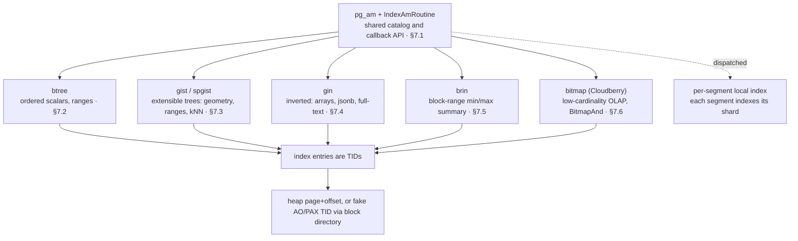

*索引全景。一组目录（pg_am + 操作符类／操作符族）和一张回调表（IndexAmRoutine）支撑了七种访问方法；每种方法都返回用于定位行的 TID——可以是真实的堆页号 + 偏移量，也可以是通过块目录解析的 AO/PAX 伪 TID（[§5.3](/cloudberry/core-internals/part-2-storage-data-layout/ch05/#53-block-directory--fastsequence)、[§6.2](/cloudberry/core-internals/part-2-storage-data-layout/ch06/#62-micro-partition-file-format--manifest-catalog)）。而且，每个索引都局限于各个 Segment 本地：CREATE INDEX 被派发后，每个 Segment 只为自己的分片建立索引。*

## 7.1 索引基础 {#71-index-fundamentals}

### 7.1.1 所有索引的共同点 {#711-what-every-index-has-in-common}

索引是一个*独立的关系*，在 `pg_class` 中有自己的行（relkind 为 `i`），将键值映射到行的位置，使查找比全表扫描更快。Cloudberry 继承了 PostgreSQL 的可插拔索引机制：七种内置**访问方法**（AM），每种方法都在 `pg_am` 目录中声明，并通过同一张 C 函数指针表 `IndexAmRoutine` 调用。不过，Cloudberry 增加了 PostgreSQL 所没有的一项关键特性：索引**位于各个 Segment 本地**。系统中没有单一的全局索引；CREATE INDEX 会派发到每个 Segment，而每个 Segment *只为自己存储的分片*建立索引。本节先介绍共同的目录和 API，再说明贯穿本章各类索引的 MPP 特性。

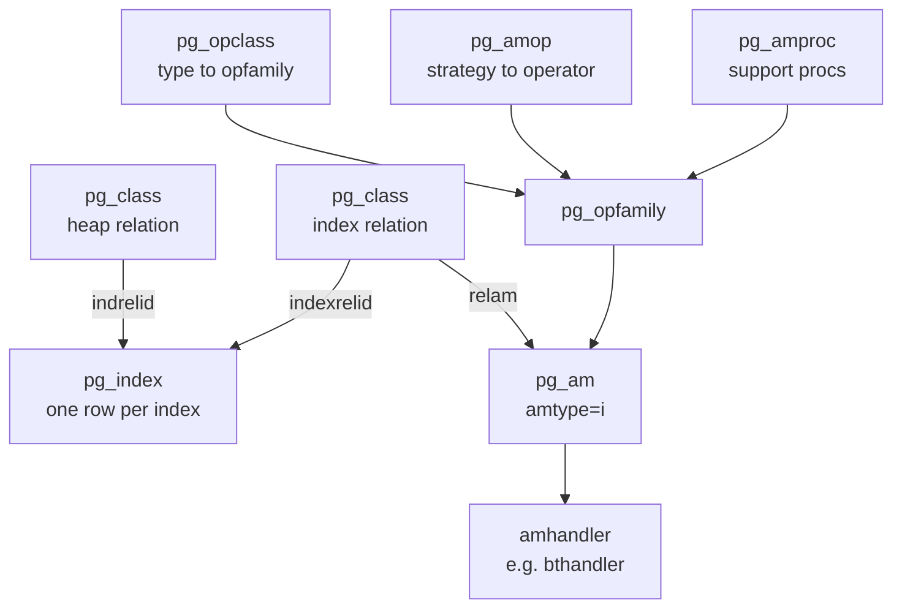

*索引 AM 的目录关系图：pg_index 将堆表与其索引关系和 AM 关联起来；操作符类／操作符族这一层规定该 AM 支持哪些操作符。*

*Coordinator（端口 7100）：7 种索引 AM。amtype='i' 过滤掉表 AM（heap、ao_row、ao_column）。*

```sql
SELECT amname, amhandler::regproc
      FROM pg_am WHERE amtype='i' ORDER BY amname;
```

```text {hl_lines="3 5" title="output"}
 amname |  amhandler  
      --------+-------------
       bitmap | bmhandler
       brin   | brinhandler
       btree  | bthandler
       gin    | ginhandler
       gist   | gisthandler
       hash   | hashhandler
       spgist | spghandler
      (7 rows)
```

- **pg_am**——每种访问方法占一行。`amtype='i'` 表示索引 AM，`'t'` 表示表 AM。`amhandler` 列指定返回例程表的 C 函数。
- **pg_opclass / pg_opfamily**——规定 AM 能为哪些数据类型和操作符建立索引。*操作符类*（如 `int4_ops`）将一种类型绑定到一个*操作符族*；操作符族将行为兼容的跨类型操作符归为一组。
- **pg_amop**——在每个操作符族内，将**策略编号**（btree 中 1=`<`、3=`=`、5=`>`）映射到实际操作符；规划器由此判断索引能否满足 `region = 'r1'`。
- **pg_amproc**——将**支持过程编号**映射到 AM 内部调用的函数（btree 的过程 1 是比较函数）。
- **pg_index**——索引*自身*的目录行：包含 `indrelid`（表）、`indexrelid`（索引关系）、`indkey`（索引列）、`indisunique`、`indisvalid` 等。

### 7.1.2 API：IndexAmRoutine {#712-the-api-indexamroutine}

每种 AM 都通过一个包含回调的结构体对外提供接口。处理函数（由 `pg_am.amhandler` 指定）用 `palloc` 分配一个 `IndexAmRoutine`，填入能力标志和函数指针并返回；系统其他部分调用 `GetIndexAmRoutine`（`src/include/access/amapi.h`）来加载它。结构体开头是供规划器读取的**能力标志**——`amcanorder`、`amcanunique`、`amcanmulticol`、`amcanparallel`——后面则是一组**接口函数**。

```c {title="src/include/access/amapi.h — IndexAmRoutine"}
bool  amcanorder;     /* support ORDER BY on indexed column? */
      bool  amcanunique;    /* support UNIQUE indexes? */
      bool  amcanmulticol;  /* support multi-column indexes? */
      ...
      ambuild_function   ambuild;     /* build a new index */
      aminsert_function  aminsert;    /* insert one tuple */
      amgettuple_function amgettuple; /* fetch next match (ordered scan) */
      amgetbitmap_function amgetbitmap;
```

btree 的处理函数是典型示例：它将这些标志设为 `true`，并将每个回调关联到相应的 `bt*` 函数。`bthandler` 位于 `src/backend/access/nbtree/nbtree.c`。

```c {title="src/backend/access/nbtree/nbtree.c"}
Datum
      bthandler(PG_FUNCTION_ARGS)
      {
          IndexAmRoutine *amroutine = makeNode(IndexAmRoutine);
          amroutine->amcanorder  = true;
          amroutine->amcanunique = true;
          amroutine->ambuild   = btbuild;
          amroutine->aminsert  = btinsert;
          amroutine->amgettuple = btgettuple;
          ...
          PG_RETURN_POINTER(amroutine);
      }
```

> [!NOTE]
> 这一间接调用层正是可插拔机制的关键：执行器从不直接指定 btree。它调用 `amroutine->ambuild(...)`，同一条代码路径就能驱动 gist、gin 或 contrib AM。

### 7.1.3 MPP 特性：索引位于各个 Segment 本地 {#713-the-mpp-twist-indexes-are-per-segment-and-local}

在单节点 PostgreSQL 中，一个索引覆盖表的所有行。在 Cloudberry 中，表根据分布键分片到各个 Segment，因此覆盖*所有*行的索引必须跨越 Segment，而系统中并不存在这种对象。实际做法是将 **CREATE INDEX 派发到每个 Segment**，由各 Segment 独立地为自己实际存储的行建立 B-树（或 bitmap、gist 等）索引。N 个 Segment ⇒ N 个本地索引。

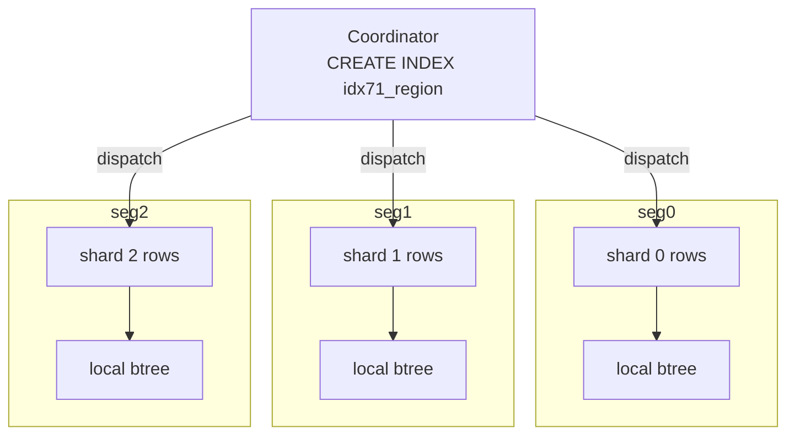

*CREATE INDEX 的派发过程：Coordinator 派发命令；每个 Segment 为自己的分片建立本地索引。不存在全局索引。*

创建一张分片表并为其建立索引，然后验证索引关系在*每个 Segment 上*都存在，且各有自己的大小。`gp_dist_random` 在每个 Segment 上执行查询并合并结果：三行结果，对应三棵独立的 B-树。

*Coordinator：同一个索引在全部 3 个 Segment 上独立构建，每个索引占 65536 字节，覆盖各自的分片。*

```sql
CREATE TABLE idx71_t (id int, region text, payload text)
        DISTRIBUTED BY (id);
      INSERT INTO idx71_t
        SELECT g, 'r'||(g%4), repeat('x',10) FROM generate_series(1,10000) g;
      CREATE INDEX idx71_region ON idx71_t (region);
      SELECT gp_segment_id, pg_relation_size('idx71_region') AS idx_bytes
      FROM gp_dist_random('gp_id') ORDER BY 1;
```

```text {hl_lines="3 4 5" title="output"}
 gp_segment_id | idx_bytes 
      ---------------+-----------
                   0 |     65536
                   1 |     65536
                   2 |     65536
      (3 rows)
```

索引是各 Segment 本地真实存在且可见的关系。以 utility 模式*直接*连接到端口 7102 的 Segment（数据实际存储的位置），就能在该 Segment 的 `pg_class` 中看到索引关系。

*端口 7102 的 Segment（utility 模式）：索引关系位于该 Segment 本地。*

```sql
SELECT c.relname, c.relkind, am.amname
      FROM pg_class c JOIN pg_am am ON am.oid = c.relam
      WHERE c.relname = 'idx71_region';
```

```text {hl_lines="3" title="output"}
   relname    | relkind | amname 
      --------------+---------+--------
       idx71_region | i       | btree
      (1 row)
```

### 7.1.4 UNIQUE 索引必须包含分布键 {#714-a-unique-index-must-contain-the-distribution-key}

由于每个索引仅覆盖一个本地分片，Segment 只能约束*自己持有的行*的唯一性。如果唯一键不是分布键的超集，两个相等的键就可能落到*不同*的 Segment 上，而任何一个 Segment 都无法同时看到这两个键，因而无法拒绝重复值。要实施这种约束，就必须在每次插入时进行跨 Segment 检查。Cloudberry 直接禁止这种情况；检查报错位于 `src/backend/cdb/cdbcat.c`（`errdetails_index_policy()`）。

*Coordinator：在 `region`（非分布键）上创建 UNIQUE 索引会被拒绝；在 `id`（分布键）上创建则被允许。*

```sql
CREATE UNIQUE INDEX idx71_uq ON idx71_t (region);
      CREATE UNIQUE INDEX idx71_uq ON idx71_t (id);
```

```text {hl_lines="1" title="output"}
ERROR:  UNIQUE index must contain all columns in the table's distribution key
      DETAIL:  Distribution key column "id" is not included in the constraint.
      -- second statement:
      CREATE INDEX
```

```c {title="src/backend/cdb/cdbcat.c — errdetails_index_policy()"}
errmsg("UNIQUE index must contain all columns in the table's distribution key")
```

### 7.1.5 索引条目指向什么：TID {#715-what-an-index-entry-points-at-the-tid}

索引不存储行，而是存储 **TID**（`ItemPointer`：共 6 字节的块号 + 偏移量），用于在表关系中定位行。对于**堆**表，TID 就是可以直接访问的页号 + 槽位（[§4](/cloudberry/core-internals/part-2-storage-data-layout/ch04/)）。但 Cloudberry 的追加优化存储引擎没有堆式的页号 + 偏移量，因此会合成一个**伪 TID**：对于 AO/AOCS，将 (segno, rownumber) 编码到 TID 中，在扫描时通过**块目录**解析（[§5.3](/cloudberry/core-internals/part-2-storage-data-layout/ch05/#53-block-directory--fastsequence)）；PAX 也以相同方式解析自己的逻辑地址（[§6.2](/cloudberry/core-internals/part-2-storage-data-layout/ch06/#62-micro-partition-file-format--manifest-catalog)）。索引 API 完全相同——`aminsert` 接收 TID，`amgettuple` 返回 TID——但 TID 的*含义*取决于底层的表 AM。

*Coordinator：索引自身的 `pg_index` 行。`indkey` 为 2，表示索引建立在第 2 列（`region`）上；索引非唯一且有效。*

```sql
SELECT indexrelid::regclass, indrelid::regclass,
             indnatts, indisunique, indisvalid, indkey
      FROM pg_index WHERE indexrelid = 'idx71_region'::regclass;
```

```text {hl_lines="7" title="output"}
-[ RECORD 1 ]-------------
      indexrelid  | idx71_region
      indrelid    | idx71_t
      indnatts    | 1
      indisunique | f
      indisvalid  | t
      indkey      | 2
```

> [!NOTE]
> 要点：一组目录（pg_am + 操作符类／操作符族）、一张回调表（IndexAmRoutine）、七种 AM，再加上 MPP 的规则——一个索引实际对应 N 个本地索引。这要求 UNIQUE ⊇ 分布键，也使存储的 TID 的含义由底层表 AM 决定。

## 7.2 B-树 {#72-b-tree}

### 7.2.1 Lehman-Yao B-link 树 {#721-a-lehman-yao-b-link-tree}

默认访问方法，即仅使用 **CREATE INDEX** 时采用的方法，是 `btree`。其处理函数 `bthandler` 声明规划器所依赖的有序扫描能力（`amcanorder`、`amcanbackward`、`amgettuple`、`amgetbitmap`）：参见 `src/backend/access/nbtree/nbtree.c` 中的 `bthandler()`。从结构上说，它并非教科书中的 B+树，而是 **Lehman-Yao B-link 树**：每个页面都带有一个**高键**（high key，表示页面可容纳键值的上界），以及指向同层右侧兄弟页的**右链接** `btpo_next`。这两个字段使读者能够**无需锁耦合**就完成向下查找和扫描：如果读取父页后发生页分裂，将目标键移到了右侧，只需沿右链接前进，直到高键表明已经到达目标页。

块 0 始终是**元数据页**（`BTREE_METAPAGE`，`src/include/access/nbtree.h`），指向当前根页。叶页之上是内部页，其元组为*下行链接*（分隔键 + 子块号）。叶元组存放索引键 + 堆 **TID**（`ctid`）。层级从叶页的 `btpo_level = 0` 开始向上递增。

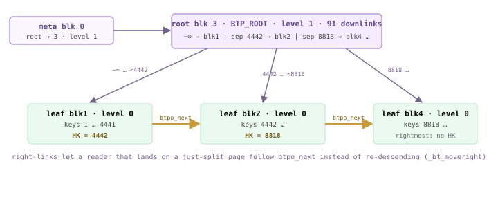

*端口 7102 的 Segment 上 idx72_idx 的 B-link 树：元数据页 → 根页（块 3，层级 1）→ 叶页（层级 0）。竖直箭头为下行链接；琥珀色水平箭头为 btpo_next 右链接。除最右侧叶页外，每个叶页都带有一个限定其内容范围的高键（HK）。*

> [!NOTE]
> 演示集群的 Segment 使用 32 KB 的块大小，因此一个叶页可容纳约 1473 个条目；仅一层根页就足以索引 13.3 万行。如果使用默认的 8 KB 块，同样的数据会使树增加第三层（内部层）。

### 7.2.2 页面剖析：专用区、标志与链接 {#722-page-anatomy--opaque-flags-links}

每个 btree 页的末尾都有一个 `BTPageOpaqueData` 特殊区域（`src/include/access/nbtree.h`）。正是它使 B-link 结构能够被遍历：

- **btpo_prev / btpo_next**——同一层中左右兄弟页的块号；两端为 `P_NONE`。`btpo_next` 是读者在并发分裂后沿着前进的右链接。
- **btpo_level**——树的层级；叶页为 `0`，向根页方向递增。
- **btpo_flags**——位标志集合：`BTP_LEAF`（1）、`BTP_ROOT`（2）、`BTP_DELETED`（4）、`BTP_HALF_DEAD`（16），以及 `BTP_INCOMPLETE_SPLIT`、`BTP_HAS_GARBAGE`（`nbtree.h` 中的 `BTP_LEAF` 及后续定义）。

按照约定，非最右侧页的第 1 个条目槽位存放**高键**（`P_HIKEY`，`nbtree.h`）；实际数据从 `P_FIRSTKEY`（槽位 2）开始。同一层的*最右侧*页没有高键（上界为 +∞），因此 `P_FIRSTDATAKEY` 返回槽位 1（`nbtree.h`）。

*idx72_idx 的两个页面的 bt_page_stats 结果（端口 7102 的 Segment）。叶页（块 1）通过右链接指向块 2；根页（块 3）的标志为 2 = BTP_ROOT，层级为 1。*

| blkno | type | live_items | avg_item_size | free_size | btpo_prev | btpo_next | btpo_level | btpo_flags |
| --- | --- | --- | --- | --- | --- | --- | --- | --- |
| 1 | l（叶页） | 1473 | 16 | 3264 | 0 | 2 | 0 | 1 = BTP_LEAF |
| 3 | r（根页） | 91 | 15 | 30912 | 0 | 0 | 1 | 2 = BTP_ROOT |

### 7.2.3 叶页内部：高键与 TID {#723-inside-a-leaf-page--the-high-key-and-the-tids}

`bt_page_items` 解码每个 `IndexTuple`。下例中，槽位 1 存放叶块 1 的**高键**：ctid `(1,1)` 是占位值，其数据字节 `5a 11` 按小端序解读为 `0x115a`，即 **4442**。从槽位 2 起才是真实条目，每个条目包含一个堆 **TID**（`ctid`）和键值。因此，该页包含键 `1 … 4441`，全部严格小于高键 4442，这正是 `_bt_moveright` 检查的不变量。

*叶块 1 的前几个条目。槽位 1 = 高键（4442）。从槽位 2 起 = 键 → 堆 TID。数据按小端序显示。*

```sql
SELECT itemoffset, ctid, itemlen, left(data,23) AS data
        FROM bt_page_items(get_raw_page('idx72_idx', 1))
        ORDER BY itemoffset LIMIT 6;
```

```text {title="output"}
 itemoffset | ctid  | itemlen |          data
      ------------+-------+---------+-------------------------
                1 | (1,1) |      16 | 5a 11 00 00 00 00 00 00   <- HIGH KEY = 0x115a = 4442
                2 | (0,1) |      16 | 02 00 00 00 00 00 00 00
                3 | (0,2) |      16 | 03 00 00 00 00 00 00 00
                4 | (0,3) |      16 | 04 00 00 00 00 00 00 00
                5 | (0,4) |      16 | 07 00 00 00 00 00 00 00
                6 | (0,5) |      16 | 08 00 00 00 00 00 00 00
      (6 rows)
```

*同一叶页的最后几个有效条目：最大键为 0x1159 = 4441，比高键 4442 小 1。下一个键（4442）位于块 2，可通过右链接到达。*

```sql
SELECT itemoffset, ctid, left(data,11) AS data
        FROM bt_page_items(get_raw_page('idx72_idx', 1))
        ORDER BY itemoffset DESC LIMIT 2;
```

```text {title="output"}
 itemoffset |  ctid   |    data
      ------------+---------+-------------
             1473 | (1,721) | 59 11 00 00   <- 0x1159 = 4441  (max key < high key)
             1472 | (1,720) | 58 11 00 00
      (2 rows)
```

<figure class="cloudberry-core-figure">
<div><div style="max-width:720px;margin:2px auto;font:11px/1.4 ui-monospace,SFMono-Regular,Menlo,monospace;color:#1f2328;overflow-x:auto"> <div style="min-width:540px;border:2px solid #b79ad6;border-radius:6px;overflow:hidden"> <div style="background:#efe3fb;color:#5e4b86;font-weight:700;text-align:center;padding:4px">idx72_idx 的一页 B-树叶页——块 1（32 KB）</div> <div style="background:#f5edff;border-top:1px solid #cdb4db;padding:5px 8px">PageHeaderData <span style="color:#6c6c6c">· 24 字节</span></div> <div style="background:#faf6ff;border-top:1px solid #cdb4db;padding:5px 8px"> <div style="color:#6b5b95">行指针——ItemId[] 向下增长 ↓</div> <div style="display:flex;gap:3px;margin-top:3px;text-align:center"> <div style="flex:0 0 150px;background:#fff4d6;border:1px solid #e0b365;padding:3px;color:#735a16">ItemId[1] → <span class="hl">高键</span><div style="font-size:9px">P_HIKEY · 槽位 1</div></div> <div style="flex:1;background:#f5edff;border:1px solid #cdb4db;padding:3px">ItemId[2] → 第一个数据<div style="font-size:9px;color:#6c6c6c">P_FIRSTKEY · 槽位 2</div></div> <div style="flex:1;background:#f5edff;border:1px solid #cdb4db;padding:3px">ItemId[3] → …</div> </div></div> <div style="background:#eef0f2;border-top:1px solid #cdb4db;text-align:center;color:#656b72;padding:6px 8px">↕ 空闲空间 ↕</div> <div style="background:#eafaf0;border-top:1px solid #cdb4db;padding:5px 8px"> <div style="color:#587161">索引元组——从末尾向上填充 ↑</div> <div style="display:flex;gap:3px;margin-top:3px;text-align:center"> <div style="flex:1;background:#eafaf0;border:1px solid #cfead9;padding:3px">键 2 · TID (0,1)</div> <div style="flex:1;background:#eafaf0;border:1px solid #cfead9;padding:3px">… · …</div> <div style="flex:1;background:#eafaf0;border:1px solid #cfead9;padding:3px">键 <span class="hl">4441</span> · TID (1,720)</div> <div style="flex:0 0 150px;background:#fff4d6;border:1px solid #e0b365;padding:3px;color:#735a16">高键 <span class="hl">4442</span><div style="font-size:9px">上界 · 无堆 TID</div></div> </div></div> <div style="background:#f5edff;border-top:1px solid #cdb4db;padding:5px 8px">special = BTPageOpaqueData: btpo_prev=0 · btpo_next=<span class="hl">2</span> · level=0 · flags=BTP_LEAF</div> </div></div></div>
<figcaption>叶页的槽位布局。行指针从页头向下增长；元组从末尾向上填充。所有非最右侧页的槽位 1 都保留给高键。</figcaption>
</figure>

### 7.2.4 元数据页与根页 {#724-the-meta-page-and-the-root}

`bt_metap` 读取块 0。`root` 是当前根块，`level` 是其层级；`fastroot`/`fastlevel` 是缓存的根节点快速入口，用于跳过已经收缩为单个子节点的层级。`allequalimage = t` 表明该操作符类支持去重。

*idx72_idx 的元数据页：根页为层级 1 的块 3，因此这是一棵两层树（根页 + 叶页）。*

```sql
SELECT root, level, fastroot, fastlevel, allequalimage
        FROM bt_metap('idx72_idx');
```

```text {title="output"}
 root | level | fastroot | fastlevel | allequalimage
      ------+-------+----------+-----------+---------------
          3 |     1 |        3 |         1 | t
      (1 row)
```

根页自身的元组是**下行链接**。槽位 1 指向最左侧子页，*不带键值*（负无穷）；后续各槽位存储一个分隔键，并在 `ctid` 中存储子块号。注意，槽位 2 的分隔键为 `0x115a` = 4442，恰好就是之前在叶块 1 中看到的高键；块 1 分裂出块 2 时，这个键被向上复制到根页。

*根页（块 3）的下行链接。槽位 1 = 最左侧子页块 1，无键值（−∞）。槽位 2 = 分隔键 4442 → 子页块 2。*

```sql
SELECT itemoffset, ctid AS child_blk, itemlen, left(data,23) AS sep_key
        FROM bt_page_items(get_raw_page('idx72_idx', 3))
        ORDER BY itemoffset LIMIT 5;
```

```text {title="output"}
 itemoffset | child_blk | itemlen |         sep_key
      ------------+-----------+---------+-------------------------
                1 | (1,0)     |       8 |                          <- leftmost, key = −infinity
                2 | (2,1)     |      16 | 5a 11 00 00 00 00 00 00   <- sep 4442 -> child blk 2
                3 | (4,1)     |      16 | 72 22 00 00 00 00 00 00   <- sep 8818 -> child blk 4
                4 | (5,1)     |      16 | ac 33 00 00 00 00 00 00
                5 | (6,1)     |      16 | 37 45 00 00 00 00 00 00
      (5 rows)
```

### 7.2.5 构建：先排序，再自底向上装载 {#725-build--sort-then-load-bottom-up}

`btbuild`（`src/backend/access/nbtree/nbtsort.c`）**不会**逐个插入元组。它将所有堆元组送入 tuplesort，按索引顺序排序，再将有序序列自底向上装入页面：`_bt_buildadd`（`nbtsort.c`）把每个元组追加到当前叶页；页面填满后便结束该页，并将高键（下一页第一个键的*截短*副本）向上传递到父层，递归创建内部层。由于页面紧密排列且按序写入，新建索引比通过随机插入逐步形成的索引更紧凑。

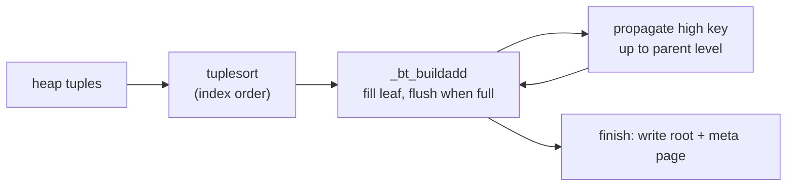

*btbuild 流程：堆扫描将数据送入排序，_bt_buildadd 将排序后的元组装入叶页并向上传递分隔键。*

### 7.2.6 插入、分裂与未完成分裂的修复 {#726-insert-split-and-incomplete-split-repair}

运行时的插入经由 `_bt_doinsert`（`src/backend/access/nbtree/nbtinsert.c`）完成。它构建扫描键，使用 `_bt_search` 向下找到正确的叶页；对于**唯一**索引，还会在插入前重新检查是否存在可见的重复项（`_bt_findinsertloc`，`nbtinsert.c`）。如果目标叶页有空间，就直接放入元组；否则，`_bt_split`（`nbtinsert.c`）将页面一分为二，把键值较大的一半移到新的右兄弟页，并重新连接右链接。

分裂在逻辑上分为两步：先分裂叶页，再向父页插入新的下行链接。两步之间，左页会被标记为 `BTP_INCOMPLETE_SPLIT`。如果在这个间隙发生崩溃或中断，下次向下经过该页时会检测到这个标志，并调用 `_bt_finish_split`（`nbtinsert.c`），先补上缺失的父页下行链接，再继续执行。在此期间，B-link 右链接保证右半部分仍然可达，因此读者始终能看到一致的树。

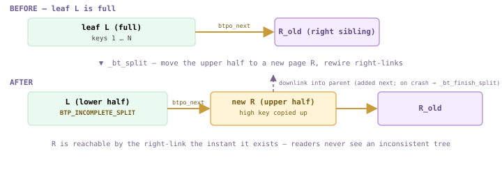

*页分裂前后：_bt_split 将已满叶页 L 中键值较大的一半移到新的右兄弟页 R，并立即建立右链接 L→R；在补上父页下行链接之前，L 带有 BTP_INCOMPLETE_SPLIT 标志。如果在这个间隙崩溃，下次向下查找时会由 _bt_finish_split 修复；与此同时，右链接始终保证 R 可达。*

### 7.2.7 查找：逐个返回 TID，或返回整张位图 {#727-lookup--one-tid-at-a-time-or-a-whole-bitmap}

两个入口分别服务于两种执行计划形态（`bthandler` 在 `nbtree.c` 中设置了这两个入口）：

- **btgettuple**——`nbtree.c`——每次调用按索引顺序返回一个堆 TID。驱动**索引扫描**／仅索引扫描；支持有序扫描和反向扫描，因此无需额外排序就能满足 ORDER BY。
- **btgetbitmap**——`nbtree.c`——遍历匹配的叶页范围，将每个 TID 加入位图，供**位图堆扫描**使用。它不保留顺序，但允许执行器按物理顺序访问堆，并组合多个索引。

两者都从 `_bt_search`（`src/backend/access/nbtree/nbtsearch.c`）开始：从根页向下，根据分隔键界定的范围选择包含目标键的子页。在每个页面上，`_bt_moveright`（`nbtsearch.c`）将搜索键与页面的**高键**比较；如果搜索键超过高键，说明并发分裂已将数据移到右侧，于是沿 `btpo_next` 前进，而不重新从上层查找。这正是 B-link 设计的核心：向下查找无需耦合锁。

### 7.2.8 删除与清理：先半死，再删除 {#728-delete--vacuum--half-dead-then-deleted}

VACUUM 扫描索引，对每个叶页调用 `btvacuumpage`（`src/backend/access/nbtree/nbtree.c`），删除指向已死亡堆行的索引元组。叶页完全变空后，可以通过 `_bt_pagedel` 从树中解除链接，但为保障并发读者的安全，删除分为两个阶段：

- **BTP_HALF_DEAD**——过渡状态：页面在逻辑上已空，父页中的下行链接也已删除，但它仍通过兄弟链接连接在树中，使正在进行的扫描可以经过它（`P_ISHALFDEAD`，`nbtree.h`）。
- **BTP_DELETED**——最终状态：页面已完全解除链接。它记录一个完整 XID，只有当所有快照都不可能再沿过期的右链接访问它时，才会将此块回收到空闲空间映射中（`nbtree.h` 中的 `BTPageSetDeleted()`）。

> [!NOTE]
> `P_IGNORE`（`nbtree.h`）将半死页和已删除页都视为扫描时可以跳过的页面，因此读者到达这类页面时，只需继续沿右链接前进；删除不会阻断并发的向下查找。

## 7.3 GiST 与 SP-GiST {#73-gist--sp-gist}

### 7.3.1 一种树骨架，可插拔的语义 {#731-one-tree-skeleton-pluggable-semantics}

B-树（[§7.2](#72-b-tree)）将一个理念写入访问方法：对标量键建立**全序**。GiST 和 SP-GiST 则反其道而行。访问方法只提供*页面机制*——由页面组成的平衡树（GiST）或空间分区树（SP-GiST）、WAL、清理——而由一个**操作符类**通过固定的一组支持函数提供*含义*。替换操作符类后，同一个 `USING gist` 索引就能服务于几何类型、范围、全文搜索或 `pg_trgm` 三元组。处理函数会声明它需要多少个支持槽位：GiST 需要 `GISTNProcs` = **11**（`gist.h`），SP-GiST 需要 `SPGISTNProc` = **7**，其中 **5** 个是必需的（`spgist.h`——`SPGISTNRequiredProc`）。

GiST 的核心理念是：每个**内部**条目都是一个*谓词*——通常是一个边界框——它**覆盖**其子树中的全部内容。搜索会进入*每个*谓词经 `consistent` 判断与查询相符的子节点，因此与 B-树不同，它可能同时沿多个分支前进。两个 AM 都设置 `amcanorder=false`，但设置 `amcanorderbyop=true`（`gist.c`——`gisthandler()`、`spgutils.c`——`spghandler()`），从而支持 **kNN** `ORDER BY p <-> point` 扫描，由 `distance` 支持函数提供距离计算。

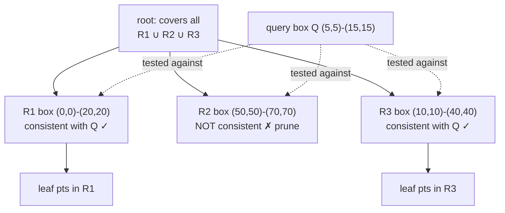

*GiST 对查询框 Q 的搜索：向每个覆盖谓词与 Q 一致的子节点下行。这里 R1 和 R3 与 Q 重叠，R2 不重叠，因此会访问两个分支，并剪掉 R2。*

`gisthandler`（`gist.c`）将 `consistent` 接入 `gistgettuple`；插入时，`union`（扩展父框以覆盖新子节点）、`penalty`（选择扩展代价最小的子节点）和 `picksplit`（将溢出页面分成两个框）共同维护谓词覆盖不变量。

### 7.3.2 两种支持函数契约 {#732-the-two-support-function-contracts}

GiST 的支持槽位在 `gist.h` 中编号（`GIST_CONSISTENT_PROC`=1 … `GIST_SORTSUPPORT_PROC`=11，`gist.h`）。SP-GiST 的支持槽位位于 `spgist.h`——`SPGIST_CONFIG_PROC`。它们编码了两种不同的几何结构：GiST 谓词可以**重叠**（一个点可能满足多个边界框，因此搜索会分叉）；SP-GiST 分区则是**互不相交**的（四叉树象限、基数树字符），所以搜索只沿少数路径前进，但树是**不平衡**的。

*操作符类支持函数——GiST（gist.h）与 SP-GiST（spgist.h）。AM 是通用的；这些函数定义具体类型的语义。*

| 框架 | 函数（槽位） | 作用 |
| --- | --- | --- |
| GiST | consistent (1) | 该条目的谓词是否匹配查询？（扫描严格需要的唯一函数） |
| GiST | union (2) | 将 N 个条目组合成一个供父节点使用的覆盖谓词 |
| GiST | compress / decompress (3/4) | 在索引值与页面上的键表示之间双向映射（允许有损） |
| GiST | penalty (5) | 在给定子节点下插入条目的代价——决定子节点选择 |
| GiST | picksplit (6) | 将溢出页面拆分成两个平衡组 |
| GiST | same / distance (7/8) | 键相等性 · kNN ORDER BY 的距离（amcanorderbyop） |
| SP-GiST | config (1) | 声明节点、前缀、叶值的类型以及分区方式 |
| SP-GiST | choose (2) | 决定新值下行到哪个子分区 |
| SP-GiST | picksplit (3) | 叶页溢出时创建子分区 |
| SP-GiST | inner_consistent (4) | 哪些内部子分区可能匹配查询（剪掉其余分区） |
| SP-GiST | leaf_consistent (5) | 叶数据是否确实匹配查询？ |

> [!NOTE]
> GiST 没有 `config`：其树始终平衡，因此结构是固定的。SP-GiST 没有 `union`/`penalty`：分区互不相交，因此没有需要合并或扩展的内容。这种不对称正是两者的区别。

### 7.3.3 这里的两者都是真正的索引访问方法 {#733-both-are-real-index-access-methods-here}

*pg_am 知道这两种方法——amtype 'i'（索引）。Cloudberry 3.0.0-devel，端口 7100*

```sql
SELECT amname, amtype FROM pg_am WHERE amname IN ('gist','spgist');
```

```text {title="output"}
 amname | amtype
      --------+--------
       gist   | i
       spgist | i
      (2 rows)
```

*point 类型为两种 AM 都提供了操作符类——注意，SP-GiST 为同一种类型提供了两种分区策略（四叉树与 k-d 树）。opcmethod 连接*

```sql
SELECT am.amname, oc.opcname
      FROM pg_opclass oc JOIN pg_am am ON am.oid = oc.opcmethod
      WHERE am.amname IN ('gist','spgist') AND oc.opcname LIKE '%point%'
      ORDER BY 1,2;
```

```text {title="output"}
 amname |    opcname
      --------+----------------
       gist   | point_ops
       spgist | kd_point_ops
       spgist | quad_point_ops
      (3 rows)
```

### 7.3.4 GiST 索引：包含与 kNN {#734-a-gist-index-containment-and-knn}

一个包含 5000 个点的演示表，使用 `USING gist(p)` 建立索引（采用 `point_ops` 操作符类）。由于 GiST 设置了 `amcanorderbyop=true`，规划器可以直接通过索引处理最近邻 `ORDER BY p <-> point`——`distance` 支持函数（槽位 8）使扫描按距离递增顺序弹出叶条目，无需排序。

```c {title="setup (idx73_g)"}
CREATE TABLE idx73_g(id int, p point);
      INSERT INTO idx73_g
        SELECT g, point(g%100,(g*7)%100) FROM generate_series(1,5000) g;
      CREATE INDEX idx73_g_gist ON idx73_g USING gist(p);
```

*kNN：没有 Sort 节点——gist Index Scan 已按距离排序后输出行。（在端口 7102 的 Segment 上以 gp_role=utility 运行，可查看每个 Segment 的计划）扫描中的 Order By*

```sql
SET enable_seqscan=off;
      EXPLAIN (COSTS OFF)
      SELECT id FROM idx73_g ORDER BY p <-> point '(0,0)' LIMIT 5;
```

```text {title="output"}
                   QUERY PLAN
      ------------------------------------------------
       Limit
         ->  Index Scan using idx73_g_gist on idx73_g
               Order By: (p <-> '(0,0)'::point)
       Optimizer: Postgres query optimizer
      (4 rows)
```

*包含谓词 &lt;@ 解析为仅索引扫描——consistent 会剪掉所有不可能与查询框重叠的边界框。索引条件*

```sql
SET enable_seqscan=off;
      EXPLAIN (COSTS OFF)
      SELECT count(*) FROM idx73_g WHERE p <@ box '(0,0),(10,10)';
```

```text {title="output"}
                     QUERY PLAN
      -----------------------------------------------------
       Aggregate
         ->  Index Only Scan using idx73_g_gist on idx73_g
               Index Cond: (p <@ '(10,10),(0,0)'::box)
       Optimizer: Postgres query optimizer
      (4 rows)
```

### 7.3.5 同一个查询，使用 SP-GiST 四叉树 {#735-the-same-query-an-sp-gist-quadtree}

对同一列重新使用 `USING spgist(p)` 建立索引后，会构建一个**四叉树**（默认 `quad_point_ops`）：每个内部节点将平面分成四个互不相交的象限。查询文本没有变化，变化的只有分区规则。`spghandler`（`spgutils.c`）先通过 `inner_consistent`（剪枝象限）再通过 `leaf_consistent`（确认点）来引导扫描。

*同一个 &lt;@ 谓词现在由 SP-GiST 索引处理——剪枝互不相交的象限，而不是重叠的边界框。使用 ..._spg 的仅索引扫描*

```sql
CREATE INDEX idx73_g_spg ON idx73_g USING spgist(p);
      SET enable_seqscan=off;
      EXPLAIN (COSTS OFF)
      SELECT count(*) FROM idx73_g WHERE p <@ box '(0,0),(10,10)';
```

```text {title="output"}
                     QUERY PLAN
      ----------------------------------------------------
       Aggregate
         ->  Index Only Scan using idx73_g_spg on idx73_g
               Index Cond: (p <@ '(10,10),(0,0)'::box)
       Optimizer: Postgres query optimizer
      (4 rows)
```

### 7.3.6 三棵树，三种契约 {#736-three-trees-three-contracts}

- **B-树**——标量上的全序。只有一种语义（比较），除 compare/sortsupport 外没有操作符类函数。树是平衡的，向下只有一条路径。最适合可排序键上的范围查询。
- **GiST**——重叠的覆盖谓词，平衡树。操作符类提供 consistent/union/penalty/picksplit（以及 kNN 所需的 +distance）。搜索可能分叉到多个子节点。适用于几何类型、范围、tsvector、pg_trgm；支持有损扫描和有序扫描。
- **SP-GiST**——互不相交的空间分区，**不**平衡的树。操作符类提供 config/choose/picksplit/inner_consistent/leaf_consistent。四叉树、k-d 树、基数树——适用于点数据和文本前缀搜索，此时各分区永不重叠。

> [!NOTE]
> 实用经验法则：键在自然状态下会重叠的数据（边界框、范围、集合）→ GiST；能够清楚地划分为空间中互不重叠单元的数据（点、前缀）→ SP-GiST。两者都使用同一种可扩展的操作符类机制，而 B-树的固定比较契约并不暴露这种机制。

## 7.4 GIN——复合值的索引 {#74-gin--the-index-for-composite-values}

### 7.4.1 一行、多个键：倒排结构 {#741-one-row-many-keys-the-inverted-structure}

B-树（[§7.2](#72-b-tree)）为每行建立一个**标量**的索引。GIN 为一个**复合**值建立索引——数组、`jsonb`、`tsvector`、`pg_trgm` 文本——方法是将它拆解为组成它的**键**，再分别为每个键建立索引。README 直白地说：一个条目*包含零个或多个键*，并且*索引实际存储和搜索的是键值，而不是条目本身*（`src/backend/access/gin/README:85`）。因此，`{"color":"blue","tags":["gin"]}` 不会作为一个整体存储，而是被拆成多个键，每个键都反向指向包含它的所有行。这张倒排映射（键 → 行）就是全部要点。

从物理结构看，GIN 索引由两棵嵌套的 B-树组成。**条目树**是一棵以提取出的键为键值的 B-树。每个条目的负载是包含该键的所有 TID（堆行指针）组成的集合，即它的**倒排列表**（posting list）。如果集合较小，它会以内联方式存放在条目元组中，作为压缩的 `GinPostingList`（`src/include/access/ginblock.h`）；当它超过 `GinMaxItemSize` 后，条目会改为指向单独的**倒排树**（posting tree）——第二棵 B-树，这次以 TID 为键（`src/backend/access/gin/README:95`）。处理函数 `ginhandler` 将这些结构连接起来：没有 `amgettuple`，只有 `amgetbitmap` → `gingetbitmap`，因为 GIN 扫描总是产生包含许多 TID 的位图，从不产生有序流（`src/backend/access/gin/ginutil.c` 中的 `ginhandler()`）。

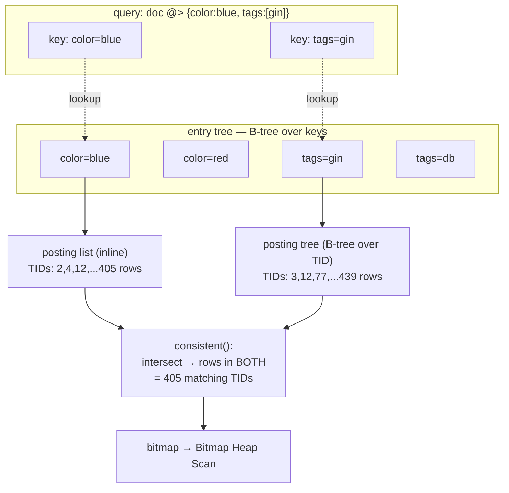

*倒排布局。查询被拆成多个键；每个键在条目树中查找；再由 consistent 求交得到它们的 TID 集合。*

GIN *针对条目包含许多键、且同一键值出现在许多不同条目中的场景进行了优化*（`src/backend/access/gin/README:91`）——这正是文档、标签和全文数据的形状：少量键在数千行中重复出现。

### 7.4.2 在 jsonb 上运行的 GIN 索引 {#742-a-live-gin-index-over-jsonb}

建立一张包含 10 000 行的表，其 `doc` 列是小型 JSON 文档，包含 `tags` 数组、`color` 和 `level`，然后使用默认的 `jsonb_ops` GIN 操作符类为其建立索引。

*填充数据并建立索引。省略分布 NOTICE。*

```sql
CREATE TABLE idx74_t (id int, doc jsonb);
      INSERT INTO idx74_t
      SELECT g, jsonb_build_object(
        'tags', to_jsonb(ARRAY[(ARRAY['db','index','gin','btree','jsonb','vacuum','tid','heap'])[1+(g%8)],
                               (ARRAY['fast','slow','warm','cold'])[1+(g%4)]]),
        'color',(ARRAY['red','green','blue','amber'])[1+(g%4)],
        'level', g%100)
      FROM generate_series(1,10000) g;
      CREATE INDEX idx74_gin ON idx74_t USING gin (doc);
```

```text {title="output"}
INSERT 0 10000
      CREATE INDEX
```

现在执行包含查询。在分布式集群上，对于低选择率谓词，ORCA 可能更偏好并行顺序扫描，因此我们在 utility 模式下使用 Postgres 规划器读取某个 **Segment** 上的 GIN 计划——索引实际就位于该 Segment 上。该计划体现了 GIN 的典型特征：一个**位图索引扫描**向一个带有**重新检查**的**位图堆扫描**提供输入。

*GIN 索引上的位图索引扫描。Segment :7102，gp_role=utility*

```sql
SET optimizer = off;          -- Postgres planner
      SET enable_seqscan = off;
      EXPLAIN (ANALYZE, COSTS off, TIMING off, SUMMARY off)
      SELECT count(*) FROM idx74_t WHERE doc @> '{"color":"blue","tags":["gin"]}';
```

```text {title="output"}
 Aggregate (actual rows=1 loops=1)
         ->  Bitmap Heap Scan on idx74_t (actual rows=405 loops=1)
               Recheck Cond: (doc @> '{"tags": ["gin"], "color": "blue"}'::jsonb)
               Heap Blocks: exact=12
               ->  Bitmap Index Scan on idx74_gin (actual rows=405 loops=1)
                     Index Cond: (doc @> '{"tags": ["gin"], "color": "blue"}'::jsonb)
       Optimizer: Postgres query optimizer
      (7 rows)
```

> [!NOTE]
> 为什么有**重新检查**？GIN 扫描只能证明某行包含所查询的*键*，不能证明这些键的*结构*（例如 `gin` 位于 `tags` 下，而不是其他位置）。位图堆扫描会在每个候选行上重新计算 `@>` 以确认结果。这是 GIN 有损的、按键匹配的固有特性——`gingetbitmap` 返回 TID，从不返回原始数据（`src/backend/access/gin/ginget.c`）。

*倒排索引远小于它所覆盖的堆。*

```sql
SELECT pg_size_pretty(pg_relation_size('idx74_gin')) AS gin_size,
             pg_size_pretty(pg_relation_size('idx74_t'))  AS heap_size;
```

```text {title="output"}
 gin_size | heap_size 
      ----------+-----------
       256 kB   | 1184 kB
      (1 row)
```

### 7.4.3 操作符类契约：三个函数完成全部工作 {#743-the-opclass-contract-three-functions-do-all-the-work}

GIN 本身不了解数组、JSON 或文本。一切与类型相关的工作都委托给操作符类的**支持函数**——`amsupport = GINNProcs`（7）（`src/backend/access/gin/ginutil.c` 中的 `ginhandler()`）；其中三个函数承载语义。`extractValue` 在**插入**时运行，将条目拆成键；`extractQuery` 在**扫描**时运行，将*查询*拆成键并返回一个**搜索模式**；`consistent` 根据某行实际匹配了这些键中的哪些，决定该行是否真正满足操作符。

*GIN 核心支持函数（编号来自 src/include/access/gin.h——GIN_COMPARE_PROC）。*

| # | 宏 | 作用 | jsonb_ops 实现（运行中） |
| --- | --- | --- | --- |
| 1 | GIN_COMPARE_PROC | 在条目树中对两个键排序 | gin_compare_jsonb |
| 2 | GIN_EXTRACTVALUE_PROC | 条目 → 键数组（INSERT 时） | gin_extract_jsonb |
| 3 | GIN_EXTRACTQUERY_PROC | 查询 → 键 + searchMode（SCAN 时） | gin_extract_jsonb_query |
| 4 | GIN_CONSISTENT_PROC | 哪些键匹配了 → 行是否匹配？ | gin_consistent_jsonb |
| 6 | GIN_TRICONSISTENT_PROC | 三值变体（true/false/maybe） | gin_triconsistent_jsonb |

*直接从目录读取的 jsonb_ops 操作符类。（amprocnum 5、compare_partial 在这里未使用。）*

```sql
SELECT ap.amprocnum, ap.amproc::regproc
      FROM pg_opclass oc
      JOIN pg_amproc ap ON ap.amprocfamily = oc.opcfamily
                       AND ap.amproclefttype = oc.opcintype
      WHERE oc.opcname = 'jsonb_ops'
        AND oc.opcmethod = (SELECT oid FROM pg_am WHERE amname='gin')
      ORDER BY ap.amprocnum;
```

```text {title="output"}
 amprocnum |         amproc          
      -----------+-------------------------
               1 | gin_compare_jsonb
               2 | gin_extract_jsonb
               3 | gin_extract_jsonb_query
               4 | gin_consistent_jsonb
               6 | gin_triconsistent_jsonb
      (5 rows)
```

`extractQuery` 还会返回一个 **searchMode**，告诉 GIN 应扫描多大的范围：`GIN_SEARCH_MODE_DEFAULT`（对键求交）、`GIN_SEARCH_MODE_ALL`、`GIN_SEARCH_MODE_INCLUDE_EMPTY` 或内部的 `GIN_SEARCH_MODE_EVERYTHING`（`src/include/access/gin.h`）。数组操作符类简明地展示了这种模式：对于 `&&`（重叠），一个匹配元素就足够；对于 `@>`（包含），查询中的**所有**键都必须存在（`src/backend/access/gin/ginarrayproc.c` 中的 `ginarrayconsistent()`）。

> [!NOTE]
> 这就是 GIN 支持 `@>`、`?`、`@@`、`&&` 一类的**包含／匹配**操作符，却**不**支持 `<`、`>`、`BETWEEN` 或 `ORDER BY` 的原因。条目树只按键排序，以便快速找到它们；查询结果是一组没有有意义顺序的 TID，因此 `amcanorder = false`，输出只能是位图（`src/backend/access/gin/ginutil.c` 中的 `ginhandler()`）。

### 7.4.4 fastupdate：在待处理列表中缓冲昂贵的插入 {#744-fastupdate-buffering-expensive-inserts-in-a-pending-list}

GIN 插入代价很高：一个包含 *N* 个键的条目意味着要在条目树中下行 *N* 次，并更新 *N* 个倒排列表（每个键调用一次 `ginEntryInsert`，`src/backend/access/gin/gininsert.c`）。为摊平成本，GIN 默认启用 **fastupdate=on**：新条目以**未排序**方式追加到由普通堆式元组组成的**待处理列表**，稍后再批量合并到主树中——由 `ginInsertCleanup` 完成，在 VACUUM 时或列表超过 `gin_pending_list_limit` 后触发（`src/backend/access/gin/ginfast.c` 中的 `ginHeapTupleFastInsert()`）。README 的原话是：*批量插入几千个条目可能比逐个插入快得多……主要收益来自：当同一个键出现在多个新的堆元组中时，不必反复搜索／插入*（`src/backend/access/gin/README:101`）。

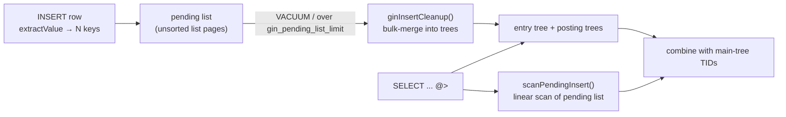

*fastupdate=on：写入落入待处理列表；读取和 VACUUM 则需要扫描／刷新它。*

- **权衡**——写入更快，但每次读取都必须**线性扫描**待处理列表，并将结果与主树结果取并集——`gingetbitmap` 在访问主树前调用 `scanPendingInsert`（`src/backend/access/gin/ginget.c`）。待处理列表过长会拖慢查询，并增加单次 VACUUM 的工作量。设置 `fastupdate=off` 后，插入立即承担全部成本，但读取无需处理待处理列表。
- **何时关闭它**——读多写少或对延迟敏感的工作负载，或者很少执行 VACUUM 的索引。它是每个索引的 reloption。

*fastupdate 是可设置的索引 reloption；刷新阈值是一个 GUC。*

```sql
ALTER INDEX idx74_gin SET (fastupdate = off);
      SELECT relname, reloptions FROM pg_class WHERE relname = 'idx74_gin';
      SHOW gin_pending_list_limit;
```

```text {title="output"}
ALTER INDEX
        relname  |    reloptions    
      -----------+------------------
       idx74_gin | {fastupdate=off}
      (1 row)

       gin_pending_list_limit 
      ------------------------
       4MB
      (1 row)
```

### 7.4.5 GIN 是 jsonb 变快的原因 {#745-gin-is-what-makes-jsonb-fast}

回到 JSON 章节：`jsonb @> '{…}'` 包含查询和 `jsonb ? 'key'` 存在性查询，恰好使用 `@>`／`?` 操作符，由 GIN 的 `jsonb_ops` 操作符类实现。没有 GIN 索引时，它们会退化为全表扫描，并逐行测试 `@>`（也就是上面分布式表中 ORCA 选择的 `Seq Scan + Filter` 计划）。另一个操作符类 **`jsonb_path_ops`** 为从根到叶的完整*路径*的哈希值建立索引，而不是为单个键建立索引：它只支持 `@>`（不支持 `?`），但会产生更少、选择性更高的键——对于深层文档而言，通常索引更小，包含查询也更快。

*两个操作符类都能建立索引；在这份浅层的 10k 数据集上二者大小相同，但对于深层／大型文档，jsonb_path_ops 通常更有优势。*

```sql
CREATE INDEX idx74_gin_po ON idx74_t USING gin (doc jsonb_path_ops);
      SELECT pg_size_pretty(pg_relation_size('idx74_gin'))    AS jsonb_ops,
             pg_size_pretty(pg_relation_size('idx74_gin_po')) AS jsonb_path_ops;
```

```text {title="output"}
 jsonb_ops | jsonb_path_ops 
      -----------+----------------
       256 kB    | 256 kB
      (1 row)
```

同一套机制还服务于全文搜索（`tsvector @@ tsquery`）、数组重叠／包含（`&& @>`）和三元组相似度（`pg_trgm`）——不同的操作符类使用相同的“条目树 + 倒排列表”骨架。对于所有*包含多个候选值之一*的问题，GIN 是 Cloudberry 复用的倒排索引。

## 7.5 BRIN {#75-brin}

### 7.5.1 每个块范围一个摘要，而不是每行一个条目 {#751-one-summary-per-block-range-not-one-entry-per-row}

B-树（[§7.2](#72-b-tree)）为**每一行**存储一个索引条目——精确，但体积很大。**BRIN**（Block Range INdex，块范围索引）走向另一个极端：它为**一段堆块范围**存储一个很小的**摘要**。默认范围是 `pages_per_range=128` 个连续堆页（`src/include/access/brin.h`——`BRIN_DEFAULT_PAGES_PER_RANGE`、`BRIN_DEFAULT_PAGES_PER_RANGE 128`）。对于 `minmax` 操作符类，一个范围的摘要就是这 128 页中索引列的 `[min, max]`。扫描会遍历这些摘要，并针对每个范围询问*这里是否可能有行匹配谓词？*——如果 `[min,max]` 不可能与谓词重叠，就会**跳过整个范围**，完全不访问堆。这样一来，BRIN 比 B-树小几个数量级，但代价是它具有**有损性**：它返回*候选*范围，之后还要逐行重新检查堆。BRIN 只有在磁盘上的列具有**自然顺序**时才真正有用（随时间追加的时间戳、单调递增的 ID），这样每个范围的 `[min,max]` 才能保持紧凑。

![堆块按范围分组（每组 128 页），每个范围用一个 [min,max] 摘要表示。反向映射为每个范围保存一个指向摘要元组的 TID，因此堆块可以在 O(1) 时间找到自己的摘要……](fig-007.svg)

*堆块按范围分组（每组 128 页），每个范围用一个 [min,max] 摘要表示。反向映射为每个范围保存一个指向摘要元组的 TID，因此堆块可以在 O(1) 时间找到自己的摘要。谓词会针对每个摘要测试：不重叠的范围整个跳过；只扫描并重新检查重叠的范围。*

访问方法处理函数 `brinhandler` 将这些结构连接起来（`src/backend/access/brin/brin.c`）：通过 `brinbuild` 构建，通过 `brininsert` 插入，并通过 `bringetbitmap` 扫描；注意 `brin.c` 中的 GPDB 注释：它返回一个**有损的 TIDBitmap**，因此 BRIN 始终向位图堆扫描提供输入，从不提供普通索引扫描。

### 7.5.2 结构：元数据页 + 反向映射 + 摘要元组 {#752-structure-meta-page--revmap--summary-tuples}

在磁盘上，BRIN 索引由三部分组成（`brin_revmap.c` 和 README 的 `src/backend/access/brin/README:103`）：**元数据页**（块 0），保存 `pagesPerRange` 和版本；**反向映射**（范围映射），占据接下来的几个块——它为每个范围保存一个 TID，指向该范围的摘要元组，因此给定一个堆块后，扫描可以在 O(1) 时间找到其摘要；以及普通的**数据页**，存放摘要元组。布局是固定的：`{meta page, [revmap pages], [data pages]}`（README 的 `brinGetTupleForHeapBlock()`）。

- **元数据页**——`pages_per_range` reloption、BRIN 版本（`BRIN_CURRENT_VERSION 1`，`brin_page.h`）以及 `lastrevmappage`。
- **反向映射**——稠密数组：范围索引 → 摘要元组的 TID。随着堆增长而扩展（`revmap_physical_extend`，`brin_revmap.c`）。
- **摘要元组**——实际的 `[min,max]`（或者其他操作符类更丰富的负载），紧密存放在数据页上。
- **未摘要尾部**——最后一个已摘要范围之后新增的堆页**还没有**摘要，因此在 `brin_summarize_new_values()` 或 autovacuum 为它们生成摘要之前，总会被完整扫描（README 的 `brinRevmapExtend()`）。

> [!NOTE]
> **CBDB 特性。** Cloudberry 让 BRIN 也能为**追加优化**表建立索引，而这类表的块号是稀疏的（Segment 文件从 33554432 这样的巨大偏移量开始）。如果在这片空间上建立稠密反向映射，就需要数千个空页（README 的 `brinGetTupleForHeapBlock()`）。因此，CBDB 增加了独立的 AO 反向映射路径——`revmap_extend_and_get_blkno_ao` 与 `..._heap`（`brin_revmap.c`）——并让 `bringetbitmap` 遍历 `BlockSequence`，而不是遍历一条扁平范围（`brin.c`）。

### 7.5.3 演示：具有自然顺序的表 {#753-demo-a-naturally-ordered-table}

两百万行，`ts` 通过 `generate_series` 按严格顺序填充，然后在 `ts` 上分别建立 BRIN 和 B-树索引——这样就能比较二者（Coordinator，端口 7100）。

*建立表和两种索引。200 万个有序时间戳。*

```sql
CREATE TABLE idx75_t (id bigint, ts timestamp) DISTRIBUTED BY (id);
      INSERT INTO idx75_t
        SELECT g, '2020-01-01'::timestamp + (g||' minutes')::interval
        FROM generate_series(1, 2000000) g;
      CREATE INDEX idx75_brin ON idx75_t USING brin(ts);
      CREATE INDEX idx75_bt   ON idx75_t USING btree(ts);
      ANALYZE idx75_t;
```

```text {title="output"}
CREATE TABLE
      INSERT 0 2000000
      CREATE INDEX
      CREATE INDEX
      ANALYZE
```

*核心效果：在同一列上，BRIN 约比 B-树小 100 倍。*

```sql
SELECT pg_size_pretty(pg_relation_size('idx75_brin')) AS brin_size,
             pg_size_pretty(pg_relation_size('idx75_bt'))   AS btree_size,
             pg_size_pretty(pg_relation_size('idx75_t'))    AS heap_size;
```

```text {title="output"}
 brin_size | btree_size | heap_size
      -----------+------------+-----------
       384 kB    | 43 MB      | 84 MB
      (1 row)
```

384 kB 对 43 MB。B-树只有所索引表大小的一半；BRIN 几乎可以忽略不计。这种权衡之所以成立，是因为 `ts` 在磁盘上按顺序排列——随机数据会让每个范围的 `[min,max]` 覆盖整个域，因而什么都跳过不了。

### 7.5.4 扫描：跳过范围，然后重新检查堆 {#754-the-scan-skip-ranges-then-recheck-the-heap}

强制使用 Postgres 规划器（ORCA 在这里更偏好精确的 B-树），并删除 B-树，使 BRIN 被选中。这个计划展示了有损索引的两步过程：BRIN 上的**位图索引扫描**产生候选堆块，然后**位图堆扫描**重新检查其中的每一行。

*在一个 6 小时的窗口上执行 BRIN 位图扫描。注意重新检查的数量。*

```sql
SET optimizer = off;
      SET enable_seqscan = off;
      DROP INDEX idx75_bt;
      EXPLAIN (ANALYZE, COSTS off, TIMING off, SUMMARY off)
      SELECT count(*) FROM idx75_t
      WHERE ts BETWEEN '2020-02-01 00:00:00' AND '2020-02-01 06:00:00';
```

```text {title="output"}
 Finalize Aggregate (actual rows=1 loops=1)
         ->  Gather Motion 3:1  (slice1; segments: 3) (actual rows=3 loops=1)
               ->  Partial Aggregate (actual rows=1 loops=1)
                     ->  Bitmap Heap Scan on idx75_t (actual rows=132 loops=1)
                           Recheck Cond: ((ts >= '2020-02-01 00:00:00') AND (ts <= '2020-02-01 06:00:00'))
                           Rows Removed by Index Recheck: 95100
                           ->  Bitmap Index Scan on idx75_brin (actual rows=1280 loops=1)
                                 Index Cond: ((ts >= '2020-02-01 00:00:00') AND (ts <= '2020-02-01 06:00:00'))
       Optimizer: Postgres query optimizer
      (9 rows)
```

从底部向上读。**位图索引扫描**标记候选块（`1280` 表示被标记的堆页，而不是匹配行数——BRIN 只能指向*范围*）。随后**位图堆扫描**读取这些块，并丢弃有损索引无法排除的 **95 100** 行，只保留 **132** 个真正匹配的行。`Rows Removed by Index Recheck` 这一行把 BRIN 的有损性直接呈现出来：索引将 2M 行缩小到少数范围，最后由堆完成工作。

### 7.5.5 深入查看：每个范围的 [min,max] {#755-looking-inside-per-range-minmax}

摘要位于各个 Segment 上（堆数据是分布式的），因此要在 Segment 上以 utility 模式执行 `pageinspect` 检查（端口 7102）。元数据页确认范围大小；数据页 2 存放摘要元组。

*Segment utility 连接——从元数据页确认范围大小。*

```sql
CREATE EXTENSION IF NOT EXISTS pageinspect;
      SELECT pagesperrange, lastrevmappage
      FROM brin_metapage_info(get_raw_page('idx75_brin', 0));
```

```text {title="output"}
 pagesperrange | lastrevmappage
      ---------------+----------------
                 128 |              1
      (1 row)
```

*摘要元组：每个 128 页范围一个 [min,max]。`blknum` 是范围的第一个堆块。*

```sql
SELECT itemoffset, blknum, value
      FROM brin_page_items(get_raw_page('idx75_brin', 2), 'idx75_brin')
      ORDER BY blknum LIMIT 6;
```

```text {title="output"}
 itemoffset | blknum |                    value
      ------------+--------+----------------------------------------------
                1 |      0 | {2020-01-01 00:02:00 .. 2020-07-17 18:24:00}
                2 |    128 | {2020-07-17 18:28:00 .. 2021-01-31 12:38:00}
                3 |    256 | {2021-01-31 12:41:00 .. 2021-08-18 15:28:00}
                4 |    384 | {2021-08-18 15:31:00 .. 2022-03-04 21:17:00}
                5 |    512 | {2022-03-04 21:22:00 .. 2022-09-18 17:39:00}
                6 |    640 | {2022-09-18 17:40:00 .. 2023-04-05 16:33:00}
      (6 rows)
```

每一行都是一个范围的字面 `{min .. max}`。这里每个范围覆盖约 6 个月——范围很宽，因为 200 万行交错分布在 3 个 Segment 上，所以每个 Segment 接收约三分之一的行，而 128 页范围覆盖了半年。`consistent` 函数（`brin_minmax_consistent`，`brin_minmax.c`）执行的正是廉价的区间测试：*`[Feb01 00:00, Feb01 06:00]` 是否与这个范围的 `{min..max}` 重叠？*对于 2 月查询，只有包含这一天的范围会重叠；此处展示的其他范围各自只需检查**一个元组**就能排除——这就是跳过范围的过程。

*谓词 `ts ∈ [Feb01 00:00, Feb01 06:00]` 为什么会跳过大多数范围——对每个摘要执行重叠测试。*

| 范围（首块） | 摘要 [min .. max] | 是否与谓词重叠？ | 操作 |
| --- | --- | --- | --- |
| 0 | 2020-01-01 .. 2020-07-17 | 是（Feb01 在其中） | 扫描 + 重新检查 |
| 128 | 2020-07-17 .. 2021-01-31 | 否 | 跳过 |
| 256 | 2021-01-31 .. 2021-08-18 | 否 | 跳过 |
| 384 | 2021-08-18 .. 2022-03-04 | 否 | 跳过 |
| … | … | 否 | 跳过 |

### 7.5.6 操作符类及其与 PAX 的联系 {#756-opclasses-and-the-connection-to-pax}

- **minmax**——每个范围一个 `[min,max]`（`brin_minmax.c`）。经典方案；最适合单调列。
- **minmax_multi**——每个范围包含多个互不相交的 `[min,max]` 区间（`brin_minmax_multi.c`），能够容忍少量离群值，否则这些离群值会把一个范围的边界大幅撑开。
- **inclusion**——包含范围内全部成员的边界值（`brin_inclusion.c`），用于几何、范围和网络类型。
- **bloom**——每个范围一个 Bloom 过滤器（`brin_bloom.c`），用于没有有用顺序的列上的**相等**查询；摘要回答的是*这个范围可能包含值 v 吗？*

> [!NOTE]
> **与 [§6.4](/cloudberry/core-internals/part-2-storage-data-layout/ch06/#64-sparse-filters-minmax--bloom-skip-scan) 的宏观联系。** BRIN 的 `minmax` 摘要——*跳过 `[min,max]` 不可能匹配谓词的块范围*——在**概念上与 PAX 的稀疏过滤器采用相同机制**（[§6.4](/cloudberry/core-internals/part-2-storage-data-layout/ch06/#64-sparse-filters-minmax--bloom-skip-scan)）。区别在于它存在的位置。BRIN 将范围跳过功能**附加**到现有堆上，作为需要独立构建和生成摘要的有损索引；PAX 则将每个组的 min/max 统计信息**内置**到存储格式中，因此扫描时可以跳过，无需维护独立索引。相比之下，AO 表两者都没有——范围查询会读取全部内容（或者依赖分区）。同一个理念——*不要读取不可能匹配的块*——处于“内置”与“附加”两端之间的三个位置。关于 PAX 如何让摘要成为文件一部分，见 [§6.4](/cloudberry/core-internals/part-2-storage-data-layout/ch06/#64-sparse-filters-minmax--bloom-skip-scan)。

## 7.6 位图索引（Cloudberry 特有） {#76-bitmap-index-cloudberry-specific}

### 7.6.1 PostgreSQL 没有的索引 {#761-an-index-postgresql-doesnt-have}

核心 PostgreSQL 会在 `BitmapHeapScan` 期间于内存中**即时**构建位图，然后将其丢弃。Cloudberry 增加了核心 PostgreSQL 没有的功能：一种**持久化、位于磁盘上的位图索引访问方法**，继承自 Greenplum，并以 `bitmap` 的名称注册在目录中。`src/backend/access/bitmap/README:6` 用一句话定义了它——*“磁盘上的位图索引由位图向量组成，每个不同的键值对应一个向量”*。每个向量都是一个（压缩的）映射，表示该值出现在哪些堆位置。

*该 AM 是目录中的真实行——处理函数为 `bmhandler`，类型为 `i`（索引）。`=>` 表示找到它。*

```sql
SELECT amname, amhandler, amtype FROM pg_am WHERE amname='bitmap';
```

```text {title="output"}
 amname | amhandler | amtype 
--------+-----------+--------
 bitmap | bmhandler | i
(1 row)
```

`bmhandler` 是入口点——`src/backend/access/bitmap/bitmap.c`。它填充一个 `IndexAmRoutine`，其策略／支持编号借用了 B-树（`amstrategies = BTMaxStrategyNumber`，`bitmap.c`——`bmhandler()`），但构建、插入和扫描回调（`bmbuild`、`bminsert`、`bmgettuple`）是位图专用的。

**它存在的原因：**面向大型 OLAP 表中**低基数**的列——性别、状态、区域、订单状态，以及从少数到数万个不同值——B-树需要为每一行存储一个索引条目（键 + 6 字节 TID），因此浪费空间。位图索引则为**每个不同值**存储一个压缩的位向量：当且仅当堆中的第 *i* 行拥有该值时，位 *i* 才为 1。对这些向量执行 AND／OR，就能几乎不花代价地回答多谓词分析过滤。README 将最佳场景的上限定为*“少于 50,000 个不同值”*（`README:14`）。

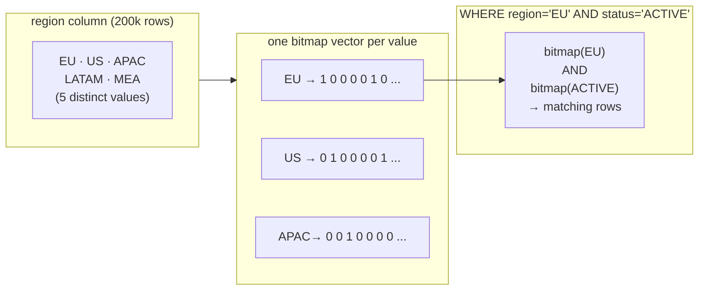

*这一设计的结构：每个不同值拥有一个位向量；多谓词过滤器对匹配向量执行按位 AND。*

### 7.6.2 磁盘结构：元数据页 → LOV → 位图向量 {#762-on-disk-structure-meta--lov--bitmap-vectors}

一个位图索引关系中包含三类页面，另有一个隐藏的辅助堆 + B-树。块 0 是**元数据页**，类型为 `BMMetaPageData`（`src/include/access/bitmap.h`）。它包含魔数／版本（`BITMAP_MAGIC 0x4249544D`、`BITMAP_VERSION 2`——`bitmap.h`），更关键的是，还包含辅助对象的 OID：

```c {title="src/include/access/bitmap.h — BMMetaPageData"}
typedef struct BMMetaPageData {
          Oid         bm_magic;
          Oid         bm_version;
          Oid         bm_lov_heapId;   /* aux heap: value -> (block,offset) */
          Oid         bm_lov_indexId;  /* btree on that heap */
          BlockNumber bm_lov_lastpage;
      } BMMetaPageData;
```

**LOV——List Of Values，值列表。**不同值以 `BMLOVItemData` 记录的形式存储在*LOV 页*中（`bitmap.h`）。每个 LOV 项都是一个**位图向量的头部**：它保存该值向量的首个／最后一个位图页（`bm_lov_head`／`bm_lov_tail`），还保存正在构建的尾部字（`bm_last_compword` 和 `bm_last_word`）以及管理信息（`bm_last_tid_location`、`bm_last_setbit`）。为了在不进行线性扫描的情况下找到某个值对应的 LOV 项，构建过程会创建一个内部的**堆 + B-树**（`README:56-64`）：堆行是 `(indexed columns…, block#, offset#)`，B-树按这些列建立键。因此，一次探查的路径是：在 B-树中搜索值 →（块、偏移量）→ LOV 项 → 向量头。NULL 键使用一个保留槽位，即第一个 LOV 页的第一项（`bitmap.h`）。

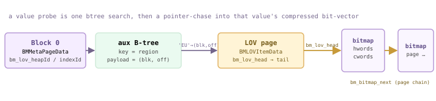

*值的探查路径：元数据页命名辅助 B-树；B-树将值映射到 LOV 项；LOV 项的 bm_lov_head 指向该值的位图页链表的头部，页之间通过 bm_bitmap_next 链接。*

**位图页**保存压缩后的向量本身。`BMBitmapData` 页面（`bitmap.h`）由两个 64 位字数组组成（`BM_HRL_WORD`，`bitmap.h`）：`hwords[]`（头部位）和 `cwords[]`（内容）。页面的 `BMBitmapOpaqueData`（`bitmap.h`）保存 `bm_hrl_words_used`、下一个 `bm_bitmap_next` 块（向量是页面链）以及 `bm_last_tid_location`，因此搜索可以在不解压的情况下跳过整页。每页容量由页面大小决定：`cwords[]` 数组由 `BM_NUM_OF_HRL_WORDS_PER_PAGE`（`bitmap.h`）确定，在本源码版本的 32 KB 页面上等于 3968 个内容字（硬上限 `BM_MAX_NUM_OF_HRL_WORDS_PER_PAGE` 为 4091）。它上面的注释仍然写着*每个 8K 页面约 4078 个字*——那段注释早于 32 KB 默认值以及 `BM_HRL_WORD` 改为 64 位。

**HRL 压缩。**编码采用混合游程长度（Hybrid Run-Length，`README:17`）。每个内容字要么是*字面值*（其头部位为 0，即 64 个原始位），要么是*填充*（头部位为 1——其最高位表示填充 0 还是填充 1，其余位是以 64 位为单位的游程长度；宏为 `FILL_LENGTH`／`GET_FILL_BIT`，见 `bitmap.h`）。连续的大段相同位——正是低基数列产生的形状——会压缩成一个字。

*README 中的计算示例（为便于阅读使用字长 8；实际字长为 64 位）。*

| 位图 | HRL 头部 | HRL 内容 | 含义 |
| --- | --- | --- | --- |
| 00000000 00000000 01000000 11111111 11111111 11111111 | 101 | 00000010 / 01000000 / 10000011 | 0 填充 ×16 · 字面值 · 1 填充 ×24 |

**不存储 TID**（`README:68`）。一个 6 字节的堆 TID 会远大于它表示的那个位，因此用位在向量中的*位置*编码存储位置：`position = block# * BM_MAX_TUPLES_PER_PAGE + offset#`（`bitmap.h`——`BMLOVItemData`）。`BM_MAX_TUPLES_PER_PAGE` 会被取整为字长的倍数，使不同堆页中的位永远不会共享同一个字（`bitmap.h`——`BM_MAX_TUPLES_PER_PAGE`）。

### 7.6.3 位图很小，而且可以 AND {#763-bitmaps-are-small--and-they-and}

用三种方式构建同一张低基数表，并比较索引大小。两个位图索引（`region`、`status`）和一个建立在 `region` 上的 B-树索引：

*200k 行；5 个区域，3 个状态。`=>` 位图索引的大小不到同一列 B-树索引的一半。*

```sql
CREATE TABLE idx76_t(id int, region text, status text) DISTRIBUTED BY (id);
      INSERT INTO idx76_t SELECT g,
        (ARRAY['EU','US','APAC','LATAM','MEA'])[1+(g%5)],
        (ARRAY['ACTIVE','INACTIVE','PENDING'])[1+(g%3)]
      FROM generate_series(1,200000) g;
      CREATE INDEX idx76_bm_region ON idx76_t USING bitmap(region);
      CREATE INDEX idx76_bm_status ON idx76_t USING bitmap(status);
      CREATE INDEX idx76_bt_region ON idx76_t USING btree(region);
      SELECT 'bitmap(region)' idx, pg_size_pretty(pg_relation_size('idx76_bm_region')) sz
      UNION ALL SELECT 'bitmap(status)', pg_size_pretty(pg_relation_size('idx76_bm_status'))
      UNION ALL SELECT 'btree(region)',  pg_size_pretty(pg_relation_size('idx76_bt_region'));
```

```text {title="output"}
      idx       |  sz   
      ----------------+-------
       bitmap(region) | 736 kB
       bitmap(status) | 544 kB
       btree(region)  | 1568 kB
      (1 row)
```

> [!NOTE]
> 相同列上的 736 kB 对 1568 kB——而且随着行数增加、不同值数量保持不变，位图索引与 B-树之间的大小差距会扩大：每增加一行，B-树就增加一个完整条目，而位图只需翻转一个位（往往只是扩展已有的填充字）。

现在执行一个双谓词分析过滤。规划器会扫描**两个**位图索引，在访问堆之前用 `BitmapAnd` 将它们组合起来——这正是这种结构的目标收益：

*`BitmapAnd` 合并位图索引上的两个 `Bitmap Index Scan`，然后执行一次 `Bitmap Heap Scan`。`=>` 直到位图完成求交后才会读取堆行。*

```sql
SET enable_seqscan=off;
      EXPLAIN (ANALYZE, COSTS off, TIMING off, SUMMARY off)
      SELECT count(*) FROM idx76_t WHERE region='EU' AND status='ACTIVE';
```

```text {title="output"}
 Finalize Aggregate (actual rows=1 loops=1)
         ->  Gather Motion 3:1 (slice1; segments: 3) (actual rows=3 loops=1)
               ->  Partial Aggregate (actual rows=1 loops=1)
                     ->  Bitmap Heap Scan on idx76_t (actual rows=4456 loops=1)
                           Recheck Cond: ((region = 'EU') AND (status = 'ACTIVE'))
                           ->  BitmapAnd (actual rows=1 loops=1)
                                 ->  Bitmap Index Scan on idx76_bm_region (actual rows=1 loops=1)
                                       Index Cond: (region = 'EU')
                                 ->  Bitmap Index Scan on idx76_bm_status (actual rows=1 loops=1)
                                       Index Cond: (status = 'ACTIVE')
      (11 rows)
```

每个 `Bitmap Index Scan` 都报告 `actual rows=1`：它返回的是**一个**解压后的位向量，而不是行流。`BitmapAnd` 逐字对它们求交，`Bitmap Heap Scan` 只访问求交后仍保留的位置（每个 Segment 约 4456 行，总计 13333 行）。下图把这个 AND 过程在几行数据上具体展示出来：

<figure class="cloudberry-core-figure">
<div><div style="max-width:720px;margin:2px auto;font:11px/1.5 ui-monospace,SFMono-Regular,Menlo,monospace;color:#1f2328;overflow-x:auto"> <div style="min-width:520px"> <div style="display:flex;gap:2px;text-align:center;color:#656b72;font-size:9.5px;margin-bottom:1px"><div style="flex:0 0 104px;text-align:left">行号</div><div style="flex:1">1</div><div style="flex:1">2</div><div style="flex:1">3</div><div style="flex:1">4</div><div style="flex:1">5</div><div style="flex:1">6</div><div style="flex:1">7</div><div style="flex:1">8</div><div style="flex:1">9</div><div style="flex:1">10</div><div style="flex:1">11</div><div style="flex:1">12</div><div style="flex:1">13</div><div style="flex:1">14</div><div style="flex:1">15</div></div> <div style="display:flex;gap:2px;text-align:center;align-items:stretch"> <div style="flex:0 0 104px;text-align:left;color:#6b5b95;font-weight:600">region=EU</div> <div style="flex:1;color:#767676">0</div><div style="flex:1;color:#767676">0</div><div style="flex:1;color:#767676">0</div><div style="flex:1;color:#767676">0</div><div style="flex:1;background:#f5edff;border:1px solid #cdb4db">1</div><div style="flex:1;color:#767676">0</div><div style="flex:1;color:#767676">0</div><div style="flex:1;color:#767676">0</div><div style="flex:1;color:#767676">0</div><div style="flex:1;background:#f5edff;border:1px solid #cdb4db">1</div><div style="flex:1;color:#767676">0</div><div style="flex:1;color:#767676">0</div><div style="flex:1;color:#767676">0</div><div style="flex:1;color:#767676">0</div><div style="flex:1;background:#f5edff;border:1px solid #cdb4db">1</div></div> <div style="display:flex;gap:2px;text-align:center;margin-top:2px"> <div style="flex:0 0 104px;text-align:left;color:#587161;font-weight:600">status=ACTIVE</div> <div style="flex:1;color:#767676">0</div><div style="flex:1;color:#767676">0</div><div style="flex:1;background:#eafaf0;border:1px solid #cfead9">1</div><div style="flex:1;color:#767676">0</div><div style="flex:1;color:#767676">0</div><div style="flex:1;background:#eafaf0;border:1px solid #cfead9">1</div><div style="flex:1;color:#767676">0</div><div style="flex:1;color:#767676">0</div><div style="flex:1;background:#eafaf0;border:1px solid #cfead9">1</div><div style="flex:1;color:#767676">0</div><div style="flex:1;color:#767676">0</div><div style="flex:1;background:#eafaf0;border:1px solid #cfead9">1</div><div style="flex:1;color:#767676">0</div><div style="flex:1;color:#767676">0</div><div style="flex:1;background:#eafaf0;border:1px solid #cfead9">1</div></div> <div style="display:flex;gap:2px;text-align:center;margin-top:3px;border-top:1px solid #cdb4db;padding-top:4px"> <div style="flex:0 0 104px;text-align:left;color:#735a16;font-weight:700">AND 结果</div> <div style="flex:1;color:#767676">0</div><div style="flex:1;color:#767676">0</div><div style="flex:1;color:#767676">0</div><div style="flex:1;color:#767676">0</div><div style="flex:1;color:#767676">0</div><div style="flex:1;color:#767676">0</div><div style="flex:1;color:#767676">0</div><div style="flex:1;color:#767676">0</div><div style="flex:1;color:#767676">0</div><div style="flex:1;color:#767676">0</div><div style="flex:1;color:#767676">0</div><div style="flex:1;color:#767676">0</div><div style="flex:1;color:#767676">0</div><div style="flex:1;color:#767676">0</div><div style="flex:1;background:#fff4d6;border:1px solid #e0b365;color:#735a16;font-weight:700">1</div></div> <div style="color:#73658b;font-size:10px;margin-top:5px">↑ 只有同时满足 EU 和 ACTIVE 时该行才保留——第一次出现在第 <span class="hl">15</span> 行，此后每 15 行一次 ↑</div> </div></div></div>
<figcaption>region=&#x27;EU&#x27; 每 5 行设置一位；status=&#x27;ACTIVE&#x27; 每 3 行设置一位；只有两者都设置的位置才会出现在 AND 结果中——第一次出现在第 15 行（5 和 3 的最小公倍数）。</figcaption>
</figure>

### 7.6.4 何时使用位图，何时使用 B-树 {#764-when-bitmap-when-b-tree}

对于**低基数 + 读多写少**的场景（典型的 OLAP 事实／维度列），位图索引的向量很小，且跨谓词执行 AND／OR 的代价很低，因此位图索引更有优势。对于**高基数、范围查询、排序、唯一性，以及频繁更新的 OLTP 风格点查**，B-树更有优势。

- **使用位图的场景**——不同值很少（区域、状态、性别、标志位），表很大且主要追加，多谓词分析过滤通过 AND／OR 求解。
- **优先使用 B-树的场景**——高基数或唯一键，范围扫描（`>`、`BETWEEN`），需要索引顺序的 `ORDER BY`，或者频繁更新单行。
- **避免在这些表上使用位图**——频繁更新的表：在堆中间插入会迫使位图原地更新，可能把一个压缩字拆成 2～3 个字，并使向量碎片化（`README:115-129`）。

> [!NOTE]
> VACUUM FULL 不会将重组后的元组重新插入位图索引，而是执行 REINDEX（`README:137`）。再加上上面提到的原地更新碎片化，这就是位图索引面向分析型、读多写少的工作负载，而不是 OLTP 的原因。本章到此结束：从 B-树（[§7.1](#71-index-fundamentals)）的索引机制，一路讲到 Cloudberry 针对分析场景调优的位图 AM。
