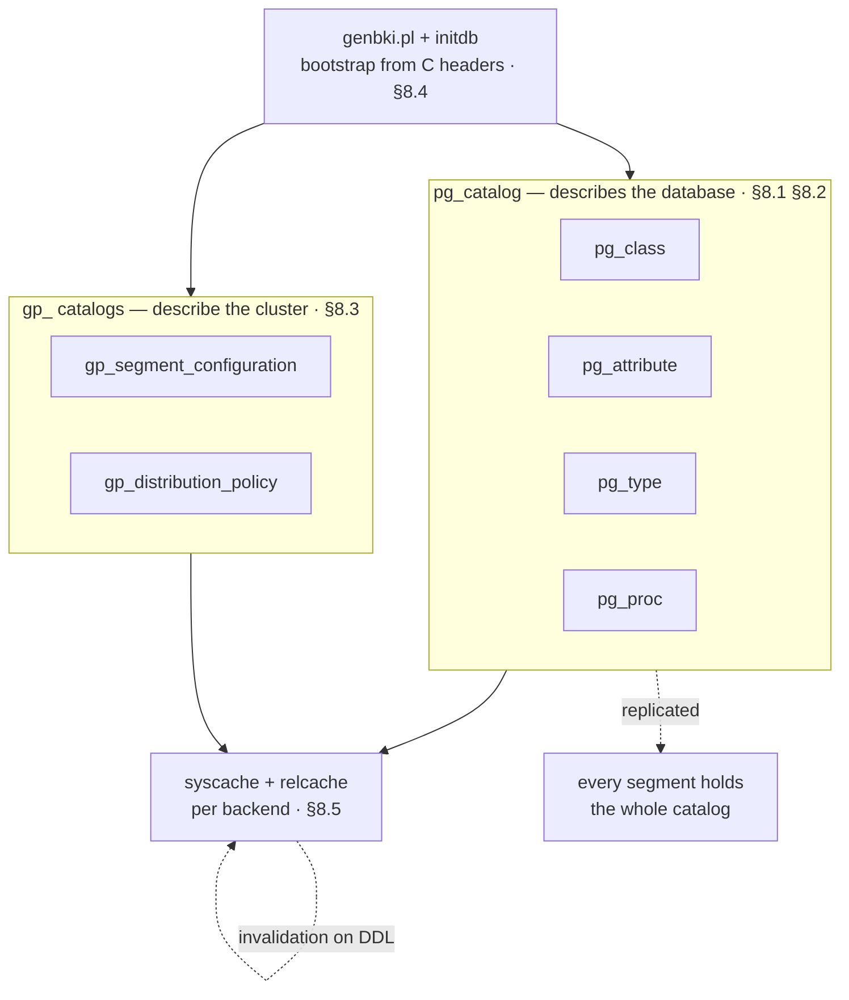
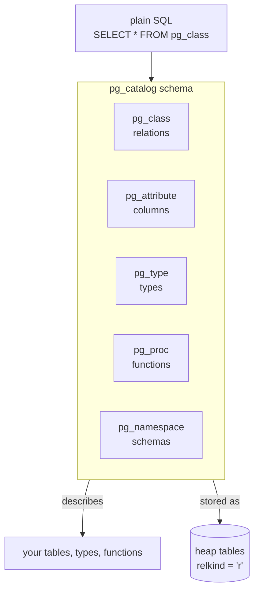
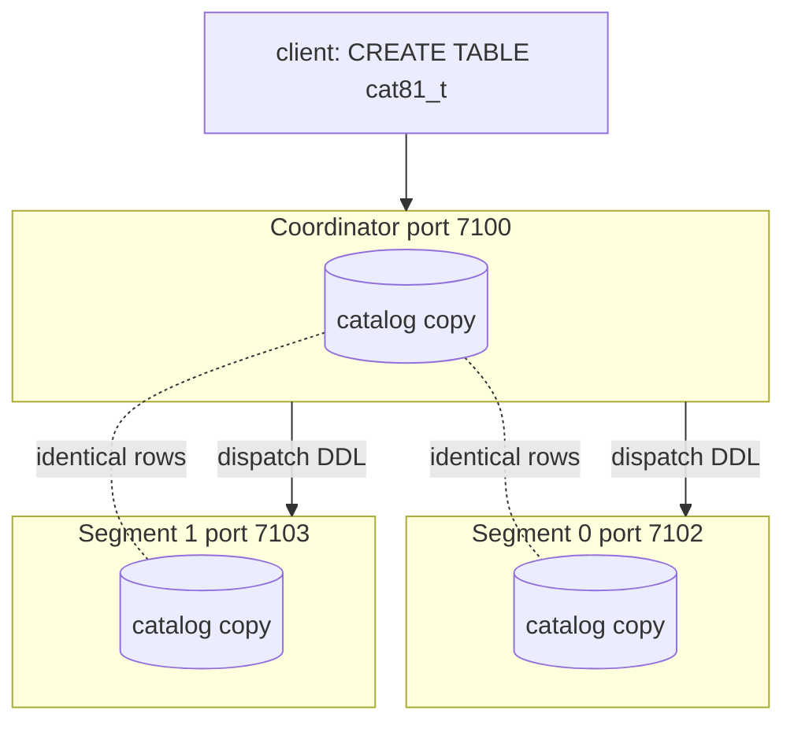
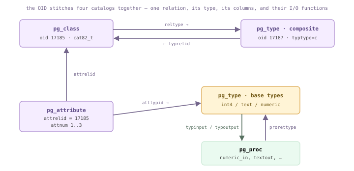
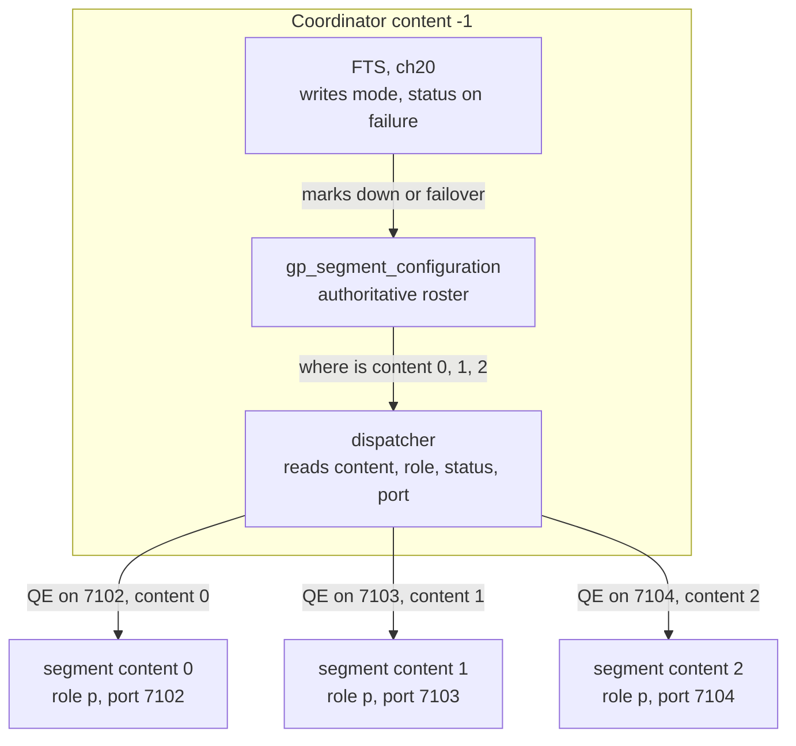
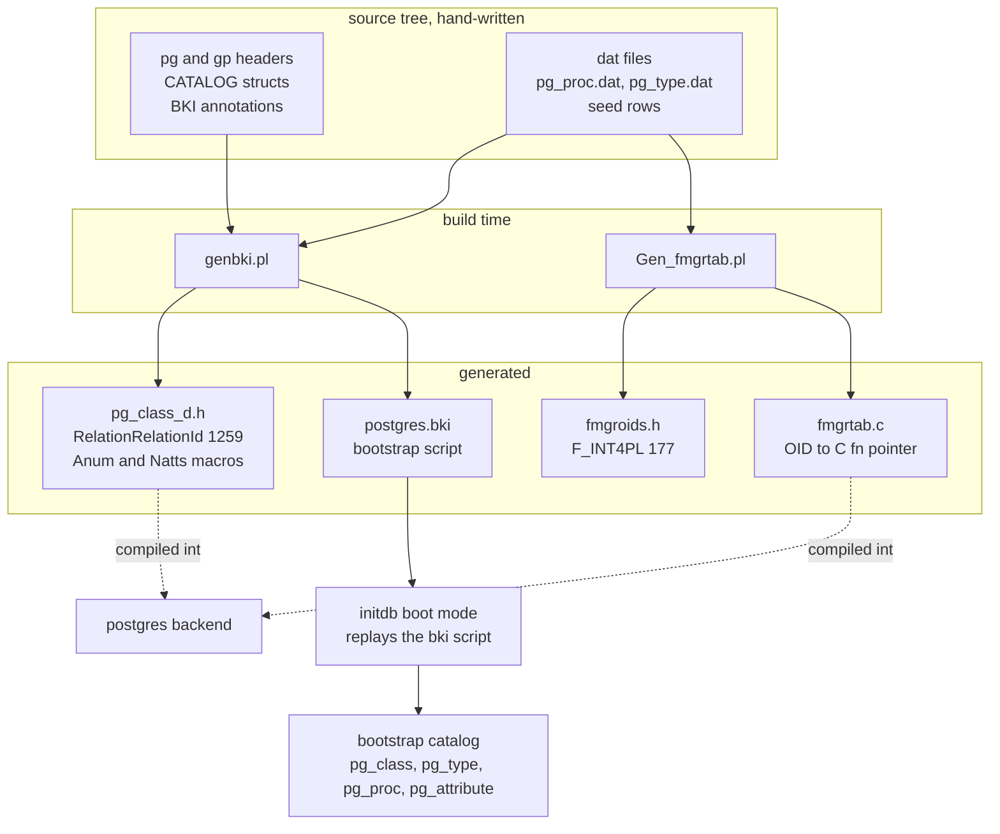
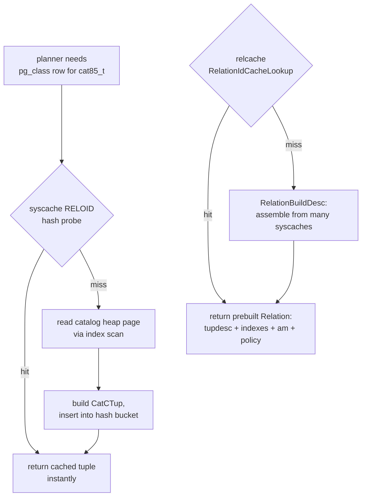
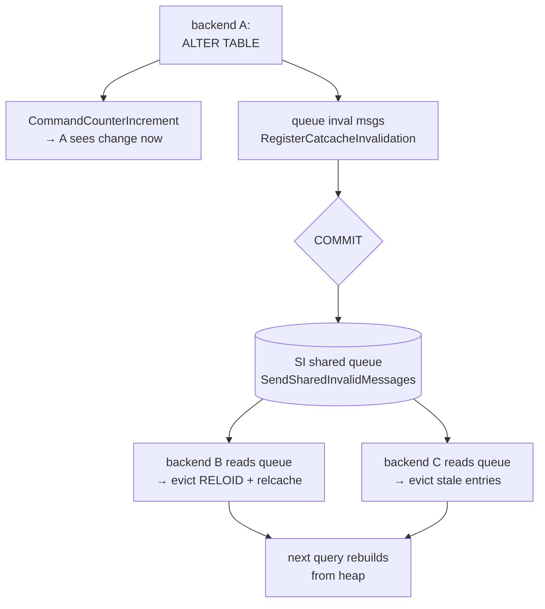
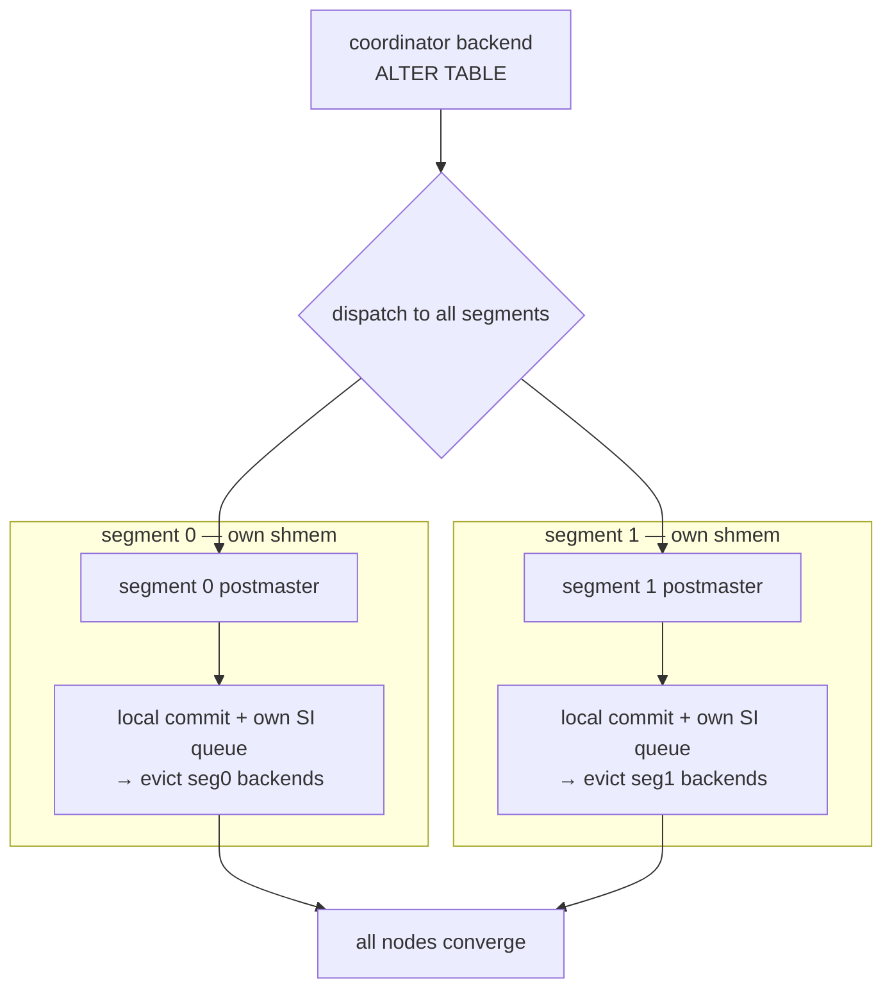

<!--
  Licensed to the Apache Software Foundation (ASF) under one
  or more contributor license agreements.  See the NOTICE file
  distributed with this work for additional information
  regarding copyright ownership.  The ASF licenses this file
  to you under the Apache License, Version 2.0 (the
  "License"); you may not use this file except in compliance
  with the License.  You may obtain a copy of the License at

    http://www.apache.org/licenses/LICENSE-2.0

  Unless required by applicable law or agreed to in writing,
  software distributed under the License is distributed on an
  "AS IS" BASIS, WITHOUT WARRANTIES OR CONDITIONS OF ANY
  KIND, either express or implied.  See the License for the
  specific language governing permissions and limitations
  under the License.
-->

<a id="8-the-system-catalog"></a>



*目录生态系统。pg_catalog 中的一组堆表（[§8.1](#81-catalog-overview)）——由 OID 串联起来的 pg_class/pg_attribute/pg_type/pg_proc（[§8.2](#82-key-catalog-tables)）——描述数据库；Cloudberry 的 gp_ 目录（[§8.3](#83-cloudberry-distributed-catalogs)）描述集群。这些内容都不是由 SQL 创建的：genbki.pl + initdb 根据 C 头文件引导生成它们（[§8.4](#84-bootstrap--generation)）。每个后端都将目录缓存到 syscache/relcache 中，并通过失效机制保持副本准确（[§8.5](#85-runtime-caching--invalidation)）；每个 Segment 都持有完整的目录副本。*

## 8.1 目录概览 {#81-catalog-overview}

### 8.1.1 数据库描述自身 {#811-the-database-describing-itself}

数据库知道的一切——每个关系、列、类型、函数、命名空间和约束——都记录在一组普通表中。这些表位于 `pg_catalog` 模式，而其中令人惊讶之处在于：它们与**你自己的表完全以相同方式存储**，都是 `relkind = 'r'` 的堆关系。目录描述数据库，而且它*借助数据库自身*来完成描述。你可以像查询自己创建的表一样 `SELECT * FROM pg_class`。

这种自引用解释了为什么一个新数据库在你创建任何表之前就已经包含大约一百个关系。`pg_class` 为每个关系保存一行，其中也包括 **`pg_class` 自身的一行**。`pg_catalog` 模式隐式地始终位于 `search_path` 中，因此不必显式指定模式，未限定的目录名称也能解析。



*目录是枢纽：SQL 查询它，它描述各种对象，而它自身也存储为堆表。*

*Coordinator：有多少个目录堆关系。*

```sql
SELECT count(*) FROM pg_class
      WHERE relnamespace = 'pg_catalog'::regnamespace
        AND relkind = 'r';
```

```text {hl_lines="3" title="output"}
 count 
      -------
          98
      (1 row)
```

标记关系类型的字段是 `relkind`，它与 `relnamespace` 一起声明在同一个目录结构体中——位于 `src/include/catalog/pg_class.h`（`FormData_pg_class`），在后者下方约四十行处（`relkind BKI_DEFAULT(r)`）。`pg_class` 是一张目录表，其模式本身写成 C 结构体；引导阶段会读取 `BKI_` 宏，由 `initdb` 据此建立最初的目录行。

```c {title="src/include/catalog/pg_class.h — FormData_pg_class"}
Oid     relnamespace BKI_DEFAULT(pg_catalog) BKI_LOOKUP(pg_namespace);
      bool    relisshared BKI_DEFAULT(f);   /* shared across all databases? */
      char    relkind     BKI_DEFAULT(r);   /* 'r' = ordinary heap table */
```

### 8.1.2 数据库私有目录与共享目录 {#812-per-database-vs-shared-catalogs}

大多数目录都是**按数据库设置的**：每个数据库都有自己的 `pg_class`、`pg_attribute`、`pg_type` 等私有副本，因为它们描述的对象属于该数据库。不过，也有少数目录描述跨越整个集群的对象——角色、数据库本身和表空间——这些目录是**共享的**。对应标志是 `relisshared`（`src/include/catalog/pg_class.h`——`FormData_pg_class`）。

共享目录不位于某个数据库的目录下，而是位于 `global/` 中，并使用**数据库 OID 0**和全局表空间寻址。后端将这组目录硬编码：`IsSharedRelation` 位于 `src/backend/catalog/catalog.c`，判断给定 OID 是否属于共享目录；关系文件放置逻辑则对全局表空间作特殊处理（`src/backend/catalog/catalog.c`——`GetNewRelFileNumber()`、`spcOid == GLOBALTABLESPACE_OID`）。

*Coordinator：共享目录（relisshared = true）。*

```sql
SELECT relname FROM pg_class
      WHERE relisshared AND relkind = 'r'
      ORDER BY relname;
```

```text {hl_lines="3 4 10" title="output"}
         relname          
      --------------------------
       pg_authid
       pg_database
       pg_db_role_setting
       pg_replication_origin
       pg_shdepend
       pg_shdescription
       pg_subscription
       pg_tablespace
       ... plus gp_segment_configuration, pg_resgroup, ...
      (31 rows)
```

- **按数据库设置**——每个数据库一份物理副本（例如 pg_class、pg_type），位于 base/`<dboid>`/ 下，描述该数据库中的本地对象。
- **共享**——整个集群一份物理副本（pg_database、pg_authid、pg_tablespace、pg_shdepend），位于 global/ 中，数据库 OID 为 0。relisshared = true。

> [!NOTE]
> Cloudberry 将自己的共享目录加入这组目录——gp_segment_configuration（集群拓扑）、gp_warehouse、资源组目录——因为它们同样描述集群范围的状态，而不是某个数据库的状态。

### 8.1.3 MPP 主干：每个 Segment 一份完整目录 {#813-the-mpp-spine-one-full-catalog-per-segment}

下面是贯穿本章的组织理念。Cloudberry 是多个 PostgreSQL 实例协同工作，表现为一个系统。**每个 Segment 都是一个完整的 PostgreSQL 实例，并拥有自己完整的目录副本。** Coordinator 持有一份目录；每个主 Segment 持有一份目录；其中的关键不变量是：它们持有**相同的行**。

为什么必须相同？因为 Coordinator 根据*自己的*目录规划查询，再将计划发送给每个 Segment。计划通过**OID**引用关系和列。如果端口 7102 的 Segment 对 OID `17180` 的含义有不同解释，那么计划在该处就会代表不同的含义。因此，集群范围内的 OID 必须保持一致，并且 DDL 会**派发**到每个 Segment，使目录保持同步。



*DDL 从 Coordinator 流向所有 Segment；每个 Segment 都持有相同的目录，因此同一个计划在任何地方都表示相同含义。*

下面来证明这一点。我们在 Coordinator 上创建一张演示表，并读取其 `pg_class` 行——注意分配到的 `oid` 和 `relkind`。

*Coordinator（7100）：创建表并读取其目录行。*

```sql
CREATE TABLE cat81_t (id int, name text);
      SELECT oid, relname, relkind, relnamespace
      FROM pg_class WHERE relname = 'cat81_t';
```

```text {hl_lines="3" title="output"}
  oid  | relname | relkind | relnamespace 
      -------+---------+---------+--------------
       17180 | cat81_t |    r    |         2200
      (1 row)
```

现在直接以**utility 模式**连接到一个 Segment（绕过 Coordinator），查找同一个关系。我们从未在该 Segment 上创建任何对象，但该行仍然存在，并且 **OID 17180 完全相同**，因为 `CREATE TABLE` 已派发并应用到该 Segment 自己的目录中。

*Segment（7102，utility 模式）：存在相同的行——OID 相同。*

```sql
-- PGOPTIONS='-c gp_role=utility' psql -p 7102
      SELECT oid, relname, relkind, relnamespace
      FROM pg_class WHERE relname = 'cat81_t';
```

```text {hl_lines="3" title="output"}
  oid  | relname | relkind | relnamespace 
      -------+---------+---------+--------------
       17180 | cat81_t |    r    |         2200
      (1 row)
```

`oid`、`relname`、`relkind` 和 `relnamespace`（`2200` = `pg_catalog` 的姊妹模式，即 `public` 模式）都相同。目录是复制的，而不是分片的——每个 Segment 都携带完整目录。

> [!NOTE]
> 由于目录变更必须原子地落到每个 Segment 上，DDL 由两阶段提交协调（见[§12](/cloudberry/core-internals/part-3-transactions-mvcc-concurrency/ch12/)）。如果 Coordinator 与 Segment 之间的目录发生漂移——行或 OID 不一致——就是严重故障；工具 gpcheckcat 正是用于检测并修复这种差异。

*为什么目录一致性不可妥协。*

| 属性 | 后果 |
| --- | --- |
| 计划按 OID 引用对象 | 每个 Segment 上的 OID 必须表示同一个关系 |
| Coordinator 规划、Segment 执行 | Segment 目录必须与规划器看到的目录一致 |
| DDL 派发到所有 Segment | 目录保持同步；变更由 2PC 协调（[§12](/cloudberry/core-internals/part-3-transactions-mvcc-concurrency/ch12/)） |
| 发生漂移即为故障 | gpcheckcat 检测集群范围内不匹配的目录行 |

## 8.2 关键目录表 {#82-key-catalog-tables}

### 8.2.1 OID，以及贯穿其中的四根支柱 {#821-the-oid-and-the-four-pillars-it-threads}

几乎每个目录行都携带一个 4 字节无符号标识：**OID**。`typedef unsigned int Oid;` 位于 `postgres_ext.h`，并且 `InvalidOid == 0`（同样见 `postgres_ext.h`）。全局计数器负责分配 OID；用户对象从 `FirstNormalObjectId` = **16384** 开始（`src/include/access/transam.h`）。小于该值的对象都是在 `initdb` 中固化的引导对象或固定对象。自 PG12 起，`oid` 是一个*普通的隐藏列*，只存在于声明了 `BKI_ROWTYPE_OID` 的目录中——pg_class 自身就声明了它：`CATALOG(pg_class,1259,RelationRelationId) … BKI_ROWTYPE_OID(83,…)`，见 `src/include/catalog/pg_class.h`（`FormData_pg_class`）。普通用户表没有系统 oid 列。

系统中的每个关系都由四张表描述，OID 将它们连接起来：表在 **pg_class** 中的行通过 `reltype` 指向 **pg_type** 中的复合类型；它的每一列位于 **pg_attribute** 中，由 `attrelid` → pg_class 和 `atttypid` → pg_type 作为键；而 **pg_proc** 中的函数通过 `prorettype` → pg_type 指定返回类型。



*一个 OID，四个目录。每条箭头都是头文件中的 FOREIGN_KEY 声明。注意 pg_class ↔ pg_type 的环：表（pg_class）通过 reltype 命名自己的复合类型，而该复合类型又通过 typrelid 指回表。数值来自 cat82_t 演示。*

*四根支柱（文件:行号引用头文件结构体）。*

| 目录 | 每行对应 | 键列 | 头文件 |
| --- | --- | --- | --- |
| pg_class | 关系（表、索引、视图、序列、TOAST、复合类型） | relname, relnamespace, reltype, relam, relfilenode, relkind, relnatts, reltuples, relpages, relisshared | pg_class.h — FormData_pg_class |
| pg_attribute | 任意关系的一列 | attrelid, attname, atttypid, attnum, attlen, attalign, attnotnull, atthasdef | pg_attribute.h — FormData_pg_attribute |
| pg_type | 数据类型 | typname, typlen, typalign, typstorage, typtype, typinput, typoutput, typrelid | pg_type.h — FormData_pg_type |
| pg_proc | 函数 | proname, pronamespace, prorettype, proargtypes, prosrc, prolang | pg_proc.h — FormData_pg_proc |

### 8.2.2 pg_class——关系自身 {#822-pg_class--the-relation-itself}

我们创建一张表并读取其一行 pg_class。`relkind` 在 `pg_class.h`（`FormData_pg_class`）中声明，值为 `r`（普通关系）；`relnatts` 在 `pg_class.h`——`FormData_pg_class` 中表示用户列数（对于目录，genbki.pl 会填充此值）；`relam` 在 `pg_class.h`——`FormData_pg_class` 中表示访问方法 OID（2 = heap）。返回的 `oid` 为 17185，高于 16384，证明它是用户对象。

*关系的身份行。oid 17185 ≥ FirstNormalObjectId 16384。*

```sql
CREATE TABLE cat82_t(id int, name text, amount numeric);
      SELECT oid, relname, relkind, relnatts, relam FROM pg_class WHERE relname='cat82_t';
```

```text {title="output"}
  oid  | relname | relkind | relnatts | relam
      -------+---------+---------+----------+-------
       17185 | cat82_t | r       |        3 |     2
      (1 row)
```

### 8.2.3 pg_attribute——每列一行 {#823-pg_attribute--one-row-per-column}

`attnum`（`pg_attribute.h`、`FormData_pg_attribute`）对于用户列从 1 开始；`attlen` 和 `attalign`（`pg_attribute.h`、`FormData_pg_attribute`）是类型的 `typlen`／`typalign` 的副本，缓存在此处，使元组解构例程在运行时无需访问 pg_type（头文件在 `pg_attribute.h`——`FormData_pg_attribute` 中解释了这种冗余）。

*三个用户列；每个 `atttypid` 都通过 ::regtype 解析到其 pg_type 条目。*

```sql
SELECT attname, atttypid::regtype, attnum, attlen, attalign
        FROM pg_attribute WHERE attrelid='cat82_t'::regclass AND attnum>0 ORDER BY attnum;
```

```text {title="output"}
 attname | atttypid | attnum | attlen | attalign
      ---------+----------+--------+--------+----------
       id      | integer  |      1 |      4 | i
       name    | text     |      2 |     -1 | i
       amount  | numeric  |      3 |     -1 | i
      (3 rows)
```

### 8.2.4 pg_type——这些 atttypid 指向的对象 {#824-pg_type--what-those-atttypids-point-at}

上面的每个 `atttypid` 都指向 pg_type 中的条目。`typlen`（`pg_type.h`、`FormData_pg_type`）是字节宽度——固定长度类型为正数，varlena 为 `-1`。`typstorage`（`pg_type.h`、`FormData_pg_type`）是 TOAST 策略：`p` 表示 plain（int4），`x` 表示 extended／可压缩（text），`m` 表示 main（numeric）。注意，pg_attribute 中的 `attlen`／`attalign` 与这里的值完全对应。

*类型定义。int4 的 typlen 4 = id 的 attlen 4；text/numeric 的 typlen -1 = varlena。*

```sql
SELECT typname, typlen, typalign, typstorage
        FROM pg_type WHERE typname IN ('int4','text','numeric') ORDER BY typname;
```

```text {title="output"}
 typname | typlen | typalign | typstorage
      ---------+--------+----------+------------
       int4    |      4 | i        | p
       numeric |     -1 | i        | m
       text    |     -1 | i        | x
      (3 rows)
```

- **reltype → typrelid 环**——pg_class.reltype（`pg_class.h`、`FormData_pg_class`）命名 pg_type 中该关系的复合类型；该类型的 `typrelid`（`pg_type.h`、`FormData_pg_type`）又指回 pg_class 行。对于 cat82_t：reltype 为 17187，其 pg_type 行的 typtype='c'、typrelid 为 17185，即原始表。`pg_class.h` 和 `pg_type.h` 中的 FOREIGN_KEY 声明了两个方向。
- **pg_proc 与 pg_type**——类型的 I/O 实际上就是函数：typinput/typoutput（`pg_type.h`、`FormData_pg_type`）是指向 pg_proc 的 regproc OID。函数的 `prorettype`（`pg_proc.h`、`FormData_pg_proc`）和 `proargtypes`（`pg_proc.h`、`FormData_pg_proc`）是 pg_type OID。`prosrc`（`pg_proc.h`、`FormData_pg_proc`）保存 C 符号名或 SQL 函数体；`prolang`（`pg_proc.h`、`FormData_pg_proc`）保存语言。这是通往 fmgr 表的桥梁（[§8.4](#84-bootstrap--generation)）。

### 8.2.5 系统列：负数 attnum {#825-system-columns-the-negative-attnums}

每个堆行还会提供隐藏列——`ctid, tableoid, xmin, xmax, cmin, cmax`（[§4](/cloudberry/core-internals/part-2-storage-data-layout/ch04/)）——它们在 pg_attribute 中使用*负数* attnum 存储，因此不会与用户列冲突。Cloudberry 还增加了自己的两列：`gp_segment_id` 和 `gp_foreign_server`。

*cat82_t 的系统列。ctid=-1，……，以及 Cloudberry 的 gp_segment_id=-7、gp_foreign_server=-8。*

```sql
SELECT attname, atttypid::regtype, attnum
        FROM pg_attribute WHERE attrelid='cat82_t'::regclass AND attnum<0 ORDER BY attnum;
```

```text {title="output"}
      attname      | atttypid | attnum
      -------------------+----------+--------
       gp_foreign_server | oid      |     -8
       gp_segment_id     | integer  |     -7
       tableoid          | oid      |     -6
       cmax              | cid      |     -5
       xmax              | xid      |     -4
       cmin              | cid      |     -3
       xmin              | xid      |     -2
       ctid              | tid      |     -1
      (8 rows)
```

> [!NOTE]
> attnum&lt;0 的行解释了为什么 `SELECT *` 从不返回 ctid/xmin：规划器只将 `*` 展开为 attnum 1..relnatts。系统列必须显式写出名称。

## 8.3 Cloudberry 分布式目录 {#83-cloudberry-distributed-catalogs}

### 8.3.1 让集群成为集群的三张目录表 {#831-three-catalogs-that-make-a-cluster-a-cluster}

[§8.1](#81-catalog-overview) 已经确立了这条规则：目录在每个节点上都**完全复制**——Coordinator 和所有 Segment 持有逐字节相同的 `pg_class`、`pg_attribute`、`pg_proc`。Cloudberry 增加了一组 PostgreSQL **没有对应物**的 `gp_` 前缀目录：它们存在的唯一原因，是系统需要描述一个集群。其中三张目录表承担了主要作用。`gp_segment_configuration` 是**集群映射**，记录节点是谁；`gp_distribution_policy` 描述**按表分片**，记录每张表如何分布到这些节点；`gp_id` 描述**节点身份**，也是“全部复制”规则的有意例外（[§8.3.4](#834-gp_id--the-deliberate-exception-and-where-identity-really-lives)）。

*三张 GP 目录表——表 → 范围 → 键列。文件位于 `src/include/catalog/` 下。*

| 目录表 | 存放位置 | 范围 | 键列 |
| --- | --- | --- | --- |
| gp_segment_configuration | 仅 Coordinator | 每个 Segment 实例一行（全局映射） | dbid、content、role、preferred_role、mode、status、port、hostname、datadir |
| gp_distribution_policy | 各处复制 | 每张分布式表一行 | localoid、policytype、numsegments、distkey、distclass |
| gp_id | 每个节点一行 | 节点身份（内容现已成为遗留信息——见[§8.3.4](#834-gp_id--the-deliberate-exception-and-where-identity-really-lives)） | gpname、numsegments、dbid、content |

- **gp_segment_configuration**——`src/include/catalog/gp_segment_configuration.h`（`FormData_gp_segment_configuration`）——`BKI_SHARED_RELATION`，OID 7026。权威的节点清单由**派发器**（dispatcher）读取以路由工作，由 **FTS**（[§20](/cloudberry/core-internals/part-5-high-availability-recovery/ch20/)）在检测到故障时写入。
- **gp_distribution_policy**——`src/include/catalog/gp_distribution_policy.h`（`FormData_gp_distribution_policy`）——OID 7142，`FOREIGN_KEY(localoid REFERENCES pg_class(oid))`。回答“对于这张表，哪个 Segment 拥有哪一行？”
- **gp_id**——`src/include/catalog/gp_id.h`——OID 5101，`BKI_SHARED_RELATION`。历史上用于告诉每个 Segment 自身身份；现在头文件已将该作用标记为过时。

### 8.3.2 gp_segment_configuration——集群映射 {#832-gp_segment_configuration--the-cluster-map}

每个 Segment 实例一行。决定性列是 **content**：`−1` 表示 Coordinator，`0..N` 表示主 Segment。**role** 是当前工作角色（`'p'` 主、`'m'` 镜像）；**preferred_role** 是此实例创建时应承担的角色——二者不一致时，FTS 已执行故障切换，集群处于不平衡状态。**mode** 是 `'s'` 同步／`'n'` 不同步／`'c'` 变更跟踪；**status** 是 `'u'` 正常／`'d'` 故障。`dbid` 是集群范围唯一的 ID；`port`、`hostname`、`address`、`datadir` 是派发器建立连接所需的位置参数。

```c {title="src/include/catalog/gp_segment_configuration.h"}
CATALOG(gp_segment_configuration,7026,...) BKI_SHARED_RELATION
      {
        int16 dbid;            /* cluster-wide unique */
        int16 content;         /* -1 = coordinator, 0..N = segment */
        char  role;            /* 'p' primary / 'm' mirror */
        char  preferred_role;
        char  mode;            /* 's' insync 'n' not 'c' changetracking */
        char  status;          /* 'u' up / 'd' down */
        int32 port;
      #ifdef CATALOG_VARLEN
        text  hostname; text address; text datadir;
        Oid   warehouseid;    /* 0 = the default warehouse */
      #endif
      }
```



*映射及其读取者。Coordinator 持有 gp_segment_configuration；派发器读取 content/role/status/port，以决定计划的每个切片（slice）在哪里运行。*

*这个 3.0.0-devel 演示集群的实时清单（3 个主 Segment，没有镜像）。content −1 是 Coordinator；健康且平衡时，各处 role=preferred_role、status='u'。*

```sql
SELECT content, role, preferred_role, mode, status, port
        FROM gp_segment_configuration ORDER BY content, role;
```

```text {title="output"}
 content | role | preferred_role | mode | status | port
      ---------+------+----------------+------+--------+------
            -1 | p    | p              | n    | u      | 7100
             0 | p    | p              | n    | u      | 7102
             1 | p    | p              | n    | u      | 7103
             2 | p    | p              | n    | u      | 7104
      (4 rows)
```

### 8.3.3 gp_distribution_policy——按表分片 {#833-gp_distribution_policy--per-table-sharding}

每张分布式表都有一行，以**localoid**（表的 `pg_class.oid`）为键。**policytype** 为 `'p'`（partitioned，目录中表示哈希分布）或 `'r'`（replicated，复制）；这些符号定义于 `gp_distribution_policy.h`（`SYM_POLICYTYPE_PARTITIONED`）——`SYM_POLICYTYPE_PARTITIONED 'p'`、`SYM_POLICYTYPE_REPLICATED 'r'`。**distkey** 是分布键 attnum 组成的 `int2vector`，**distclass** 是对应的哈希操作符类。`DISTRIBUTED RANDOMLY` 表仍然是 `'p'`，但具有一个**空 distkey**——属于同一族，只是没有哈希列。这就是 [§1.1](/cloudberry/core-internals/#11-the-mpp-cluster-coordinator-segments--distribution)／[§2.1](/cloudberry/core-internals/part-2-storage-data-layout/ch02/#21-data-sharding--storage-formats) 中分片图示背后的目录表。

```c {title="src/include/catalog/gp_distribution_policy.h"}
CATALOG(gp_distribution_policy,7142,...)
      {
        Oid   localoid;        /* the table (pg_class.oid) */
        char  policytype;      /* 'p' partitioned/hash, 'r' replicated */
        int32 numsegments;
      #ifdef CATALOG_VARLEN
        int2vector distkey;    /* distribution-key attnums */
        oidvector  distclass;  /* hash opclasses */
      #endif
      }
      #define SYM_POLICYTYPE_PARTITIONED 'p'
      #define SYM_POLICYTYPE_REPLICATED  'r'
```

*相同的两列、两种分布选择。cat83_hash：policytype 为 'p'，distkey 为 '1'，按 attnum 1（id）哈希，distclass 为 10020 int4_ops。cat83_repl：policytype 为 'r'，distkey 为空，每个 Segment 都保存一份完整副本。*

```sql
CREATE TABLE cat83_hash (id int, v text) DISTRIBUTED BY (id);
      CREATE TABLE cat83_repl (id int, v text) DISTRIBUTED REPLICATED;

      SELECT c.relname, p.policytype, p.numsegments, p.distkey, p.distclass
        FROM gp_distribution_policy p JOIN pg_class c ON c.oid = p.localoid
       WHERE c.relname LIKE 'cat83%' ORDER BY c.relname;
```

```text {title="output"}
  relname   | policytype | numsegments | distkey | distclass
      ------------+------------+-------------+---------+-----------
       cat83_hash | p          |           3 | 1       | 10020
       cat83_repl | r          |           3 |         |
      (2 rows)
```

> [!NOTE]
> distclass 10020 解析为 `int4_ops`——Cloudberry 针对 int 的跳跃一致性哈希操作符类，而不是 B-树比较操作符类。正是这个哈希族保证相同的 `id` 每次都落到同一个 Segment。

### 8.3.4 gp_id——有意的例外，以及身份真正存放的位置 {#834-gp_id--the-deliberate-exception-and-where-identity-really-lives}

[§8.1](#81-catalog-overview) 的规则是所有节点都持有相同的目录内容。节点知道自己的**身份**似乎会打破这一规则，而 `gp_id` 正是 Greenplum 过去存储该信息的地方。但 `src/include/catalog/gp_id.h` 中的头文件记录了这个转折：镜像机制要求主 Segment 与镜像逐字节相同后，该表就不能在不同节点上有差异，因此**其内容被视为无关**。身份从目录中移出，改由每个节点各自的文件保存。

证明方法：分别在 Coordinator 和 Segment 0（utility 模式，端口 7102）查询 `gp_id`——两处的行**完全相同**，都显示 content −1，即冻结的 `BKI` 值。

*gp_id 在每个节点上读到的内容都相同——它的内容不再携带身份（`gp_id.h` 中说“其内容现已无关”）。−1 只是冻结的目录种子。*

```sql
-- coordinator (content -1)
      SELECT * FROM gp_id;
      -- segment 0, utility mode on :7102
      --   PGOPTIONS='-c gp_role=utility' psql -p 7102
      SELECT * FROM gp_id;
```

```text {title="output"}
=== coordinator ===
         gpname   | numsegments | dbid | content
      ------------+-------------+------+---------
       Cloudberry |          -1 |   -1 |      -1
      === segment 7102 utility ===
         gpname   | numsegments | dbid | content
      ------------+-------------+------+---------
       Cloudberry |          -1 |   -1 |      -1
```

那么，Segment 实际上从哪里知道自己是 content 0？答案是它自己的数据目录中的 **`internal.auto.conf`** 文件——这是每个节点不同的唯一文件，其中设置了 `gp_dbid` GUC；节点启动时会在 `gp_segment_configuration` 中查找自己的记录（该信息由 Coordinator 传入），从而推导出 content。SQL 可见的 `gp_segment_id` 系统列和 `current_setting('gp_contentid')` 都来自这里，**不是**来自 `gp_id` 表。

*真正的每节点身份。同一个查询会得到不同结果：GUC 不同，是因为每个数据目录中的 `internal.auto.conf` 不同。Coordinator 的 dbid 1／content −1；Segment 0 的 dbid 2／content 0。*

```sql
-- coordinator
      SELECT current_setting('gp_dbid') AS dbid,
             current_setting('gp_contentid') AS content;
      -- segment 0 (utility, :7102)
      SELECT current_setting('gp_dbid') AS dbid,
             current_setting('gp_contentid') AS content;
```

```text {title="output"}
=== coordinator ===
       dbid | content
      ------+---------
       1    | -1
      === segment 7102 utility ===
       dbid | content
      ------+---------
       2    | 0

      -- and on disk, the only per-node file:
      $ grep gp_dbid .../qddir/demoDataDir-1/internal.auto.conf
      gp_dbid=1
      $ grep gp_dbid .../dbfast1/demoDataDir0/internal.auto.conf
      gp_dbid=2
```

- **共享映射**——`gp_segment_configuration`——每个节点看到的节点清单都相同，描述整个集群。
- **按表的计划**——`gp_distribution_policy`——逐字节复制，每张表一行，告诉所有节点该表如何分片。
- **本地身份**——不是（已成为遗留信息的）`gp_id`，而是 `internal.auto.conf` → `gp_dbid` GUC → 通过共享映射得到 content。这个有意保留的单一节点差异被放在文件中，正是为了让复制的目录能够保持逐字节一致。

## 8.4 引导与生成 {#84-bootstrap--generation}

### 8.4.1 目录的“先有鸡还是先有蛋”难题 {#841-the-chicken-and-egg-of-the-catalog}

Cloudberry 中的每张表都由目录中的行描述，但目录表（`pg_class`、`pg_type`、`pg_proc`、`pg_attribute`）本身也是表，需要由 `pg_class` 中的行来描述。不存在 SQL `CREATE TABLE pg_class`，因为运行它要求 `pg_class` 已经存在。Cloudberry 在数据库创建之前通过三层机制打破这个循环：目录**声明在 C 头文件中**，构建时 Perl 脚本**生成**连接关系，而 `initdb` 运行 `postgres --boot` 来**重放**一个手工构建首批表的脚本。



*完整的引导流程——头文件和种子数据在构建时由 genbki.pl/Gen_fmgrtab.pl 编译为后端使用的 OID 头文件，以及由 initdb 重放的 .bki 脚本。*

第 1 层——**声明**。每张目录表都是一个 `CATALOG(name,oid,oidmacro) {...}` C 结构体，位于 `src/include/catalog/` 中。宏参数将表的 OID *永久固定*；`pg_class` 的 OID 被直接指定为 1259，写在 `src/include/catalog/pg_class.h`（`FormData_pg_class`）中。`BKI_*` 单词是编译器忽略、但生成器会读取的注解。

```c {title="src/include/catalog/pg_class.h — FormData_pg_class"}
CATALOG(pg_class,1259,RelationRelationId)
        BKI_BOOTSTRAP BKI_ROWTYPE_OID(83,RelationRelation_Rowtype_Id)
        BKI_SCHEMA_MACRO
      {
        Oid oid;
        NameData relname;
        Oid relnamespace BKI_DEFAULT(pg_catalog) BKI_LOOKUP(pg_namespace);
        ...
      }
```

*pg_class 上可见的 BKI 注解——这是给 genbki.pl 的指令，而不是 C。*

| 注解 | 含义 |
| --- | --- |
| BKI_BOOTSTRAP | 这张目录表最先以引导模式手工构建（此时其他目录尚不存在）。只有 pg_class、pg_type、pg_proc、pg_attribute 带有该注解。 |
| BKI_ROWTYPE_OID(83,…) | 固定此表复合（行）类型的 OID，因此 `pg_class` 的行类型为类型 83。 |
| BKI_SHARED_RELATION | 该表位于集群范围的目录中，并由所有数据库共享（例如 pg_authid、pg_database）。pg_class 上没有此注解。 |
| BKI_DEFAULT(x) | 用于填充省略该列的种子行的默认列值。 |
| BKI_LOOKUP(rel) | 该列是一个 OID，生成 .bki 时应根据名称在 `rel` 中解析它。 |

引导目录（以及许多后续行）的*内容*以 Perl 哈希形式存放在对应的 **`.dat` 文件**中。内置函数 `int4pl` 只是 `pg_proc.dat` 中一个固定为 OID 177 的数据行：

```c {title="src/include/catalog/pg_proc.dat"}
{ oid => '177',
        proname => 'int4pl', prorettype => 'int4',
        proargtypes => 'int4 int4', prosrc => 'int4pl' },
```

### 8.4.2 genbki.pl——生成 OID 头文件和 .bki 脚本 {#842-genbkipl--generating-the-oid-headers-and-the-bki-script}

在构建时，`src/backend/catalog/genbki.pl` 解析每一对 `pg_*.h` + `.dat`，并生成两类输出（`genbki.pl:439`）：一个 **`postgres.bki`** 引导脚本，以及每张目录表一个 **`pg_<name>_d.h`**。在这些 `_d.h` 文件中，后端 C 代码使用的符号名——`RelationRelationId`、`Anum_pg_class_relname`、`Natts_pg_class`——才真正获得数值。这些文件由生成器产生，绝不能手工编辑：

*生成的 pg_class_d.h 明确警告不要编辑它，然后硬编码 OID 和属性编号宏；注意 `DO NOT EDIT` + `GENERATED by ... genbki.pl`。*

```bash
head -16 src/include/catalog/pg_class_d.h
      grep -n "RelationRelationId\|Anum_pg_class_relname\|Natts_pg_class" \
           src/include/catalog/pg_class_d.h
```

```text {title="output"}
 *  ******************************
       *  *** DO NOT EDIT THIS FILE! ***
       *  ******************************
       *
       *  It has been GENERATED by src/backend/catalog/genbki.pl
      => 21:#define RelationRelationId 1259
         28:#define Anum_pg_class_relname 2
         64:#define Natts_pg_class 36
```

> [!NOTE]
> 因此，运行中后端的 `RelationRelationId` 与宏中的 `1259`，即 `CATALOG(pg_class,1259,…)` 指定的值，*按构造就是同一个数字*——genbki.pl 将宏的 OID 参数直接复制到 `#define` 中。修改头文件并重新构建，二者会一起变化。

另一个输出 `postgres.bki` 使用一种很小的命令式语言。对于每个 `BKI_BOOTSTRAP` 目录表，它生成一个 `create … bootstrap` 命令；其他内容都变成 `insert` 行。其中的 `create` 命令为 `pg_class` 精确指定了上面宏中的 OID 和 rowtype_oid：

*生成的引导脚本——四张 BKI_BOOTSTRAP 目录表的 `create` 命令，带有固定的 OID／rowtype OID。*

```bash
grep -n "^create pg_proc\|^create pg_type\|^create pg_attribute\|^create pg_class" \
           src/backend/catalog/postgres.bki
```

```text {title="output"}
=> 2:create pg_proc 1255 bootstrap rowtype_oid 81
         3584:create pg_type 1247 bootstrap rowtype_oid 71
         3819:create pg_attribute 1249 bootstrap rowtype_oid 75
         4007:create pg_class 1259 bootstrap rowtype_oid 83
```

### 8.4.3 Gen_fmgrtab.pl——将 OID 连接到 C 函数指针 {#843-gen_fmgrtabpl--wiring-oids-to-c-function-pointers}

第二个生成器 `src/backend/utils/Gen_fmgrtab.pl` **只**读取 `pg_proc.dat`，并生成三个文件（`Gen_fmgrtab.pl:105`）：**`fmgroids.h`**（每个内置函数一个 `#define F_<name> <oid>`）、**`fmgrprotos.h`**（C 原型）和 **`fmgrtab.c`**（静态 `fmgr_builtins[]` 表，将每个 pg_proc OID 映射到实际的 C 函数指针）。执行器只持有来自 `pg_proc` 的 OID，正是通过这张表跳转到正确的本地例程。上面的 `int4pl` 行（OID 177）会变成：

*fmgroids.h 由 pg_proc.dat 生成——F_INT4PL 与 .dat 行固定的 177 相同。*

```bash
grep -n "F_INT4PL\|F_TEXTCAT\|F_NUMERIC_ADD" src/include/utils/fmgroids.h
```

```text {title="output"}
=> 148:#define F_INT4PL 177
         748:#define F_TEXTCAT 1258
        1094:#define F_NUMERIC_ADD 1724
```

- **fmgroids.h**——符号 OID 名称——C 代码写入 `F_INT4PL`，而不是魔数 177。
- **fmgrprotos.h**——每个内置函数都有 `extern Datum int4pl(PG_FUNCTION_ARGS);`。
- **fmgrtab.c**——`fmgr_builtins[]`——&#123; 177, "int4pl", 2, true, false, int4pl, "int4pl" &#125;——链接到后端的 OID→指针派发表。

### 8.4.4 initdb／引导模式，以及 Cloudberry 的 cdb_init.d 钩子 {#844-initdb--bootstrap-mode--and-cloudberrys-cdb_initd-hook}

`initdb` 是这些文件的使用者。它以特殊模式启动后端——`postgres --boot`——该模式*不*要求目录已经存在；相反，它读取 `postgres.bki`，直接对新建的堆文件执行 `create`／`insert` 命令。`bootstrap_template1()` 读取脚本并构造 `--boot` 命令行，位置是 `src/bin/initdb/initdb.c`／`bootstrap_template1()`；`bki_file` 的位置由 `setup_data_file_paths()` 确定。四张引导表创建后，initdb 运行普通 SQL 文件，加入 `information_schema`、系统视图以及目录的其余部分。

**Cloudberry 在这里增加了一个钩子。** 除原生 PostgreSQL 行为外，initdb 还扫描 `cdb_init.d/` 目录，并运行找到的每个 `*.sql` 文件（`initdb.c`——`setup_cdb_schema()`，目录在 `setup_data_file_paths()` 中设置）。存储 AM 和其他组件便通过这个扩展点在集群创建时注册自身——PAX（[§6.1](/cloudberry/core-internals/part-2-storage-data-layout/ch06/#61-the-c-contrib-access-method)）正是通过这条路径安装的：

```c {title="src/bin/initdb/initdb.c — setup_cdb_schema()"}
/*
       * These are contained in directory "cdb_init.d". We load all .sql files
       * ... allows extensions to put their install scripts under cdb_init.d, and
       * have them run at initdb time.
       */
```

> [!NOTE]
> Cloudberry 是一个 MPP 集群：Coordinator 和**每个 Segment** 都分别执行 initdb。因此，每个节点都会重放相同的 `postgres.bki` 和相同的 `cdb_init.d` 脚本——所有节点上的目录骨架完全相同，这就是为什么类似 1259 的目录 OID 在任何地方都表示 `pg_class`。

### 8.4.5 交叉检查：生成的数字就是运行中的数字 {#845-cross-check-the-generated-numbers-are-the-live-numbers}

只有在构建时写入头文件的 OID 与运行中服务器报告的 OID 一致时，整个流程才可信。它们确实一致。向运行中的 Coordinator 查询 `pg_class`、`pg_proc` 和 `int4pl` 函数的 OID，返回的正是我们在 `pg_class_d.h`（1259）、`postgres.bki`（1255）和 `fmgroids.h`（177）中看到的硬编码值：

*端口 7100 上的实时 Coordinator——每个 OID 都与生成的 #define 匹配：1259=RelationRelationId，1255=pg_proc，177=F_INT4PL。*

```sql
SELECT 'pg_class'::regclass::oid          AS pg_class_oid,
             'pg_proc'::regclass::oid           AS pg_proc_oid,
             'int4pl(int,int)'::regprocedure::oid AS int4pl_oid;
```

```text {title="output"}
 pg_class_oid | pg_proc_oid | int4pl_oid 
      --------------+-------------+------------
               1259 |        1255 |        177
      (1 row)
```

这里没有任何运行时分配。`pg_class` 是 1259，因为有人手工写入了 `CATALOG(pg_class,1259,…)`；genbki.pl 将 1259 复制到 `#define` 以及 `create … 1259` 行中，后者位于 `postgres.bki`；initdb 重放该行来构建表；而你刚才查询的后端正是使用同一个 1259 编译的。目录在任何数据库存在之前就已存在，因为它归根结底是一个构建产物。

## 8.5 运行时缓存与失效 {#85-runtime-caching--invalidation}

### 8.5.1 每个查询都会读取目录，因此每个后端都会缓存它 {#851-every-query-reads-the-catalog--so-every-backend-caches-it}

解析和规划最简单的语句时，都会反复查询目录：*这张表存在吗？它有哪些列，各是什么类型？哪个操作符实现了 `=`，用于 `int4` 类型？* 每个答案都是 `pg_class`、`pg_attribute`、`pg_type`、`pg_operator` 中的一行。如果每条语句都从头读取这些堆页，规划器会不堪重负。因此，每个后端都维护两层内存缓存：**syscache**（单个目录*元组*）和 **relcache**（完整构建的 `Relation` 描述符）。缓存**命中**会立即返回；缓存**未命中**则读取一次目录堆并填充缓存。



*一次目录查找的热路径。每个后端针对每个键只读取一次堆；此后每次查找都是一次哈希探查。*

relcache 位于 syscache *之上*：构建一个 `Relation` 描述符（`RelationBuildDesc`）会将多个 syscache 元组合并起来——`pg_class` 行、每个 `pg_attribute` 行、索引列表、访问方法例程，以及 Cloudberry 中的**分布策略**。这次组装是成本最高的单个目录操作，正因如此，它才会被如此积极地缓存。

### 8.5.2 syscache——每个目录一张按查找键索引的哈希缓存 {#852-syscache--a-hash-cache-per-catalog-keyed-by-lookup-key}

syscache 是一组固定的、按后端划分的哈希表，每个**缓存 ID**对应一张表。ID 是 `src/include/utils/syscache.h`（`SysCacheIdentifier`）中的枚举，例如 `RELOID`（按 oid 查找 pg_class）、`ATTNAME`、`TYPEOID` 等。每个条目保存一个目录元组；传入缓存 ID 和最多四个键列，就可以通过 `SearchSysCache1..4`（`src/backend/utils/cache/syscache.c`）获取它。

*一个后端维护多少个不同的目录缓存——统计 `src/include/utils/syscache.h` 中的枚举成员。该枚举从 AGGFNOID 到 EXTENSIONOID。*

```bash
$ awk '/enum SysCacheIdentifier/{f=1} f&&/^\t[A-Z]/{print} /^};/{if(f)exit}' \
           src/include/utils/syscache.h | wc -l
```

```text {title="output"}
103
```

因此，单个后端会保持 **103** 张哈希缓存处于活动状态，每张都在第一次未命中时按需填充。缓存的元组是 `CatCTup`（`src/include/utils/catcache.h`）；缓存本身是 `CatCache`（`src/include/utils/catcache.h`，原文附注“closed”）。关键点是：syscache 缓存的是*按键组织的元组*，而不是查询结果——它是最底层、最可复用的一层。

- **SearchSysCache1**——一个键列，例如按表 OID 查找 `RELOID`——`syscache.c`
- **CatCTup**——哈希桶中带引用计数的缓存元组——`catcache.h`
- **CatCache**——一张哈希表、一张目录表、一组键——`catcache.h`

### 8.5.3 relcache——预构建的 Relation 与 pg_internal.init {#853-relcache--the-prebuilt-relation-and-pg_internalinit}

`RelationIdGetRelation`（`src/backend/utils/cache/relcache.c`）是 relcache 的入口：它调用 `RelationIdCacheLookup` 宏（`relcache.c`），命中后返回准备好的 `RelationData`（`src/include/utils/rel.h`）。该结构体携带查询所需的一切，无需再次访问堆——`pg_class` 行结构（`rd_rel`，`rel.h`——`RelationData`）、元组描述符（`rd_att`）、索引列表（`rd_indexlist`）以及 Cloudberry 的分布策略（`rd_cdbpolicy`，`rel.h`——`RelationData`）。

*`RelationData` 中几个关键字段（`src/include/utils/rel.h`）。*

| 字段 | 行 | 缓存内容 |
| --- | --- | --- |
| rd_rel | 118 | pg_class 元组（relkind、relnatts、……） |
| rd_att | 119 | 完整的元组描述符 |
| rd_indexlist | 161 | 此关系的索引 OID |
| rd_cdbpolicy | 125 | MPP 分布策略——Cloudberry 特有 |

每次后端启动都重新组装这些内容会很慢，因此引导目录／共享目录的 relcache 会作为 relcache 初始化文件 `pg_internal.init` 持久化到磁盘（`relcache.c`——`load_relcache_init_file()`）。新后端会加载该文件，而不是从堆重新构建。每个数据库目录中有一份，`global/` 中还有一份：

*初始化文件确实存在于一个*Segment*上（通过 utility 连接的数据目录）。每个数据库使用 `base/<dboid>/`，共享目录使用 `global/`。*

```bash
$ ls -l .../dbfast1/demoDataDir0/base/1/pg_internal.init \
              .../dbfast1/demoDataDir0/global/pg_internal.init
```

```text {title="output"}
-rw------- 1 gpadmin gpadmin 25840 ... base/1/pg_internal.init
      -rw------- 1 gpadmin gpadmin 27188 ... global/pg_internal.init
```

### 8.5.4 失效——一个后端无法直接访问另一个后端的内存 {#854-invalidation--a-backend-cannot-reach-into-anothers-memory}

缓存让 DDL 变得困难。当后端 A 执行 `ALTER TABLE` 时，它会修改一行目录记录，但后端 B 和 C 仍在各自私有的 syscache/relcache 中持有*过期副本*，而 A 没有指针可以进入它们的地址空间。机制是：A 在事务期间将**失效消息**排队（`CacheInvalidateHeapTuple`、`RegisterCatcacheInvalidation`，位于 `inval.c`），提交时通过 `SendSharedInvalidMessages`（`inval.c`——`ProcessCommittedInvalidationMessages()`）将它们广播到共享失效（**SI**）队列。其他每个后端都会读取该队列中的全部待处理消息并移除匹配的缓存条目（`RelationCacheInvalidate`，`inval.c`——`LocalExecuteInvalidationMessage()`）。

在 A 自己的事务中，无需通过 SI 队列传递消息：`CommandCounterIncrement` 使刚写入的目录行对下一条命令可见，因此 A 会立即看到自己的 DDL——下面的演示先在一个会话中展示这一点，再展示提交后跨会话的情况。



*后端 A 上的 DDL；提交时广播 SI；B 和 C 驱逐缓存。整个过程在一个 postmaster 内部独立完成。*

*同一会话在事务中途看到新列（CCI）；新的后端在 COMMIT 后看到它（SI 失效）。端口 7100 上的两个 psql 会话。*

```sql
-- session 1
      BEGIN;
      ALTER TABLE cat85_t ADD COLUMN created date;
      \d cat85_t              -- visible already, before COMMIT
      COMMIT;
      -- session 2 (different backend)
      \d cat85_t
```

```text {title="output"}
-- session 1, inside the open txn:
       Column  |  Type   | ...
       id      | integer |
       name    | text    |
       created | date    |          <= already here
      -- session 2, fresh backend after COMMIT:
       created | date    |          <= invalidation propagated
```

### 8.5.5 MPP 特性——每个 Segment 独立缓存并执行失效 {#855-the-mpp-twist--every-segment-caches-and-invalidates-on-its-own}

与单节点 Postgres 的关键区别是：**不存在集群范围的共享缓存**。每个 Segment 都是一个独立的 postmaster，拥有自己的 syscache、relcache 和位于自己共享内存中的 SI 队列。Coordinator 会将 DDL **派发**给每个 Segment；每个 Segment 在本地提交目录变更，并针对自己的后端执行本地的[§8.5.4](#854-invalidation--a-backend-cannot-reach-into-anothers-memory)失效处理。集群范围的一致性不是由某个共享结构提供的，而是由每个节点上的失效处理构成，并结合可靠的命令派发来实现。



*一个逻辑 DDL 向外派发；每个节点独立运行完整的本地失效周期。没有节点读取另一个节点的缓存。*

> [!NOTE]
> 由于每个 Segment 都运行完全相同的本地机制，同一个 `pg_internal.init` 文件和同一个 SI 队列会在**每个 Segment 上各存在一份**——这就是为什么 8.5.3 节的初始化文件演示取自 Segment 数据目录，而不是 Coordinator（[§8.5.3](#853-relcache--the-prebuilt-relation-and-pg_internalinit)）。

本章和第一部分到此结束：目录是数据库对自身的描述；syscache 和 relcache 让读取目录变得廉价；失效机制让这些缓存能够在 DDL 下保持准确；而“派发 + 每节点失效”则将这种准确性扩展到由独立进程组成的集群，无需维护一个共享缓存来保持一致。
