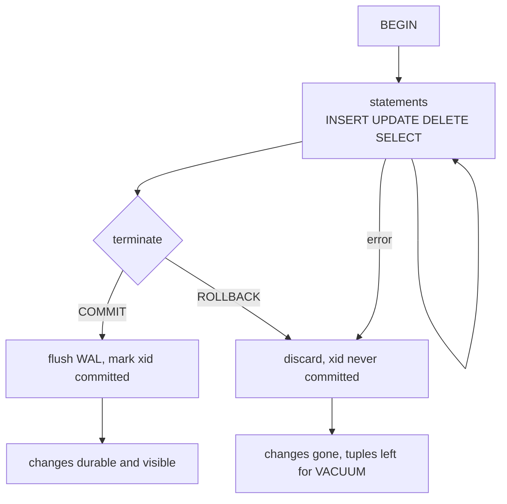
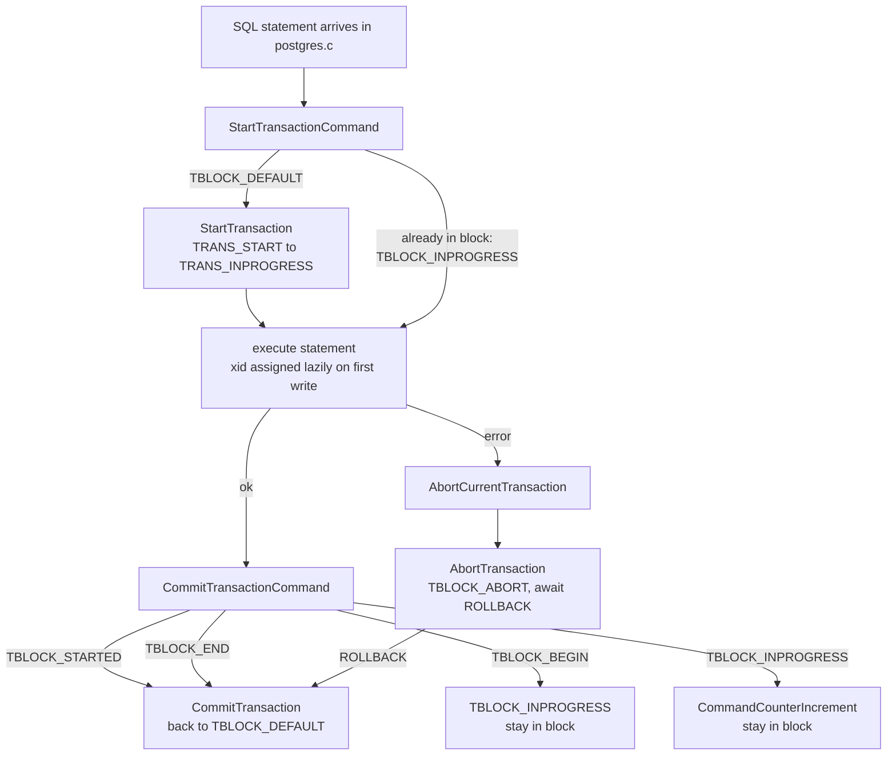
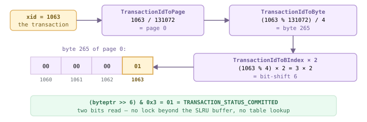
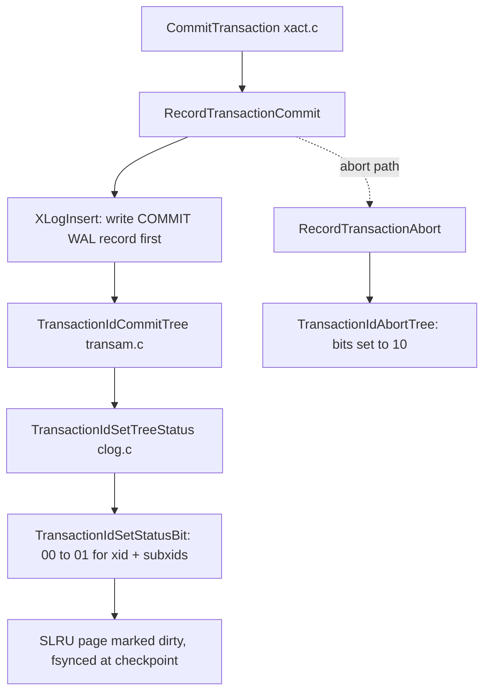
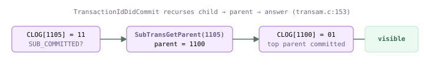
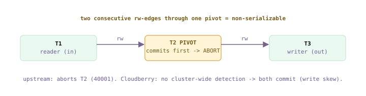
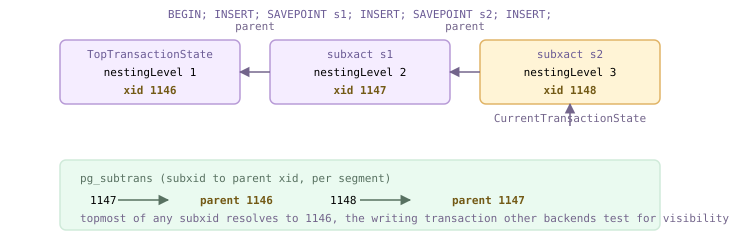

<style>
/*
 * Licensed to the Apache Software Foundation (ASF) under one
 * or more contributor license agreements.  See the NOTICE file
 * distributed with this work for additional information
 * regarding copyright ownership.  The ASF licenses this file
 * to you under the Apache License, Version 2.0 (the
 * "License"); you may not use this file except in compliance
 * with the License.  You may obtain a copy of the License at
 *
 *   http://www.apache.org/licenses/LICENSE-2.0
 *
 * Unless required by applicable law or agreed to in writing,
 * software distributed under the License is distributed on an
 * "AS IS" BASIS, WITHOUT WARRANTIES OR CONDITIONS OF ANY
 * KIND, either express or implied.  See the License for the
 * specific language governing permissions and limitations
 * under the License.
 */

/* Layout for the HTML-and-CSS figures, lifted from the handbook's own
   stylesheet so the figures render identically here. */

/* These four come from the handbook's own stylesheet; a consuming site has no
   such definitions, and an undefined custom property invalidates its whole
   declaration. Define them here, scoped to the figure.

   Deliberately NOT themed. The artwork below is light-only: band and tile
   backgrounds are hard-coded pastels, and the injected markup carries some 800
   more hard-coded light colours in inline styles. Giving --fg a dark-theme
   value paints near-white text onto a near-white band -- measured at 1.08:1,
   worse than the bug that replaced. The handbook's light values are correct in
   both themes; what changes for dark mode is the surface underneath. */
.cloudberry-core-figure {
  --border: #d8dee4;
  --soft:   #f6f8fa;
  --fg:     #1f2328;
  --muted:  #636c76;
  margin: 1.4rem 0;
}

/* Light-only artwork needs a light ground AND a dark ink, or it bleeds into a
   dark page. Setting only the ground is not enough: any text in these figures
   without its own inline colour inherits the site's near-white body colour, so
   it lands white-on-pastel -- measured at 1.03:1 across 184 text nodes. The
   colour has to be restored at the same place the ground is. */
[data-bs-theme='dark'] .cloudberry-core-figure > div {
  background: #ffffff;
  color: #1f2328;
  border-radius: 8px;
  padding: 10px;
}
/* Descendants that inherit rather than carry an inline colour. */
[data-bs-theme='dark'] .cloudberry-core-figure > div :not([style*="color"]) {
  color: inherit;
}
.cloudberry-core-figure figcaption {
  margin-top: .5rem;
  font-size: .9em;
  /* --ifm-color-emphasis-600 resolves to rgb(141,148,158) in the light theme,
     which is 3.06:1 on white -- below WCAG AA for the 37 figure captions.
     (The dark theme's value is fine, so only light is overridden.) */
  color: #636b75;
}
[data-bs-theme='dark'] .cloudberry-core-figure figcaption {
  color: #a6adb4;
}

/* Selective highlight: the handbook wraps a key token so it stands out.
   Scoped to the component. The class name .hl is two letters and this file
   lands in the consuming site's single global stylesheet, so an unscoped
   rule would style every page of that site. The standalone edition's
   figure.code / figure.session variants are dropped: those classes do not
   occur anywhere in this tree. */
.cloudberry-core-figure .hl { border-radius: 2px; font-weight: 700;
                   background: #fff8c5; color: #1f2328; padding: 0 2px; }

/* Layered module map and the banded brick figures. */
.cloudberry-core-figure .bricks { border:1px solid var(--border);border-radius:12px;overflow:hidden;background:var(--soft) }
.cloudberry-core-figure .bk-band { display:flex;align-items:stretch;border-top:1px solid var(--border) }
.cloudberry-core-figure .bk-band:first-child { border-top:none }
.cloudberry-core-figure .bk-lbl { flex:0 0 116px;display:flex;flex-direction:column;justify-content:center;gap:2px;padding:10px 13px }
.cloudberry-core-figure .bk-lbl b { font-size:12.5px;font-weight:800;color:var(--fg);line-height:1.2 }
.cloudberry-core-figure .bk-lbl span { font-size:9.5px;font-weight:700;color:var(--muted);text-transform:uppercase;letter-spacing:.5px }
.cloudberry-core-figure .bk-row { flex:1 1 auto;display:flex;flex-wrap:wrap;gap:7px;padding:9px 10px }
.cloudberry-core-figure .bk { flex:1 1 118px;min-width:104px;display:flex;flex-direction:column;justify-content:center;gap:2px; padding:8px 11px;border-radius:7px;border:1px solid;background:#fff;text-decoration:none;transition:.13s }
.cloudberry-core-figure .bk-t2 { font-size:12.5px;font-weight:700;line-height:1.25 }
.cloudberry-core-figure .bk-ch { font-size:10.5px;font-weight:700;font-variant-numeric:tabular-nums;opacity:.8 }
.cloudberry-core-figure a.bk:hover { transform:translateY(-2px);box-shadow:0 4px 12px #0000001f;text-decoration:none }
.cloudberry-core-figure .bk-q { background:#eef6ff }
.cloudberry-core-figure .bk-q .bk { border-color:#54aeff66;color:#0a3069;background:#ddf4ff }
.cloudberry-core-figure .bk-s { background:#eefcf2 }
.cloudberry-core-figure .bk-s .bk { border-color:#4ac26b80;color:#04260f;background:#dafbe1 }
.cloudberry-core-figure .bk-t { background:#fff6ef }
.cloudberry-core-figure .bk-t .bk { border-color:#fb8f4480;color:#5e2700;background:#fff1e5 }
.cloudberry-core-figure .bk-h { background:#fff4f3 }
.cloudberry-core-figure .bk-h .bk { border-color:#ff818280;color:#5c0011;background:#ffebe9 }
.cloudberry-core-figure .bk-r { background:#f3f5f8 }
.cloudberry-core-figure .bk-r .bk { border-color:#afb8c1;color:#1f2328;background:#eaeef2 }
@media (max-width: 560px) {
  .cloudberry-core-figure .bk-band { flex-direction:column }
  .cloudberry-core-figure .bk-lbl { flex-basis:auto;border-bottom:1px solid var(--border) }
}

</style>

<!--
  Licensed to the Apache Software Foundation (ASF) under one
  or more contributor license agreements.  See the NOTICE file
  distributed with this work for additional information
  regarding copyright ownership.  The ASF licenses this file
  to you under the Apache License, Version 2.0 (the
  "License"); you may not use this file except in compliance
  with the License.  You may obtain a copy of the License at

    http://www.apache.org/licenses/LICENSE-2.0

  Unless required by applicable law or agreed to in writing,
  software distributed under the License is distributed on an
  "AS IS" BASIS, WITHOUT WARRANTIES OR CONDITIONS OF ANY
  KIND, either express or implied.  See the License for the
  specific language governing permissions and limitations
  under the License.
-->


<a id="9-transactions--isolation"></a>

## 9.1 事务概念与模型 {#91-transaction-concepts--models}

**事务**是一组共同构成单个逻辑工作单元的操作，例如一次银行转账、一笔订单或一次批量加载。它遵循全有或全无的规则：所有操作要么全部生效，要么全部不生效。用户使用 `BEGIN` … `COMMIT`（或 `ROLLBACK`）界定事务；在数据库看来，两者之间的一切都是不可分割的一个步骤。本节先介绍基本术语，包括 ACID 四大特性和经典事务*模型*，再沿用本手册的实证方法，明确指出**Cloudberry 中哪个子系统保障各项特性，以及本手册在哪一节剖析该子系统**。后续内容始终贯穿一个特殊之处：在 MPP 系统中，单个用户事务实际上从来都不只是*一个*事务——它天生就是分布式的。

### 9.1.1 ACID 四大特性 {#911-the-four-acid-properties}

ACID 指正确事务必须具备的四项*必要*特性：**原子性**（Atomicity）、**一致性**（Consistency）、**隔离性**（Isolation）和**持久性**（Durability）。它们描述要求，具体机制由相应子系统提供。带着“由哪个子系统实现、在哪一节介绍”的问题理解 ACID，这个缩写就成为本手册后续内容的索引。

- **原子性**——事务结束后，其操作要么全部应用，要么全部丢弃；崩溃或 `ROLLBACK` 之后不会留下部分生效的结果。例如，从 A 向 B 转账 100 美元，不会出现 A 已扣款而 B 未入账的情况。
- **一致性**——事务使数据库从一个有效状态转变为另一个有效状态。“有效”意味着所有完整性约束都成立，包括主键、外键（引用完整性）、CHECK 约束，以及应用通过触发器实施的业务规则。
- **隔离性**——并发事务彼此不可感知。事务修改了某行但尚未提交时，其他事务不能看到这些更改；每个事务的行为都如同独自运行。
- **持久性**——事务一旦提交，其更改便永久保留。即使服务器随后立即崩溃，恢复过程也必须重现这些更改。

*ACID → 保障该特性的机制 → 本手册中的对应位置*

| 特性 | Cloudberry/Postgres 中的保障机制 | 位置 |
| --- | --- | --- |
| 原子性 | WAL 加上“通过不提交来撤销”：更改先暂存；中止时不会将任何内容标记为已提交，事务的 xid 始终不会在提交日志中标记为已提交，因此其元组保持不可见。无需对各行执行物理撤销。 | [§10](/cloudberry/core-internals/part-3-transactions-mvcc-concurrency/ch10/), [§20](/cloudberry/core-internals/part-5-high-availability-recovery/ch20/) |
| 一致性 | 在语句执行时检查约束（PK/FK/CHECK）和触发器。数据库保证状态转换具有原子性和隔离性；保证各状态在业务上*有意义*，则由引擎与模式/业务规则共同负责。 | 本章及模式设计 |
| 隔离性 | MVCC 快照使每个事务读取数据的一致版本，锁则处理写写冲突。更高的隔离级别还会增加谓词检查。 | [§9.4](#94-isolation-levels--anomalies), [§10](/cloudberry/core-internals/part-3-transactions-mvcc-concurrency/ch10/), [§11](/cloudberry/core-internals/part-3-transactions-mvcc-concurrency/ch11/) |
| 持久性 | 将 WAL 刷写（`fsync`）到磁盘，完成后 `COMMIT` 才返回；数据页可以在随后延迟写入。 | [§20](/cloudberry/core-internals/part-5-high-availability-recovery/ch20/) |

> [!NOTE]
> 原子性与持久性是同一份日志发挥的两种作用：恢复时*重放* WAL，使已提交的工作持久保存；对于未提交的事务，其日志记录*永远不会*成为已生效的依据，从而保证中止的原子性。因此，Postgres 和 Cloudberry 的 MVCC 表无需独立的撤销日志：中止事务留下的死元组会由 VACUUM（[§10](/cloudberry/core-internals/part-3-transactions-mvcc-concurrency/ch10/)）在之后回收。

### 9.1.2 原子性演示 {#912-atomicity-demonstrated}

验证原子性最直接的方法是插入一行，然后执行 `ROLLBACK`：这行随即消失，如同插入语句从未执行；改为执行 `COMMIT`，该行便会保留。以下输出均来自端口 7100 上的 Coordinator 的实际运行结果。

*ROLLBACK 丢弃更改，COMMIT 保留更改；不存在部分生效的中间结果*

```sql
CREATE TABLE t9_1 (id int, v text) DISTRIBUTED BY (id);

      BEGIN;
      INSERT INTO t9_1 VALUES (1, 'rolled-back');
      SELECT count(*) FROM t9_1;      -- visible inside my own txn
      ROLLBACK;
      SELECT count(*) AS after_rollback FROM t9_1;

      BEGIN;
      INSERT INTO t9_1 VALUES (2, 'committed');
      COMMIT;
      SELECT count(*) AS after_commit FROM t9_1;
```

```text {hl_lines="11 18" title="output"}
CREATE TABLE
      BEGIN
      INSERT 0 1
       count
      -------
           1                          -- I see my own uncommitted row
      (1 row)
      ROLLBACK
       after_rollback
      ----------------
                    0               -- gone: the insert never happened
      (1 row)
      BEGIN
      INSERT 0 1
      COMMIT
       after_commit
      --------------
                    1               -- persists across the commit
      (1 row)
```

### 9.1.3 事务生命周期 {#913-the-transaction-lifecycle}

后端在内部通过状态机管理事务*块*：`BEGIN` 使其从 `TBLOCK_STARTED` 转为 `TBLOCK_BEGIN`，随后进入 `TBLOCK_INPROGRESS`；`COMMIT` 请求进入 `TBLOCK_END`；`ROLLBACK` 请求进入 `TBLOCK_ABORT_PENDING`。这些命令本身只修改状态标志；真正的工作发生在下一次 `CommitTransactionCommand()` 运行并检查到所请求的状态时。最终的两条路径完全不同：一条刷写 WAL 并将 xid 标记为已提交；另一条丢弃更改，不做提交标记。

```c {title="src/backend/access/transam/xact.c — CallSubXactCallbacks()"}
/* BEGIN: allow a block to start */
      BeginTransactionBlock(void)
      {
          TransactionState s = CurrentTransactionState;
          switch (s->blockState)
          {
              case TBLOCK_STARTED:
                  s->blockState = TBLOCK_BEGIN;   /* -> block begins */
                  break;
              ...
      /* COMMIT: tell CommitTransactionCommand to COMMIT */
      EndTransactionBlock(bool chain)          /* :4965 */
          case TBLOCK_INPROGRESS:
              s->blockState = TBLOCK_END;
      /* ROLLBACK: tell it to abort */
      UserAbortTransactionBlock(bool chain)    /* :5125 */
          case TBLOCK_INPROGRESS:
              s->blockState = TBLOCK_ABORT_PENDING;
```



*事务生命周期：一条路径持久保存更改，另一条路径丢弃更改*

> [!NOTE]
> 完整的状态机涵盖子事务、预备事务、并行执行和中止恢复，共有二十多个 `TBLOCK_*` 状态，定义于 `xact.c` 的 `TBlockState` 中。[§9.5](#95-subtransactions--savepoints) 将介绍保存点使用的子事务状态。

### 9.1.4 事务模型 {#914-transaction-models}

事务*模型*描述事务所保护的操作之间的结构和逻辑关系。相关文献提出了多种模型；Cloudberry 与 Postgres 一样，支持**带保存点的扁平事务**，并且作为 MPP 数据库，还支持**分布式事务**。

- **扁平事务**——基本模型：先执行 `BEGIN`，再执行一个或多个操作，最后执行 `COMMIT` 或 `ROLLBACK`。模型很简单，但长事务接近结束时的一次失败，就会迫使*整个*事务回滚并重新执行；大型批处理任务为此付出的代价很高。
- **带保存点的扁平事务**——`SAVEPOINT` 记录事务执行过程中的中间状态；出错时可以用 `ROLLBACK TO` 回到该保存点，避免丢弃整个事务，还可以用 `RELEASE` 释放不再需要的保存点。保存点通过子事务实现，具体机制见 **[§9.5](#95-subtransactions--savepoints)**。
- **嵌套事务/链式事务（简述）**——嵌套事务形成真正的子事务树，子事务可以独立提交或中止；链式事务在一个事务提交时自动开启下一个事务（`COMMIT AND CHAIN`，对应前文的 `chain` 参数）。Postgres 提供保存点和 `AND CHAIN`，并不支持完全通用的嵌套事务。
- **分布式事务**——操作跨越多个节点的事务，整体仍必须满足 ACID。实际实现中，两阶段提交协议提供其原子性，详见 **[§12](/cloudberry/core-internals/part-3-transactions-mvcc-concurrency/ch12/)**。

### 9.1.5 Cloudberry 事务天生就是分布式的 {#915-a-cloudberry-transaction-is-distributed-by-nature}

在单节点 Postgres 中，一个事务获得一个**事务 ID**（xid）；`txid_current()` 可以显示该 ID，同一事务中的两条语句共享这个 ID，证明它们属于同一个工作单元：

*整个事务共用一个 xid，即 Coordinator（QD）后端的本地 xid*

```sql
BEGIN;
      SELECT txid_current();
      SELECT txid_current();   -- same statement, later in the txn
      COMMIT;
```

```text {hl_lines="4 9" title="output"}
BEGIN
       txid_current
      --------------
               1089
      (1 row)

       txid_current
      --------------
               1089          -- identical: still the same transaction
      (1 row)
      COMMIT
```

但在 Cloudberry 中，这个数字只是 *Coordinator* 视角下的事务 ID。输入 `BEGIN` 时，Coordinator 启动一个 **QD**（查询分发器）后端及其本地事务；语句执行时，QD 将语句分发给各 Segment 上的 **QE**（查询执行器）后端。每个 QE 都针对自己的本地数据、WAL 和提交日志运行各自的本地事务。Coordinator 分配的同一个**分布式事务 ID** 将这些分散执行的事务联系起来。该 ID 存储于 `TransactionState.distribXid`，由分布式事务管理器生成（`getDistributedTransactionId()`，底层由 `cdbtm.c` 实现）。跨 Segment 的 2PC、分布式快照等机制将在[§12](/cloudberry/core-internals/part-3-transactions-mvcc-concurrency/ch12/)介绍；*这里*要强调的是，即使一条简单的 `SELECT` 也会变成多个协作的本地事务。

```c {title="src/backend/access/transam/xact.c — GetAllTransactionXids()"}
/* every transaction carries a distributed id alongside its local xid */
          *distribXid = getDistributedTransactionId();   /* from cdbtm.c */
      /* stored per-transaction in TransactionState (xact.h:444): */
          DistributedTransactionId  distribXid;
```

*一条语句、一个事务，但工作在每个 Segment 上执行*

```sql
INSERT INTO t9_seg SELECT generate_series(1,12);
      BEGIN;
        SELECT gp_segment_id, count(*) FROM t9_seg GROUP BY 1 ORDER BY 1;
      COMMIT;
```

```text {hl_lines="5 6 7" title="output"}
INSERT 0 12
      BEGIN
       gp_segment_id | count
      ---------------+-------
                   0 |     5      -- QE on segment :7102
                   1 |     2      -- QE on segment :7103
                   2 |     5      -- QE on segment :7104
      (3 rows)
      COMMIT
```

> [!NOTE]
> 数据行分布在三个 Segment 上，因此这条 `SELECT` 实际由三个 QE 本地事务加上 QD 执行，全部归属于同一个分布式事务。每个 Segment 都维护*自己的*提交日志，因此这里的原子性意味着“所有 Segment 要么全部提交，要么全部不提交”，这正是引入 2PC（[§12](/cloudberry/core-internals/part-3-transactions-mvcc-concurrency/ch12/)）的原因。下文如无特别说明，“事务”均指 Coordinator 端看到的事务；随后介绍的本地机制（xid、快照、CLOG、锁）则在*每个*后端内部运行。

## 9.2 事务管理器 {#92-the-transaction-manager}

每个事务都需要标识和生命周期。**事务管理器**负责提供这两者：分配事务 ID，驱动事务从开始经过各个状态直至提交或中止，并向用户提供 `BEGIN`/`COMMIT`/`SAVEPOINT`/`ROLLBACK` 接口。它本身并不能独立保障 ACID 特性，而是依靠 WAL 实现原子性和持久性（[§9.3](#93-local-transaction-implementation)），依靠 MVCC 和快照实现隔离性（[§10](/cloudberry/core-internals/part-3-transactions-mvcc-concurrency/ch10/)），依靠锁管理器实现串行化（[§11](/cloudberry/core-internals/part-3-transactions-mvcc-concurrency/ch11/)）。本节只讨论事务管理器直接负责的两项内容：**事务标识**（xid），以及后端处理每条命令时经过的**状态机**。

### 9.2.1 事务 ID {#921-transaction-ids}

事务 ID（`TransactionId`，或 **xid**）是一个无符号 32 位整数。有四个值被保留，不会分配给普通事务；从 3 开始的所有值都是“普通”xid，按顺序分配并单调递增：

```c {title="src/include/access/transam.h — InvalidTransactionId"}
#define InvalidTransactionId     ((TransactionId) 0)
      #define BootstrapTransactionId   ((TransactionId) 1)
      #define FrozenTransactionId      ((TransactionId) 2)
      #define FirstNormalTransactionId ((TransactionId) 3)
      #define MaxTransactionId         ((TransactionId) 0xFFFFFFFF)
      /* ... */
      #define TransactionIdIsNormal(xid)  ((xid) >= FirstNormalTransactionId)
```

- **InvalidTransactionId (0)**——空 xid，表示“没有事务”，例如 xmin 从未设置的元组或尚未分配的槽位。
- **BootstrapTransactionId (1)**——`initdb` 填充系统目录时使用的伪 xid；它写入的行永远对所有事务可见。
- **FrozenTransactionId (2)**——“无限古老”的 xid。VACUUM 将古老元组的 xmin 改写为 2，使其在回卷后仍然可见（详见[§10](/cloudberry/core-internals/part-3-transactions-mvcc-concurrency/ch10/)）。
- **FirstNormalTransactionId (3)**——真实事务可以获得的第一个 ID。所有 ≥ 3 的值都是普通 xid。

<figure class="cloudberry-core-figure">
<div><div style="max-width:720px;margin:2px auto;font:11px/1.4 ui-monospace,SFMono-Regular,Menlo,monospace;color:#1f2328;overflow-x:auto"><div style="min-width:560px"> <div style="display:flex;gap:2px"> <div style="width:70px;border:1px solid #cdb4db;background:#f4f5f6;text-align:center;padding:5px 2px;color:#656b72">0<br><span style="font-size:9px">无效</span></div> <div style="width:70px;border:1px solid #cdb4db;background:#eafaf0;text-align:center;padding:5px 2px">1<br><span style="font-size:9px">引导</span></div> <div style="width:70px;border:1px solid #cdb4db;background:#eafaf0;text-align:center;padding:5px 2px">2<br><span style="font-size:9px">冻结</span></div> <div style="flex:1;border:1px solid #e0b365;background:#fff4d6;text-align:center;padding:5px 2px;color:#735a16;font-weight:700">3 &#8230; 0xFFFFFFFF<br><span style="font-size:9px;font-weight:400">普通 xid &#8212; 顺序分配，随后回卷</span></div> </div> <div style="text-align:center;color:#73658b;font-size:10px;padding:1px">&#8593; 保留的哨兵值 &#8593;&nbsp;&nbsp;&nbsp;&nbsp;&nbsp;&#8593; 约 42 亿个 ID，按环形空间处理（§10）&#8593;</div> </div></div></div>
<figcaption>32 位 TransactionId 空间：三个保留的哨兵值，其后是会发生回卷的普通取值范围</figcaption>
</figure>

普通 xid 由 `GetNewTransactionId` 分配：该函数获取 `XidGenLock`，读取共享计数器 `ShmemVariableCache->nextXid`，然后递增它。该函数还会检查回卷安全阈值：超过 `xidVacLimit` 时促使 autovacuum 运行，超过 `xidStopLimit` 时拒绝继续分配 xid。这是因为 ID 空间有限，并按环形处理（冻结与回卷将在[§10](/cloudberry/core-internals/part-3-transactions-mvcc-concurrency/ch10/)讨论）：

```c {title="src/backend/access/transam/varsup.c — GetNewTransactionId()"}
LWLockAcquire(XidGenLock, LW_EXCLUSIVE);
      full_xid = ShmemVariableCache->nextXid;
      xid = XidFromFullTransactionId(full_xid);
      /* ... wraparound-limit checks: xidVacLimit / xidStopLimit ... */
      FullTransactionIdAdvance(&ShmemVariableCache->nextXid);
```

为了在内部突破约 40 亿的上限，计数器实际上使用 64 位 `FullTransactionId`：在 32 位 xid 之上叠加一个 32 位的*纪元*（epoch）。纪元记录低位字发生回卷的次数，因此完整 xid 的比较不受回卷影响。元组头（[§4.2](/cloudberry/core-internals/part-2-storage-data-layout/ch04/#42-row-version-layout)）仍存储较窄的 32 位 xid，以控制大小；需要无歧义排序的地方则使用完整 ID。

```c {title="src/include/access/transam.h — FullTransactionId"}
typedef struct FullTransactionId
      {
          uint64  value;          /* (epoch << 32) | xid */
      } FullTransactionId;
      #define EpochFromFullTransactionId(x)  ((uint32) ((x).value >> 32))
      #define XidFromFullTransactionId(x)    ((uint32) (x).value)
```

### 9.2.2 延迟分配：虚拟 xid {#922-lazy-assignment-virtual-xids}

由于 xid 数量有限，事务**只有在首次写入时**才获得真实 xid。只读事务完全不消耗 xid。在此之前，后端使用**虚拟事务 ID（VXID）** 运行，即 `backendId/localXid` 二元组；其分配成本很低，只涉及当前后端，不需要全局锁。真实 xid 由 `AssignTransactionId` 按需生成：第一次调用 `GetCurrentTransactionId` 请求 xid 时（例如执行 `INSERT`），便会调用它：

```c {title="src/backend/access/transam/xact.c"}
TransactionId
      GetCurrentTransactionId(void)
      {
          TransactionState s = CurrentTransactionState;
          if (!FullTransactionIdIsValid(s->fullTransactionId))
              AssignTransactionId(s);         /* first write -> real xid */
          return XidFromFullTransactionId(s->fullTransactionId);
      }
```

在 `AssignTransactionId` 内部，从 `GetNewTransactionId` 获得的新 ID 会记录在后端的 `PGPROC` 和 `pg_subtrans` 中；如果是顶层事务，还会缓存在 `XactTopFullTransactionId` 中：

```c {title="src/backend/access/transam/xact.c — AssignTransactionId()"}
s->fullTransactionId = GetNewTransactionId(isSubXact);
      if (!isSubXact)
          XactTopFullTransactionId = s->fullTransactionId;
```

可以直接观察这一变化。`txid_current_if_assigned()` 只在 xid 已存在时返回它，否则返回空值；`txid_current()` 则会*强制*分配 xid。在同一个事务中，先查询是否已有 xid，再强制分配：

*延迟分配：强制分配前没有 xid，分配后便一直保留*

```sql
BEGIN;
      SELECT txid_current_if_assigned() AS if_assigned_before;
      SELECT txid_current()            AS forced;
      SELECT txid_current_if_assigned() AS if_assigned_after;
      COMMIT;
```

```text {hl_lines="4 9 14" title="output"}
BEGIN
       if_assigned_before
      --------------------
                            ← no xid yet (read-only so far)
      (1 row)

       forced
      --------
         1096             ← txid_current() forced assignment
      (1 row)

       if_assigned_after
      -------------------
                    1096  ← now it exists, and it is the same id
      (1 row)
      COMMIT
```

在整个事务生命周期内，该 ID 保持不变：同一事务中的两条语句看到相同的 xid：

*每个事务一个 xid，不随语句改变*

```sql
BEGIN;
      SELECT txid_current() AS first;
      SELECT txid_current() AS second;
      COMMIT;
```

```text {hl_lines="4 7" title="output"}
BEGIN
       first
      -------
        1097
       second
      --------
         1097    ← same transaction, same xid
      COMMIT
```

可以直接在 `pg_locks` 中看到 VXID。每个活动后端都持有其自身虚拟 xid 的锁；真实 xid 只有在分配后才会出现对应的锁。下面观察只读事务最初仅持有 `virtualxid` 锁，随后在获得 xid 的瞬间取得 `transactionid` 锁：

*pg_locks：始终持有 VXID 锁，真实 xid 的锁在分配时出现*

```sql
BEGIN;
      SELECT locktype, virtualtransaction, transactionid
        FROM pg_locks
       WHERE pid = pg_backend_pid()
         AND locktype IN ('virtualxid','transactionid');
      SELECT txid_current();                 -- force a real xid
      SELECT locktype, virtualtransaction, transactionid
        FROM pg_locks
       WHERE pid = pg_backend_pid()
         AND locktype IN ('virtualxid','transactionid');
      COMMIT;
```

```text {hl_lines="3 8 12 13" title="output"}
  locktype  | virtualtransaction | transactionid
      ------------+--------------------+---------------
       virtualxid | 8/4              |                ← only the VXID
      (1 row)

       txid_current
      --------------
               1098

         locktype    | virtualtransaction | transactionid
      ---------------+--------------------+---------------
       transactionid | 8/4                |          1098  ← real xid now held
       virtualxid    | 8/4              |
      (2 rows)
      COMMIT
```

> [!NOTE]
> VXID **8/4** 表示 `backendId 8`、`localXid 4`。后端 ID 部分来自后端的 `PGPROC` 槽位；计数器部分存储在 `PGPROC.lxid` 中，其含义是“当前正在执行的顶层事务的本地 ID”（`src/include/storage/proc.h`）。由于 VXID 不消耗全局资源，纯读取工作负载不会访问 `XidGenLock`，也不会递增 `nextXid`。

### 9.2.3 事务状态机 {#923-the-transaction-state-machine}

后端在 `TransactionStateData` 结构体中跟踪当前事务。它构成一个**栈**：子事务（[§9.5](#95-subtransactions--savepoints)）将新节点压栈，因此 `CurrentTransactionState` 指向最内层节点，`parent` 则指回上层。每个节点带有两个独立的状态变量：`state`（底层 `TransState`，代表引擎视角）和 `blockState`（高层 `TBlockState`，代表用户视角），此外还有延迟填充的 `fullTransactionId` 和 `nestingLevel`：

```c {title="src/backend/access/transam/xact.c — TransactionStateData"}
typedef struct TransactionStateData
      {
          FullTransactionId fullTransactionId; /* my xid (0 until first write) */
          SubTransactionId  subTransactionId;
          char       *name;                    /* savepoint name, if any */
          TransState  state;                   /* low-level state  */
          TBlockState blockState;              /* high-level state */
          int         nestingLevel;           /* transaction nesting depth */
          TransactionId *childXids;           /* subcommitted child xids */
          struct TransactionStateData *parent; /* back link (subxacts) */
      } TransactionStateData;

      static TransactionStateData TopTransactionStateData = {
          .state = TRANS_DEFAULT, .blockState = TBLOCK_DEFAULT,
      };
      static TransactionState CurrentTransactionState = &TopTransactionStateData;
```

底层 `TransState` 表示引擎此刻正在做什么；高层 `TBlockState` 表示客户端事务块所处的阶段，例如空闲、正在 BEGIN、运行中、正在结束或正在中止。这种分离是有意设计的：一条客户端命令可能使引擎经过多个底层状态，而事务块状态只改变一次：

*两组状态枚举（xact.c — TransState / xact.c — TBlockState）*

| 底层 TransState | 高层 TBlockState（顶层事务） |
| --- | --- |
| TRANS_DEFAULT — 空闲 | TBLOCK_DEFAULT — 无事务 |
| TRANS_START — 正在启动 | TBLOCK_STARTED — 隐式单查询事务 |
| TRANS_INPROGRESS — 运行中 | TBLOCK_BEGIN / TBLOCK_INPROGRESS — 显式事务块 |
| TRANS_COMMIT — 正在提交 | TBLOCK_END — 已收到 COMMIT |
| TRANS_ABORT — 正在中止 | TBLOCK_ABORT / _END / _PENDING — 已失败，等待 ROLLBACK |
| TRANS_PREPARE — 2PC 第一阶段 | TBLOCK_PREPARE — 已收到 PREPARE |

事务块状态由 `postgres.c` 驱动：**每条** SQL 语句执行前都调用 `StartTransactionCommand()`，执行后调用 `CommitTransactionCommand()`，出错时则调用 `AbortCurrentTransaction()`。这些函数的核心都是大型 `switch (s->blockState)` 语句。没有显式 `BEGIN` 时，第一次调用沿 `TBLOCK_DEFAULT` → `StartTransaction()` → `TBLOCK_STARTED` 路径执行；结束时的调用提交事务并返回 `TBLOCK_DEFAULT`。这就是自动提交：

```c {title="src/backend/access/transam/xact.c — CleanupTransaction()"}
/* StartTransactionCommand() */
      case TBLOCK_DEFAULT:
          StartTransaction();
          s->blockState = TBLOCK_STARTED;   /* implicit single-query xact */
          break;

      /* CommitTransactionCommand() */
      case TBLOCK_STARTED:
          CommitTransaction();
          s->blockState = TBLOCK_DEFAULT;   /* back to idle: autocommit */
          break;
```

显式 `BEGIN` 则进入 `TBLOCK_BEGIN`，随后 `CommitTransactionCommand` 将其推进到 `TBLOCK_INPROGRESS`，不对数据库做实际操作（`xact.c`）。后续语句保持在 `TBLOCK_INPROGRESS`，每条语句结束时只调用 `CommandCounterIncrement()`（[§9.4](#94-isolation-levels--anomalies)）；最后的 `COMMIT` 使状态变为 `TBLOCK_END`，并运行真正的 `CommitTransaction()`。完整的命令循环如下：



*逐条命令执行的事务循环与顶层事务块状态*

### 9.2.4 MPP 集群中的情况 {#924-in-an-mpp-cluster}

上图描述的是*本地*机制，即单个 PostgreSQL 后端执行的过程；每个 Cloudberry 进程内部也原样运行这套机制。不过，一条用户语句会涉及多个后端：Coordinator（QD），以及每个 Segment 上的一个查询执行器（QE）。这些后端各自运行**自己的**本地状态机；如果发生写入，则从**自己的** `nextXid` 计数器中分配**自己的**本地 xid。整个集群没有共享的 xid 空间。

将它们联系起来的是 QD 分配、并随计划一起分发的**分布式事务 ID（gxid）**；每个 Segment 将自己的本地 xid 与该 gxid 绑定。通过 utility 模式直接向两个 Segment 请求本地 xid，可以看到这些计数器确实相互独立，返回的数字彼此无关：

*每个 Segment 都有自己的本地 xid 计数器（utility 模式，端口 7102/7103）*

```sql
-- segment 0
      SELECT gp_segment_id FROM gp_id;
      BEGIN; SELECT txid_current() AS seg0_local_xid; COMMIT;
      -- segment 1
      BEGIN; SELECT txid_current() AS seg1_local_xid; COMMIT;
```

```text {hl_lines="7 11" title="output"}
 gp_segment_id
      ---------------
                   0

       seg0_local_xid
      ----------------
                1118        ← segment 0 counter

       seg1_local_xid
      ----------------
                1112        ← segment 1 counter (independent)
```

> [!NOTE]
> gxid、它的分发过程，以及 QD 如何通过两阶段提交保障各 Segment 本地事务的整体原子性，将在 **[§12](/cloudberry/core-internals/part-3-transactions-mvcc-concurrency/ch12/)** 讨论。这里先明确职责划分：*QD 分配全局 ID，每个 QE 维护本地 xid*。在 QE 端，还可以在 `PGPROC.localDistribXactData`（`src/include/storage/proc.h`）中看到 Coordinator 的分布式上下文。

## 9.3 本地事务实现 {#93-local-transaction-implementation}

到目前为止，讨论的都是*正在运行的*事务——它拥有的 xid（[§9.2](#92-the-transaction-manager)）以及它经历的块状态。但事务最重要的事实要到最后一刻才确定：它是**提交**还是**中止**？这一最终结果必须在崩溃后仍然保留，并且其他每个后端都必须能够永久读取任意 xid 的结果。两个由 SLRU 支持的磁盘映射保存了这些信息：**CLOG**（`pg_xact`）记录每个事务的最终结果，**SUBTRANS**（`pg_subtrans`）记录子事务属于哪个父事务。本节介绍这两个映射的布局、寻址方式，以及它们在提交路径上的写入方式。

### 9.3.1 CLOG——用两位记录每个事务的结果 {#931-clog--two-bits-of-truth-per-transaction}

提交日志为每个曾经分配过的 xid 保存一个*状态*，每个状态占用**2 位**。两位恰好能表示四种状态，CLOG 四种都使用（`src/include/access/clog.h`）：

*CLOG 的四种状态码（clog.h）*

| 位 | 常量 | 含义 |
| --- | --- | --- |
| `00` | `TRANSACTION_STATUS_IN_PROGRESS` (0x00) | 尚未确定——全零的初始状态 |
| `01` | `TRANSACTION_STATUS_COMMITTED` (0x01) | 已提交；其效果是永久的 |
| `10` | `TRANSACTION_STATUS_ABORTED` (0x02) | 已中止；必须忽略其效果 |
| `11` | `TRANSACTION_STATUS_SUB_COMMITTED` (0x03) | 已提交但顶层父事务尚未确定的子事务 |

由于默认值是 `00`，新扩展的 CLOG 页面开始使用时，其中覆盖的每个 xid 读到的都是*进行中*，无需显式初始化每个槽位。事务只会被标记一次，从 `00` 转为 `01`/`10`（对于已提交的子事务则经过 `11`）。`TransactionIdGetStatus` 读取两位并返回状态；易读的谓词 `TransactionIdDidCommit` / `TransactionIdDidAbort` 在 `transam.c` 中对它进行了封装（对于 `SUB_COMMITTED` 子事务，还会通过 SUBTRANS 递归到顶层父事务 → [§9.5](#95-subtransactions--savepoints)）。

```c {title="src/include/access/clog.h — clogsyncfiletag()"}
#define CLOG_BITS_PER_XACT   2
#define CLOG_XACTS_PER_BYTE  4
#define CLOG_XACTS_PER_PAGE  (BLCKSZ * CLOG_XACTS_PER_BYTE)
#define CLOG_XACT_BITMASK    ((1 << CLOG_BITS_PER_XACT) - 1)
```

每个字节由四个 xid 共享；一个页面就是一个 `BLCKSZ` 块。本集群使用 `BLCKSZ = 32768` 构建，因此 **CLOG_XACTS_PER_PAGE = 32768 × 4 = 131072**——一个页面可保存连续 131072 个事务的命运。正因为如此密集，CLOG 才会很小：一个段文件（包含 `SLRU_PAGES_PER_SEGMENT` 个页面）只需几百 KB，就能覆盖数千万个 xid。

<figure class="cloudberry-core-figure">
<div><div style="max-width:720px;margin:2px auto;font:11px/1.4 ui-monospace,SFMono-Regular,Menlo,monospace;color:#1f2328;overflow-x:auto"><div style="min-width:560px"><div style="text-align:center;color:#73658b;font-size:10px;padding:2px">一个 32 KB 页面 = 32768 字节 = 131072 个 xid &nbsp;（每字节 4 个 xid）</div><div style="display:flex;gap:0;margin-bottom:1px"><div style="flex:2;border:1px solid #cdb4db;background:#efe3fb;text-align:center;padding:5px 2px;color:#6b5b95">字节 0 &mdash; xid 0..3</div><div style="flex:2;border:1px solid #cdb4db;background:#efe3fb;text-align:center;padding:5px 2px;color:#6b5b95">字节 1 &mdash; xid 4..7</div><div style="flex:3;border:1px dashed #cdb4db;background:#f4f5f6;text-align:center;padding:5px 2px;color:#656b72">&hellip;</div><div style="flex:2;border:1px solid #e0b365;background:#fff4d6;text-align:center;padding:5px 2px;color:#735a16;font-weight:700">字节 265 &mdash; xid 1060..1063</div></div><div style="display:flex;gap:0"><div style="flex:1;border:1px solid #cdb4db;background:#f5edff;text-align:center;padding:5px 2px">01</div><div style="flex:1;border:1px solid #cdb4db;background:#f5edff;text-align:center;padding:5px 2px">01</div><div style="flex:1;border:1px solid #cdb4db;background:#f5edff;text-align:center;padding:5px 2px">10</div><div style="flex:1;border:1px solid #cdb4db;background:#f5edff;text-align:center;padding:5px 2px">01</div><div style="flex:3;border:1px dashed #cdb4db;background:#f4f5f6;text-align:center;padding:5px 2px;color:#656b72">&hellip; 另有 131064 个槽位 &hellip;</div><div style="flex:1;border:1px solid #cdb4db;background:#f5edff;text-align:center;padding:5px 2px;color:#656b72">00</div><div style="flex:1;border:1px solid #cdb4db;background:#f5edff;text-align:center;padding:5px 2px;color:#656b72">00</div><div style="flex:1;border:1px solid #cdb4db;background:#f5edff;text-align:center;padding:5px 2px;color:#656b72">00</div><div style="flex:1;border:2px solid #e0b365;background:#fff4d6;text-align:center;padding:4px 2px;color:#735a16;font-weight:700">01</div></div><div style="display:flex;gap:0;color:#73658b;font-size:10px"><div style="flex:4;text-align:left;padding:1px 3px">xid 0 &rarr;</div><div style="flex:3"></div><div style="flex:4;text-align:right;padding:1px 3px">&larr; 移位 6 位，xid 1063 = 01 = COMMITTED</div></div><div style="text-align:center;color:#73658b;font-size:10px;padding:3px">00 进行中 &nbsp;|&nbsp; 01 已提交 &nbsp;|&nbsp; 10 已中止 &nbsp;|&nbsp; 11 子事务已提交</div></div></div></div>
<figcaption>一个 pg_xact 页面表示为一条 2 位槽位带——每字节 4 个 xid，每个 32KB 页面 131072 个 xid</figcaption>
</figure>

### 9.3.2 将 xid 解析为（页面、字节、位）{#932-resolving-an-xid-to-page-byte-bit}

由于每字节紧密排列四个槽位，读取状态完全是整数运算，不需要查找表。给定一个 xid，`clog.h` 中的四个宏会将其拆解为：所在页面、该页面中的字节，以及在字节内需要移动的位数。

```c {title="src/include/access/clog.h"}
#define TransactionIdToPage(xid)    ((xid) / CLOG_XACTS_PER_PAGE)
#define TransactionIdToPgIndex(xid) ((xid) % CLOG_XACTS_PER_PAGE)
#define TransactionIdToByte(xid)    (TransactionIdToPgIndex(xid) / CLOG_XACTS_PER_BYTE)
#define TransactionIdToBIndex(xid)  ((xid) % CLOG_XACTS_PER_BYTE)
```

`TransactionIdSetStatusBit` 和 `TransactionIdGetStatus`（`clog.c`）都会计算 `byteno` 以及 `bshift = TransactionIdToBIndex(xid) * 2`，然后使用 `CLOG_XACT_BITMASK` 进行掩码和移位。下面的图按照本构建每页 131072 个 xid 的布局，完整演示 xid 1063 的处理过程。



*xid 1063 → CLOG 地址：页面 → 字节 → 2 位槽位 → 状态（clog.c — TransactionIdSetStatusBit）*

### 9.3.3 提交路径——位是如何设置的 {#933-the-commit-path--how-the-bits-get-set}

CLOG 只在一个时刻写入：事务完成时。`CommitTransaction` 调用 `RecordTransactionCommit`（`xact.c`），后者写出提交 WAL 记录，然后调用 `TransactionIdCommitTree`。这是 `transam.c` 中对真正执行工作的 `TransactionIdSetTreeStatus` 的薄封装，后者一次性将顶层 xid **及其所有已提交的子 xid** 改为 `COMMITTED`。中止路径则通过 `RecordTransactionAbort` → `TransactionIdAbortTree` 进行对应处理。

```c {title="src/backend/access/transam/transam.c — TransactionIdCommitTree()"}
void
TransactionIdCommitTree(TransactionId xid, int nxids, TransactionId *xids)
{
    TransactionIdSetTreeStatus(xid, nxids, xids,
                               TRANSACTION_STATUS_COMMITTED,
                               InvalidXLogRecPtr);
}
```

```c {title="src/backend/access/transam/xact.c — RecordTransactionCommit()"}
if (markXidCommitted)
{
    /* mark distributed txn committed *before* clog (see cdbtm / §12) */
    if (isDtxPrepared || isOnePhaseQE)
        DistributedLog_SetCommittedTree(xid, nchildren, children, ...);

    TransactionIdCommitTree(xid, nchildren, children);
}
```



*提交路径：从 CommitTransaction 到翻转两个位*

> [!NOTE]
> **始终先写 WAL。** 提交记录会在 CLOG 位持久化*之前*刷新到 WAL。如果服务器在 WAL 刷新后、CLOG 写入磁盘前崩溃，恢复过程会重放提交记录，再次运行 `TransactionIdSetTreeStatus`（通过 `xact_redo`，xact.c——XactLogAbortRecord）来重建该位。因此，CLOG 的持久性依赖于 WAL 的持久性——使这一顺序安全的规则见 [§20](/cloudberry/core-internals/part-5-high-availability-recovery/ch20/)。

### 9.3.4 SUBTRANS——将子事务映射到父事务 {#934-subtrans--mapping-a-subtransaction-to-its-parent}

CLOG 可以将子事务标记为 `SUB_COMMITTED`（`11`），但这仅表示“*如果祖先事务提交了*，我就提交了”。要确定结果，系统必须从子 xid 向上查找到顶层 xid，而这个父子关系保存在 **SUBTRANS**（`pg_subtrans`、`subtrans.c`）中。上游 PostgreSQL 的每个槽位只存储一个父 xid；Cloudberry 则存储一个小结构体，以缓存最顶层的祖先，避免每次都遍历整条链：

```c {title="src/include/access/subtrans.h — SubTransData"}
typedef struct SubTransData
{
    TransactionId parent;         /* immediate parent xid */
    TransactionId topMostParent;  /* cached top-level xid of the tree */
} SubTransData;
```

由于每个条目是一个结构体，而不是两位，其页面布局与 CLOG 不同：`SUBTRANS_XACTS_PER_PAGE = BLCKSZ / sizeof(SubTransData)`（`subtrans.c`），寻址宏定位的是整个条目（`TransactionIdToEntry`），而非压紧排列的位。子事务首次分配 xid 时，`SubTransSetParent` 会记录父子关系；可见性检查时，`SubTransGetParent` / `SubTransGetTopmostTransaction` 会将其读回。子事务的完整*生命周期*（保存点、`TBLOCK_SUBBEGIN`、子 xid 数组）见 [§9.5](#95-subtransactions--savepoints)；这里讨论的只是存储映射，它让 `TransactionIdDidCommit` 能从 `11` 递归向上，得到确定的答案。



*SUBTRANS 向上解析已提交的子事务，确定其持久化结果（subtrans.c + clog.c）*

### 9.3.5 实际观察 {#935-watching-it-live}

可以直接查询事务在 CLOG 中留下的状态。`txid_status(xid)` 读取的正是前面解码的那两位。提交一个事务，再查询其状态，会得到 committed；回滚一个事务，对应槽位读到的就是 aborted。

*txid_status 读回 CLOG 位：已提交与已中止（端口 7100）*

```sql
-- a transaction that commits
SELECT txid_current() AS my_xid \gset
COMMIT;
SELECT txid_status(:my_xid) AS status_of_committed;

-- a transaction that rolls back
BEGIN;
  INSERT INTO t9 VALUES (1);
  SELECT txid_current() AS ax \gset
ROLLBACK;
SELECT txid_status(:ax) AS status_of_rolledback;
```

```text {hl_lines="4 10" title="output"}
COMMIT
 status_of_committed 
---------------------
 committed
(1 row)

ROLLBACK
 status_of_rolledback 
----------------------
 aborted
(1 row)
```

在磁盘上，CLOG 就是 `pg_xact/` 下的那些 SLRU 段文件。每个 Segment 都有自己的目录，因为它们各有自己的 CLOG（见下文）：

*Segment 0 数据目录下的 pg_xact SLRU 段文件*

```bash
$ ls -l $PGDATA/pg_xact/    # segment 0 data dir
```

```text {hl_lines="2" title="output"}
total 32
-rw------- 1 gpadmin gpadmin 32768 Jul  2 22:03 0000
```

`0000` 文件是 CLOG 的第零页/段，大小为 32768 字节，恰好是一个 `BLCKSZ`，覆盖 xid 0..131071。SLRU 会在共享内存中缓存少量这样的页面；`pg_stat_slru` 按名称展示这两个映射的缓存活动：

*Xact 和 Subtrans 日志的 SLRU 缓存计数器（端口 7100）*

```sql
SELECT name, blks_hit, blks_read, blks_written
FROM pg_stat_slru
WHERE name IN ('Xact','Subtrans');
```

```text {hl_lines="3" title="output"}
   name   | blks_hit | blks_read | blks_written 
----------+----------+-----------+--------------
 Xact    |     5748 |         6 |           21
 Subtrans |        0 |         0 |            7
(1 row)
```

### 9.3.6 MPP：每个节点维护自己的提交日志 {#936-mpp-every-node-keeps-its-own-commit-log}

在 Cloudberry 集群中，Coordinator（QD）和每个 Segment（QE）本质上都是完整的 PostgreSQL 实例，因此各自维护**自己的** `pg_xact` 和 `pg_subtrans`、**自己的** SLRU 缓存，以及**自己的**本地 xid 计数器。一条用户语句由一个 QD 后端以及每个 Segment 上的一个 QE 后端执行，各后端分配一个*本地* xid，并在*自己的* CLOG 中记录*本地*结果。这些计数器相互独立，同一条语句在不同节点上对应不同的本地 xid：

*独立的本地 xid 计数器：Coordinator 与 Segment 0*

```bash
-- on the coordinator (QD)
psql -p 7100 -c "SELECT txid_current();"

-- on segment 0, utility mode (QE, its own counter)
PGOPTIONS='-c gp_role=utility' psql -p 7102 \
  -c "SELECT txid_current(), gp_segment_id FROM gp_id;"
```

```text {hl_lines="1 2" title="output"}
QD  coordinator local xid: 1102
seg0 local xid, gp_segment_id: 1121 | 0
```

> [!NOTE]
> 将这些独立的本地结果组合为一个全有或全无结果的，是**分布式事务**及其自身的分布式提交日志（`DistributedLog_SetCommittedTree`，在 xact.c 的 RecordTransactionCommit 中，紧接着才写本地 CLOG）。这套机制——分布式 xid、两阶段提交，以及全局快照如何跨节点读取各自的 CLOG——将在 **[§12](/cloudberry/core-internals/part-3-transactions-mvcc-concurrency/ch12/)** 讨论。就本地而言，到这里已经完整：两个位，写入一次，由 WAL 保护，供所有后端读取。

## 9.4 隔离级别与异常 {#94-isolation-levels--anomalies}

### 9.4.1 四种级别与经典异常 {#941-the-four-levels-and-the-classic-anomalies}

SQL 标准根据允许出现哪些读取异常来划分隔离级别。需要关注三种经典异常：**脏读**（T 读取了另一个事务写入但尚未提交的行）、**不可重复读**（T 读取一行，另一个事务提交了对该行的 UPDATE，T 再次读取时值已改变），以及**幻读**（T 执行范围查询，另一个事务提交了一条落在该范围内的 INSERT，T 再次查询时出现了新行）。标准据此定义四种级别：读未提交、读已提交、可重复读、可串行化。每提高一级，都会以并发性为代价，禁止更多异常。

Postgres，以及由此继承的 Cloudberry，**并不**按照标准所设想的方式，以读锁来实现这些级别。其基础是 MVCC 快照（[§10](/cloudberry/core-internals/part-3-transactions-mvcc-concurrency/ch10/)），这使其中两个级别的行为比标准允许的*更严格*，也改变了实际会给你带来问题的异常类型。控制这一切的宏很简单：

```c {title="src/include/access/xact.h — XACT_READ_UNCOMMITTED"}
#define XACT_READ_UNCOMMITTED  0
      #define XACT_READ_COMMITTED    1
      #define XACT_REPEATABLE_READ   2
      #define XACT_SERIALIZABLE      3

      /* one snapshot for the whole xact? */
      #define IsolationUsesXactSnapshot() (XactIsoLevel >= XACT_REPEATABLE_READ)
      #define IsolationIsSerializable()   (XactIsoLevel == XACT_SERIALIZABLE)
```

因此实际上只有两种快照机制。低于可重复读时，每条语句都获取一个**新**快照（`GetTransactionSnapshot` 在每条命令中重新读取）；在可重复读及更高级别，事务在第一次查询时获取**一个**快照，并一直保留到事务结束。`IsolationIsSerializable()` 在这个单一快照之上加入 SSI 冲突跟踪；但 Cloudberry 实际如何处理它，见 [§9.4.3](#943-serializable-in-cloudberry-it-falls-back-to-repeatable-read)。

*隔离级别与异常——Postgres/Cloudberry 的实际行为。“更严格”表示 Postgres 禁止了 SQL 标准允许的异常。*

| 级别 | 脏读 | 不可重复读 | 幻读 | 写偏差／串行化异常 |
| --- | --- | --- | --- | --- |
| 读未提交 | 不会发生（= 读已提交） | 可能 | 可能 | 可能 |
| 读已提交 | 不会发生 | 可能 | 可能 | 可能 |
| 可重复读 | 不会发生 | 不会发生 | 不会发生（更严格） | 可能——写偏差 |
| 可串行化（上游 PG） | 不会发生 | 不会发生 | 不会发生 | 不会发生（SSI 会中止其中一个事务） |
| 可串行化（Cloudberry） | 不会发生 | 不会发生 | 不会发生 | 可能——回退到可重复读（RR）（[§9.4.3](#943-serializable-in-cloudberry-it-falls-back-to-repeatable-read)） |

> [!NOTE]
> 请牢记 Postgres 特有的两点：**读未提交的行为与读已提交完全相同**——快照从不显示未提交的数据，因此在任何级别下，*脏读都不可能发生*。此外，**可重复读已经阻止了幻读**，因为其固定快照会隐藏快照取得后由其他事务提交的行；SQL 标准只要求可串行化做到这一点。可重复读仍然允许的一种异常是**写偏差**，这正是需要可串行化的原因。

### 9.4.2 实际观察读已提交与可重复读 {#942-read-committed-vs-repeatable-read-live}

差异完全在于*何时*获取快照。我们在 Coordinator（:7100）上运行两个时间重叠的会话：会话 B 读取一行，休眠，再次读取；另一个会话则在两次读取之间 UPDATE 该行并 COMMIT。先看读已提交：

*读已提交：每条语句重新获取快照，因此 B 的第二次读取能看到已提交的更改*

```sql
-- session B                          -- concurrent writer (fires during the sleep)
      BEGIN ISOLATION LEVEL READ COMMITTED;
      SELECT bal FROM iso_demo WHERE id=1;    UPDATE iso_demo SET bal=200 WHERE id=1;
      SELECT pg_sleep(3);
      SELECT bal FROM iso_demo WHERE id=1;
      COMMIT;
```

```text {hl_lines="3 7" title="output"}
 read1
      -------
         100
      UPDATE 1
       read2
      -------
         200      <- non-repeatable read: value changed mid-transaction
```

现在在可重复读下执行相同的交错操作。B 的第一次查询会为整个事务固定一个快照，因此已提交的 UPDATE 在 B 结束前都不可见：

*可重复读：整个事务使用一个快照——B 始终读到旧值；只有 COMMIT 后才能看到更改*

```sql
-- session B                          -- concurrent writer (fires during the sleep)
      BEGIN ISOLATION LEVEL REPEATABLE READ;
      SELECT bal FROM iso_demo WHERE id=1;    UPDATE iso_demo SET bal=200 WHERE id=1;
      SELECT pg_sleep(3);
      SELECT bal FROM iso_demo WHERE id=1;
      COMMIT;
      SELECT bal FROM iso_demo WHERE id=1;    -- outside the txn now
```

```text {hl_lines="3 7 11" title="output"}
 read1
      -------
         100
      UPDATE 1
       read2
      -------
         100      <- SAME value: repeatable read holds
      COMMIT
       after_commit
      --------------
                200  <- fresh snapshot after COMMIT finally sees it
```

这个唯一的快照正是 `FirstXactSnapshot`，定义于 `snapmgr.c`：当 `IsolationUsesXactSnapshot()` 为真时，在第一次查询中获取，再复制、注册并固定，直到事务结束。

```c {title="src/backend/utils/time/snapmgr.c — GetTransactionSnapshot()"}
if (IsolationUsesXactSnapshot())
      {
          if (IsolationIsSerializable())
              CurrentSnapshot = GetSerializableTransactionSnapshot(&CurrentSnapshotData);
          else
              CurrentSnapshot = GetSnapshotData(&CurrentSnapshotData, DistributedTransactionContext);
          CurrentSnapshot   = CopySnapshot(CurrentSnapshot);   /* survives whole xact */
          FirstXactSnapshot = CurrentSnapshot;
      }
```

### 9.4.3 Cloudberry 中的可串行化：回退到可重复读 {#943-serializable-in-cloudberry-it-falls-back-to-repeatable-read}

这里有一个仅凭上游经验容易误判的事实。单节点 Postgres 的可串行化使用 **SSI**（可串行化快照隔离）：它基于可重复读快照运行，额外跟踪事务之间的读写依赖；如果形成不可串行化的环，就中止其中一个事务。Cloudberry 无法在整个分布式集群上做到这一点：SSI 的谓词锁保存在各节点自己的共享内存中，而一条用户语句会展开为一个 QD 后端和每个 Segment 上的一个 QE 后端（[§12](/cloudberry/core-internals/part-3-transactions-mvcc-concurrency/ch12/)），因此没有任何单个节点能看到完整的依赖图。为避免提供无法兑现的保证，Cloudberry 在 GUC 检查钩子中**静默地将可串行化降级为可重复读**：

```c {title="src/backend/commands/variable.c — check_transaction_isolation()"}
/* GPDB_91_MERGE_FIXME: ... Cloudberry lacks the support to detect
       * serialization conflicts using predicate locks at cluster level.
       * Until that support is implemented, let's keep old behavior by
       * falling back to repeatable read. */
      if (newXactIsoLevel == XACT_SERIALIZABLE)
      {
          elog(LOG, "serializable isolation requested, falling back to "
                    "repeatable read until serializable is supported in Cloudberry");
          *newval = XACT_REPEATABLE_READ;
      }
```

对应的钩子 `check_DefaultXactIsoLevel`（variable.c）会对 `default_transaction_isolation` 做同样处理，因此无论按事务设置还是设置默认值，都无法获得真正的 SERIALIZABLE。可以直接观察到：请求 serializable，得到 repeatable read，LOG 行会说明这次降级：

*CBDB 将 SERIALIZABLE 降级为 REPEATABLE READ，并在日志中说明*

```sql
SET client_min_messages='log';
      SET default_transaction_isolation='serializable';
      SHOW default_transaction_isolation;
      BEGIN ISOLATION LEVEL SERIALIZABLE;
      SHOW transaction_isolation;
      COMMIT;
```

```text {hl_lines="6 12" title="output"}
SET
      LOG:  default serializable isolation requested, falling back to
            repeatable read until serializable is supported in Cloudberry
       default_transaction_isolation
      -------------------------------
       repeatable read
      BEGIN
      LOG:  serializable isolation requested, falling back to
            repeatable read until serializable is supported in Cloudberry
       transaction_isolation
      -----------------------
       repeatable read
```

实际后果是：**即使请求 SERIALIZABLE，Cloudberry 也不会阻止写偏差。** 经典例子是医生值班安排，其不变量是“至少有一位医生值班”。两个事务各自读取人数，都看到两位医生值班，然后各自让一位*不同的*医生退出值班。两者都没有写入另一个事务读取的内容，因此没有写写冲突；可重复读（以及 CBDB 的“可串行化”）会允许两者都提交，从而破坏不变量：

*写偏差：两个事务都请求 SERIALIZABLE，均成功 COMMIT，没有 40001——不变量被破坏（无人值班）*

```sql
-- session A                              -- session B (starts ~1s later)
      BEGIN ISOLATION LEVEL SERIALIZABLE;        BEGIN ISOLATION LEVEL SERIALIZABLE;
      SELECT count(*) FROM doctors               SELECT count(*) FROM doctors
         WHERE on_call;   -- 2                       WHERE on_call;   -- 2
      UPDATE doctors SET on_call=false           UPDATE doctors SET on_call=false
         WHERE name='Alice';                         WHERE name='Bob';
      COMMIT;                                     COMMIT;
```

```text {hl_lines="3 9 10" title="output"}
 oncall            oncall
      --------          --------
         2               2
      UPDATE 1          UPDATE 1
      COMMIT            COMMIT     <- neither aborts (no serialization_failure)

       name  | on_call
      -------+---------
       Alice | f
       Bob   | f       <- BOTH off call: invariant broken
```

> [!NOTE]
> 在**上游单节点 PostgreSQL** 中，真正的 SERIALIZABLE 会在相同的交错执行下中止其中一个事务，报出 `ERROR: could not serialize access due to read/write dependencies among transactions`（SQLSTATE **40001**）。而在 Cloudberry 中，两个事务都会成功提交，数据却已违反业务约束。如果现在就需要这项保证，请使用显式加锁或约束来强制实现，不能依赖隔离级别。

### 9.4.4 真正的可串行化如何工作（SSI，供参考）{#944-how-real-serializable-works-ssi-for-reference}

Cloudberry 尚未在集群范围内启用的这套机制，已在 `predicate.c` 中针对本地情况完整实现。理解它很有必要，因为它界定了“可串行化”应有的含义。SSI 保留高效的可重复读快照，并在其上加入 **SIREAD（谓词）锁**：SIREAD 锁不阻塞操作，而是*记录某个事务读取过某些内容*，用来检测**读写反依赖**——如果写事务先提交，这次读取本应看到那次写入。

- **SIREAD 锁**——不阻塞操作的“此事务读取过此页面/元组/关系”标记。它会保留到所有时间重叠的事务结束，以便后来的写入仍能检测到这次读取。Predicate.c:27。
- **读写反依赖**——T1 →rw T2：T1 读取了一个版本，T2 写入了同一数据的较新版本，而 T1 没有看到它。这条边从读事务指向写事务。
- **危险结构**——一个事务（“枢纽”）在并发事务间同时具有入向和出向的 rw 边。每次不可串行化的执行都包含这样的结构；SSI 通过中止事务来打破它。
- **安全快照优化**——如果能证明一个 READ ONLY DEFERRABLE 事务不可能成为枢纽，就释放其谓词锁，使其无锁运行（GetSafeSnapshot，predicate.c）。

SSI 所依据的定理（Cahill/Fekete）是：任何串行化异常都要求存在两条连续的 rw 边参与成环，且中间的事务——枢纽——最先提交。SSI 不会计算完整的环，而是监测这个由三个事务构成的局部模式，并在发现时中止枢纽事务（`OnConflict_CheckForSerializationFailure`，predicate.c）。



*“危险结构”：两条读写反依赖经过枢纽（T2）。SSI 以 SQLSTATE 40001 中止 T2，以保证调度可串行化。*

> [!NOTE]
> 在 Cloudberry 中，SSI 代码可以编译和运行，但由于 `XactIsoLevel` 永远无法达到 `XACT_SERIALIZABLE`（[§9.4.3](#943-serializable-in-cloudberry-it-falls-back-to-repeatable-read)），`IsolationIsSerializable()` 始终为假，不会进入 `GetSerializableTransactionSnapshot`，也不会创建任何 SIREAD 锁。上述危险结构**只有上游 PostgreSQL 才会检测**；CBDB 尚未实现分布式可串行化（见 variable.c 中的 GPDB_91_MERGE_FIXME）。

## 9.5 子事务与保存点 {#95-subtransactions--savepoints}

### 9.5.1 可以撤销部分工作的事务 {#951-a-transaction-that-can-back-out-part-of-itself}

到目前为止，事务都是全有或全无的：要么全部提交，要么全部中止（[§9.1](#91-transaction-concepts--models)）。**保存点**放宽了这一要求。在尚未结束的事务中，可以用 `SAVEPOINT s1` 命名一个位置，之后执行 `ROLLBACK TO SAVEPOINT s1`，就会丢弃该点*之后*的所有工作，同时保留该点之前的工作；关键是，事务本身仍可继续运行。`RELEASE SAVEPOINT s1` 会去掉这个标记（相应工作并入外层事务）。这是 SQL 标准规定的部分回滚机制，PL/pgSQL 异常处理程序也建立在同一套机制上（[§9.5.5](#955-plpgsql-exception-blocks-are-subtransactions)）。

*部分回滚：保存点之前的行保留，保存点之后的行被撤销*

```sql
CREATE TABLE sp_demo (id int, note text) DISTRIBUTED BY (id);
      BEGIN;
      INSERT INTO sp_demo VALUES (1, 'before savepoint');
      SAVEPOINT s1;
      INSERT INTO sp_demo VALUES (2, 'after savepoint');
      SELECT * FROM sp_demo ORDER BY id;
      ROLLBACK TO SAVEPOINT s1;
      SELECT * FROM sp_demo ORDER BY id;
      COMMIT;
```

```text {hl_lines="14" title="output"}
BEGIN
      INSERT 0 1
      SAVEPOINT
      INSERT 0 1
       id |       note
      ----+------------------
        1 | before savepoint
        2 | after savepoint      -- both visible inside the txn
      (2 rows)

      ROLLBACK                   -- ROLLBACK TO SAVEPOINT s1
       id |       note
      ----+------------------
        1 | before savepoint    -- row 2 is gone, row 1 remains
      (1 row)

      COMMIT
```

执行没有出错的 `ROLLBACK TO` 后，事务并未结束，而是继续执行并提交了第 1 行。因此，保存点构成一个**嵌套的原子性单元**：保存点之后的所有工作*相对于*外层事务具有原子性。

### 9.5.2 子事务实现基础：TransactionState 栈 {#952-backed-by-subtransactions-the-transactionstate-stack}

保存点不是一份保存下来的数据，而是一个**子事务**。每个后端维护一个顶层 `TopTransactionStateData`，以及指向当前正在运行的事务的指针 `CurrentTransactionState`。`SAVEPOINT` 将一个新的 `TransactionStateData` 节点压栈，其 `parent` 指向此前的当前节点，`nestingLevel` 加深一级；`CurrentTransactionState` 随之移到新节点。提交或回滚子事务时，会出栈并返回父事务。这些节点构成一个栈（退化的树，每次只有一个子节点活动），全部分配在 `TopTransactionContext` 中。

```c {title="src/backend/access/transam/xact.c — CleanupSubTransaction()"}
/* PushTransaction: create and enter a subtransaction node */
      TransactionState p = CurrentTransactionState;
      TransactionState s = MemoryContextAllocZero(TopTransactionContext,
                                                  sizeof(TransactionStateData));
      currentSubTransactionId += 1;
      s->subTransactionId = currentSubTransactionId;
      s->parent           = p;                       /* link to enclosing xact */
      s->nestingLevel     = p->nestingLevel + 1;     /* one level deeper       */
      s->state            = TRANS_DEFAULT;
      s->blockState       = TBLOCK_SUBBEGIN;
      CurrentTransactionState = s;                    /* we now run inside s     */
```

`DefineSavepoint` 很简单：对于进行中的（子）事务，它只调用 `PushTransaction()`，并将保存点名称复制到新节点。同样，`ReleaseSavepoint` 和 `RollbackToSavepoint` 的主要工作也是改变块状态机（[§9.2](#92-the-transaction-manager)），让顶层命令循环知道在当前语句结束时，应对目标节点进行子事务提交或中止并出栈。

```c {title="src/backend/access/transam/xact.c — DefineDispatchSavepoint()"}
void DefineSavepoint(const char *name)   /* SAVEPOINT s1 */
      {
          TransactionState s = CurrentTransactionState;
          switch (s->blockState) {
            case TBLOCK_INPROGRESS:       /* first savepoint      */
            case TBLOCK_SUBINPROGRESS:    /* savepoint on savepoint */
              PushTransaction();
              s = CurrentTransactionState;              /* changed by push */
              if (name)
                s->name = MemoryContextStrdup(TopTransactionContext, name);
              break;
            ...
          }
      }
```



*建立两个嵌套保存点后的 TransactionState 栈，各节点的 xid 延迟分配*

### 9.5.3 子事务 xid 延迟分配 {#953-subtransaction-xids-are-assigned-lazily}

子事务节点初始为 `fullTransactionId = InvalidFullTransactionId`，没有任何 xid。一个 xid 会占用共享 xid 环中的槽位和一个 CLOG 条目，因此只有在子事务*第一次写入*时才分配。`AssignTransactionId` 负责这项工作，并谨慎处理一个细节：子 xid 的数值必须**大于**父 xid；因此，如果父事务尚未分配 xid，它就沿栈向上遍历，先为父事务分配。

```c {title="src/backend/access/transam/xact.c — AssignTransactionId()"}
/* AssignTransactionId: ensure parents have xids first (child > parent) */
      if (isSubXact && !FullTransactionIdIsValid(s->parent->fullTransactionId)) {
          ...
          while (p != NULL && !FullTransactionIdIsValid(p->fullTransactionId)) {
              parents[parentOffset++] = p;    p = p->parent;
          }
          while (parentOffset != 0)
              AssignTransactionId(parents[--parentOffset]);   /* parents first */
      }
      s->fullTransactionId = GetNewTransactionId(isSubXact);
      if (isSubXact)
          SubTransSetParent(XidFromFullTransactionId(s->fullTransactionId),
                            XidFromFullTransactionId(s->parent->fullTransactionId));
```

最后一行将子 xid → 父 xid 的映射记录在 `pg_subtrans` 中（[§9.3](#93-local-transaction-implementation)）。借助这个映射，可见性机制能够将元组 `xmin`/`xmax` 中遇到的子 xid 追溯到顶层事务。子事务的命运并不独立：只有顶层事务提交，它才真正提交。因此，每个执行写入的子事务都会在所插入的行上留下自己的 xid：

*同一 Segment 上的两行携带两个不同的 xid——每个子事务各有一个*

```sql
CREATE TABLE xmin_demo (id int, tag text) DISTRIBUTED BY (id);
      BEGIN;
      SELECT txid_current() AS top_level_xid;
      INSERT INTO xmin_demo VALUES (2,'sub s1');   -- parent's write
      SAVEPOINT s1;
      INSERT INTO xmin_demo VALUES (3,'sub s2');   -- subxact's write
      SELECT tag, xmin, gp_segment_id FROM xmin_demo ORDER BY tag;
      COMMIT;
```

```text {hl_lines="12 13" title="output"}
BEGIN
       top_level_xid
      ---------------
                1114
      (1 row)

      INSERT 0 1
      SAVEPOINT
      INSERT 0 1
        tag   | xmin | gp_segment_id
      --------+------+---------------
       sub s1 | 1146 |             0    -- parent's segment-local xid
       sub s2 | 1147 |             0    -- subxact got its own, one higher
      (2 rows)

      COMMIT
```

> [!NOTE]
> 两行都散列到 Segment 0，因此它们的 `xmin` 值可以比较：先是 **1146**，然后是 **1147**，子 xid 大 1，正如 `AssignTransactionId` 所保证的那样。`txid_current()` 报告顶层事务 ID，不会随跨过保存点而改变；各子事务的不同 xid，是写在堆中的 Segment 本地后端 xid。（QD/QE 的分布式 xid 与本地 xid 之分，见 [§12](/cloudberry/core-internals/part-3-transactions-mvcc-concurrency/ch12/)。）

顶层事务提交时，CLOG 会统一更新：与父 xid 不在同一 CLOG 页面上的子 xid，先标记为 `TRANSACTION_STATUS_SUB_COMMITTED`（`0x03`）；然后父事务变为 `TRANSACTION_STATUS_COMMITTED`，这会使此前标记为子事务已提交的子事务也被视为已提交（`src/backend/access/transam/clog.c`——`TransactionIdSetTreeStatus()`，`transam.c`——`TransactionIdDidCommit()`）。回滚的子事务则和任何其他 xid 一样，直接标记为已中止。

### 9.5.4 错误只中止当前（子）事务 {#954-errors-abort-only-the-current-subtransaction}

保存点之所以能让外层事务继续运行，是因为**任何错误都只中止栈中最内层的事务**。如果存在活动的子事务，外层事务会保持可中止的状态，并可在 `ROLLBACK TO` 后继续执行。在内部，这通过三个 C 入口实现，它们包围 `PG_TRY`/`PG_CATCH`：

- **BeginInternalSubTransaction**——从 C 代码启动子事务（类似 SAVEPOINT）。在 CBDB 中，QD 还会向每个 QE 分发子事务开始命令，使各 Segment 的栈保持同步（xact.c——DispatchRollbackToSavepoint）。
- **ReleaseCurrentSubTransaction**——成功路径：提交子事务并出栈，将工作并入父事务（类似 RELEASE SAVEPOINT）（xact.c——BeginInternalSubTransaction）。
- **RollbackAndReleaseCurrentSubTransaction**——错误路径：中止子事务并出栈，丢弃其更改，父事务则继续运行（类似 ROLLBACK TO + RELEASE）（xact.c——ReleaseCurrentSubTransaction）。

### 9.5.5 PL/pgSQL EXCEPTION 块就是子事务 {#955-plpgsql-exception-blocks-are-subtransactions}

PL/pgSQL 的 `BEGIN … EXCEPTION WHEN … END` 块正是按这一模式实现的。进入块时会开启一个内部子事务；如果块体正常执行完毕，就释放子事务；如果任何语句抛出异常，就回滚子事务并运行匹配的处理程序，外层事务不受影响。

```c {title="src/pl/plpgsql/src/pl_exec.c — exec_stmt_block()"}
BeginInternalSubTransaction(NULL);
      PG_TRY();
      {
          rc = exec_stmts(estate, block->body);
          ReleaseCurrentSubTransaction();          /* no error: sub-commit */
      }
      PG_CATCH();
      {
          RollbackAndReleaseCurrentSubTransaction();  /* error: sub-abort  */
          /* ... then find and run a matching WHEN handler ... */
      }
```

*捕获 division_by_zero 后回滚其子事务，事务本身继续执行*

```sql
CREATE FUNCTION safe_div(n int, d int) RETURNS text AS $$
      BEGIN
        UPDATE acct SET bal = bal + (n / d) WHERE id = 1;   -- may divide by zero
        RETURN 'ok: applied ' || (n/d);
      EXCEPTION WHEN division_by_zero THEN
        RETURN 'caught division_by_zero; balance unchanged';
      END; $$ LANGUAGE plpgsql;

      BEGIN;
      SELECT safe_div(50, 5) AS call1;   -- +10
      SELECT safe_div(50, 0) AS call2;   -- error caught, UPDATE undone
      SELECT safe_div(20, 2) AS call3;   -- txn still alive, +10
      SELECT * FROM acct;
      COMMIT;
```

```text {hl_lines="7 13" title="output"}
BEGIN
           call1
      ----------------
       ok: applied 10
                         call2
      --------------------------------------------
       caught division_by_zero; balance unchanged
           call3
      ----------------
       ok: applied 10
       id | bal
      ----+-----
        1 | 120      -- 100 + 10 (call1) + 0 (caught) + 10 (call3)
      (1 row)

      COMMIT
```

失败的 `UPDATE`（位于 `call2` 中）没有留下任何效果，其子事务已经回滚，而外层事务提交了另外两次调用的结果。这就是子事务最常见的使用方式：大多数 SQL 用户从不输入 `SAVEPOINT`，但他们编写的每个异常处理程序都会创建一个子事务。

### 9.5.6 保存点命令及其运行位置 {#956-the-savepoint-verbs-and-where-they-run}

*保存点命令及其内部效果*

| 命令 | 对栈的影响 | 内部例程 |
| --- | --- | --- |
| SAVEPOINT s1 | 压入子节点；CurrentTransactionState 下移 | DefineSavepoint → PushTransaction |
| RELEASE SAVEPOINT s1 | 提交子事务 s1（及所有嵌套子事务），出栈到父事务 | ReleaseSavepoint |
| ROLLBACK TO SAVEPOINT s1 | 中止子事务并回退到 s1，丢弃其更改，事务继续运行 | RollbackToSavepoint |
| COMMIT / ROLLBACK | 从栈顶向下完成整个栈的处理 | CommitTransaction / AbortTransaction |

> [!NOTE]
> **MPP 说明。** 保存点并非仅由 Coordinator 维护的一套记账机制。语句的写入发生在 QE 后端，因此 QD 会将每条保存点命令（以及每次内部 `BeginInternalSubTransaction`）分发到各 Segment，让每个 QE 都维护一个嵌套层次相同、*彼此对应*的 TransactionState 栈。因此，`ROLLBACK TO` 会在所有 Segment 上一致地回退子事务。将各 Segment 的栈关联为同一个分布式事务的协调协议，见 [§12](/cloudberry/core-internals/part-3-transactions-mvcc-concurrency/ch12/)。
