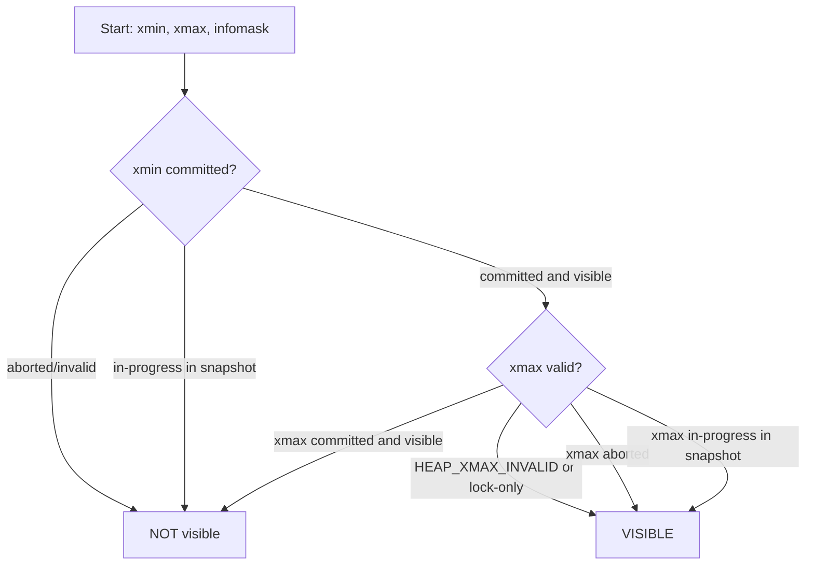
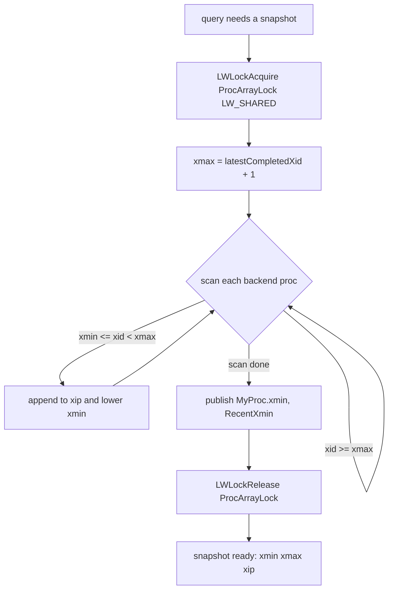
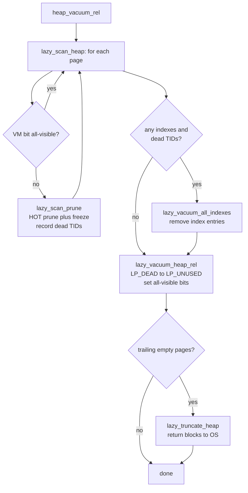
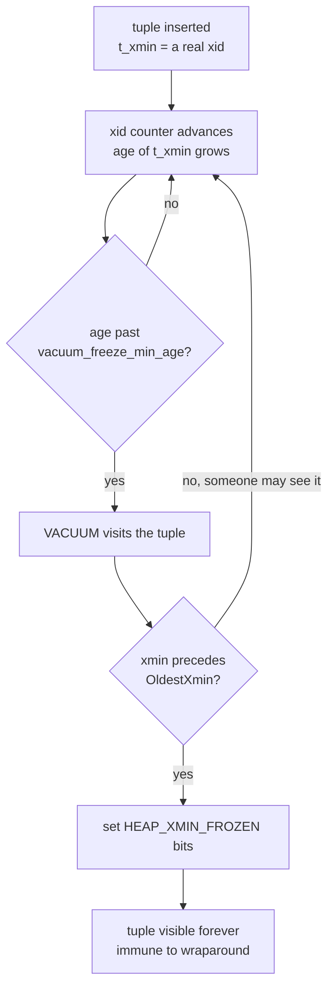
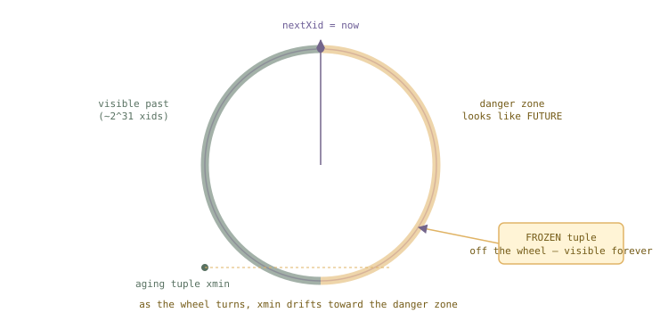
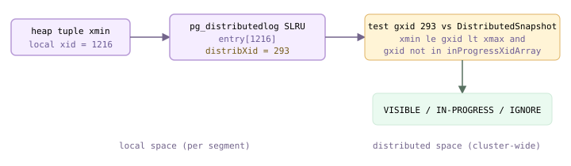
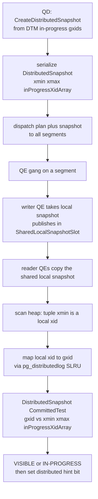

<style>
/*
 * Licensed to the Apache Software Foundation (ASF) under one
 * or more contributor license agreements.  See the NOTICE file
 * distributed with this work for additional information
 * regarding copyright ownership.  The ASF licenses this file
 * to you under the Apache License, Version 2.0 (the
 * "License"); you may not use this file except in compliance
 * with the License.  You may obtain a copy of the License at
 *
 *   http://www.apache.org/licenses/LICENSE-2.0
 *
 * Unless required by applicable law or agreed to in writing,
 * software distributed under the License is distributed on an
 * "AS IS" BASIS, WITHOUT WARRANTIES OR CONDITIONS OF ANY
 * KIND, either express or implied.  See the License for the
 * specific language governing permissions and limitations
 * under the License.
 */

/* Layout for the HTML-and-CSS figures, lifted from the handbook's own
   stylesheet so the figures render identically here. */

/* These four come from the handbook's own stylesheet; a consuming site has no
   such definitions, and an undefined custom property invalidates its whole
   declaration. Define them here, scoped to the figure.

   Deliberately NOT themed. The artwork below is light-only: band and tile
   backgrounds are hard-coded pastels, and the injected markup carries some 800
   more hard-coded light colours in inline styles. Giving --fg a dark-theme
   value paints near-white text onto a near-white band -- measured at 1.08:1,
   worse than the bug that replaced. The handbook's light values are correct in
   both themes; what changes for dark mode is the surface underneath. */
.cloudberry-core-figure {
  --border: #d8dee4;
  --soft:   #f6f8fa;
  --fg:     #1f2328;
  --muted:  #636c76;
  margin: 1.4rem 0;
}

/* Light-only artwork needs a light ground AND a dark ink, or it bleeds into a
   dark page. Setting only the ground is not enough: any text in these figures
   without its own inline colour inherits the site's near-white body colour, so
   it lands white-on-pastel -- measured at 1.03:1 across 184 text nodes. The
   colour has to be restored at the same place the ground is. */
[data-bs-theme='dark'] .cloudberry-core-figure > div {
  background: #ffffff;
  color: #1f2328;
  border-radius: 8px;
  padding: 10px;
}
/* Descendants that inherit rather than carry an inline colour. */
[data-bs-theme='dark'] .cloudberry-core-figure > div :not([style*="color"]) {
  color: inherit;
}
.cloudberry-core-figure figcaption {
  margin-top: .5rem;
  font-size: .9em;
  /* --ifm-color-emphasis-600 resolves to rgb(141,148,158) in the light theme,
     which is 3.06:1 on white -- below WCAG AA for the 37 figure captions.
     (The dark theme's value is fine, so only light is overridden.) */
  color: #636b75;
}
[data-bs-theme='dark'] .cloudberry-core-figure figcaption {
  color: #a6adb4;
}

/* Selective highlight: the handbook wraps a key token so it stands out.
   Scoped to the component. The class name .hl is two letters and this file
   lands in the consuming site's single global stylesheet, so an unscoped
   rule would style every page of that site. The standalone edition's
   figure.code / figure.session variants are dropped: those classes do not
   occur anywhere in this tree. */
.cloudberry-core-figure .hl { border-radius: 2px; font-weight: 700;
                   background: #fff8c5; color: #1f2328; padding: 0 2px; }

/* Layered module map and the banded brick figures. */
.cloudberry-core-figure .bricks { border:1px solid var(--border);border-radius:12px;overflow:hidden;background:var(--soft) }
.cloudberry-core-figure .bk-band { display:flex;align-items:stretch;border-top:1px solid var(--border) }
.cloudberry-core-figure .bk-band:first-child { border-top:none }
.cloudberry-core-figure .bk-lbl { flex:0 0 116px;display:flex;flex-direction:column;justify-content:center;gap:2px;padding:10px 13px }
.cloudberry-core-figure .bk-lbl b { font-size:12.5px;font-weight:800;color:var(--fg);line-height:1.2 }
.cloudberry-core-figure .bk-lbl span { font-size:9.5px;font-weight:700;color:var(--muted);text-transform:uppercase;letter-spacing:.5px }
.cloudberry-core-figure .bk-row { flex:1 1 auto;display:flex;flex-wrap:wrap;gap:7px;padding:9px 10px }
.cloudberry-core-figure .bk { flex:1 1 118px;min-width:104px;display:flex;flex-direction:column;justify-content:center;gap:2px; padding:8px 11px;border-radius:7px;border:1px solid;background:#fff;text-decoration:none;transition:.13s }
.cloudberry-core-figure .bk-t2 { font-size:12.5px;font-weight:700;line-height:1.25 }
.cloudberry-core-figure .bk-ch { font-size:10.5px;font-weight:700;font-variant-numeric:tabular-nums;opacity:.8 }
.cloudberry-core-figure a.bk:hover { transform:translateY(-2px);box-shadow:0 4px 12px #0000001f;text-decoration:none }
.cloudberry-core-figure .bk-q { background:#eef6ff }
.cloudberry-core-figure .bk-q .bk { border-color:#54aeff66;color:#0a3069;background:#ddf4ff }
.cloudberry-core-figure .bk-s { background:#eefcf2 }
.cloudberry-core-figure .bk-s .bk { border-color:#4ac26b80;color:#04260f;background:#dafbe1 }
.cloudberry-core-figure .bk-t { background:#fff6ef }
.cloudberry-core-figure .bk-t .bk { border-color:#fb8f4480;color:#5e2700;background:#fff1e5 }
.cloudberry-core-figure .bk-h { background:#fff4f3 }
.cloudberry-core-figure .bk-h .bk { border-color:#ff818280;color:#5c0011;background:#ffebe9 }
.cloudberry-core-figure .bk-r { background:#f3f5f8 }
.cloudberry-core-figure .bk-r .bk { border-color:#afb8c1;color:#1f2328;background:#eaeef2 }
@media (max-width: 560px) {
  .cloudberry-core-figure .bk-band { flex-direction:column }
  .cloudberry-core-figure .bk-lbl { flex-basis:auto;border-bottom:1px solid var(--border) }
}

</style>

<!--
  Licensed to the Apache Software Foundation (ASF) under one
  or more contributor license agreements.  See the NOTICE file
  distributed with this work for additional information
  regarding copyright ownership.  The ASF licenses this file
  to you under the Apache License, Version 2.0 (the
  "License"); you may not use this file except in compliance
  with the License.  You may obtain a copy of the License at

    http://www.apache.org/licenses/LICENSE-2.0

  Unless required by applicable law or agreed to in writing,
  software distributed under the License is distributed on an
  "AS IS" BASIS, WITHOUT WARRANTIES OR CONDITIONS OF ANY
  KIND, either express or implied.  See the License for the
  specific language governing permissions and limitations
  under the License.
-->


<a id="10-mvcc-snapshots--vacuum"></a>

## 10.1 快照与行版本可见性 {#101-snapshots--row-version-visibility}

MVCC 使读操作不阻塞写操作，写操作也不阻塞读操作。其背后的设计取舍已在内部架构一章中说明：PostgreSQL 和 Greenplum 使用 **Steal / No-Force** 缓冲区策略，却**不维护撤销日志**；`UPDATE` 或 `DELETE` 从不在原位置覆盖旧值，而是追加行的新*版本*，旧版本则作为*死亡*元组保留。“这个查询会看到哪个版本？”由逐元组的可见性检查回答，无需回滚任何内容。本节介绍的就是这项检查。本章后续的快照构建（[§10.2](#102-snapshot-structure--transaction-horizon)）、死亡版本回收（VACUUM，[§10.3](#103-vacuum--autovacuum)），以及分布式环境中的变化（[§10.5](#105-distributed-snapshots--the-distributed-log)），都以它为基础。

### 10.1.1 版本携带的信息，以及什么是快照 {#1011-what-a-version-carries-and-what-a-snapshot-is}

回顾 [§4.2](/cloudberry/core-internals/part-2-storage-data-layout/ch04/#42-row-version-layout)/[§4.3](/cloudberry/core-internals/part-2-storage-data-layout/ch04/#43-operations-on-tuples)：每个堆元组头部都保存两个事务 ID 和一组提示位。`t_xmin` 是**创建**该版本的 xid；`t_xmax` 是**删除或锁定**它的 xid（版本存活时为零）；`t_infomask` 中的位则缓存之后获知的这两个 xid 的信息。UPDATE 和 DELETE 不会改写已提交版本的数据字节，而是在旧版本上写入 `t_xmax`，并在 UPDATE 时写入带有新 `t_xmin` 的新版本。因此，磁盘上的表是一组版本，有些存活，有些死亡；可见性完全取决于 `(xmin, xmax, infomask)` 与查询事务所见状态之间的关系。

这个“所见状态”就是**快照**：它准确记录了获取快照那一刻哪些事务已经提交。其核心字段（`snapshot.h`）包括 `xmin`（所有小于它的 xid 都已确定结果）、`xmax`（所有大于等于它的 xid 都肯定*尚不可见*），以及 `xip[]`（两者之间仍在进行中的 xid）。当且仅当创建该版本的事务对快照可见，**且**删除它的事务不可见时，该版本才可见。

```c {title="src/include/utils/snapshot.h — SnapshotData"}
TransactionId xmin;   /* all XID < xmin are visible to me */
      TransactionId xmax;   /* all XID >= xmax are invisible to me */
      TransactionId *xip;   /* in-progress XIDs when snapshot taken */
      uint32        xcnt;   /* # of xact ids in xip[] */
      CommandId     curcid; /* in my xact, CID < curcid are visible */
```

### 10.1.2 判定规则：HeapTupleSatisfiesMVCC {#1012-the-rule-heaptuplesatisfiesmvcc}

完整检查位于 `HeapTupleSatisfiesMVCC`（`heapam_visibility.c`）中。从整体看，它依次回答两个问题：**插入事务对我可见吗？** 如果可见，**删除事务对我可见吗？** 只有第一个答案为*是*、第二个答案为*否*时，才显示该版本。

xmin 分支：如果元组已带有 `HEAP_XMIN_COMMITTED`，说明创建结果已确定，直接继续。否则代码会判定：设置了 `HEAP_XMIN_INVALID`，表示创建事务已中止，该版本从未有效存在，返回 false。如果创建者是*我们自己*正在运行的事务，则根据命令 ID 判断（10.1.4）。其他情况通过 `XidInMVCCSnapshot` 查询快照：如果创建者*在*快照中（在我们所见的状态中仍在进行），版本尚不可见；如果它已提交，则缓存 `HEAP_XMIN_COMMITTED` 并继续；如果它已中止，则缓存 `HEAP_XMIN_INVALID` 并判为不可见。

```c {title="src/backend/access/heap/heapam_visibility.c — HeapTupleSatisfiesMVCC()"}
if (!HeapTupleHeaderXminCommitted(tuple))
      {
          if (HeapTupleHeaderXminInvalid(tuple))
              return false;                 /* creator aborted */
          ...
          else /* not ours */
          {
              snapshotCheckResult = XidInMVCCSnapshot(
                  HeapTupleHeaderGetRawXmin(tuple), snapshot, ... );
              if (snapshotCheckResult == XID_IN_SNAPSHOT)
                  return false;             /* creator not yet visible */
              else if (... TransactionIdDidCommit(...))
                  SetHintBits(tuple, buffer, relation,
                              HEAP_XMIN_COMMITTED, ...);
              else { SetHintBits(... HEAP_XMIN_INVALID ...); return false; }
          }
      }
      /* by here, the inserting transaction has committed */
```

xmax 分支：此时创建事务可见，因此版本*本应*显示，除非一次可见的删除使其失效。如果设置了 `HEAP_XMAX_INVALID`（或该行仅被锁定而未被删除），就不存在删除，返回 true。否则对 `t_xmax` 执行*相同的*快照检查。如果删除事务在我们的快照中仍在进行，那么对我们而言删除尚未发生，该版本**可见**。如果删除事务在我们的视图内已提交，则删除有效，该版本**不可见**。如果删除事务已中止，则删除失效，版本**可见**，并缓存 `HEAP_XMAX_INVALID`，让后续读取者无需再次检查。

```c {title="src/backend/access/heap/heapam_visibility.c — HeapTupleSatisfiesMVCC()"}
if (tuple->t_infomask & HEAP_XMAX_INVALID)  /* no valid delete */
          return true;
      if (HEAP_XMAX_IS_LOCKED_ONLY(tuple->t_infomask))
          return true;                              /* locked, not deleted */
      ...
      snapshotCheckResult = XidInMVCCSnapshot(
          HeapTupleHeaderGetRawXmax(tuple), snapshot, ... );
      if (snapshotCheckResult == XID_IN_SNAPSHOT)
          return true;                              /* deleter not visible yet */
      if (!(... TransactionIdDidCommit(...))) {
          SetHintBits(... HEAP_XMAX_INVALID ...);
          return true;                              /* deleter aborted */
      }
      return false;                                 /* delete is visible: hide row */
```

快照成员检查本身由 `XidInMVCCSnapshot_Local`（`snapmgr.c`）完成，它在扫描数组前先执行开销很小的范围检查：`xid < snapshot->xmin` 表示结果已确定且可见（false = 非进行中）；`xid >= snapshot->xmax` 表示肯定不可见（true = 进行中）；只有位于两者之间的 xid 才需要通过 `xip[]` 判断。这就是两个边界字段如此重要的原因：大多数 xid 只需一次比较就能判定。

```c {title="src/backend/utils/time/snapmgr.c — XidInMVCCSnapshot_Local()"}
/* Any xid < xmin is not in-progress */
      if (TransactionIdPrecedes(xid, snapshot->xmin))
          return false;
      /* Any xid >= xmax is in-progress */
      if (TransactionIdFollowsOrEquals(xid, snapshot->xmax))
          return true;
      /* ...otherwise search xip[]/subxip[] */
```



*HeapTupleSatisfiesMVCC——单个版本的可见性判定*

### 10.1.3 提示位：只付出一次 CLOG 查询开销 {#1013-hint-bits-pay-the-clog-lookup-once}

回答“xid 1221 是否提交了？”需要查询 CLOG（[§9.3](/cloudberry/core-internals/part-3-transactions-mvcc-concurrency/ch09/#93-local-transaction-implementation)），这是一次共享查询，还可能访问磁盘。如果每次扫描的每个元组都这样做，开销会极大。因此，第一个得出结论的访问者会将结果写回元组的 `t_infomask`，使用的函数是 `SetHintBits`。此后，`HeapTupleHeaderXminCommitted(tuple)` 只需检查一个位，就能跳过 CLOG 查询。提示位纯粹是缓存，本身不构成权威依据（只有在 CLOG 确认结果*之后*才会设置），丢失也无妨：如果页面在提示位刷新前被逐出，下一位读取者只需重新推导并设置它。

- **HEAP_XMIN_COMMITTED (0x0100)**——创建事务已提交；无需访问 CLOG，按快照判断 `t_xmin` 是否可见即可。
- **HEAP_XMIN_INVALID (0x0200)**——创建事务已中止；该版本从一开始就是死亡的。
- **HEAP_XMAX_COMMITTED (0x0400)**——删除事务已提交；一旦它对读取者的快照可见，删除就生效。
- **HEAP_XMAX_INVALID (0x0800)**——没有有效的删除事务（从未删除，或删除事务已中止）；xmax 字段没有意义。

> [!NOTE]
> Cloudberry 在 `t_infomask2`（不是 `t_infomask`）中增加了两个**分布式**提示位：`HEAP_XMIN_DISTRIBUTED_SNAPSHOT_IGNORE`（0x0800）和 `HEAP_XMAX_DISTRIBUTED_SNAPSHOT_IGNORE`（0x1000）。在 Segment 上，一旦根据*分布式*快照确认某个 xid 的全局结果已确定，就设置相应位。此后对该元组的可见性检查会跳过分布式检查，直接进入本地检查；这仍是“只付出一次开销”的思路，只是提升了一个层次。检查的分布式部分见 [§10.5](#105-distributed-snapshots--the-distributed-log)。

*Segment 0 上的存活行与已删除行——删除表现为写入的 t_xmax*

```sql
-- coordinator (:7100): two rows land on seg 0, delete one
      DELETE FROM vis WHERE id = 3;

      -- segment 0 in utility mode (:7102):
      PGOPTIONS='-c gp_role=utility' psql -p 7102 -d postgres
      SELECT lp, t_xmin, t_xmax, to_hex(t_infomask) AS infomask
      FROM heap_page_items(get_raw_page('vis',0))
      WHERE t_xmin IS NOT NULL ORDER BY lp;
```

```text {hl_lines="3 4" title="output"}
 lp | t_xmin | t_xmax | infomask
      ----+--------+--------+----------
        1 |   1221 |      0 | 902
        2 |   1221 |   1222 | 102
        3 |   1221 |      0 | 802
        ...
        8 |   1221 |      0 | 802
      (8 rows)
```

每个版本都由 xid 1221 创建。存活行（`lp` 1、3–8）的 `t_xmax = 0`，并设置了 `HEAP_XMAX_INVALID`；`0x802` 就是 `HEAP_XMAX_INVALID(0x800) | HEAP_HASVARWIDTH(0x02)`，而 `0x902` 还增加了 `HEAP_XMIN_COMMITTED(0x100)`，因为之前的一次读取已经为该行设置了提示位。已删除的行 `lp 2` 是例外：其 `t_xmax` 写入了删除事务 1222，infomask `102` 中的 `HEAP_XMAX_INVALID` 已被*清除*。`HeapTupleSatisfiesMVCC` 正是读取这一状态，使该行对所有能看到 xid 1222 已提交的快照不可见。

### 10.1.4 两个时间重叠的快照 {#1014-a-tale-of-two-overlapping-snapshots}

用两个会话最容易理解这条规则。会话 A 开启一个 `REPEATABLE READ` 事务并获取快照；随后会话 B 插入新行并提交。B 插入行的 `t_xmin` 满足 `>= A.snapshot->xmax`，落在 A 的固定快照不可见的一侧，因此无论 A 查看多少次，都看不到它。只有在 B 提交后获取的*新*快照，才会将 B 的 xid 包含在 `xmax` 以下，从而显示该行。

*可重复读保持原快照；在获取新快照之前，并发提交不可见*

```sql
-- Session A                       -- Session B
      BEGIN ISOLATION LEVEL
        REPEATABLE READ;
      SELECT * FROM t;
                                         INSERT INTO t VALUES (2,'bob');
      SELECT * FROM t;   -- same snapshot
      COMMIT;
      SELECT * FROM t;   -- fresh snapshot
```

```text {hl_lines="8 13" title="output"}
-- A, first SELECT (snapshot taken):
       id |  val
      ----+-------
        1 | alice
      -- A, second SELECT (B has committed bob, but A's snapshot is unchanged):
       id |  val
      ----+-------
        1 | alice          <- bob still invisible
      -- A, after COMMIT, fresh snapshot:
       id |  val
      ----+-------
        2 | bob
        1 | alice          <- now visible
```

另一半是同一事务内部的可见性，它*不是*快照问题，而是命令 ID 问题。同一事务中，后面的命令必须能看到前面命令的效果。因此，当 `HeapTupleSatisfiesMVCC` 发现 `t_xmin` 就是当前事务自己的 xid 时，会比较元组的 `cmin` 与 `snapshot->curcid`，而不扫描 `xip[]`。语句之间通过 `CommandCounterIncrement` 推进计数器（同一事务中*既创建又删除*的行，其 cmin/cmax 由组合命令 ID 机制打包，见 [§4.6](/cloudberry/core-internals/part-2-storage-data-layout/ch04/#46-combocid)）。结果是：在事务内部，一次 INSERT 对接下来的 SELECT 立即可见。

```c {title="src/backend/access/heap/heapam_visibility.c — HeapTupleSatisfiesMVCC()"}
else if (TransactionIdIsCurrentTransactionId(
                   HeapTupleHeaderGetRawXmin(tuple)))
      {
          if (HeapTupleHeaderGetCmin(tuple) >= snapshot->curcid)
              return false;   /* inserted by a later command in my xact */
          ...
          return true;        /* inserted by an earlier command: visible */
      }
```

*同一事务中，前一条命令的 INSERT 对后续 SELECT 可见（CommandCounterIncrement 推进 curcid）*

```sql
BEGIN;
      INSERT INTO cci VALUES (100);
      SELECT * FROM cci;
      COMMIT;
```

```text {hl_lines="5" title="output"}
BEGIN
      INSERT 0 1
       id
      -----
       100          <- own uncommitted insert, seen via cmin < curcid
      (1 row)
      COMMIT
```

因此，“查询会看到哪个版本”的完整答案是：解析 `t_xmin` 和 `t_xmax` 时，依据快照的 `xmin`/`xmax`/`xip[]`（对于自己的事务，则根据 `curcid` 判断），将 CLOG 的判定结果缓存在 infomask 提示位中，并且只在创建可见、删除不可见时显示该版本。下一节 [§10.2](#102-snapshot-structure--transaction-horizon) 将讨论*快照从何而来*，即 `GetSnapshotData` 如何扫描 procarray，计算出这些 `xmin`/`xmax`/`xip` 字段。

## 10.2 快照结构与事务视界 {#102-snapshot-structure--transaction-horizon}

元组携带自己的 `xmin`/`xmax`（[§4.2](/cloudberry/core-internals/part-2-storage-data-layout/ch04/#42-row-version-layout)），这些 xid 的提交结果保存在 CLOG 中（[§9](/cloudberry/core-internals/part-3-transactions-mvcc-concurrency/ch09/)）。但这还不足以判定可见性：*在我的查询开始那一刻，xmin 已提交了吗？* **快照**回答的正是这个问题。它固定了某个时刻仍在运行的事务集合，使一条查询，或整个 `REPEATABLE READ` 事务，无论底层状态如何变化，都能始终看到数据库的同一个自洽版本。

在 `READ COMMITTED` 下，Cloudberry 在*每条* SQL 语句开始时获取新快照；在 `REPEATABLE READ`/`SERIALIZABLE` 下，则在第一条语句时获取快照，并在事务整个生命周期内复用（[§9](/cloudberry/core-internals/part-3-transactions-mvcc-concurrency/ch09/)）。本节介绍快照在物理上*是什么*，如何通过扫描所有后端构建，以及它所阻止推进的**视界**——任何活动快照仍然关心的最老 xid。VACUUM（[§10.3](#103-vacuum--autovacuum)）回收死亡元组前，必须遵守这一边界。

### 10.2.1 三区模型：xmin、xmax、xip[] {#1021-the-three-zone-model-xmin-xmax-xip}

快照在 xid 轴上划出两条边界，并列出两者之间的例外。整个模型可归结为 `SnapshotData` 的三个字段：

- **`xmin`**——获取快照时仍在运行的最小 xid。所有**小于** `xmin` 的 xid 都已结束（提交或中止），其结果*已确定*，因此仅由 CLOG 判定可见性，无需继续查找。
- **`xmax`**——已完成事务中的最大 xid 加一，即 `latestCompletedXid + 1`。所有**大于等于** `xmax` 的 xid 都在快照之后开始，按定义不可见：对这个快照而言，未来尚不存在。
- **`xip[]` + `xcnt`**——在窗口 `[xmin, xmax)` 内捕获的进行中 xid，也就是*空洞*。该范围内的 xid 可见，**除非**它出现在 `xip[]` 中；出现则说明它当时仍在运行，其效果需要隐藏。

```c {title="src/include/utils/snapshot.h — SnapshotData"}
TransactionId xmin;   /* all XID < xmin are visible to me */
      TransactionId xmax;   /* all XID >= xmax are invisible to me */
      TransactionId *xip;   /* in-progress xids, xmin <= xip[i] < xmax */
      uint32        xcnt;   /* # of xact ids in xip[] */
```

因此，xid `x` 的可见性有三个分支：`x < xmin` → *结果已确定*（查询 CLOG）；`x >= xmax` → *未来*（不可见）；否则扫描 `xip[]`，命中表示仍在运行、不可见，未命中表示在快照时已提交。`xmin` 和 `xmax` 的作用纯粹是提供快速路径，让常见情况无需访问 `xip[]` 数组。子事务 xid 随附于并行的 `subxip[]` 中（[§9](/cloudberry/core-internals/part-3-transactions-mvcc-concurrency/ch09/)），而 `snapshot_type`（普通查询为 `SNAPSHOT_MVCC`，另有 `SNAPSHOT_DIRTY`、`SNAPSHOT_NON_VACUUMABLE` 等特殊模式）决定采用哪套可见性规则。

![典型快照图——xid 轴分为结果已确定区、含 xip[] 空洞的可见窗口和未来区](fig-014.svg)

*典型快照图——xid 轴分为结果已确定区、含 xip[] 空洞的可见窗口和未来区*

`xmin` 以下的绿色区域无需查询 `xip[]`；大于等于 `xmax` 的灰色区域全部不可见；只有中间琥珀色的空洞需要查数组。因此，`pg_current_snapshot()` 打印紧凑的三元组 `xmin:xmax:xip1,xip2,…`，一行就表示了整个模型。

*没有并发时的快照三元组——窗口为空，xmin == xmax*

```sql
SELECT pg_current_snapshot();
```

```text {hl_lines="3" title="output"}
 pg_current_snapshot 
      ---------------------
       1143:1143:
      (1 row)
```

没有其他事务运行时，`xmin == xmax`，`xip[]` 为空：边界以下的所有 xid 结果均已确定，大于等于边界的都属于未来，中间区域不存在。要制造一个空洞，需要某个事务*仍在运行*，且其 xid **严格小于** `xmax`。这意味着另一个事务必须在它开始后提交，将 `latestCompletedXid`（以及 `xmax`）推进到它之后。下面，会话 A 开启事务（xid 1213）并休眠；会话 C 提交（xid 1214），推进视界；随后会话 B 获取快照：

*A 成为空洞——B 的快照将窗口内的 xid 1213 列为进行中（Segment 0，utility 模式）*

```sql
-- session A:  BEGIN; INSERT ...; txid_current() -> 1213; pg_sleep(5)
      -- session C:  INSERT ...; txid_current() -> 1214;  (commits)
      -- session B:
      SELECT pg_current_snapshot();
```

```text {hl_lines="3" title="output"}
 pg_current_snapshot 
      ---------------------
       1213:1216:1213
      (1 row)
```

B 的快照是 `xmin=1213`、`xmax=1216`、`xip=[1213]`。事务 A（1213）处于 `[1213,1216)` 内，但列在 `xip[]` 中，因此其未提交行对 B 不可见；C（1214）*不在*列表中，因此 C 已提交的行*可见*。任何 xid ≥ 1216 都尚未被看到。注意，这里以 *utility 模式*连接 Segment 运行（[§9](/cloudberry/core-internals/part-3-transactions-mvcc-concurrency/ch09/)），其本地 procarray 的行为与原生 PostgreSQL 相同。在 Coordinator 上，还会叠加一层**分布式**快照，见 [§10.5](#105-distributed-snapshots--the-distributed-log)。

> [!NOTE]
> `pg_current_snapshot()` / `txid_current_snapshot()` 的文本形式采用相同的三区模型，但数字是 64 位*完整* xid（纪元·xid），因此看起来永不回卷。关于 `FullTransactionId` 与 32 位 `TransactionId`（存储在 `SnapshotData.xmin` 中）的区别，见 [§9](/cloudberry/core-internals/part-3-transactions-mvcc-concurrency/ch09/)。

### 10.2.2 GetSnapshotData：扫描 ProcArray {#1022-getsnapshotdata-scanning-the-procarray}

快照并非预先存放在某处，而是由 `GetSnapshotData` 按需*计算*。该函数遍历 **ProcArray**——各活动后端在其中公布当前 xid 的共享内存表。在持有共享 `ProcArrayLock` 时（只*读取*数组，因此共享模式足够），它确定 `xmax` 的值，依据是全局 `latestCompletedXid`，然后扫描所有后端，将仍在运行的 xid 收集到 `xip[]`，并把最小值记为 `xmin`。

```c {title="src/backend/storage/ipc/procarray.c — GetSnapshotData()"}
LWLockAcquire(ProcArrayLock, LW_SHARED);
      ...
      /* xmax is always latestCompletedXid + 1 */
      xmax = XidFromFullTransactionId(latest_completed);
      TransactionIdAdvance(xmax);
```

```c {title="src/backend/storage/ipc/procarray.c — GetSnapshotData()"}
if (!NormalTransactionIdPrecedes(xid, xmax))
          continue;                    /* >= xmax: treated as running anyway */
      if (NormalTransactionIdPrecedes(xid, xmin))
          xmin = xid;                  /* track the oldest running xid */
      xip[count++] = xid;              /* record it as a hole */
```

扫描期间持锁使快照保持*稳定*：进行中 xid 的集合在复制过程中不会变化，因此查询视图内部一致。同一次计算还得到两个后端全局变量：`RecentXmin` 是最近快照的 `xmin`，`TransactionXmin` 是当前事务仍在使用的最老 `xmin`。`GetSnapshotData` 还会将后者公布到 `MyProc->xmin`，让集群其他部分知道该后端仍需回溯到多早。



*GetSnapshotData——从 ProcArray 构建快照*

### 10.2.3 事务视界 {#1023-the-transaction-horizon}

每个正在执行查询的后端都会公布其仍持有的最老快照的 `xmin`。整个 ProcArray 中**最老**的这个 `xmin` 就是*事务视界*：没有活动事务能看到在它之前已死亡的行。因此，如果删除某元组的事务已提交，且其 xid 早于视界，那么该元组**对所有事务**都已死亡，可以安全移除。这就是 VACUUM（[§10.3](#103-vacuum--autovacuum)）遵守的约定。视界由 `ComputeXidHorizons` 计算，它将各后端的 `xmin` 汇总为一组 `*_oldest_nonremovable` 边界：

```c {title="src/backend/storage/ipc/procarray.c — ComputeXidHorizons()"}
h->shared_oldest_nonremovable =
          TransactionIdOlder(h->shared_oldest_nonremovable, xmin);
      ...
      h->data_oldest_nonremovable =
          TransactionIdOlder(h->data_oldest_nonremovable, xmin);
```

由于作用范围不同，视界也有多个：共享系统目录必须考虑*所有*数据库中的后端，普通（`data`）表则只需考虑当前数据库的后端。单个旧快照——例如执行了 `BEGIN`、取得快照后被遗忘的空闲事务——就会拖住整个集群的视界，阻止元组回收，这是表膨胀的典型原因。可以直接观察视界：`pg_stat_activity.backend_xmin` 就是每个后端公布的 `xmin`。

*停滞的视界——空闲的 REPEATABLE READ 事务固定了 backend_xmin（Coordinator :7100）*

```sql
-- session A:  BEGIN ISOLATION LEVEL REPEATABLE READ;
      --             SELECT count(*) FROM pg_class;   -- pins a snapshot
      --             pg_sleep(...)
      SELECT pid, state, backend_xmin, now()-xact_start AS held_for
        FROM pg_stat_activity
       WHERE backend_xmin IS NOT NULL
       ORDER BY xact_start;
```

```text {hl_lines="3" title="output"}
 pid  | state  | backend_xmin |   held_for    
      ------+--------+--------------+---------------
       4325 | active |     1149   | 00:00:01.50
       4333 | active |      1149    | 00:00:00
      (1 row shown)
```

后端 4325 已保持 `backend_xmin = 1149` 超过一秒：只要事务未结束，VACUUM 就无法回收在 xid 1149 或之后变为死亡状态的任何元组，不论它已经死亡多久。视界始终受最老活动快照的约束。

### 10.2.4 系统目录快照：为什么 DDL 立即可见 {#1024-catalog-snapshots-why-ddl-is-seen-immediately}

快照隔离有一个刻意保留的例外。如果系统目录扫描也使用查询的 MVCC 快照，那么在 `REPEATABLE READ` 下，并发事务*已提交*的表结构更改仍会通过旧的系统目录行读取，导致规划器可能针对已不存在的列生成计划。因此，系统目录查询使用独立且始终保持最新的**系统目录快照**：由 `GetCatalogSnapshot` 获取，缓存在 `CatalogSnapshot` 中，并在相关系统目录更改触发失效通知时立即丢弃。

```c {title="src/backend/utils/time/snapmgr.c — GetNonHistoricCatalogSnapshot()"}
if (CatalogSnapshot == NULL)
      {
          /* Get new snapshot. */
          CatalogSnapshot = GetSnapshotData(&CatalogSnapshotData,
                                            distributedTransactionContext);
          ...
      }
      return CatalogSnapshot;
```

每次系统目录更改都会通过 `InvalidateCatalogSnapshot` 使其失效，并在需要时重建，因此系统目录快照始终反映*最新*已提交的 DDL，即使在数据视图已固定、运行时间很长的 `REPEATABLE READ` 事务中也是如此。这就是新增列或新建索引能立即使用，而表中*数据*仍遵循事务原始快照的原因。

### 10.2.5 导出快照 {#1025-exporting-a-snapshot}

两个独立后端通常会在略有差异的时刻各自计算快照，因此并不共享完全相同的视图。为保证并行工作的状态一致，可以*导出*快照；典型场景是并行 `pg_dump`，多个工作连接必须转储*同一个*数据库状态。`pg_export_snapshot()`（由 `ExportSnapshot` 实现）将当前快照写入文件并返回一个令牌；另一个事务随后通过 `SET TRANSACTION SNAPSHOT '<token>'` 采用这个快照。

```c {title="src/backend/utils/time/snapmgr.c — ExportSnapshot()"}
char *
      ExportSnapshot(Snapshot snapshot)
      {
          ...
          /* The basename of the file is what we return from pg_export_snapshot(). */
      }
```

*导出快照会返回可共享的令牌*

```sql
BEGIN ISOLATION LEVEL REPEATABLE READ;
      SELECT pg_export_snapshot();
      COMMIT;
```

```text {hl_lines="3" title="output"}
 pg_export_snapshot  
      ---------------------
       00000008-0000002A-1
      (1 row)
```

令牌编码了源事务和一个序号。另一个会话执行 `SET TRANSACTION SNAPSHOT '00000008-0000002A-1'`，就会导入完全相同的 `xmin`/`xmax`/`xip[]` 三元组，从而看到相同的数据库状态。导出事务必须保持未结束，直到导入者完成接入。在此期间，它的快照也会固定视界，因此导出的快照与其他快照一样，会在其生命周期内限制 VACUUM 的回收进度。

> [!NOTE]
> 在 MPP 集群中，这个思路扩展到了更大范围：Coordinator 必须向*每个* Segment 提供统一的分布式事务状态视图，方法是构建并分发分布式快照。这相当于 Coordinator 到 Segment 的快照导出，具体机制见 [§10.5](#105-distributed-snapshots--the-distributed-log)。

## 10.3 清理与自动清理 {#103-vacuum--autovacuum}

MVCC 从不原地覆盖行。每次 `UPDATE` 都留下旧版本并插入新版本；每次 `DELETE` 仅写入 `xmax`；即使中止的 `INSERT` 也会留下一个元组，其 `xmin` 永远不会提交（[§4.3](/cloudberry/core-internals/part-2-storage-data-layout/ch04/#43-operations-on-tuples)）。当任何活动快照都不再能看到这样的元组时，它就已**死亡**，只会浪费空间，使堆及其索引膨胀。**清理（Vacuum）** 就是垃圾回收器，负责回收这些空间，供*关系内部复用*。这里必须准确区分：惰性 `VACUUM` 将空闲空间归还到表自身的空闲空间映射，而非操作系统；通过缩小文件向操作系统归还空间的是 `VACUUM FULL`/`CLUSTER`，见 [§10.6](#106-rebuilding-tables--indexes)。

可见性规则由 `HeapTupleSatisfiesVacuum` 决定：只有元组的 `xmax` 已提交，*并且*早于**可移除边界**时才能移除（即任何运行中事务可能需要的最老 xmin，由 `ComputeXidHorizons` 计算，见 [§10.4](#104-freezing--xid-wraparound)）。更晚的元组属于*最近死亡*：已经死亡，但尚不能移除。

### 10.3.1 惰性清理的各个阶段 {#1031-the-lazy-vacuum-phases}

`VACUUM t` 经由 `vacuum_rel` 进入表访问方法的 `relation_vacuum` 回调，对堆来说就是 `heap_vacuum_rel`。它初始化一个 `LVRelState`，再调用整个过程的核心 `lazy_scan_heap`。工作最多分为四个阶段。

```c {title="src/backend/access/heap/vacuumlazy.c — heap_vacuum_rel()"}
void
      heap_vacuum_rel(Relation rel, VacuumParams *params,
                      BufferAccessStrategy bstrategy)
      {
          LVRelState *vacrel;
          ...
          lazy_scan_heap(vacrel);          /* phases 1-3 */
          if (should_attempt_truncation(vacrel))
              lazy_truncate_heap(vacrel);  /* phase 4 */
```

**阶段 1——堆扫描。** `lazy_scan_heap` 逐块遍历关系，对每个页面取得清理锁并调用 `lazy_scan_prune`，择机进行 **HOT 剪枝**（[§4.5](/cloudberry/core-internals/part-2-storage-data-layout/ch04/#45-page-pruning--hot-updates)）：压缩 HOT 链，将完全死亡的元组变为 `LP_DEAD` 行指针，然后冻结旧元组，将死亡项的 TID 记录到 `dead_items` 数组中。关键优化是：完全跳过**可见性映射**中标记为 `all-visible` 的页面，因为没有死亡元组的页面无须清理。

**阶段 2——索引清理。** 索引条目仍指向死亡堆元组的 TID，因此释放这些行指针之前必须扫描所有索引。`lazy_vacuum_all_indexes` 调用各索引访问方法的批量删除操作，移除引用死亡 TID 的条目。如果没有索引，或剪枝后已无可移除项，就跳过这一阶段。

```c {title="src/backend/access/heap/vacuumlazy.c — lazy_vacuum_all_indexes()"}
static bool
      lazy_vacuum_all_indexes(LVRelState *vacrel)
      {
          ...
          pgstat_progress_update_param(PROGRESS_VACUUM_PHASE,
                                       PROGRESS_VACUUM_PHASE_VACUUM_INDEX);
```

**阶段 3——堆清理。** 只有到了此时，在不再有索引指向这些项之后，`lazy_vacuum_heap_rel` 才重新访问已记录的页面，将每个 `LP_DEAD` 行指针变为 `LP_UNUSED`，实际回收槽位，并更新空闲空间映射和可见性映射。完全清理干净的页面会设置其 VM 的 `all-visible` 位。

**阶段 4——截断。** 如果扫描发现关系*末尾*有连续的空页，`lazy_truncate_heap` 会短暂获取访问排他锁，将它们截掉，把这些尾部块归还操作系统。这是惰性清理中唯一会缩小文件的部分，而且只影响尾部。



*惰性清理控制流——通过 VM 跳过分支直接略过干净页面*

### 10.3.2 可见性映射 {#1032-the-visibility-map}

可见性映射是随每个堆保存的小型分叉文件，**每个堆页面占用两位**（`BITS_PER_HEAPBLOCK`）。它由 `visibilitymap.c` 维护，通过 `visibilitymap_get_status` 读取。这两位承载了清理过程的关键优化信息。

- **ALL_VISIBLE（`0x01`）**——页面上的所有元组都对当前和未来的所有事务可见。清理可以跳过该页；仅索引扫描可以直接从索引取得结果，无需访问堆。
- **ALL_FROZEN（`0x02`）**——所有元组还都已冻结（[§10.2](#102-snapshot-structure--transaction-horizon)）。即使防回卷清理也可以跳过该页，因为其中没有内容需要再次冻结。

<figure class="cloudberry-core-figure">
<div><div style="max-width:720px;margin:2px auto;font:11px/1.4 ui-monospace,SFMono-Regular,Menlo,monospace;color:#1f2328;overflow-x:auto"><div style="min-width:560px"><div style="text-align:center;color:#73658b;font-size:10px;padding:1px">↑ 一个 VM 字节 = 4 个堆页面 ↑</div><div style="display:flex;gap:2px"><div style="flex:1;border:1px solid #cdb4db;background:#f5edff;text-align:center;padding:5px 2px">页面 0<br>FRZ VIS</div><div style="flex:1;border:1px solid #cdb4db;background:#f5edff;text-align:center;padding:5px 2px">页面 1<br>FRZ VIS</div><div style="flex:1;border:1px solid #cdb4db;background:#f5edff;text-align:center;padding:5px 2px">页面 2<br>FRZ VIS</div><div style="flex:1;border:1px solid #cdb4db;background:#f5edff;text-align:center;padding:5px 2px">页面 3<br>FRZ VIS</div></div><div style="display:flex;gap:2px;margin-top:2px"><div style="flex:1;border:1px solid #e0b365;background:#fff4d6;text-align:center;padding:5px 2px;color:#735a16">0&nbsp;&nbsp;1</div><div style="flex:1;border:1px solid #e0b365;background:#fff4d6;text-align:center;padding:5px 2px;color:#735a16">1&nbsp;&nbsp;1</div><div style="flex:1;border:1px solid #cdb4db;background:#f4f5f6;text-align:center;padding:5px 2px;color:#656b72">0&nbsp;&nbsp;0</div><div style="flex:1;border:1px solid #e0b365;background:#fff4d6;text-align:center;padding:5px 2px;color:#735a16">0&nbsp;&nbsp;1</div></div><div style="text-align:center;color:#73658b;font-size:10px;padding:2px">每页位布局：VISIBLE=0x01，FROZEN=0x02；灰色页面为脏页，清理必须访问</div></div></div></div>
<figcaption>可见性映射——每个堆页面占两位，一个字节紧凑存放四个页面的信息</figcaption>
</figure>

### 10.3.3 清理实操 {#1033-vacuum-in-action}

创建堆表，删除一半数据，再查询每个 Segment 的 `pg_stat_user_tables`，查看产生了多少死亡元组。（统计信息分属各 Segment，通过 `gp_dist_random` 汇总。）

*删除一半行后，一半元组已死亡*

```sql
CREATE TABLE vac_demo2 (id int, pad text) DISTRIBUTED BY (id);
      INSERT INTO vac_demo2 SELECT g, repeat('x',100) FROM generate_series(1,100000) g;
      DELETE FROM vac_demo2 WHERE id % 2 = 0;
      SELECT sum(n_live_tup) AS n_live_tup, sum(n_dead_tup) AS n_dead_tup
      FROM gp_dist_random('pg_stat_user_tables') WHERE relname='vac_demo2';
```

```text {hl_lines="5" title="output"}
INSERT 0 100000
      DELETE 50000
       n_live_tup | n_dead_tup
      ------------+------------
            50000 |      50000
```

现在执行清理。为了读取一份不混杂其他节点信息的 `VERBOSE` 报告，我们以 utility 模式在单个 Segment 上运行（[§9](/cloudberry/core-internals/part-3-transactions-mvcc-concurrency/ch09/)）；Coordinator 则会将同样的工作分发到所有 Segment。注意前后 VM 检查的变化：包含已删除元组的页面，从*没有一个*全可见，变为*全部*全可见。

*VACUUM VERBOSE 回收死亡行指针，并设置所有 all-visible 位（Segment 0，utility 模式，端口 7102）*

```sql
SELECT count(*) FILTER (WHERE all_visible) AS all_visible_pages,
             count(*) AS total_pages FROM pg_visibility_map('vac_demo2');
      VACUUM (VERBOSE) vac_demo2;
      SELECT count(*) FILTER (WHERE all_visible) AS all_visible_pages,
             count(*) AS total_pages FROM pg_visibility_map('vac_demo2');
```

```text {hl_lines="3 8 16" title="output"}
 all_visible_pages | total_pages
      -------------------+-------------
                       0 |         144

      INFO:  vacuuming "postgres.public.vac_demo2"
      INFO:  finished vacuuming "postgres.public.vac_demo2": index scans: 0
      pages: 0 removed, 144 remain, 144 scanned (100.00% of total)
      tuples: 16725 removed, 16737 remain, 0 are dead but not yet removable
      removable cutoff: 1163, which was 3 XIDs old when operation ended
      index scan not needed: 144 pages ... had 16725 dead item identifiers removed
      ...
      VACUUM

       all_visible_pages | total_pages
      -------------------+-------------
                     144 |         144
```

> [!NOTE]
> 出现 `index scans: 0` / `index scan not needed`，是因为 **vac_demo2** 没有索引，因此跳过阶段 2，LP_DEAD 项直接变为 LP_UNUSED。添加索引后，报告会出现 `index scan needed` 行，且 `index scans` 不再为零。16725 是 50000 个已删除行中位于这个 Segment 上的数量。

### 10.3.4 自动清理及 Cloudberry 对它的限制 {#1034-autovacuum--and-how-cloudberry-restricts-it}

`VACUUM` 不一定要手动运行。**自动清理**子系统（`autovacuum.c`）运行一个*启动进程*，定期唤醒并为各数据库派生*工作进程*；工作进程扫描 `pg_class`/`pg_stat`，由 `relation_needs_vacanalyze` 决定每个表需要什么操作。当表的死亡元组数超过 `autovacuum_vacuum_threshold + autovacuum_vacuum_scale_factor × reltuples` 时，就符合清理条件；默认值分别为 `50` 和 `0.2`，约相当于 20% 的数据发生更替。

> [!NOTE]
> **CBDB 注意事项——依据其源码核实，不能照搬上游行为。** Cloudberry 延续了 Greenplum 的设计：**没有分布式自动清理**。工作进程在各 Segment 上独立、本地运行。关键在于，`relation_needs_vacanalyze` 中的自动清理 **VACUUM 只对系统目录表启用**；用户堆表交由 DBA 维护，或在防回卷时处理：`if (!IsSystemClass(relid, classForm) && !force_vacuum) *dovacuum = false;`。原因写在文件头部：系统目录在各 Segment 上的膨胀程度相近，OLTP 用户表却不是如此，因此混用全局和本地的清理决策会在 Segment 上触发不必要的清理。

```c {title="src/backend/postmaster/autovacuum.c — relation_needs_vacanalyze()"}
/*
       * GPDB: Autovacuum VACUUM is only enabled for catalog tables. (But ignore
       * if at risk of wrap around and proceed to vacuum)
       */
      if (!IsSystemClass(relid, classForm) && !force_vacuum)
          *dovacuum = false;
```

同一文件还说明了 Cloudberry 的另外两点：只要任何表的 `relfrozenxid` 年龄越过 `autovacuum_freeze_max_age`，仍会触发**防回卷**清理（`force_vacuum` 会覆盖“仅限系统目录”的规则）；而 **AO/AOCO 表完全豁免回卷清理**，因为它们不保存逐元组 xid，`relfrozenxid` 为 `InvalidTransactionId`，AO 通过*紧缩*回收空间（[§5.5](/cloudberry/core-internals/part-2-storage-data-layout/ch05/#55-vacuum--compaction)）。相比之下，自动 **ANALYZE** 由 Coordinator 驱动（`Gp_role == GP_ROLE_DISPATCH`）。

*Cloudberry 自动清理的处理范围*

| 关系 | 自动 VACUUM | 防回卷 | 自动 ANALYZE |
| --- | --- | --- | --- |
| 系统目录／系统表 | 是（按阈值） | 是 | 不适用 |
| 用户堆表 | **否**（DBA／手动） | 是 | 是（由 QD 发起） |
| AO / AOCO 表 | 否（通过紧缩，见 [§5.5](/cloudberry/core-internals/part-2-storage-data-layout/ch05/#55-vacuum--compaction)） | 豁免（无 xid） | 是（由 QD 发起） |

### 10.3.5 节流与监控 {#1035-throttling-and-monitoring}

清理可以自行节流，避免前台工作得不到资源：它按访问的缓冲区累积代价，预算耗尽时休眠 `vacuum_cost_delay` 指定的时长（自动清理使用 `autovacuum_vacuum_cost_delay`）。演示构建的默认设置为 `vacuum_cost_delay = 0`，即手动清理不启用基于代价的延迟。

两个视图可用于观察清理。`pg_stat_user_tables` 报告当前统计状态——`n_dead_tup`、`n_live_tup`、`last_vacuum`、`last_autovacuum`——并为自动清理阈值判断提供依据。`pg_stat_progress_vacuum` 实时报告*正在运行的*清理：当前阶段（与上文各阶段对应）、堆块总数与已扫描数，以及已收集的死亡元组数。

*本构建中控制清理的 GUC（Coordinator，端口 7100）*

```sql
SELECT name, setting FROM pg_settings
      WHERE name IN ('autovacuum','autovacuum_vacuum_threshold',
        'autovacuum_vacuum_scale_factor','vacuum_cost_delay','autovacuum_freeze_max_age');
```

```text {hl_lines="3 7" title="output"}
              name              |  setting
      --------------------------------+-----------
       autovacuum                     | on
       autovacuum_freeze_max_age      | 200000000
       autovacuum_vacuum_scale_factor | 0.2
       autovacuum_vacuum_threshold    | 50
       vacuum_cost_delay              | 0
```

因此，标准 Cloudberry 集群的 `autovacuum` 虽然*开启*，但对用户表而言，它实际上提供的是防回卷和自动分析服务；用户堆表的常规死亡元组回收仍需定期执行 `VACUUM`。惰性清理*无法*完成的工作——将空闲空间归还操作系统——将在 [§10.6](#106-rebuilding-tables--indexes) 讨论。

## 10.4 冻结与 XID 回卷 {#104-freezing--xid-wraparound}

### 10.4.1 会耗尽的 32 位时钟 {#1041-the-32-bit-clock-that-runs-out}

`TransactionId` 是一个 32 位计数器（[§9.2](/cloudberry/core-internals/part-3-transactions-mvcc-concurrency/ch09/#92-the-transaction-manager)）。可见性关心的从来不是 xid *具体是多少*，而是 *A 是否早于 B*。比较是在包含 2^32 个值的**环**上进行，而不是在线上进行。`TransactionIdPrecedes(a,b)` 将 `nextXid` 之前最近的约 2^31 个 xid 视为**过去**，另一半视为**未来**（`transam.h` 定义了 `MaxTransactionId 0xFFFFFFFF`，最终比较使用两个 ID 的有符号差值）。

只有每个存活元组的 `xmin` 都处于环上“可见的过去”这一半时，这套机制才有效。如果计数器从某个元组的 `xmin` 向前推进超过约 2^31 个 xid，环就转过头了：这个已提交、本应始终可见的 `xmin` 会落入*未来*那一半。对所有后端而言，它看起来都像一个尚未发生的事务，该行会无声地**消失**。这就是 XID **回卷**，它会酿成正确性灾难，而非仅仅影响性能。

```c {title="src/include/access/transam.h — FrozenTransactionId"}
#define FrozenTransactionId       ((TransactionId) 2)
      #define FirstNormalTransactionId  ((TransactionId) 3)
      #define MaxTransactionId          ((TransactionId) 0xFFFFFFFF)
      /* the circular comparison the whole system relies on */
      extern bool TransactionIdPrecedes(TransactionId id1, TransactionId id2);
```

> [!NOTE]
> PostgreSQL/CBDB 如今在内部以 64 位 **FullTransactionId** 跟踪计数器（[§9.2](/cloudberry/core-internals/part-3-transactions-mvcc-concurrency/ch09/#92-the-transaction-manager)），使内存中的 xid 不会产生歧义。但磁盘上的元组头部仍只保存 32 位 `t_xmin`/`t_xmax`，每行没有空间容纳 64 位。因此磁盘上的编号仍是一个环，冻结依然必不可少。

### 10.4.2 解决办法：冻结 {#1042-the-fix-freezing}

解决办法是取一个*所有事务*都已能看到的元组——其 `xmin` 早于任何事务可能持有的最老快照——将其标记为**永久可见**，从而完全移出老化窗口。早期的 VACUUM 会将这种元组的 `xmin` 改写为哨兵值 **`FrozenTransactionId`（2）**，`TransactionIdPrecedes` 将它视为早于所有普通 xid。现代 PostgreSQL/CBDB 会保留原始 xid，转而设置 infomask 的 **`HEAP_XMIN_FROZEN`** 位，即 `HEAP_XMIN_COMMITTED | HEAP_XMIN_INVALID` 的组合。该组合在其他情况下没有意义，因此可安全地复用为*已冻结*标记。

```c {title="src/include/access/htup_details.h — HEAP_XMIN_COMMITTED"}
#define HEAP_XMIN_COMMITTED  0x0100  /* t_xmin committed */
      #define HEAP_XMIN_INVALID    0x0200  /* t_xmin invalid/aborted */
      #define HEAP_XMIN_FROZEN     (HEAP_XMIN_COMMITTED|HEAP_XMIN_INVALID)
      /* HeapTupleHeaderXminFrozen(tup): both bits set -> visible to all */
```

`heap_prepare_freeze_tuple` 逐元组作出决定。当且仅当元组的 `xmin` 早于本次清理的 `OldestXmin` 视界时才冻结（[§10.2](#102-snapshot-structure--transaction-horizon)），也就是说，任何地方的活动快照都不再需要检查这个 xid。如果符合条件，VACUUM 就生成设置冻结位的冻结计划；原始 xid 留作追查之用，不再参与可见性判断。

```c {title="src/backend/access/heap/heapam.c — heap_prepare_freeze_tuple()"}
xid = HeapTupleHeaderGetXmin(tuple);
      if (!TransactionIdIsNormal(xid))
          xmin_already_frozen = true;               /* xid 2, already frozen */
      else {
          /* freeze iff nobody can still be looking at this xid */
          freeze_xmin = TransactionIdPrecedes(xid, cutoffs->OldestXmin);
          if (freeze_xmin)
              frz->checkflags |= HEAP_FREEZE_CHECK_XMIN_COMMITTED;
      }
```



*一个存活元组如何避免回卷影响：从普通 xid 到冻结状态。*

### 10.4.3 记录管理：relfrozenxid、datfrozenxid 与 age {#1043-bookkeeping-relfrozenxid-datfrozenxid-and-age}

数据库无需扫描每一行，就能知道离危险边界还有多远。每个表记录 `pg_class.relfrozenxid`，即表中可能仍存在的最老未冻结 `xmin`；每个数据库再将这些值汇总到 `pg_database.datfrozenxid`。从 `nextXid` 向前回溯到其中某个值的距离，就是它的**年龄 `age`**：`age(relfrozenxid)` 表示从表中最老未冻结行以来已消耗的 xid 数。当任何表的年龄接近 2^31 时，整个数据库都处于危险之中。

清理在 `vacuum_get_cutoffs` 中计算各个边界。`FreezeLimit = nextXID - freeze_min_age`（`vacuum_freeze_min_age`，默认 5000 万）标记*足够老、值得冻结*的元组；该值会被限制为不超过 `OldestXmin`。`VACUUM FREEZE` 只是强制令 `freeze_min_age = 0`，因此会冻结所有早于 `OldestXmin` 的元组。

```c {title="src/backend/commands/vacuum.c — vacuum_get_cutoffs()"}
if (freeze_min_age < 0)
          freeze_min_age = vacuum_freeze_min_age;                 /* default 50M */
      freeze_min_age = Min(freeze_min_age, autovacuum_freeze_max_age / 2);
      cutoffs->FreezeLimit = nextXID - freeze_min_age;
      /* FreezeLimit must always be <= OldestXmin */
      if (TransactionIdPrecedes(cutoffs->OldestXmin, cutoffs->FreezeLimit))
          cutoffs->FreezeLimit = cutoffs->OldestXmin;
```

- **`vacuum_freeze_min_age`**——只有元组 `xmin` 的年龄达到这个 xid 数量（默认 50,000,000）才冻结。在此之前，VACUUM 不处理它，以避免反复冻结带来的额外开销。
- **`autovacuum_freeze_max_age`**——当表的 `age(relfrozenxid)` 越过该值（默认 200,000,000）时，会*强制*对其执行**防回卷自动清理**；即使已禁用常规自动清理，甚至超级用户试图将其关闭，它也会运行。这是安全保障。
- **激进清理**——普通清理会跳过可见性映射中标记为全可见的页面。**激进**清理（由 `freeze_table_age` 或防回卷路径触发）连这些页面也会扫描，以冻结其中的元组，真正推进 `relfrozenxid`。
- **`vacuum_failsafe_age`**——最后一道防线（默认 16 亿）。当表达到这个年龄，VACUUM 进入**故障保护**模式：跳过索引清理和基于代价的延迟，尽快冻结堆，因为此时远离回卷边界比回收索引空间更重要。

```c {title="src/backend/commands/vacuum.c — vacuum_xid_failsafe_check()"}
/* failsafe: skip index vacuum to freeze faster when dangerously old */
      skip_index_vacuum = Max(vacuum_failsafe_age, autovacuum_freeze_max_age * 1.05);
      xid_skip_limit = ReadNextTransactionId() - skip_index_vacuum;
      if (TransactionIdPrecedes(relfrozenxid, xid_skip_limit))
          return true;   /* the table's relfrozenxid is too old */
```



*xid 空间环：nextXid 是“现在”；绿色弧段是可见的过去；元组老化越过危险区后会重新出现在“未来”——冻结使它彻底脱离这个环。*

### 10.4.4 实际观察（Segment 0，:7102）{#1044-watching-it-happen-segment-0-7102}

每位 DBA 都应持续监控 `age(relfrozenxid)`。刚写入的表年龄为 0；数据库在两次清理之间不断积累年龄：

*查看各表、各数据库中最老未冻结 xid 的年龄。*

```sql
SELECT relname, age(relfrozenxid) FROM pg_class WHERE relname='t';
      SELECT datname, age(datfrozenxid) AS age FROM pg_database ORDER BY 2 DESC;
```

```text {hl_lines="3 8 9 10" title="output"}
  relname | age
       ---------+-----
        t       |   1
       (1 row)

         datname  | age
       -----------+------
        postgres  | 247
        template0 | 247
        template1 | 190
       (3 rows)
```

现在直接观察堆上的冻结。在 Segment 0（utility 模式，见 [§10.1](#101-snapshots--row-version-visibility)）插入三行，再通过几个独立事务推进计数器，使这些行早于 `OldestXmin`，然后执行 `VACUUM FREEZE`。`heap_page_items` 会直接显示元组头部的变化：

*冻结前：t_xmin 是真实 xid（1196）；infomask 仅有 HEAP_XMAX_INVALID（0x800）。*

```bash
PGOPTIONS='-c gp_role=utility' psql -p 7102 -d postgres
      -- table created + 3 rows inserted, then a few xids consumed in other txns
      SELECT lp, t_xmin, t_infomask FROM heap_page_items(get_raw_page('t',0))
       WHERE lp_off > 0;
```

```text {hl_lines="3 4 5" title="output"}
 lp | t_xmin | t_infomask
       ----+--------+------------
        1 |  1196 |      2048
        2 |  1196 |      2048
        3 |  1196 |      2048
       (3 rows)
```

*VACUUM FREEZE 后：xid 未变，但 infomask 现在包含 HEAP_XMIN_FROZEN（0xB00 = 0x300 | 0x800）。*

```sql
VACUUM FREEZE t;
      SELECT lp, t_xmin, t_infomask,
             heap_tuple_infomask_flags(t_infomask, t_infomask2)
      FROM heap_page_items(get_raw_page('t',0)) WHERE lp_off > 0;
```

```text {hl_lines="3" title="output"}
 lp | t_xmin | t_infomask |            heap_tuple_infomask_flags
       ----+--------+------------+--------------------------------------------------
        1 |  1196 |      2816 | ("{HEAP_XMIN_COMMITTED,HEAP_XMIN_INVALID,HEAP_XMAX_INVALID}",{HEAP_XMIN_FROZEN})
        2 |  1196 |      2816 | ("{HEAP_XMIN_COMMITTED,HEAP_XMIN_INVALID,HEAP_XMAX_INVALID}",{HEAP_XMIN_FROZEN})
        3 |  1196 |      2816 | ("{HEAP_XMIN_COMMITTED,HEAP_XMIN_INVALID,HEAP_XMAX_INVALID}",{HEAP_XMIN_FROZEN})
       (3 rows)
```

有两点值得注意。`t_xmin` 的值**仍为 1196**：现代冻结不会覆盖 xid，而是修改 infomask，使 `HEAP_XMIN_COMMITTED` 和 `HEAP_XMIN_INVALID` *同时*置位（解码器将这一组合标为 `HEAP_XMIN_FROZEN`）。此后，无论 xid 环转动多远，可见性判断都会将这些行视为无条件存活。本构建默认的强制清理阈值如下：

*在本集群上确认的防回卷触发阈值。*

```sql
SHOW autovacuum_freeze_max_age;
```

```text {hl_lines="3" title="output"}
 autovacuum_freeze_max_age
       ---------------------------
        200000000
       (1 row)
```

> [!NOTE]
> 在演示中，在插入这些行的*同一个*会话中运行 `VACUUM FREEZE` 没有产生效果，行并未冻结。这不是缺陷：`OldestXmin` 被会话自身的事务视界拖住，导致 `TransactionIdPrecedes(xid, OldestXmin)` 为假。冻结要求行早于*任何事务*仍可能看到的范围；固定 `OldestXmin` 的长事务（或事务中空闲的后端）会使整个集群的冻结停滞，这是回卷风险逐渐上升最常见的原因之一。

### 10.4.5 MPP 集群中各 Segment 独立面临回卷 {#1045-wraparound-is-per-segment-in-an-mpp-cluster}

每个 Segment 运行自己的 procarray，分配自己的本地 xid，并维护自己的 `pg_class.relfrozenxid` / `pg_database.datfrozenxid`（Coordinator 也有自己的）。各计数器以*不同速率*推进；持有哈希分布表热点数据的 Segment，消耗 xid 的速度远高于其他 Segment。因此，回卷风险是**各 Segment 自身**的属性：集群的安全程度取决于年龄最大的 Segment。

这意味着必须监控**所有** Segment 的年龄，不能只监控 Coordinator。只在 Coordinator 检查 `age(datfrozenxid)`，数值可能很低，看起来很安全，但某个 Segment 却已悄然接近 `autovacuum_freeze_max_age`。应查询各 Segment（使用 utility 模式或 `gp_dist_random('pg_class')`），并根据所有节点中的最大年龄报警，而非平均值。

> [!NOTE]
> 各 Segment 的表越过阈值时，会独立触发防回卷自动清理，因此系统通常能在各 Segment 上自行恢复。需要防范的是阻塞整个集群的情况：例如停滞的已准备两阶段提交事务（[§12](/cloudberry/core-internals/part-3-transactions-mvcc-concurrency/ch12/)）或过期的复制槽，同时在各处固定 `OldestXmin`，使所有 Segment 都无法推进 `relfrozenxid`。

## 10.5 分布式快照与分布式日志 {#105-distributed-snapshots--the-distributed-log}

本章到目前为止的所有内容——`xmin`/`xmax`/`xip[]`、可见性映射、剪枝——都是从**单个 PostgreSQL 实例**的角度描述的。在 Cloudberry 中，这个实例就是一个 *Segment*，每个 Segment 都运行自己的 procarray，生成自己的本地 xid，并获取自己的本地快照（[§9.2](/cloudberry/core-internals/part-3-transactions-mvcc-concurrency/ch09/#92-the-transaction-manager)、[§9.3](/cloudberry/core-internals/part-3-transactions-mvcc-concurrency/ch09/#93-local-transaction-implementation)）。各 Segment 的计数器**互不相关**：Segment 0 上的本地 xid `1216` 与 Segment 1 上的本地 xid `1216` 没有关系。访问多个 Segment 上的行的一条语句，是*一个*分布式事务，由多个**独立**的本地事务共同执行。

问题恰恰就在这种独立性。如果每个 Segment 只依据自己的本地快照回答可见性问题，集群就可能呈现**撕裂**的视图：一个分布式事务在 Segment 0 上的本地部分已提交，在 Segment 2 上却尚未提交，于是 Segment 0 上的读取者认为它已提交，Segment 2 上的读取者却认为它仍在进行；同一个分布式事务只有一半可见。为了让集群表现为一个 MVCC 数据库，Cloudberry 增加了以**分布式事务 ID**（`gxid`）为依据的第二层快照，由 Coordinator 构建一次，再分发给每个 Segment。

### 10.5.1 分布式快照 {#1051-the-distributed-snapshot}

分布式快照与本地快照（[§9.3](/cloudberry/core-internals/part-3-transactions-mvcc-concurrency/ch09/#93-local-transaction-implementation)）完全对应，只是处理的是 `gxid`，而非本地 `xid`。Coordinator（QD）上的 `CreateDistributedSnapshot()` 根据分布式事务管理器的进行中事务集合构建它，随后序列化，并随计划一同发送到各 Segment。

```c {title="src/include/cdb/cdbdistributedsnapshot.h — DistributedSnapshot"}
typedef struct DistributedSnapshot
      {
          DistributedTransactionId xminAllDistributedSnapshots;
          DistributedSnapshotId    distribSnapshotId;
          DistributedTransactionId xmin;  /* gxid < xmin are visible to me */
          DistributedTransactionId xmax;  /* gxid >= xmax are invisible to me */
          int32                    count; /* # of gxids in inProgressXidArray */
          DistributedTransactionId *inProgressXidArray;
      } DistributedSnapshot;
```

与 [§9.3](/cloudberry/core-internals/part-3-transactions-mvcc-concurrency/ch09/#93-local-transaction-implementation) 的本地 `SnapshotData` 对照，字段一一对应：`xmin`/`xmax` 划定范围，`inProgressXidArray` 是分布式的 `xip[]`，`count` 是其长度。`xmax` 设置为 `latestCompletedGxid + 1`；大于等于它的事务都在快照之后开始，不可见；小于 `xmin` 的事务则已完成，结果已确定。

```c {title="src/backend/storage/ipc/procarray.c — CreateDistributedSnapshot()"}
xmin = xmax = ShmemVariableCache->latestCompletedGxid + 1;
      /* ... scan allTmGxact[] for in-progress gxids, filling
         inProgressXidArray[] and lowering xmin ... */
```

`xminAllDistributedSnapshots` 是集群范围的视界，即任何活动分布式快照仍然关心的最老 `gxid`。它对应于 [§10.2](#102-snapshot-structure--transaction-horizon) 中全局 xmin 的分布式版本，使各 Segment 最终可以*丢弃*旧的分布式提交记录（[§10.5.4](#1054-the-shared-local-snapshot-writers-and-readers-within-a-segment)）。

### 10.5.2 pg_distributedlog：本地 xid → 分布式 xid {#1052-pg_distributedlog-local-xid--distributed-xid}

Segment 执行可见性检查时，起点是一个**本地** xid，它从堆元组的 `xmin`/`xmax` 中读出（[§4.2](/cloudberry/core-internals/part-2-storage-data-layout/ch04/#42-row-version-layout)）。要依据*分布式*快照判断该元组，必须先回答：*这个本地 xid 属于哪个 `gxid`，那个 `gxid` 提交了吗？* `pg_distributedlog` 提供的正是这种反向查询。它是每个 Segment 各自维护的 SLRU，将每个本地 xid 映射到其所属的 `gxid`，由此确定分布式提交状态。

映射在提交时填入。分布式事务在 Segment 上提交时，`DistributedLog_SetCommittedTree()` 会为提交中的本地 xid 及其所有子事务 xid 记录 `gxid`，对应于 `TransactionIdSetTreeStatus()` 写入 CLOG 的方式（[§9.4](/cloudberry/core-internals/part-3-transactions-mvcc-concurrency/ch09/#94-isolation-levels--anomalies)）：

```c {title="src/backend/access/transam/distributedlog.c — DistributedLog_SetCommittedTree()"}
void
      DistributedLog_SetCommittedTree(TransactionId xid, int nxids,
              TransactionId *xids, DistributedTransactionId distribXid,
              bool isRedo)
      {
          if (!IS_QUERY_DISPATCHER())
          {
              DistributedLog_SetCommittedWithinAPage(1, &xid, distribXid, isRedo);
              DistributedLog_SetCommittedByPages(nxids, xids, distribXid, isRedo);
          }
      }
```



*通过 pg_distributedlog 将本地 xid 解析为分布式判定结果*

### 10.5.3 提交检查及可见性判断对它的调用 {#1053-the-committed-test-and-where-visibility-calls-it}

在 Segment 上，`HeapTupleSatisfiesMVCC` 仍执行 [§10.1](#101-snapshots--row-version-visibility) 中普通的本地检查，但对于已提交的 xid，还要判断它在**分布式**快照中是否可见。`snapmgr.c` 首先执行一个开销很低的短路判断：如果本地快照已将该 xid 视为进行中（`xid >= snapshot->xmax`），分布式快照也必然如此，因此无需查询 SLRU：

```c {title="src/backend/utils/time/snapmgr.c — XidInMVCCSnapshot()"}
if (TransactionIdFollowsOrEquals(xid, snapshot->xmax))
          return XID_IN_SNAPSHOT;

      distributedSnapshotCommitted =
          DistributedSnapshotWithLocalMapping_CommittedTest(
              &snapshot->distribSnapshotWithLocalMapping, xid, false);
```

`DistributedSnapshotWithLocalMapping_CommittedTest()` 执行上图中的解析。它将本地 xid 映射到 `gxid`（先查询后端的小型缓存和 `LocalDistribXactCache`，再回退到 SLRU 中的 `DistributedLog_CommittedCheck`），然后对 `gxid` 应用经典的快照比较规则：

```c {title="src/backend/cdb/cdbdistributedsnapshot.c — DistributedSnapshotWithLocalMapping_CommittedTest()"}
if (distribXid < ds->xminAllDistributedSnapshots)
          return DISTRIBUTEDSNAPSHOT_COMMITTED_IGNORE;
      ...
      if (distribXid < ds->xmin)
          return DISTRIBUTEDSNAPSHOT_COMMITTED_VISIBLE;
      if (distribXid >= ds->xmax)
          return DISTRIBUTEDSNAPSHOT_COMMITTED_INPROGRESS;
      /* else: linear search of inProgressXidArray[] */
```

- **COMMITTED_VISIBLE**——`gxid` 在本快照之前已提交，元组在整个集群中可见。可见性检查返回 `XID_SURELY_COMMITTED`。
- **COMMITTED_INPROGRESS**——`gxid` 大于等于 `xmax`，或列于 `inProgressXidArray` 中，在任何 Segment 上都尚未对该快照可见。
- **COMMITTED_IGNORE**——`gxid` 小于 `xminAllDistributedSnapshots`，早于所有活动分布式快照；调用者可以缓存此结果，以后不再检查（用于设置下述提示位）。
- **COMMITTED_UNKNOWN**——分布式日志中没有条目，说明该 xid 仅属于本地事务，或仍在进行中。继续执行 `snapmgr.c` 中普通的本地检查。

> [!NOTE]
> 这正是 [§4.2](/cloudberry/core-internals/part-2-storage-data-layout/ch04/#42-row-version-layout)/[§10.1](#101-snapshots--row-version-visibility) 中**分布式**提示位发挥作用的地方。结果确定后，执行器会在元组的 infomask 中设置 `HEAP_XMIN_DISTRIBUTED_SNAPSHOT_IGNORE` / `HEAP_XMAX_DISTRIBUTED_SNAPSHOT_IGNORE`，缓存“这个 xid 早于所有分布式快照，下次跳过 SLRU”的结论。与本地 `HEAP_XMIN_COMMITTED` 提示一样，它将重复的 SLRU 查询变成了一次位检查。

> [!NOTE]
> Coordinator 自身会跳过这一切：保护条件 `!IS_QUERY_DISPATCHER()` 在 `distributedlog.c` 和 `cdbdistributedsnapshot.c` 中多次出现。在 QD 上，分布式事务与其对应的本地事务同时变为可见，因此本地快照已经足够；这个分布式层只存在于 QE 上。

### 10.5.4 共享本地快照：Segment 内部的写进程与读进程 {#1054-the-shared-local-snapshot-writers-and-readers-within-a-segment}

单个 Segment *内部*还存在第二种一致性风险。分布式事务在其中由一组进程（QE），即 **gang**，执行：一个**写** QE，以及服务于并行计划切片的多个**读** QE。它们都属于同一个分布式事务，必须看到*相同*的本地快照，否则同一查询的两个切片会对哪些本地行可见产生分歧。但只有写进程持有本地事务，能安全地针对 Segment 的 procarray 调用 `GetSnapshotData()`。

因此，写进程取得本地快照并公布到共享内存中；读进程复制它，不再自行取得快照。共享的交汇点是 `SharedSnapshotSlot`，通过全局变量 `SharedLocalSnapshotSlot` 访问：

```c {title="src/include/utils/sharedsnapshot.h"}
typedef struct SharedSnapshotSlot
      {
          int32    slotindex;
          int32    slotid;
          PGPROC   *writer_proc;         /* the writer QE that owns this slot */
          volatile DistributedTransactionId distributedXid;
          volatile bool     ready;       /* writer has published the snapshot */
          volatile dsm_handle snapshot_handle;
          ...
      } SharedSnapshotSlot;

      extern volatile SharedSnapshotSlot *SharedLocalSnapshotSlot;
```

- **写 QE**——持有本地事务，针对 Segment 的 procarray 运行 `GetSnapshotData()`，并将所得本地快照存入槽位（`ready = true`）。
- **读 QE**——阻塞直到 `ready`，然后从槽位读出写进程的快照，不再自行计算；这样，在所有进程都从 QD 收到同一个分布式快照的基础上，还保证该 Segment 上所有 gang 成员共享同一个本地视图。

因此有两个相互协调的层次：所有 Segment 共享**一个分布式快照**，保证跨 Segment 一致性；每个 Segment 内，每个分布式事务使用**一个共享本地快照**，保证 Segment 内的 gang 一致性。

### 10.5.5 分发的完整流程 {#1055-dispatch-end-to-end}



*分布式快照如何到达 Segment 上的元组可见性检查*

### 10.5.6 实际观察 {#1056-seeing-it-work}

首先，分布式层是可以实际查看的。保持一个分布式事务未结束，Coordinator 上的 `gp_distributed_xacts` 会显示其 `gxid`，以及它所固定的分布式 xmin：

*在 QD 上查看进行中的分布式事务*

```sql
-- session A (held open):
      BEGIN; INSERT INTO ds_demo
        SELECT g, 'r'||g FROM generate_series(30,35) g;
      -- session B, concurrently:
      SELECT distributed_xid, state, gp_session_id,
             xmin_distributed_snapshot
      FROM gp_distributed_xacts WHERE distributed_xid::text::int <> 0;
```

```text {hl_lines="3" title="output"}
distributed_xid | state | gp_session_id | xmin_distributed_snapshot
      -----------------+-------+---------------+---------------------------
                  293 | None  |           175 |                       293
      (1 row)
```

现在来看整个设计的关键：**跨 Segment 可见性的原子性**。`ds_demo` 按哈希分布，因此 ID 1–6 落在三个不同的 Segment 上（1 在 Segment 1；2、3、4 在 Segment 0；5、6 在 Segment 2）。一个事务插入全部六行，并发读取者必须要么看到**全部**，要么**一行也看不到**，绝不能只看到恰好先提交的那些 Segment 拼成的部分结果。

*横跨三个 Segment 的六行——要么原子地全部可见，要么全部不可见*

```sql
SELECT gp_segment_id, array_agg(id ORDER BY id)
      FROM ds_demo WHERE id BETWEEN 1 AND 6 GROUP BY 1 ORDER BY 1;

      -- session A: BEGIN; INSERT 6 rows; pg_sleep(4); COMMIT;
      -- session B while A is mid-transaction:
      SELECT count(*) AS visible_rows FROM ds_demo;
      -- session B again, after A commits:
      SELECT count(*) AS visible_rows FROM ds_demo;
```

```text {hl_lines="10 15" title="output"}
 gp_segment_id | array_agg
      ---------------+-----------
                   0 | {2,3,4}
                   1 | {1}
                   2 | {5,6}

      -- B during A's transaction:
       visible_rows
      --------------
                 0      <- never 1..5; all-or-nothing

      -- B after A commits:
       visible_rows
      --------------
                 6
```

分布式事务未提交时，读取者看到 `0`；提交后看到 `6`，从未出现中间值，尽管这些行在三个独立 Segment 上使用三个互不相关的本地 xid 提交。这就是分布式快照的作用：每个 Segment 都将插入者的本地 xid 映射回 `gxid` 293，并在读取者的 `inProgressXidArray` 中找到它，从而一致地隐藏其结果。

最后，映射本身保存在磁盘上。每个 Segment 将自己的 `pg_distributedlog` SLRU 存放在自己的数据目录下：

*各 Segment 的分布式日志 SLRU（Segment 0，dbid 2，:7102）*

```bash
$ ls -l .../datadirs/dbfast1/demoDataDir0/pg_distributedlog/
```

```text {hl_lines="1" title="output"}
-rw------- 1 gpadmin gpadmin 32768 Jul  2 22:08 0000
```

> [!NOTE]
> 本节只介绍了这个 SLRU 的**可见性**作用。它还承担**恢复**职责：SLRU 的更改记录在 WAL 中，在重放时重建，并在重做过程中推进 `latestCompletedGxid`（通过 `DistributedLog_SetCommittedTree(..., isRedo=true)`），使崩溃后的 Segment 重建相同的本地 → 分布式映射。这属于崩溃恢复的内容，见 [§20.4.6](/cloudberry/core-internals/part-5-high-availability-recovery/ch20/#2046-distributedlogs-role-in-recovery)。

相关章节：`gxid`、两阶段提交，以及生成进行中事务集合的分布式事务管理器，见 [§12](/cloudberry/core-internals/part-3-transactions-mvcc-concurrency/ch12/)；本地 xid、CLOG 和 `FullTransactionId` 见 [§9](/cloudberry/core-internals/part-3-transactions-mvcc-concurrency/ch09/)；本层所对应的本地快照计算规则见 [§10.1](#101-snapshots--row-version-visibility)–[§10.2](#102-snapshot-structure--transaction-horizon)；分布式提示位见 [§4.2](/cloudberry/core-internals/part-2-storage-data-layout/ch04/#42-row-version-layout)。

## 10.6 重建表与索引 {#106-rebuilding-tables--indexes}

惰性 `VACUUM`（[§10.3](#103-vacuum--autovacuum)）释放死亡元组占用的空间供*复用*：它标记可移除的元组，更新空闲空间映射和可见性映射，但**不会**将磁盘空间归还操作系统。一个增长到 67 MB 的表，即使随后删除了 99% 的行，仍保留 67 MB 的文件；只有尾部空页（如果存在）会被截断。当必须真正*回收*膨胀空间，或索引性能已经退化时，就需要重写物理结构。本章最后一节介绍三个重写命令——`VACUUM FULL`、`CLUSTER` 和 `REINDEX`——以及 CBDB 如何将它们分发到各 Segment。

### 10.6.1 VACUUM FULL——重写整个堆 {#1061-vacuum-full--rewrite-the-whole-heap}

`VACUUM FULL` 不会原地清理页面。它创建一个**全新的空文件**，按物理顺序复制所有存活元组，在新文件上创建全新的索引，然后原子地交换两个 `relfilenode` 并删除旧文件。空间归还了操作系统，代价却很高：命令全程持有 **`AccessExclusiveLock`**（阻塞所有读写），而且复制期间新旧文件同时存在于磁盘上，需要约为**表大小两倍**的空闲空间。

对于堆，`VACUUM FULL` 没有独立的代码路径，它就是**不指定排序索引**的 `CLUSTER`。`vacuum_rel` 检测到 `VACOPT_FULL` 后，直接调用聚簇机制，并以 `InvalidOid` 作为索引参数：

```c {title="src/backend/commands/vacuum.c — vacuum_rel()"}
if (!is_appendoptimized && (params->options & VACOPT_FULL))
      {
          ...
          /* VACUUM FULL is now a variant of CLUSTER; see cluster.c */
          cluster_rel(relid, InvalidOid, &cluster_params);
      }
```

锁模式在前面几百行处选定：FULL 清理使用 `AccessExclusiveLock`，惰性清理使用 `ShareUpdateExclusiveLock`；这行代码决定了操作是阻塞式重写还是在线清理。

```c {title="src/backend/commands/vacuum.c — vacuum_rel()"}
lmode = (params->options & VACOPT_FULL) ?
          AccessExclusiveLock : ShareUpdateExclusiveLock;
```

*普通 VACUUM 不缩小该文件，VACUUM FULL 则会缩小（堆；QD 端口 7100）*

```sql
CREATE TABLE t_rebuild (id int, pad text) DISTRIBUTED BY (id);
      INSERT INTO t_rebuild SELECT g, repeat('x',100) FROM generate_series(1,500000) g;
      DELETE FROM t_rebuild WHERE id % 100 <> 0;          -- delete 99% of rows
      SELECT pg_size_pretty(pg_relation_size('t_rebuild'));
      VACUUM t_rebuild;
      SELECT pg_size_pretty(pg_relation_size('t_rebuild'));
      VACUUM FULL t_rebuild;
      SELECT pg_size_pretty(pg_relation_size('t_rebuild'));
```

```text {hl_lines="4 9 14" title="output"}
DELETE 495000
       pg_size_pretty
      ----------------
       67 MB            -- bloated: file still full of dead space

      VACUUM
       pg_size_pretty
      ----------------
       67 MB            -- lazy VACUUM freed space for reuse, but kept the file

      VACUUM
       pg_size_pretty
      ----------------
       768 kB           -- VACUUM FULL rewrote the heap and returned space to the OS
```

### 10.6.2 CLUSTER——按索引顺序重写 {#1062-cluster--rewrite-in-index-order}

`CLUSTER t USING t_idx` 执行与 `VACUUM FULL` *相同*的重写，唯一差别是按指定索引的顺序复制元组，而非堆顺序。这会改善局部性：之后对聚簇列的范围扫描可按顺序读取页面，不必四处跳转。与 `VACUUM FULL` 一样，它获取 `AccessExclusiveLock`，并需要约两倍磁盘空间。两个命令都经由 `cluster_rel`，以排他方式打开表，再交由 `rebuild_relation` 处理：

```c {title="src/backend/commands/cluster.c"}
cluster_rel(Oid tableOid, Oid indexOid, ClusterParams *params)
      {
          Relation OldHeap;
          ...
          OldHeap = try_relation_open(tableOid, AccessExclusiveLock, false);
          ...
          /* rebuild_relation does all the dirty work */
          rebuild_relation(OldHeap, indexOid, verbose);
      }
```

`rebuild_relation` 是所有堆重写的核心。如果提供了索引，它首先在该索引上记录*已聚簇*标记（`pg_index.indisclustered`），然后创建新的空堆，复制数据，并交换文件：

```c {title="src/backend/commands/cluster.c — rebuild_relation()"}
rebuild_relation(Relation OldHeap, Oid indexOid, bool verbose)
      {
          if (OidIsValid(indexOid))
              mark_index_clustered(OldHeap, indexOid, true);      /* indisclustered = t */
          ...
          OIDNewHeap = make_new_heap(tableOid, tableSpace, ...);   /* fresh relfilenode */
          copy_table_data(OIDNewHeap, tableOid, indexOid, ...);    /* live tuples, ordered */
          finish_heap_swap(tableOid, OIDNewHeap, ...);             /* atomic relfilenode swap */
      }
```

由于文件会被交换，证明发生重写最可靠的依据就是表的 `relfilenode` 已改变。注意，该标记只是*当时状态的记录*，不是持续保证：新行进入后，CBDB 不会维持表的聚簇状态，必须定期重新运行 `CLUSTER`。

*CLUSTER 重写堆（relfilenode 改变）并设置 indisclustered（QD）*

```sql
CREATE INDEX t_rebuild_idx ON t_rebuild (id);
      SELECT relfilenode FROM pg_class WHERE relname='t_rebuild';
      CLUSTER t_rebuild USING t_rebuild_idx;
      SELECT relfilenode FROM pg_class WHERE relname='t_rebuild';
      SELECT indisclustered FROM pg_index WHERE indexrelid='t_rebuild_idx'::regclass;
```

```text {hl_lines="3 8 12" title="output"}
 relfilenode
      -------------
             16599         -- before

      CLUSTER
       relfilenode
      -------------
             16603         -- after: file was rewritten

       indisclustered
      ----------------
       t
```

### 10.6.3 REINDEX——重建膨胀或损坏的索引 {#1063-reindex--rebuild-a-bloated-or-corrupt-index}

索引也会膨胀：页面分裂、删除和非 HOT 更新会让 B-树页面逐渐变得半空，崩溃或排序规则变化还可能导致索引逻辑损坏。`REINDEX` 根据当前堆内容，在新文件中重建索引。命令解析后进入 `ReindexIndex`，在非并发情况下驱动 `reindex_relation` / `reindex_index`（位于 `catalog/index.c` 中）：

```c {title="src/backend/catalog/index.c"}
reindex_relation(Oid relid, int flags, ReindexParams *params)
      {
          ...
          foreach(indexId, indexIds)
              reindex_index(indexOid, ...);   /* rebuild each index into a new relfilenode */
          ...
      }
```

普通 `REINDEX` 会在索引上获取 `AccessExclusiveLock`（对表的写入会被阻塞）。`REINDEX ... CONCURRENTLY` 则经由 `ReindexRelationConcurrently`，在现有索引旁构建影子索引，再在短暂持锁期间将其换入，让普通 DML 可以继续运行。它更慢，也可能中途失败，留下待清理的 `INVALID` 索引，但对于繁忙的表，它是减少停机时间的首选工具。

```c {title="src/backend/commands/indexcmds.c — ReindexIndex()"}
ReindexIndex(ReindexStmt *stmt, ReindexParams *params, bool isTopLevel)
      {
          ...
          if (concurrent)
              ReindexRelationConcurrently(stmt, indOid, params);   /* online, brief lock */
          else
              reindex_relation(...);                               /* AccessExclusiveLock */
      }
```

*REINDEX 将索引重建到新的 relfilenode；CONCURRENTLY 也可使用（QD）*

```sql
SELECT relfilenode FROM pg_class WHERE relname='t_rebuild_idx';
      REINDEX INDEX t_rebuild_idx;
      SELECT relfilenode FROM pg_class WHERE relname='t_rebuild_idx';
      REINDEX INDEX CONCURRENTLY t_rebuild_idx;
```

```text {hl_lines="3 8" title="output"}
 relfilenode
      -------------
             16606         -- before

      REINDEX
       relfilenode
      -------------
             16607         -- after: index file rebuilt

      REINDEX                 -- CONCURRENTLY: rebuilt under a brief lock
```

### 10.6.4 各命令实际执行的工作 {#1064-what-each-command-actually-does}

这四个空间管理命令从开销最小、最适合在线执行，逐步过渡到最彻底、影响最大。核心取舍在于*是否向操作系统归还空间*与*锁级别*：

*惰性 VACUUM、VACUUM FULL、CLUSTER 与 REINDEX 对比*

| 命令 | 重写对象 | 锁 | 是否向操作系统归还空间 | 是否保持顺序 |
| --- | --- | --- | --- | --- |
| `VACUUM`（惰性） | 不重写，原地清理页面 | `ShareUpdateExclusiveLock`（在线） | 否，仅释放空间供复用 | 否 |
| `VACUUM FULL` | 整个堆及其所有索引 | `AccessExclusiveLock` | 是（需要约两倍磁盘空间） | 否（堆顺序） |
| `CLUSTER` | 整个堆及其所有索引 | `AccessExclusiveLock` | 是（需要约两倍磁盘空间） | 是，按索引顺序，设置 `indisclustered`（不自动维持） |
| `REINDEX` | 一个索引（或表的所有索引） | `AccessExclusiveLock`；`CONCURRENTLY` = 短暂持锁 | 是，针对索引 | 重建索引结构 |

<figure class="cloudberry-core-figure">
<div><div style="max-width:720px;margin:2px auto;font:11px/1.4 ui-monospace,SFMono-Regular,Menlo,monospace;color:#1f2328;overflow-x:auto"><div style="min-width:560px"><div style="display:flex;gap:8px;align-items:center"><div style="flex:2"><div style="text-align:center;color:#6b5b95;padding:2px">旧文件  relfilenode 16599</div><div style="display:flex"><div style="flex:1;border:1px solid #cdb4db;background:#eafaf0;text-align:center;padding:5px 2px">存活</div><div style="flex:1;border:1px solid #cdb4db;background:#f4f5f6;text-align:center;padding:5px 2px;color:#656b72">死亡</div><div style="flex:1;border:1px solid #cdb4db;background:#f4f5f6;text-align:center;padding:5px 2px;color:#656b72">死亡</div><div style="flex:1;border:1px solid #cdb4db;background:#eafaf0;text-align:center;padding:5px 2px">存活</div><div style="flex:1;border:1px solid #cdb4db;background:#f4f5f6;text-align:center;padding:5px 2px;color:#656b72">死亡</div></div><div style="text-align:center;color:#73658b;font-size:10px;padding:1px">67 MB——膨胀</div></div><div style="flex:0 0 40px;text-align:center;color:#735a16;font-weight:bold">复制存活元组&nbsp;→</div><div style="flex:1"><div style="text-align:center;color:#6b5b95;padding:2px">新文件  16603</div><div style="display:flex"><div style="flex:1;border:1px solid #cfead9;background:#eafaf0;text-align:center;padding:5px 2px">存活</div><div style="flex:1;border:1px solid #cfead9;background:#eafaf0;text-align:center;padding:5px 2px">存活</div></div><div style="text-align:center;color:#73658b;font-size:10px;padding:1px">768 kB</div></div></div><div style="text-align:center;color:#735a16;padding:6px 2px;font-weight:bold">finish_heap_swap：pg_class.relfilenode 16599 → 16603，删除旧文件</div></div></div></div>
<figcaption>VACUUM FULL / CLUSTER：将存活元组复制到新文件，再交换 relfilenode</figcaption>
</figure>

### 10.6.5 CBDB 中的情况 {#1065-the-cbdb-angle}

MPP 集群中有两点变化。首先，**这些命令会分发到每个 Segment**：Coordinator 规划 `VACUUM FULL` / `CLUSTER` / `REINDEX`，各 Segment 用自己的 `relfilenode` 重写表在本地的部分。Coordinator 系统目录中的 `relfilenode`（上例为 16603）与任何 Segment 的值无关；每个主实例都独立保存自己的数据及物理文件。

*同一逻辑关系在每个 Segment 上有自己的 relfilenode（Segment 0，utility 模式）*

```bash
PGOPTIONS='-c gp_role=utility' psql -p 7102 -d postgres \
        -c "SELECT relname, relfilenode FROM pg_class
            WHERE relname IN ('t_rebuild','t_rebuild_idx');"
```

```text {hl_lines="3 4" title="output"}
    relname    | relfilenode
      ---------------+-------------
       t_rebuild     |       16596
       t_rebuild_idx |       16600
```

其次，**这些经典命令的上述行为仅适用于堆表**。`rebuild_relation` 的重写路径会显式检查 `RelationIsAppendOptimized`，对 **AO/AOCO** 表走不同路线：通过普通 `VACUUM` 驱动的*紧缩*回收空间，仅重写删除比例较高的段文件（[§5.5](/cloudberry/core-internals/part-2-storage-data-layout/ch05/#55-vacuum--compaction)）。对于 **PAX** 表，空间回收和重排序采用 `CLUSTER` 式重写（[§6.5](/cloudberry/core-internals/part-2-storage-data-layout/ch06/#65-clustering-z-order--lexical-visimap)）。因此，在 CBDB 中，回收机制取决于表的访问方法，而不仅是输入的 SQL。

> [!NOTE]
> 堆表的经验法则是：常规死亡元组清理使用普通 **VACUUM**（以及自动清理），可以在线执行。只有确需将膨胀空间归还操作系统时才使用 **VACUUM FULL**/**CLUSTER**，并因其持有 **AccessExclusiveLock** 而安排在维护窗口执行。在线表若仅索引性能退化，可使用 **REINDEX … CONCURRENTLY**。PostgreSQL 生态也有在线重写扩展（如 pg_repack，在后台重建，再短暂持锁切换），目的同样是避免停机，但它们不属于内核。
