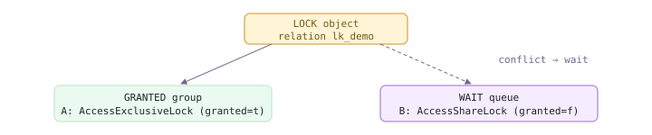
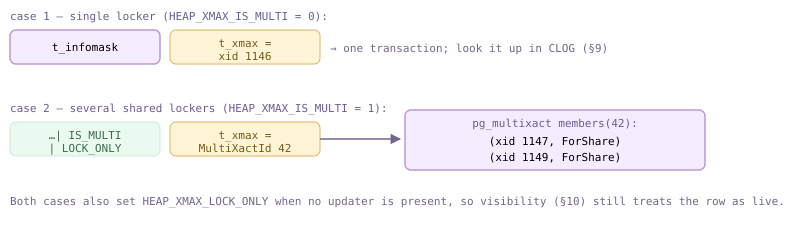
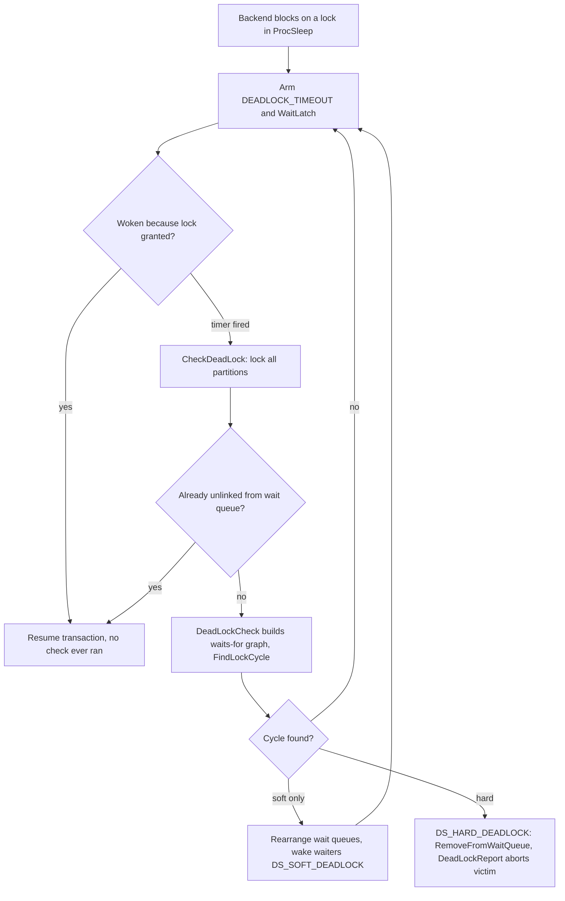
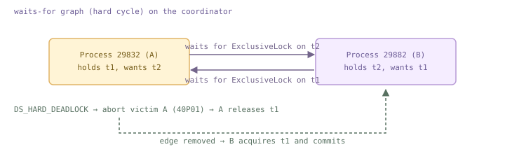
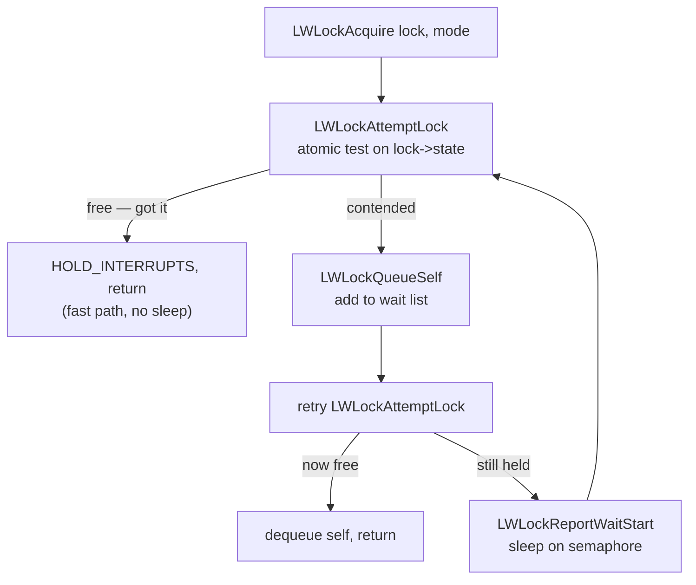
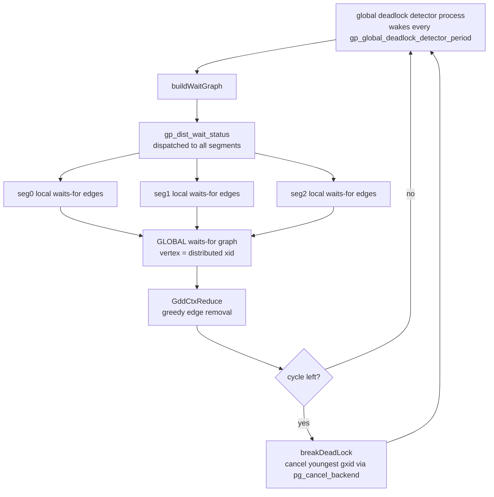
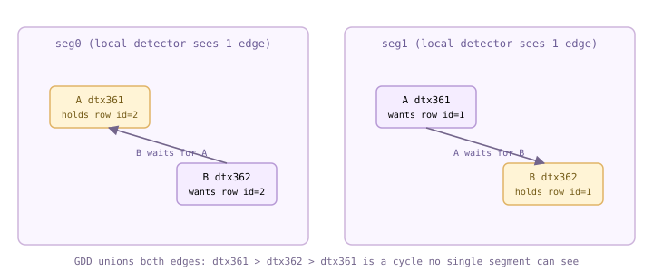

<style>
/*
 * Licensed to the Apache Software Foundation (ASF) under one
 * or more contributor license agreements.  See the NOTICE file
 * distributed with this work for additional information
 * regarding copyright ownership.  The ASF licenses this file
 * to you under the Apache License, Version 2.0 (the
 * "License"); you may not use this file except in compliance
 * with the License.  You may obtain a copy of the License at
 *
 *   http://www.apache.org/licenses/LICENSE-2.0
 *
 * Unless required by applicable law or agreed to in writing,
 * software distributed under the License is distributed on an
 * "AS IS" BASIS, WITHOUT WARRANTIES OR CONDITIONS OF ANY
 * KIND, either express or implied.  See the License for the
 * specific language governing permissions and limitations
 * under the License.
 */

/* Layout for the HTML-and-CSS figures, lifted from the handbook's own
   stylesheet so the figures render identically here. */

/* These four come from the handbook's own stylesheet; a consuming site has no
   such definitions, and an undefined custom property invalidates its whole
   declaration. Define them here, scoped to the figure.

   Deliberately NOT themed. The artwork below is light-only: band and tile
   backgrounds are hard-coded pastels, and the injected markup carries some 800
   more hard-coded light colours in inline styles. Giving --fg a dark-theme
   value paints near-white text onto a near-white band -- measured at 1.08:1,
   worse than the bug that replaced. The handbook's light values are correct in
   both themes; what changes for dark mode is the surface underneath. */
.cloudberry-core-figure {
  --border: #d8dee4;
  --soft:   #f6f8fa;
  --fg:     #1f2328;
  --muted:  #636c76;
  margin: 1.4rem 0;
}

/* Light-only artwork needs a light ground AND a dark ink, or it bleeds into a
   dark page. Setting only the ground is not enough: any text in these figures
   without its own inline colour inherits the site's near-white body colour, so
   it lands white-on-pastel -- measured at 1.03:1 across 184 text nodes. The
   colour has to be restored at the same place the ground is. */
[data-bs-theme='dark'] .cloudberry-core-figure > div {
  background: #ffffff;
  color: #1f2328;
  border-radius: 8px;
  padding: 10px;
}
/* Descendants that inherit rather than carry an inline colour. */
[data-bs-theme='dark'] .cloudberry-core-figure > div :not([style*="color"]) {
  color: inherit;
}
.cloudberry-core-figure figcaption {
  margin-top: .5rem;
  font-size: .9em;
  /* --ifm-color-emphasis-600 resolves to rgb(141,148,158) in the light theme,
     which is 3.06:1 on white -- below WCAG AA for the 37 figure captions.
     (The dark theme's value is fine, so only light is overridden.) */
  color: #636b75;
}
[data-bs-theme='dark'] .cloudberry-core-figure figcaption {
  color: #a6adb4;
}

/* Selective highlight: the handbook wraps a key token so it stands out.
   Scoped to the component. The class name .hl is two letters and this file
   lands in the consuming site's single global stylesheet, so an unscoped
   rule would style every page of that site. The standalone edition's
   figure.code / figure.session variants are dropped: those classes do not
   occur anywhere in this tree. */
.cloudberry-core-figure .hl { border-radius: 2px; font-weight: 700;
                   background: #fff8c5; color: #1f2328; padding: 0 2px; }

/* Layered module map and the banded brick figures. */
.cloudberry-core-figure .bricks { border:1px solid var(--border);border-radius:12px;overflow:hidden;background:var(--soft) }
.cloudberry-core-figure .bk-band { display:flex;align-items:stretch;border-top:1px solid var(--border) }
.cloudberry-core-figure .bk-band:first-child { border-top:none }
.cloudberry-core-figure .bk-lbl { flex:0 0 116px;display:flex;flex-direction:column;justify-content:center;gap:2px;padding:10px 13px }
.cloudberry-core-figure .bk-lbl b { font-size:12.5px;font-weight:800;color:var(--fg);line-height:1.2 }
.cloudberry-core-figure .bk-lbl span { font-size:9.5px;font-weight:700;color:var(--muted);text-transform:uppercase;letter-spacing:.5px }
.cloudberry-core-figure .bk-row { flex:1 1 auto;display:flex;flex-wrap:wrap;gap:7px;padding:9px 10px }
.cloudberry-core-figure .bk { flex:1 1 118px;min-width:104px;display:flex;flex-direction:column;justify-content:center;gap:2px; padding:8px 11px;border-radius:7px;border:1px solid;background:#fff;text-decoration:none;transition:.13s }
.cloudberry-core-figure .bk-t2 { font-size:12.5px;font-weight:700;line-height:1.25 }
.cloudberry-core-figure .bk-ch { font-size:10.5px;font-weight:700;font-variant-numeric:tabular-nums;opacity:.8 }
.cloudberry-core-figure a.bk:hover { transform:translateY(-2px);box-shadow:0 4px 12px #0000001f;text-decoration:none }
.cloudberry-core-figure .bk-q { background:#eef6ff }
.cloudberry-core-figure .bk-q .bk { border-color:#54aeff66;color:#0a3069;background:#ddf4ff }
.cloudberry-core-figure .bk-s { background:#eefcf2 }
.cloudberry-core-figure .bk-s .bk { border-color:#4ac26b80;color:#04260f;background:#dafbe1 }
.cloudberry-core-figure .bk-t { background:#fff6ef }
.cloudberry-core-figure .bk-t .bk { border-color:#fb8f4480;color:#5e2700;background:#fff1e5 }
.cloudberry-core-figure .bk-h { background:#fff4f3 }
.cloudberry-core-figure .bk-h .bk { border-color:#ff818280;color:#5c0011;background:#ffebe9 }
.cloudberry-core-figure .bk-r { background:#f3f5f8 }
.cloudberry-core-figure .bk-r .bk { border-color:#afb8c1;color:#1f2328;background:#eaeef2 }
@media (max-width: 560px) {
  .cloudberry-core-figure .bk-band { flex-direction:column }
  .cloudberry-core-figure .bk-lbl { flex-basis:auto;border-bottom:1px solid var(--border) }
}

</style>

<!--
  Licensed to the Apache Software Foundation (ASF) under one
  or more contributor license agreements.  See the NOTICE file
  distributed with this work for additional information
  regarding copyright ownership.  The ASF licenses this file
  to you under the Apache License, Version 2.0 (the
  "License"); you may not use this file except in compliance
  with the License.  You may obtain a copy of the License at

    http://www.apache.org/licenses/LICENSE-2.0

  Unless required by applicable law or agreed to in writing,
  software distributed under the License is distributed on an
  "AS IS" BASIS, WITHOUT WARRANTIES OR CONDITIONS OF ANY
  KIND, either express or implied.  See the License for the
  specific language governing permissions and limitations
  under the License.
-->


<a id="11-locks--the-global-deadlock-detector"></a>

## 11.1 重量级锁（关系级锁） {#111-heavyweight-relation-level-locks}

Cloudberry 继承了 PostgreSQL 的四层锁体系。**自旋锁**（`s_lock.c`）通过少量指令执行 TAS 忙等待，是其他各层的基础。**轻量级锁**（LWLock，[§11.4](#114-locks-on-memory-structures)）使用简单的读／写两种模式保护共享内存数据结构，不进行死锁检测。**重量级锁**，也称*常规锁*，是数据库理论中两阶段锁定协议使用的锁：它们保护逻辑对象（表、元组、事务），支持八种模式和死锁检测，并一直持有到事务结束。最后，*谓词锁*（`SIReadLock`）为可串行化快照隔离提供支持。本节介绍重量级锁管理器；行锁见 [§11.2](#112-row-level-locks--multixacts)，本地死锁检测器见 [§11.3](#113-deadlock-detection)，LWLock 见 [§11.4](#114-locks-on-memory-structures)，而 Cloudberry 特有的全局死锁检测器见 [§11.5](#115-the-global-deadlock-detector-gdd)。

### 11.1.1 重量级锁锁定什么：LOCKTAG {#1111-what-a-heavyweight-lock-is-the-locktag}

重量级锁锁定的是*具名对象*，而非内存。这个名称就是 `LOCKTAG`：一个锁方法 ID、一个类型标签，以及最多四个 ID 字段。整个关系由带有 `LOCKTAG_RELATION` 标签的 `(dbOid, relOid)` 标识；事务由带有 `LOCKTAG_TRANSACTION` 标签的 xid 标识；虚拟事务由带有 `LOCKTAG_VIRTUALTRANSACTION` 标签的 `(backendId, localXid)` 标识。锁存放在共享内存哈希表中，按后端跟踪，并在提交或中止时自动释放（也可能在错误恢复期间由锁管理器释放）——你从不需要对表执行 `UNLOCK`。

```c {title="src/include/storage/lock.h — LOCKTAG"}
typedef struct LOCKTAG {
          uint32  locktag_field1;   /* a 32-bit ID field */
          uint32  locktag_field2;   /* a 32-bit ID field */
          uint32  locktag_field3;
          uint16  locktag_field4;
          uint8   locktag_type;     /* see enum LockTagType: RELATION,
                                       TRANSACTION, VIRTUALTRANSACTION, ... */
          uint8   locktag_lockmethodid;
      } LOCKTAG;
```

`lmgr.c` 中的 `LockRelation()` 是标准入口：它为关系填充 `LOCKTAG`，然后调用锁管理器。`ConditionalLockRelation()` 的作用相同，但在锁不可用时会立即返回，而不是等待；`XactLockTableWait()` 则等待另一个事务的 xid 锁（参见 11.1.4）。

```c {title="src/backend/storage/lmgr/lmgr.c — LockRelation()"}
void
      LockRelation(Relation relation, LOCKMODE lockmode)
      {
          LOCKTAG  tag;
          SET_LOCKTAG_RELATION(tag,
              relation->rd_lockInfo.lockRelId.dbId,
              relation->rd_lockInfo.lockRelId.relId);
          res = LockAcquireExtended(&tag, lockmode, false, false, true, &locallock);
          ...
      }
```

### 11.1.2 八种表级锁模式 {#1112-the-eight-table-level-lock-modes}

关系锁可以按八种模式之一请求；`lockdefs.h` 按强度从弱到强将它们编号为 1–8。每个 `#define` 旁的注释都注明了会获取该锁的 SQL。对*同一个*对象的两个锁请求，只有在模式不冲突时才能同时持有；两者越强，越容易冲突。

```c {title="src/include/storage/lockdefs.h — AccessShareLock"}
#define AccessShareLock          1  /* SELECT */
      #define RowShareLock             2  /* SELECT FOR UPDATE/FOR SHARE */
      #define RowExclusiveLock         3  /* INSERT, UPDATE, DELETE */
      #define ShareUpdateExclusiveLock 4  /* VACUUM (non-FULL), ANALYZE,
                                             CREATE INDEX CONCURRENTLY */
      #define ShareLock                5  /* CREATE INDEX */
      #define ShareRowExclusiveLock    6  /* like EXCLUSIVE, but allows ROW SHARE */
      #define ExclusiveLock            7  /* blocks ROW SHARE / SELECT...FOR UPDATE */
      #define AccessExclusiveLock      8  /* ALTER/DROP TABLE, VACUUM FULL,
                                             unqualified LOCK TABLE */
```

*各语句在目标表上获取的锁*

| 语句 | 模式 |
| --- | --- |
| `SELECT` | `AccessShareLock` (1) |
| `SELECT ... FOR UPDATE/SHARE` | `RowShareLock` (2) |
| `INSERT` | `RowExclusiveLock` (3) |
| `UPDATE` / `DELETE` | `RowExclusiveLock` (3)——但参见 11.1.5 |
| `VACUUM`（非 FULL）、`ANALYZE`、`CREATE INDEX CONCURRENTLY` | `ShareUpdateExclusiveLock` (4) |
| `CREATE INDEX` | `ShareLock` (5) |
| `ALTER TABLE`, `DROP TABLE`, `VACUUM FULL`, `TRUNCATE` | `AccessExclusiveLock` (8) |

### 11.1.3 冲突矩阵 {#1113-the-conflict-matrix}

谁阻塞谁的规则存放在一个静态数组 `LockConflicts[]` 中。每个条目都是一个位掩码，表示与该行锁模式冲突的各模式。它呈现出熟悉的阶梯形：`AccessShareLock`（普通读取）仅与 `AccessExclusiveLock` 冲突，因此读取不会阻塞读取或写入；`AccessExclusiveLock` 与*所有模式*冲突，因此 `ALTER`/`DROP` 会阻塞表的所有其他使用者，也会被它们阻塞。

```c {title="src/backend/storage/lmgr/lock.c — LockConflicts"}
static const LOCKMASK LockConflicts[] = {
          0,
          /* AccessShareLock */
          LOCKBIT_ON(AccessExclusiveLock),
          /* RowShareLock */
          LOCKBIT_ON(ExclusiveLock) | LOCKBIT_ON(AccessExclusiveLock),
          /* RowExclusiveLock */
          LOCKBIT_ON(ShareLock) | LOCKBIT_ON(ShareRowExclusiveLock) |
          LOCKBIT_ON(ExclusiveLock) | LOCKBIT_ON(AccessExclusiveLock),
          ...
          /* AccessExclusiveLock: conflicts with all eight */ };
```

<figure class="cloudberry-core-figure">
<div><div style="max-width:720px;margin:2px auto;font:11px/1.4 ui-monospace,SFMono-Regular,Menlo,monospace;color:#1f2328;overflow-x:auto"><div style="min-width:600px"> <div style="display:flex"><div style="flex:2.6;padding:4px 3px;color:#6b5b95">已持有 \ 请求</div><div style="flex:1;border:1px solid #cdb4db;background:#efe3fb;text-align:center;padding:4px 1px">1 AS</div><div style="flex:1;border:1px solid #cdb4db;background:#efe3fb;text-align:center;padding:4px 1px">2 RS</div><div style="flex:1;border:1px solid #cdb4db;background:#efe3fb;text-align:center;padding:4px 1px">3 RX</div><div style="flex:1;border:1px solid #cdb4db;background:#efe3fb;text-align:center;padding:4px 1px">4 SUX</div><div style="flex:1;border:1px solid #cdb4db;background:#efe3fb;text-align:center;padding:4px 1px">5 S</div><div style="flex:1;border:1px solid #cdb4db;background:#efe3fb;text-align:center;padding:4px 1px">6 SRX</div><div style="flex:1;border:1px solid #cdb4db;background:#efe3fb;text-align:center;padding:4px 1px">7 X</div><div style="flex:1;border:1px solid #cdb4db;background:#efe3fb;text-align:center;padding:4px 1px">8 AX</div></div> <div style="display:flex"><div style="flex:2.6;padding:4px 3px;color:#6b5b95">1 AccessShare</div><div style="flex:1;border:1px solid #cfead9;background:#eafaf0;text-align:center;padding:4px 1px">·</div><div style="flex:1;border:1px solid #cfead9;background:#eafaf0;text-align:center;padding:4px 1px">·</div><div style="flex:1;border:1px solid #cfead9;background:#eafaf0;text-align:center;padding:4px 1px">·</div><div style="flex:1;border:1px solid #cfead9;background:#eafaf0;text-align:center;padding:4px 1px">·</div><div style="flex:1;border:1px solid #cfead9;background:#eafaf0;text-align:center;padding:4px 1px">·</div><div style="flex:1;border:1px solid #cfead9;background:#eafaf0;text-align:center;padding:4px 1px">·</div><div style="flex:1;border:1px solid #cfead9;background:#eafaf0;text-align:center;padding:4px 1px">·</div><div style="flex:1;border:1px solid #e0b365;background:#fff4d6;text-align:center;padding:4px 1px;color:#735a16">✗</div></div> <div style="display:flex"><div style="flex:2.6;padding:4px 3px;color:#6b5b95">2 RowShare</div><div style="flex:1;border:1px solid #cfead9;background:#eafaf0;text-align:center;padding:4px 1px">·</div><div style="flex:1;border:1px solid #cfead9;background:#eafaf0;text-align:center;padding:4px 1px">·</div><div style="flex:1;border:1px solid #cfead9;background:#eafaf0;text-align:center;padding:4px 1px">·</div><div style="flex:1;border:1px solid #cfead9;background:#eafaf0;text-align:center;padding:4px 1px">·</div><div style="flex:1;border:1px solid #cfead9;background:#eafaf0;text-align:center;padding:4px 1px">·</div><div style="flex:1;border:1px solid #cfead9;background:#eafaf0;text-align:center;padding:4px 1px">·</div><div style="flex:1;border:1px solid #e0b365;background:#fff4d6;text-align:center;padding:4px 1px;color:#735a16">✗</div><div style="flex:1;border:1px solid #e0b365;background:#fff4d6;text-align:center;padding:4px 1px;color:#735a16">✗</div></div> <div style="display:flex"><div style="flex:2.6;padding:4px 3px;color:#6b5b95">3 RowExclusive</div><div style="flex:1;border:1px solid #cfead9;background:#eafaf0;text-align:center;padding:4px 1px">·</div><div style="flex:1;border:1px solid #cfead9;background:#eafaf0;text-align:center;padding:4px 1px">·</div><div style="flex:1;border:1px solid #cfead9;background:#eafaf0;text-align:center;padding:4px 1px">·</div><div style="flex:1;border:1px solid #cfead9;background:#eafaf0;text-align:center;padding:4px 1px">·</div><div style="flex:1;border:1px solid #e0b365;background:#fff4d6;text-align:center;padding:4px 1px;color:#735a16">✗</div><div style="flex:1;border:1px solid #e0b365;background:#fff4d6;text-align:center;padding:4px 1px;color:#735a16">✗</div><div style="flex:1;border:1px solid #e0b365;background:#fff4d6;text-align:center;padding:4px 1px;color:#735a16">✗</div><div style="flex:1;border:1px solid #e0b365;background:#fff4d6;text-align:center;padding:4px 1px;color:#735a16">✗</div></div> <div style="display:flex"><div style="flex:2.6;padding:4px 3px;color:#6b5b95">4 ShareUpdExcl</div><div style="flex:1;border:1px solid #cfead9;background:#eafaf0;text-align:center;padding:4px 1px">·</div><div style="flex:1;border:1px solid #cfead9;background:#eafaf0;text-align:center;padding:4px 1px">·</div><div style="flex:1;border:1px solid #cfead9;background:#eafaf0;text-align:center;padding:4px 1px">·</div><div style="flex:1;border:1px solid #e0b365;background:#fff4d6;text-align:center;padding:4px 1px;color:#735a16">✗</div><div style="flex:1;border:1px solid #e0b365;background:#fff4d6;text-align:center;padding:4px 1px;color:#735a16">✗</div><div style="flex:1;border:1px solid #e0b365;background:#fff4d6;text-align:center;padding:4px 1px;color:#735a16">✗</div><div style="flex:1;border:1px solid #e0b365;background:#fff4d6;text-align:center;padding:4px 1px;color:#735a16">✗</div><div style="flex:1;border:1px solid #e0b365;background:#fff4d6;text-align:center;padding:4px 1px;color:#735a16">✗</div></div> <div style="display:flex"><div style="flex:2.6;padding:4px 3px;color:#6b5b95">5 Share</div><div style="flex:1;border:1px solid #cfead9;background:#eafaf0;text-align:center;padding:4px 1px">·</div><div style="flex:1;border:1px solid #cfead9;background:#eafaf0;text-align:center;padding:4px 1px">·</div><div style="flex:1;border:1px solid #e0b365;background:#fff4d6;text-align:center;padding:4px 1px;color:#735a16">✗</div><div style="flex:1;border:1px solid #e0b365;background:#fff4d6;text-align:center;padding:4px 1px;color:#735a16">✗</div><div style="flex:1;border:1px solid #cfead9;background:#eafaf0;text-align:center;padding:4px 1px">·</div><div style="flex:1;border:1px solid #e0b365;background:#fff4d6;text-align:center;padding:4px 1px;color:#735a16">✗</div><div style="flex:1;border:1px solid #e0b365;background:#fff4d6;text-align:center;padding:4px 1px;color:#735a16">✗</div><div style="flex:1;border:1px solid #e0b365;background:#fff4d6;text-align:center;padding:4px 1px;color:#735a16">✗</div></div> <div style="display:flex"><div style="flex:2.6;padding:4px 3px;color:#6b5b95">6 ShareRowExcl</div><div style="flex:1;border:1px solid #cfead9;background:#eafaf0;text-align:center;padding:4px 1px">·</div><div style="flex:1;border:1px solid #cfead9;background:#eafaf0;text-align:center;padding:4px 1px">·</div><div style="flex:1;border:1px solid #e0b365;background:#fff4d6;text-align:center;padding:4px 1px;color:#735a16">✗</div><div style="flex:1;border:1px solid #e0b365;background:#fff4d6;text-align:center;padding:4px 1px;color:#735a16">✗</div><div style="flex:1;border:1px solid #e0b365;background:#fff4d6;text-align:center;padding:4px 1px;color:#735a16">✗</div><div style="flex:1;border:1px solid #e0b365;background:#fff4d6;text-align:center;padding:4px 1px;color:#735a16">✗</div><div style="flex:1;border:1px solid #e0b365;background:#fff4d6;text-align:center;padding:4px 1px;color:#735a16">✗</div><div style="flex:1;border:1px solid #e0b365;background:#fff4d6;text-align:center;padding:4px 1px;color:#735a16">✗</div></div> <div style="display:flex"><div style="flex:2.6;padding:4px 3px;color:#6b5b95">7 Exclusive</div><div style="flex:1;border:1px solid #cfead9;background:#eafaf0;text-align:center;padding:4px 1px">·</div><div style="flex:1;border:1px solid #e0b365;background:#fff4d6;text-align:center;padding:4px 1px;color:#735a16">✗</div><div style="flex:1;border:1px solid #e0b365;background:#fff4d6;text-align:center;padding:4px 1px;color:#735a16">✗</div><div style="flex:1;border:1px solid #e0b365;background:#fff4d6;text-align:center;padding:4px 1px;color:#735a16">✗</div><div style="flex:1;border:1px solid #e0b365;background:#fff4d6;text-align:center;padding:4px 1px;color:#735a16">✗</div><div style="flex:1;border:1px solid #e0b365;background:#fff4d6;text-align:center;padding:4px 1px;color:#735a16">✗</div><div style="flex:1;border:1px solid #e0b365;background:#fff4d6;text-align:center;padding:4px 1px;color:#735a16">✗</div><div style="flex:1;border:1px solid #e0b365;background:#fff4d6;text-align:center;padding:4px 1px;color:#735a16">✗</div></div> <div style="display:flex"><div style="flex:2.6;padding:4px 3px;color:#6b5b95">8 AccessExcl</div><div style="flex:1;border:1px solid #e0b365;background:#fff4d6;text-align:center;padding:4px 1px;color:#735a16">✗</div><div style="flex:1;border:1px solid #e0b365;background:#fff4d6;text-align:center;padding:4px 1px;color:#735a16">✗</div><div style="flex:1;border:1px solid #e0b365;background:#fff4d6;text-align:center;padding:4px 1px;color:#735a16">✗</div><div style="flex:1;border:1px solid #e0b365;background:#fff4d6;text-align:center;padding:4px 1px;color:#735a16">✗</div><div style="flex:1;border:1px solid #e0b365;background:#fff4d6;text-align:center;padding:4px 1px;color:#735a16">✗</div><div style="flex:1;border:1px solid #e0b365;background:#fff4d6;text-align:center;padding:4px 1px;color:#735a16">✗</div><div style="flex:1;border:1px solid #e0b365;background:#fff4d6;text-align:center;padding:4px 1px;color:#735a16">✗</div><div style="flex:1;border:1px solid #e0b365;background:#fff4d6;text-align:center;padding:4px 1px;color:#735a16">✗</div></div> <div style="text-align:center;color:#73658b;font-size:10px;padding:3px">矩阵是对称的 · AS AccessShare · RS RowShare · RX RowExclusive · SUX ShareUpdExcl · S Share · SRX ShareRowExcl · X Exclusive · AX AccessExcl</div> </div></div></div>
<figcaption>锁模式冲突矩阵——✗ 表示两种模式不能同时在同一对象上持有（来自 LockConflicts[]）。注意 ExclusiveLock (7) ✗ RowExclusiveLock (3)：这解释了 GDD 关闭时并发 UPDATE 为何串行执行（11.1.5）。</figcaption>
</figure>

要实际观察这一点，可以开启事务、运行 `SELECT`，然后读取 `pg_locks`。读取会在表上获取 `AccessShareLock`，并像每个事务一样，在自身的虚拟事务 ID 上获取排他锁（11.1.4）。限定 `gp_segment_id = -1` 后，只会显示 Coordinator 的锁表。

*SELECT 在目标表上持有 AccessShareLock，并在自身 VXID 上持有排他锁*

```sql
BEGIN;
      SELECT count(*) FROM lk_demo;
      SELECT locktype, relation::regclass AS rel, mode, granted
      FROM pg_locks
      WHERE pid = pg_backend_pid() AND gp_segment_id = -1
        AND (relation IS NULL OR relation::regclass::text = 'lk_demo')
      ORDER BY locktype;
```

```text {hl_lines="3" title="output"}
 locktype   |   rel   |      mode       | granted
      ------------+---------+-----------------+---------
       relation   | lk_demo | AccessShareLock | t
       virtualxid |         | ExclusiveLock   | t
```

### 11.1.4 等待队列与 lock_timeout {#1114-the-wait-queue-and-lock_timeout}

当请求与已授予的锁冲突时，后端不会直接失败，而是*等待*。锁队列分为已授予组和等待组，等待者在 `pg_locks` 中的行显示 `granted = false`。它在进程信号量上休眠，直到持有者在事务结束时释放锁，再由锁管理器将其唤醒。用两个会话即可观察此过程：A 获取并持有 `ACCESS EXCLUSIVE`；B 的普通 `SELECT` 只需 `AccessShareLock`，但根据冲突矩阵，它与模式 8 冲突，因此会被阻塞。

*会话 A 独占表并持续持锁*

```sql
-- session A
      BEGIN;
      LOCK TABLE lk_demo IN ACCESS EXCLUSIVE MODE;
      SELECT pg_sleep(6);
      COMMIT;
```

```text {title="output"}
BEGIN
      LOCK TABLE
       pg_sleep
      ----------

      COMMIT      -- released after ~6s
```

*会话 B 的 SELECT 被阻塞；观察者可以看到已获锁的持有者和等待者；只有在 A 提交后，B 才解除阻塞（5.1 秒）*

```sql
-- session B (started ~1s after A)
      \timing on
      SELECT count(*) FROM lk_demo;

      -- observer session, while B waits:
      SELECT pid, mode, granted FROM pg_locks
      WHERE relation::regclass::text='lk_demo' AND gp_segment_id=-1
      ORDER BY granted DESC;
```

```text {hl_lines="3 4 10" title="output"}
  pid  |        mode         | granted
      -------+---------------------+---------
       28949 | AccessExclusiveLock | t   <- A, holder
       28959 | AccessShareLock     | f   <- B, waiting

      -- back in session B, once A commits:
       count
      -------
           2
      Time: 5113.806 ms (00:05.114)
```



*一个锁对象，两组进程：A 持有锁（已授予），B 排在后面等待，直到 A 提交并释放锁*

等待者不必无限期阻塞。设置 `lock_timeout` 可以限制等待时长：如果未能及时获取锁，语句就会被取消，而不会一直挂起。（另一个相关但不同的参数 `deadlock_timeout` 控制后端在*执行死锁检查*之前等待多久，见 11.3。）

*lock_timeout 将无限等待变为明确的报错*

```sql
-- session A still holds ACCESS EXCLUSIVE
      SET lock_timeout = '1s';
      SELECT count(*) FROM lk_demo;
```

```text {hl_lines="2" title="output"}
SET
      ERROR:  canceling statement due to lock timeout
      LINE 1: SELECT count(*) FROM lk_demo;
```

### 11.1.5 事务 ID 上的锁 {#1115-locks-on-transaction-ids}

事务本身也是可锁定对象，一个后端就是借此等待另一个后端的事务*结束*。每个事务在开始时都在自身虚拟 xid（VXID）上获取排他锁；一旦进行写入并分配了真实 xid，还会在该 xid 上获取排他锁（[§9.2](/cloudberry/core-internals/part-3-transactions-mvcc-concurrency/ch09/#92-the-transaction-manager)）。其他事务绝不会共同持有这些锁——它们纯粹用于传递信号。当事务 T2 需要等待 T1 结束时（例如 T2 要更新的行，其 `xmax` 是仍在运行的 T1 的 xid，见 [§10](/cloudberry/core-internals/part-3-transactions-mvcc-concurrency/ch10/)；或者唯一索引检查发现一个尚未结束的事务写入了重复值），T2 会调用 `XactLockTableWait()`，请求 T1 的 xid 上的*共享*锁。因为 T1 以排他方式持有该锁，T2 会被阻塞；T1 提交或中止时释放锁，T2 随之唤醒——这就是用普通锁管理器构建的事务完成屏障。

```c {title="src/backend/storage/lmgr/lmgr.c — XactLockTableWait()"}
void
      XactLockTableWait(TransactionId xid, Relation rel, ItemPointer ctid,
                        XLTW_Oper oper)
      {
          LOCKTAG  tag;
          /* wait (share mode) on the holder's own exclusive lock on 'xid';
             returns when that transaction commits or aborts */
      }
```

> [!NOTE]
> 在 MPP 中，真实 xid 是按 **Segment** 分配的，因此 `transactionid` 锁位于 Segment 的锁表中，而不是 Coordinator 上——应从 Segment 上的 utility 模式会话检查它。Coordinator 一侧主要显示 `virtualxid` 锁。它的分布式对应物 `LOCKTAG_DISTRIB_TRANSACTION` 将在 [§12](/cloudberry/core-internals/part-3-transactions-mvcc-concurrency/ch12/) 中介绍。

*在 Segment 上（utility 模式，端口 :7102）：写事务同时在其 xid 和 VXID 上持有排他锁*

```sql
-- PGOPTIONS='-c gp_role=utility' psql -p 7102
      BEGIN;
      SELECT txid_current();
      SELECT locktype, mode, granted FROM pg_locks
      WHERE pid = pg_backend_pid()
        AND locktype IN ('transactionid','virtualxid')
      ORDER BY locktype;
```

```text {hl_lines="3 7" title="output"}
 txid_current
      --------------
               1236

         locktype    |     mode      | granted
      ---------------+---------------+---------
       transactionid | ExclusiveLock | t
       virtualxid    | ExclusiveLock | t
```

最后，Cloudberry 对 `UPDATE`/`DELETE` 有一项特有处理。在 PostgreSQL 中，它们在目标表上获取 `RowExclusiveLock`（模式 3），因此对同一表的两个更新可以并行进行，并依靠*行*锁将冲突行的操作串行化。在 MPP 集群中，这可能引发任何单个 Segment 都无法看到的*全局*死锁。默认情况下，全局死锁检测器处于**关闭**状态。为防止这类死锁，Cloudberry 将 Coordinator 上 `UPDATE`/`DELETE` 的目标表锁升级为 `ExclusiveLock`（模式 7）；根据冲突矩阵，它与 `RowExclusiveLock` 冲突，因此对同一表的两个并发更新会*串行执行*。启用 GDD（[§11.5](#115-the-global-deadlock-detector-gdd)）后，堆表的锁会放宽回 `RowExclusiveLock`，并由检测器打破由此产生的任何跨 Segment 环路。

```c {title="src/backend/access/table/table.c — CdbTryOpenTable()"}
/* CdbTryOpenTable: UPDATE/DELETE on a normal table, on the QD */
      if (reqmode == RowExclusiveLock &&
          (Gp_role == GP_ROLE_DISPATCH || IS_SINGLENODE()) &&
          relid >= FirstNormalObjectId)
      {
          if (!gp_enable_global_deadlock_detector && !IS_SINGLENODE())
          {
              /* Without GDD, to avoid global deadlock, always
                 upgrade locklevel to ExclusiveLock */
              lockmode = ExclusiveLock;
              rel = try_table_open(relid, lockmode, false);
          }
          else
              lockmode = RowExclusiveLock;   /* like Postgres */
          ...
      }
```

*GDD 关闭时（默认设置），UPDATE 在目标表上获取 ExclusiveLock，而非 RowExclusiveLock*

```sql
SHOW gp_enable_global_deadlock_detector;
      BEGIN;
      UPDATE lk_demo SET v = 'x' WHERE id = 1;
      SELECT locktype, relation::regclass AS rel, mode, granted
      FROM pg_locks
      WHERE pid = pg_backend_pid() AND gp_segment_id = -1
        AND relation::regclass::text = 'lk_demo';
```

```text {hl_lines="3 7" title="output"}
 gp_enable_global_deadlock_detector
      ------------------------------------
       off

       locktype |   rel   |     mode      | granted
      ----------+---------+---------------+---------
       relation | lk_demo | ExclusiveLock | t
```

## 11.2 行级锁与多事务 {#112-row-level-locks--multixacts}

表锁（[§11.1](#111-heavyweight-relation-level-locks)）保护整个关系，但只触及一行的事务不应该阻止其他所有事务访问。这项工作由**行级锁**承担，而它最重要的特征在于*存放位置*。行锁不是锁管理器共享哈希表中的条目，而是直接记录在**元组本身**：加锁者将自己的 xid 写入 `t_xmax`，并设置 infomask 位（即 [§4.2](/cloudberry/core-internals/part-2-storage-data-layout/ch04/#42-row-version-layout) 介绍过的那些元组头字段）。因此，即使锁定十亿行，也不消耗共享内存——锁随数据一起位于堆页上。

### 11.2.1 四种行锁模式 {#1121-four-row-lock-modes}

PostgreSQL（以及 CBDB 继承的堆访问方法）恰好定义了四种行锁强度，按从弱到强排列。每种模式都对应 `SELECT … FOR` 锁定子句中的一种 SQL 写法：

```c {title="src/include/nodes/lockoptions.h — LockTupleMode"}
typedef enum LockTupleMode
      {
          LockTupleKeyShare,        /* SELECT FOR KEY SHARE */
          LockTupleShare,           /* SELECT FOR SHARE */
          LockTupleNoKeyExclusive,  /* SELECT FOR NO KEY UPDATE, and
                                     * UPDATEs that don't touch key cols */
          LockTupleExclusive        /* SELECT FOR UPDATE, key-col UPDATEs, DELETE */
      } LockTupleMode;
```

普通 `UPDATE` 在不改变任何键列时获取 `NoKeyExclusive`，只有改写了某个索引或外键所依赖的列时，才升级为 `Exclusive`。这种区分正是这些*键*模式的意义：外键检查只需固定住被引用的键（`FOR KEY SHARE`），因此**不应**阻塞对同一行中无关非键列的 `UPDATE`。下面的冲突矩阵展示了哪些模式可以在同一元组上共存——较弱的两种模式彼此兼容，真正造成串行化的是两种排他模式。

*行锁冲突矩阵——✓ = 不同事务可以同时持有，✗ = 冲突（等待者被阻塞）*

| 持有者 ↓ / 请求者 → | KeyShare | Share | NoKeyExcl | Exclusive |
| --- | --- | --- | --- | --- |
| **KeyShare** | ✓ | ✓ | ✓ | ✗ |
| **Share** | ✓ | ✓ | ✗ | ✗ |
| **NoKeyExclusive** | ✓ | ✗ | ✗ | ✗ |
| **Exclusive** | ✗ | ✗ | ✗ | ✗ |

> [!NOTE]
> 此矩阵是对称的。注意左上角的 ✓：两个事务可以各自在同一行上持有 **KeyShare**，而且 KeyShare 甚至可以与持有 NoKeyExclusive 的更新者共存——正在执行的非键列 `UPDATE` 不会阻塞并发外键检查。这正是需要多事务的场景（[§11.2.4](#1124-multixacts--one-t_xmax-many-lockers)），因为一个 `t_xmax` 此时必须表示多个加锁者。

### 11.2.2 heap_lock_tuple：获取锁并等待持有者 {#1122-heap_lock_tuple--taking-the-lock-waiting-on-the-holder}

`heap_lock_tuple()` 是执行器处理 `FOR …` 子句的入口。它固定缓冲区并对其加排他锁，重新读取元组，再通过 `HeapTupleSatisfiesUpdate` 判断当前谁拥有 `t_xmax`。如果此行已被以冲突模式锁定，就必须等待；等待的对象并非行锁对象，而是通过 `XactLockTableWait` 等待**持有者的事务**（即 [§11.1](#111-heavyweight-relation-level-locks) 中事务 ID 锁的用法）：每个 xid 都在自己的 ID 上持有排他锁，因此休眠到该锁释放，就意味着休眠到加锁者提交或中止。

```c {title="src/backend/access/heap/heapam.c — heap_lock_tuple()"}
/* wait for regular transaction to end, or die trying */
      switch (wait_policy)
      {
          case LockWaitBlock:
              XactLockTableWait(xwait, relation, &tuple->t_self, XLTW_Lock);
              break;
          case LockWaitSkip:
              if (!ConditionalXactLockTableWait(xwait))
                  { result = TM_WouldBlock; goto failed; }   /* SKIP LOCKED */
              break;
          case LockWaitError:
              if (!ConditionalXactLockTableWait(xwait))
                  ereport(ERROR, (errcode(ERRCODE_LOCK_NOT_AVAILABLE),
                    errmsg("could not obtain lock on row ...")));  /* NOWAIT */
              break;
      }
```

`LockWaitPolicy` 对应 SQL 修饰选项：默认的 `LockWaitBlock` 会休眠；`NOWAIT`（`LockWaitError`）通过 `ConditionalXactLockTableWait` 探测，若行正忙便立即报错；`SKIP LOCKED`（`LockWaitSkip`）则直接返回 `TM_WouldBlock`，使扫描从结果中剔除该行。`heap_lock_tuple` 实际记录的锁强度通过一个小表查得，该表将各个 `LockTupleMode` 映射为重量级 `LOCKMODE`，以及锁需要成为多事务成员时使用的两个 `MultiXactStatus` 代码：

```c {title="src/backend/access/heap/heapam.c"}
tupleLockExtraInfo[MaxLockTupleMode + 1] =
      { /* LockTupleMode        hwlock            lockstatus / updstatus */
        { AccessShareLock,    MultiXactStatusForKeyShare,    -1 },
        { RowShareLock,       MultiXactStatusForShare,       -1 },
        { ExclusiveLock,      MultiXactStatusForNoKeyUpdate, MultiXactStatusNoKeyUpdate },
        { AccessExclusiveLock,MultiXactStatusForUpdate,      MultiXactStatusUpdate }
      };
```

### 11.2.3 实测：FOR UPDATE 会串行执行，普通 SELECT 不会 {#1123-live-for-update-serialises-plain-select-does-not}

在 Coordinator 上开启两个会话（`heap_prepare_freeze_tuple()`）。会话 A 锁定 id=1 后休眠；会话 B 先运行一个*普通* `SELECT`（纯 MVCC 读取，不应感知到该锁），然后对同一行运行 `FOR UPDATE`（必须等 A 提交）。

*A 在 id=1 上持有 FOR UPDATE 约 4 秒；B 的普通读取立即返回，B 的 FOR UPDATE 则被阻塞*

```sql
-- session A
      BEGIN;
      SELECT id,val FROM rl_demo WHERE id=1 FOR UPDATE;
      SELECT pg_sleep(4);  COMMIT;

      -- session B (starts ~1 s later)
      	iming on
      SELECT id,val FROM rl_demo WHERE id=1;             -- plain MVCC read
      SELECT id,val FROM rl_demo WHERE id=1 FOR UPDATE;  -- must wait for A
```

```text {hl_lines="5 10" title="output"}
-- session B
       id | val
      ----+-----
        1 | a
      Time: 57.082 ms        -- plain SELECT: unaffected by A's lock

       id | val
      ----+-----
        1 | a
      Time: 3050.061 ms      -- FOR UPDATE: blocked until A COMMITs (~3 s)
```

A 仍持锁时，普通读取在 57 毫秒内就返回了——MVCC 读者从不阻塞写者或加锁者（[§10](/cloudberry/core-internals/part-3-transactions-mvcc-concurrency/ch10/)）。第二条语句等待了三秒，恰好是 A 的 `pg_sleep` 剩余时间，然后在 A 提交的瞬间继续执行。

### 11.2.4 多事务：一个 t_xmax，多个加锁者 {#1124-multixacts--one-t_xmax-many-lockers}

冲突矩阵允许*多个*事务同时持有共享行锁（KeyShare+KeyShare，或 Share+Share）。但 `t_xmax` 只是一个 32 位字段，无法列出两个 xid。堆通过 **MultiXactId** 解决这一问题：`t_xmax` 存储的不再是普通 xid，而是一个 ID，指向单独日志中的一组 `(xid, mode)` 成员，并通过 infomask 中的 `HEAP_XMAX_IS_MULTI` 位标识这种解释方式。

```c {title="src/include/access/htup_details.h — HEAP_XMAX_KEYSHR_LOCK"}
#define HEAP_XMAX_KEYSHR_LOCK  0x0010  /* xmax is a key-shared locker */
      #define HEAP_XMAX_EXCL_LOCK    0x0040  /* xmax is exclusive locker */
      #define HEAP_XMAX_LOCK_ONLY    0x0080  /* xmax, if valid, is only a locker */
      #define HEAP_XMAX_IS_MULTI     0x1000  /* t_xmax is a MultiXactId */
```

成员存储在 `pg_multixact` 中，由 `multixact.c` 以*两个* SLRU 区域管理：**offsets** 日志记录多事务 N 的成员数组起始位置，**members** 日志存储紧凑排列的 `(xid, status)` 条目。这种“偏移量加成员”的布局使单个 MultiXactId 能够展开为变长列表：

```c {title="src/backend/access/transam/multixact.c"}
* The pg_multixact manager is a pg_xact-like manager that stores an array of
      * MultiXactMember for each MultiXactId ... a fundamental part of the
      * shared-row-lock implementation.  Each MultiXactMember is comprised of a
      * TransactionId and a set of flag bits.
      * We use two SLRU areas, one for storing the offsets at which the data
      * starts for each MultiXactId in the other one.
```



*t_xmax 具有双重含义：普通 xid（上）；设置 HEAP_XMAX_IS_MULTI 时，则为索引 pg_multixact 成员列表的 MultiXactId（下）*

多事务也有自己的回卷问题：MultiXactId 只有 32 位，因此与 xid 一样，必须在清理期间**冻结**（`MultiXactCutoff` / `relminmxid`，参见 [§10.4](/cloudberry/core-internals/part-3-transactions-mvcc-concurrency/ch10/#104-freezing--xid-wraparound)）。`pg_get_multixact_members(mxid)` 可以解码一个仍有效的多事务，`pg_control_checkpoint()` 则暴露集群级计数器——下面是尚未生成任何多事务的新建演示集群：

*多事务机制已经存在，并由 pg_control 跟踪（Segment 0，utility 模式，端口 :7102）*

```sql
SELECT next_multixact_id, next_multi_offset
      FROM pg_control_checkpoint();
```

```text {hl_lines="3" title="output"}
 next_multixact_id | next_multi_offset
      -------------------+-------------------
       1               | 0
```

### 11.2.5 CBDB 中的实际行为：FOR UPDATE 升级为表锁 {#1125-cbdb-reality-for-update-escalates-to-a-table-lock}

以上都是 CBDB 编译进来的堆访问方法，也正是各个 **Segment** 上运行的机制。但在分布式计划中，Coordinator 无法可靠地持有 Segment 的元组锁——元组经 Motion 节点向上传送，QD 看不到稳定的 TID。因此，Cloudberry 会在解析时改写锁定子句：除非已启用全局死锁检测器，**并且**语句只访问一个无需 Motion 的表，否则 `SELECT … FOR …` 会升级为整个表的 `ExclusiveLock`，而任何 `NOWAIT`/`SKIP LOCKED` 等待策略都会被丢弃。

```c {title="src/backend/parser/parse_relation.c — addRangeTableEntry()"}
lockmode = pstate->p_canOptSelectLockingClause ? RowShareLock : ExclusiveLock;
      if (lockmode == ExclusiveLock && locking->waitPolicy != LockWaitBlock)
          ereport(WARNING,
              (errmsg("Upgrade the lockmode to ExclusiveLock on table(%s) "
                      "and ignore the wait policy.",
                      RelationGetRelationName(rel))));
```

可以直接观察这种升级。GDD 关闭时（此集群的默认设置），`FOR UPDATE` 持有者显示的是*关系级* `ExclusiveLock`，而非元组锁——这解释了 [§11.2.3](#1123-live-for-update-serialises-plain-select-does-not) 的演示为何会发生阻塞，也解释了 Segment 上元组的 `t_xmax` 为何仍为 0：

*持有 FOR UPDATE 时的 pg_locks：关系级 ExclusiveLock，没有行锁（GDD 关闭）*

```sql
SELECT locktype, mode, granted
      FROM pg_locks
      WHERE relation = 'rl_demo'::regclass AND gp_segment_id = -1
      ORDER BY mode;
```

```text {hl_lines="3 4" title="output"}
 locktype |      mode       | granted
      ----------+-----------------+---------
       relation | AccessShareLock | t
       relation | ExclusiveLock   | t
```

由于等待策略被丢弃，`NOWAIT` 不会报错，`SKIP LOCKED` 也不会跳过——两者都会发出警告，然后像普通阻塞等待一样运行：

*对已锁定的行执行 NOWAIT / SKIP LOCKED（GDD 关闭）：等待策略被忽略，NOWAIT 仍阻塞 3 秒*

```sql
-- another session holds id=1 FOR UPDATE for ~4 s
      SELECT id FROM rl_demo WHERE id=1 FOR UPDATE NOWAIT;
      SELECT id FROM rl_demo WHERE id=1 FOR UPDATE SKIP LOCKED;
```

```text {hl_lines="1 5" title="output"}
WARNING:  Upgrade the lockmode to ExclusiveLock on table(rl_demo) and ignore the wait policy.
       id
      ----
        1
      Time: 3131.585 ms   -- NOWAIT did NOT error; it blocked like a normal wait

      WARNING:  Upgrade the lockmode to ExclusiveLock on table(rl_demo) and ignore the wait policy.
       id
      ----
        1
      Time: 56.222 ms       -- (holder had committed by now)
```

> [!NOTE]
> 因此，堆上的逐元组行锁和多事务在**各 Segment 上确实存在并正常运作**，但只有启用 `gp_enable_global_deadlock_detector`，且计划只访问一个无需 Motion 的表时，分布式 `SELECT … FOR …` 才能真正采用元组粒度（此时 `lockmode` 保持为 `RowShareLock`，并由真正的 `LockRows` 节点写入 `t_xmax`）。启用 GDD 会将 UPDATE/DELETE 的表级 `ExclusiveLock` 改为更有利于行级并发的 `RowExclusiveLock`，从而使跨 Segment 死锁成为可能，这正是 [§11.5](#115-the-global-deadlock-detector-gdd) 的主题。

总而言之，行锁记录在元组中，按强度分为四种模式，多个共享持有者通过 `pg_multixact` 中的一个 MultiXactId 表示。这是其基本机制。Cloudberry 的特殊之处在于，Coordinator 默认用较粗粒度的表级 `ExclusiveLock` 取代这种细粒度机制，只有在启用全局死锁检测器时，才恢复元组级锁定。

## 11.3 死锁检测 {#113-deadlock-detection}

两阶段锁定保证可串行化，却不保证事务能够继续推进。事务 T1 可能持有 T2 想要的锁，同时 T2 又持有 T1 想要的锁——这就是**死锁**，即*等待图*中的环路；图中每个顶点代表一个事务，每条边都从等待者指向阻塞它的事务。在单节点上，PostgreSQL 和 Cloudberry 都不尝试*预防*死锁（那意味着预先声明所有锁，或一遇冲突就中止，代价都太高）。它们允许环路形成，再**检测**环路，通过取消其中一个参与者将其打破，让其他事务继续。本节介绍*本地*检测器，即每个后端针对自身节点上的锁等待运行的检测器。如果环路的边分散在不同 Segment 上，它就无法看到；这由全局死锁检测器处理（[§11.5](#115-the-global-deadlock-detector-gdd)）。

### 11.3.1 检测而非预防，也不急于检测 {#1131-detect-dont-prevent--and-dont-detect-eagerly}

构建和搜索等待图需要获取所有锁分区的 LWLock，并遍历每个等待队列；若每次后端阻塞时都这样做，代价过高。绝大多数锁等待*并不是*死锁，阻塞者会在几毫秒内提交或中止，等待者便正常唤醒。因此 Cloudberry 会推迟检查：`ProcSleep` 让后端因等待锁而休眠时，会启动一个时长为 `deadlock_timeout`（默认 **1 秒**）的计时器，只有到*那时*仍在等待，才运行检测。

```c {title="src/backend/utils/misc/guc_tables.c — config_int"}
{"deadlock_timeout", PGC_SUSET, LOCK_MANAGEMENT,
          gettext_noop("Sets the time to wait on a lock before checking for deadlock."),
          NULL, GUC_UNIT_MS },
      &DeadlockTimeout,
      1000, 1, INT_MAX,   /* default 1000 ms, min 1 ms */
```

```c {title="src/backend/storage/lmgr/proc.c — ProcSleep()"}
/* Set timer so we can wake up after awhile and check for a deadlock. */
      enable_timeout_after(DEADLOCK_TIMEOUT, DeadlockTimeout);
      ...
      (void) WaitLatch(MyLatch, WL_LATCH_SET | WL_EXIT_ON_PM_DEATH, 0,
                       PG_WAIT_LOCK | locallock->tag.lock.locktag_type);
      /* check for deadlocks first, as that's probably log-worthy */
      if (got_deadlock_timeout)
          CheckDeadLock();
```

> [!NOTE]
> 因此，死锁从不会立即报告——牺牲者收到错误前，始终会有一段 **deadlock_timeout** 时长的停顿。如果在 `ERROR: deadlock detected` 之前观察到大约一秒的停顿，那*就是*计时器的等待时间，而不是检测耗时。调低该 GUC 会使检测更及时，但也会在并非死锁的等待上浪费 CPU；调高它则会更晚发现真正的死锁。

### 11.3.2 CheckDeadLock 与等待图 {#1132-checkdeadlock-and-the-waits-for-graph}

计时器触发时，`CheckDeadLock`（由信号驱动的等待循环调用）会对**所有**锁分区获取排他锁，从而获得整个节点锁状态的一致快照。然后它重新检查后端是否已经被唤醒（期间若已授予锁，就不存在环路），若仍然受阻，则调用 `DeadLockCheck`。

```c {title="src/backend/storage/lmgr/proc.c — CheckDeadLock()"}
for (i = 0; i < NUM_LOCK_PARTITIONS; i++)
          LWLockAcquire(LockHashPartitionLockByIndex(i), LW_EXCLUSIVE);
      ...
      /* Run the deadlock check, and set deadlock_state for use by ProcSleep */
      deadlock_state = DeadLockCheck(MyProc);
      if (deadlock_state == DS_HARD_DEADLOCK)
      { ...RemoveFromWaitQueue... }
```

`DeadLockCheck` 遍历等待图。每个等待后端的 `PGPROC` 都记录其正在等待的 `LOCK`；每个 `LOCK` 则记录持有者和后面的排队者。`FindLockCycle` 从当前后端出发，沿等待边进行深度优先搜索；如果回到起始顶点，就存在环路。递归过程将每条边分为**硬边**或**软边**：

- **硬边**——阻塞者*已经持有*一个与等待者所需模式冲突的锁。这种边无法通过重排消除：在持有者释放锁之前，等待者确实无法继续。
- **软边**——阻塞者只是位于同一锁的等待队列中，排在等待者*前面*，且其尚未满足的请求与等待者冲突。这种边可以调整：重排队列，让等待者先行，就能在不中止任何事务的情况下消除环路。

```c {title="src/backend/storage/lmgr/deadlock.c — FindLockCycleRecurseMember()"}
/* Scan for procs that already hold conflicting locks.
       * These are "hard" edges in the waits-for graph. */
      ...
      /* Scan for procs that are ahead of this one in the lock's wait
       * queue.  Those that have conflicting requests soft-block this one.
       * This must be done after the hard-block search, since if another
       * proc both hard- and soft-blocks this one, we want a hard edge. */
```

`DeadLockCheckRecurse` 将软边处理视为约束满足搜索：它尝试各种可能的等待队列重排（`TestConfiguration` → `ExpandConstraints`），寻找*没有*环路的排列。如果找到，结果就是 `DS_SOFT_DEADLOCK`——队列被重排，阻塞的等待者被唤醒，**没有事务被中止**。只有处理所有软边后仍存在真正的硬环时，才返回 `DS_HARD_DEADLOCK`；这是唯一必须通过终止事务来打破的情况。

```c {title="src/include/storage/lock.h — DeadLockState"}
/* Deadlock states identified by DeadLockCheck() */
      typedef enum {
          DS_NOT_YET_CHECKED,     /* no deadlock check has run yet */
          DS_NO_DEADLOCK,         /* no deadlock detected */
          DS_SOFT_DEADLOCK,       /* deadlock avoided by queue rearrangement */
          DS_HARD_DEADLOCK,       /* deadlock, no way out but ERROR */
          DS_BLOCKED_BY_AUTOVACUUM /* queue blocked by autovacuum worker */
      } DeadLockState;
```

> [!NOTE]
> 整套软边／硬边机制是为了让检测器**先尝试重排，再考虑中止**。仅由排队顺序冲突构成的环路不是真正的死锁——检测器只需允许等待者提前。中止事务是最后手段，只用于 `DS_HARD_DEADLOCK`。



*CheckDeadLock 流程：先休眠，只有经过 deadlock_timeout 后仍在等待才检测*

### 11.3.3 报告牺牲者 {#1133-reporting-the-victim}

遇到 `DS_HARD_DEADLOCK` 时，执行检查的后端会将自身移出等待队列，成为**牺牲者**：它自行报错，而不是选择其他事务。`DeadLockReport` 根据 `deadlockDetails[]` 重建环路，为每条边打印一行 *waits for … blocked by*，最后回到第一个进程闭合成环，然后以 SQLSTATE **40P01** 中止事务。

```c {title="src/backend/storage/lmgr/deadlock.c — DeadLockReport()"}
ereport(ERROR,
              (errcode(ERRCODE_T_R_DEADLOCK_DETECTED),   /* 40P01 */
               errmsg("deadlock detected"),
               errdetail_internal("%s", clientbuf.data),  /* the waits-for lines */
               errdetail_log("%s", logbuf.data),          /* + each proc's query */
               errhint("See server log for query details.")));
```

> [!NOTE]
> 对于简单的双向死锁，还有一条开销更低的路径：`ProcSleep` 在将自身插入等待队列时，就能发现自己将阻塞某个等待者，而该等待者又反过来阻塞自己，于是调用 `RememberSimpleDeadLock` 立即失败，无需等到 **deadlock_timeout** 到期，也无需运行完整的图搜索（proc.c — ProcSleep）。

### 11.3.4 实测同一节点上的死锁 {#1134-a-same-node-deadlock-live}

在 Coordinator 上开启两个会话，分别按相反顺序更新两个表。全局死锁检测器*关闭*时，`UPDATE` 获取表级 `ExclusiveLock`（[§11.5](#115-the-global-deadlock-detector-gdd) 会解释原因，以及 GDD 如何放宽这一限制），因此这种 AB-BA 顺序会形成真正的环路，由 Coordinator 的本地检测器解决。会话 A 先更新 `t1`，暂停片刻后再更新 `t2`；会话 B 先更新 `t2`，再更新 `t1`：

*会话 A：更新 t1，然后尝试更新 t2 时被阻塞（t2 由 B 持锁）*

```sql
BEGIN;
      UPDATE t1 SET bal=bal-1 WHERE id=1;   -- takes ExclusiveLock on t1
      SELECT pg_sleep(3);                    -- meanwhile B grabs t2 and waits for t1
      UPDATE t2 SET bal=bal-1 WHERE id=1;   -- wants t2 (held by B)  => cycle
```

```text {hl_lines="6 8 9 11" title="output"}
BEGIN
      UPDATE 1
       pg_sleep
      ----------

      ERROR:  deadlock detected
      LINE 1: UPDATE t2 SET bal=bal-1 WHERE id=1;
      DETAIL:  Process 29832 waits for ExclusiveLock on relation 17561 of database 5; blocked by process 29882.
               Process 29882 waits for ExclusiveLock on relation 17558 of database 5; blocked by process 29832.
      HINT:  See server log for query details.
      ROLLBACK
```

*会话 B：另一个事务得以继续并提交*

```sql
BEGIN;
      UPDATE t2 SET bal=bal-1 WHERE id=1;   -- takes ExclusiveLock on t2
      UPDATE t1 SET bal=bal-1 WHERE id=1;   -- waits for t1 (held by A) then proceeds
      COMMIT;
```

```text {hl_lines="4" title="output"}
BEGIN
      UPDATE 1
      UPDATE 1
      COMMIT
```

关系 17558 是 `t1`，17561 是 `t2`；两行 `Process … waits for … blocked by …` 恰好对应环路的两条边。检测器选择 A（计时器先触发的后端）作为牺牲者：A 收到 40P01 并回滚，释放其在 `t1` 上的锁，使 B 能够获取锁并提交。注意，A 报错前约有 3 秒的实际时间间隔——这是 `pg_sleep(3)` 加上 `deadlock_timeout` 的等待时间，不是图搜索耗时；后者只有微秒级。

服务器日志包含更完整的 `errdetail_log`，其中有各后端当前的查询文本，DBA 可以据此看到发生冲突的*具体语句*：

*Coordinator 日志（seg-1）：SQLSTATE 与各进程的查询文本*

```bash
grep -A3 'deadlock detected' $COORDINATOR_DATA_DIRECTORY/log/*.csv
```

```text {hl_lines="1" title="output"}
... seg-1 ... "ERROR","40P01","deadlock detected",
      "Process 29832 waits for ExclusiveLock on relation 17561 of database 5; blocked by process 29882.
       Process 29882 waits for ExclusiveLock on relation 17558 of database 5; blocked by process 29832.
       Process 29832: UPDATE t2 SET bal=bal-1 WHERE id=1;
       Process 29882: UPDATE t1 SET bal=bal-1 WHERE id=1;"
```



*本地检测器发现的等待环路，以及打破一条边后如何让另一方继续*

### 11.3.5 本地检测器的盲区 {#1135-where-the-local-detector-is-blind}

以上所有操作都针对单个节点的锁表：`CheckDeadLock` 锁定*本节点*的分区，`FindLockCycle` 遍历*本节点*的 `PGPROC`/`LOCK` 结构。在 MPP 集群中，每个 Segment 都有独立的检测器，只检查自己的等待。若死锁的边位于*不同* Segment 上——A 在 seg0 上的后端等待 B，而 B 在 seg1 上的后端等待 A——每个本地检测器都只能看到*半个*环路，因此没有任何本地检测器能发现闭环，所有等待者都会无限等待。正是因为启用全局死锁检测器后，Cloudberry 将 `UPDATE`/`DELETE` 的锁从 `ExclusiveLock` 放宽为 `RowExclusiveLock`，并发更新不再在表级串行执行，才使跨 Segment 环路成为可能。将各 Segment 的本地等待边收集成一个全局图，并打破单个节点无法看到的环路，就是 [§11.5](#115-the-global-deadlock-detector-gdd) 的主题。

## 11.4 内存结构上的锁 {#114-locks-on-memory-structures}

[§11.1](#111-heavyweight-relation-level-locks) 中的重量级锁管理器开销很大：每次 `LockAcquire` 背后都有 `LOCKTAG`、哈希表查找、等待队列和死锁检测器。对于事务可能持有数秒的锁——表锁、行锁、事务 ID 锁——这套机制是合适的。但后端每秒可能为了访问共享计数器或缓冲区头而加锁数千次，此时它就过于笨重。为此，Cloudberry 继承 PostgreSQL 的设计，在重量级锁管理器之下使用两个更轻的层次：**自旋锁**和**轻量级锁（LWLock）**。这三层形成了开销与持有时长的层次关系——锁越轻，允许持有的时间越短，提供的功能也越少。

*三层锁体系：开销越低的锁，提供的功能越少*

| 层次 | 持有时长 | 模式 | 等待队列？ | 死锁检测？ | 观察位置 |
| --- | --- | --- | --- | --- | --- |
| **自旋锁** | 几条指令 | 仅排他模式 | 无，采用忙等待 | 无 | 无处可见 |
| **LWLock** | 一次短暂的共享内存操作 | 共享／排他 | 有 | **无**，靠遵守加锁顺序 | `wait_event_type = LWLock` |
| **重量级锁**（[§11.1](#111-heavyweight-relation-level-locks)） | 数秒，最长直到事务结束 | 8 种模式（`AccessShare`..`AccessExclusive`） | 有 | 有（[§11.3](#113-deadlock-detection) / GDD [§11.5](#115-the-global-deadlock-detector-gdd)） | `pg_locks`、`wait_event_type = Lock` |

> [!NOTE]
> PostgreSQL 自带的锁管理器 README 列出了四种锁（`src/backend/storage/lmgr/README:6`）：**自旋锁**、**轻量级锁**（LWLock）、**重量级锁**，以及用于可串行化快照隔离的**谓词锁**。本节介绍前两种，即内存结构上的锁。重量级锁见 [§11.1](#111-heavyweight-relation-level-locks)–[§11.3](#113-deadlock-detection)；谓词锁属于 SSI 机制，不在本节范围内。

### 11.4.1 自旋锁：共享字上的几条指令 {#1141-spinlocks--a-few-instructions-over-a-shared-word}

自旋锁保护针对单个共享变量的少量指令，例如递增计数器或翻转共享内存中的标志。它是持有时间最短的锁。`SpinLockAcquire` 是封装原子**测试并设置**操作（`TAS`）的宏：获取者不断尝试设置锁字，直到成功，期间在紧凑的 CPU 循环中自旋，而不是休眠。它只有一种模式（排他），没有等待队列，也不维护额外的管理信息。

```c {title="src/include/storage/spin.h — SpinLockInit"}
#define SpinLockInit(lock)    S_INIT_LOCK(lock)
      #define SpinLockAcquire(lock) S_LOCK(lock)     /* atomic test-and-set, spin */
      #define SpinLockRelease(lock) S_UNLOCK(lock)
```

发生锁竞争时，`S_LOCK` 会转入平台无关的等待循环 `s_lock()`。它先自旋一会儿（初始估计约为 100 次迭代），只有仍未成功时才开始通过 `pg_usleep()` 休眠，延迟随机增长（从 1 毫秒逐渐增加到约 1 秒）。若经过 `NUM_DELAYS` 次尝试——大约两分钟——仍无法获取锁，就判定自旋锁*卡死*并触发 PANIC，因为自旋锁被持有这么久只能意味着存在缺陷：

```c {title="src/backend/storage/lmgr/s_lock.c — s_lock()"}
int
      s_lock(volatile slock_t *lock, const char *file, int line, const char *func)
      {
          SpinDelayStatus delayStatus;
          init_spin_delay(&delayStatus, file, line, func);
          while (TAS_SPIN(lock))                 /* keep testing-and-setting */
              perform_spin_delay(&delayStatus); /* spin, then back off */
          finish_spin_delay(&delayStatus);
          return delayStatus.delays;
      }
```

由于自旋锁没有队列、死锁检测或自动释放机制，使用规则非常严格：只能在对共享变量执行少量指令期间持有，**绝不能**跨越任何可能阻塞、分配内存、获取其他锁或调用 `elog` 的操作。如果后端在持有自旋锁时出错退出，就没有任何机制会释放它——这也是锁卡死时要触发 PANIC 的原因。自旋锁是构建上一层锁的基础：LWLock 管理器内部使用自旋锁（等待列表锁），将对每个 LWLock 自身等待队列的修改串行化。

### 11.4.2 轻量级锁（LWLock）：保护共享内存结构 {#1142-lightweight-locks-lwlocks--protecting-shared-memory-structures}

LWLock 在一次操作期间保护共享内存数据结构，例如读取或更新 procarray、分配 xid、插入 WAL 记录、查找缓冲区。与自旋锁不同，它有两种**模式**：读者使用共享模式（`LW_SHARED`），写者使用排他模式（`LW_EXCLUSIVE`）；它还有真正的等待列表，阻塞的后端会在信号量上休眠，而不是空耗 CPU。它**不具备**的是死锁检测器。锁管理器 README（`src/backend/storage/lmgr/README:20`）说得很明确：*不提供死锁检测，但 LWLock 管理器会在 elog 恢复期间自动释放持有的 LWLock，因此持有 LWLock 时可以安全地抛出错误。* 所以，避免死锁是程序员的职责——代码必须始终按固定的全局顺序获取 LWLock。

```c {title="src/backend/storage/lmgr/lwlock.c — LWLockAcquire()"}
bool
      LWLockAcquire(LWLock *lock, LWLockMode mode)  /* mode = LW_SHARED | LW_EXCLUSIVE */
      {
          ...
          HOLD_INTERRUPTS();            /* can't be cancelled while holding it */
          for (;;)
          {
              mustwait = LWLockAttemptLock(lock, mode);   /* fast path: atomic try */
              if (!mustwait)
                  break;                                  /* got it, no waiting */
              LWLockQueueSelf(lock, mode);                /* add to wait list ... */
              mustwait = LWLockAttemptLock(lock, mode);   /* ... and retry once */
              if (!mustwait) { LWLockDequeueSelf(lock); break; }
              LWLockReportWaitStart(lock);                /* -> pg_stat_activity */
              for (;;) { PGSemaphoreLock(proc->sem); ...} /* sleep until woken */
          }
```



*LWLockAcquire：快速路径与等待列表*

常见情况走的是**快速路径**：`LWLockAttemptLock` 对锁的 `state` 字执行一次原子比较；如果锁空闲，或锁已经以共享方式持有且本次也请求共享模式，后端便可直接获得锁，完全不接触等待列表。只有真正发生竞争时，后端才会排队、报告等待并休眠。另有 `LWLockConditionalAcquire`：锁空闲就获取，否则立即返回 `false` 而不等待；当后端还有其他有用的工作可做、不宜阻塞时，会使用它。

大多数常见共享结构由*具名* LWLock 保护，这些锁位于 `MainLWLockArray` 的固定槽位中。它们的名称由 `lwlocknames.txt` 生成；其他锁则组成若干*锁组（tranche）*（例如 `WALInsert`、`BufferMapping`、`BufferContent`），名称在 `BuiltinTrancheNames[]` 中定义：

- **`ProcArrayLock`**：将 procarray 的修改串行化，每次 `GetSnapshotData` 都会以共享方式获取它——[§10.2](/cloudberry/core-internals/part-3-transactions-mvcc-concurrency/ch10/#102-snapshot-structure--transaction-horizon)
- **`XidGenLock`**：保护下一个事务 ID 的分配——[§9.2](/cloudberry/core-internals/part-3-transactions-mvcc-concurrency/ch09/#92-the-transaction-manager)
- **`WALInsertLock`**：一个锁组，将 WAL 插入缓冲区中的空间预留操作串行化——[§20](/cloudberry/core-internals/part-5-high-availability-recovery/ch20/)
- **`BufferMapping` / `BufferContent`**：缓冲区管理器中的缓冲区映射分区锁和每个缓冲区的内容锁——[§3](/cloudberry/core-internals/part-2-storage-data-layout/ch03/)
- **`OidGenLock`、`MultiXactGenLock`、`SInvalReadLock`**：分别用于 OID 生成、多事务 ID 分配（[§11.2](#112-row-level-locks--multixacts)）和共享失效队列，每个结构各有一个锁

在 Segment 上，这些结构位于各进程组的共享内存中，因此每个 Segment 都有每个具名 LWLock 的独立副本——Coordinator 的 `ProcArrayLock` 和 Segment 0 的 `ProcArrayLock` 是互不关联的锁，保护各自独立的 procarray。这与 [§10](/cloudberry/core-internals/part-3-transactions-mvcc-concurrency/ch10/) 中快照的 MPP 结构相同：每个 Segment 维护自己的底层并发状态，将它们联系起来的是*分布式*事务／快照层（[§10.5](/cloudberry/core-internals/part-3-transactions-mvcc-concurrency/ch10/#105-distributed-snapshots--the-distributed-log)、[§12](/cloudberry/core-internals/part-3-transactions-mvcc-concurrency/ch12/)），而不是某个共享的底层锁。

### 11.4.3 观察底层锁：使用等待事件，而非 pg_locks {#1143-watching-low-level-locks--wait-events-not-pg_locks}

实际排查时需要注意：**自旋锁和 LWLock 都不会出现在 `pg_locks` 中**。该视图只展示重量级锁管理器的锁表（[§11.2](#112-row-level-locks--multixacts)）。自旋锁完全不可见：它没有名称，几微秒后便消失。LWLock 在任何目录中也没有对应行；它留下的唯一痕迹，是*当前被它阻塞*的后端上的**等待事件**。因此，观察较低层锁应使用 `pg_stat_activity` 中的 `wait_event_type` 和 `wait_event` 列。

后端可能经历的每种等待都带有类别标签。类别代码是 `PG_WAIT_*` 常量，`pgstat_get_wait_event_type()` 将它们映射为视图中可见的字符串：

*wait_event_type 类别（来自 wait_event.h / wait_event.c 中的 PG_WAIT_\*）*

| wait_event_type | PG_WAIT_* 代码 | 表示后端正在等待…… |
| --- | --- | --- |
| `LWLock` | `PG_WAIT_LWLOCK` `0x01000000` | 轻量级锁；`wait_event` 给出锁／锁组名称（例如 `ProcArrayLock`、`WALInsert`、`lock_manager`） |
| `Lock` | `PG_WAIT_LOCK` `0x03000000` | **重量级**锁；`wait_event` 是 LOCKTAG 类型（`relation`、`transactionid`、`tuple` 等） |
| `BufferPin` | `PG_WAIT_BUFFER_PIN` | 缓冲区固定被释放 |
| `IPC` | `PG_WAIT_IPC` `0x08000000` | 其他进程（消息队列、同步复制、DTX 恢复等） |
| `Timeout` | `PG_WAIT_TIMEOUT` `0x09000000` | 计时器，例如 `PgSleep` |
| `Activity` / `Client` / `IO` | … | 空闲等待工作、等待客户端或等待存储，而非锁竞争 |

> [!NOTE]
> 注意这个易混点：`wait_event_type = **Lock**`（单数类别名）表示**重量级**锁等待，而 `wait_event_type = **LWLock**` 才是轻量级锁。如果 `wait_event_type` 为 NULL，后端根本没有等待，而是在运行或处于两条语句之间。

在实际运行的 3.0.0-devel 集群上（Coordinator 端口 :7100），空闲集群中的等待主要是后台工作进程停留在 `Activity` 和 `IPC` 状态，没有锁竞争，正是理想状态：

*实际等待情况：按等待类别对 pg_stat_activity 分组*

```sql
SELECT wait_event_type, wait_event, count(*)
      FROM pg_stat_activity GROUP BY 1,2 ORDER BY 3 DESC;
```

```text {hl_lines="3 7" title="output"}
wait_event_type |        wait_event        | count
      -----------------+--------------------------+-------
                       |                          |     1   -- running / not waiting
       Activity        | BgWriterHibernate        |     1
       Activity        | WalWriterMain            |     1
       Activity        | LogicalLauncherMain      |     1
       IPC             | DtxRecovery            |     1   -- distributed-txn recovery worker
       Activity        | CheckpointerMain         |     1
       Activity        | AutoVacuumMain           |     1
       Activity        | LoginMonitorLauncherMain |     1
      (8 rows)
```

要观察真正的锁等待，可以主动制造竞争。在一个会话中获取表的 `ACCESS EXCLUSIVE` 锁并通过 `pg_sleep` 持有；另一个会话读取该表，读者便会阻塞。再从第三个会话采样 `pg_stat_activity`，就会看到阻塞的读者正在等待**重量级** `Lock`（`wait_event = relation`），而持有者只是因 `Timeout` 而休眠：

*从 pg_stat_activity 采样观察被锁阻塞的后端*

```sql
-- session A:  BEGIN; LOCK TABLE ll_demo IN ACCESS EXCLUSIVE MODE; SELECT pg_sleep(8);
      -- session B:  SELECT * FROM ll_demo;        -- blocks
      -- session C (observer):
      SELECT pid, wait_event_type, wait_event, state, left(query,32) AS query
      FROM pg_stat_activity
      WHERE state <> 'idle' AND wait_event_type IS NOT NULL
      ORDER BY wait_event_type;
```

```text {hl_lines="3" title="output"}
  pid  | wait_event_type | wait_event | state  |              query
      -------+-----------------+------------+--------+----------------------------------
       28482 | Lock          | relation | active | SELECT * FROM ll_demo;          -- B is blocked
       28472 | Timeout         | PgSleep    | active | BEGIN; LOCK TABLE ll_demo IN ACC -- A just sleeps
      (2 rows)
```

实际系统中捕捉 LWLock 竞争也使用同一个查询：在高写入负载下，会看到后端的 `wait_event_type = LWLock`，且 `wait_event = WALInsert` 或 `ProcArrayLock`，从而知道瓶颈位于*哪个*共享结构。`pg_locks` 无法提供这些信息，因为这些锁从不进入其中。`pg_stat_activity` 为这两层锁提供了统一的观察窗口：自旋锁仍不可见（太短暂，无法采样），LWLock 仅在阻塞时按名称显示，重量级锁则既在此处显示（类别为 `Lock`），也会完整地出现在 `pg_locks` 中。重量级锁的等待图，以及打破其中环路的本地和全局（GDD）死锁检测器，是后续各节的主题。

## 11.5 全局死锁检测器（GDD） {#115-the-global-deadlock-detector-gdd}

[§11.3](#113-deadlock-detection) 最后指出了一个盲区。PostgreSQL 的本地死锁检测器遍历的等待图只存在于**一个**后端所用的共享内存中，即一个 Segment 的 `LOCK`/`PROC` 结构。但 Cloudberry 的表分布在多个 Segment 上，一条 `UPDATE` 会分发到*每个* Segment 的 QE 后端。因此，环路的两条边可能位于**不同** Segment：事务 A 在 seg0 上的后端等待 B，而 B 在 seg1 上的后端等待 A。每个 Segment 的本地检测器只能看到半个环路，即一条孤立的等待边，而非闭环，所以永远不会触发。没有集群级检测器时，两个事务会永久挂起。**全局死锁检测器**正是为弥补这一缺口而存在，也是锁系统中最具 Cloudberry 特点的部分。

### 11.5.1 为什么需要它：锁模式的权衡 {#1151-why-it-needs-to-exist-the-lock-mode-trade-off}

回顾 [§11.1](#111-heavyweight-relation-level-locks)–[§11.2](#112-row-level-locks--multixacts) 中的选择。普通 PostgreSQL 在执行 `UPDATE`/`DELETE` 期间，只在表上持有 `RowExclusiveLock`，因此写入*不同行*的并发写者不会因表锁而阻塞，只在行级发生竞争。Greenplum 5 及更早版本**没有**全局检测器，为从结构上排除跨 Segment 死锁，采取了直接而粗糙的做法：在 QD 生成计划时，将 `UPDATE`/`DELETE` 的表锁**升级**为完整的表级 `ExclusiveLock`。这会将同一表的所有写者串行化——整个集群一次只能有一个——严重损害并发更新吞吐量，却保证两个写者不会在不同 Segment 上交错执行而形成环路。

这项升级逻辑仍保留在代码中，由 GDD 的 GUC 控制。`CdbTryOpenTable` 是分岔点：请求模式为 `RowExclusiveLock`（DML）且 GDD **关闭**时，它会悄然改为以 `ExclusiveLock` 打开关系。

```c {title="src/backend/access/table/table.c — CdbTryOpenTable()"}
if (reqmode == RowExclusiveLock &&
          (Gp_role == GP_ROLE_DISPATCH || IS_SINGLENODE()) &&
          relid >= FirstNormalObjectId)
      {
          if (!gp_enable_global_deadlock_detector && !IS_SINGLENODE())
          {
              /* Without GDD, to avoid global deadlock, always
               * upgrade locklevel to ExclusiveLock */
              lockmode = ExclusiveLock;
              rel = try_table_open(relid, lockmode, false);
          }
          else
          {
              lockmode = RowExclusiveLock;   /* GDD on: keep PG behavior */
```

**启用** GDD 后，行为随之改变：堆表的 `UPDATE`/`DELETE` 保留更宽松的 `RowExclusiveLock`；`SELECT ... FOR UPDATE` 也在 `parse_relation.c` 中保留 `RowShareLock`，不再升级（参见 [§11.2](#112-row-level-locks--multixacts)）。这里的因果关系很明确：**放宽锁模式，使跨 Segment 死锁重新成为可能，也正因此必须使用集群级检测器。** 锁升级和检测器是同一问题的两种解法；GDD 以放弃结构性的无死锁保证换取并发，并用后台检测器承担相应代价。（AO/AOCO 表例外：它们无法在 Segment 级并发执行 `UPDATE`，因此即使启用 GDD，`CdbTryOpenTable` 仍会升级它们的锁。）

> [!NOTE]
> 此集群目前**已启用** GDD，因此正在使用更宽松的模式。下一个演示将确认，执行中的 `UPDATE` 持有 `RowExclusiveLock`，而不是 [§11.1](#111-heavyweight-relation-level-locks) 中 GDD 关闭路径所获取的 `ExclusiveLock`。

*启用 GDD 后，UPDATE 持有较宽松的表锁（对比 [§11.1](#111-heavyweight-relation-level-locks) 中的 ExclusiveLock）*

```sql
-- session 1: begin an UPDATE and hold it open
      BEGIN;
      UPDATE gdd_demo SET v=v+1 WHERE id=2;

      -- session 2: inspect the coordinator's table lock
      SELECT locktype, mode, granted FROM pg_locks
       WHERE relation='gdd_demo'::regclass AND gp_segment_id=-1;
```

```text {hl_lines="3" title="output"}
 locktype |       mode       | granted
      ----------+------------------+---------
       relation | RowExclusiveLock | t
      (1 row)
```

### 11.5.2 运行机制：一个工作进程，多个本地图，一个全局图 {#1152-the-mechanism-one-worker-many-local-graphs-one-global-graph}

检测器是一个专用后台工作进程，即 `global deadlock detector process`，注册在 postmaster 的静态后台工作进程表中。它只有一个实例，位于 Coordinator；集群达到一致状态后启动，退出后立即重启。

```c {title="src/backend/postmaster/postmaster.c — PMAuxProcList"}
{"global deadlock detector process", "global deadlock detector process",
       BGWORKER_SHMEM_ACCESS | BGWORKER_BACKEND_DATABASE_CONNECTION,
       BgWorkerStart_RecoveryFinished,
       0, /* restart immediately if gdd exits with non-zero code */
       "postgres", "GlobalDeadLockDetectorMain", 0, {0}, 0,
       GlobalDeadLockDetectorStartRule},
```

其入口函数不断循环：运行一轮检查，再通过 latch 等待 `gp_global_deadlock_detector_period` 秒（默认为 2 分钟；此集群设为 5 秒，以便快速清除环路）。PostgreSQL 的本地检测器只有在后端已经等待 `deadlock_timeout` 后，才由 `SIGALRM` 延迟触发；GDD 则采用**定期轮询**，并非信号驱动。这是二者触发模型的根本区别。

```c {title="src/backend/utils/gdd/gddbackend.c — GlobalDeadLockDetectorLoop()"}
StartTransactionCommand();
      status = doDeadLockCheck();
      if (status == STATUS_OK)
          CommitTransactionCommand();
      ...
      timeout = got_SIGHUP ? 0 : gp_global_deadlock_detector_period;
      rc = WaitLatch(&MyProc->procLatch,
                     WL_LATCH_SET | WL_TIMEOUT | WL_POSTMASTER_DEATH,
                     timeout * 1000L,
                     WAIT_EVENT_GLOBAL_DEADLOCK_DETECTOR_MAIN);
```

每轮在 `doDeadLockCheck` 中分为四步：创建新上下文，收集各 Segment 的本地边以**构建**全局等待图，对其进行**约简**，若仍有残留，则**打破**环路。

```c {title="src/backend/utils/gdd/gddbackend.c — doDeadLockCheck()"}
ctx = GddCtxNew();
      buildWaitGraph(ctx);
      GddCtxReduce(ctx);
      if (!GddCtxEmpty(ctx))
      {
          ...
          dumpGddCtx(ctx, &wait_graph_str);
          elog(LOG, "global deadlock detected! Final graph is :%s", ...);
          breakDeadLock(ctx);
      }
```

`buildWaitGraph` 通过一个集合返回函数 `gp_dist_wait_status()` 收集原始数据。在 Coordinator 上调用时，该函数通过 `CdbDispatchCommand` 将调用分发到每个 Segment；各 Segment 报告其**本地**等待边，结果合并成一个关系返回，每条等待边占一行，并带有其 `segid`。

```c {title="src/backend/utils/gdd/gddfuncs.c — gp_dist_wait_status()"}
CdbDispatchCommand("SELECT * FROM pg_catalog.gp_dist_wait_status()",
                         DF_WITH_SNAPSHOT, &cdb_pgresults);
```

每个返回行都成为全局图中的一条 `waiter_dxid → holder_dxid` 边。图以**分布式**事务 ID 为键，因此同一事务在不同 Segment 上对应同一个顶点。`holdTillEndXact` 列成为边的 `solid` 标志：实线边表示锁将一直持有到持有者的事务结束，等待者确实必须等持有者结束后才能继续；虚线边（非实线边）则表示等待者可能更早取得锁。



*一轮 GDD：轮询、收集各 Segment 的边、合并、约简、打破环路*

### 11.5.3 贪心约简算法 {#1153-the-greedy-reduction-algorithm}

只有等待图中环路上的所有事务都无法自行推进时，该环路才是**真正的**死锁。GDD 通过两级贪心约简 `GddCtxReduce` 区分真实环路和表面环路，不断重复，直到无法再移除任何内容。它采用乐观假设：自身不在等待其他事务的事务最终会完成并释放锁。因此，`gddVertReduce` 每轮都会移除**全局**入度或出度为零的顶点，并断开它的所有边——源点或汇点要么可以继续，要么没有事务等待它，所以不可能属于当前死锁。

```c {title="src/backend/utils/gdd/gdddetector.c — gddVertReduce()"}
/* Remove global end verts (verts with global 0 in/out degrees) */
      if (global->indeg == 0 || global->outdeg == 0)
      {
          /* Remove all local in/out edges */
          if (gddVertUnlinkAll(vert))
              dirty = true;
          return dirty;
      }
      /* Remove a vert's dotted in edges if vert's local out degree is 0 */
      if (gddVertGetOutDegree(vert) == 0) { ... /* keep solid edges */ }
```

移除一个顶点可能使相邻顶点的度降为零，因此循环会再次运行（`dirty`）。局部规则从不丢弃实线边：持有到事务结束的锁是硬依赖。约简完成后，剩余的边构成真正的环路，任何本地检测器都无法看到它们。随后 `GddCtxBreakDeadLock` 选择牺牲者：目前唯一的策略是取消**最年轻**的事务，即分布式 xid 最大的事务，再次约简，如此重复直到图为空。

```c {title="src/backend/utils/gdd/gdddetector.c — GddCtxBreakDeadLock()"}
while (!GddCtxEmpty(ctx))
      {
          /* cancel the youngest vert, who has the max vid */
          *maxvid = gddCtxGetMaxVid(ctx);
          vids = lappend(vids, maxvid);
          gddCtxRemoveVid(ctx, *maxvid);
          GddCtxReduce(ctx);
      }
```

`breakDeadLock` 将每个选定要取消的分布式 xid 映射回 Coordinator 后端 PID，再取消该后端。它使用普通的 `pg_cancel_backend`，也就是向一个 QD 发送 `SIGINT`，因此牺牲者收到的是取消错误，而非专门的错误类别。

```c {title="src/backend/utils/gdd/gddbackend.c — breakDeadLock()"}
pid = GetPidByGxid(xid);
      DirectFunctionCall2(pg_cancel_backend_msg,
                          Int32GetDatum(pid),
                          CStringGetTextDatum("cancelled by global deadlock detector"));
```

### 11.5.4 实测跨 Segment 死锁 {#1154-a-cross-segment-deadlock-live}

现在来观察效果。`gdd_demo` 按 `id` 做哈希分布；`id=2` 落在 seg0，`id=1` 落在 seg1，即两行位于两个不同 Segment。两个会话各自先锁住一个 Segment 上的行，再尝试获取另一方的行，形成边分布在 seg0 和 seg1 上的环路。由于 GDD 已启用，这些是**行**锁；seg0 和 seg1 的本地检测器各自只能看到一条等待边，因此保持沉默。会话会一直挂起，直到 GDD 工作进程下一次轮询。

*会话 A：持有 seg0 行的锁，然后等待 seg1 行*

```sql
BEGIN;
      UPDATE gdd_demo SET v=v+1 WHERE id=2;   -- holds row on seg0
      SELECT pg_sleep(2);
      UPDATE gdd_demo SET v=v+1 WHERE id=1;   -- wants row on seg1 (held by B)
      COMMIT;
```

```text {hl_lines="7" title="output"}
BEGIN
      UPDATE 1
       pg_sleep
      ----------

      UPDATE gdd_demo SET v=v+1 WHERE id=1;
      ERROR:  canceling statement due to user request: "cancelled by global deadlock detector"
      COMMIT;
      ROLLBACK
```

*会话 B：持有 seg1 行的锁，然后等待 seg0 行；B 得以继续并提交*

```sql
BEGIN;
      UPDATE gdd_demo SET v=v+1 WHERE id=1;   -- holds row on seg1
      SELECT pg_sleep(2);
      UPDATE gdd_demo SET v=v+1 WHERE id=2;   -- wants row on seg0 (held by A)
      COMMIT;
```

```text {hl_lines="7" title="output"}
BEGIN
      UPDATE 1
       pg_sleep
      ----------

      UPDATE 1
      COMMIT
```

经过一个轮询间隔后，工作进程恰好取消了一个后端；牺牲者被阻塞的语句返回 `ERROR: canceling statement due to user request: "cancelled by global deadlock detector"`，其事务回滚，存活事务则立即获取释放的行锁并提交。Coordinator 日志记录了工作进程本轮的处理过程：约简后仍无法清空的图，以及所选择取消的 gxid（最年轻的 `362`）。

*Coordinator 日志（gddbackend.c）：检测到的全局环路与牺牲者*

```bash
$ grep 'global deadlock detected\|will be cancelled' \
          $COORDINATOR_DATA_DIRECTORY/log/*.csv
```

```text {hl_lines="1 4" title="output"}
LOG: global deadlock detected! Final graph is :{
        "seg0": ["p4999 of dtx361 ... waits for a transactionid lock on ShareLock mode, blocked by p5002 of dtx362"],
        "seg1": ["p5003 of dtx362 ... waits for a transactionid lock on ShareLock mode, blocked by p5000 of dtx361"]}
      LOG: these gxids will be cancelled to break global deadlock: 362(Master Pid: 4996)
```

下面是工作进程使用的原始数据：在*死锁仍存在时*捕获的 `gp_dist_wait_status()`。两行分别来自两个 Segment，合在一起才构成环路：seg0 上分布式 xid 361 等待 362；seg1 上 xid 362 等待 361。没有任何 Segment 同时拥有两条边，因此任何本地检测器都看不到环路，只有合并后才能看到。

*死锁存在期间的 gp_dist_wait_status：全局图的原始边*

```sql
SELECT * FROM gp_dist_wait_status();
```

```text {hl_lines="2 3 4 9 10 11" title="output"}
-[ RECORD 1 ]----+--------------
      segid            | 0
      waiter_dxid      | 361
      holder_dxid      | 362
      holdTillEndXact  | t
      waiter_lockmode  | ShareLock
      waiter_locktype  | transactionid
      -[ RECORD 2 ]----+--------------
      segid            | 1
      waiter_dxid      | 362
      holder_dxid      | 361
      holdTillEndXact  | t
      waiter_lockmode  | ShareLock
      waiter_locktype  | transactionid
```

> [!NOTE]
> 此处的等待表现为 `transactionid` 上的 `ShareLock`，而不是表锁或元组锁：更新者遇到仍在进行中的事务锁定的行时，会通过 `XactLockTableWait` 等待**另一个事务的** xid（[§11.4](#114-locks-on-memory-structures)）。每行中的 `holdTillEndXact = t` 使两条边都成为*实线边*，即 GDD 贪心约简后仍然保留的硬依赖，留下真正的环路。



*跨 Segment 环路：两个 Segment 上的两条实线边，任一本地检测器都无法看到完整环路*

对比 [§11.3](#113-deadlock-detection) 中的单节点环路：它完全位于一个后端所用的锁表中，会在 `deadlock_timeout` 后触发检测。这里的环路则在物理上分布于多个节点，任何一半都不是环路；解决它的不是本地 `SIGALRM`，而是定期将两半拼合起来的 Coordinator 工作进程。这个拼合过程——收集本地边、合并全局图、约简、取消最年轻事务——就是全局死锁检测器，也是 Cloudberry 为在 MPP 集群中保持 PostgreSQL 并发更新锁级别所付出的代价。

- **gp_enable_global_deadlock_detector**：总开关。关闭时（默认），DML 升级为表级 `ExclusiveLock` 以防止全局死锁（`CdbTryOpenTable`）。开启时，DML 保留 `RowExclusiveLock`，`FOR UPDATE` 保留 `RowShareLock`，并运行 GDD 工作进程，检测这种放宽所允许出现的跨 Segment 环路。它是 `postmaster` 级 GUC。
- **gp_global_deadlock_detector_period**：工作进程的轮询间隔（默认 2 分钟，此集群为 5 秒）。因此，跨 Segment 死锁在被打破前，可能挂起长达一个轮询周期；这是使用定期检测而非信号驱动检测的代价。
- **gp_dist_wait_status()**：Coordinator 上的集合返回函数，会分发到所有 Segment 并返回每条本地等待边（`segid`、`waiter_dxid`、`holder_dxid`、`holdTillEndXact`、锁模式／类型）。它是 GDD 工作进程的唯一数据源，也是运维人员观察正在发生的挂起的窗口。
