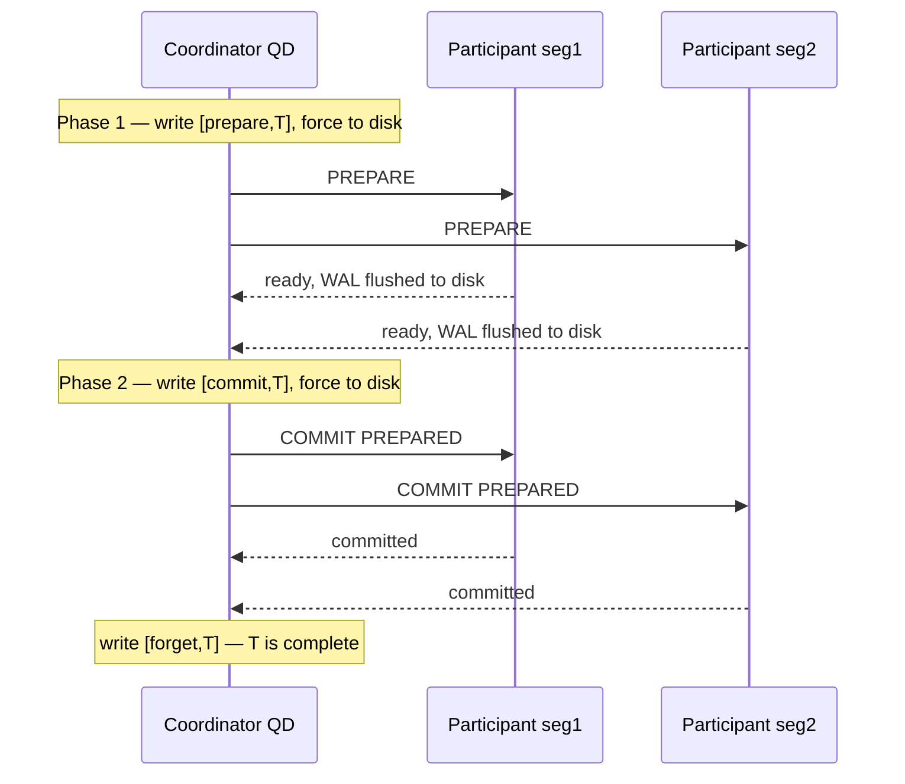
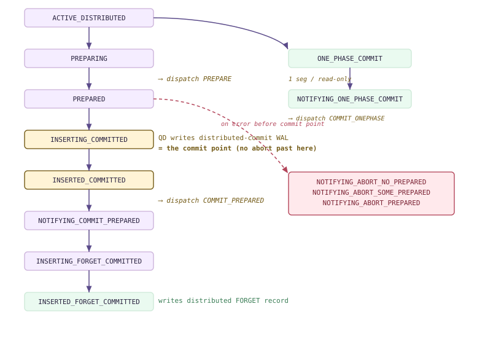
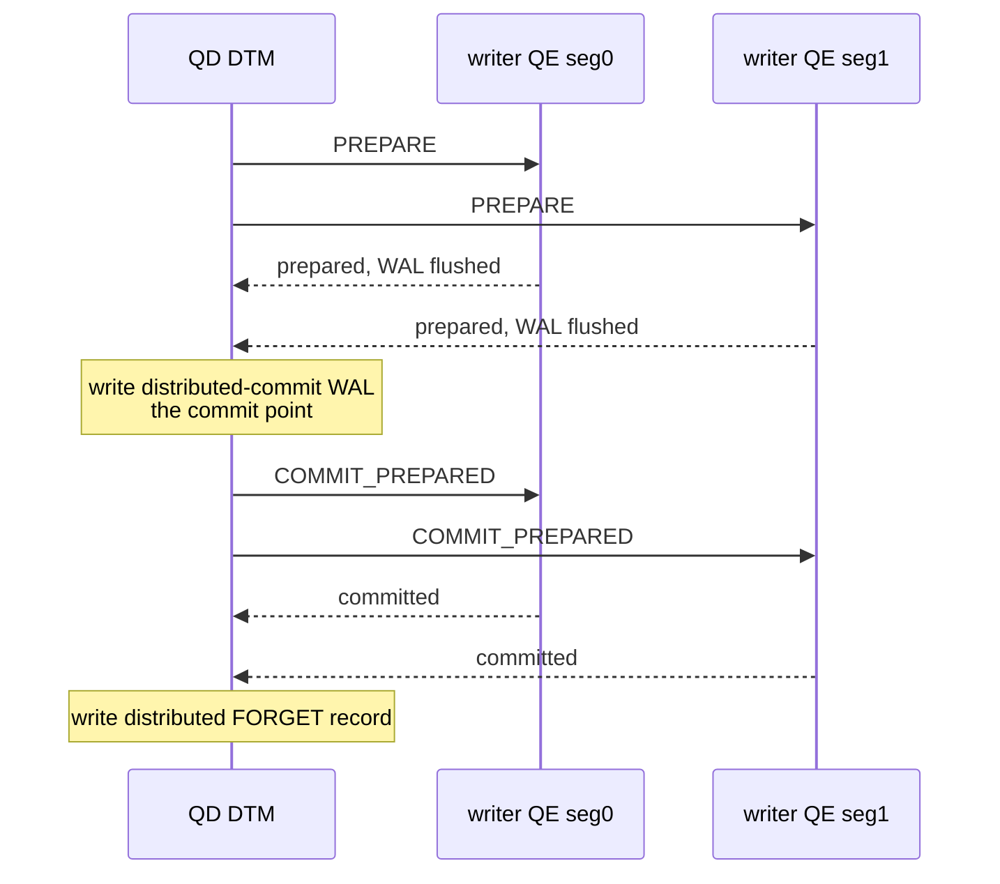
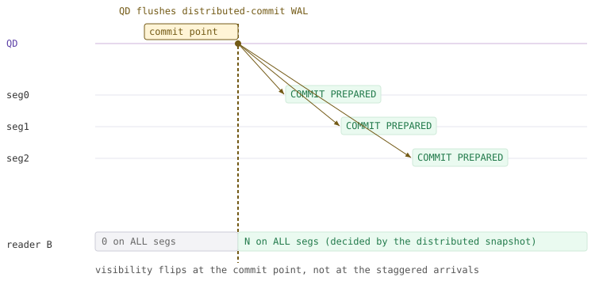
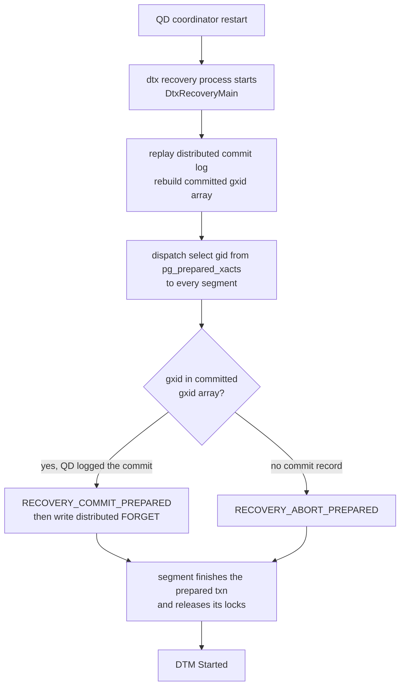
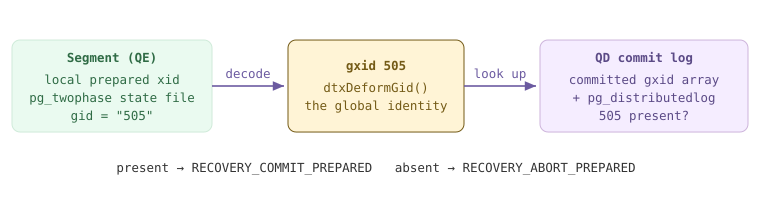

<!--
  Licensed to the Apache Software Foundation (ASF) under one
  or more contributor license agreements.  See the NOTICE file
  distributed with this work for additional information
  regarding copyright ownership.  The ASF licenses this file
  to you under the Apache License, Version 2.0 (the
  "License"); you may not use this file except in compliance
  with the License.  You may obtain a copy of the License at

    http://www.apache.org/licenses/LICENSE-2.0

  Unless required by applicable law or agreed to in writing,
  software distributed under the License is distributed on an
  "AS IS" BASIS, WITHOUT WARRANTIES OR CONDITIONS OF ANY
  KIND, either express or implied.  See the License for the
  specific language governing permissions and limitations
  under the License.
-->

<a id="12-distributed-transactions--2pc"></a>

## 12.1 两阶段提交基础 {#121-two-phase-commit-fundamentals}

Cloudberry 事务很少只在一台机器上运行。一条 `INSERT ... SELECT` 就可能同时向 Segment 1、Segment 2 和 Segment 3 写入行，因此*提交*它并非本地操作，而是多个独立 PostgreSQL 实例之间达成的一致决定；每个实例都有自己的 WAL、clog 和崩溃恢复机制。事务必须在**所有实例上保持全有或全无**：要么每个 Segment 都持久提交自己负责的部分，要么都不提交。提供这一保证的协议就是**两阶段提交（2PC）**，第 12 章将围绕 Cloudberry 如何驱动这一协议展开。

要理解为何一轮消息交互不够，可以看经典的三节点示例。用户通过节点 **A** 提交事务 *T*；*T* 更新节点 **B** 上的 *X* 和节点 **C** 上的 *Y*。假设 A 只广播“*立即提交*”。B 刷出 *X* 并提交，但 C 更新 *Y* 后，在变更到达稳定存储之前崩溃。C 重启后的恢复过程回滚 *T*，对 *Y* 的更新丢失。此时 B 将 *T* 视为已提交，C 却将其视为已中止：集群永久不一致，原子性被破坏。问题就在 B 提交与 C 提交之间的**窗口**，此时发生崩溃可能使两者结果分裂。



*2PC 消息交互：PREPARE 收集已持久化的“ready”投票，再由 COMMIT PREPARED 最终完成提交。所有参与者都承诺能够提交之前，没有任何参与者会提交。*

2PC 通过引入一个所有参与者都必须在**任何一方提交之前**达到的*不可自行反悔点*，关闭这一窗口。它将提交拆为投票阶段和最终完成阶段，两者之间以持久化承诺为界。

### 12.1.1 分布式事务为何需要原子提交协议 {#1211-why-a-distributed-transaction-needs-an-atomic-commit-protocol}

分布式事务是一种嵌套事务：一个逻辑事务 *T* 由各参与节点上的本地子事务组成，原子性要求它们拥有共同的结果。在*集中式*服务器上，这一点自然成立：所有资源管理器都写入同一份共享 WAL，一条 `<commit>` 记录刷盘一次即可决定全部结果。集群中则没有共享 WAL：每个 Segment 独立执行 fsync，网络还可能重排、延迟或丢弃 Coordinator 的消息。没有协议时，Coordinator 无法知道沉默的参与者是已提交、已中止，还是仅仅尚未回复。

2PC（由 Gray 等人提出）正是为这一场景而设计：一个 **Coordinator** 协调一组**参与者**，协议规则确保即使发生崩溃，两个参与者也不可能对 *T* 的结果产生分歧。在 A/B/C 示例中，A 是 Coordinator，B 和 C 是参与者；*T* 执行完毕后，B 和 C 告知 A 自己已完成，A 随即开始两阶段提交。

> [!NOTE]
> 2PC 是**提交**协议，不是锁定协议或隔离协议。分布式*可见性*——决定查询跨 Segment 能看到哪些已提交事务——由另一套机制负责，即基于全局 xid 的分布式快照，已在 **[§10.5](/cloudberry/core-internals/part-3-transactions-mvcc-concurrency/ch10/#105-distributed-snapshots--the-distributed-log)** 中介绍。本节只讨论如何达成原子的*决定*。

### 12.1.2 两个阶段 {#1212-the-two-phases}

**阶段 1：PREPARE（投票）。** Coordinator 写入 `<prepare,T>` 记录，将自身日志强制刷入持久存储，再向每个参与者发送 `PREPARE` 消息。各参与者判断自己*能否*提交 *T* 中由自己负责的部分。如果出现问题，就写入 `<not prepared,T>` 并回复 **abort**。如果可以提交，则将 *T* 的*全部* WAL 连同一条 `<ready,T>` 记录刷入磁盘，然后才回复 **ready**。回复前的刷盘是关键，下文还会回到这一点。

**阶段 2：COMMIT（决定）。** Coordinator 收到所有参与者的回复后，结果就确定了：**全部**回复 ready ⇒ 提交；**任何一个**中止或超时 ⇒ 中止。提交时，Coordinator 写入 `<commit,T>` 并强制刷盘（这条记录*就是*决定），随后向每个参与者发送 `COMMIT PREPARED`；各参与者完成其已准备事务——更新 clog、释放锁——并确认。收到所有确认后，Coordinator 写入最后一条 `<forget,T>`（也称 `<complete,T>`）记录，随后可以释放自身资源。

- **阶段 1：PREPARE**：Coordinator 强制刷出 `<prepare,T>`；各参与者将事务 WAL 和持久化的 `<ready,T>` 刷盘，再投票 **ready** 或 **abort**。对参与者而言，这是不可自行反悔的节点。
- **阶段 2：COMMIT**：Coordinator 强制刷出决定记录（`<commit,T>` 或 `<abort,T>`）——这一次持久写入决定整个分布式事务的提交——然后广播 `COMMIT PREPARED` / `ABORT PREPARED` 并收集确认。
- **不变条件**：回复 **ready** 的参与者，在任意崩溃后都必须能够服从 COMMIT *或* ABORT。它已经放弃单方面决定结果的权利。

正因为这个不变条件，参与者必须在回答 ready *之前*刷盘。投出 ready 后，它就不再掌控结果，而是由 Coordinator 决定。因此，即使它在回复后立即崩溃，恢复过程也必须能够将 *T* 恢复到已准备状态，然后遵从 Coordinator 最终给出的指令。仅将变更缓存在内存中的参与者无法兑现这一承诺；正是刷盘让“ready”成为具有约束力且能承受崩溃的承诺。

> [!NOTE]
> 崩溃后，恢复过程读取自身日志：发现 `<commit,T>` 的参与者重做 T，发现 `<abort,T>` 的参与者撤销 T；若只找到 `<ready,T>`，就必须**询问 Coordinator** 究竟发生了什么——这就是*未决*事务。

### 12.1.3 阻塞问题 {#1213-the-blocking-problem}

2PC 众所周知的弱点恰恰就在这种未决状态中。假设所有参与者都已投出 ready，持有 *T* 的锁并等待阶段 2，此时 **Coordinator** 在决定送达前崩溃，或网络发生分区。参与者不能自行提交：其他参与者可能已经中止。它也不能自行中止：Coordinator 可能已决定提交，并通知了其他参与者。它只能**阻塞**，继续持有 *T* 的锁和资源，直到 Coordinator 恢复并重新发布决定。与这些锁冲突的其他事务也必须等待。

因此，2PC 是一种*阻塞*协议，而 Coordinator 的日志不可或缺：它是让所有参与者解除阻塞的唯一权威依据。（三阶段提交通过增加状态和消息来减少阻塞，但几乎没有生产数据库采用它。）Cloudberry 的应对方式是一条可靠的恢复路径：Coordinator 重启后，由后台进程重新驱动未决事务的阶段 2。相关内容见 **[§12.4](#124-dtx-recovery--localdistributed-mapping)**，并结合 **[§20.4.4](/cloudberry/core-internals/part-5-high-availability-recovery/ch20/#2044-distributed-recovery--the-second-layer)** 中的 WAL 核对与恢复过程阅读。

### 12.1.4 PostgreSQL 仅实现参与者侧的 2PC：Cloudberry 的构建基础 {#1214-postgresqls-participant-only-2pc--the-machinery-cloudberry-builds-on}

PostgreSQL 是集中式数据库，**不自带分布式事务管理器**。它*提供*的是 2PC 的**参与者部分**，通过三条 SQL 命令暴露。没有内置的 Coordinator；外部事务管理器（在这里就是 Cloudberry）承担这一角色，并通过这些命令驱动各 PostgreSQL 实例：

- **PREPARE TRANSACTION 'gid'**：本节点上的阶段 1，将事务 WAL 和准备记录刷入磁盘，把锁交给一个虚拟 PGPROC，并以全局 ID `gid` 将 *T* 留在未决状态。会话的事务块此时已经结束，但 *T* 既未提交，也未中止。
- **COMMIT PREPARED 'gid'**：完成阶段 2，通过 `gid` 查找已准备事务并持久提交它。所有参与者都投出 ready 后，由 Coordinator 发出。
- **ROLLBACK PREPARED 'gid'**：阶段 2 的中止操作，丢弃由 `gid` 标识的已准备事务并释放其资源。

这套机制由 GUC `max_prepared_transactions` 控制：其值必须大于零（它决定已准备事务槽共享数组的大小），否则 `PREPARE TRANSACTION` 会报错。在我们的集群中，Coordinator 和各 Segment 上的值都充分大于零，说明 2PC 机制已在所有节点就绪：

*两层的 max_prepared_transactions 都大于 0：参与者机制已在整个集群启用。*

```sql
-- coordinator (QD), port 7100
SHOW max_prepared_transactions;

-- a segment (QE) in utility mode, port 7102
PGOPTIONS='-c gp_role=utility' psql -p 7102 \
    -d postgres -c 'SHOW max_prepared_transactions;'
```

```text {hl_lines="3" title="output"}
 max_prepared_transactions 
---------------------------
 250

 max_prepared_transactions 
---------------------------
 250
```

已准备事务是一种*比创建它的会话存活更久的持久状态*：PostgreSQL 写入一条 `XLOG_XACT_PREPARE` WAL 记录，并在检查点或崩溃时，在 `pg_twophase/` 目录下为各事务生成状态文件（`src/backend/access/transam/twophase.c` — `TWOPHASE_DIR`）。`EndPrepare` 例程使“ready”成为持久状态：它将准备记录插入 WAL，并在返回调用者之前强制刷盘：

```c {title="src/backend/access/transam/twophase.c — EndPrepare()"}
gxact->prepare_end_lsn =
    XLogInsert(RM_XACT_ID, XLOG_XACT_PREPARE);
...
XLogFlush(gxact->prepare_end_lsn);
/* If we crash now, we have prepared: WAL replay will fix things */
```

这一行 `XLogFlush` 就实现了 2PC 的不变条件：准备记录落盘之前，控制权不会返回，Segment 也不会向 Coordinator 报告 *ready*。注释说得很清楚：此后即使崩溃也可恢复，因为重放会重建已准备事务。任何当前处于此状态的节点都可以通过 `pg_prepared_xacts` 视图观察。在空闲集群上，该视图为空，但其列恰好展示了 Coordinator 核对未决事务所需的信息：全局 ID 和准备时间。

*pg_prepared_xacts：未决事务登记表。此处为空（没有事务正处于 2PC 中途），但请注意 gid 列。*

```sql
SELECT * FROM pg_prepared_xacts;

\d pg_prepared_xacts
```

```text {hl_lines="8" title="output"}
 transaction | gid | prepared | owner | database 
-------------+-----+----------+-------+----------
(0 rows)

   Column    |           Type           
-------------+--------------------------
 transaction | xid
 gid       | text
 prepared    | timestamp with time zone
 owner       | name
 database    | name
```

还有一个特殊之处：虽然各 Segment *实现了*参与者命令，但 Cloudberry 禁止用户直接调用它们。在 Segment 的 utility 模式下尝试 `PREPARE TRANSACTION`，会被直接拒绝。这一原语专供分布式事务管理器使用，只有它有权选择全局 ID 并协调投票：

*Cloudberry 阻止用户直接执行 PREPARE：参与者部分仅由 DTM 驱动，不能手动调用。*

```sql
-- on a segment, utility mode (port 7102)
BEGIN;
INSERT INTO dtx121_t VALUES (1),(2);
PREPARE TRANSACTION 'dtx121_demo';
```

```text {hl_lines="3" title="output"}
BEGIN
INSERT 0 2
ERROR:  PREPARE TRANSACTION is not supported in utility mode
```

```c {title="src/backend/tcop/postgres.c — exec_simple_query()"}
/* GPDB: in utility mode, disallow PREPARE TRANSACTION */
if (Gp_role == GP_ROLE_UTILITY && IsA(parsetree->stmt, TransactionStmt) &&
    ((TransactionStmt *) parsetree->stmt)->kind == TRANS_STMT_PREPARE)
    ereport(ERROR,
            (errcode(ERRCODE_FEATURE_NOT_SUPPORTED),
             errmsg("PREPARE TRANSACTION is not supported in utility mode")));
```

因此，分工很清楚，也决定了本章后续的内容。PostgreSQL 提供*参与者*机制：持久化的 PREPARE、`pg_twophase` 状态文件，以及崩溃后仍能服从 COMMIT PREPARED 或 ROLLBACK PREPARED 的能力。Cloudberry 在其上提供 *Coordinator*：QD 分配全局事务 ID，跟踪哪些 Segment 参与了写入，以状态机驱动它们完成 PREPARE → COMMIT PREPARED，并持久记录分布式决定。**[§12.2](#122-cloudberrys-2pc-cdbtm-dtxstate--dtxcontext)** 将直接在这里展示的参与者机制之上构建这个 Coordinator，即 `DtxState` 状态机和 QD→QE 协议命令。

> [!NOTE]
> 交叉引用：**[§10.5](/cloudberry/core-internals/part-3-transactions-mvcc-concurrency/ch10/#105-distributed-snapshots--the-distributed-log)** 介绍分布式快照与全局 xid；**[§12.2](#122-cloudberrys-2pc-cdbtm-dtxstate--dtxcontext)** 介绍建立在此参与者层之上的 Cloudberry Coordinator（DtxState、DtxProtocolCommand）；**[§12.4](#124-dtx-recovery--localdistributed-mapping)** 介绍阻塞问题的处理，即未决事务的 DTX 恢复；**[§20.4.4](/cloudberry/core-internals/part-5-high-availability-recovery/ch20/#2044-distributed-recovery--the-second-layer)–20.4.5** 介绍 WAL 层面的崩溃核对与恢复。

## 12.2 Cloudberry 的 2PC：cdbtm、DtxState 与 DtxContext {#122-cloudberrys-2pc-cdbtm-dtxstate--dtxcontext}

> [!NOTE]
> ↔ 本节介绍**运行时 2PC 协议**，即驱动跨 Segment 提交的 QD `DtxState` / QE `DtxContext` 状态机。*持久化*部分见第 [20](/cloudberry/core-internals/part-5-high-availability-recovery/ch20/) 章：[§20.2.7](/cloudberry/core-internals/part-5-high-availability-recovery/ch20/#2027-the-distributed-commit-story-precisely)–20.2.9 介绍分布式 commit/forget 的 WAL 编码，[§20.4.4](/cloudberry/core-internals/part-5-high-availability-recovery/ch20/#2044-distributed-recovery--the-second-layer) 介绍崩溃时未决 2PC 的核对与恢复，[§20.4.5](/cloudberry/core-internals/part-5-high-availability-recovery/ch20/#2045-how-prepared-phase-1-transactions-survive-a-crash) 介绍 Segment 的已准备状态如何在崩溃后保留下来。

Cloudberry 的两阶段提交并不是后来外挂的扩展，而是一个完全由 QD 上的**分布式事务管理器（DTM）**驱动的状态机。DTM 位于 `src/backend/cdb/cdbtm.c`。当语句首次需要分布式工作时，QD 分配一个**分布式事务 ID（gxid）**，将其记录在共享的 `MyTmGxact` 槽中，并将自身 DTX 推进到 `DTX_STATE_ACTIVE_DISTRIBUTED`。此后，提交就是按固定顺序经过一系列状态，在每个阶段向写入 QE 分发一条协议命令。本节介绍这套*运行时*协议；持久化的 WAL 部分，即分布式提交和 forget 记录如何编码和重放，见第 20 章（[§20.2.7](/cloudberry/core-internals/part-5-high-availability-recovery/ch20/#2027-the-distributed-commit-story-precisely)–20.2.9、[§20.4.4](/cloudberry/core-internals/part-5-high-availability-recovery/ch20/#2044-distributed-recovery--the-second-layer)）。

请记住第 9 章中的一个区别：一个*分布式*事务只有一个 gxid，但它会映射为**每个参与 Segment 上各自的普通本地 xid**（[§9.2](/cloudberry/core-internals/part-3-transactions-mvcc-concurrency/ch09/#92-the-transaction-manager)）。gxid 将这些本地 xid 联系成一个原子单元，也是 [§10.5](/cloudberry/core-internals/part-3-transactions-mvcc-concurrency/ch10/#105-distributed-snapshots--the-distributed-log) 中分布式快照机制使用的键。下面的 QD 侧状态机是整章的核心；请先看图，再逐步理解。



*QD 上的 DtxState 提交状态机（所有名称都以 DTX_STATE_\* 开头）。绿色主线表示正常路径的 2PC；琥珀色表示提交点；右列表示单阶段捷径；玫红色表示提交前的中止分支。*

从图中可以读出两点。第一，**主线有严格的顺序**：`ACTIVE_DISTRIBUTED → PREPARING → PREPARED → INSERTING_COMMITTED → INSERTED_COMMITTED → NOTIFYING_COMMIT_PREPARED → INSERTING/INSERTED_FORGET_COMMITTED`。第二，琥珀色一行是**提交点**：一旦 QD 写入自身的分布式提交 WAL 记录，事务的结果就*已确定*；此后的任何失败都只能**向前**恢复（`RETRY_COMMIT_PREPARED`），不能回退。主线右侧都是分支出口：上方是单阶段捷径，下方是提交前中止分支。

### 12.2.1 分布式事务管理器位于 QD {#1221-the-distributed-transaction-manager-lives-on-the-qd}

gxid 采用延迟分配。只有执行器确定语句需要写入时，QD 才会调用 `currentDtxActivate()`（`src/backend/cdb/cdbtm.c` — `bumpGxid()`），从共享 gxid 计数器取得下一个值，存入 `MyTmGxact->gxid`，记录会话 ID，并将 DTX 切换到第一个实际状态。

```c {title="src/backend/cdb/cdbtm.c — currentDtxActivate()"}
SpinLockAcquire(shmGxidGenLock);
if (ShmemVariableCache->GxidCount > 0)
{
    pg_atomic_write_u64(&MyTmGxact->atomic_gxid,
                        ShmemVariableCache->nextGxid++);
    MyTmGxact->gxid = MyTmGxact->atomic_gxid.value;
    ShmemVariableCache->GxidCount--;
    ...
}
MyTmGxact->sessionId = gp_session_id;
setCurrentDtxState(DTX_STATE_ACTIVE_DISTRIBUTED);   /* :342 */
```

`MyTmGxact` 是第 9 章中本地 `PGPROC`/xact 状态的分布式对应物：在 QD 和各 QE 的共享数组中，每个后端各有一个槽。它持有的 gxid 是整个分布式事务的*唯一句柄*；应与 Segment 本地 xid 区分（[§9.2](/cloudberry/core-internals/part-3-transactions-mvcc-concurrency/ch09/#92-the-transaction-manager)），并记住分布式快照（[§10.5](/cloudberry/core-internals/part-3-transactions-mvcc-concurrency/ch10/#105-distributed-snapshots--the-distributed-log)）是一组这样的 gxid，而非本地 xid。

可以实时观察 gxid。在一个会话中开启分布式写入并暂不提交，`gp_distributed_xacts` 就会显示 QD 正在进行的 DTX（这里从同一个未结束事务内部查询）：

*正在进行的分布式写入：一个 gxid，三个参与 Segment。*

```sql
BEGIN;
INSERT INTO dtx122_multi SELECT generate_series(1,1000);
SELECT distributed_xid, state, gp_session_id
  FROM gp_distributed_xacts;
SELECT gp_segment_id, count(*)
  FROM dtx122_multi GROUP BY 1 ORDER BY 1;
```

```text {hl_lines="3" title="output"}
 distributed_xid | state | gp_session_id
-----------------+-------+---------------
             499 | None  |          3001
               0 | None  |             0     -- (unused proc slots)
               ...
(7 rows)

 gp_segment_id | count
---------------+-------
             0 |   338
             1 |   322
             2 |   340    <- rows on ALL 3 segments
```

gxid `499` 属于会话 3001。行数查询证明此次写入触及全部三个主 Segment，因此提交时 QD *必须*经过完整的两阶段主线。（值为零的行只是共享 `TMGXACT` 数组中的空闲槽。）

### 12.2.2 沿提交主线逐步执行 {#1222-walking-the-commit-spine}

第一阶段由 `doPrepareTransaction()` 执行（`cdbtm.c` — `doDispatchSubtransactionInternalCmd()`）。它断言 DTX 处于 `ACTIVE_DISTRIBUTED`，将其移到 `PREPARING`，向每个写入 QE 分发 `DTX_PROTOCOL_COMMAND_PREPARE`，成功后再推进到 `PREPARED`。分发是同步的：QD 会阻塞，直到所有 Segment 都刷出准备记录并作出回复。

```c {title="src/backend/cdb/cdbtm.c — doPrepareTransaction()"}
Assert(MyTmGxactLocal->state == DTX_STATE_ACTIVE_DISTRIBUTED);
setCurrentDtxState(DTX_STATE_PREPARING);
...
succeeded = currentDtxDispatchProtocolCommand(
                DTX_PROTOCOL_COMMAND_PREPARE, true);
...
Assert(MyTmGxactLocal->state == DTX_STATE_PREPARING);
setCurrentDtxState(DTX_STATE_PREPARED);
```

提交点位于 `PREPARED` 与第二阶段之间。QD 写入自身的**分布式提交** WAL 记录这一持久化决定时，会经过 `INSERTING_COMMITTED` → `INSERTED_COMMITTED`（`insertingDistributedCommitted()`，`cdbtm.c` — `resetTmGxact()`）。*只有在*该记录刷盘之后，`doNotifyingCommitPrepared()`（`cdbtm.c` — `doNotifyingOnePhaseCommit()`）才会执行第二阶段。

```c {title="src/backend/cdb/cdbtm.c"}
Assert(MyTmGxactLocal->state == DTX_STATE_INSERTED_COMMITTED);
setCurrentDtxState(DTX_STATE_NOTIFYING_COMMIT_PREPARED);
...
succeeded = currentDtxDispatchProtocolCommand(
                DTX_PROTOCOL_COMMAND_COMMIT_PREPARED, true);
```



*QD 与写入 QE 之间完整的 2PC 消息交互。QD 自身的提交点 WAL 位于两轮分发之间。*

两个 QE 都确认后，QD 写入 **forget** 记录（`INSERTING_FORGET_COMMITTED` → `INSERTED_FORGET_COMMITTED`，`cdbtm.c` 中的 `doInsertForgetCommitted()`），表示“此分布式事务已完全处理完毕，恢复时不必再跟踪它”。中止分支与之对应：若 PREPARE 失败，QD 会根据准备进行到哪一步，进入 `NOTIFYING_ABORT_NO_PREPARED` / `_SOME_PREPARED` / `_PREPARED`。这些 WAL 记录的字节布局和崩溃重放见 [§20.2.7](/cloudberry/core-internals/part-5-high-availability-recovery/ch20/#2027-the-distributed-commit-story-precisely)–20.2.9 / [§20.4.4](/cloudberry/core-internals/part-5-high-availability-recovery/ch20/#2044-distributed-recovery--the-second-layer)；未决事务的恢复见 [§12.4](#124-dtx-recovery--localdistributed-mapping)。

> [!NOTE]
> 想实时观察这条主线的状态推进，可以使用开发者 GUC `Debug_print_full_dtm`（默认**关闭**）。它控制各状态转换中的 `DTM_DEBUG5` 日志（`doPrepareTransaction moved to state = ...`）。它可以按会话 `SET`，但这些消息只有在 `DEBUG5` 级别才出现，因此更适合作为阅读代码的辅助，而非演示工具。

### 12.2.3 单阶段提交优化 {#1223-the-one-phase-commit-optimization}

如果写入只到达一个 Segment，整轮 PREPARE 就没有必要：只有一个参与者，不存在需要防范的跨节点原子性缺口。该 Segment 提交，*就是*整个事务提交。`prepareDtxTransaction()` 会检测这种情况，直接走捷径。

```c {title="src/backend/cdb/cdbtm.c"}
if (!TopXactExecutorDidWriteXLog() ||
    (!markXidCommitted && list_length(MyTmGxactLocal->dtxSegments) < 2))
{
    setCurrentDtxState(DTX_STATE_ONE_PHASE_COMMIT);
    doNotifyingOnePhaseCommit();
    return;
}
...
doPrepareTransaction();   /* else: full 2PC */
```

触发条件有两个：事务完全没有写入 xlog（只读）；或者发生了写入，但触及的 Segment 少于两个。此时，`doNotifyingOnePhaseCommit()`（`cdbtm.c` — `doInsertForgetCommitted()`）会转入 `NOTIFYING_ONE_PHASE_COMMIT`，仅分发一次 `DTX_PROTOCOL_COMMAND_COMMIT_ONEPHASE`，没有分布式提交 WAL 记录，没有 forget，也没有第二轮。这就是经典的*单阶段提交*：Coordinator 将提交决定交给唯一的参与者。[§12.2.1](#1221-the-distributed-transaction-manager-lives-on-the-qd) 的多 Segment INSERT 触及全部三个 Segment，因此不符合条件；按哈希只落到一个 Segment 的写入则符合。

### 12.2.4 QE 侧：DtxContext 角色 {#1224-the-qe-side-dtxcontext-roles}

每个后端都携带一个全局 `DistributedTransactionContext`（声明于 `src/include/cdb/cdbtm.h`，枚举 `DtxContext` 位于 `cdbtm.h`），用来标识自己的角色。QD 为 `QD_DISTRIBUTED_CAPABLE`；QE 的值由 `setupQEDtxContext()`（`cdbtm.c` — `setupRegularDtxContext()`）根据 `QEDtxContextInfo` 填入。QD 会将该信息序列化，并随*每一条*分发命令一起发送，使用的就是 [§1.4](/cloudberry/core-internals/#14-clients-the-wire-protocol--dispatch) 中承载计划的 gang／分发通道。QD 的 gxid、分布式快照和 2PC 意图正是这样到达各 Segment 的。

| DtxContext 值 | 对应进程与时机 |
| --- | --- |
| LOCAL_ONLY | 没有分布式工作的任何后端，例如 utility 模式或仅在 Coordinator 上执行的查询。也是初始状态和事务之间的状态。 |
| QD_DISTRIBUTED_CAPABLE | 正在驱动分布式事务的 QD（DTM 角色）。 |
| QD_RETRY_PHASE_2 | 分发失败后重新执行第二阶段（提交／中止已准备事务）的 QD。 |
| QE_ENTRY_DB_SINGLETON | Coordinator Segment 上的 Entry-DB 单例 QE。 |
| QE_AUTO_COMMIT_IMPLICIT | 非写入自动提交查询的根 QE，不需要 2PC。 |
| QE_TWO_PHASE_EXPLICIT_WRITER | 事务由显式 BEGIN 开启的写入 QE。 |
| QE_TWO_PHASE_IMPLICIT_WRITER | 事务由自动提交写查询开启的写入 QE。 |
| QE_READER | 非根 QE，共享写入者的快照（[§10.5](/cloudberry/core-internals/part-3-transactions-mvcc-concurrency/ch10/#105-distributed-snapshots--the-distributed-log)），从不执行准备。 |
| QE_PREPARED | 第一阶段（PREPARE）完成后的写入 QE。 |
| QE_FINISH_PREPARED | 第二阶段（提交／中止已准备事务）完成后的写入 QE。 |

这种区分对正确性十分重要：只有两种 `_WRITER` 上下文会实际执行 PREPARE 并持有已准备事务的资源；`QE_READER` 仅借用写入者的分布式快照，从不需要提交任何内容。因此，在三 Segment 集群中，一个分布式事务可能有三个写入 QE 处于已准备状态，同时任意数量的读取 QE 正常启动或退出。

### 12.2.5 DtxProtocolCommand：线上协议命令 {#1225-dtxprotocolcommand-the-wire-verbs}

QD 分发的是 `DTX_PROTOCOL_COMMAND_*` 系列命令（`cdbtm.h` — `DTX_PROTOCOL_COMMAND_NONE`）：`PREPARE`、`COMMIT_ONEPHASE`、`COMMIT_PREPARED`、三种 `ABORT_*` 变体、`RETRY_{COMMIT,ABORT}_PREPARED`，以及恢复进程使用的一对 `RECOVERY_*` 命令（[§12.4](#124-dtx-recovery--localdistributed-mapping)），此外还有子事务命令。在 QE 上，`performDtxProtocolCommand()`（`cdbtm.c` — `performDtxProtocolAbortPrepared()`）是统一入口，它结合本地 `DistributedTransactionContext` 解码命令，并调用相应的处理例程。

```c {title="src/backend/cdb/cdbtm.c — performDtxProtocolCommand()"}
case DTX_PROTOCOL_COMMAND_PREPARE:
case DTX_PROTOCOL_COMMAND_COMMIT_ONEPHASE:
    switch (DistributedTransactionContext)
    {
    case DTX_CONTEXT_QE_TWO_PHASE_EXPLICIT_WRITER:
    case DTX_CONTEXT_QE_TWO_PHASE_IMPLICIT_WRITER:
        if (dtxProtocolCommand == DTX_PROTOCOL_COMMAND_COMMIT_ONEPHASE)
            performDtxProtocolCommitOnePhase(gid);
        else
            performDtxProtocolPrepare(gid);
        break;
    ...
```

`COMMIT_PREPARED` 和 `ABORT_PREPARED` 分别进入 `performDtxProtocolCommitPrepared()`（`cdbtm.c` — `performDtxProtocolCommitOnePhase()`）/ `performDtxProtocolAbortPrepared()`，驱动 Segment 继承的底层 PostgreSQL 两阶段机制（`twophase.c`）。Cloudberry 的参与者就是 PostgreSQL 已准备事务，由 QD 的 DTM 协调。`RECOVERY_*` 命令执行相同的提交／中止操作，只是由专用后台进程重新发出；可以在每个集群中看到该进程运行：

*dtx recovery process 始终存在；没有发生崩溃时，也就没有未决事务。*

```bash
$ ps -ef | grep 'dtx recovery process'
$ psql -p 7100 -c 'SELECT * FROM pg_prepared_xacts;'
```

```text {hl_lines="1" title="output"}
gpadmin 6021 ... postgres: 7100, dtx recovery process

 transaction | gid | prepared | owner | database
-------------+-----+----------+-------+----------
(0 rows)
```

Segment 若在 2PC 中途崩溃，其已准备事务仍会保留在 `pg_prepared_xacts` 中（磁盘上位于 `pg_twophase`，参见 [§20.4.5](/cloudberry/core-internals/part-5-high-availability-recovery/ch20/#2045-how-prepared-phase-1-transactions-survive-a-crash)）；`dtx recovery process` 会将它们与 QD 的 committed/forget 记录核对，再重新发出 `RECOVERY_COMMIT_PREPARED` 或 `RECOVERY_ABORT_PREPARED`。这一核对过程是 [§12.4](#124-dtx-recovery--localdistributed-mapping) 的主题，提交顺序如何使结果*可见*则见 [§12.3](#123-distributed-commit-ordering)。

## 12.3 分布式提交顺序 {#123-distributed-commit-ordering}

[§12.2](#122-cloudberrys-2pc-cdbtm-dtxstate--dtxcontext) 使分布式事务具备*全有或全无*的性质：每个参与 Segment 要么对已准备事务执行 COMMIT，要么执行 ABORT。但持久性意义上的原子性与*可见性*是不同问题。`COMMIT PREPARED` 消息从 QD 发出，到达 seg0、seg1、seg2 的时刻略有差异；在短暂窗口内，一个 Segment 的本地 xid 已在其 CLOG 中提交，另一个却还没有。因此，还必须回答另一个独立问题：**分布式事务何时、以怎样的原子性对读者可见**，才能确保读者绝不会只在部分 Segment 上看到它的行，而在其他 Segment 上看不到？

答案有两部分。第一，有一个唯一时刻决定*整个*分布式事务是提交还是中止，这就是**提交点**。第二，读者从不只凭某个 Segment 的本地 CLOG 判断可见性，而是依据**分布式快照**（[§10.5](/cloudberry/core-internals/part-3-transactions-mvcc-concurrency/ch10/#105-distributed-snapshots--the-distributed-log)）；其中从*进行中*到*已提交*的切换，是与提交点关联的单个逻辑事件。二者共同使各 Segment 的 `COMMIT PREPARED` 时间差对读者不可见。



*提交点为整个分布式事务确定串行顺序；可见性在此切换，而非在 COMMIT PREPARED 先后到达各节点时切换。*

### 12.3.1 提交点 {#1231-the-commit-point}

回顾 [§12.2](#122-cloudberrys-2pc-cdbtm-dtxstate--dtxcontext) 中 QD 的状态机。每个写入 QE 都回复 PREPARE 后，QD 进入 `DTX_STATE_INSERTING_COMMITTED`，写入**自身的**本地提交记录。由于此事务已经完成两阶段准备，该记录不是普通的 `XLOG_XACT_COMMIT`，而是一条分布式提交记录。`RecordTransactionCommit()` 将决定交给 `XactLogCommitRecord()`，后者根据 `isDtxPrepared` 选择记录类型（`src/backend/access/transam/xact.c`）。

```c {title="src/backend/access/transam/xact.c — XactLogCommitRecord()"}
/* decide between a plain and 2pc commit */
if (isDtxPrepared)
    info = XLOG_XACT_DISTRIBUTED_COMMIT;
else if (!TransactionIdIsValid(twophase_xid))
    info = XLOG_XACT_COMMIT;
else
    info = XLOG_XACT_COMMIT_PREPARED;
```

[§12.2](#122-cloudberrys-2pc-cdbtm-dtxstate--dtxcontext) 中的两个 DtxState 转换，分别位于实际插入该记录的 `XLogInsert` 前后：前面是 `insertingDistributedCommitted()`，后面是 `insertedDistributedCommitted()`（`src/backend/access/transam/xact.c` — `XactLogCommitRecord()`）。此时记录已经*进入 WAL 缓冲区*，但尚未持久化。

```c {title="src/backend/access/transam/xact.c — XactLogCommitRecord()"}
if (isDtxPrepared)
    insertingDistributedCommitted();

recptr = XLogInsert(RM_XACT_ID, info);

if (isDtxPrepared)
    insertedDistributedCommitted();
```

再往后几行，`RecordTransactionCommit()` 将 WAL **刷出**到此记录的位置，才最终确定持久性，也就确定了提交决定。Cloudberry 的每个用户事务都同步提交，正是因为集群依赖两阶段提交，所以这次刷盘不可省略。

```c {title="src/backend/access/transam/xact.c — RecordTransactionCommit()"}
if ((wrote_xlog && markXidCommitted &&
     synchronous_commit > SYNCHRONOUS_COMMIT_OFF) ||
    forceSyncCommit || nrels > 0)
{
    XLogFlush(XactLastRecEnd);   /* <-- the distributed commit point */
```

**这次刷盘是整个分布式事务唯一的串行化点。** 在它返回之前，QD 崩溃会导致全部中止：没有分布式提交记录保留下来，恢复过程便将事务视为从未提交，并回滚各 Segment 上的已准备事务。返回之后，事务就永久提交：即使 QD 在任何一条 `COMMIT PREPARED` 到达 Segment 之前崩溃，崩溃恢复也会找到分布式提交记录，重放它，并重新驱动阶段 2，在每个 Segment 上**向前**完成事务（[§12.4](#124-dtx-recovery--localdistributed-mapping)；WAL 编码见 [§20.2.7](/cloudberry/core-internals/part-5-high-availability-recovery/ch20/#2027-the-distributed-commit-story-precisely)–20.2.9，未决事务核对与恢复见 [§20.4.4](/cloudberry/core-internals/part-5-high-availability-recovery/ch20/#2044-distributed-recovery--the-second-layer)）。

只有*越过*提交点，阶段 2 才开始。`CommitTransaction()` 调用 `notifyCommittedDtxTransaction()`（`src/backend/access/transam/xact.c`），后者读取 QD 的 DtxState；由于此时已处于 `DTX_STATE_INSERTED_COMMITTED`，便向各 Segment 分发 `COMMIT PREPARED`。

```c {title="src/backend/cdb/cdbtm.c — notifyCommittedDtxTransaction()"}
switch(MyTmGxactLocal->state)
{
    case DTX_STATE_INSERTED_COMMITTED:
        doNotifyingCommitPrepared();
        break;
    case DTX_STATE_NOTIFYING_ONE_PHASE_COMMIT:
    case DTX_STATE_ONE_PHASE_COMMIT:
        break;   /* one-phase: nothing more to notify */
    ...
```

> [!NOTE]
> 因此，**先有提交记录，后有发往 Segment 的 COMMIT PREPARED 消息**。正是这一顺序使恢复具有确定性：QD 的持久化记录是权威依据，阶段 2 只是落实这一决定，无论正常运行还是崩溃后恢复都如此。

### 12.3.2 各 Segment 的时间差为何不会造成可见性异常 {#1232-why-per-segment-timing-is-not-a-visibility-anomaly}

`doNotifyingCommitPrepared()` 将 QD 移到 `DTX_STATE_NOTIFYING_COMMIT_PREPARED`，并向所有参与 Segment 广播协议命令（`src/backend/cdb/cdbtm.c` — `doNotifyingCommitPrepared()`）。分发是并行的，但确认到达时间不同，因此各 Segment 在略有差异的时刻切换其*本地* CLOG 条目。

```c {title="src/backend/cdb/cdbtm.c — doNotifyingCommitPrepared()"}
setCurrentDtxState(DTX_STATE_NOTIFYING_COMMIT_PREPARED);
...
succeeded = currentDtxDispatchProtocolCommand(
                DTX_PROTOCOL_COMMAND_COMMIT_PREPARED, true);
```

如果读者*简单地*只查询各 Segment 的本地 CLOG，就会暴露于这种时间差：几毫秒内，seg0 的本地 xid 已提交，而 seg1 的尚未提交，分布式 `count(*)` 就可能计入 seg0 的行，却漏掉 seg1 的行，形成违反原子可见性的撕裂读。

Cloudberry 通过**分布式快照**关闭这一窗口（完整机制见 [§10.5](/cloudberry/core-internals/part-3-transactions-mvcc-concurrency/ch10/#105-distributed-snapshots--the-distributed-log)，这里只使用其结论）。读者的快照在 QD 上取得，包含一组*进行中*的 gxid 和一个分布式 `xmax`，随计划发送给每个 QE。判断元组可见性时，将创建该元组的事务的 **gxid** 与这同一份共享快照比较，而不是孤立地依据任何本地 CLOG。*不在*进行中集合内、且位于分布式完成边界或其之前的 gxid，会同时在**所有** Segment 上可见；仍处于进行中集合内的 gxid，则同时在**所有** Segment 上不可见。由于快照是 QD 侧的单个对象，从进行中到已提交的切换是一个逻辑事件，与 [§12.3.1](#1231-the-commit-point) 的提交点对应，不受各 Segment 实际执行 `COMMIT PREPARED` 的时间差影响。

### 12.3.3 演示：从各处都为 0 到各处都显示全部行 {#1233-demonstration-0-everywhere-to-n-everywhere}

可以在运行中的集群上观察这一结果。先创建分布在全部三个 Segment 上的 `dtx123_t`，再在会话 A 中开启事务，插入一批会落到每个 Segment 的数据，并保持事务未结束。

*会话 A：跨所有 Segment 的分布式写入，保持事务未结束（尚未提交）*

```sql
BEGIN;
INSERT INTO dtx123_t
  SELECT g, 'new' FROM generate_series(1,12) g;   -- lands on all 3 segments
SELECT count(*) FROM dtx123_t;                    -- A sees its own writes
```

```text {hl_lines="5" title="output"}
BEGIN
INSERT 0 12
 count
-------
    12
(1 row)
-- (transaction left open)
```

并发运行的会话 B 看到的是*旧*状态，关键在于，每个 Segment 上看到的都是**一致的**旧状态，绝不会得到部分计数。

*A 尚未结束时的会话 B：每个 Segment 上一致的提交前视图*

```sql
SELECT count(*) FROM dtx123_t;
SELECT gp_segment_id, count(*) FROM dtx123_t GROUP BY 1 ORDER BY 1;
```

```text {hl_lines="3" title="output"}
 count
-------
    0
(1 row)

 gp_segment_id | count
---------------+-------
(0 rows)
```

A 的事务仍在进行，并带有分布式 xid，也就是 [§12.2](#122-cloudberrys-2pc-cdbtm-dtxstate--dtxcontext) 中的 **gxid**。`gp_distributed_xacts` 在集群范围内暴露它；此处 A 的 gxid 为 `509`，分布式快照的 `xmin` 也处于相同值。

*未结束分布式事务的 gxid（即 [§12.2](#122-cloudberrys-2pc-cdbtm-dtxstate--dtxcontext) 中的 gxid）*

```sql
SELECT distributed_xid, state, gp_session_id, xmin_distributed_snapshot
  FROM gp_distributed_xacts WHERE gp_session_id > 0;
```

```text {hl_lines="3" title="output"}
 distributed_xid | state | gp_session_id | xmin_distributed_snapshot
-----------------+-------+---------------+---------------------------
             509 | None  |          3031 |                       509
(1 row)
```

> [!NOTE]
> **state** 列显示 `None`，因为 QD 侧的 DtxState（`DTX_STATE_ACTIVE_DISTRIBUTED`，参见 [§12.2](#122-cloudberrys-2pc-cdbtm-dtxstate--dtxcontext)）位于 QD 后端本地的 `MyTmGxactLocal` 中，而集群级视图暴露的是共享 gxid 槽。关键事实是 gxid **509** 位于进行中集合中，因此其行在各处同时不可见。

现在 A 提交。会话 B 的下一条语句看到**完整**计数，而且每个 Segment 上同时出现。读者直接从*各处都为 0* 变为*各处都显示全部行*，没有中间的撕裂状态。

*A 提交后的会话 B：每个 Segment 同时显示完整计数*

```sql
-- A has now issued COMMIT
SELECT count(*) FROM dtx123_t;
SELECT gp_segment_id, count(*) FROM dtx123_t GROUP BY 1 ORDER BY 1;
```

```text {hl_lines="3" title="output"}
 count
-------
    12
(1 row)

 gp_segment_id | count
---------------+-------
             0 |     5
             1 |     2
             2 |     5
(3 rows)
```

这 12 行从未出现部分可见的情况。B 较早的快照将 gxid `509` 列为进行中，因此隐藏全部 12 行；较晚的快照不再包含它，因此显示全部 12 行。各 Segment 上不均匀的分布（5/2/5）以及实际 `COMMIT PREPARED` 的时间差，对读者都没有影响：由分布式快照决定可见性，而且决定是原子的。

### 12.3.4 gang 内部的顺序：共享本地快照 {#1234-ordering-within-a-gang-the-shared-local-snapshot}

还有一个细节，确保*单个 Segment 上单条查询内部*也严格满足这一保证。查询切片在 Segment 上以 gang 的形式运行：该 Segment 上**同一**会话的一个写入 QE，以及可能存在的多个读取 QE。如果它们各自选择读取本地状态的时刻，同一查询的各切片就可能得到不同结果。Cloudberry 通过**共享本地快照**（[§10.5](/cloudberry/core-internals/part-3-transactions-mvcc-concurrency/ch10/#105-distributed-snapshots--the-distributed-log)）防止这一问题：写入 QE 将快照发布到共享内存，gang 中的读取 QE 再复制它，使同一 Segment 上一条查询的每个切片都看到完全相同的已提交事务集合。详细机制见 [§10.5](/cloudberry/core-internals/part-3-transactions-mvcc-concurrency/ch10/#105-distributed-snapshots--the-distributed-log)；这里只需知道，跨 Segment 的原子性保证依赖于这种 Segment 内部的一致性，以及上文的共享分布式快照。

### 12.3.5 分布式日志：本地 xid → gxid → 已提交 {#1235-the-distributed-log-local-xid--gxid--committed}

Segment 的堆元组中只有*本地* xid，它如何判定以 gxid 表述的*分布式*快照？答案是 `pg_distributedlog` SLRU（[§10.5](/cloudberry/core-internals/part-3-transactions-mvcc-concurrency/ch10/#105-distributed-snapshots--the-distributed-log)），它将每个本地 xid 映射到其 gxid 和提交状态。因此，在提交点，分布式日志会在 CLOG **之前**更新；这一顺序是刻意安排的，源码注释也明确说明了这一点：

```c {title="src/backend/access/transam/xact.c — RecordTransactionCommit()"}
/*
 * Mark the distributed transaction committed. Note that this
 * is done *before* updating the clog. As soon as an XID is
 * marked as comitted in the clog, other backends might try
 * to look it up in the DistributedLog.
 */
if (isDtxPrepared || isOnePhaseQE)
    DistributedLog_SetCommittedTree(xid, nchildren, children,
                                    getDistributedTransactionId(), false);
TransactionIdCommitTree(xid, nchildren, children);
```

这样，读者一旦能从 CLOG 得知某个本地 xid 已提交，分布式日志就已经知道其背后的 gxid。读者可以立即回答：*相对于我的分布式快照，创建此元组的分布式事务是否已提交？* 中间不会出现撕裂状态。判定结果一经计算，就缓存在元组的 `HEAP_XMIN_DISTRIBUTED_SNAPSHOT_IGNORE` / `HEAP_XMAX_DISTRIBUTED_SNAPSHOT_IGNORE` 提示位中（`src/include/access/htup_details.h`），后续扫描因此可以完全跳过分布式日志查找（[§10.5](/cloudberry/core-internals/part-3-transactions-mvcc-concurrency/ch10/#105-distributed-snapshots--the-distributed-log)）。

所有 Segment 都确认 `COMMIT PREPARED` 后，QD 写入最后一条 `XLOG_XACT_DISTRIBUTED_FORGET` 记录（`RecordDistributedForgetCommitted()`，`src/backend/cdb/cdbtm.c` — `doInsertForgetCommitted()`），将该 gxid 从恢复集合中移除。[§12.4](#124-dtx-recovery--localdistributed-mapping) 将介绍这条记录；在那里，本节确定的提交点成为崩溃恢复的关键界限。

## 12.4 DTX 恢复与本地↔分布式映射 {#124-dtx-recovery--localdistributed-mapping}

[§12.3](#123-distributed-commit-ordering) 明确了*提交点*：QD 刷出分布式 `COMMIT` 记录的那一刻，事务结果就确定了。但从 QD 分发 `PREPARE` 到所有 Segment 完成 `COMMIT PREPARED` 之间存在一个窗口；如果 QD **在此窗口内崩溃**，已经回复 *prepared* 的 Segment 就会陷入等待。每个这样的 Segment 都持有持久化的已准备状态（PostgreSQL 的 `pg_twophase/` 状态文件，参见 [§12.1](#121-two-phase-commit-fundamentals)）以及事务获取的全部锁，却**不知道**全局决定。这正是 [§12.1](#121-two-phase-commit-fundamentals) 所提醒的阻塞问题在实际系统中的体现。

未决 Segment 既不能自行提交，也不能自行中止：如果 QD 实际已中止，自行提交可能破坏原子性；自行中止则可能丢失已经提交的事务。它**必须等待 Coordinator**。这些已准备事务若迟迟得不到处理，就会一直占住锁，并阻碍 `VACUUM` 和 xid 的推进。Cloudberry 使用专用后台进程和一条简单规则来解决它们：*由 Coordinator 的持久化提交日志作出决定*。



*DTX 恢复循环：Coordinator 重启时，dtx recovery process 将各 Segment 的未决已准备事务与 QD 的分布式提交日志逐一核对。*

这一规则与经典的 Coordinator 故障处理完全一致：持有 `ready`（已准备）记录却不知道结果的参与者询问 Coordinator；如果 Coordinator 日志中有提交记录，就重做，否则就撤销。下文介绍 Cloudberry 如何实现这一过程，以及如何通过映射将 Segment 的本地已准备 xid 对应到全局决定。

### 12.4.1 崩溃后的未决已准备事务 {#1241-in-doubt-prepared-transactions-after-a-crash}

Segment 上的已准备事务是一个普通 PostgreSQL 2PC 参与者。如 [§12.1](#121-two-phase-commit-fundamentals) 所述，`PREPARE` 将事务的锁移交给一个*虚拟* PGPROC，并写入 `XLOG_XACT_PREPARE` 记录；崩溃后，该记录被重放为 `pg_twophase/` 状态文件，使已准备事务及其锁都能**在崩溃后保留下来**（持久化基础见第 20 章的 [§20.4.5](/cloudberry/core-internals/part-5-high-availability-recovery/ch20/#2045-how-prepared-phase-1-transactions-survive-a-crash)）。它缺少的只是最终决定。

请注意，用户不能直接在 Segment 上创建这些已准备事务；Cloudberry 将 2PC 保留给分布式事务管理器使用。只有 QD 向 Segment 分发 `DTX_PROTOCOL_COMMAND_PREPARE` 时（[§12.2](#122-cloudberrys-2pc-cdbtm-dtxstate--dtxcontext)），Segment 才会进入已准备状态，将 QE 上下文设为 `DTX_CONTEXT_QE_PREPARED`。在 utility 模式下直接尝试 `PREPARE TRANSACTION` 会被拒绝：

*在 Segment 的 utility 模式下，PREPARE TRANSACTION 会被拒绝：已准备／未决状态只能由 QD 分发的 DTX PREPARE 产生，不能由用户命令创建。*

```sql
-- PGOPTIONS='-c gp_role=utility' psql -p 7102 -d postgres
BEGIN;
CREATE TABLE dtx124_t(a int);
INSERT INTO dtx124_t VALUES(1);
PREPARE TRANSACTION 'dtx124_gid';
```

```text {hl_lines="4" title="output"}
BEGIN
CREATE TABLE
INSERT 0 1
ERROR:  PREPARE TRANSACTION is not supported in utility mode
```

> [!NOTE]
> 因此，Segment 持有未决已准备事务的唯一情形，是真实分布式事务的 QD 在提交中途退出。测试套件中的 `debug_dtm_action` 故障注入系列（12.4.5）就是用来由 DTM 主动制造这种场景的。真正恢复时看到的 gid 字符串由 QD 设置，而非用户设置，参见 12.4.4。

### 12.4.2 DTX 恢复进程 {#1242-the-dtx-recovery-process}

恢复由每个集群的一个后台工作进程驱动，它仅在分发器上注册（`cdbdtxrecovery.c` 中，当 `Gp_role == GP_ROLE_DISPATCH` 时，`DtxRecoveryStartRule` 返回 true）。它在进程表中显示为 `dtx recovery process`，在 Coordinator 的整个生命周期内常驻：

*端口 :7100 的 Coordinator 上常驻的 dtx recovery process，以及控制其运行节奏的 GUC。它从 Coordinator 启动后就一直运行，并非只在崩溃时运行。*

```bash
$ ps -ef | grep 'dtx recovery' | grep -v grep

postgres=# SHOW gp_dtx_recovery_interval;
postgres=# SHOW gp_dtx_recovery_prepared_period;
postgres=# SHOW max_prepared_transactions;
```

```text {hl_lines="1" title="output"}
gpadmin  6021  6006  0 Jul06 ?  00:00:06 postgres: 7100, dtx recovery process

 gp_dtx_recovery_interval        | 1min
 gp_dtx_recovery_prepared_period | 2min
 max_prepared_transactions       | 250
```

入口 `DtxRecoveryMain`（`cdbdtxrecovery.c`）以普通后端方式连接；只有 DTM 尚未启动时（`*shmDtmStarted`），才在事务中执行一次启动恢复，之后进入无限循环，按 `gp_dtx_recovery_interval` 唤醒（PANIC 后的短时密集检查阶段则每 5 秒一次），推进 gxid 并清理孤立的已准备事务：

```c {title="src/backend/cdb/cdbdtxrecovery.c — DtxRecoveryMain()"}
if (!*shmDtmStarted)
{
    set_ps_display("recovering");
    StartTransactionCommand();
    recoverTM();                       /* the startup recovery pass */
    CommitTransactionCommand();
    DisconnectAndDestroyAllGangs(true);
    set_ps_display("");
}
...
rc = WaitLatch(&MyProc->procLatch, ...,
               frequent_check_times > 0 ? 5 * 1000L
                                        : gp_dtx_recovery_interval * 1000L, ...);
```

### 12.4.3 恢复算法：由提交日志决定 {#1243-the-recovery-algorithm--the-commit-log-decides}

`recoverTM` → `recoverInDoubtTransactions`（`cdbdtxrecovery.c`）构成完整算法。它分两遍处理两个权威数据源。**第一遍**遍历 QD 重建的*分布式提交日志*，即 `shmCommittedGxidArray`；WAL 重做会将所有具有分布式 `COMMIT` 记录却没有 `FORGET` 记录的 gxid 填入其中（重建过程见第 20 章的 [§20.4.4](/cloudberry/core-internals/part-5-high-availability-recovery/ch20/#2044-distributed-recovery--the-second-layer)）。其中每个事务都是 Coordinator *已经决定提交*的事务，因此恢复会将其提交执行到底：

```c {title="src/backend/cdb/cdbdtxrecovery.c — recoverInDoubtTransactions()"}
for (i = 0; i < *shmNumCommittedGxacts; i++)
{
    DistributedTransactionId gxid = shmCommittedGxidArray[i];
    char gid[TMGIDSIZE];
    dtxFormGid(gid, gxid);
    doNotifyCommittedInDoubt(gid);      /* -> RECOVERY_COMMIT_PREPARED */
    RecordDistributedForgetCommitted(gxid);
}
/* Pass 2: gather every gid still prepared on any segment ... */
htab = gatherRMInDoubtTransactions(0, true);
abortRMInDoubtTransactions(htab);       /* ... and abort them all */
```

**第二遍**向每个 Segment 分发 `select gid from pg_prepared_xacts`，收集仍然留在其中的 gid。按此流程，任何*未被*第一遍涵盖的 gid，都是 QD 从未记录分布式提交的事务，也就是 QD 在提交点之前便退出了，因此决定为**中止**。这就是本节开头图中的两分规则：命中提交日志 → 提交；未命中 → 中止。

```c {title="src/backend/cdb/cdbdtxrecovery.c — doNotifyCommittedInDoubt()"}
/* verdict = COMMIT: QD's log had the distributed commit for this gid */
doDispatchDtxProtocolCommand(DTX_PROTOCOL_COMMAND_RECOVERY_COMMIT_PREPARED,
                             gid, /* raiseError */ false, ...);
...
/* verdict = ABORT: QD's log has no commit record for this gid */
doDispatchDtxProtocolCommand(DTX_PROTOCOL_COMMAND_RECOVERY_ABORT_PREPARED,
                             gid, /* raiseError */ false, ...);
```

```c {title="src/backend/cdb/cdbdtxrecovery.c — gatherRMInDoubtTransactions()"}
snprintf(cmdbuf, sizeof(cmdbuf),
         "select gid from pg_prepared_xacts where "
         "prepared < now() - interval'%d seconds'", prepared_seconds);
CdbDispatchCommand(cmdbuf, DF_NONE, &cdb_pgresults);
```

这正是 [§12.2](#122-cloudberrys-2pc-cdbtm-dtxstate--dtxcontext) 介绍的两个 `RECOVERY_*` 协议命令。在 Segment 上，QE 的 `performDtxProtocolCommand`（`cdbtm.c`）从一个干净的 `LOCAL_ONLY` 上下文处理它们。崩溃已经清除了 QE 内存中的 DTX 状态，因此恢复仅凭 `gid` 重新找到已准备事务，不要求 QE 仍处于 `QE_PREPARED`：

```c {title="src/backend/cdb/cdbtm.c — performDtxProtocolCommand()"}
case DTX_PROTOCOL_COMMAND_RECOVERY_COMMIT_PREPARED:
    requireDistributedTransactionContext(DTX_CONTEXT_LOCAL_ONLY);
    performDtxProtocolCommitPrepared(gid, /* raiseErrorIfNotFound */ false);
    break;
case DTX_PROTOCOL_COMMAND_RECOVERY_ABORT_PREPARED:
    requireDistributedTransactionContext(DTX_CONTEXT_LOCAL_ONLY);
    performDtxProtocolAbortPrepared(gid, /* raiseErrorIfNotFound */ false);
    break;
```

### 12.4.4 本地 ↔ 分布式映射 {#1244-local--distributed-mapping}

上述每一步都依赖于将 Segment 的未决已准备事务转换为 QD 能够裁决的*全局*身份。两种映射使之成为可能。第一种是已准备事务的 `gid` 本身：PostgreSQL 的 `gid` 是不透明字符串，Cloudberry 则用它承载分布式 xid。`dtxFormGid` 只是将 gxid 输出为十进制字符串，`dtxDeformGid` 再用 `sscanf` 读回：

```c {title="src/backend/cdb/cdbtmutils.c — dtxFormGid()"}
void
dtxFormGid(char *gid, DistributedTransactionId gxid)
{
    sprintf(gid, UINT64_FORMAT, gxid);   /* the gid string IS the gxid */
    Assert(strlen(gid) < TMGIDSIZE);
}
```

因此，Segment 从 `pg_prepared_xacts` 报告的 `gid` *就是*文本形式的 gxid；从 Segment 的已准备事务找到其全局 ID，无需额外的映射表。要查看真正恢复时会匹配的数字，可以在 QD 上观察正在进行的分布式写事务的 gxid；Segment 的已准备 `gid` 就是同一数值的字符串形式：

*Coordinator 上进行中的分布式写事务的全局 xid。假如 QD 在 PREPARE 之后于此处崩溃，每个 Segment 都会持有 gid = "505" 的已准备事务，也就是恢复过程要在提交日志中查找的 gxid。*

```sql
postgres=# BEGIN;
postgres=# INSERT INTO dtx124_t SELECT generate_series(1,100);
postgres=# SELECT distributed_xid, state, gp_session_id
             FROM gp_distributed_xacts;
```

```text {hl_lines="3" title="output"}
 distributed_xid | state | gp_session_id
-----------------+-------+---------------
             505 | None  |          3014
(1 in-progress distributed transaction)
```



*恢复映射：Segment 的持久化已准备状态携带 gid，gid 解码为 gxid，再以 gxid 为键查询 QD 的分布式提交日志，得到最终决定。*

第二种映射是 [§10.5](/cloudberry/core-internals/part-3-transactions-mvcc-concurrency/ch10/#105-distributed-snapshots--the-distributed-log) 已剖析过的 `pg_distributedlog` SLRU，即每个 Segment 维护的持久化*本地 xid → gxid + 状态*表。`gid` 让恢复过程能够提出*正确的*问题（是哪个 gxid），而 Segment 在普通可见性检查时查询 `pg_distributedlog`，得知 gxid 的提交状态。两者共同构成 Segment 私有本地 xid 与集群级 gxid 空间之间的双向桥梁，使全局决定能够在单个 Segment 上落实。

### 12.4.5 定期清理孤立事务 {#1245-the-periodic-orphan-sweep}

启动恢复并不是唯一触发点。常驻循环还会运行 `AbortOrphanedPreparedTransactions`（`cdbdtxrecovery.c`），复用 `gatherRMInDoubtTransactions`，但增加了 `gp_dtx_recovery_prepared_period` 时长过滤（此处为 2 分钟）。它只考虑已经准备足够久、任何仍存活的 Coordinator 都不可能仍在完成它们的事务，然后中止 gxid 已不再处于进行中状态的事务（`IsDtxInProgress`）。这样无需等到重启，就能处理瞬时故障留下的遗留事务。

> [!NOTE]
> 在测试中制造真实未决事务的开发者工具是 `debug_dtm_action` 故障注入系列（`debug_dtm_action`、`_target`、`_protocol`、`_segment`）。它可以让 QD 在指定的 DTX 协议步骤“失败”，留下已准备事务供恢复过程处理。这里**不会执行**它：在共享集群中，错误的动作设置可能让系统卡住。此处仅作说明，不实际触发。

### 12.4.6 第 20 章负责的内容，以及第二部分的收尾 {#1246-what-ch20-owns-and-the-close-of-part-ii}

[§12.4](#124-dtx-recovery--localdistributed-mapping) 介绍 DTM 层面的恢复*算法*：由谁运行、收集什么，以及依据提交日志为每个 gxid 作出决定的规则。它有意不重新推导所依赖的磁盘记录：分布式 commit / forget 的 WAL 编码见 [§20.2.7](/cloudberry/core-internals/part-5-high-availability-recovery/ch20/#2027-the-distributed-commit-story-precisely)–20.2.9；崩溃时如何根据这些记录重建 `shmCommittedGxidArray`，见 [§20.4.4](/cloudberry/core-internals/part-5-high-availability-recovery/ch20/#2044-distributed-recovery--the-second-layer)；Segment 的已准备状态（其 `pg_twophase/` 文件以及重新获取的锁）如何在崩溃后保留，使 `RECOVERY_COMMIT_PREPARED` 有可处理的对象，见 [§20.4.5](/cloudberry/core-internals/part-5-high-availability-recovery/ch20/#2045-how-prepared-phase-1-transactions-survive-a-crash)。结合阅读时，第 20 章是持久化基础，[§12.4](#124-dtx-recovery--localdistributed-mapping) 则是在其上进行核对和协调的逻辑。

至此，第二部分结束。第 9 章介绍本地 xid 分配和 CLOG；第 10 章通过 gxid 上的分布式快照和 `pg_distributedlog` 映射，将可见性扩展到分布式场景；第 11 章处理锁定和全局死锁检测；第 12 章将这些机制串联起来：写入如何分发到各 Segment（[§12.2](#122-cloudberrys-2pc-cdbtm-dtxstate--dtxcontext)），如何在单个持久化点原子提交（[§12.3](#123-distributed-commit-ordering)），以及如何在 Coordinator 崩溃后重新完成整个事务（[§12.4](#124-dtx-recovery--localdistributed-mapping)）。事务之所以能在整个集群保持原子性，是因为唯一的 Coordinator 上的一份日志拥有最终决定权，而 dtx recovery process 确保每个 Segment 最终都收到这一决定。
