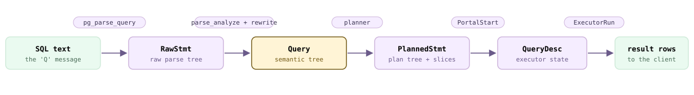
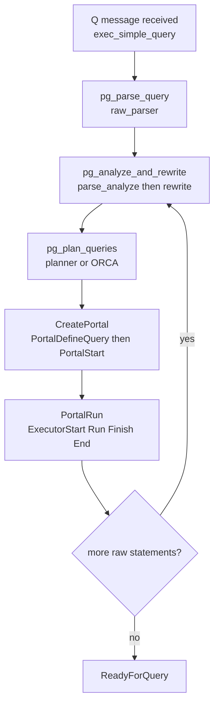
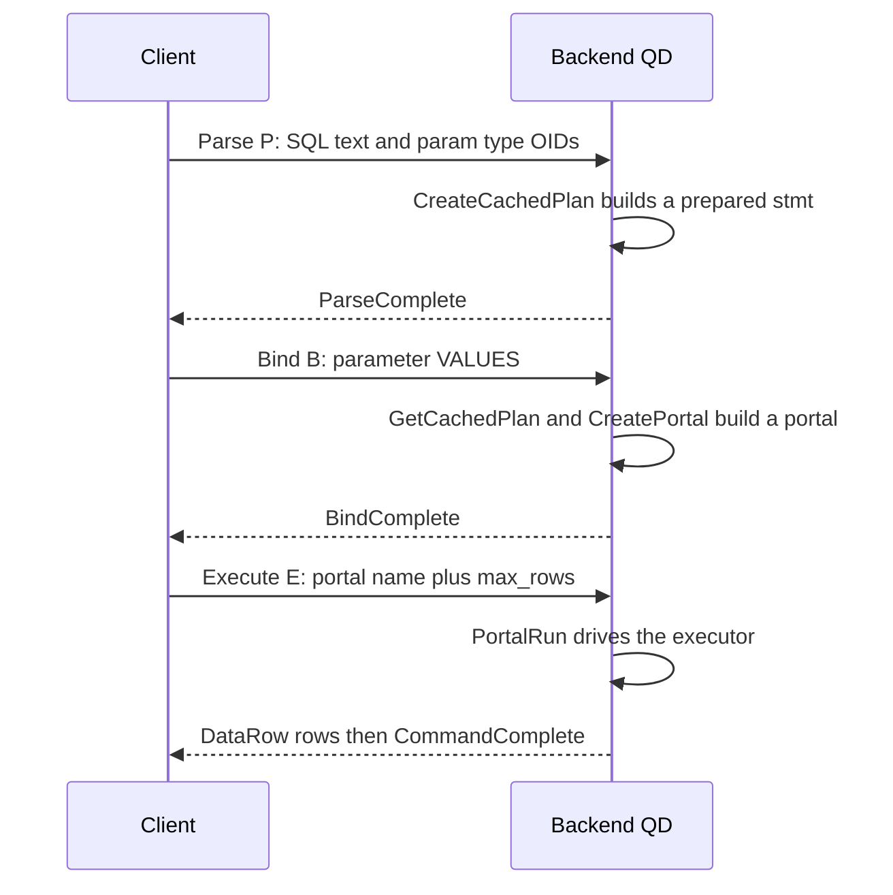
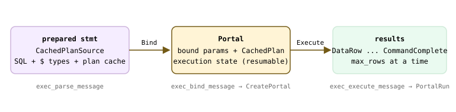
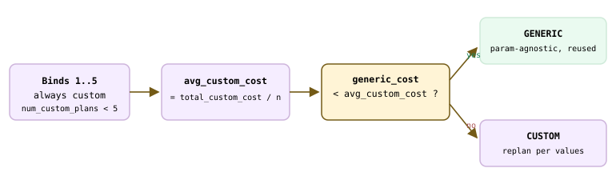
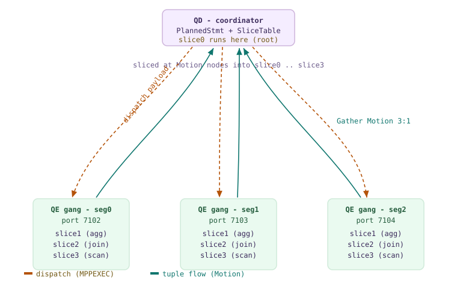
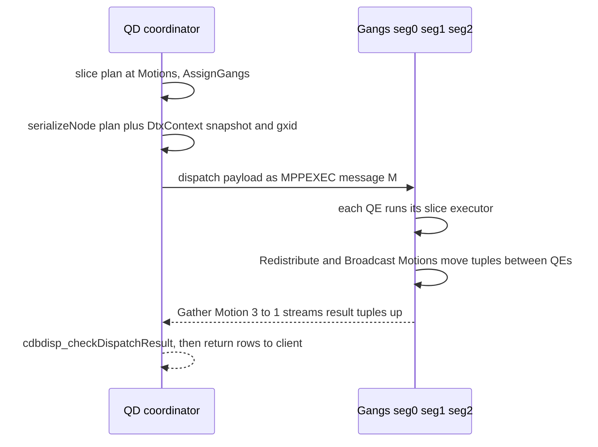

<!--
  Licensed to the Apache Software Foundation (ASF) under one
  or more contributor license agreements.  See the NOTICE file
  distributed with this work for additional information
  regarding copyright ownership.  The ASF licenses this file
  to you under the Apache License, Version 2.0 (the
  "License"); you may not use this file except in compliance
  with the License.  You may obtain a copy of the License at

    http://www.apache.org/licenses/LICENSE-2.0

  Unless required by applicable law or agreed to in writing,
  software distributed under the License is distributed on an
  "AS IS" BASIS, WITHOUT WARRANTIES OR CONDITIONS OF ANY
  KIND, either express or implied.  See the License for the
  specific language governing permissions and limitations
  under the License.
-->

<a id="13-query-processing-stages"></a>

## 13.1 简单查询协议 {#131-the-simple-query-protocol}

当客户端一次性将完整的 SQL 字符串交给后端时——也就是线协议中消息类型为 `'Q'` 的*简单查询*——该字符串便踏上了一条固定路径。它先被**解析**成原始树，再经**分析和重写**成为语义树，然后被**规划**成可执行树，最后**执行**并产生结果行。每个阶段都接收上一阶段的数据对象，并生成下一阶段的对象。在 Cloudberry 中，Coordinator（即 QD，见 [§1.3](/cloudberry/core-internals/#13-processes-and-memory)）自行运行整个前半段流水线；直到执行时，才将计划分送到各个 Segment。不过，派发是 [§13.3](#133-dispatch-from-coordinator-plan-to-segment-execution) 的主题，因此这里先跟踪到计划就绪、可以运行为止。

本节的主线就是这条**数据对象**链。在查看代码之前，先记住它很有帮助：SQL 文本变成 `RawStmt`，再变成 `Query`，继而变成 `PlannedStmt`，最后装入 `QueryDesc`，由执行器遍历并输出结果行。



*转换链：一次性查询在 QD 侧的各阶段变成什么。小标签标出执行每次转换的函数。*



*exec_simple_query 的控制流——字符串中的每条原始语句各执行一遍。*

### 13.1.1 'Q' 消息到达 {#1311-the-q-message-arrives}

后端主循环读取一条协议消息，并根据其首字节选择处理分支。`'Q'` 表示简单查询：循环从网络中取出查询字符串，再调用一个函数完成全部工作。这个带单引号的 `Q` 分支位于 `PostgresMain` 的消息处理 switch 中（`src/backend/tcop/postgres.c`）。

```c {title="src/backend/tcop/postgres.c"}
case 'Q':               /* simple query */
{
    const char *query_string;
    SetCurrentStatementStartTimestamp();
    query_string = pq_getmsgstring(&input_message);
    pq_getmsgend(&input_message);
    ...
    exec_simple_query(query_string);   /* the whole pipeline */
    send_ready_for_query = true;
}
```

`exec_simple_query()`（`src/backend/tcop/postgres.c`）是整条流水线的缩影。略去簿记工作后，其流程是：将字符串解析成原始语句列表，然后遍历每条语句，依次进行分析 → 重写 → 规划，将得到的计划封装到门户（portal）中，再将门户运行到完成。

```c {title="src/backend/tcop/postgres.c — exec_simple_query()"}
parsetree_list = pg_parse_query(query_string);      /* -> List of RawStmt */
foreach(parsetree_item, parsetree_list)
{
    querytree_list = pg_analyze_and_rewrite_fixedparams(
                         parsetree, query_string, NULL, 0, NULL);  /* -> List of Query */
    plantree_list  = pg_plan_queries(querytree_list, query_string,
                                     CURSOR_OPT_PARALLEL_OK, NULL); /* -> List of PlannedStmt */
    portal = CreatePortal("", true, true);
    PortalDefineQuery(portal, NULL, query_string, ..., plantree_list, NULL);
    PortalStart(portal, NULL, 0, InvalidSnapshot, NULL);
    (void) PortalRun(portal, FETCH_ALL, true, true, receiver, receiver, &qc);
}
```

> [!NOTE]
> 一条 `'Q'` 字符串可以包含多条用分号分隔的语句——因此需要列表和循环。若包含多条语句，它们就在同一个隐式事务块中运行。我们的示例都恰好发送一条语句，所以循环只执行一遍。

### 13.1.2 阶段 1——解析 {#1312-stage-1--parse}

解析只处理语法：它了解语法规则，却不了解你的表。`pg_parse_query()`（`src/backend/tcop/postgres.c`）调用 `raw_parser()`（`src/backend/parser/parser.c`），后者运行 flex 扫描器（`scan.l`）和 bison 语法（`gram.y`），将文本转换成 **`RawStmt` 节点列表**（`src/include/nodes/parsenodes.h`）。整个过程不访问系统目录，因此即使在已经中止的事务中执行这一步也是安全的。

```c {title="src/backend/tcop/postgres.c — pg_parse_query()"}
raw_parsetree_list = raw_parser(query_string, RAW_PARSE_DEFAULT);
```

> [!NOTE]
> `RawStmt` 忠实记录了你输入的内容：表还只是名称，列还只是标识符。此时尚未检查这些对象是否存在；这项检查属于下一阶段。

### 13.1.3 阶段 2——分析与重写 {#1313-stage-2--analyze-and-rewrite}

从这里开始处理语义。`pg_analyze_and_rewrite_fixedparams()`（`src/backend/tcop/postgres.c`）执行两个子步骤。首先是**解析分析**——`parse_analyze_fixedparams()`（`src/backend/parser/analyze.c`）根据系统目录解析每个名称，确定类型，并检查查询在语义上是否合法，生成一个 `Query` 节点（`src/include/nodes/parsenodes.h`）。其次是**重写**——`pg_rewrite_query()` → `QueryRewrite()`（`src/backend/rewrite/rewriteHandler.c`）应用规则，其中最重要的工作是将视图展开成底层查询。输出是 `Query` 节点的*列表*，因为一个输入查询可能被重写成多个查询。

```c {title="src/backend/tcop/postgres.c — pg_analyze_and_rewrite_fixedparams()"}
/* (1) parse analysis: RawStmt -> Query */
query = parse_analyze_fixedparams(parsetree, query_string,
                                  paramTypes, numParams, queryEnv);
/* (2) rule rewriting */
querytree_list = pg_rewrite_query(query);
```

这些名称和类型解析会引发大量系统目录读取——包括 `pg_class`、`pg_attribute`、`pg_type` 等。在热路径上，这些读取不会访问磁盘，而是由 [§8.5](/cloudberry/core-internals/part-2-storage-data-layout/ch08/#85-runtime-caching--invalidation) 介绍的每个后端各自的 **syscache 和 relcache** 提供数据。因此，缓存已预热的查询，其分析耗时以微秒计；下文的阶段计时将展示这一点。

> [!NOTE]
> **Query** 是整条流水线的语义中心：规划器接收它，规则系统重写它，预备语句缓存它。下一节（[§13.2](#132-the-extended-query-protocol)）正是从这里继续，因为扩展协议允许客户端在分析后暂停，并在多次执行中复用 **Query**。

### 13.1.4 阶段 3——规划 {#1314-stage-3--plan}

规划将 `Query` 描述的*做什么*转换成*怎么做*——即承载可执行计划树的 `PlannedStmt`（`src/include/nodes/plannodes.h`）。`pg_plan_queries()`（`src/backend/tcop/postgres.c`）对每个非工具类查询调用 `pg_plan_query()` → `planner()`（`src/backend/optimizer/plan/planner.c`）。Cloudberry 提供两个规划器：PostgreSQL 基于代价的 `standard_planner()`，以及通过 `planner_hook` 接入的 ORCA 优化器。本章只说明这一阶段的位置；深入内容见**第 [15](/cloudberry/core-internals/part-4-query-processing/ch15/) 章**（PostgreSQL 规划器）、**第 [16](/cloudberry/core-internals/part-4-query-processing/ch16/) 章**（分布式规划）和**第 [17](/cloudberry/core-internals/part-4-query-processing/ch17/) 章**（ORCA）；规划器统计信息见**第 [14](/cloudberry/core-internals/part-4-query-processing/ch14/) 章**。

```c {title="src/backend/optimizer/plan/planner.c"}
if (planner_hook)          /* ORCA installs this hook */
    result = (*planner_hook)(parse, query_string, cursorOptions,
                             boundParams, optimizer_options);
else
    result = standard_planner(parse, query_string, cursorOptions,
                              boundParams, optimizer_options);
```

要*看到*查询生成的 `PlannedStmt`，最直接的方式是 `EXPLAIN`——它打印计划树，但不运行计划。对于分布在三个 Segment 上的表，注意计划中体现的 Cloudberry 特性：顶部的 **Gather Motion** 从下方三个并行的 `Seq Scan` 切片收集行，底部则标明构建计划的优化器。

*分布式 SELECT 生成的 PlannedStmt——三个 Segment 扫描之上的 Gather Motion。*

```sql
CREATE TABLE q131_t (id int, city text) DISTRIBUTED BY (id);
INSERT INTO q131_t VALUES (1,'sf'),(2,'la'),(3,'ny'),(4,'sd'),(5,'sac'),(6,'boston');

EXPLAIN (VERBOSE, COSTS OFF)
  SELECT id, city FROM q131_t WHERE id > 2 ORDER BY id;
```

```text {hl_lines="3" title="output"}
                QUERY PLAN
------------------------------------------
 Gather Motion 3:1  (slice1; segments: 3)
   Output: id, city
   Merge Key: id
   ->  Sort
         Output: id, city
         Sort Key: q131_t.id
         ->  Seq Scan on public.q131_t
               Output: id, city
               Filter: (q131_t.id > 2)
 Optimizer: GPORCA
(10 rows)
```

`slice1` / `segments: 3` 这组注释标出了单后端流水线转为分布式执行的边界：计划被切成*切片*，并派发给由 QE 组成的*进程组*。我们将在 [§13.3](#133-dispatch-from-coordinator-plan-to-segment-execution) 继续跟踪这一边界；这里只需记住，在任何计划内容离开 Coordinator 之前，整个计划就已经在 QD 上构建完成。

### 13.1.5 阶段 4——执行 {#1315-stage-4--execute}

完成的计划不会自行运行，而是在**门户**中运行。`exec_simple_query()` 创建一个匿名门户，通过 `PortalDefineQuery()`（`src/backend/utils/mmgr/portalmem.c`）将计划列表交给它，再用 `PortalStart()`（`src/backend/tcop/pquery.c`）初始化，最后通过 `PortalRun()`（`src/backend/tcop/pquery.c`）驱动它。门户是一个有状态的容器，负责记录查询执行到了哪里——这一点对游标尤为重要，但这里也统一采用同一机制。

门户之下是执行器，由 `src/backend/executor/execMain.c` 中的四个入口驱动。它以**拉取方式**运行计划树：顶层节点反复向子节点请求元组，每次一个。执行器的内部结构——节点、元组槽以及每个节点的状态——见**第 [18](/cloudberry/core-internals/part-4-query-processing/ch18/) 章**；Motion 节点及为其提供数据的 Interconnect 见**第 [19](/cloudberry/core-internals/part-4-query-processing/ch19/) 章**。

- **ExecutorStart** — `execMain.c` — 构建执行器状态树（与计划对应的 `PlanState` 树），并打开关系。
- **ExecutorRun** — `execMain.c` — 执行拉取循环，产生元组并交给 DestReceiver，直到达到指定数量。
- **ExecutorFinish** — `execMain.c` — 运行所有延迟的后置触发器，并完成修改语句的执行。
- **ExecutorEnd** — `execMain.c` — 关闭节点和关系，释放状态。

`EXPLAIN (ANALYZE)` 会实际运行计划，并将各节点的计数器汇入输出，因此你可以观察执行阶段的情况。注意底部的两项计时：**Planning Time** 对应 QD 的第 3 阶段，**Execution Time** 对应第 4 阶段。另外，叶节点扫描报告每个 Segment 的 `actual rows`，而 Gather Motion 报告汇总后的总数。

*EXPLAIN (ANALYZE)：执行器的逐节点计数器，以及规划与执行的计时划分。*

```sql
EXPLAIN (ANALYZE, TIMING OFF, COSTS OFF)
  SELECT id, city FROM q131_t WHERE id > 2 ORDER BY id;
```

```text {hl_lines="11" title="output"}
                       QUERY PLAN
---------------------------------------------------------
 Gather Motion 3:1  (slice1; segments: 3) (actual rows=4 loops=1)
   Merge Key: id
   ->  Sort (actual rows=2 loops=1)
         Sort Key: id
         Sort Method:  quicksort  Memory: 75kB
         ->  Seq Scan on q131_t (actual rows=2 loops=1)
               Filter: (id > 2)
               Rows Removed by Filter: 1
 Planning Time: 44.889 ms
 Optimizer: GPORCA
 Execution Time: 11.426 ms
(14 rows)
```

在 Coordinator 上，整个过程都由一个后端完成，即 QD。在 `ExecutorStart` 与第一个元组之间，它将计划、事务的分布式快照（[§10.5](/cloudberry/core-internals/part-3-transactions-mvcc-concurrency/ch10/#105-distributed-snapshots--the-distributed-log)）以及分布式事务 ID（[§12.2](/cloudberry/core-internals/part-3-transactions-mvcc-concurrency/ch12/#122-cloudberrys-2pc-cdbtm-dtxstate--dtxcontext)）一并序列化，再派发给一组 QE 后端——这一机制见 [§13.3](#133-dispatch-from-coordinator-plan-to-segment-execution)。从 `exec_simple_query()` 的角度看，`PortalRun()` 只是在所有行发送完毕后返回，随后丢弃门户，继续下一轮循环。

### 13.1.6 观察各阶段依次运行 {#1316-watching-the-stages-tick-by}

这条流水线不只是理解查询的模型；你还可以让每个阶段报告自身的开销。设置 `log_parser_stats` 和 `log_planner_stats` 后，`pg_parse_query`、解析分析、重写和规划器会分别输出一行计时信息（GUC 检查就位于阶段函数内部，例如 `postgres.c` 中的 `pg_parse_query()`，以及 `postgres.c` 中的 `pg_analyze_and_rewrite_fixedparams()`）。从上到下阅读时，QD 侧的输出就是这条转换链的实际耗时表示。

*该 SELECT 在 QD 上的逐阶段计时（仅保留四个阶段标题及其计时）。*

```sql
SET client_min_messages=log;
SET log_parser_stats=on;
SET log_planner_stats=on;
SELECT id, city FROM q131_t WHERE id > 2 ORDER BY id;
```

```text {hl_lines="7" title="output"}
LOG:  PARSER STATISTICS
!  0.000112 s user, 0.000000 s system, 0.000112 s elapsed
LOG:  PARSE ANALYSIS STATISTICS
!  0.002841 s user, 0.001728 s system, 0.004570 s elapsed
LOG:  REWRITER STATISTICS
!  0.000035 s user, 0.000035 s system, 0.000070 s elapsed
LOG:  PLANNER STATISTICS
!  0.025188 s user, 0.018101 s system, 0.043292 s elapsed
```

这种分布很典型：解析的成本很低，分析和重写只需花几微秒查询已预热的系统目录，而**规划占据主要开销**——这里 ORCA 优化器的耗时比其余三个阶段的总和高出一个数量级。因此，流水线会积极缓存 `Query` 和计划层面的输出（[§13.2](#132-the-extended-query-protocol)），规划也值得用专门的章节介绍。下表汇总了整个过程，以及各对象的定义位置。

| 阶段 | 函数 | 输入 → 输出对象 | 章节／参考 |
| --- | --- | --- | --- |
| 解析 | `pg_parse_query` → `raw_parser` | SQL 文本 → `RawStmt` 列表 | 本节 |
| 分析 | `parse_analyze_fixedparams` | `RawStmt` → `Query`（系统目录：[§8.5](/cloudberry/core-internals/part-2-storage-data-layout/ch08/#85-runtime-caching--invalidation)） | 本节 |
| 重写 | `pg_rewrite_query` → `QueryRewrite` | `Query` → `Query` 列表 | 本节 |
| 规划 | `pg_plan_queries` → `planner` / ORCA | `Query` → `PlannedStmt` | 第 14–17 章 |
| 执行 | `PortalRun` → `ExecutorStart/Run/End` | `PlannedStmt` → `QueryDesc` → 行 | 第 18 章 |
| 派发 | `CdbDispatchPlan`（QD → QE 进程组） | 序列化计划 + 快照 + gxid | [§13.3](#133-dispatch-from-coordinator-plan-to-segment-execution)，第 16／19 章 |

> [!NOTE]
> 扩展查询协议（[§13.2](#132-the-extended-query-protocol)）将这条链拆成可以分别调用的消息——Parse、Bind、Execute——使客户端能够分析一次、执行多次。本节介绍的内容，正是该协议在消息之间缓存的对象。

## 13.2 扩展查询协议 {#132-the-extended-query-protocol}

[§13.1](#131-the-simple-query-protocol) 跟踪了*简单*查询：一条 `'Q'` 消息携带完整的 SQL 字符串，一次执行完毕。但观察实际驱动——JDBC、psycopg、libpq 的 `PQexecParams`——与后端的通信方式时，你几乎看不到 `'Q'`。相反，交互被拆成三条较小的消息：**Parse**、**Bind** 和 **Execute**。这就是*扩展查询协议*，也是预备语句、绑定参数、门户和计划缓存共同采用的路径。

为什么把一条消息拆成三条？这样做有两个好处。首先是**解析一次，多次执行**：客户端只发送一次 SQL 文本和参数*类型*（Parse），之后就可以按需使用新的参数*值*反复执行（Bind + Execute），跳过重新解析，而且正如下文所示，往往也能跳过重新规划。其次是**安全传递参数**：值通过单独的消息到达，从不拼接到 SQL 文本中，因此没有 SQL 注入的入口。后端在主循环的 switch 中处理这些消息类型，位置分别是 `` `src/backend/tcop/postgres.c` (`PostgresMain()`) ``（`'P'`）、`` ``（`'B'`）和 `` ``（`'E'`）。



*扩展协议：三次往返，以及每条消息在后端创建的对象。*

### 13.2.1 三条协议消息 {#1321-the-three-protocol-messages}

消息处理 switch 中的每个 `case` 本身几乎不做什么工作：它从网络消息中提取各字段，再交给专门的 `exec_*_message` 函数。**Parse** 分支读取语句名称、SQL 文本以及参数类型 OID 数组：

```c {title="src/backend/tcop/postgres.c — PostgresMain()"}
stmt_name    = pq_getmsgstring(&input_message);
query_string = pq_getmsgstring(&input_message);
numParams    = pq_getmsgint(&input_message, 2);
for (int i = 0; i < numParams; i++)
    paramTypes[i] = pq_getmsgint(&input_message, 4);
exec_parse_message(query_string, stmt_name, paramTypes, numParams);
```

`exec_parse_message()`（`` `src/backend/tcop/postgres.c` ``）将 SQL 解析成原始解析树，然后构建 **`CachedPlanSource`**——内存中的预备语句。空语句名表示*匿名*语句（恰好只有一个，缓存在文件作用域的静态槽位中）；非空名称则表示存放在哈希表中的*命名*预备语句。

```c {title="src/backend/tcop/postgres.c — exec_parse_message()"}
is_named = (stmt_name[0] != '\0');
...
psrc = CreateCachedPlan(raw_parse_tree, query_string, ...);
...
if (is_named)
    StorePreparedStatement(stmt_name, psrc, false);
else
    unnamed_stmt_psrc = psrc;   /* the single unnamed slot */
```

**Bind** 更值得关注：参数*值*在这里与计划结合。`exec_bind_message()`（`` ``）重新查找预备语句，解码参数值，向计划缓存请求计划，创建一个**门户**并使其准备好执行：

```c {title="src/backend/tcop/postgres.c — exec_bind_message()"}
cplan = GetCachedPlan(psrc, params, NULL, NULL, NULL);   /* generic or custom */
...
PortalDefineQuery(portal, saved_stmt_name, query_string,
                  psrc->sourceTag, psrc->commandTag,
                  cplan->stmt_list, cplan);
...
PortalStart(portal, params, 0, InvalidSnapshot, NULL);
```

**Execute**（`exec_execute_message()`，`` ``）运行门户。关键在于，客户端会传入 **`max_rows`** 限制：协议可以分*批*获取结果，在 N 行之后暂停门户，并在下一次 Execute 时恢复。0 表示“全部行”（`FETCH_ALL`）。

```c {title="src/backend/tcop/postgres.c — exec_execute_message()"}
if (max_rows <= 0)
    max_rows = FETCH_ALL;
...
completed = PortalRun(portal,
                      max_rows,       /* stop after this many rows */
                      true, ...);
```

> [!NOTE]
> 匿名语句和匿名门户针对“解析、绑定、执行一次”的用法做了优化：客户端不复用它们时，后端就能立即回收它们的内存。在 Bind 与 Execute 之间，客户端也可以发送 **Describe** 来了解结果行的结构，或发送 **Close** 来提前删除门户或语句。

### 13.2.2 预备语句与 pg_prepared_statements {#1322-prepared-statements-and-pg_prepared_statements}

预备语句有两种创建方式，但最终都会得到同样的 `CachedPlanSource`。扩展协议通过 Parse 消息创建；SQL 则通过 `PREPARE` 命令创建（`` `src/backend/commands/prepare.c` — `PrepareQuery()` `` `PrepareQuery`）；创建后的语句由 `EXECUTE` 运行。无论采用哪种方式，`EXPLAIN EXECUTE` 都能显示 Bind 针对给定参数将选择的计划。注意，下面的计划被限定在**单个 Segment** 上：由于我们给出了字面量 `42`，规划器准确知道哪个 Segment 持有该哈希桶：

*一个命名预备语句，以及针对某个具体参数所选的计划。*

```sql
CREATE TABLE q132_t (k int, name text) DISTRIBUTED BY (k);
INSERT INTO q132_t SELECT g, 'name_'||g FROM generate_series(1,1000) g;
ANALYZE q132_t;
PREPARE p AS SELECT k, name FROM q132_t WHERE k = $1;
EXPLAIN EXECUTE p(42);
```

```text {hl_lines="3" title="output"}
                                  QUERY PLAN
-------------------------------------------------------------------------------
 Gather Motion 1:1  (slice1; segments: 1)  (cost=0.00..431.02 rows=1 ...)
   ->  Seq Scan on q132_t  (cost=0.00..431.02 rows=1 width=12)
         Filter: (k = 42)
 Optimizer: GPORCA
```

这里的 `Gather Motion 1:1 (segments: 1)` 是一个**直接派发的自定义计划**，也就是已知实际值时规划出的计划。`pg_prepared_statements` 视图公开了计划缓存为每条语句维护的统计信息，包括生成通用计划与自定义计划的次数：

*执行语句七次，以及计划缓存计数器。*

```sql
EXECUTE p(1); EXECUTE p(2); EXECUTE p(3); EXECUTE p(4);
EXECUTE p(5); EXECUTE p(6); EXECUTE p(7);
SELECT name, statement, parameter_types, generic_plans, custom_plans
  FROM pg_prepared_statements;
```

```text {hl_lines="3" title="output"}
 name |                     statement                        | parameter_types | generic_plans | custom_plans
------+------------------------------------------------------+-----------------+---------------+--------------
 p    | PREPARE p AS SELECT ... WHERE k = $1;                | {integer}       |             0 |          7
```

> [!NOTE]
> 最后两列直接来自计划缓存：`generic_plans` 和 `custom_plans` 分别对应 `plansource->num_generic_plans` / `num_custom_plans`（`src/backend/commands/prepare.c`——`pg_prepared_statement()`）。七次自定义、零次通用；[§13.2.4](#1324-generic-versus-custom-plans) 将解释为什么在分布式表上，计数经常一直如此。

### 13.2.3 门户——执行中的语句 {#1323-portals--an-executing-statement}

预备语句好比食谱，**门户**则是*正在照着食谱烹饪*的一次实例。Bind 创建门户（`CreatePortal`，`` `src/backend/utils/mmgr/portalmem.c` ``），将具体参数和选定的 `CachedPlan` 绑定进去（`PortalDefineQuery`，`` ``），再由 `PortalStart`/`PortalRun`（`` `src/backend/tcop/pquery.c` ``，`` ``）通过执行器驱动它。因为门户*保存执行状态*，所以可以分段运行；这正是 `max_rows` 分批机制（[§13.2.1](#1321-the-three-protocol-messages)）所依赖的，也是 SQL 游标（`DECLARE ... CURSOR` + `FETCH`）的底层实现。



*语句 → 门户 → 结果：Bind 和 Execute 构建的对象。*

- **匿名门户** — 名称为空（`""`）。通过 `CreatePortal(name, true, true)` 创建，会静默替换已有的匿名门户。它是一次性 Bind/Execute 的默认选择，内存会被积极回收。
- **命名门户** — 名称非空，且必须唯一。SQL 游标会变成这种门户，在多次 `FETCH`/Execute 往返之间保持存活，直到关闭。
- **逐行处理** — 门户记住上次执行停止的位置，因此带 `max_rows` 的 Execute 和游标 `FETCH n` 都只是恢复 `PortalRun`，以处理下一批结果。

### 13.2.4 通用计划与自定义计划 {#1324-generic-versus-custom-plans}

预备语句的真正收益在这里。当 Bind 调用 `GetCachedPlan()` 时，计划缓存会在**自定义计划**（使用*这次* Bind 的实际参数值重新规划）和**通用计划**（保留参数占位符，只规划一次，然后一直复用）之间选择。这一策略完全位于 `choose_custom_plan()`（`` `src/backend/utils/cache/plancache.c` ``）中：

```c {title="src/backend/utils/cache/plancache.c"}
/* Generate custom plans until we have done at least 5 (arbitrary) */
if (plansource->num_custom_plans < 5)
    return true;

avg_custom_cost = plansource->total_custom_cost / plansource->num_custom_plans;

/* Prefer generic plan if it's less expensive than the average custom plan. */
if (plansource->generic_cost < avg_custom_cost)
    return false;
return true;
```

因此，前 **五** 次 Bind 总是构建自定义计划，在这个预热阶段测量自定义计划的平均代价。从第六次开始，它只构建*一次*通用计划，然后比较代价：通用计划的代价*只有*执行代价，因为它避开了自定义计划平均代价中包含的每次 Bind 的规划代价。因此，除非自定义计划的*运行*代价低得多，否则通用计划就会胜出。



*GetCachedPlan 的决策：先使用自定义计划预热，然后比较代价。*

PostgreSQL 16 允许通过 `EXPLAIN (GENERIC_PLAN)` 直接查看通用计划，无需任何 Bind：占位符 `$1` 直接显示在计划里。这是观察扩展协议思想最直接的方式：完全不依赖具体参数值构建一个计划。

*EXPLAIN (GENERIC_PLAN) 是 PG16 的特性，在 $1 尚未解析为具体值时规划查询。*

```sql
EXPLAIN (GENERIC_PLAN)
  SELECT k, name FROM q132_t WHERE k = $1;
```

```text {hl_lines="5" title="output"}
                                   QUERY PLAN
--------------------------------------------------------------------------------
 Gather Motion 3:1  (slice1; segments: 3)  (cost=0.00..431.04 rows=400 ...)
   ->  Seq Scan on q132_t  (cost=0.00..431.02 rows=134 width=12)
         Filter: (k = $1)
 Optimizer: GPORCA
```

与 [§13.2.2](#1322-prepared-statements-and-pg_prepared_statements) 中的自定义计划对比：自定义计划直接派发到**一个** Segment（`1:1`），因为它知道 `k = 42`；通用计划却必须分送到**全部三个** Segment（`3:1`），因为 `$1` 尚未解析为具体值，无法知道哪个 Segment 持有该值。这就是计数一直停在 *7 次自定义、0 次通用* 的原因：对于分布式表，CBDB 会为通用计划的代价加上**直接派发惩罚项**，使廉价的单 Segment 自定义计划持续胜出。

```c {title="src/backend/utils/cache/plancache.c — cached_plan_cost()"}
/* A generic plan can't direct-dispatch, so it fans out to more segments.
 * Nudge the decision toward custom (direct-dispatch) plans: */
result += 10.0 * seq_page_cost * (maxsegments - 1);
```

不过，这套机制确实存在；只需让通用计划真正具有代价竞争力，或者使用强制选择的 GUC。设置 `plan_cache_mode = force_generic_plan` 会覆盖 `choose_custom_plan`（`` `plancache.c` ``）的决定，计数器马上就会转向通用计划：

*强制使用通用计划路径，验证计数器机制。*

```sql
SET plan_cache_mode = force_generic_plan;
PREPARE p AS SELECT k, name FROM q132_t WHERE k = $1;
EXECUTE p(1); EXECUTE p(2);
SELECT name, generic_plans, custom_plans FROM pg_prepared_statements;
```

```text {hl_lines="3" title="output"}
 name | generic_plans | custom_plans
------+---------------+--------------
 p    |           2 |            0
```

最后，无需 Java 驱动也能走 Parse/Bind/Execute 路径；psql 16 的 `\bind` 元命令可以在客户端完成这一操作。它通过 Parse 发送 SQL，将后面的词作为绑定参数值，再通过 `\g` 触发 Execute：

*psql 的 \bind 完整驱动扩展协议；$1=3，$2=4。*

```sql
SELECT $1::int + $2::int \bind 3 4 \g
```

```text {hl_lines="3" title="output"}
 ?column?
----------
      7
```

> [!NOTE]
> `plan_cache_mode` GUC（`auto`/`force_generic_plan`/`force_custom_plan`）允许你覆盖这一策略。实际构建怎样的计划——即 ORCA 或 PostgreSQL 优化器的工作，以及它如何变成带 Motion 的分布式计划——见**第 [15](/cloudberry/core-internals/part-4-query-processing/ch15/) 章**（规划器）、**第 [16](/cloudberry/core-internals/part-4-query-processing/ch16/) 章**（分布式规划）和**第 [17](/cloudberry/core-internals/part-4-query-processing/ch17/) 章**（ORCA）；计划如何派发到 Segment 进程组见 [§13.3](#133-dispatch-from-coordinator-plan-to-segment-execution)。（演示表 `q132_t` 已在采集输出后删除。）

## 13.3 派发：从 Coordinator 计划到 Segment 执行 {#133-dispatch-from-coordinator-plan-to-segment-execution}

在 [§13.1](#131-the-simple-query-protocol) 和 [§13.2](#132-the-extended-query-protocol) 结束时，Coordinator（**QD**，查询派发器）已经持有一个完成的 `PlannedStmt`。在单节点 PostgreSQL 中，这个计划会直接交给执行器，在这一个后端内运行。Cloudberry 在中间增加了 PostgreSQL 没有的一步：计划描述的工作分布在所有 Segment 上，因此在开始执行之前，必须将计划*切开*，发送给每个 Segment 上的一组工作后端（**QE**，查询执行器），再收集返回结果。这一步就是**派发**，是分布式引擎的标志性阶段。

派发依次分为三个步骤。首先是**切片**：规划器插入的 `Motion` 节点（[§1.4](/cloudberry/core-internals/#14-clients-the-wire-protocol--dispatch)）将计划树切成多个*切片*，每个并行阶段对应一个计划片段。其次是**进程组**：每个切片都需要分配并连接一个*进程组*，即一组 QE 进程，每个 Segment 上一个。第三步才是**实际派发**：QD 将计划、参数和事务上下文（[§10.5](/cloudberry/core-internals/part-3-transactions-mvcc-concurrency/ch10/#105-distributed-snapshots--the-distributed-log) 的分布式快照，以及 [§12.2](/cloudberry/core-internals/part-3-transactions-mvcc-concurrency/ch12/#122-cloudberrys-2pc-cdbtm-dtxstate--dtxcontext) 的 `gxid`）序列化成一个载荷，再通过 libpq 发送给每个进程组。QE 随后运行自己的切片，将元组通过 Motion 向上流回 QD，由 QD 返回给客户端。各步骤的内部细节将在后续章节深入介绍；这里先定位这个阶段，并观察其实际运行。



*派发扇出：QD 切分计划，为各 Segment 分配 QE 进程组，派发载荷（琥珀色），再通过 Motion（青绿色）向上收集元组。*

我们将完整跟踪一个查询：带分组的两表连接。选择它，正是因为连接键不同于分布键，从而*迫使*计划使用 Redistribute Motion，也就有多个切片可供观察。

### 13.3.1 切片：在 Motion 处切分计划 {#1331-slicing-cutting-the-plan-at-motions}

计划中的 `Motion` 节点表示 *“元组必须在这里跨进程移动”*。每个 Motion 都是一条接缝，沿这些接缝切开计划树就得到**切片**：每个切片是两个 Motion 之间连续的计划片段，可以完全在单个进程内运行，无需进一步移动数据。切片底部是一个发送 Motion，而上方切片的顶部是与之匹配的接收端。正因如此，计划才能并行：各切片在自己的进程组上并发运行。

切分由规划器完成。`cdbllize_build_slice_table()` 位于 `src/backend/cdb/cdbllize.c`，它遍历已完成的计划，为每个 Motion 分配切片 ID，并将 `PlanSlice` 数组记录在 `PlannedStmt` 中。执行时，`InitSliceTable()`（`src/backend/executor/execUtils.c`）将其转换为执行器的 `SliceTable`，也就是由 `ExecSlice` 结构体组成的数组；每个切片对应一个结构体，包含其 `gangType` 和子切片列表。

```c {title="src/backend/cdb/cdbllize.c"}
/* cdbllize_decorate_subplans_with_motions() adds Motions ...
 * cdbllize_build_slice_table() assigns slice IDs to Motion
 * nodes, and builds the PlanSlice array (one entry per slice). */
```

运行时结构定义在 `src/include/executor/execdesc.h` 中（`SliceTable`）：`SliceTable` 的形态是 `{ int numSlices; ExecSlice *slices; bool hasMotions; ... }`，每个 `ExecSlice` 保存 `sliceIndex`、`parentIndex`、自身的 `children`、所需的 `GangType gangType`，以及运行它的 `segments`。`EXPLAIN` 展示的正是这棵树：每一行 `Motion` 都打印所属切片，而两个 Motion 之间的所有内容都属于一个切片：

*必须重分布的连接查询的 EXPLAIN (ANALYZE, VERBOSE) 输出。每个 Motion 引入一个新切片；两个 Motion 之间的片段构成一个切片。此处使用 Postgres 规划器（optimizer=off）。*

```sql
CREATE TABLE q133_t (id int, region_id int, amount numeric)
  DISTRIBUTED BY (id);            -- fact, distributed on id
CREATE TABLE q133_d (region_id int, region_name text)
  DISTRIBUTED BY (region_id);     -- dim, distributed on region_id
-- join is on region_id (not q133_t's key) => Motions required
EXPLAIN (ANALYZE, VERBOSE, COSTS OFF, TIMING OFF)
SELECT d.region_name, sum(t.amount)
FROM q133_t t JOIN q133_d d ON t.region_id = d.region_id
GROUP BY d.region_name;
```

```text {hl_lines="4" title="output"}
Gather Motion 3:1  (slice1; segments: 3) (actual rows=3 loops=1)
  ->  HashAggregate (actual rows=1 loops=1)
        Group Key: d.region_name
        ->  Redistribute Motion 3:3  (slice2; segments: 3) (actual rows=4)
              Hash Key: d.region_name
              ->  Hash Join (actual rows=5 loops=1)
                    Hash Cond: (t.region_id = d.region_id)
                    ->  Seq Scan on public.q133_t t (actual rows=5)
                    ->  Hash (actual rows=3 loops=1)
                          ->  Broadcast Motion 3:3  (slice3; segments: 3)
                                ->  Seq Scan on public.q133_d d (actual rows=2)
   (slice0)  Executor memory: 123K bytes.
 * (slice1)  Executor memory: 123K bytes avg x 3 workers ...
   (slice2)  Executor memory: 2104K bytes avg x 3 workers ...
   (slice3)  Executor memory: 113K bytes avg x 3 workers ...
```

从下往上阅读，就能看清四个切片。**slice3** 扫描 `q133_d`，将每一行*广播*到所有 Segment。**slice2** 扫描 `q133_t`，与广播来的维表做哈希连接，然后按 `region_name` *重分布*结果，使每个分组落到同一个 Segment 上。**slice1** 在本地聚合每个分组，再*汇集*到 Coordinator。**slice0** 是在 QD 自身运行的根切片，只负责接收。`actual rows` 表示某个代表性 Segment 处理的元组数（例如 `Seq Scan ... rows=5`），表明该切片确实在三个 Segment 上并行运行。

- **slice3 → Broadcast Motion** — 扫描 `q133_d`，将小型维表的完整副本发送给每个 Segment。这是叶切片：根部是发送端，下方没有接收端。
- **slice2 → Redistribute Motion** — 扫描 `q133_t`，与广播来的行做哈希连接，再按 `region_name` 对连接输出重新计算哈希，使相同键位于同一位置，以便聚合。
- **slice1 → Gather Motion 3:1** — 在各自 Segment 上聚合每个分组，再将全部结果行汇集到唯一的 QD 接收端。`3:1` 表示 *3 个发送端、1 个接收端*。
- **slice0（根）** — 只在 QD 上运行。`GANGTYPE_UNALLOCATED` 表示不派发（见 `cdbdisp_query.c`——`cdbdisp_dispatchX()`），只消费 Gather 交付的数据。

> [!NOTE]
> Motion 的*实现*——元组如何在网络上传输、TCP 与 UDPIFC 互联、流量控制和重排——见**第 [19](/cloudberry/core-internals/part-4-query-processing/ch19/) 章（Motion 与 Interconnect）**。在这里，Motion 只是定义切片边界的接缝。

### 13.3.2 进程组：每个切片的一组 QE {#1332-gangs-a-set-of-qes-per-slice}

切片是*计划片段*；**进程组**则是运行该片段的*进程集合*，在每个参与的 Segment 上各有一个 QE 后端。将一个四切片计划派发到三 Segment 集群时，除根切片外，每个进程组都有三个 QE。QE 是由 Segment 的 postmaster 派生的普通 `postgres` 后端，可以在 `ps` 中看到。进程组按切片需求划分类型，对应的枚举定义在 `src/include/nodes/plannodes.h` 中（`GangType`）：

```c {title="src/include/nodes/plannodes.h — GangType"}
typedef enum GangType
{
    GANGTYPE_UNALLOCATED,     /* root slice run by the QD */
    GANGTYPE_ENTRYDB_READER,  /* 1-gang, reads the entry (QD) db */
    GANGTYPE_SINGLETON_READER,/* 1-gang, reads one segment db */
    GANGTYPE_PRIMARY_READER,  /* 1- or N-gang, reads segment dbs */
    GANGTYPE_PRIMARY_WRITER   /* the N-gang that can update segments */
} GangType;
```

进程组分配在 QD 上进行。`AssignGangs()`（`src/backend/executor/execUtils.c`）遍历切片树，申请所需进程组；`AllocateGang()`（`src/backend/cdb/dispatcher/cdbgang.c`）返回一个进程组，并通过 `cdbgang_createGang()` 创建 QE 连接。每个查询恰好有一个**主写入进程组**（`GANGTYPE_PRIMARY_WRITER`），它负责每个 Segment 上的写事务；其他进程组都是读进程组。可复用的空闲进程组在语句之间保留在池中，因此会话无需为每次查询都付出派生进程和建立连接的成本。

| 进程组类型 | 大小 | 在本查询中的作用 |
| --- | --- | --- |
| PRIMARY_WRITER | N（全部 Segment） | 每个会话一个，持有 Segment 本地写事务。读切片也会复用它。 |
| PRIMARY_READER | N（全部 Segment） | 运行并行切片（连接、重分布、聚合），即 slice2、slice1。 |
| SINGLETON_READER | 仅含一个进程的进程组（1-gang） | 在单个 Segment 上运行的切片，例如 gp_single_row／复制读取。 |
| ENTRYDB_READER | 仅含一个进程的进程组（1-gang） | 读取 Coordinator 数据库自身的系统目录／入口数据。 |
| UNALLOCATED | 0（仅 QD） | 根切片 slice0，不派发，在 QD 后端内执行。 |

要*看到*进程组，可以让一个分布式查询保持运行（用 `pg_sleep` 延缓交叉连接），同时获取进程表快照。QD 后端位于 Coordinator 端口 `7100`；各 QE 位于 Segment 端口 `7102/7103/7104`，并带有 `conNNN` 会话、`segN`、`sliceN` 和 `MPPEXEC` 标记：

*分布式查询运行期间的 ps -ef 输出（已裁剪列）。一个 QD 后端为每个切片连接一个包含 3 个 QE 的进程组；注意 seg0/seg1/seg2 和 MPPEXEC 标记。*

```sql
-- session A: a query that keeps the gangs busy
SELECT count(*) FROM q133_t t1, q133_t t2, q133_t t3
WHERE pg_sleep(6) IS NULL;
-- session B, meanwhile:
$ ps -ef | grep -E 'con[0-9]+' | grep -v grep
```

```text {hl_lines="3" title="output"}
  PID  PPID  postgres backend
14950  6006  7100 ... [local] con26464 cmd1 SELECT              <- QD
14952  5967  7102 ... 10.100.0.3 con26464 seg0 cmd2 slice1 MPPEXEC SELECT
14953  5969  7103 ... 10.100.0.3 con26464 seg1 cmd2 slice1 MPPEXEC SELECT
14954  5970  7104 ... 10.100.0.3 con26464 seg2 cmd2 slice1 MPPEXEC SELECT
14964  5967  7102 ... 10.100.0.3 con26464 seg0 cmd2 slice3 MPPEXEC SELECT
14965  5969  7103 ... 10.100.0.3 con26464 seg1 cmd2 slice3 MPPEXEC SELECT
14966  5970  7104 ... 10.100.0.3 con26464 seg2 cmd2 slice3 MPPEXEC SELECT
```

一个 QD（`7100`、`con26464`、`cmd1`）下方有两个读进程组，每个包含三个 QE：`slice1` 横跨 seg0/seg1/seg2，`slice3` 也横跨 seg0/seg1/seg2。它们都带有*相同*的 `con26464`，因此能识别为同一个分布式命令。各 QE 的 `PPID` 是各自 Segment 的 postmaster（`5967`/`5969`/`5970`），并非 QD：QD 不会派生 QE，而是*连接*到 Segment postmaster 派生的后端。这就是 [§1.3](/cloudberry/core-internals/#13-processes-and-memory) 所述 QD/QE 进程模型的具体体现。

每个 QE 都知道自己的身份。两个内置函数可以报告这些信息：`gp_execution_segment()` 返回 content ID，QD 上为 `-1`，Segment 上为 `0..N`；`gp_execution_dbid()` 返回物理 Segment 的 dbid。在每个 Segment 上求值，就能得到清晰的逐 Segment 映射：

*逐 Segment 身份：content ID（seg）与物理 dbid 的对照。确认查询已分送到全部三个主 Segment。*

```sql
SELECT gp_execution_segment() AS seg,
       gp_execution_dbid()   AS dbid
FROM gp_dist_random('gp_id')
ORDER BY 1;
```

```text {hl_lines="3" title="output"}
 seg | dbid
-----+------
   0 |    2
   1 |    3
   2 |    4
(3 rows)
```

> [!NOTE]
> 读进程组可以是**包含 N 个进程的完整进程组（N-gang）**，即每个 Segment 上各有一个 QE；当直接派发证明所需行只位于一个 Segment 时，也可以使用**仅含一个进程的进程组（1-gang）**。这对按分布键进行的点查很有帮助。进程组的创建、池化和恢复将在派发器的深入介绍中讲解；这里可以先把它们理解为“运行切片的那些进程”。

### 13.3.3 派发：序列化计划、快照与 gxid {#1333-dispatch-serialize-the-plan-snapshot-and-gxid}

完成切片划分和进程组分配后，QD 必须把工作发送出去。它不能发送 SQL 文本来执行，因为 Segment 不得重新规划，所以发送的是*计划本身*。`CdbDispatchPlan()`（`src/backend/cdb/dispatcher/cdbdisp_query.c`）准备载荷，再交给 `cdbdisp_dispatchX()`；后者负责主要工作，包括分配进程组、构建查询字符串以及逐切片派发。

组装载荷时，先用 `serializeNode()` 将计划节点序列化成扁平字节串，再加入事务上下文。计划树、`QueryDispatchDesc`（携带 `SliceTable` 和序列化参数）以及分布式事务上下文一同打包：

```c {title="src/backend/cdb/dispatcher/cdbdisp_query.c — cdbdisp_buildPlanQueryParms()"}
splan = serializeNode((Node *) queryDesc->plannedstmt, &splan_len, ...);
...
sddesc = serializeNode((Node *) queryDesc->ddesc, &sddesc_len, NULL);
...
pQueryParms->serializedDtxContextInfo =
    qdSerializeDtxContextInfo(&len, true /* wantSnapshot */,
                              queryDesc->extended_query,
                              mppTxnOptions(planRequiresTxn),
                              "cdbdisp_buildPlanQueryParms");
```

最后这个调用是分布式一致性的关键。`qdSerializeDtxContextInfo()` 将**分布式快照**（[§10.5](/cloudberry/core-internals/part-3-transactions-mvcc-concurrency/ch10/#105-distributed-snapshots--the-distributed-log)）以及 QD 为该事务生成的 **`gxid`**（[§12.2](/cloudberry/core-internals/part-3-transactions-mvcc-concurrency/ch12/#122-cloudberrys-2pc-cdbtm-dtxstate--dtxcontext)）装入派发载荷。因此，每个 QE 都在 QD 选定的*同一*快照下、在*同一个*分布式事务中执行。这使查询看到单一、全集群一致的视图，而不是三个独立的 Segment 视图。`QueryDispatchDesc`（`src/include/executor/execdesc.h`）这个结构体承载了计划树之外的全部内容：

- **serializedPlantree** — `PlannedStmt` 经 `serializeNode` 展平后的结果，即实际要执行的工作，在每个 Segment 上相同。
- **QueryDispatchDesc.sliceTable** — `SliceTable`，让每个 QE 知道自己属于哪个切片，以及其 Motion 向哪里发送、从哪里接收。
- **QueryDispatchDesc.paramInfo** — `SerializedParams`，包含已绑定的 `$n` 值和已求值的 stable/exec 参数，使结果与 QD 保持一致。
- **serializedDtxContextInfo** — 分布式快照（[§10.5](/cloudberry/core-internals/part-3-transactions-mvcc-concurrency/ch10/#105-distributed-snapshots--the-distributed-log)）+ `gxid`（[§12.2](/cloudberry/core-internals/part-3-transactions-mvcc-concurrency/ch12/#122-cloudberrys-2pc-cdbtm-dtxstate--dtxcontext)），保证所有 QE 之间的一致性。
- **strCommand / gp_command_count** — 原始 SQL 文本（用于 `EXPLAIN`／日志），以及为这次派发添加标记的逐命令计数器。

随后，`cdbdisp_dispatchX()` 遍历排好序的切片向量，通过 `cdbdisp_dispatchToGang()`（`cdbdisp.c`）将各切片的载荷推送到相应进程组。根切片被跳过，留在 QD 上运行：

```c {title="src/backend/cdb/dispatcher/cdbdisp_query.c — cdbdisp_dispatchX()"}
if (slice && slice->gangType == GANGTYPE_UNALLOCATED)
    continue;                 /* root slice: run on QD, don't dispatch */
primaryGang = slice->primaryGang;
...
cdbdisp_dispatchToGang(ds, primaryGang, si);   /* send this slice */
if (planRequiresTxn || isDtxExplicitBegin())
    addToGxactDtxSegments(primaryGang);        /* enlist QEs in the gxact */
```



*派发顺序：QD 切分并序列化计划，经由 libpq 将载荷发送给各进程组；QE 运行自己的切片，元组再经 Gather Motion 向上汇集。*

派发是异步的：默认派发器（`cdbdisp_async.c`）向所有进程组发送载荷而不阻塞，因为同步发送会导致死锁——顶部的 Gather 等待元组，而下方 Segment 仍在等待计划。执行后，QD 通过 `cdbdisp_checkDispatchResult()`（`src/backend/cdb/dispatcher/cdbdisp.c`）统一检查每个进程组的状态，并通过 `cdbdisp_getDispatchResults()` 收集各 QE 的结果；任何 Segment 错误都会在这里重新抛出，使整个命令原子地失败。

> [!NOTE]
> `gp_command_count` 定义在 `cdbvars.c` 中，由 `increment_command_count()` 递增。QD 每执行一个命令就递增它，并将其放入派发字符串中，这就是 `cmd1`/`cmd2`，也就是前面在 `ps` 中看到的标记。它与会话 ID（`conNNN`）共同唯一标识 QD 及其所有 QE 上的一次派发，从而可以将 Coordinator 语句与对应的 Segment 后端关联起来。

### 13.3.4 Segment 执行与结果回流 {#1334-segment-execution-and-the-result-flowing-back}

在 Segment 一侧，载荷以 Cloudberry 专用协议消息 `'M'` 的形式到达，不同于普通的 `'Q'`（[§13.1](#131-the-simple-query-protocol)）。`PostgresMain` 的消息循环将其交给 `exec_mpp_query()`（`src/backend/tcop/postgres.c`），后者反序列化计划和 `QueryDispatchDesc`，安装 `SliceTable`，然后只为当前 QE 的切片启动一个*本地*执行器：

```c {title="src/backend/tcop/postgres.c — SocketBackend()"}
case 'M':   /* Apache Cloudberry dispatched statement from QD */
    ...
    exec_mpp_query(query_string, serializedQuerytree, ...,
                   serializedPlantree, serializedQueryDispatchDesc, ...);
    /* -> rebuilds PlannedStmt + SliceTable, runs this slice's executor */
```

从这里开始，每个 QE 都在自己的切片上运行普通执行器（`ExecutorStart/Run/End`，第 [18](/cloudberry/core-internals/part-4-query-processing/ch18/) 章），但扫描节点只读取当前 Segment 上的那部分本地数据，Motion 节点则作为端点，将元组发送到上方切片。Broadcast Motion 将每一行发送给所有对等节点；Redistribute 重新计算哈希并路由；Gather 将数据汇集到 QD。元组沿切片树*向上*流动，从一个 QE 到另一个 QE，直到顶层 Gather Motion 将它们交给 QD 的根切片 slice0。

于是，流程回到了 [§13.1](#131-the-simple-query-protocol)：QD 的门户仍然通过 `PortalRun` 驱动 Coordinator 执行器，只不过 slice0 的 Gather Motion 成了*它*的元组来源。QD 上的 `ExecutorRun` 从 Gather 拉取一行，Gather 再从 Segment 进程组拉取；门户随后将这一行交给 `DestReceiver`，由它写给客户端。这与单节点查询采用的是同一套机制，只是向 Segment 扇出的部分隐藏在根部的一个 Motion 节点之后。

> [!NOTE]
> 完整过程如下：字节 → 解析／分析／重写（[§13.1](#131-the-simple-query-protocol)）→ 规划 → **切片 → 进程组 → 派发（本节）** → 各 Segment 执行（**第 [18](/cloudberry/core-internals/part-4-query-processing/ch18/) 章**）→ 元组经 Motion 返回（**第 [19](/cloudberry/core-internals/part-4-query-processing/ch19/) 章**）→ 客户端。决定 Motion *放在哪里*的分布式规划见**第 [16](/cloudberry/core-internals/part-4-query-processing/ch16/) 章**；ORCA 这一替代方案见**第 [17](/cloudberry/core-internals/part-4-query-processing/ch17/) 章**。
