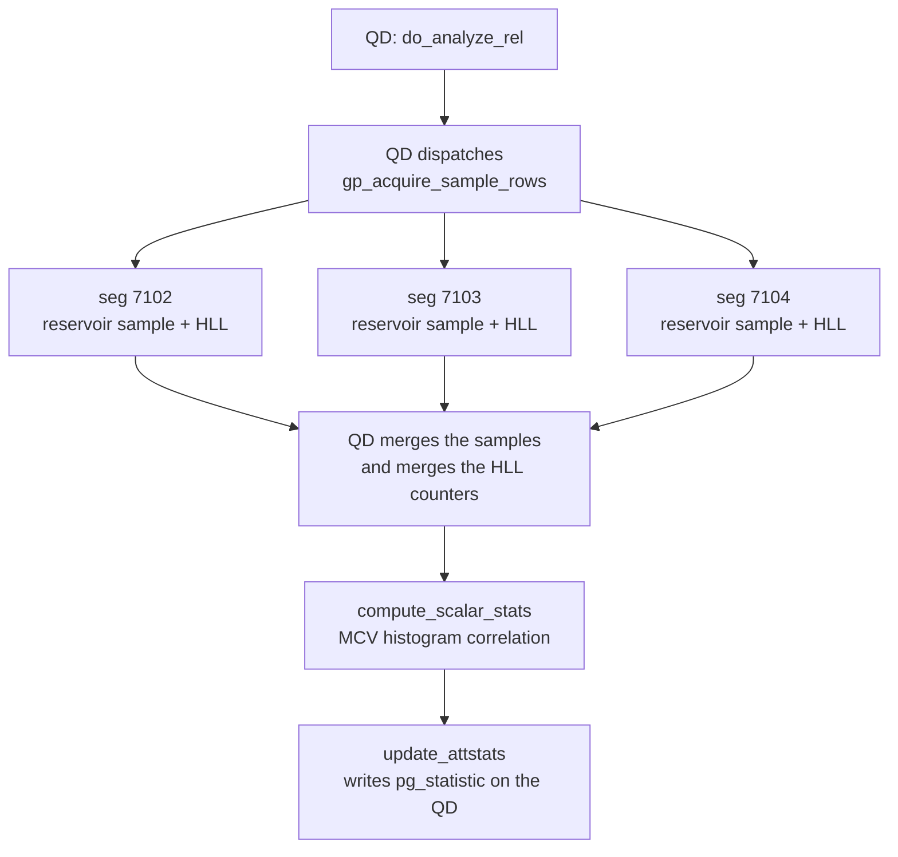
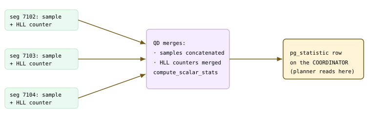
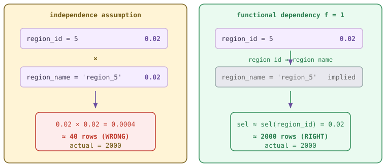
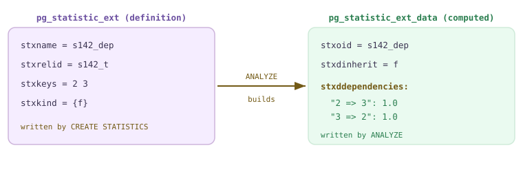
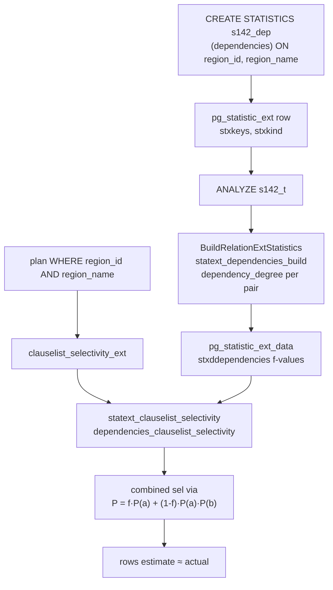
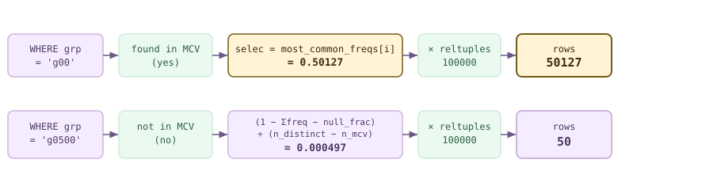
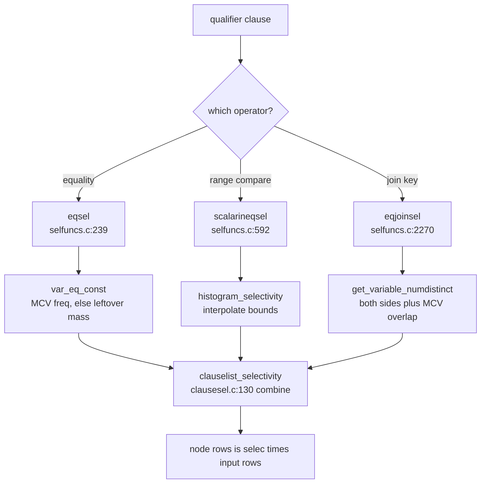

<style>
/*
 * Licensed to the Apache Software Foundation (ASF) under one
 * or more contributor license agreements.  See the NOTICE file
 * distributed with this work for additional information
 * regarding copyright ownership.  The ASF licenses this file
 * to you under the Apache License, Version 2.0 (the
 * "License"); you may not use this file except in compliance
 * with the License.  You may obtain a copy of the License at
 *
 *   http://www.apache.org/licenses/LICENSE-2.0
 *
 * Unless required by applicable law or agreed to in writing,
 * software distributed under the License is distributed on an
 * "AS IS" BASIS, WITHOUT WARRANTIES OR CONDITIONS OF ANY
 * KIND, either express or implied.  See the License for the
 * specific language governing permissions and limitations
 * under the License.
 */

/* Layout for the HTML-and-CSS figures, lifted from the handbook's own
   stylesheet so the figures render identically here. */

/* These four come from the handbook's own stylesheet; a consuming site has no
   such definitions, and an undefined custom property invalidates its whole
   declaration. Define them here, scoped to the figure.

   Deliberately NOT themed. The artwork below is light-only: band and tile
   backgrounds are hard-coded pastels, and the injected markup carries some 800
   more hard-coded light colours in inline styles. Giving --fg a dark-theme
   value paints near-white text onto a near-white band -- measured at 1.08:1,
   worse than the bug that replaced. The handbook's light values are correct in
   both themes; what changes for dark mode is the surface underneath. */
.cloudberry-core-figure {
  --border: #d8dee4;
  --soft:   #f6f8fa;
  --fg:     #1f2328;
  --muted:  #636c76;
  margin: 1.4rem 0;
}

/* Light-only artwork needs a light ground AND a dark ink, or it bleeds into a
   dark page. Setting only the ground is not enough: any text in these figures
   without its own inline colour inherits the site's near-white body colour, so
   it lands white-on-pastel -- measured at 1.03:1 across 184 text nodes. The
   colour has to be restored at the same place the ground is. */
[data-bs-theme='dark'] .cloudberry-core-figure > div {
  background: #ffffff;
  color: #1f2328;
  border-radius: 8px;
  padding: 10px;
}
/* Descendants that inherit rather than carry an inline colour. */
[data-bs-theme='dark'] .cloudberry-core-figure > div :not([style*="color"]) {
  color: inherit;
}
.cloudberry-core-figure figcaption {
  margin-top: .5rem;
  font-size: .9em;
  /* --ifm-color-emphasis-600 resolves to rgb(141,148,158) in the light theme,
     which is 3.06:1 on white -- below WCAG AA for the 37 figure captions.
     (The dark theme's value is fine, so only light is overridden.) */
  color: #636b75;
}
[data-bs-theme='dark'] .cloudberry-core-figure figcaption {
  color: #a6adb4;
}

/* Selective highlight: the handbook wraps a key token so it stands out.
   Scoped to the component. The class name .hl is two letters and this file
   lands in the consuming site's single global stylesheet, so an unscoped
   rule would style every page of that site. The standalone edition's
   figure.code / figure.session variants are dropped: those classes do not
   occur anywhere in this tree. */
.cloudberry-core-figure .hl { border-radius: 2px; font-weight: 700;
                   background: #fff8c5; color: #1f2328; padding: 0 2px; }

/* Layered module map and the banded brick figures. */
.cloudberry-core-figure .bricks { border:1px solid var(--border);border-radius:12px;overflow:hidden;background:var(--soft) }
.cloudberry-core-figure .bk-band { display:flex;align-items:stretch;border-top:1px solid var(--border) }
.cloudberry-core-figure .bk-band:first-child { border-top:none }
.cloudberry-core-figure .bk-lbl { flex:0 0 116px;display:flex;flex-direction:column;justify-content:center;gap:2px;padding:10px 13px }
.cloudberry-core-figure .bk-lbl b { font-size:12.5px;font-weight:800;color:var(--fg);line-height:1.2 }
.cloudberry-core-figure .bk-lbl span { font-size:9.5px;font-weight:700;color:var(--muted);text-transform:uppercase;letter-spacing:.5px }
.cloudberry-core-figure .bk-row { flex:1 1 auto;display:flex;flex-wrap:wrap;gap:7px;padding:9px 10px }
.cloudberry-core-figure .bk { flex:1 1 118px;min-width:104px;display:flex;flex-direction:column;justify-content:center;gap:2px; padding:8px 11px;border-radius:7px;border:1px solid;background:#fff;text-decoration:none;transition:.13s }
.cloudberry-core-figure .bk-t2 { font-size:12.5px;font-weight:700;line-height:1.25 }
.cloudberry-core-figure .bk-ch { font-size:10.5px;font-weight:700;font-variant-numeric:tabular-nums;opacity:.8 }
.cloudberry-core-figure a.bk:hover { transform:translateY(-2px);box-shadow:0 4px 12px #0000001f;text-decoration:none }
.cloudberry-core-figure .bk-q { background:#eef6ff }
.cloudberry-core-figure .bk-q .bk { border-color:#54aeff66;color:#0a3069;background:#ddf4ff }
.cloudberry-core-figure .bk-s { background:#eefcf2 }
.cloudberry-core-figure .bk-s .bk { border-color:#4ac26b80;color:#04260f;background:#dafbe1 }
.cloudberry-core-figure .bk-t { background:#fff6ef }
.cloudberry-core-figure .bk-t .bk { border-color:#fb8f4480;color:#5e2700;background:#fff1e5 }
.cloudberry-core-figure .bk-h { background:#fff4f3 }
.cloudberry-core-figure .bk-h .bk { border-color:#ff818280;color:#5c0011;background:#ffebe9 }
.cloudberry-core-figure .bk-r { background:#f3f5f8 }
.cloudberry-core-figure .bk-r .bk { border-color:#afb8c1;color:#1f2328;background:#eaeef2 }
@media (max-width: 560px) {
  .cloudberry-core-figure .bk-band { flex-direction:column }
  .cloudberry-core-figure .bk-lbl { flex-basis:auto;border-bottom:1px solid var(--border) }
}

</style>

<!--
  Licensed to the Apache Software Foundation (ASF) under one
  or more contributor license agreements.  See the NOTICE file
  distributed with this work for additional information
  regarding copyright ownership.  The ASF licenses this file
  to you under the Apache License, Version 2.0 (the
  "License"); you may not use this file except in compliance
  with the License.  You may obtain a copy of the License at

    http://www.apache.org/licenses/LICENSE-2.0

  Unless required by applicable law or agreed to in writing,
  software distributed under the License is distributed on an
  "AS IS" BASIS, WITHOUT WARRANTIES OR CONDITIONS OF ANY
  KIND, either express or implied.  See the License for the
  specific language governing permissions and limitations
  under the License.
-->


<a id="14-statistics--selectivity"></a>

## 14.1 基础统计信息 {#141-basic-statistics}

[§13.1](/cloudberry/core-internals/part-4-query-processing/ch13/#131-the-simple-query-protocol) 中，规划器通过*计算备选计划的代价*，将查询转为 `PlannedStmt`。但代价是否准确，取决于背后的行数估计，而行数估计来自**逐列统计信息**。在权衡顺序扫描与索引扫描之前，规划器会先问：`region = 'EAST'` 匹配多少行？这一列的平均宽度是多少，以便确定哈希表大小？这一列在磁盘上是否已有序，从而让索引扫描代价较低？这些问题都由各列*分布*的一份预先计算的小型摘要来回答。

这份摘要保存在系统目录 **`pg_statistic`**（`src/include/catalog/pg_statistic.h`——`FormData_pg_statistic`）中，每列对应一行。它是复制到各节点的系统目录（[§8.2](/cloudberry/core-internals/part-2-storage-data-layout/ch08/#82-key-catalog-tables)），因此每个节点都有它；但规划器读取的是 **Coordinator** 上的行，因为 Cloudberry 的规划器运行在 QD 上（[§13.3](/cloudberry/core-internals/part-4-query-processing/ch13/#133-dispatch-from-coordinator-plan-to-segment-execution)）。本节剖析这一行，介绍规划器实际使用的四五种统计信息，说明 `ANALYZE` 如何构建它们，再讨论 MPP 环境下的变化：样本*从各 Segment 收集*，合并后的结果则存放在 Coordinator 上。

<figure class="cloudberry-core-figure">
<div><div style="overflow-x:auto;font-family:ui-monospace,Menlo,monospace;font-size:12.5px;line-height:1.35"> <div style="display:flex;gap:6px;min-width:680px;margin-bottom:8px"> <div style="flex:1;background:#f5edff;border:1px solid #cdb4db;border-radius:6px;padding:6px 8px"><b>starelid</b><br/>关系 OID</div> <div style="flex:1;background:#f5edff;border:1px solid #cdb4db;border-radius:6px;padding:6px 8px"><b>staattnum</b><br/>列号</div> <div style="flex:1;background:#eafaf0;border:1px solid #cfead9;border-radius:6px;padding:6px 8px"><b>stanullfrac</b><br/>NULL 占比</div> <div style="flex:1;background:#eafaf0;border:1px solid #cfead9;border-radius:6px;padding:6px 8px"><b>stawidth</b><br/>平均字节数</div> <div style="flex:1;background:#fff4d6;border:1px solid #735a16;border-radius:6px;padding:6px 8px"><b>stadistinct</b><br/>非重复值数（&lt;0 = 比例）</div> </div> <div style="display:flex;gap:6px;min-width:680px"> <div style="flex:1;background:#f5edff;border:1px solid #cdb4db;border-radius:6px;padding:6px 8px"><b>槽位 1</b><br/>stakind1 <span style="color:#735a16">= 1 MCV</span><br/>staop1 / stacoll1<br/>stanumbers1 = <i>频率</i><br/>stavalues1 = <i>值</i></div> <div style="flex:1;background:#f5edff;border:1px solid #cdb4db;border-radius:6px;padding:6px 8px"><b>槽位 2</b><br/>stakind2 <span style="color:#735a16">= 3 CORR</span><br/>staop2 / stacoll2<br/>stanumbers2 = <i>[corr]</i><br/>stavalues2 = —</div> <div style="flex:1;background:#f5edff;border:1px solid #cdb4db;border-radius:6px;padding:6px 8px"><b>槽位 3</b><br/>stakind3 <span style="color:#735a16">= 8 NDV/seg</span><br/>staop3 / stacoll3<br/>stanumbers3<br/>stavalues3</div> <div style="flex:1;background:#f5edff;border:1px solid #cdb4db;border-radius:6px;padding:6px 8px;opacity:.6"><b>槽位 4</b><br/>stakind4 = 0<br/>（未使用）</div> <div style="flex:1;background:#f5edff;border:1px solid #cdb4db;border-radius:6px;padding:6px 8px;opacity:.6"><b>槽位 5</b><br/>stakind5 = 0<br/>（未使用）</div> </div> <div style="margin-top:6px;color:#6b6b6b">↑ 五个相同的槽位；各槽位的含义由 stakindN 代码决定，与位置无关 ↑</div> </div></div>
<figcaption>一行 pg_statistic：固定标量头部加五个通用槽位。每个槽位是一个 (kind, op, coll, numbers, values) 元组；同一物理布局根据 stakindN 存放 MCV 列表、直方图或相关性。</figcaption>
</figure>

### 14.1.1 pg_statistic 行与 pg_stats 视图 {#1411-the-pg_statistic-row-and-the-pg_stats-view}

每行开头有三个固定标量字段。**`stanullfrac`**（`src/include/catalog/pg_statistic.h`——`FormData_pg_statistic`）是 NULL 条目的占比；**`stawidth`** 是非空条目的平均字节宽度（用于确定内存中哈希表的大小）；**`stadistinct`**（`FormData_pg_statistic`）是非空值中非重复值的数量，采用了一种巧妙的编码。

- **`stanullfrac`**——列中 NULL 的占比，范围为 [0,1]。规划器用 `(1 - null_frac)` 缩放各项估计。
- **`stawidth`**——非空值经 TOAST 处理后的平均存储宽度。用于内存和宽度估计，不用于行数估计。
- **`stadistinct`**——**正数**表示非重复值的绝对数量；**负数**表示*相对于 `reltuples` 的比例*：`-1` 表示所有值都唯一，`-0.5` 表示每个值大约出现两次。即使表继续增长，且 `pg_class.reltuples` 比 `pg_statistic` 更新更频繁，负数形式仍能让估计保持正确。

其他信息都存放在**五个通用槽位**中。每个槽位是一个 `(kind, op, coll, numbers, values)` 五元组，其含义由 *kind* 代码决定：同样的物理列，在某行存放 MCV 列表，在另一行可以存放直方图：

```c {title="src/include/catalog/pg_statistic.h — FormData_pg_statistic"}
int16    stakind1;      /* kind of statistic (see constants) */
Oid      staop1;        /* operator used to derive it */
Oid      stacoll1;      /* collation used to derive it */
#ifdef CATALOG_VARLEN
float4   stanumbers1[1];/* numeric statistics (e.g. frequencies) */
anyarray stavalues1;    /* representative data values */
#endif
/* ... slots 2..5 are declared identically ... */
```

一共有五个槽位（`STATISTIC_NUM_SLOTS`），因此同一列可以同时保存多种统计信息。标准规划器关注的种类代码如下：

| 常量 | 值 | numbers 数组 | values 数组 |
| --- | --- | --- | --- |
| `STATISTIC_KIND_MCV` | 1 | 每个 MCV 的频率 | 最常见值 |
| `STATISTIC_KIND_HISTOGRAM` | 2 | — | 等深桶边界 |
| `STATISTIC_KIND_CORRELATION` | 3 | 一个数：相关性 | — |
| `STATISTIC_KIND_NDV_BY_SEGMENTS` | 8 | 各 Segment 的 ndistinct（Cloudberry） | — |
| `STATISTIC_KIND_HLL` / `_FULLHLL` | 99 / 98 | — | 序列化的 HLL 计数器（临时使用，Cloudberry） |

> [!NOTE]
> 种类 1/2/3 来自原生 PostgreSQL（`pg_statistic.h`——`STATISTIC_KIND_MCV`）。种类 **8**（`STATISTIC_KIND_NDV_BY_SEGMENTS`）和 **98/99**（`STATISTIC_KIND_HLL`）是 Cloudberry 新增的：8 记录*各 Segment* 的非重复值数量，让优化器能估计部分聚合节点的规模；98/99 携带 HyperLogLog 计数器，用于跨 Segment 合并 `n_distinct`（见 [§14.1.4](#1414-the-mpp-twist-sample-on-the-segments-store-on-the-coordinator)）。

通常很少直接读取 `pg_statistic`，因为数组列保存的是内部 `anyarray` 数据块。便于读取的视图是 **`pg_stats`**：它关联表名和列名，将数组展开为带类型的值，并隐藏你无权访问的列所对应的行。下面一条查询就能展现表的统计信息全貌；`s141_t` 有一列分布严重倾斜的文本列 `region`，以及严格递增的 `ordered_col`：

*ANALYZE 后的 pg_stats。region 分布倾斜（4 个值，其中一个占约 50%），因此其 MCV 列表包含全部值；ordered_col 没有 MCV，但有一个含 100 个桶的直方图，且相关性 ≈ 1。*

```sql
ANALYZE s141_t;
SELECT attname, null_frac, n_distinct,
       most_common_vals, most_common_freqs,
       histogram_bounds, correlation
FROM pg_stats WHERE tablename='s141_t';
```

```text {hl_lines="5" title="output"}
attname           | region
null_frac         | 0
n_distinct        | 4
most_common_vals  | {EAST,WEST,NORTH,SOUTH}
most_common_freqs | {0.5000333,0.249,0.12596667,0.125}
histogram_bounds  |
correlation       | 0.34476006
-------------------+--------------------------------------
attname           | ordered_col
null_frac         | 0
n_distinct        | -1
most_common_vals  |
most_common_freqs |
histogram_bounds  | {1,1054,2068,3124, ... ,98999,99999}
correlation       | 1
```

从这两行可读出：`region` 只有 **4** 个非重复值，因此 `n_distinct` 是精确计数，所有值都能放进 MCV 列表；`ordered_col` 的值唯一，因此 `n_distinct = -1`（负数表示比例，即 1 × `reltuples`），它没有 MCV，且**相关性为 1**，说明物理顺序与逻辑顺序一致，在该列上执行索引扫描的代价因而很低。

### 14.1.2 四种主要统计信息 {#1412-the-four-workhorse-statistics}

规划器从这些槽位为每列提取（最多）四种主要统计信息。每种都回答一个特定的估计问题，供 [§14.3](#143-selectivity-estimation) 的选择率函数和第 [15](/cloudberry/core-internals/part-4-query-processing/ch15/) 章的代价模型使用：

- **`null_frac`**——列中 NULL 出现的频率，用于 `IS NULL` / `IS NOT NULL`，以及折减其他估计。
- **`n_distinct`**——非重复值数量，是通用等值估计的分母：一个非 MCV 值大约匹配 `reltuples / n_distinct` 行。
- **`most_common_vals` + `most_common_freqs`（MCV）**——频繁到值得单独跟踪的值，以及每个值在表中所占的精确比例。针对 MCV 值的等值条件，**直接**按其频率估计，无须猜测。
- **`histogram_bounds`**——*非 MCV* 值的等深桶边界。每个桶（最多 100 个）包含相同比例的行，因此可通过计算桶数估计范围谓词（`<`、`>`、`BETWEEN`）。
- **`correlation`**——物理行顺序与值排序顺序的接近程度，范围为 [-1,1]。接近 ±1 时，索引扫描几乎按顺序读取页面（代价低）；接近 0 时，则随机寻址（代价高）。

<figure class="cloudberry-core-figure">
<div><div style="overflow-x:auto;font-family:ui-monospace,Menlo,monospace;font-size:12.5px"> <div style="min-width:420px"> <div style="display:flex;align-items:center;gap:8px;margin:3px 0"><span style="width:64px">EAST</span><div style="height:16px;width:250px;background:#735a16;border-radius:3px"></div><span><span class="hl">0.5000</span></span></div> <div style="display:flex;align-items:center;gap:8px;margin:3px 0"><span style="width:64px">WEST</span><div style="height:16px;width:124px;background:#cdb4db;border-radius:3px"></div><span>0.2490</span></div> <div style="display:flex;align-items:center;gap:8px;margin:3px 0"><span style="width:64px">NORTH</span><div style="height:16px;width:63px;background:#cfead9;border-radius:3px"></div><span>0.1260</span></div> <div style="display:flex;align-items:center;gap:8px;margin:3px 0"><span style="width:64px">SOUTH</span><div style="height:16px;width:62px;background:#cfead9;border-radius:3px"></div><span>0.1250</span></div> </div> <div style="margin-top:6px;color:#6b6b6b">stavalues1 = <span class="hl">{EAST,WEST,NORTH,SOUTH}</span> &nbsp;·&nbsp; stanumbers1 = 上述四个频率</div> </div></div>
<figcaption>region 的 MCV 列表——每个值在表中所占的精确比例。与其中任一值比较相等时，直接按其频率估计；这里没有非 MCV 值，因为 n_distinct（4）所对应的全部值都能放进列表。</figcaption>
</figure>

规划器不会在规划时扫描数据，读取的就是这些数组。[§14.3](#143-selectivity-estimation) 介绍将它们转换成比例的选择率函数（`eqsel`、`scalarltsel`），[§14.1.4](#1414-the-mpp-twist-sample-on-the-segments-store-on-the-coordinator) 则将某个 MCV 频率与具体的 `EXPLAIN` 估计对应起来。

### 14.1.3 ANALYZE 如何构建统计信息 {#1413-how-analyze-builds-them}

这些行由 `ANALYZE`（以及自动清理中的分析）构建。入口是 **`do_analyze_rel()`**（`src/backend/commands/analyze.c`）。它调用 **`acquire_sample_rows()`**，通过水塘采样（Vitter 算法）抽取*大小有上限的随机样本*，然后逐列运行计算函数；对于可排序类型，使用 **`compute_scalar_stats()`**，填充 MCV 列表、直方图（`compute_scalar_stats()`）和相关性（`compute_scalar_stats()`）。最后，**`update_attstats()`** 写入完成的 `pg_statistic` 行。

```c {title="src/backend/commands/analyze.c — std_typanalyze()"}
/* Set the sample size (minrows) for this column's stats. */
stats->minrows = 300 * attr->attstattarget;
```

样本大小*有上限*，不会按表大小同比增长：它是 `300 × attstattarget`，而 `attstattarget` 默认取 `default_statistics_target = 100`（未设置时，`std_typanalyze()` 会代入默认值）。因此，无论表有 10 万行还是 1 亿行，普通 `ANALYZE` 都采样约 **30,000 行**；同一个目标值还将 MCV 列表和直方图限制为 100 个条目。可通过 `ALTER TABLE t ALTER COLUMN c SET STATISTICS n` 提高单列的统计精度，这会同时增加该列的样本大小和数组长度。



*MPP 集群中的 ANALYZE：QD 统筹，各 Segment 对自身数据采样，QD 合并，然后为每列写入一行 pg_statistic。*

> [!NOTE]
> **default_statistics_target** 是一个 GUC，默认值为 100。对于分布倾斜或基数很高、估计不准确的列，标准修复方式是通过 `ALTER TABLE ... ALTER COLUMN ... SET STATISTICS n` 提高该列的目标值：增加采样行数，延长 MCV 列表和直方图，代价是 ANALYZE 更慢、系统目录行更大。

### 14.1.4 MPP 的变化：在 Segment 上采样，在 Coordinator 上存储 {#1414-the-mpp-twist-sample-on-the-segments-store-on-the-coordinator}

在单节点 PostgreSQL 中，`acquire_sample_rows()` 从本地磁盘读取页面。Cloudberry 无法这样做：表的行分散在各 Segment 上，而 Segment 不维护自己的统计信息。因此，`ANALYZE` 在 QD 上运行时会*分发*采样工作：对每一列，要求各 Segment 在自身的数据部分上采样，并将采样行发回。分发语句就在 `acquire_sample_rows_dispatcher()` 中按如下方式构造：

```c {title="src/backend/commands/analyze.c"}
appendStringInfo(&str,
    "select pg_catalog.gp_acquire_sample_rows(%u, %d, '%s');",
    RelationGetRelid(onerel),
    perseg_targrows,
    inh ? "t" : "f");
```

各 Segment 运行自己的 `acquire_sample_rows()` 并返回本地样本；QD 将它们拼接成集群范围的样本，再对其运行 `compute_scalar_stats()`。但 `n_distinct` 不能直接求和，因为同一个值可能出现在多个 Segment 上。因此，各 Segment 还会为该列构建一个 **HyperLogLog** 计数器（`src/backend/utils/hyperloglog/gp_hyperloglog.c`：`gp_hyperloglog_add_item`、`gp_hyperloglog_estimate`），QD 再使用 `gp_hyperloglog_merge_counters()` 合并这些计数器，在较小误差范围内估计整个集群的非重复值数量：

```c {title="src/backend/commands/analyze.c — GP_HLL_ERROR_MARGIN"}
/* If HLL's distinct-value estimate is within 0.3% of the
 * row count, we treat every value as distinct. */
#define GP_HLL_ERROR_MARGIN  0.003
```



*跨 Segment 流程：各 Segment 发送本地水塘样本和 HLL 摘要；QD 将样本合为一份，将摘要合并为集群范围的 n_distinct，然后在 Coordinator 上写入一行 pg_statistic。*

合并后的行存入 **Coordinator 的** `pg_statistic`，这是有意为之：规划器运行在 QD 上（[§13.3](/cloudberry/core-internals/part-4-query-processing/ch13/#133-dispatch-from-coordinator-plan-to-segment-execution)），所以必须能在那里取得统计信息。估计值与合并后的数字精确对应，便是证明。以 `region = 'EAST'` 为例，它是一个频率为 `0.5000333` 的 MCV 值：

*MCV 等值估计直接读取 most_common_freqs，无需猜测。Gather 处的 rows ≈ freq × reltuples。*

```sql
EXPLAIN SELECT * FROM s141_t WHERE region = 'EAST';
```

```text {hl_lines="2" title="output"}
Gather Motion 3:1 (slice1; segments: 3)
   (cost=0.00..435.78 rows=50004 width=13)
   ->  Seq Scan on s141_t
         (cost=0.00..433.36 rows=16668 width=13)
         Filter: (region = 'EAST'::text)
 Optimizer: GPORCA
```

计算一下：`reltuples` 在 `s141_t` 中为 100,000，EAST 的 MCV 频率为 `0.5000333`，因此 `0.5000333 × 100000 = 50003`，与计划中的 `rows=50004` 相符（最后一行向上取整；按各 Segment 计算为 16,668 × 3）。这个估计并非在规划时采样得到，而是从 `most_common_freqs` 中*读取*。**不在** MCV 列表中的值则会按 `reltuples / n_distinct` 估计。ORCA（第 [17](/cloudberry/core-internals/part-4-query-processing/ch17/) 章）拥有自己的基数估计引擎，但读取的正是同一行 `pg_statistic`；经典 PostgreSQL 规划器见第 [15](/cloudberry/core-internals/part-4-query-processing/ch15/) 章，分布式规划见第 [16](/cloudberry/core-internals/part-4-query-processing/ch16/) 章。用于处理逐列独立估计失准的扩展（多列）统计信息，见 [§14.2](#142-extended--multivariate-statistics)。

## 14.2 扩展统计信息与多元统计信息 {#142-extended--multivariate-statistics}

[§14.1](#141-basic-statistics) 的逐列统计信息隐含一个假设：各列*独立*变化。`WHERE` 子句测试多列时，规划器分别估计每个条件，再将比例**相乘**；执行这项工作的是 `clauselist_selectivity()`，位于 `src/backend/optimizer/path/clausesel.c`。只有各列不相关时，这样做才正确。真实表中存在大量相关性：`region_name` 完全由 `region_id` 决定；`city` 隐含其所属的 `country`；计算列 `b = a*2` 随 `a` 同步变化。如果两个选择率实际上对应*同一个*条件，将它们相乘会让估计骤降为一个很小的数，而实际行数仍然很大。

扩展统计信息让你*声明*哪些列组存在相关性，使规划器不再将它们当作相互独立。本节先展示低估问题，再用一条 `CREATE STATISTICS` 修复它。



*合并 sel(region_id=5) 与 sel(region_name='region_5') 的两种方式。左：独立性假设将两者相乘，得到接近零的结果。右：函数依赖表明第二个子句由第一个子句蕴含，因此合并后的选择率基本就是 sel(region_id)。*

### 14.2.1 独立性陷阱 {#1421-the-independence-trap}

考虑一个有 10 万行的分布式表，`region_name` 完全由 `region_id` 决定：共有 50 个地区，每个 ID 恰好对应一个名称。两列都各有 50 个非重复值，因此 `default_statistics_target=100` 会将全部值收录为 MCV，每个等值子句的估计选择率为 ≈ 1/50 = 0.02。规划器看到两个貌似独立的子句，就将它们相乘：0.02 × 0.02 ≈ 0.0004，只得到很少的行。但 `region_id=5` 的 2000 行中，每行*也都*满足 `region_name='region_5'`，因此真实数量是 2000。

```c {title="src/backend/optimizer/path/clausesel.c — clauselist_selectivity()"}
* The remaining clauses are then estimated by taking the product of their
* selectivities, but that's only right if they have independent
* probabilities, and in reality they are often NOT independent even if they
* only refer to a single column.  So, we want to be smarter where we can.
```

下面使用默认优化器 GPORCA 实际展示这一低估。`rows=` 的估计远小于 `EXPLAIN ANALYZE` 测得的实际数量：

*修复前——GPORCA 将两个子句的选择率相乘：估计 74 行，实际 2000 行（低估约 27 倍）。*

```sql
EXPLAIN ANALYZE
SELECT * FROM s142_t
WHERE region_id = 5 AND region_name = 'region_5';
```

```text {hl_lines="1 2" title="output"}
Gather Motion 3:1  (cost=0.00..434.13 rows=74 width=17)
                    (actual time=3.028..6.440 rows=2000 loops=1)
  ->  Seq Scan on s142_t  (cost=0.00..434.13 rows=25 width=17)
              (actual time=0.094..4.056 rows=713 loops=1)
        Filter: ((region_id = 5) AND (region_name = 'region_5'::text))
        Rows Removed by Filter: 32614
 Optimizer: GPORCA
```

内置 PostgreSQL 规划器也会犯同样的错误。扩展统计信息并非 ORCA 或某一规划器独有的功能，两种基数估计引擎读取同一份系统目录。切换到它（`SET optimizer=off`）后，可以看到相同的情况：

*修复前——Postgres 规划器：估计 290 行，实际 2000 行。独立性假设错误相同，取整方式不同。*

```sql
SET optimizer = off;
EXPLAIN ANALYZE
SELECT * FROM s142_t
WHERE region_id = 5 AND region_name = 'region_5';
```

```text {hl_lines="1 2" title="output"}
Gather Motion 3:1  (cost=0.00..557.87 rows=290 width=17)
                    (actual time=2.946..12.387 rows=2000 loops=1)
  ->  Seq Scan on s142_t  (cost=0.00..554.00 rows=97 width=17)
              (actual time=0.082..4.017 rows=713 loops=1)
        Filter: ((region_id = 5) AND (region_name = 'region_5'::text))
 Optimizer: Postgres query optimizer
```

> [!NOTE]
> 两个子句组成的过滤条件若低估 7–27 倍，误差会不断放大：偏低的行数估计使规划器倾向于嵌套循环、过小的哈希表，以及 MPP 计划中错误的跨 Segment 连接或重分布策略。规划器细节见**第 [15](/cloudberry/core-internals/part-4-query-processing/ch15/) 章**；ORCA 的基数估计引擎见**第 [17](/cloudberry/core-internals/part-4-query-processing/ch17/) 章**。

### 14.2.2 CREATE STATISTICS：三种类型 {#1422-create-statistics-the-three-kinds}

`CREATE STATISTICS` 在一个表的一组列（或表达式）上定义统计信息*对象*。你可以选择构建哪些类型，每种类型针对一种不同的组合估计错误。语法为 `CREATE STATISTICS name (kind[, ...]) ON c1, c2 FROM t;`。

- **`dependencies`**——**函数依赖**：为每对列记录一个*依赖度* `f ∈ [0,1]`，衡量一列决定另一列（`c1 ⇒ c2`）的程度。由 `src/backend/statistics/dependencies.c` 构建和使用。这正是解决本例 `region_id ⇒ region_name` 问题的方法。
- **`ndistinct`**——**多元非重复值数量**：一组列的不同值*组合*数，例如不同 `(a,b)` 对的数量。它修正 GROUP BY 和 DISTINCT 的估计，避免将各列的非重复值数量直接相乘。实现位于 `src/backend/statistics/mvdistinct.c`。
- **`mcv`**——**多元 MCV**：最常见值*组合*及其频率的列表；它最详细，也是唯一还能帮助估计范围和不等式子句的类型。实现位于 `src/backend/statistics/mcv.c`。
- **表达式统计信息**——针对*表达式*（如 `lower(col)` 或 `(a+b)`）的统计信息，让 `WHERE lower(col)='x'` 不再依赖盲目猜测。类型为 `STATS_EXT_EXPRESSIONS`（'e'）；当表达式出现在 `ON` 列表中时隐式创建，也可作为单表达式对象创建。

```c {title="src/backend/statistics/extended_stats.c — BuildRelationExtStatistics()"}
if (t == STATS_EXT_NDISTINCT)
    ndistinct = statext_ndistinct_build(totalrows, data);
else if (t == STATS_EXT_DEPENDENCIES)
    dependencies = statext_dependencies_build(data);
else if (t == STATS_EXT_MCV)
    mcv = statext_mcv_build(data, totalrows, stattarget);
```

类型常量是 `src/include/catalog/pg_statistic_ext.h`（`STATS_EXT_NDISTINCT`）中的单字符代码：`'d'` 表示 ndistinct，`'f'` 表示函数依赖，`'m'` 表示 MCV，`'e'` 表示表达式。对于本例的相关列对，函数依赖已经足够：

*先声明依赖，再运行 ANALYZE 实际计算（仅执行 CREATE STATISTICS 不会存储统计数据）。*

```sql
CREATE STATISTICS s142_dep (dependencies)
    ON region_id, region_name FROM s142_t;
ANALYZE s142_t;
```

```text {title="output"}
CREATE STATISTICS
ANALYZE
```

### 14.2.3 存放位置：两个系统目录 {#1423-where-they-live-two-catalogs}

一个扩展统计信息对象分存于**两个**系统目录，对应普通列统计信息中定义与数据的划分（[§14.1](#141-basic-statistics)）。`pg_statistic_ext` 保存*定义*：哪个表、哪些列（`stxkeys`）、请求哪些类型（`stxkind`）。执行 `CREATE STATISTICS` 后，定义立即存在。`pg_statistic_ext_data` 保存*计算得到的*内容——依赖度、非重复值数量映射、序列化的 MCV 列表——只有 `ANALYZE` 才会填充或刷新它。



*CREATE STATISTICS 写入左侧行；ANALYZE 读取样本并写入右侧行。定义用 attnum 标识列，数据也使用这些 attnum（'2 => 3' = region_id ⇒ region_name）。*

下面直接从系统目录读取定义行和计算结果行，再查看便于阅读的 `pg_stats_ext` 视图，它会将 attnum 解码为列名：

*pg_statistic_ext 保存结构，pg_statistic_ext_data 保存数值，pg_stats_ext 提供便于阅读的关联结果。*

```sql
SELECT stxname, stxkeys, stxkind
  FROM pg_statistic_ext WHERE stxname = 's142_dep';

SELECT stxddependencies
  FROM pg_statistic_ext_data d JOIN pg_statistic_ext e ON e.oid = d.stxoid
 WHERE stxname = 's142_dep';

SELECT attnames, kinds, dependencies
  FROM pg_stats_ext WHERE statistics_name = 's142_dep';
```

```text {hl_lines="7" title="output"}
  stxname  | stxkeys | stxkind
-----------+---------+---------
 s142_dep  | 2 3     | {f}

          stxddependencies
------------------------------------------
 {"2 => 3": 1.000000, "3 => 2": 1.000000}

       attnames          | kinds |            dependencies
-------------------------+-------+------------------------------------
 {region_id,region_name} | {f}   | {"2 => 3": 1.000000, "3 => 2": 1.000000}
```

两个方向的依赖度都为 `1.0`，说明存在完全双射：`region_id` 决定 `region_name`，反之亦然。扩展统计信息与列统计信息由同一套 `ANALYZE` 机制收集；逐列处理完成后，`BuildRelationExtStatistics()` 遍历表的统计信息对象：

```c {title="src/backend/statistics/extended_stats.c"}
void
BuildRelationExtStatistics(Relation onerel, bool inh, double totalrows,
                           int numrows, HeapTuple *rows,
                           int natts, VacAttrStats **vacattrstats)
```

> [!NOTE]
> 与 `pg_statistic` 一样，这些系统目录存储在 Coordinator 上（规划器在那里运行，见 [§13.3](/cloudberry/core-internals/part-4-query-processing/ch13/#133-dispatch-from-coordinator-plan-to-segment-execution)），并像普通系统目录一样复制（[§8.2](/cloudberry/core-internals/part-2-storage-data-layout/ch08/#82-key-catalog-tables)）。ANALYZE 仍然从全部三个 Segment 采样；扩展统计信息的构建基于 Coordinator 端合并后的样本。

### 14.2.4 规划器如何使用它们 {#1424-how-the-planner-uses-them}

将各子句选择率相乘之前，`clauselist_selectivity_ext()` 会调用 `statext_clauselist_selectivity()`（`src/backend/statistics/extended_stats.c`），尽可能使用扩展统计信息估计更多子句；已经处理的子句会从独立相乘步骤中移除。函数依赖的处理位于 `dependencies_clauselist_selectivity()`（`src/backend/statistics/dependencies.c`）：它找出子句所涉及列之间最强的依赖，按依赖度 `f` 混合两种估计：

```c {title="src/backend/statistics/dependencies.c — dependencies_clauselist_selectivity()"}
* Assuming (a=>b) is the selected
* dependency, we then combine the per-clause selectivities using the formula
*
*     P(a,b) = f * P(a) + (1-f) * P(a) * P(b)
```

看公式的两个极端。`f = 0`（无依赖）时，它退化为原来的独立乘积 `P(a)·P(b)`。`f = 1`（完全依赖，本例即如此）时，结果恰好为 `P(a)`；第二个子句已被蕴含，不再额外收紧条件。因此，本例的 `f = 1.0` 将 0.02 × 0.02 恢复为 ≈ 0.02。依赖度本身由 `dependency_degree()`（`src/backend/statistics/dependencies.c`）计算，方法是统计有多少采样行符合 `c1 ⇒ c2`。



*生命周期：定义声明一次，每次 ANALYZE 构建或重建数据，每次规划匹配的查询时都会查询这些信息。*

有了依赖信息，两种优化器现在都得到相同且准确的估计：估计 1940 行，实际 2000 行：

*修复后——Postgres 规划器从 290→1940，GPORCA 从 74→1940（实际均为 2000）。依赖度使合并选择率回到 sel(region_id)。*

```sql
-- Postgres planner
SET optimizer = off;
EXPLAIN ANALYZE SELECT * FROM s142_t
  WHERE region_id = 5 AND region_name = 'region_5';

-- GPORCA
SET optimizer = on;
EXPLAIN ANALYZE SELECT * FROM s142_t
  WHERE region_id = 5 AND region_name = 'region_5';
```

```text {hl_lines="2 7" title="output"}
-- Postgres planner
Gather Motion 3:1 (cost=0.00..579.87 rows=1940 ...) (actual ... rows=2000 ...)
  ->  Seq Scan on s142_t (cost=0.00..554.00 rows=647 ...) (actual ... rows=713 ...)
 Optimizer: Postgres query optimizer

-- GPORCA
Gather Motion 3:1 (cost=0.00..434.27 rows=1940 ...) (actual ... rows=2000 ...)
  ->  Seq Scan on s142_t (cost=0.00..434.15 rows=647 ...) (actual ... rows=713 ...)
 Optimizer: GPORCA
```

两种引擎都收敛到 1940，是这里要记住的重点：扩展统计信息保存在系统目录中，并不属于某个特定规划器，因此声明一次相关性，就能使各个查询和优化器路径受益。修正后的选择率*如何*影响连接顺序与代价，以及 ORCA 自身的基数模型如何读取同样的记录，见 [§15](/cloudberry/core-internals/part-4-query-processing/ch15/) 和 [§17](/cloudberry/core-internals/part-4-query-processing/ch17/)。清理本演示时删除表，便会连同其统计信息对象一并删除。

*清理——删除表时，自动移除依赖它的 pg_statistic_ext 对象。*

```sql
DROP TABLE s142_t;
SELECT count(*) FROM pg_statistic_ext WHERE stxname = 's142_dep';
```

```text {title="output"}
 count
-------
     0
```

## 14.3 选择率估计 {#143-selectivity-estimation}

[§14.1](#141-basic-statistics) 和 [§14.2](#142-extended--multivariate-statistics) 将原始统计信息填入系统目录，包括空值比例、最常见值列表、直方图和非重复值数量。但这些还不是计划。对于查询中的每个限定条件，规划器仍须回答一个具体问题：*流入该节点的行中，有多大比例会保留下来？* 这个比例就是**选择率**，取值在 `[0,1]` 之间；统计信息的目的就是帮助规划器准确估计它。

从选择率即可得到估计基数：**估计行数 = 选择率 × 输入行数**。行数是规划器最重要的估计，它决定连接顺序、是否值得使用索引、采用哈希还是排序，以及预留多少内存。一旦行数估错，所有后续代价都会出错。各运算符的估计函数位于 `src/backend/utils/adt/selfuncs.c`；将多个限定条件组合成一个数的逻辑位于 `src/backend/optimizer/path/clausesel.c`。所得 `rows` 随后由代价模型*计价*：PostgreSQL 规划器见**第 [15](/cloudberry/core-internals/part-4-query-processing/ch15/) 章**，ORCA 见**第 [17](/cloudberry/core-internals/part-4-query-processing/ch17/) 章**（它有自己的基数估计引擎，但读取同一个 `pg_statistic`）。本节就是连接两者的桥梁：输入统计信息，输出行数。



*eqsel 推导链——从常量得到估计行数。数值来自演示表 s143_t（reltuples = 100000）。上方路径：常量是 MCV，因此测得的频率就是选择率。下方路径：常量不是 MCV，将剩余概率质量均摊到剩余的非重复值上。*



*分派：各限定条件按运算符类别交给 selfuncs.c 中的估计函数，再由 clauselist_selectivity 将逐子句结果组合为节点的行数估计。*

### 14.3.1 等值条件：eqsel 与 var_eq_const {#1431-equality-eqsel-and-var_eq_const}

最常见的限定条件是 `col = const`。`eqsel`（`selfuncs.c`）将处理交给 `eqsel_internal`（`selfuncs.c`），后者查找变量，并在右侧是普通常量时调用 `var_eq_const`（`selfuncs.c`）。该例程根据常量是否属于该列的最常见值，分两种情况处理。

```c {title="src/backend/utils/adt/selfuncs.c — var_eq_const()"}
if (match)
    /* Constant IS a most common value: we know its frequency exactly */
    selec = sslot.numbers[i];
else
{
    double  sumcommon = 0.0;
    for (i = 0; i < sslot.nnumbers; i++)
        sumcommon += sslot.numbers[i];
    selec = 1.0 - sumcommon - nullfrac;          /* leftover mass  */
    otherdistinct = get_variable_numdistinct(vardata, &isdefault)
                    - sslot.nnumbers;
    if (otherdistinct > 1)
        selec /= otherdistinct;                  /* spread it evenly */
}
```

- **常量是 MCV**——`selec = most_common_freqs[i]`，即 ANALYZE 为该值实际测得的频率（`selfuncs.c`——`var_eq_const()`）。无需建模，也无需假设，这是估计函数的*最佳*情况。
- **常量不是 MCV**——`selec = (1 − Σ most_common_freqs − null_frac) / (n_distinct − n_mcv)`，即扣除 MCV 和 NULL 后的剩余概率质量，均匀分配到剩余的非重复值上（`selfuncs.c`——`var_eq_const()`）。这里的 `n_distinct` 来自 `get_variable_numdistinct`（`selfuncs.c`）。

下面验证这一点。演示表 `s143_t` 有 100000 行，列 `grp` 被刻意设计成倾斜分布：值 `g00` 占据表的一半，其余值形成稀疏的长尾。因此，ANALYZE 只保留少量 MCV，大多数非重复值不在列表中，正适合测试两个分支。

*倾斜列的 pg_stats。等值估计函数将原样使用 g00 的实测频率。*

```sql
SELECT null_frac, n_distinct,
       array_length(most_common_vals,1) AS n_mcv,
       most_common_vals, most_common_freqs
FROM pg_stats WHERE tablename='s143_t' AND attname='grp';
```

```text {hl_lines="5" title="output"}
null_frac         | 0
n_distinct        | 1000
n_mcv             | 7
most_common_vals  | {g00,g0813,g0250,g0313,g0436,g0200,g0388}
most_common_freqs | {0.50126666,0.0009666667,0.00086666667,
                     0.00086666667,0.00086666667,0.0008,0.0008}
```

*针对 MCV 值的等值条件。0.50126666 × 100000 = 50126.7，EXPLAIN 恰好报告 rows=50127（Gather Motion 上的整表估计）。关闭 ORCA，以测试 selfuncs.c 路径。*

```sql
SET optimizer = off;
EXPLAIN SELECT * FROM s143_t WHERE grp = 'g00';
```

```text {hl_lines="1" title="output"}
Gather Motion 3:1  (slice1; segments: 3)  (cost=0.00..1130.02 rows=50127 width=12)
  ->  Seq Scan on s143_t  (cost=0.00..461.67 rows=16709 width=12)
        Filter: (grp = 'g00'::text)
Optimizer: Postgres query optimizer
```

结果精确吻合：MCV 频率*就是*选择率，因此估计连最后一行都对得上。现在看一个实际存在、但不够常见而未成为 MCV 的值 `g0500`。七个 MCV 频率之和为 `Σ = 0.50643`。于是 `selec = (1 − 0.50643 − 0) / (1000 − 7) = 0.49357 / 993 = 0.000497`，得到 `0.000497 × 100000 ≈ 49.7`。

*针对非 MCV 值的等值条件。剩余概率质量公式预测约 49.7 行，EXPLAIN 报告 rows=50。*

```sql
EXPLAIN SELECT * FROM s143_t WHERE grp = 'g0500';
```

```text {hl_lines="1" title="output"}
Gather Motion 3:1  (slice1; segments: 3)  (cost=0.00..462.33 rows=50 width=12)
  ->  Seq Scan on s143_t  (cost=0.00..461.67 rows=17 width=12)
        Filter: (grp = 'g0500'::text)
Optimizer: Postgres query optimizer
```

> [!NOTE]
> 注意两级行数：**Seq Scan** 报告*每个 Segment* 的估计（约 16709），三个 Segment 的流合并后，**Gather Motion** 再乘回整表数量（约 50127）。如 [§13.3](/cloudberry/core-internals/part-4-query-processing/ch13/#133-dispatch-from-coordinator-plan-to-segment-execution) 所述，规划器运行在 Coordinator 上，读取合并后的 `pg_statistic`；估计本身是整表数量，由 Motion 节点重新汇总。负数的 `n_distinct`（如 `-1`）表示“非重复值数量 = |值| × reltuples”，即随表增长而缩放的比例，不是固定计数。

### 14.3.2 范围条件：scalarineqsel 与直方图 {#1432-ranges-scalarineqsel-and-the-histogram}

不等式——`<`、`<=`、`>`、`>=`——由 `scalarltsel` / `scalargtsel`（`selfuncs.c`）估计，它们是 `scalarineqsel`（`selfuncs.c`）的薄封装。等值条件可以完全依赖 MCV 列表，范围条件却不行，因为范围也包含并不常见的值。因此，`scalarineqsel` 合并两部分贡献：满足比较条件的 MCV 条目（`mcv_selectivity`，`selfuncs.c`），以及对所有非 MCV 值通过 `histogram_bounds` 进行的插值（`ineq_histogram_selectivity`，`selfuncs.c`）。

```c {title="src/backend/utils/adt/selfuncs.c — scalarineqsel()"}
mcv_selec = mcv_selectivity(vardata, &opproc, collation, constval, true,
                            &sumcommon);
hist_selec = ineq_histogram_selectivity(root, vardata, operator, &opproc,
                                        isgt, iseq, collation,
                                        constval, consttype);
/* histogram covers the non-null, non-MCV mass */
selec = 1.0 - stats->stanullfrac - sumcommon;
selec *= hist_selec;          /* fraction of that mass below/above const */
selec += mcv_selec;           /* plus the matching MCV entries */
```

直方图存储 `histogram_target + 1` 个边界，选择边界时使每个桶包含相同数量的行。对于 `s143_t.amt`（值为 1..100000，严格有序），共有 101 个边界，相关性为 1.0。`ineq_histogram_selectivity` 找到常量所在的桶，并在桶内线性插值，因此选择率实质上就是*谓词所覆盖的边界范围比例*。

*amt 的直方图——101 个等深桶边界覆盖 1..100000，相关性为 1.0。范围估计通过在这些边界之间插值得到。*

```sql
SELECT n_distinct, correlation,
       array_length(histogram_bounds,1) AS n_bounds,
       (histogram_bounds::text::int[])[1:5]   AS first5,
       (histogram_bounds::text::int[])[97:101] AS last5
FROM pg_stats WHERE tablename='s143_t' AND attname='amt';
```

```text {hl_lines="3" title="output"}
n_distinct  | -1
correlation | 1
n_bounds    | 101
first5      | {4,930,1930,2879,3945}
last5       | {96016,97062,98023,99061,100000}
```

*覆盖取值范围中间约一半的区间。25001..75000 约占 1..100000 范围的 50%，插值估计为 rows=49994，约为全表的一半。*

```sql
EXPLAIN SELECT * FROM s143_t WHERE amt BETWEEN 25001 AND 75000;
```

```text {hl_lines="1" title="output"}
Gather Motion 3:1  (slice1; segments: 3)  (cost=0.00..1211.59 rows=49994 width=12)
  ->  Seq Scan on s143_t  (cost=0.00..545.00 rows=16665 width=12)
        Filter: ((amt >= 25001) AND (amt <= 75000))
Optimizer: Postgres query optimizer
```

估计直接对应所覆盖的比例：直方图范围的一半 → `0.49994 × 100000 = 49994` 行。`BETWEEN` 不是两个独立测试：`clauselist_selectivity` 将 `>=` 和 `<=` 识别为同一变量上一对相配的边界，将其合并为一个范围选择率，而不是相乘（使用 `RangeQueryClause` 记录相关信息，实现位于 `clausesel.c` 中）。

### 14.3.3 组合子句：clauselist_selectivity {#1433-combining-clauses-clauselist_selectivity}

一个 `WHERE` 列表包含多个子句，`clauselist_selectivity`（`clausesel.c`）将它们归结为一个数。教科书规则很简单：对于 **AND**，假设子句*独立*，将其选择率相乘；对于 **OR**，使用容斥原理。如果所引用的列存在 [§14.2](#142-extended--multivariate-statistics) 所述的扩展统计信息，就先查询这些信息（`statext_clauselist_selectivity`），将覆盖到的子句从逐列相乘步骤中移除。这正是扩展统计信息存在的*原因*：在列相关时修正独立性假设。

Cloudberry 增加了一项针对 MPP 的处理。对同一关系的多个选择率相乘会累积采样误差，容易严重*低估*；错误估计再分发到各 Segment，代价就很高。因此，规划器采用**选择率阻尼**（`gp_selectivity_damping_for_scans`，默认开启）：先将各因子排序，后续因子依次取更高次方根，减弱其影响后再求乘积。

```c {title="src/backend/optimizer/path/clausesel.c — clauselist_selectivity_ext()"}
for (i = 1; i < pos; i++)
    /* dampen selectivity as n-th root of the original value */
    rgsel[i] = pow(rgsel[i], 1.0/Max(0.1, ((i + 1) * gp_selectivity_damping_factor)));

for (i = 0; i < pos; i++)
    s1 *= rgsel[i];
```

*两个独立子句以 AND 连接。纯独立性假设预测约 25140 行，实际估计为 35499；阻尼有意使合并选择率保持较大。*

```sql
EXPLAIN SELECT * FROM s143_t
WHERE grp = 'g00' AND amt <= 50000;
```

```text {hl_lines="1" title="output"}
Gather Motion 3:1  (slice1; segments: 3)  (cost=0.00..1018.32 rows=35499 width=12)
  ->  Seq Scan on s143_t  (cost=0.00..545.00 rows=11833 width=12)
        Filter: ((amt <= 50000) AND (grp = 'g00'::text))
Optimizer: Postgres query optimizer
```

- **教科书中的独立性假设**——`sel(grp='g00') × sel(amt<=50000)` = `0.50127 × 0.50152` ≈ `0.2514` → **25140 行**。原生 PostgreSQL 会打印这一结果。
- **Cloudberry 阻尼（观察结果）**——因子按升序排列，第 k 个因子取 `1/(k+1)` 次幂：`0.50127 × 0.50152^(1/2)` ≈ `0.35499` → **35499 行**，与 EXPLAIN 精确到行的结果一致。最小因子保留全部权重，每增加一个因子，其收紧作用都会减弱。

> [!NOTE]
> 两个 GUC 控制这一行为：`gp_selectivity_damping_for_scans`（对单表扫描启用，默认 **on**）和 `gp_selectivity_damping_factor`（默认 **1**）。在会话中设置 `gp_selectivity_damping_for_scans=off`，上面的 AND 就会恢复为普通的独立乘积。这是 Cloudberry 相较上游的特有变化：同一个 `clauselist_selectivity`，在相乘前增加了一次循环。

### 14.3.4 连接，以及从行数到代价 {#1434-joins-and-from-rows-to-cost}

连接限定条件（`t1.a = t2.b`）使用 `eqjoinsel`（`selfuncs.c`）。它读取*两侧*的 `n_distinct`，使用的是 `get_variable_numdistinct`（`selfuncs.c`），交叉匹配两个 MCV 列表以计算确定的匹配，再对剩余部分采用经典规则：较小一侧的每行大约匹配较大一侧的 `1/max(nd1, nd2)`。因此，连接选择率由非重复值更多的列决定。这个数值决定了分布式规划器（[§16](/cloudberry/core-internals/part-4-query-processing/ch16/)）所考虑的各个哈希表和重分布操作的规模。

无论使用哪种估计函数，输出都是同一种度量：转换为节点 `rows` 的选择率。代价模型*只消费*这个行数，不重新推导选择率，而是为基数计价。具体计价方式（顺序扫描与索引扫描、哈希连接与归并连接、Motion 代价），PostgreSQL 规划器见**第 [15](/cloudberry/core-internals/part-4-query-processing/ch15/) 章**，ORCA 见**第 [17](/cloudberry/core-internals/part-4-query-processing/ch17/) 章**。ORCA 通过独立引擎计算自己的基数，但输入仍是相同的 `pg_statistic` 行，因此 [§14.1](#141-basic-statistics)/[§14.2](#142-extended--multivariate-statistics) 的统计信息同样服务于两种规划器。

*估计与实际值对比。对于高度倾斜的 g00，基于 MCV 的估计（50127）与实际 50000 的偏差在 0.25% 以内，这就是保存常见值精确频率的收益。*

```sql
EXPLAIN ANALYZE SELECT * FROM s143_t WHERE grp = 'g00';
```

```text {hl_lines="1" title="output"}
Gather Motion 3:1 ... (cost=0.00..1130.02 rows=50127 width=12)
                     (actual time=1.888..14.224 rows=50000 loops=1)
  ->  Seq Scan on s143_t (cost=0.00..461.67 rows=16709 width=12)
                     (actual ... rows=16718 loops=1)
        Filter: (grp = 'g00'::text)
        Rows Removed by Filter: 16609
Optimizer: Postgres query optimizer
```

这就是统计信息驱动规划的完整过程：ANALYZE 测量数据，`pg_statistic` 存储结果，`selfuncs.c` 中的估计函数将限定条件转为选择率，`clauselist_selectivity` 合并它们（并为 MPP 加入阻尼），最后将所得 `rows` 交给代价模型。此后规划器的所有决策，都依赖这个估计比例足够接近真实值。
