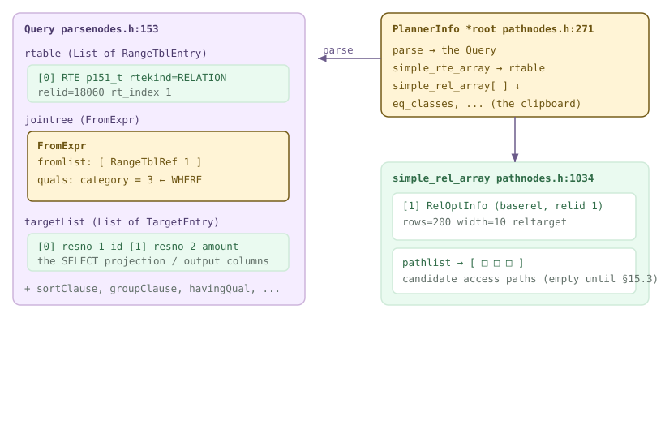
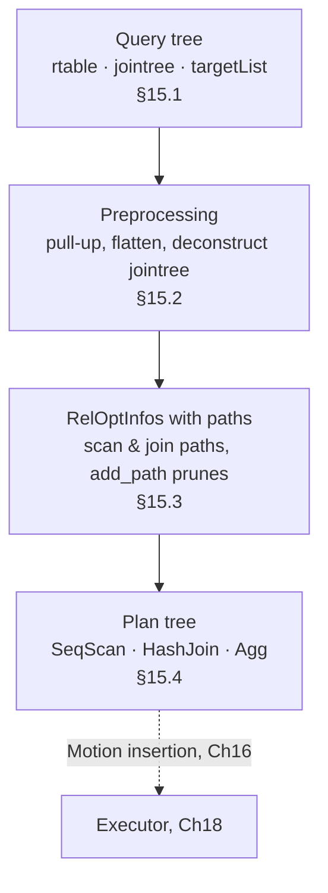
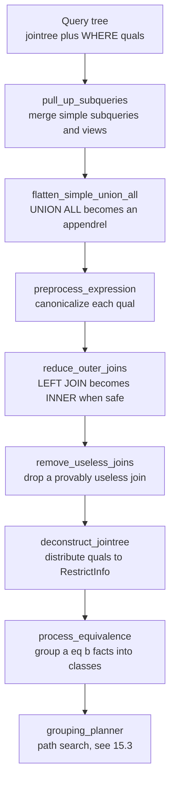
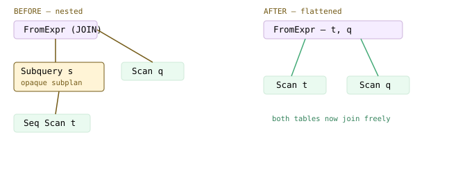
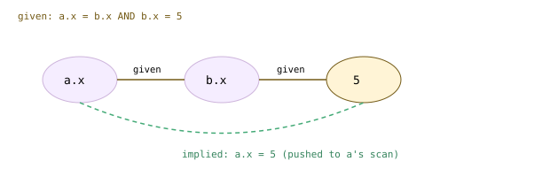
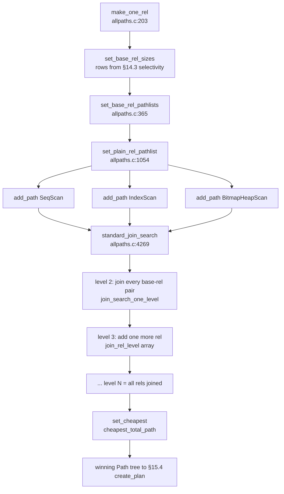
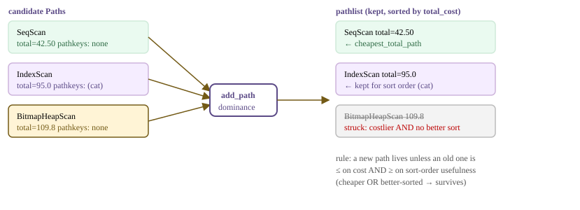
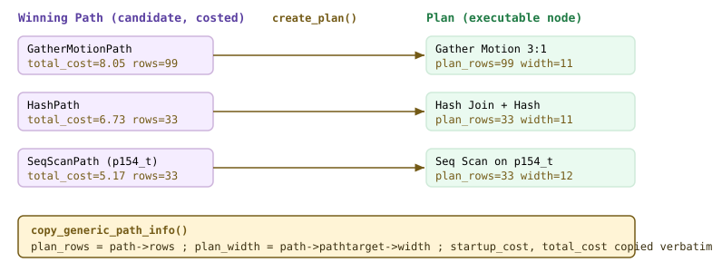
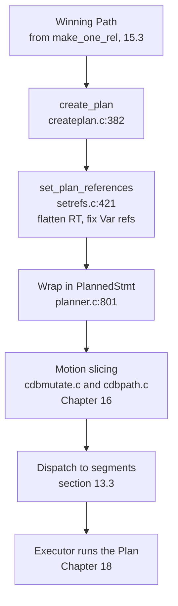

<!--
  Licensed to the Apache Software Foundation (ASF) under one
  or more contributor license agreements.  See the NOTICE file
  distributed with this work for additional information
  regarding copyright ownership.  The ASF licenses this file
  to you under the Apache License, Version 2.0 (the
  "License"); you may not use this file except in compliance
  with the License.  You may obtain a copy of the License at

    http://www.apache.org/licenses/LICENSE-2.0

  Unless required by applicable law or agreed to in writing,
  software distributed under the License is distributed on an
  "AS IS" BASIS, WITHOUT WARRANTIES OR CONDITIONS OF ANY
  KIND, either express or implied.  See the License for the
  specific language governing permissions and limitations
  under the License.
-->

<a id="15-the-postgres-planner"></a>

## 15.1 查询树结构 {#151-query-tree-structure}

[§13.1](/cloudberry/core-internals/part-4-query-processing/ch13/#131-the-simple-query-protocol) 沿着解析 → 重写 → 规划的路径追踪一条语句，并在规划器入口交给我们一个节点：**`Query`**。基于代价的规划器从这里开始工作。规划器作出的每一项决定——扫描哪个关系、按什么顺序连接、使用排序还是哈希——都是把这棵树变换成另一棵 **`Plan`** 树的过程。本节先展开 `Query`，再介绍规划器在决策过程中使用的两个工作结构：**`PlannerInfo`**（通常称为 `root`），以及挂在它下面、每个关系各有一个的 **`RelOptInfo`**。

Cloudberry 的默认优化器是 ORCA（第 [17](/cloudberry/core-internals/part-4-query-processing/ch17/) 章），因此，要使用本节介绍的 PostgreSQL 规划器，必须先执行 `SET optimizer=off`，本章所有演示都这样做。设置该 GUC 后，`planner()` 会跳过 ORCA 钩子，调用 `standard_planner()`（`src/backend/optimizer/plan/planner.c`），后者将实际工作交给 `subquery_planner()`（`planner.c`）和 `grouping_planner()`（`planner.c`）。



*Query 的结构，以及规划器据此构建的工作状态。左侧的 Query 携带三个主要列表；规划器分配一个 PlannerInfo（root），并按范围表位置为每个关系分配一个 RelOptInfo。每个 RelOptInfo 的 pathlist 起初为空，将在 [§15.3](#153-path-cost--add_path) 中填充。*



*本章的整体流程。每个方框对应一节：Query 进入，Plan 输出。随后，Cloudberry 在这个 Plan 上插入 Motion 节点（第 [16](/cloudberry/core-internals/part-4-query-processing/ch16/) 章），再交给执行器运行（第 [18](/cloudberry/core-internals/part-4-query-processing/ch18/) 章）。*

### 15.1.1 Query 节点 {#1511-the-query-node}

`Query`（`src/include/nodes/parsenodes.h`）是个庞大的结构体，但对规划器而言，几乎所有含义都集中在三个列表中。可以把它们连成一句话来理解：*从这些关系中，保留这些行，生成这些列。*

```c {title="src/include/nodes/parsenodes.h — Query"}
List      *rtable;     /* list of range table entries    */
FromExpr  *jointree;   /* table join tree (FROM and WHERE) */
List      *targetList; /* target list (of TargetEntry)   */
/* ... */
List      *groupClause; /* a list of SortGroupClause's   */
List      *sortClause;  /* a list of SortGroupClause's   */
```

- **`rtable`**——**范围表**：一个由 `RangeTblEntry`（`parsenodes.h`）组成的 `List`，查询中可引用的每个关系、子查询、函数或 CTE 各占一项。其他所有位置都通过关系在**此列表中从 1 开始的位置**（*范围表索引*）引用它，而不使用名称；因此，`rtable` 就是查询私有的符号表。
- **`jointree`**——一个 `FromExpr`（`src/include/nodes/primnodes.h`），记录 `FROM` 的结构和剩余的 `WHERE` 条件。它的 `fromlist` 保存参与连接的各项，`quals` 保存过滤／连接条件。
- **`targetList`**——一个由 `TargetEntry`（`primnodes.h`）组成的 `List`，表示输出列。每一项将表达式与一个 `resno`（输出位置）和一个可选的 `resname` 配对（`primnodes.h` — `TargetEntry`）。这*就是* `EXPLAIN VERBOSE` 输出中 **Output** 的内容。
- **`groupClause` / `sortClause` / `havingQual`**——决定上层计划结构的分组、排序和 HAVING。`grouping_planner()` 在选定扫描／连接路径后查询这些字段。

`jointree` 是最容易被低估的部分。`FromExpr` 被刻意设计得很小：

```c {title="src/include/nodes/primnodes.h"}
typedef struct FromExpr
{
    NodeTag  type;
    List    *fromlist;  /* List of join subtrees */
    Node    *quals;     /* qualifiers on join, if any */
} FromExpr;
```

对于普通的单表查询，`fromlist` 中只有一个指回 `rtable` 的 `RangeTblRef`，`quals` 则是 `WHERE` 表达式。后续的预处理（[§15.2](#152-preprocessing)）会*解构*这棵树，将每个限定条件下推到它所能限制的最小关系。

*对带过滤条件的投影执行 EXPLAIN VERBOSE，并设置 optimizer=off，由 Postgres 规划器生成计划。将计划对应回 Query：Output 列表是 targetList，扫描的关系是 rtable 条目，Filter 是 jointree.quals。*

```sql
SET optimizer=off;
EXPLAIN (VERBOSE, COSTS ON)
  SELECT id, amount FROM p151_t WHERE category = 3;
```

```text {hl_lines="4" title="output"}
                            QUERY PLAN
------------------------------------------------------------------------
 Gather Motion 3:1  (slice1; segments: 3)  (cost=0.00..7.83 rows=200 ...)
   Output: id, amount
   ->  Seq Scan on public.p151_t  (cost=0.00..5.17 rows=67 width=10)
         Output: id, amount
         Filter: (p151_t.category = 3)
 Settings: optimizer = 'off'
 Optimizer: Postgres query optimizer
```

计划中的三行与 `Query` 一一对应。**Output** 就是 `targetList`。**Seq Scan on p151_t** 对应唯一的 `rtable` 条目。**Filter: (category = 3)** 对应 `jointree.quals`。顶层的 `Gather Motion` 是 Cloudberry 在收集三个 Segment 的结果；规划器在 Motion 插入阶段添加了它（第 [16](/cloudberry/core-internals/part-4-query-processing/ch16/) 章），其下的所有内容都由核心规划器生成。

> [!NOTE]
> 末尾的 **Optimizer: Postgres query optimizer** 证明 `optimizer=off` 已生效，当前看到的正是本章描述的规划器。如果没有该设置，看到的会是 **GPORCA**，计划的构建方式也会不同。

### 15.1.2 查看原始树 {#1512-peeking-at-the-raw-tree}

`EXPLAIN` 展示的是*最终*计划。要查看规划器实际收到的 `Query`，可以让后端打印节点树。`debug_print_parse` 输出解析／分析树；`debug_pretty_print` 为其添加缩进；将 `client_min_messages` 调整到能够显示 DEBUG 消息的级别。输出非常庞大，因此下面只保留一个大幅裁剪后的片段，恰好展示前述三个列表。

*SELECT id, amount FROM p151_t WHERE category = 3 的内部 &#123;QUERY ...&#125; 节点树片段。注意其结构：rtable 是只有一个 RTE 的列表，jointree 是 FROMEXPR，其 quals 为 OPEXPR（'=' 运算符），targetList 则是两个 TARGETENTRY 节点。*

```sql
SET debug_print_parse=on;
SET debug_pretty_print=on;
SET client_min_messages=debug1;
SELECT id, amount FROM p151_t WHERE category = 3;
```

```text {title="output"}
:rtable (
   {RTE :eref {ALIAS :aliasname p151_t ...}
    :rtekind 0 :relid 18060 :relkind r }
)
:jointree
   {FROMEXPR
    :fromlist ( {RANGETBLREF :rtindex 1} )
    :quals
       {OPEXPR :opno 96          -- int4eq  ("=")
        :args ( {VAR :varno 1 :varattno 2 ...}   -- category
                {CONST :consttype 23 :constvalue 3 } ) } }
:targetList (
   {TARGETENTRY :resno 1 :resname id     :expr {VAR :varattno 1}}
   {TARGETENTRY :resno 2 :resname amount :expr {VAR :varattno 3}}
)
```

`RANGETBLREF :rtindex 1` 和 `VAR :varno 1` 展示了范围表索引的实际用途：二者都表示 *rtable 中的第 1 个关系*，即 `p151_t`。限定条件中的 `:varattno 2` 是第 2 列（`category`）；`OPEXPR` 是 `=` 运算符（`:opno 96`、`int4eq`）。这正是前图描绘的结构。

> [!NOTE]
> 查看完毕后，请重置这些 GUC：`SET debug_print_parse=off; SET debug_pretty_print=off; RESET client_min_messages;`。否则，会话中后续的每条语句都会让节点转储信息刷满终端。

### 15.1.3 PlannerInfo：规划器的工作记录板 {#1513-plannerinfo--the-clipboard-the-planner-writes-on}

规划器从不就地修改 `Query`，而是分配一个 **`PlannerInfo`**，惯例上将变量命名为 `root`，并将每项中间决策关联到它。可以把 `root` 看作整个规划器共用的工作记录板：从预处理到路径搜索，再到计划创建，这一个对象贯穿所有函数。

```c {title="src/include/nodes/pathnodes.h — PlannerInfo"}
struct PlannerInfo
{
    NodeTag        type;
    Query         *parse;              /* the Query being planned */
    PlannerGlobal *glob;
    /* indexed by rangetable index (entry 0 wasted): */
    struct RelOptInfo **simple_rel_array;
    RangeTblEntry     **simple_rte_array;
    /* ... */
    List          *eq_classes;         /* active EquivalenceClasses */
};
```

`parse`（`pathnodes.h` — `PlannerInfo`）指回 `Query`。两个并列数组承担主要工作：`simple_rte_array`（`pathnodes.h` — `PlannerInfo`）只是将 `rtable` 展平，方便按索引快速访问；`simple_rel_array`（`pathnodes.h` — `PlannerInfo`）则为每个关系保存一个 `RelOptInfo`。二者都**以范围表索引为下标**，有意空置条目 `[0]`，让索引 1 对应第一个关系，这与刚才看到的 `:rtindex 1` 和 `:varno 1` 一致。`eq_classes`（`pathnodes.h` — `PlannerInfo`）积累等价类，用于推导隐含等式和确定连接顺序（[§15.2](#152-preprocessing)）。

### 15.1.4 RelOptInfo：每个关系一个 {#1514-reloptinfo--one-per-relation}

查询每访问一个关系，规划器就为其构建一个 **`RelOptInfo`**（`src/include/nodes/pathnodes.h`）。每个基本关系各有一个，后续每个中间连接结果也各有一个。估算值和候选计划都汇集于此。

```c {title="src/include/nodes/pathnodes.h — RelOptInfo"}
typedef struct RelOptInfo
{
    NodeTag      type;
    RelOptKind   reloptkind;
    Relids       relids;      /* rangetable indexes in this rel */
    Cardinality  rows;        /* estimated result tuples */
    struct PathTarget *reltarget;   /* columns + width */
    List        *pathlist;    /* Path structures  <-- the candidates */
    struct Path *cheapest_total_path;
    Index        relid;       /* base-rel rangetable index */
    /* ... */
} RelOptInfo;
```

`rows`（`pathnodes.h`）是估算基数，根据 [§14.1](/cloudberry/core-internals/part-4-query-processing/ch14/#141-basic-statistics)–14.3 的统计信息计算；行宽保存在 `reltarget->width`（`pathnodes.h` — `PathTarget`）中。使该结构成为规划器*重心*的字段是 **`pathlist`**（`pathnodes.h` — `RelOptInfo`）：该关系候选访问 `Path` 的列表。[§15.3](#153-path-cost--add_path) 会填充这个列表（顺序扫描、索引扫描等），通过 `add_path()` 剪去被其他路径支配的路径，并将胜出的路径记录在 `cheapest_total_path` 中。对于基本关系，`relid`（`pathnodes.h` — `RelOptInfo`）就是范围表索引，因此 `root->simple_rel_array[relid]` 和 `root->simple_rte_array[relid]` 是同一关系的两种视角。

*optimizer=off 下的双表连接。两个 rtable 条目对应两个基本关系 RelOptInfo；规划器还构建了一个连接 RelOptInfo，其最便宜路径是 Hash Join。每个节点都会打印其 RelOptInfo 估算的 rows/width。（Broadcast Motion 是 Cloudberry 对小表进行重分布，见第 [16](/cloudberry/core-internals/part-4-query-processing/ch16/) 章。）*

```sql
SET optimizer=off;
EXPLAIN (VERBOSE, COSTS ON)
  SELECT t.id, d.cname FROM p151_t t
  JOIN p151_d d ON t.category = d.category
  WHERE t.amount > 1000;
```

```text {hl_lines="3" title="output"}
 Gather Motion 3:1 (slice1; segments: 3)  (cost=1.15..12.19 rows=333 ...)
   Output: t.id, d.cname
   ->  Hash Join  (cost=1.15..7.75 rows=111 width=9)
         Hash Cond: (t.category = d.category)
         ->  Seq Scan on p151_t t  (cost=0.00..5.17 rows=111 width=8)
               Filter: (t.amount > '1000'::numeric)
         ->  Hash  (cost=1.08..1.08 rows=5 width=9)
               ->  Broadcast Motion 3:3 (slice2; ...)
                     ->  Seq Scan on p151_d d  (rows=2 width=9)
```

这里的 `rtable` 有两个条目（`t`、`d`），因此 `simple_rel_array` 获得两个基本关系 `RelOptInfo`。规划器随后构建覆盖 `relids = {1,2}` 的*连接* `RelOptInfo`，在其 `pathlist` 中填入嵌套循环／哈希／归并连接候选路径，再由 `add_path()` 保留代价最低的 **Hash Join**。[§15.3](#153-path-cost--add_path) 将介绍这套连接关系机制。

### 15.1.5 本章结构 {#1515-the-shape-of-the-chapter}

有了这些术语，本章其余内容就是一次连续的变换。`Query` 的三个列表先经过**预处理**（[§15.2](#152-preprocessing)）：上拉子查询，解构 `jointree`，将限定条件分配给关系，形成等价类。然后，**路径生成与代价估算**（[§15.3](#153-path-cost--add_path)）填充每个 `RelOptInfo.pathlist`，并搜索连接顺序，由 `add_path()` 持续剪枝。最后，**计划创建**（[§15.4](#154-plan-generation)）遍历胜出的 `Path` 树，生成包裹在 `PlannedStmt` 中的 `Plan` 树。

> [!NOTE]
> 在 Cloudberry 中，`PlannedStmt` 还不是终点：还需插入 Motion 节点，在 Segment 之间移动元组（即上面看到的 **Gather** 和 **Broadcast**），这是**第 [16](/cloudberry/core-internals/part-4-query-processing/ch16/) 章**的内容；之后才进行派发（[§13.3](/cloudberry/core-internals/part-4-query-processing/ch13/#133-dispatch-from-coordinator-plan-to-segment-execution)），并由执行器运行（**第 [18](/cloudberry/core-internals/part-4-query-processing/ch18/) 章**）。本章仅讨论 Cloudberry 继承自 PostgreSQL 的单节点核心规划器。

## 15.2 预处理 {#152-preprocessing}

[§13.1](/cloudberry/core-internals/part-4-query-processing/ch13/#131-the-simple-query-protocol) 将规划阶段画成了一个方框：`planner()` → `standard_planner()`。本节展开这个方框的*前半部分*。在搜索低代价路径之前，规划器必须先将查询树整理成适合搜索分析的形态。这种重写就是**预处理**，位于 `src/backend/optimizer/plan/planner.c` 的 `subquery_planner()` 顶部。这个函数为每个查询或子查询承担主要工作，运行下面的变换，然后将展平后的树交给 `grouping_planner` 搜索路径（[§15.3](#153-path-cost--add_path)）。

目标是一棵*规范化、展平*的树：将不透明的子查询合并到父查询中，让其中的表可以自由连接；将 UNION ALL 变为扁平的追加操作；在可以证明等价时，将外连接弱化为内连接；将每个 `WHERE`/`ON` 子句拆开，下推到能够求值的最底层关系。每项变换都是为了*扩大后续路径搜索的空间*：困在子查询中的表只能作为整体扫描，而上拉到父查询连接树中的表则可以按任意顺序连接。



*预处理流水线。subquery_planner 自顶向下重写树；紧接着，query_planner 调用 deconstruct_jointree 时执行限定条件分配与等价类构建步骤。*



*连接树中的上拉。变换前：q 必须连接一个不透明的 Subquery 节点，对 t 的扫描封闭在其中。变换后：t 和 q 并列于同一个 FromExpr 之下，可以按任意顺序连接。*

> [!NOTE]
> 本章每个计划都使用 **PostgreSQL** 的代价规划器；Cloudberry 仅在 `optimizer=off` 时才使用它（默认为 ORCA，见第 [17](/cloudberry/core-internals/part-4-query-processing/ch17/) 章）。下面所有演示都先执行 `SET optimizer=off`；计划末尾的 `Optimizer: Postgres query optimizer` 可确认这一点。

### 15.2.1 子查询上拉 {#1521-subquery-pull-up}

`FROM (SELECT ...) s` 子查询，或重写后与之等价的简单视图，最初各自对应一个 `RTE_SUBQUERY` 范围表条目。如果不加处理，它会成为自成一体的子计划，外层查询只能将其输出视为黑盒。`pull_up_subqueries()`（`src/backend/optimizer/prep/prepjointree.c`，从 `planner.c` — `subquery_planner()` 调用）遍历连接树，对每个*足够简单*的子查询，将其表和限定条件直接拼入父查询。

```c {title="src/backend/optimizer/prep/prepjointree.c — pull_up_subqueries_recurse()"}
if (rte->rtekind == RTE_SUBQUERY &&
    !rte->forceDistRandom &&
    is_simple_subquery(root, rte->subquery, rte, lowest_outer_join) &&
    (containing_appendrel == NULL ||
     is_safe_append_member(rte->subquery)))
    return pull_up_simple_subquery(root, jtnode, rte,
                                   lowest_outer_join,
                                   containing_appendrel);
```

子查询上拉后，它的基本表进入父查询的连接树，它的 `WHERE` 也合并到父查询的限定条件中。于是，路径搜索看到的是一个展平的连接问题。下方计划中的派生表 `s` 已完全消失，`p152_t` 和 `q` 直接连接，中间没有 SubPlan 或 Subquery Scan 节点。

*可以上拉的子查询：上拉之后，各表直接连接，没有 SubPlan。*

```sql
SET optimizer=off;
EXPLAIN (COSTS OFF)
SELECT * FROM (SELECT id, x FROM p152_t WHERE x > 5) s
  JOIN p152_q q ON s.id = q.id;
```

```text {hl_lines="3" title="output"}
 Gather Motion 3:1  (slice1; segments: 3)
   ->  Hash Join
         Hash Cond: (q.id = p152_t.id)
         ->  Seq Scan on p152_q q
         ->  Hash
               ->  Seq Scan on p152_t
                     Filter: (x > 5)
 Optimizer: Postgres query optimizer
```

并非每个子查询都能安全合并。`is_simple_subquery()`（`prepjointree.c`）会拒绝内联后无法保持语义的情形：分组、聚合、`DISTINCT`、窗口函数、排序、`LIMIT` 或集合操作。例如，向上合并 `LIMIT 100` 会改变保留下来的*具体* 100 行，因此会阻止上拉。

```c {title="src/backend/optimizer/prep/prepjointree.c — is_simple_subquery()"}
if (subquery->hasAggs ||
    subquery->hasWindowFuncs ||
    subquery->hasTargetSRFs ||
    subquery->groupClause ||
    subquery->distinctClause ||
    subquery->limitOffset ||
    subquery->limitCount || ...)
    return false;
```

*同一查询加上 LIMIT 后便无法上拉：子查询仍是独立、不透明的子树，位于自己的切片中。*

```sql
SET optimizer=off;
EXPLAIN (COSTS OFF)
SELECT * FROM (SELECT id, x FROM p152_t WHERE x > 5 LIMIT 100) s
  JOIN p152_q q ON s.id = q.id;
```

```text {hl_lines="7" title="output"}
 Gather Motion 3:1  (slice1; segments: 3)
   ->  Hash Join
         Hash Cond: (q.id = p152_t.id)
         ->  Seq Scan on p152_q q
         ->  Hash
               ->  Redistribute Motion 1:3  (slice2; segments: 1)
                     ->  Limit
                           ->  Gather Motion 3:1  (slice3; segments: 3)
                                 ->  Limit
                                       ->  Seq Scan on p152_t
                                             Filter: (x > 5)
 Optimizer: Postgres query optimizer
```

### 15.2.2 UNION ALL 展平与外连接简化 {#1522-union-all-flattening-and-outer-join-reduction}

另外两种重写会弱化原本约束搜索的结构。`flatten_simple_union_all()`（从 `planner.c` — `subquery_planner()` 调用）通过 `prepjointree.c` 中的 `pull_up_simple_union_all()`，将普通 `UNION ALL` 转换为**追加关系**。这样，各分支便成为同一个 appendrel 的子关系，而不是不透明的集合操作子计划，规划器因而可以独立估算各分支的代价并进行并行化。

`reduce_outer_joins()`（`prepjointree.c`，从 `planner.c` — `subquery_planner()` 调用）是价值更高的变换。外连接会限制连接顺序，并要求生成以空值补齐的行；内连接代价更低，重排顺序也更自由。关键在于：如果连接上方的一个**严格**限定条件要求连接*可空*一侧的某列非空，那么外连接生成的以空值补齐的行绝不可能通过此条件，因此可以把外连接降为内连接。

```c {title="src/backend/optimizer/prep/prepjointree.c — reduce_outer_joins()"}
/* SELECT ... FROM a LEFT JOIN b ON (...) WHERE b.y = 42;
 * we can reduce the LEFT JOIN to a plain JOIN if the "=" operator
 * in WHERE is strict.  The strict operator will always return NULL,
 * causing the outer WHERE to fail, on any row where the LEFT JOIN
 * filled in NULLs for b's columns. */
```

*LEFT JOIN 的可空一侧带有严格 WHERE 条件时，可简化为普通内连接；计划显示的是 Hash Join，而不是 Left Join。*

```sql
SET optimizer=off;
EXPLAIN (COSTS OFF)
SELECT t.id FROM p152_t t
  LEFT JOIN p152_q q ON t.id = q.id
  WHERE q.x = 3;
```

```text {hl_lines="2" title="output"}
 Gather Motion 3:1  (slice1; segments: 3)
   ->  Hash Join
         Hash Cond: (t.id = q.id)
         ->  Seq Scan on p152_t t
         ->  Hash
               ->  Seq Scan on p152_q q
                     Filter: (q.x = 3)
 Optimizer: Postgres query optimizer
```

另一个相关步骤更进一步，会彻底移除连接。当 LEFT JOIN 的内侧在连接上方*未被引用*，且一个*唯一键*保证它不会使行数倍增时，`remove_useless_joins()`（`src/backend/optimizer/plan/analyzejoins.c`）就会删除该连接（由 `analyzejoins.c` 中的 `join_is_removable()` 检查）。这里，`p152_u.id` 是主键，而且没有选择 `u` 中的任何列，因此连接退化为仅扫描 `t`。

*右侧未被引用，且连接列上存在唯一键：LEFT JOIN 被直接移除。*

```sql
SET optimizer=off;
EXPLAIN (COSTS OFF)
SELECT t.id, t.val FROM p152_t t
  LEFT JOIN p152_u u ON t.id = u.id;
```

```text {hl_lines="2" title="output"}
 Gather Motion 3:1  (slice1; segments: 3)
   ->  Seq Scan on p152_t t
 Optimizer: Postgres query optimizer
```

### 15.2.3 deconstruct_jointree：分配限定条件 {#1523-deconstruct_jointree--distributing-the-quals}

树展平后，`deconstruct_jointree()`（`src/backend/optimizer/plan/initsplan.c`，由 `planmain.c` 中的 `query_planner` 调用）遍历连接树，将每个限定条件交给合法求值位置中的*最底层*。每个子句都包裹在 `RestrictInfo` 中，并归到关系上：只涉及一个关系的子句成为该关系的扫描过滤条件；涉及两个关系的子句成为二者的连接条件。正是这种拆分，让 `WHERE` 谓词可以下推到扫描。

```c {title="src/backend/optimizer/plan/initsplan.c — deconstruct_jointree()"}
* deconstruct_jointree
*    Recursively scan the query's join tree for WHERE and JOIN/ON qual
*    clauses, and add these to the appropriate restrictinfo and joininfo
*    lists belonging to base RelOptInfos.
```

- **单关系限定条件**——引用一个关系 → 以 `RestrictInfo` 的形式存入该关系的 `baserestrictinfo`，在扫描期间应用（对应 Filter 行）。
- **连接限定条件**——引用两个或更多关系 → 存入这些关系的 `joininfo`，仅在连接这些关系时应用（对应 Hash/Join Cond 行）。

*deconstruct_jointree 的实际作用：连接谓词变为 Hash Cond，每个单表谓词则下推为其所属关系扫描上的 Filter。*

```sql
SET optimizer=off;
EXPLAIN (COSTS OFF)
SELECT * FROM p152_t t JOIN p152_q q ON t.id = q.id
  WHERE t.val LIKE 'v1%' AND q.note LIKE 'n2%';
```

```text {hl_lines="5" title="output"}
 Gather Motion 3:1  (slice1; segments: 3)
   ->  Hash Join
         Hash Cond: (t.id = q.id)
         ->  Seq Scan on p152_t t
               Filter: (val ~~ 'v1%'::text)
         ->  Hash
               ->  Seq Scan on p152_q q
                     Filter: (note ~~ 'n2%'::text)
 Optimizer: Postgres query optimizer
```

实际归类由 `distribute_qual_to_rels()`（`initsplan.c`）完成。它还会判断限定条件是否是值得送入等价类机制的*可用于归并连接的等式*，这就是下一小节的主题。

### 15.2.4 等价类与隐含等式 {#1524-equivalence-classes-and-implied-equalities}

当 `distribute_qual_to_rels()` 遇到可用于归并连接的 `a = b` 子句时，会将它交给 `process_equivalence()`（`src/backend/optimizer/path/equivclass.c`）。规划器不会将 `a = b` 存为一个不透明的谓词，而是记录 `a` 和 `b` 属于同一个 **EquivalenceClass**，即一组已知彼此相等的表达式。将 `a = b` 和 `b = c` 串入同一等价类后，规划器就能推导出*隐含*等式 `a = c`；更关键的是，若已知任意成员等于某个常量，就能把这个常量约束下推到*每个*成员。



*等价类的扇形展开。两个显式等式合并为一个等价类；每条虚线边都代表一个隐含等式，规划器可以将其用作额外的连接或过滤条件。*

```c {title="src/backend/optimizer/path/equivclass.c — process_equivalence()"}
* qualification, so its two sides can be considered equal
* anywhere they are both computable; moreover that equality can be
* extended transitively.  Record this knowledge in the
* EquivalenceClass data structure, if applicable.
```

*等价类的实际作用：a.x = b.x 加上 b.x = 5，推导出隐含的 a.x = 5，并将其作为 Filter 下推到 a 自身的扫描中；查询并未显式写出这个过滤条件。*

```sql
SET optimizer=off;
EXPLAIN (COSTS OFF)
SELECT * FROM p152_t a JOIN p152_q b ON a.x = b.x
  WHERE b.x = 5;
```

```text {hl_lines="4" title="output"}
 Gather Motion 3:1  (slice1; segments: 3)
   ->  Nested Loop
         ->  Seq Scan on p152_t a
               Filter: (x = 5)
         ->  Materialize
               ->  Broadcast Motion 3:3  (slice2; segments: 3)
                     ->  Seq Scan on p152_q b
                           Filter: (x = 5)
 Optimizer: Postgres query optimizer
```

尽管查询只写了 `b.x = 5`，现在两次扫描都带有 `Filter: (x = 5)`；`generate_base_implied_equalities()`（`equivclass.c`）从等价类中生成了其余条件。这直接有利于路径搜索：在连接前先将 `a` 限制为 `x = 5`，会减少其估算行数（[§14.3](/cloudberry/core-internals/part-4-query-processing/ch14/#143-selectivity-estimation)）；而且，由于常量可以传播到*任意*成员，现在任一列上的索引都可以使用。最终展平后的树，连同分配好的 `RestrictInfo` 和等价类，就是 [§15.3](#153-path-cost--add_path) 路径搜索的输入。

## 15.3 路径、代价与 add_path {#153-path-cost--add_path}

预处理（[§15.2](#152-preprocessing)）为规划器留下了整理好的 `Query`，以及每个基本关系的一个 `RelOptInfo`。接下来，就是*基于代价*的优化器得名的部分：针对每个关系，规划器枚举读取其行的具体方式——顺序扫描、索引扫描、位图扫描——估算各自的代价，淘汰较差者。然后对连接重复这一过程：以每种可行顺序，使用嵌套循环、哈希和归并连接，将保留下来的扫描路径组合起来。每个候选方案都是一个 **`Path`**；它的价格就是**代价**；决定谁能留下的裁判是 **`add_path()`**。这就是 Cloudberry 在 `optimizer=off` 时运行的 Postgres 规划器的核心。

驱动函数是 `make_one_rel()`（`src/backend/optimizer/path/allpaths.c`）：估算基本关系的大小，构建扫描路径，然后自底向上搜索连接顺序。输出是最终的一个 `RelOptInfo`，其 `cheapest_total_path` 就是胜出的计划雏形，交给 [§15.4](#154-plan-generation) 将其具体化。



*路径搜索流水线：make_one_rel 驱动各基本关系的扫描路径构建，随后自底向上以动态规划搜索连接；set_cheapest 从保留的路径中选出胜者。*

上图中每条进入 `RelOptInfo` 的箭头都经过 `add_path()`。设想某个关系正在收集扫描候选路径：一个便宜但无序的 **SeqScan**，一个较贵但输出*有序*的 **IndexScan**，以及位于两者之间的 **BitmapHeapScan**。如果列表中没有现有路径*支配*新路径，`add_path` 就会保留它；所谓支配，是指代价不高于它，**并且**排序性质至少与它一样好。因此，最便宜的路径总能保留；更昂贵的路径若能提供其他路径没有的排序顺序，也能保留。在两方面都落败的路径则被剔除并释放。



*一个 RelOptInfo 内的 add_path 竞争：三个候选扫描 Path 进入，被支配的路径被淘汰，两个胜出者共存于 pathlist 中；一个代价最低，另一个提供有用的排序顺序。*

这就是一个关系通常保留*多条*路径而不是一条的原因。本节余下部分会逐一解释：`Path` 保存什么，`cost_seqscan()` 如何估价，`add_path()` 中精确的支配判定，以及如何通过动态规划搜索连接，将路径拼成整个查询的计划。下面每个演示都运行 `SET optimizer=off`，以使用这里的 Postgres 代码，而非 ORCA（[§17](/cloudberry/core-internals/part-4-query-processing/ch17/)）。

### 15.3.1 路径：生成关系中各行的候选方式 {#1531-paths--candidate-ways-to-produce-a-rels-rows}

`Path`（`src/include/nodes/pathnodes.h`）是一个轻量节点：它标识扫描／连接方法（`pathtype`），指向其 `parent` `RelOptInfo`，携带搜索所依赖的三个数值——`rows`、`startup_cost`、`total_cost`——以及表示输出排序顺序的 `pathkeys`。它还*不是*计划，而是已经估算代价的提案。路径的创建成本足够低，规划器才能枚举成千上万个这样的对象。

```c {title="src/include/nodes/pathnodes.h — Path"}
/* estimated size/costs for path (see costsize.c for more info) */
Cardinality rows;        /* estimated number of result tuples */
Cost        startup_cost;/* cost expended before fetching any tuples */
Cost        total_cost;  /* total cost (assuming all tuples fetched) */
...
List       *pathkeys;    /* sort ordering of path's output */
```

普通表的扫描路径在 `set_plain_rel_pathlist()`（`src/backend/optimizer/path/allpaths.c`）中构建：它始终提供顺序扫描，然后在有适用索引时，让 `create_index_paths()` 添加索引扫描和位图扫描。每条路径都会直接交给 `add_path`。

```c {title="src/backend/optimizer/path/allpaths.c — set_plain_rel_pathlist()"}
/* Consider sequential scan */
add_path(rel, create_seqscan_path(root, rel, required_outer, 0), root);
...
/* Consider index and bitmap scans */
create_index_paths(root, rel);
create_tidscan_paths(root, rel);
```

- **扫描路径**——`SeqScan`（读取每一页）、`IndexScan`（遍历索引，按索引键顺序输出）、`BitmapHeapScan`（索引 → 页位图 → 对堆扫描一遍）。在 `allpaths.c` 中为每个基本关系构建。
- **连接路径**——`NestLoop`、`HashJoin`、`MergeJoin`，由 `add_paths_to_joinrel()`（`joinpath.c`）为每对子关系添加。
- **pathkeys**——路径无需额外开销即可提供的排序顺序。即使存在更便宜的无序路径，带有有用 `pathkeys` 的路径也能保留，因为后续的 `MergeJoin` 或 `ORDER BY` 可能需要这个顺序。

### 15.3.2 代价模型 {#1532-the-cost-model}

代价是抽象单位，而不是秒。其单位是*一次顺序页读取*（`seq_page_cost = 1.0`）。其他一切都相对于它定价：随机读取一页的代价为 `4.0`，通过执行器处理一个元组的代价为 `cpu_tuple_cost = 0.01`。这些默认值位于 `src/backend/optimizer/path/cost.h:26`。

*决定每条路径代价的三个常量（会话默认值；optimizer=off 使用 Postgres 规划器）。*

```sql
SHOW seq_page_cost;
SHOW cpu_tuple_cost;
SHOW random_page_cost;
```

```text {title="output"}
 seq_page_cost
---------------
 1
 cpu_tuple_cost
----------------
 0.01
 random_page_cost
------------------
 4
```

`cost_seqscan()`（`src/backend/optimizer/path/costsize.c`）展现了代价模型最简单的形式：将关系的每一页读取一次（磁盘代价），并让每个元组经过 CPU 处理（CPU 代价）。产生第一行之前不需要启动工作，因此 `startup_cost` 保持接近零，扫描可以立即开始流式输出。

```c {title="src/backend/optimizer/path/costsize.c — cost_seqscan()"}
disk_run_cost = spc_seq_page_cost * baserel->pages;
...
cpu_per_tuple = cpu_tuple_cost + qpqual_cost.per_tuple;
cpu_run_cost  = cpu_per_tuple * baserel->tuples;
...
path->startup_cost = startup_cost;                       /* ~0 */
path->total_cost   = startup_cost + cpu_run_cost + disk_run_cost;
```

传入的 `rows` 和 `pages` 正是 [§14.1](/cloudberry/core-internals/part-4-query-processing/ch14/#141-basic-statistics)–[§14.3](/cloudberry/core-internals/part-4-query-processing/ch14/#143-selectivity-estimation) 中的大小估算值：`baserel->tuples`/`baserel->pages` 来自 `pg_class`，在 Cloudberry 中缩放为*每个 Segment* 的数值。因此，可以手工推算代价，再与 `EXPLAIN` 对照。

*手工推导 Seq Scan 代价。pg_class 保存整张表的数值；规划器将其缩放到单个 Segment（共 3 个主 Segment），因此每个 Segment 上的 Seq Scan 节点读取 5 页、3000 行。*

```sql
SET optimizer=off;
SELECT relpages, reltuples FROM pg_class WHERE relname='p153_t';
EXPLAIN SELECT * FROM p153_t;
```

```text {hl_lines="6" title="output"}
 relpages | reltuples
----------+-----------
       14 |      9000

 Gather Motion 3:1 (slice1; segments: 3) (cost=0.00..155.00 rows=9000 width=15)
   ->  Seq Scan on p153_t  (cost=0.00..35.00 rows=3000 width=15)
```

整张表有 14 页、9000 行。分布到 3 个 Segment 后，*每个*约有 5 页、3000 行；各 Segment 并行扫描，所以 `Seq Scan` 节点显示的是**每个 Segment** 的数值。代入 `cost_seqscan`：`disk = 5 × 1.0 = 5`，`cpu = 3000 × 0.01 = 30`，总计 `= 35.00`。结果与节点完全一致。（上方的 `Gather Motion` 再加上将行发送给 Coordinator 的代价，这种重分布的代价估算见 [§16](/cloudberry/core-internals/part-4-query-processing/ch16/)。）

> [!NOTE]
> **启动代价与总代价。** Seq Scan 的 `startup_cost=0.00` 表示产生第一行的代价基本为零；`total_cost=35.00` 则假定完整读完扫描结果。在 `LIMIT` 场景（只获取少量行，规划器便尽量降低*启动代价*）以及嵌套循环的内侧（每个外侧行都要重新扫描）中，这一区别至关重要。相比之下，Sort 或 Hash 必须读取全部输入后才能输出一行，因此启动代价较高；`add_path` 正因如此才同时跟踪两个数值。

### 15.3.3 add_path：剪枝的核心 {#1533-add_path--the-pruning-heart}

每个候选路径都会调用一次 `add_path()`（`src/backend/optimizer/util/pathnode.c`）。它遍历一遍现有 `pathlist`，决定新路径是否保留，以及淘汰哪些已有路径。列表按 `total_cost` 排序，先比较代价低的路径，因此可以快速拒绝较差路径。

比较采用*模糊*容差：若较大代价不超过较小代价的 `STD_FUZZ_FACTOR` 倍，就视为相等；该系数为 1.01（`pathnode.c`，即允许 1% 的差异），以避免舍入导致不同平台选择不同计划。只有某条现有路径在**所有**维度上都不逊于新路径时，新路径才被支配并丢弃；这些维度包括总代价、启动代价、`pathkeys`（排序顺序）、所需外侧关系、`rows` 和并行安全性。如果在这些方面都没有被胜过，新路径就会保留。

```c {title="src/backend/optimizer/util/pathnode.c — add_path()"}
costcmp = compare_path_costs_fuzzily(new_path, old_path, STD_FUZZ_FACTOR);
/* If startup and total costs compare differently, keep BOTH */
if (costcmp != COSTS_DIFFERENT)
{
    keyscmp = compare_pathkeys(new_path_pathkeys, old_path_pathkeys);
    if (keyscmp != PATHKEYS_DIFFERENT) { /* one may dominate the other */ }
    /* different pathkeys => both survive (one may sort for free) */
}
```

两个保留出口 `COSTS_DIFFERENT` 和 `PATHKEYS_DIFFERENT`，正是一个关系保留*一组*路径的原因：具有独特代价权衡的路径（启动代价低与总代价低之间的取舍）可以保留；能提供较便宜路径无法提供的排序顺序的路径也可以保留。强制让次优路径胜出，就能观察这一点。`enable_seqscan=off` 不会移除 SeqScan 路径，而是为其增加 `1.0e10` 的 `disable_cost`（`costsize.c`），于是 `add_path` 保留的*次优*路径便成为胜者。

*让 add_path 的竞争显现出来。对于宽泛谓词，SeqScan 默认占优；禁用它后，保留下来的 BitmapHeapScan 路径胜出，表明二者都曾在 pathlist 中，而且 SeqScan 确实更便宜（42.50 &lt; 109.76）。*

```sql
SET optimizer=off;
EXPLAIN SELECT * FROM p153_t WHERE cat < 40;   -- default

SET enable_seqscan=off;
EXPLAIN SELECT * FROM p153_t WHERE cat < 40;   -- runner-up wins
```

```text {hl_lines="2 6" title="output"}
-- default:
 ->  Seq Scan on p153_t  (cost=0.00..42.50 rows=2400 width=15)
       Filter: (cat < 40)

-- enable_seqscan=off:
 ->  Bitmap Heap Scan on p153_t  (cost=74.76..109.76 rows=2400 width=15)
       Recheck Cond: (cat < 40)
       ->  Bitmap Index Scan on p153_t_cat_idx (cost=0.00..74.16 rows=2400 ...)
```

> [!NOTE]
> `enable_*` GUC 并非硬开关：它们给路径的启动代价加上 `disable_cost = 1e10`，让它在 `add_path` 的代价竞争中落败，而不是将其删除。因此，当某个节点是回答查询的*唯一*方式时，有时仍会看到“已禁用”的节点；其被抬高到天文数字的代价（可见 `10000000...` 前缀）就是标志。

### 15.3.4 连接路径与方法竞争 {#1534-join-paths--method-competition}

基本关系扫描路径建好后，`add_paths_to_joinrel()`（`src/backend/optimizer/path/joinpath.c`）会为组合两个关系的三种方式估价：**NestLoop**（对每个外侧行扫描内侧；启动代价低，适合很小的外侧或内侧有索引的情况）、**HashJoin**（在较小的一侧构建哈希表，用较大的一侧探测；适合大型等值连接，但启动代价高）和 **MergeJoin**（将两个输入按连接键排序，再归并；输入已排序时占优）。每个已估价的变体都经过连接 `RelOptInfo` 上的 `add_path`，因此连接会像扫描一样保留多种方法。

同样可以用 `disable_cost` 展示竞争。默认情况下，哈希连接在双表等值连接中胜出。禁用它后，归并连接——即 `add_path` 一直保留的次优路径——便浮现出来，同时带来两个 Sort 节点和标志性的 `1e10` 代价。

*双表等值连接的方法竞争。HashJoin 按代价胜出；禁用它后，MergeJoin 路径显现出来，注意新增的排序以及 disable_cost 带来的 1e10 前缀。*

```sql
SET optimizer=off;
EXPLAIN SELECT * FROM p153_t t JOIN p153_u u ON t.id = u.id;

SET enable_hashjoin=off;
EXPLAIN SELECT * FROM p153_t t JOIN p153_u u ON t.id = u.id;
```

```text {hl_lines="2 8" title="output"}
-- default:
 ->  Hash Join  (cost=49.00..115.25 rows=2000 width=31)
       Hash Cond: (t.id = u.id)
       ->  Seq Scan on p153_t t   (cost=0.00..35.00 rows=3000 ...)
       ->  Hash  ( ->  Seq Scan on p153_u u  cost=0.00..24.00 ... )

-- enable_hashjoin=off:
 ->  Merge Join  (cost=10000000341.92..10000000368.59 rows=2000 ...)
       Merge Cond: (t.id = u.id)
       ->  Sort (Sort Key: t.id) -> Seq Scan on p153_t t
       ->  Sort (Sort Key: u.id) -> Seq Scan on p153_u u
```

### 15.3.5 连接顺序搜索：动态规划 {#1535-join-order-search--dynamic-programming}

`add_paths_to_joinrel` 为*一对*关系估价。而选择组成*哪些*关系对，以及按什么顺序逐步组合，则由 `standard_join_search()`（`src/backend/optimizer/path/allpaths.c`）负责。这是典型的自底向上动态规划：`join_rel_level[1]` 保存各个基本关系；第 2 层构建所有双表连接；第 3 层将一个双表连接与一个剩余基本关系组合；依此类推，直到顶层的一个关系连接了所有关系。

```c {title="src/backend/optimizer/path/allpaths.c — standard_join_search()"}
root->join_rel_level[1] = initial_rels;
for (lev = 2; lev <= levels_needed; lev++)
{
    /* build every join pair at this level, cost them, add_path each */
    join_search_one_level(root, lev);
    foreach(lc, root->join_rel_level[lev])
        set_cheapest((RelOptInfo *) lfirst(lc));   /* crown survivors */
}
```

`join_search_one_level()`（`src/backend/optimizer/path/joinrels.c`）为每种合法配对调用 `add_paths_to_joinrel`；`set_cheapest()`（`pathnode.c`）则从 `add_path` 保留的路径中，为每个连接关系记录 `cheapest_total_path`。下面观察动态规划如何为三张表选择顺序：规划器先连接两个*最小*的输入（需要哈希和探测的行数最少），再连接第三张表，使每一步的中间结果尽可能小。

*standard_join_search 选择的三表连接顺序。动态规划先将 p153_v（最小，每个 Segment 1000 行）与 p153_t 连接，再连接 p153_u，优先生成最小的中间结果。*

```sql
SET optimizer=off;
EXPLAIN SELECT * FROM p153_t t, p153_u u, p153_v v
        WHERE t.id = u.id AND u.id = v.id;
```

```text {hl_lines="1" title="output"}
 ->  Hash Join  (cost=90.75..128.92 rows=667 width=45)
       Hash Cond: (u.id = t.id)
       ->  Seq Scan on p153_u u  (cost=0.00..24.00 rows=2000 ...)
       ->  Hash
             ->  Hash Join  (cost=24.50..78.25 rows=1000 width=29)
                   Hash Cond: (t.id = v.id)
                   ->  Seq Scan on p153_t t  (cost=0.00..35.00 rows=3000 ...)
                   ->  Hash -> Seq Scan on p153_v v (cost=0.00..12.00 ...)
```

动态规划是精确算法，但搜索空间会爆炸式增长：连接顺序数量按阶乘增长，因此面对大型查询时，动态规划表的开销难以承受。当待连接的关系数达到 `geqo_threshold`（默认 12）时，Postgres 会切换到**遗传查询优化器**（`geqo`），放弃保证最优顺序，转而通过随机搜索找到足够好的顺序。

> [!NOTE]
> 在 Cloudberry 中，完成的 Path 树*还不是*全部：由于行分布在各 Segment 上，规划器还必须插入 **Motion** 节点（重分布／广播／收集），并估算网络传输代价，因此上面的连接计划顶层才会出现 `Gather Motion`。Motion 插入及其代价估算见 **[§16](/cloudberry/core-internals/part-4-query-processing/ch16/)（分布式规划）**。这里的交接是：`make_one_rel` 返回顶层 `RelOptInfo`，其 `cheapest_total_path` 交给 `create_plan()`（[§15.4](#154-plan-generation)）。

## 15.4 计划生成 {#154-plan-generation}

[§15.3](#153-path-cost--add_path) 的连接搜索最终留下一个胜者：`get_cheapest_fractional_path()` 从顶层关系的 pathlist 中取出总代价最低的 `Path`。但 Path 只是*已估算代价的候选方案*，是记录 `pathtype`、`startup_cost`、`total_cost`、`rows` 及子路径的轻量节点，执行器（第 18 章）无法直接运行它。计划生成是规划器的最后一步：`create_plan()` 遍历胜出的 Path 树，将其具体化为可执行的 **`Plan`** 树，再由 `set_plan_references()` 完成最终处理，包裹在 `PlannedStmt` 中。在 Cloudberry 中，计划随后进入分布式领域，即 Motion 插入和切片，这是第 [16](/cloudberry/core-internals/part-4-query-processing/ch16/) 章的主题。



*Path → Plan：create_plan 将每个胜出的 Path 节点变为具体的 Plan 节点，并复制已确定的 cost/rows/width 估算值。*

结构上存在一一对应关系，但节点数量并不一一对应：一个 `SeqScanPath` 变为一个 `SeqScan`，而一个 `HashPath` 会展开为一个 `HashJoin` 节点，*加上*位于内侧输入之上的一个 `Hash` 节点。前面搜索时计算的代价不会重新计算，而是直接复制到计划节点上。

### 15.4.1 从 Path 到 Plan：create_plan {#1541-from-path-to-plan-create_plan}

入口是 `src/backend/optimizer/plan/createplan.c` 中的 `create_plan()`。它在 `root` 上初始化少量模块状态，然后调用承担递归工作的 `create_plan_recurse()`，要求生成精确的目标列表（`CP_EXACT_TLIST`），使顶层节点暴露查询真正的输出列。



*计划生成流水线：胜出的 Path → create_plan → set_plan_references → PlannedStmt → Cloudberry Motion 切片（第 16 章）→ 派发 → 执行器。*

```c {title="src/backend/optimizer/plan/createplan.c — create_plan()"}
/* Recursively process the path tree, demanding the correct tlist result */
plan = create_plan_recurse(root, best_path, CP_EXACT_TLIST);
...
SS_attach_initplans(root, plan);   /* hook up any init-plans */
return plan;
```

`create_plan_recurse()`（`createplan.c`）是一个针对 `best_path->pathtype` 的大型 `switch`。扫描路径交给 `create_scan_plan()`，连接路径交给 `create_join_plan()`，依此类推。每次递归都先构建子节点，再构建当前节点，因此 Plan 树自底向上组装，与 Path 树的结构完全对应。

```c {title="src/backend/optimizer/plan/createplan.c — create_plan_recurse()"}
switch (best_path->pathtype)
{
    case T_SeqScan: ... case T_IndexScan: ... case T_ForeignScan:
        plan = create_scan_plan(root, best_path, flags);
        break;
    case T_HashJoin: case T_MergeJoin: case T_NestLoop:
        plan = create_join_plan(root, (JoinPath *) best_path);
        break;
    ...
```

来看最简单的叶节点函数 `create_seqscan_plan()`（`createplan.c`）。它将限制子句按执行顺序排序，剥去包装，只保留表达式，再调用 `make_seqscan()` 构建节点；然后执行关键一步：把已经估算的代价等信息复制到节点上。

```c {title="src/backend/optimizer/plan/createplan.c — create_seqscan_plan()"}
scan_plan = make_seqscan(tlist, scan_clauses, scan_relid);
copy_generic_path_info(&scan_plan->scan.plan, best_path);
return scan_plan;
```

`copy_generic_path_info()`（`createplan.c`）是估算值转化为计划属性的衔接点。[§15.3](#153-path-cost--add_path) 中搜索选定的 `rows`、`width`、`startup_cost` 和 `total_cost`，被原样写入 `plan_rows`、`plan_width` 以及代价字段，也就是 `EXPLAIN` 打印的那些数值。计划不会重新估算任何内容。

```c {title="src/backend/optimizer/plan/createplan.c — copy_generic_path_info()"}
copy_generic_path_info(Plan *dest, Path *src)
{
    dest->startup_cost = src->startup_cost;
    dest->total_cost   = src->total_cost;
    dest->plan_rows    = src->rows;
    dest->plan_width   = src->pathtarget->width;
    ...
```

哈希连接的情形展示了一对多的展开。`create_hashjoin_plan()`（`createplan.c`）递归构建外侧和内侧子计划，然后通过 `make_hash()`（调用点为 `createplan.c` — `create_hashjoin_plan()`）给内侧子计划包上一个专用的 `Hash` 节点，再组装 `HashJoin`。一个 `HashPath` 对应两个计划节点。

- **Path**——轻量的*候选方案*：包含 `pathtype`、一对代价值、`rows`、`pathkeys` 和子路径。每个关系有数十个候选方案竞争，`add_path()` 只保留未被支配的路径（[§15.3](#153-path-cost--add_path)）。没有目标列表，也没有可执行的限定条件。
- **Plan**——*可执行*节点：包含具体的目标列表、限定条件表达式树、`plan_rows`/`plan_width`，以及经过 `set_plan_references()` 处理后可供执行器使用的 Var 引用。Path 树每个位置最终恰好保留一个。

### 15.4.2 最终处理：set_plan_references 与 PlannedStmt {#1542-finalizing-set_plan_references-and-plannedstmt}

`create_plan()` 返回的树仍是*规划器格式*：目标列表和限定条件中的 Var 仍使用解析器按关系编号的 `(varno, varattno)`。执行器需要的则是相对于槽位的索引：连接输入使用 INNER/OUTER，扫描使用展平后的范围表索引。`set_plan_references()`（`src/backend/optimizer/plan/setrefs.c`）遍历计划并就地修正这些引用。

```c {title="src/backend/optimizer/plan/setrefs.c — set_plan_references()"}
set_plan_references(PlannerInfo *root, Plan *plan)
{
    PlannerGlobal *glob = root->glob;
    int rtoffset = list_length(glob->finalrtable);
    /* Add all the query's RTEs to the flattened rangetable */
    add_rtes_to_flat_rtable(root, false);
    ...
```

它还会*展平范围表*：将每个子查询的 RTE 提升到全局的 `glob->finalrtable` 中，并调整每个扫描节点的 `scanrelid` 偏移，使其指向该表。`planner.c`（`standard_planner()`）对顶层计划调用此函数，然后把完成的各部分汇集到 `PlannedStmt` 中，也就是 [§13.1](/cloudberry/core-internals/part-4-query-processing/ch13/#131-the-simple-query-protocol) 交给 portal 执行的对象。

```c {title="src/backend/optimizer/plan/planner.c — standard_planner()"}
result = makeNode(PlannedStmt);
result->commandType   = parse->commandType;
result->planTree      = top_plan;          /* the finalized Plan */
result->rtable        = glob->finalrtable; /* flattened range table */
result->subplans      = glob->subplans;
result->numSlices     = glob->numSlices;   /* CBDB: dispatch slices */
```

> [!NOTE]
> 注意，同一结构体中还有 CBDB 专有的字段：`numSlices`/`slices`。上游 PostgreSQL 的 PlannedStmt 到这里就完成了；在 Cloudberry 中，它还携带切片表，告诉派发器如何将计划划分到各 Segment 上，这就是下一步的主题。

### 15.4.3 向 Cloudberry 交接：Motion 与派发 {#1543-the-cloudberry-hand-off-motion-and-dispatch}

使用**本章的规划器**运行连接（`SET optimizer=off`；集群默认值是 ORCA，见第 17 章），每个可见节点都能追溯到搜索选中的 Path。末尾信息会确认生成计划的优化器。

*EXPLAIN VERBOSE：每个计划节点对应一个胜出的 Path；plan_rows/width 是已确定的估算值。*

```sql
SET optimizer=off;
EXPLAIN (VERBOSE, COSTS ON)
SELECT t.id, t.val, d.name
FROM p154_t t JOIN p154_d d ON t.dept = d.dept
WHERE t.id < 100;
```

```text {hl_lines="8" title="output"}
 Gather Motion 3:1  (slice1; segments: 3)  (cost=1.15..8.05 rows=99 width=11)
   Output: t.id, t.val, d.name
   ->  Hash Join  (cost=1.15..6.73 rows=33 width=11)
         Hash Cond: (t.dept = d.dept)
         ->  Seq Scan on public.p154_t t  (cost=0.00..5.17 rows=33 width=12)
               Filter: (t.id < 100)
         ->  Hash  (cost=1.08..1.08 rows=5 width=7)
               ->  Broadcast Motion 3:3  (slice2; segments: 3)  (cost=0.00..1.08 rows=5 width=7)
                     ->  Seq Scan on public.p154_d d  (cost=0.00..1.02 rows=2 width=7)
 Settings: optimizer = 'off'
 Optimizer: Postgres query optimizer
(16 rows)
```

反向对应：`Seq Scan on p154_t` ← 一个 `SeqScanPath`，`Hash Join` + `Hash` ← 一个 `HashPath`，`Gather Motion` ← 顶层的 `MotionPath`。Seq Scan 上的 `rows=33 width=12`，正是 [§15.3](#153-path-cost--add_path) 用于代价估算、再由 `copy_generic_path_info()` 复制过来的值。而 `Optimizer: Postgres query optimizer` 确认这就是本章介绍的基于代价的规划器，而非 ORCA。

两个 **Motion** 节点就是向 Cloudberry 分布式规划交接的地方。由于两张表按不同的键分布，无法在本地完成连接：较小的 `p154_d` 被*广播*到每个 Segment，使其能与各自的 `p154_t` 数据切片连接，然后将结果*收集*到 Coordinator。在 Cloudberry 中，这一决策发生在路径生成阶段：`cdbpath_create_motion_path()`（`src/backend/cdb/cdbpath.c`）将 `MotionPath` 节点加入搜索，因此胜出的 Path 已经包含这些节点，`create_plan()` 再将每个节点转换为 `Motion` 计划节点（由 `cdbmutate.c` 中的 `make_union_motion()` 等辅助函数构建）。切片、重分布／广播代价模型以及 Interconnect 属于**第 [16](/cloudberry/core-internals/part-4-query-processing/ch16/) 章（分布式规划）** 的内容；在本章中，这只是单节点计划转为分布式计划的衔接处。

```c {title="src/backend/optimizer/plan/planner.c — standard_planner()"}
if (Gp_role == GP_ROLE_DISPATCH)
    best_path = cdbllize_adjust_top_path(root, best_path, top_slice); /* top Gather */
top_plan = create_plan(root, best_path, top_slice);
...
cdbllize_build_slice_table(root, top_plan, top_slice);   /* cut into slices */
```

开启内部转储后，可以直接看到最终节点字段。下面是单表扫描的 `{PLANNEDSTMT}`（`debug_print_plan` 的裁剪输出）：注意，`plan_rows` 和 `plan_width` 是复制来的估算值，`scanrelid` 则是 `set_plan_references()` 生成的展平后范围表索引。

*debug_print_plan：最终的 PlannedStmt；plan_rows/width 是已经确定的估算值，scanrelid 是展平后的范围表索引。*

```sql
SET optimizer=off;
SET debug_print_plan=on; SET debug_pretty_print=on;
SET client_min_messages=debug1;
EXPLAIN SELECT t.id FROM p154_t t WHERE t.id < 100;
RESET debug_print_plan; RESET client_min_messages;
```

```text {hl_lines="11" title="output"}
DEBUG:  plan:
DETAIL:  {PLANNEDSTMT
   :commandType 1
   :planTree
      {MOTION
      :motionType 0
      :total_cost 6.4866
      :plan_rows 99  :plan_width 4
         {SEQSCAN
         :startup_cost 0  :total_cost 5.1666
         :plan_rows 33  :plan_width 4
         :scanrelid 1
         ...
```

至此，第三部分的规划器流程完整串联起来：`Query → preprocess ([§15.2](#152-preprocessing)) → paths + cost ([§15.3](#153-path-cost--add_path)) → create_plan → set_plan_references → PlannedStmt → (Motion slicing, Ch16) → dispatch ([§13.3](./ch13.md#133-dispatch-from-coordinator-plan-to-segment-execution)) → executor (Ch18)`。本章介绍的是 PostgreSQL 基于代价的规划器；另一条路径 ORCA 会通过截然不同的过程构建等价的 PlannedStmt，第 [17](/cloudberry/core-internals/part-4-query-processing/ch17/) 章将介绍它。

> [!NOTE]
> 演示表 `p154_t`/`p154_d` 在采集后已删除。所有输出均为真实结果，采自端口 7100 的集群，使用 **optimizer = off**；集群默认值（ORCA）保持不变。
