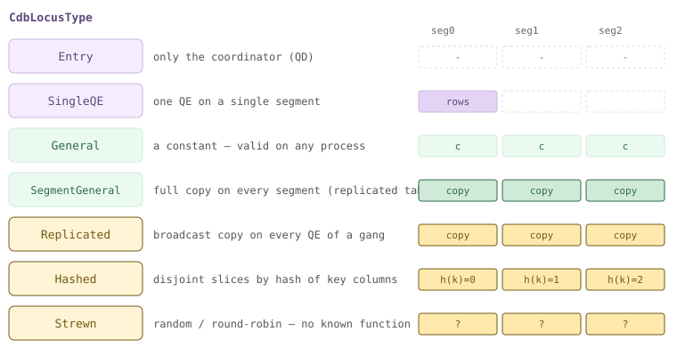
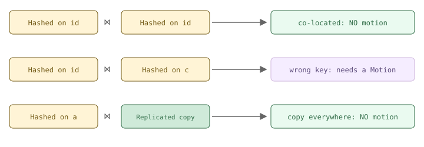
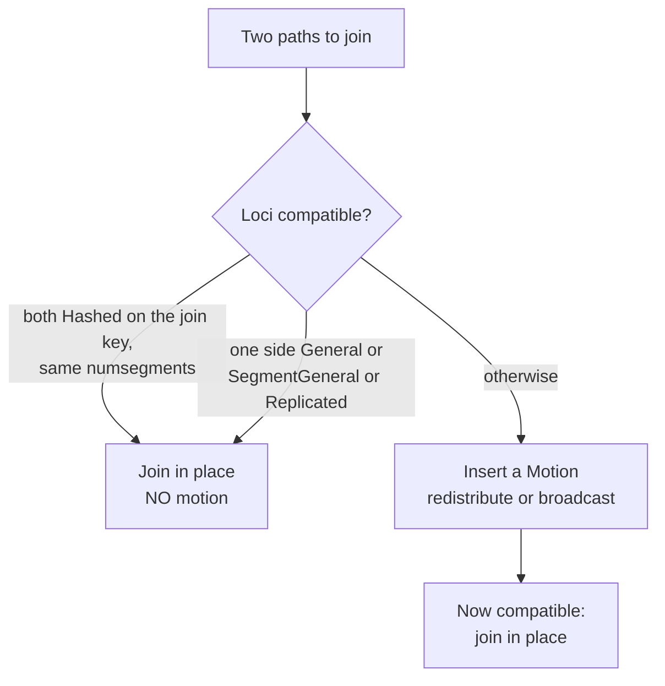
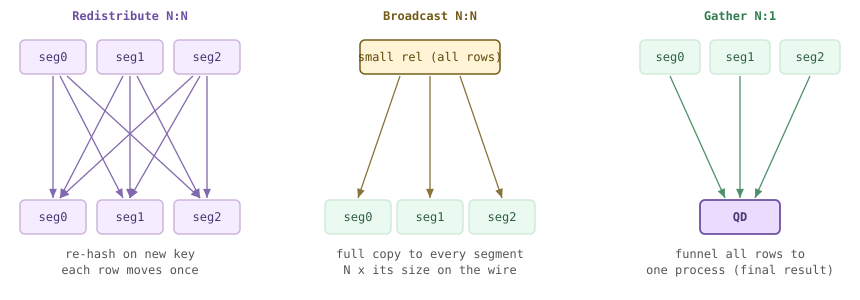
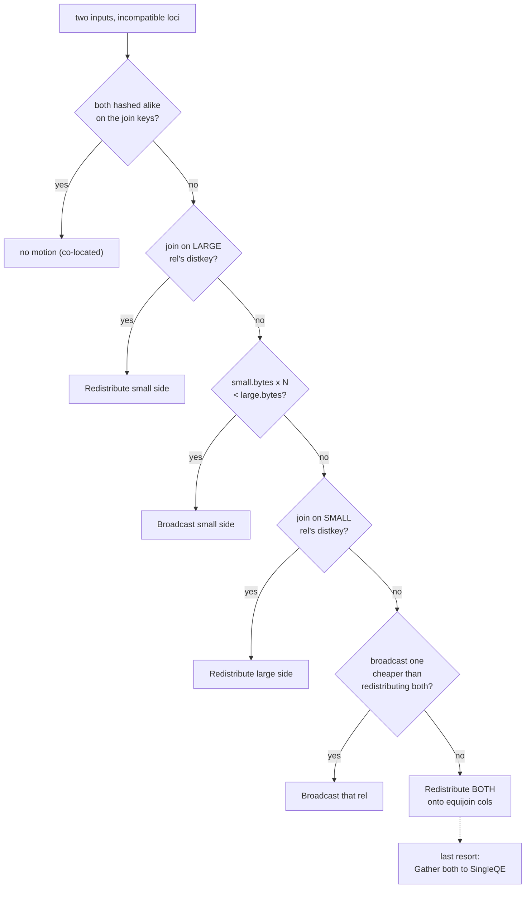
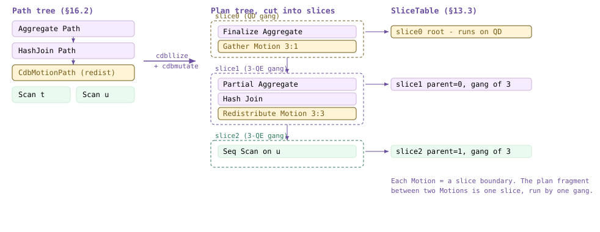
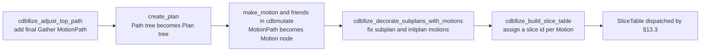
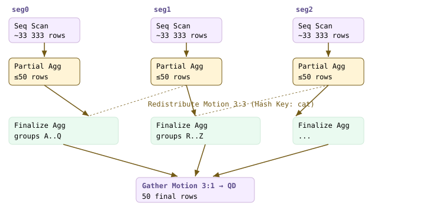
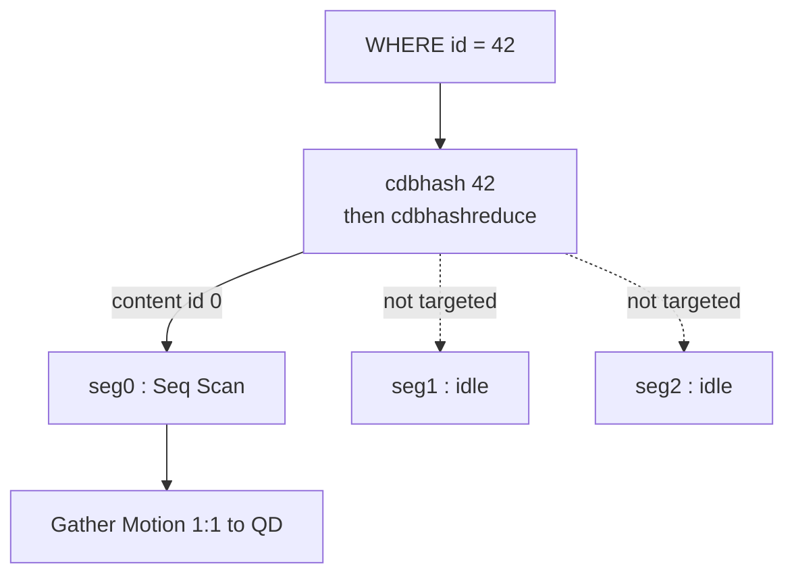

<!--
  Licensed to the Apache Software Foundation (ASF) under one
  or more contributor license agreements.  See the NOTICE file
  distributed with this work for additional information
  regarding copyright ownership.  The ASF licenses this file
  to you under the Apache License, Version 2.0 (the
  "License"); you may not use this file except in compliance
  with the License.  You may obtain a copy of the License at

    http://www.apache.org/licenses/LICENSE-2.0

  Unless required by applicable law or agreed to in writing,
  software distributed under the License is distributed on an
  "AS IS" BASIS, WITHOUT WARRANTIES OR CONDITIONS OF ANY
  KIND, either express or implied.  See the License for the
  specific language governing permissions and limitations
  under the License.
-->

<a id="16-distributed-planning"></a>

## 16.1 分布位置模型（cdbpathlocus） {#161-the-locus-model-cdbpathlocus}

第 [15](/cloudberry/core-internals/part-4-query-processing/ch15/) 章构建路径和计划时，仿佛所有数据都位于同一个地方。实际情况并非如此。在 Cloudberry 中，一张表的行分散在各个 Segment 上，规划器新增的核心职责就是跟踪每个中间结果的**位置**。只有需要汇合的数据已经位于同一个 Segment 上，两个结果才能*就地*执行连接、分组或并集运算。否则，规划器就必须通过 **Motion** 在 Segment 之间传输元组（[§16.2](#162-cdbmotionpath-generation)）。

记录“这些行在哪里”的机制称为**分布位置（locus）**。每个 `Path` 都携带一个 `CdbPathLocus`，整个分布式规划过程可以看作对分布位置进行的一套简单代数运算：从基表的分布策略读取其分布位置，判断两个分布位置是否*兼容*；如果不兼容，就在一侧外加一个 Motion 来改变其分布位置。本节介绍这套类型体系，本章后续各节将运用它。由于分布位置属于 **PostgreSQL 规划器**的规划流程，以下所有演示都使用 `SET optimizer=off`（ORCA 有自己的分布式规划机制，见第 [17](/cloudberry/core-internals/part-4-query-processing/ch17/) 章）。



*分布位置格：路径中的行位于何处。最上面的两种在单个进程上运行；General/SegmentGeneral 在各处都可用；最下面的三种分散在 N 个 Segment 上（Hashed/Strewn 的各部分互不重叠，Replicated 则在每处都有完整副本）。*

### 16.1.1 什么是分布位置 {#1611-what-a-locus-is}

`CdbPathLocus` 是一个小结构体，用来回答一个问题：*对于这条路径中的行，哪个 Segment 持有哪些行？* 其中三个关键部分是：`locustype` 类型标记、`distkey`（对于哈希类型，这是分布键列的列表），以及 `numsegments`（这些行分布在多少个 Segment 上）。第四个字段 `parallel_workers` 记录 Segment 内部的并行度。

```c {title="src/include/cdb/cdbpathlocus.h — CdbPathLocus"}
typedef struct CdbPathLocus
{
    CdbLocusType locustype;
    List       *distkey;       /* List of DistributionKeys */
    int         numsegments;
    int         parallel_workers;
} CdbPathLocus;
```

`distkey` 并非列号列表，而是 `DistributionKey` 列表，每个元素都封装一个 `EquivalenceClass`。这层间接引用正是关键所在：`WHERE a=b` 子句将 `a` 和 `b` 放入同一个等价类，因此按 `a` 哈希的分布位置也会*自动*被识别为按 `b` 哈希。借助分布键和等价类，规划器才能判断连接键是否已经与表的分布方式匹配；`src/include/cdb/cdbpathlocus.h` 头文件对此作了明确说明。

### 16.1.2 分布位置类型 {#1612-the-locus-types}

`CdbLocusType`（`src/include/cdb/cdbpathlocus.h`）枚举了数据分布可能具有的“形态”。从上到下阅读这些类型，就是在阅读上面的格：先是单个进程，然后是各处均可用的数据，最后是分散在 Segment 进程组（gang）中的数据。

| 分布位置类型 | 行所在的位置 | 连接开销 |
| --- | --- | --- |
| **Entry** | 仅位于 Coordinator（QD）上 | 向 QD 汇集或从 QD 传输 |
| **SingleQE** | 单个 Segment 上的一个 QE 后端进程 | 汇集 |
| **General** | 自包含的内容（常量／不可变表达式），在任意进程上均有效 | 无开销，可与任何类型组合 |
| **SegmentGeneral** | 每个 Segment 上都有完整副本（`DISTRIBUTED REPLICATED` 表） | 复制表这一侧无开销 |
| **Replicated** | 进程组中的每个 QE 上都有一份广播副本 | 无开销，副本已遍布各处 |
| **Hashed** | 按已知键列进行哈希分布 | 若另一侧也按连接键进行 Hashed 分布，则无开销 |
| **HashedOJ** | 哈希分布，但 NULL 可能位于任意 Segment 上（由外连接产生） | 连接时与 Hashed 相同 |
| **Strewn** | 随机／轮询分布，没有已知的哈希函数 | 始终需要 Motion 来对齐分布 |

```c {title="src/include/cdb/cdbpathlocus.h — CdbLocusType"}
CdbLocusType_Entry,          /* a backend on the entry db (usually the qDisp) */
CdbLocusType_SingleQE,       /* a single backend on any db */
CdbLocusType_General,        /* compatible with any locus (self-contained) */
CdbLocusType_SegmentGeneral, /* available in any qExec, not in qDisp */
CdbLocusType_Replicated,     /* replicated over all qExecs of an N-gang */
CdbLocusType_Hashed,         /* hash partitioned over all qExecs */
CdbLocusType_HashedOJ,       /* hashed outer join, NULLs can be anywhere */
CdbLocusType_Strewn,         /* partitioned on no known function */
```

> [!NOTE]
> 该枚举还包含并行的 `*Workers` 变体：`HashedWorkers`、`SegmentGeneralWorkers`、`ReplicatedWorkers`，用于切片（slice）在每个 Segment 上使用多个工作进程的情形。它们遵循相同的规则，只是多了一个 `parallel_workers` 维度；`cdbpathlocus_join()` 甚至会断言这些类型不会传入其中（并行连接使用 `cdbpathlocus_parallel_join()`）。这里不讨论这些变体。

### 16.1.3 基关系的分布位置从何而来 {#1613-where-a-base-rels-locus-comes-from}

基表的分布位置直接从其分布策略读取。`cdbpathlocus_from_baserel()` 只是将该关系的 `cdbpolicy` 转交给 `cdbpathlocus_from_policy()`，后者把三种 `DISTRIBUTED …` 形式（[§8.3](/cloudberry/core-internals/part-2-storage-data-layout/ch08/#83-cloudberry-distributed-catalogs)）映射为三种分布位置类型：`DISTRIBUTED BY (c)` → 按 `c` 分布的 **Hashed**；`DISTRIBUTED RANDOMLY` → **Strewn**；`DISTRIBUTED REPLICATED` → **SegmentGeneral**。

```c {title="src/backend/cdb/cdbpathlocus.c — cdbpathlocus_from_policy()"}
if (GpPolicyIsPartitioned(policy))
{
    if (policy->nattrs > 0)
    {
        List *distkeys = cdb_build_distribution_keys(root, rti, policy);
        CdbPathLocus_MakeHashed(&result, distkeys, policy->numsegments, 0);
    }
    else                                  /* DISTRIBUTED RANDOMLY */
        CdbPathLocus_MakeStrewn(&result, policy->numsegments, 0);
}
else if (GpPolicyIsReplicated(policy))    /* DISTRIBUTED REPLICATED */
    CdbPathLocus_MakeSegmentGeneral(&result, policy->numsegments);
```

我们可以从系统目录中读出这些策略。`gp_distribution_policy` 保存了 `policytype`（`p` 表示分区分布，`r` 表示复制分布）、`numsegments` 和 `distkey` 属性编号，恰好对应分布位置记录的三个字段：

*用于确定各基关系分布位置的系统目录行。*

```sql
SELECT c.relname,
       CASE p.policytype WHEN 'p' THEN 'partitioned'
                         WHEN 'r' THEN 'replicated' END AS policytype,
       p.numsegments, p.distkey
FROM gp_distribution_policy p
JOIN pg_class c ON c.oid = p.localoid
WHERE c.relname LIKE 'm161%' ORDER BY 1;
```

```text {hl_lines="3" title="output"}
relname | policytype  | numsegments | distkey
--------+-------------+-------------+---------
 m161_r | replicated |           3 |          -- -> SegmentGeneral
 m161_t | partitioned |           3 | 1        -- -> Hashed on col 1 (id)
 m161_u | partitioned |           3 | 1        -- -> Hashed on col 1 (id)
 m161_w | partitioned |           3 | 1        -- -> Hashed on col 1 (wid)
```

### 16.1.4 分布兼容性 {#1614-distribution-compatibility}

关键就在这里。只有两个路径的分布位置*兼容*时，才能**在本地进行连接，无需 Motion**。兼容的情形有三种：（1）双方都按连接键进行 **Hashed** 分布，且 `numsegments` 相同，这保证了匹配行共置于同一 Segment；（2）任意一侧是 **General**，因为常量在各处均有效；（3）任意一侧是 **SegmentGeneral / Replicated**，因为另一侧使用的每个 Segment 上都已有一份完整副本。除此之外的情况，包括按*不匹配的*键进行 Hashed 分布或采用 Strewn 分布，都意味着需要汇合的行位于不同的 Segment 上，因此必须使用 Motion（[§16.2](#162-cdbmotionpath-generation)）。



*连接兼容性：两侧均按 k 进行 Hashed 分布时，数据共置，无需 Motion；一侧按 k、另一侧按 j 进行 Hashed 分布时，数据不共置，需用 Motion 对齐；任意一侧具有完整副本（Replicated / SegmentGeneral）时，连接无需移动数据。*

`cdbpathlocus_join()` 实现的正是这些规则，并返回连接*结果*的分布位置（假设所需的 Motion 已经就位）。General 和 SegmentGeneral / Replicated 这两类情况会提前返回：结果直接继承另一侧的分布位置。只有两侧都继续执行到函数末尾时，才要求双方均为 Hashed、分布键列表长度相同且 `numsegments` 相同；否则，直接连接它们就是规划器错误：

```c {title="src/backend/cdb/cdbpathlocus.c — cdbpathlocus_join()"}
if (CdbPathLocus_IsGeneral(a))
    return b;                       /* a constant: keep b's locus */
if (CdbPathLocus_IsSegmentGeneral(a)) {
    b.numsegments = CdbPathLocus_CommonSegments(a, b);
    return b;                       /* full copy on every seg: keep b */
}
/* ... else both must be Hashed on compatible keys ... */
if (a.distkey == NIL ||
    list_length(a.distkey) != list_length(b.distkey))
    elog(ERROR, "... incompatible distribution keys");
if (CdbPathLocus_NumSegments(a) != CdbPathLocus_NumSegments(b))
    elog(ERROR, "... different number of segments");
```

“这两个 Hashed 分布位置是否相同”的检查由 `cdbpathlocus_equal()`（`src/backend/cdb/cdbpathlocus.c`）完成：先比较 `numsegments`，再交给 `cdbpath_distkey_equal()` 检查分布键是否共享相同的等价类。另一个相关判定函数 `cdbpathlocus_is_hashed_on_exprs()` 回答的是“能否按*这些*表达式分组／去重而不使用 Motion”；只有每个分布键列的等价类都包含其中一个表达式时，结果才为真。这两者就是上图背后的实现机制。

下面看实际示例。`m161_t` 和 `m161_u` 都采用 `DISTRIBUTED BY (id)`；**按 `id` 连接**时，两侧的分布位置都按 id 哈希，因此兼容且数据共置。计划中**没有 Redistribute**：每个 Segment 的 `Hash Join` 读取本地切片，唯一的 Motion 是最后向 Coordinator 执行的 `Gather`。

*共置连接：Hashed 分布位置兼容，无需重分布。（SET optimizer=off：这里使用 Postgres 规划器。）*

```sql
SET optimizer=off;
EXPLAIN (COSTS OFF)
SELECT * FROM m161_t JOIN m161_u USING (id);
```

```text {hl_lines="4" title="output"}
                 QUERY PLAN
--------------------------------------------
 Gather Motion 3:1  (slice1; segments: 3)
   ->  Hash Join                       -- directly over the scans
         Hash Cond: (m161_t.id = m161_u.id)
         ->  Seq Scan on m161_t
         ->  Hash
               ->  Seq Scan on m161_u
 Optimizer: Postgres query optimizer
```

现在只改变连接键。将 `m161_t.id` 与 `m161_w` 的**非分布列**（即 `c`，而非分布键 `wid`）连接，会使两侧分布位置不兼容：`m161_w` 的行按 `wid` 哈希，因此具有匹配 `c` 值的行分散在各个 Segment 上。规划器在 `m161_w.c` 上插入一个 **Redistribute Motion**，重新建立按 `c` 哈希的分布位置，然后才能执行连接：

*非共置连接：分布位置不兼容，计划中出现 Motion（机制见 [§16.2](#162-cdbmotionpath-generation)）。*

```sql
SET optimizer=off;
EXPLAIN (COSTS OFF)
SELECT * FROM m161_t JOIN m161_w ON m161_t.id = m161_w.c;
```

```text {hl_lines="6" title="output"}
                         QUERY PLAN
------------------------------------------------------------
 Gather Motion 3:1  (slice1; segments: 3)
   ->  Hash Join
         Hash Cond: (m161_w.c = m161_t.id)
         ->  Redistribute Motion 3:3  (slice2; segments: 3)
               Hash Key: m161_w.c
               ->  Seq Scan on m161_w
         ->  Hash
               ->  Seq Scan on m161_t
 Optimizer: Postgres query optimizer
```

最后来看无需移动数据的情况：`m161_r` 采用 `DISTRIBUTED REPLICATED`，因此其分布位置为 **SegmentGeneral**，每个 Segment 上都有一份完整副本。将其与 Hashed 分布的 `m161_t` 连接时，两侧都完全不需要 Motion；`cdbpathlocus_join()` 通过 SegmentGeneral 分支提前返回，保留 `m161_t` 的 Hashed 分布位置作为结果的分布位置。

*复制表（SegmentGeneral）一侧：副本遍布各处，因此无需 Motion。*

```sql
SET optimizer=off;
EXPLAIN (COSTS OFF)
SELECT * FROM m161_t JOIN m161_r ON m161_t.a = m161_r.r;
```

```text {hl_lines="8" title="output"}
                QUERY PLAN
------------------------------------------
 Gather Motion 3:1  (slice1; segments: 3)
   ->  Hash Join
         Hash Cond: (m161_t.a = m161_r.r)
         ->  Seq Scan on m161_t
         ->  Hash
               ->  Seq Scan on m161_r   -- no motion over the replicated rel
 Optimizer: Postgres query optimizer
```



*每次连接都要判断分布位置：两侧是否兼容？兼容则就地连接；不兼容则先用 Motion 改变一侧的分布位置。*

这就是分布式规划的全部前提：路径携带分布位置，`cdbpathlocus_join()`（以及用于分组的同类函数）判断分布位置是否已经对齐，而每一处不匹配都会引入一个 Motion。[§16.2](#162-cdbmotionpath-generation) 将通过 `cdbpath_create_motion_path()`（`src/backend/cdb/cdbpath.c`）和 `cdbpath_motion_for_join()`，进一步介绍这些 Motion 的选择与代价估算，包括 Redistribute、Broadcast 和 Gather 之间的取舍。

## 16.2 CdbMotionPath 的生成 {#162-cdbmotionpath-generation}

[§16.1](#161-the-locus-model-cdbpathlocus) 确立了这样一条规则：当两条路径的分布位置*不兼容*时，行就无法在原位置连接，必须移动其中一部分数据。本节介绍规划器**如何**表达这种移动。规划器会将 **`CdbMotionPath`** 作为另一条具有代价的 `Path`，直接插入*路径搜索过程本身*，而不是等到规划结束后才添加 Motion。这样，“按这种方式移动数据”就会在 `add_path` 中与“按另一种方式移动数据”（以及所有不使用 Motion 的方案）竞争（[§15.3](/cloudberry/core-internals/part-4-query-processing/ch15/#153-path-cost--add_path)）。最终输出仍然是代价最低的路径，只不过它现在可能包含 Motion。

Motion 只有**三种形态**：Redistribute、Broadcast 和 Gather。整个分布式连接规划，就是规划器选择在哪一侧采用哪种形态代价最低。我们先建立直观图景，再阅读实现它的代码，最后在端口 7100 上观察规划器实际选择各形态的过程（全程使用 `SET optimizer=off`；ORCA 以自己的方式规划 Motion，见第 [17](/cloudberry/core-internals/part-4-query-processing/ch17/) 章）。



*包含 3 个 Segment 的集群上的三种 Motion 形态。Redistribute 在所有 Segment 之间对行重新哈希；Broadcast 将一个小关系复制到每个 Segment；Gather 将所有数据汇集到一个进程（QD）。*

### 16.2.1 cdbpath_create_motion_path：改变分布位置的 Path {#1621-cdbpath_create_motion_path--a-path-that-changes-locus}

规划器考虑的所有 Motion 都由同一个函数创建：**`cdbpath_create_motion_path()`**（`src/backend/cdb/cdbpath.c`）。传入一条子路径和一个*目标分布位置*，它就返回一条将行送达该目标的 `Path`。如果子路径已经处于目标位置，便原样返回，不会无缘无故添加 Motion：

```c {title="src/backend/cdb/cdbpath.c — cdbpath_create_motion_path()"}
	/*
	 * Motion is to change path's locus, if target locus is the
	 * same as the subpath's, there is no need to add motion.
	 */
	if (cdbpathlocus_equal(subpath->locus, locus))
		return subpath;
```

当*确实*需要 Motion 时，它会检查目标：*瓶颈*分布位置（Entry / SingleQE）对应 **Gather**；*Replicated* 目标对应 **Broadcast**；*Hashed*（分区分布）目标对应 **Redistribute**。无论是哪一种，节点都由共用的构造函数 **`make_motion_path()`**（`src/backend/cdb/cdbpath.c`）构建。它创建一个 `CdbMotionPath`，并且关键在于，会在返回前为其估算代价：

```c {title="src/backend/cdb/cdbpath.c — make_motion_path()"}
	pathnode = makeNode(CdbMotionPath);
	pathnode->path.pathtype = T_Motion;
	pathnode->path.parent   = subpath->parent;
	pathnode->path.locus    = locus;      /* the requested target locus */
	pathnode->subpath       = subpath;
	...
	cdbpath_cost_motion(root, pathnode);  /* fill in the cost */
```

这个结构体本身很小：`CdbMotionPath` 只是一个封装了子路径的 `Path`，再加一个标志和一个策略（`src/include/nodes/pathnodes.h`）。由于它*本身就是*一个 `Path`，并且已设置 `total_cost`，因此可以直接参与 `add_path` 的代价比较（[§15.3](/cloudberry/core-internals/part-4-query-processing/ch15/#153-path-cost--add_path)）：Motion 不是事后进行的特殊改写，而是搜索过程中的另一个候选方案。

- **`path` / `subpath`**：Motion 是封装输入路径的 `Path` 节点；`subpath->locus` 表示行当前所在的位置，`path.locus` 表示行将到达的位置。
- **`is_explicit_motion`**：用于标记写命令可能强制要求的显式重分布（例如 UPDATE 修改分布键），与代价无关。
- **`policy`**：当 Motion 按特定键集合重分布时，用于描述目标哈希分布的 `GpPolicy`。

### 16.2.2 cdbpath_cost_motion：为何形态选择取决于代价 {#1622-cdbpath_cost_motion--why-shape-is-a-cost-question}

之所以没有“始终重分布”或“始终广播”这样的固定规则，是因为每种形态移动的*行数*不同，而 `cdbpath_cost_motion()`（`src/backend/cdb/cdbpath.c`）估算的正是这项代价。它从两侧的分布位置确定发送和接收 Segment 的数量，估算经由 Interconnect 传输的总行数，然后按行计费：

```c {title="src/backend/cdb/cdbpath.c — cdbpath_cost_motion()"}
	sendrows  = subpath->rows;
	recvrows  = motionpath->path.rows;
	motioncost = cost_per_row * 0.5 * (sendrows + recvrows);
	...
	motionpath->path.total_cost = motioncost + subpath->total_cost;
```

关键变量是 `recvrows`。对于 **Redistribute**，`total_rows` 对应关系中的行重新分散到接收 Segment，每行只移动*一次*。对于 **Broadcast**，目标类型是 Replicated，因此每个接收 Segment 都会收到*整个关系*：`recvrows` 随 Segment 数量成倍增加。这就是最根本的权衡：把一个 `B` 字节的关系广播到 `N` 个 Segment，会在网络上传输 `N × B` 字节，而重分布只需传输一次 `B` 字节。只有当关系足够小，使得 `N × B` 仍然比重新分布*另一侧的大关系*更便宜时，Broadcast 才有优势。

> [!NOTE]
> `cost_per_row` 在设置了 `gp_motion_cost_per_row` 时取其值，否则使用 `2.0 * cpu_tuple_cost`（`cdbpath.c`，`cdbpath_cost_motion()`）。`0.5 * (sendrows + recvrows)` 的形式将发送和接收代价各计一半。这个线性模型很简单，却足以正确排列三种形态的代价。

### 16.2.3 cdbpath_motion_for_join：为连接选择 Motion 形态 {#1623-cdbpath_motion_for_join--picking-a-shape-for-a-join}

当连接的两个输入具有不兼容的分布位置时，由 **`cdbpath_motion_for_join()`**（`src/backend/cdb/cdbpath.c`）作出选择。它根据两条子路径和等值连接子句，决定移动哪一侧或两侧、移动到哪里，再对选定的一侧或两侧调用 `cdbpath_create_motion_path()`，返回最终连接的分布位置。如果*无需* Motion 即可使分布位置兼容，也就是两个关系已经按连接键以相同方式哈希分布，它便立即返回：

```c {title="src/backend/cdb/cdbpath.c — cdbpath_motion_for_join()"}
	/* No motion if partitioned alike and joining on the partitioning keys. */
	else if (cdbpath_match_preds_to_both_distkeys(root, redistribution_clauses,
												  outer.locus, inner.locus, false))
		return cdbpathlocus_join(jointype, outer.locus, inner.locus);
```

否则，函数进入*两侧均为分区分布*的分支（`src/backend/cdb/cdbpath.c`，`cdbpath_motion_for_join()`），按字节大小将两侧标记为 `large_rel` / `small_rel`，然后按**代价最低者优先**的顺序依次检查一系列 `else if`。其中最重要的几项如下：

| 优先顺序 | 条件 | 选用的 Motion |
| --- | --- | --- |
| 重分布较小的一侧 | 按*较大*关系的分布键连接 | 仅将较小关系按该键重分布 |
| 广播较小的一侧 | `small.bytes * N < large.bytes` | 将较小关系复制到全部 N 个 Segment |
| 重分布较大的一侧 | 按*较小*关系的分布键连接 | 仅移动较大关系 |
| 广播一侧（与移动两侧比较） | 广播一侧比重分布两侧更便宜 | 复制该关系 |
| 重分布两侧 | 以上条件均不满足 | 将两个关系都按等值连接列重新哈希 |
| 将两侧汇集到 SingleQE | 没有可用的等值连接谓词 | 最后的办法：在一个进程上执行 |

广播与重分布的比较，直接将 [§16.2.2](#1622-cdbpath_cost_motion--why-shape-is-a-cost-question) 的权衡写成了一个不等式：只有将较小关系复制到每个 Segment 比移动较大关系更便宜时，才复制较小关系：

```c {title="src/backend/cdb/cdbpath.c — cdbpath_motion_for_join()"}
	/* Replicate smaller rel if cheaper than redistributing larger rel. */
	else if (!small_rel->require_existing_order &&
			 small_rel->ok_to_replicate &&
			 (small_rel->bytes * CdbPathLocus_NumSegments(large_rel->locus) <
			  large_rel->bytes))
		CdbPathLocus_MakeReplicated(&small_rel->move_to, ...);
```

确定 `move_to` 分布位置之后，函数末尾才会创建实际的 MotionPath；正是在这里，上述选择转化为计划中的 `CdbMotionPath`：

```c {title="src/backend/cdb/cdbpath.c — cdbpath_motion_for_join()"}
	if (!CdbPathLocus_IsNull(outer.move_to))
		outer.path = cdbpath_create_motion_path(root, outer.path,
									outer_pathkeys, outer.require_existing_order,
									outer.move_to);
	...
	if (!CdbPathLocus_IsNull(inner.move_to))
		inner.path = cdbpath_create_motion_path(root, inner.path, ...);
```



*cdbpath_motion_for_join：代价最低者优先的逐级判断。每一级都检查代价或键是否匹配，第一个满足的条件决定 Motion 的形态。*

### 16.2.4 Redistribute 实例 {#1624-redistribute-live}

下面观察这组判断如何生效。`m162_t` 是一张大表，采用 `DISTRIBUTED BY (id)`；`m162_u` 也是大表（60 万行），采用 `DISTRIBUTED BY (uid)`。按 `uid` 连接两表，这个列是 `m162_u` 的分布键，却**不是** `m162_t` 的分布键。这符合“*按较小／另一关系的分布键连接 → 重分布另一侧*”这一判断：只需移动 `m162_t`，按 `uid` 重新哈希，使其与 `m162_u` 的对应行汇合。由于 `m162_u` 很大，广播它的代价要高得多，因此选择 Redistribute：

*连接使用 m162_u 的分布键，却没有使用 m162_t 的分布键 → 规划器只重分布 m162_t。注意被移动一侧的 Hash Key。*

```sql
SET optimizer=off;
EXPLAIN (COSTS off)
SELECT count(*) FROM m162_t t JOIN m162_u u ON t.uid = u.uid;
```

```text {hl_lines="8" title="output"}
Finalize Aggregate
  ->  Gather Motion 3:1  (slice1; segments: 3)
        ->  Partial Aggregate
              ->  Hash Join
                    Hash Cond: (u.uid = t.uid)
                    ->  Seq Scan on m162_u u
                    ->  Hash
                          ->  Redistribute Motion 3:3  (slice2; segments: 3)
                                Hash Key: t.uid
                                ->  Seq Scan on m162_t t
```

`Redistribute Motion 3:3` 正对应图中交叉连线的部分：3 个发送 Segment、3 个接收 Segment，每行都按 `t.uid` 重新哈希，并送到负责该键的 Segment。因此，`u.uid` 和 `t.uid` 现在共置于同一 Segment，哈希连接可以在每个 Segment 上本地执行。

### 16.2.5 Broadcast 实例 {#1625-broadcast-live}

现在让 `m162_t` 仍保持为大表，但改为与 `m162_d` 连接；这是一张只有 50 行、采用 `DISTRIBUTED BY (did)` 的小维度表，连接条件为 `t.uid = d.did`。`uid` 不是 `m162_t` 的分布键，因此分布位置不兼容。此时，`cdbpath.c`（`cdbpath_motion_for_join()`）中的不等式得出了另一种结果：`m162_d` 非常小，将全部 50 行复制到所有 3 个 Segment，显然比重新分布有 50 万行的 `m162_t` 更便宜。规划器于是广播较小的一侧：

*大事实表按非分布键与小维度表连接 → 将较小关系广播到每个 Segment。COSTS ON 显示了原因：广播读取约 50 行，而移动事实表需要读取约 50 万行。*

```sql
SET optimizer=off;
EXPLAIN
SELECT count(*) FROM m162_t t JOIN m162_d d ON t.uid = d.did;
```

```text {hl_lines="4" title="output"}
->  Gather Motion 3:1 (slice1; segments: 3)  (cost=2353.69..2353.74 rows=3)
      ->  Hash Join  (cost=2.46..2349.52 rows=1665)
            ->  Seq Scan on m162_t t  (cost=0.00..1911.67 rows=166667)
            ->  Broadcast Motion 3:3 (slice2; segments: 3) (cost=0.00..1.83 rows=50)
                  ->  Seq Scan on m162_d d  (cost=0.00..1.17 rows=17)
```

同样是两表连接，Motion 的形态却截然不同，决定因素只有代价。Broadcast Motion 位于 `Hash` 下方（较小关系被构建成哈希表，现在每个 Segment 上都有完整的哈希表），而 `m162_t` 保持原位，以流式方式参与连接。这对应图中的中间部分：将一个关系完整复制到全部三个 Segment。

> [!NOTE]
> 可以这样验证这完全由代价决定：对*相同*的连接（`t.uid = d.did`），如果 `m162_d` 很大，就会使 `small.bytes * N < large.bytes` 不成立，转而选择 Redistribute，正如前面大表 `m162_u` 的情况。`cdbpath.c`（`cdbpath_motion_for_join()`）中的这个判定条件就是切换依据。

### 16.2.6 Gather 及上述规划发生的位置 {#1626-gather--and-where-all-this-happens}

第三种形态出现在上述*每个*计划的顶部：**`Gather Motion 3:1`**。连接在各个 Segment 上分布式执行之后，最终结果行必须到达负责向客户端返回结果的单个进程。当目标是*瓶颈*分布位置（Entry，即 QD）时，`cdbpath_create_motion_path()` 就会生成这种形态；它对应图中右侧的部分，三个 Segment 汇入一个进程。Gather 是 `N:1`，Redistribute 和 Broadcast 则是 `N:N`。

最后来看调用位置。`cdbpath_motion_for_join()` 并非在规划结束后的分布式处理阶段调用，而是由 `src/backend/optimizer/util/pathnode.c` 中的连接路径构造函数调用（例如 `create_nestloop_path`，以及哈希连接和归并连接的对应函数）；这些构造函数又由 **`add_paths_to_joinrel()`**（`src/backend/optimizer/path/joinpath.c`，[§15.3](/cloudberry/core-internals/part-4-query-processing/ch15/#153-path-cost--add_path)）调用。因此，每条候选连接路径的代价都*包含其 Motion 的代价*，Redistribute 与 Broadcast 的选择，也由为其他路径排序的同一个 `add_path` 代价比较过程决定。Motion 是规划过程的一部分，不是事后补上的。

[§16.1](#161-the-locus-model-cdbpathlocus) 介绍了分布位置和兼容性，本节则将不兼容的分布转化为具体且已估算代价的 `CdbMotionPath` 节点。接下来，[§16.3](#163-parallelization-cdbllize--cdbmutate) 将选出的路径连同其中的 Motion 转化为带有**切片表**的并行 `Plan`（`cdbllize`/`cdbmutate`）；[§13.3](/cloudberry/core-internals/part-4-query-processing/ch13/#133-dispatch-from-coordinator-plan-to-segment-execution) 正是依据这一结构将计划派发给进程组。至于这些 Motion 节点如何通过 Interconnect 实际传输元组，将在第 [19](/cloudberry/core-internals/part-4-query-processing/ch19/) 章介绍。

## 16.3 并行化（cdbllize / cdbmutate） {#163-parallelization-cdbllize--cdbmutate}

[§16.2](#162-cdbmotionpath-generation) 得到了一棵已经包含 `CdbMotionPath` 节点的 **Path** 树，规划器已经*决定*数据需要在哪里移动。但 Path 还不能运行。本节介绍将这棵带有分布注记的 Path 树转化为**并行 `Plan`** 的具体步骤：先把每个 MotionPath 转化为真正的 `Motion` 计划节点，再将计划切分成**切片**，每个片段由各自的进程组执行。输出正是 [§13.3](/cloudberry/core-internals/part-4-query-processing/ch13/#133-dispatch-from-coordinator-plan-to-segment-execution) 要派发的 `SliceTable`。可以把这个过程理解为*让单节点计划具备 MPP 能力*：`create_plan()` 构建普通的 Plan 树，随后各个 `cdb*` 处理步骤将 Motion 和切片边界纳入其中。



*从包含 MotionPath 的 Path 树到划分为切片的 Plan 树，每个切片对应一个进程组（与 [§13.3](/cloudberry/core-internals/part-4-query-processing/ch13/#133-dispatch-from-coordinator-plan-to-segment-execution) 的派发示意图相呼应）。*



*standard_planner 内部的并行化流程：从最佳 Path 到可派发的 SliceTable。*

### 16.3.1 cdbllize：将计划并行化 {#1631-cdbllize--parallelizing-the-plan}

`cdbllize.c` 负责驱动这一过程。文件头说明了 `standard_planner()` 遵循的流程，其中两个入口点负责两项主要工作。`cdbllize_adjust_top_path()` 在 `create_plan()` **之前**运行：它在最佳 Path 的顶部追加一个最终的 MotionPath，让查询结果到达所需位置。通常是向 QD 执行 Gather，使 Coordinator 能够向客户端返回行；对于 DML 或 CTAS，也可能改为向目标表的 Segment 重分布。

```c {title="src/backend/optimizer/plan/planner.c — standard_planner()"}
/* add the final Gather MotionPath, then build the Plan */
best_path = cdbllize_adjust_top_path(root, best_path, top_slice);
top_plan  = create_plan(root, best_path, top_slice);
top_plan->flow = cdbpathtoplan_create_flow(root, best_path->locus);
...
top_plan = cdbllize_decorate_subplans_with_motions(root, top_plan);
...
cdbllize_build_slice_table(root, top_plan, top_slice);
```

`create_plan()` 生成 Plan 树之后（主查询的 Motion 已经就位，见 [§16.3.2](#1632-cdbmutate--building-motion-nodes)），`cdbllize_decorate_subplans_with_motions()`（`src/backend/cdb/cdbllize.c`）会遍历它，修整**子计划和初始化计划**。SubPlan 的结果必须在正确的位置物化：如果引用它的切片在单个节点上运行，就在其顶部添加 Gather；如果父切片在所有 Segment 上运行，则可能添加 Broadcast。此时，外围切片的 Flow 已知，该函数还会把 `MOTIONTYPE_OUTER_QUERY` 占位 Motion 转化为具体类型；这些是路径搜索时尚无法确定应使用 Gather 还是 Broadcast 的 Motion。

```c {title="src/backend/cdb/cdbllize.c — cdbllize_decorate_subplans_with_motions()"}
context.currentPlanFlow = plan->flow;
result = (Plan *) fix_outer_query_motions_mutator((Node *) plan, &context);
```

> [!NOTE]
> 此外，还有针对初始化计划（在主查询之前运行一次）的 **cdbllize_adjust_init_plan_path()**，以及 **motion_sanity_check()**（位于 `cdbllize.c`，由 `gp_enable_motion_deadlock_sanity` 控制）。后者检查 Motion 拓扑是否会导致死锁，例如两个切片各自都在等待向对方发送数据。

### 16.3.2 cdbmutate：构建 Motion 节点 {#1632-cdbmutate--building-motion-nodes}

实际的 `Motion` 节点从何而来？在 `create_plan()` 期间，遍历器每遇到一个 `CdbMotionPath`，就调用 `create_motion_plan()` → `cdbpathtoplan_create_motion_plan()`（`src/backend/optimizer/plan/createplan.c`），根据目标分布位置选择 `src/backend/cdb/cdbmutate.c` 中的一个构造函数。每个构造函数都只是对基础构造函数 `make_motion()`（`src/backend/optimizer/plan/createplan.c`）的简单封装，负责设置 `motionType` 和路由字段：

- **`make_hashed_motion()` — `cdbmutate.c`**：**Redistribute。** 设置 `MOTIONTYPE_HASH`、`hashExprs` 列表（重分布键）、对应的 `hashFuncs`，以及 `numHashSegments`。对每个元组的键求哈希，以选定目标 Segment。
- **`make_broadcast_motion()` — `cdbmutate.c`**：**Broadcast。** 使用 `MOTIONTYPE_BROADCAST`，没有哈希键，将每个元组发送到每个 Segment（用于让连接中较小一侧的数据与另一侧共置）。
- **`make_union_motion()` / `make_sorted_union_motion()` — `cdbmutate.c`**：**Gather。** 使用 `MOTIONTYPE_GATHER`，N 个发送方对应一个接收方。*有序*变体携带排序列，使接收方能够执行保序归并。
- **`make_explicit_motion()` — `cdbmutate.c` — `make_parallel_broadcast_motion()`**：**Explicit。** 使用 `MOTIONTYPE_EXPLICIT`，将每个元组路由到显式 `segid` 列指定的 Segment（用于在目标表自身的 Segment 上执行 DML）。

```c {title="src/backend/cdb/cdbmutate.c — make_hashed_motion()"}
Motion *
make_hashed_motion(Plan *lefttree, List *hashExprs,
                   List *hashOpfamilies, int numHashSegments)
{
    ... /* look up cdb_hashproc for each key expr */
    motion = make_motion(NULL, lefttree, 0, ...);
    motion->motionType     = MOTIONTYPE_HASH;
    motion->hashExprs      = hashExprs;      /* the redistribution key */
    motion->hashFuncs      = hashFuncs;
    motion->numHashSegments = numHashSegments;
    return motion;
}
```

`Motion` 计划节点（`src/include/nodes/plannodes.h`）是在普通 `Plan` 上增加了这些字段：`motionType`、用于哈希路由的 `hashExprs`/`hashFuncs`/`numHashSegments`、用于显式路由的 `segidColIdx`、用于归并 Gather 的排序列，以及由 [§16.3.3](#1633-slice-assignment--the-slicetable-is-born) 填充的 `senderSliceInfo` 指针。基础构造函数 `make_motion()` 复制子节点的代价和目标列表，并断言一个 Motion 不能直接叠加在另一个 Motion 之上。

| 目标分布位置 | 构造函数 | motionType | EXPLAIN 中的行 |
| --- | --- | --- | --- |
| Hashed（按某个键） | make_hashed_motion | MOTIONTYPE_HASH | Redistribute Motion N:N |
| Replicated | make_broadcast_motion | MOTIONTYPE_BROADCAST | Broadcast Motion N:N |
| Entry / SingleQE | make_union_motion | MOTIONTYPE_GATHER | Gather Motion N:1 |
| 目标 Segment | make_explicit_motion | MOTIONTYPE_EXPLICIT | Explicit Redistribute Motion |

### 16.3.3 分配切片：生成 SliceTable {#1633-slice-assignment--the-slicetable-is-born}

此时，计划已是一棵嵌入 Motion 的完整 Plan 节点树，但还没有说明*哪些进程执行哪些部分*。`cdbllize_build_slice_table()`（`src/backend/cdb/cdbllize.c`）负责补全这些信息。它遍历计划以及可达的子计划，在遇到**每个 Motion** 时创建一个新切片：Motion 的发送侧成为新的 `PlanSlice`，获得下一个切片编号，并记录其父切片。随后将 `motion->motionID` 设置为该切片 ID，再将切片追加到表中。

```c {title="src/backend/cdb/cdbllize.c — build_slice_table_walker()"}
/* at each Motion: start a new (sender) slice */
sendSlice->sliceIndex  = list_length(context->slices);
sendSlice->parentIndex = context->currentSliceIndex;
motion->motionID       = sendSlice->sliceIndex;
context->slices        = lappend(context->slices, sendSlice);
```

一个**切片**恰好是两个 Motion 之间的计划片段，即子 Motion 上方、父 Motion 下方的所有内容。**根切片（slice0）** 是最顶层 Gather 上方的片段，在 **QD** 上运行。其余每个切片都在一个 QE 进程组上运行。最终的 `SliceTable`（切片 ID → 父切片 → 进程组类型 → Segment）保存在计划中，正是 [§13.3](/cloudberry/core-internals/part-4-query-processing/ch13/#133-dispatch-from-coordinator-plan-to-segment-execution) 遍历以启动进程组并建立 Interconnect 连接的结构。在 [§15.4](/cloudberry/core-internals/part-4-query-processing/ch15/#154-plan-generation) 的交接流程中，这次调用紧跟在 `create_plan()` 之后：并行化是 Postgres 规划器在派发前完成的最后一步。

> [!NOTE]
> 在 **utility**/**execute** 模式下，`cdbllize_build_slice_table()` 会提前返回，因为没有派发过程，最多只构建一个占位切片（`cdbllize.c`）。切片划分只对**派发端**（QD）有意义。

### 16.3.4 多切片计划实例 {#1634-the-multi-slice-plan-live}

下面看实际示例。在演示集群上（`SET optimizer=off`，使用的是 Postgres 规划器流程；ORCA 有自己的分布式规划机制，见第 [17](/cloudberry/core-internals/part-4-query-processing/ch17/) 章），我们连接两张按**不同**键分布的表，因此两侧都不以连接键作为分布键，其中一侧必须重分布。随后，`EXPLAIN (ANALYZE, VERBOSE)` 会打印每个 Motion 所属的切片，并在末尾显示各切片的内存用量。

*连接两张分布键不匹配的表 → 3 个切片。每个 Motion 都会显示其切片和 Segment 数量，末尾列出各切片的内存用量。*

```sql
SET optimizer=off;   -- Postgres planner (ORCA is Ch.17)
-- m163_t DISTRIBUTED BY (id), m163_u DISTRIBUTED BY (val)
EXPLAIN (ANALYZE, VERBOSE, COSTS OFF, TIMING OFF)
SELECT count(*) FROM m163_t t JOIN m163_u u ON t.id = u.id;
```

```text {hl_lines="8" title="output"}
 Finalize Aggregate (actual rows=1 loops=1)
   Output: count(*)
   ->  Gather Motion 3:1  (slice1; segments: 3) (actual rows=3 loops=1)
         Output: (PARTIAL count(*))
         ->  Partial Aggregate (actual rows=1 loops=1)
               ->  Hash Join (actual rows=16718 loops=1)
                     Hash Cond: (u.id = t.id)
                     ->  Redistribute Motion 3:3  (slice2; segments: 3) (actual rows=16718)
                           Output: u.id
                           Hash Key: u.id
                           ->  Seq Scan on public.m163_u u (actual rows=19000 loops=1)
                     ->  Hash (actual rows=16718 loops=1)
                           ->  Seq Scan on public.m163_t t (actual rows=16718 loops=1)
 Settings: optimizer = 'off'
   (slice0)    Executor memory: 121K bytes.
   (slice1)    Executor memory: 4819K bytes avg x 3 workers, 4819K bytes max (seg0).
   (slice2)    Executor memory: 112K bytes avg x 3 workers, 112K bytes max (seg0).
 Optimizer: Postgres query optimizer
```

这三个切片与规划器刚构建的 SliceTable 一致：

| 切片 | 计划片段（位于哪些 Motion 之间） | 进程组 | 创建位置 |
| --- | --- | --- | --- |
| **slice0**（根切片） | Finalize Aggregate，位于 Gather 上方 | QD（1 个进程） | top_slice，编号为 0 |
| **slice1** | Partial Aggregate + Hash Join + Hash，位于 Gather 下方的发送侧 | 3 个 QE | Gather Motion |
| **slice2** | 对 u 的 Seq Scan，位于 Redistribute 下方的发送侧 | 3 个 QE | Redistribute Motion |

自底向上阅读计划：**slice2** 在 `m163_u` 所在的 Segment 上扫描该表，其 Redistribute Motion 按 `u.id` 对每一行重新哈希。`Hash Key: u.id` 这一行恰好显示了 `hashExprs`，它由 `make_hashed_motion()` 保存，而 `segments: 3` 对应其 `numHashSegments`。行被送到匹配的 `m163_t` 行所在的 Segment，因此 **slice1** 可以执行本地哈希连接和部分聚合。Gather Motion 位于 slice1 顶部，将三个部分计数发送到 QD 上的 **slice0**，由它执行最终聚合。末尾每一行 `(sliceN)` 都是该切片的 `Executor memory`，直观表明执行器把每个切片视为独立单元。

> [!NOTE]
> 只有 `m163_u` 进行了重分布；`m163_t` 已经按连接键哈希，因此保持原位（它这一侧只是普通的 `Hash`，没有 Motion）。如果按**相同**的分布键连接，两侧分布位置就会兼容，**无需**重分布，得到每次扫描对应单个切片的共置连接。直接派发和 Broadcast 变体（[§16.1](#161-the-locus-model-cdbpathlocus)）只会改变选用的 Motion 类型，切片划分机制完全相同。

### 16.3.5 Flow：执行器读取的分布信息 {#1635-flow--what-the-executor-reads-back}

还有一项注记将上述过程串联起来。每个计划节点都携带一个 `Flow`（`src/include/nodes/plannodes.h`），描述*该节点*的输出元组如何分布在集群中。`cdbpathtoplan_create_flow()`（`src/backend/cdb/cdbpathtoplan.c`）紧接在 `create_plan()` 之后，根据节点的分布位置生成它。三种 `FlowType` 对应 [§16.1](#161-the-locus-model-cdbpathlocus) 中的几类分布位置：

- **`FLOW_PARTITIONED`**：元组分散在各个 Segment 上（哈希分布或随机分布的关系，或 Redistribute 的输出）。
- **`FLOW_REPLICATED`**：每个 Segment 上都有完整副本（Broadcast 的输出，或复制表）。
- **`FLOW_SINGLETON`**：单个节点上的单一数据流；`segindex = -1` 表示 QD（Gather 上方的输出）。

```c {title="src/include/nodes/plannodes.h — Flow"}
typedef struct Flow {
    NodeTag       type;          /* T_Flow */
    FlowType      flotype;       /* SINGLETON / REPLICATED / PARTITIONED */
    CdbLocusType  locustype;     /* optimizer flow characterization */
    int           segindex;      /* -1 = entry (QD) for a singleton flow */
    int           numsegments;
} Flow;
```

因此，Flow 是供执行器使用的切片分布概况：Redistribute 的输出节点为 `FLOW_PARTITIONED`，Broadcast 的输出节点为 `FLOW_REPLICATED`，最终 Gather 上方的计划根节点则是 QD 上的 `FLOW_SINGLETON`。Motion 构建完成、切片分配完毕并附上 Flow 后，计划就已完整具备 MPP 执行所需的信息；这里生成的 `SliceTable` 会直接交给 [§13.3](/cloudberry/core-internals/part-4-query-processing/ch13/#133-dispatch-from-coordinator-plan-to-segment-execution) 的派发机制，将每个切片转化为正在运行的进程组，并通过 Interconnect 互连（第 [19](/cloudberry/core-internals/part-4-query-processing/ch19/) 章）。

## 16.4 分布式分组与直接派发 {#164-distributed-grouping--direct-dispatch}

[§16.2](#162-cdbmotionpath-generation) 中的两种 Motion，即 Redistribute 和 Broadcast，移动的都是*完整的行*。如果规划器只是机械地使用它们，那么按非分布列执行 `GROUP BY` 时，就会在开始计数之前将每一行都通过 Interconnect 发送出去；即使按分布键进行点查询，也仍会唤起全部三个 Segment。本章最后一节介绍两项优化，让分布式规划器*比“移动所有数据”更高效*：**两阶段聚合**在网络传输*之前*，先把行汇聚为各分组的部分结果；**直接派发**则只将计划发送到可能包含匹配行的 Segment。这两项优化都属于 Postgres 规划器流程，因此，与本章其他部分一样，演示均从 `SET optimizer=off` 开始（ORCA 有自己的分布式分组机制，见第 [17](/cloudberry/core-internals/part-4-query-processing/ch17/) 章）。

先直观地看一下收益。对分散在 3 个 Segment 上的 10 万行执行 `GROUP BY cat`，只会产生 50 个不同的分组。如果每个 Segment 先将约 3.3 万行预聚合为不超过 50 个部分计数，那么 Redistribute Motion 就只需传输 **150 行，而非 100 000 行**，将网络流量缩减至千分之一。这正是规划器将一个聚合拆成两个的原因。



*3 个 Segment 上的两阶段聚合：在网络传输之前，先将行汇聚为各分组的部分结果；随后 Redistribute 将同一分组的结果送到同一个 Segment，交给 Finalize 合并。*

相比之下，如果按**分布键**本身分组，给定 `id` 的所有行原本就完整地位于同一个 Segment 上，因此每个分组在本地已经完整。规划器只需生成*一个*聚合，再用 Gather 汇集结果。而分布键上的点查询条件（`WHERE id = 42`）能够证明，只有一个 Segment 可能保存该行，因此计划只被派发到这个 Segment，这就是**直接派发**。下面逐一介绍这三种情况。

### 16.4.1 两阶段聚合：Partial → Redistribute → Finalize {#1641-two-stage-aggregation-partial--redistribute--finalize}

当 `GROUP BY` 列*不是*分布键时，同一分组的行分散在所有 Segment 上，任何一个 Segment 都无法独自计算最终计数。分布式规划器采用经典的 MPP 两阶段拆分方式，实现文件的开头就给出了这种计划的形态：

```c {title="src/backend/cdb/cdbgroupingpaths.c"}
Finalize Aggregate [3]
   Motion             [2]
      Partial Aggregate  [1]

* [2] With GROUP BY, [partial results] can be redistributed
*     according to the GROUP BY columns.
```

`cdb_create_multistage_grouping_paths()`（`src/backend/cdb/cdbgroupingpaths.c`）是规划器调用的 CBDB 扩展函数，由它驱动 `create_two_stage_paths()`（`src/backend/cdb/cdbgroupingpaths.c`）。第一阶段在每个 Segment 的本地扫描之上构建部分聚合。关键在于聚合的*拆分方式*：部分聚合阶段以 **`AGGSPLIT_INITIAL_SERIAL`** 模式执行每个聚合（`create_two_stage_paths()`），即运行状态转移函数，并将当前状态*序列化*；最终聚合阶段则使用 **`AGGSPLIT_FINAL_DESERIAL`**（`add_second_stage_group_agg_path()`），将部分状态反序列化、*合并*，再计算最终结果。对于 `count(*)`，部分状态是每个分组的计数小计，合并函数只需将小计相加；正是这种可加性，使两个阶段能够位于不同的 Segment 上。

两个阶段之间是 Motion。`choose_grouping_locus()`（`src/backend/cdb/cdbgroupingpaths.c`）决定其目标：如果部分结果尚未按分组键哈希分布，就根据 `GROUP BY` 列构建新的 Hashed 分布位置；`create_two_stage_paths` 随后通过 `cdbpath_create_motion_path()`（`add_second_stage_group_agg_path()`）在部分聚合路径外加一个 Redistribute，指向该分布位置。重分布后，给定 `cat` 的所有行都保证落在同一个 Segment 上，因此最终聚合既能保证正确，*又能*在全部三个 Segment 上并行执行。

```c {title="src/backend/cdb/cdbgroupingpaths.c — add_second_stage_group_agg_path()"}
/* Alternative 1: Redistribute -> Sort -> Agg */
if (CdbPathLocus_IsHashed(group_locus))
{
    path = initial_agg_path;
    path = cdbpath_create_motion_path(root, path, NIL,
                                      false, group_locus);
    ...
    path = (Path *) create_agg_path(root, output_rel, path, ctx->target,
                    ..., AGGSPLIT_FINAL_DESERIAL ...);
```

*按非分布列 cat 执行 GROUP BY：Streaming Partial HashAggregate 先汇聚各 Segment 上的行，再按 cat 执行 3:3 Redistribute，最后执行 Finalize。注意行数估计：经网络传输的是 50 行，而非 100 000 行。*

```sql
SET optimizer=off;
EXPLAIN SELECT cat, count(*) FROM m164_t GROUP BY cat;
```

```text {hl_lines="6" title="output"}
                              QUERY PLAN
--------------------------------------------------------------------------
 Gather Motion 3:1  (slice1; segments: 3)
   ->  Finalize HashAggregate
         Group Key: cat
         ->  Redistribute Motion 3:3  (slice2; segments: 3)
               Hash Key: cat
               ->  Streaming Partial HashAggregate
                     Group Key: cat
                     ->  Seq Scan on m164_t  (rows=33333 width=4)
 Optimizer: Postgres query optimizer
```

自底向上阅读计划：`Seq Scan` 向 `Streaming Partial HashAggregate`（阶段 [1]，`slice2`）提供输入，部分结果随后按 `cat` 重分布，再由 `Finalize HashAggregate`（阶段 [3]，`slice1`）合并部分计数，最后 `Gather Motion 3:1` 将 50 个分组汇集到 Coordinator。Redistribute 的行数估计为 `rows=50`，因为部分聚合阶段在网络传输之前就已完成汇聚。

> [!NOTE]
> 带有 **DISTINCT** 参数的聚合（DQA，例如 `count(DISTINCT x)`）更加复杂：如果同一个值出现在多个 Segment 上，普通的部分计数会得出错误结果。当只有一个 DQA，并且数据按其 DISTINCT 参数共置时，两阶段形态仍然适用；否则，规划器会退回三阶段计划，有时还会使用 TupleSplit。参见同一文件中的 `add_single_dqa_hash_agg_path` / `add_multi_dqas_hash_agg_path`；当 `distinctAggrefs` 非空时，会完全禁用哈希聚合（cdbgroupingpaths.c，create_two_stage_paths）。

### 16.4.2 单阶段聚合：按分布键分组 {#1642-single-stage-grouping-on-the-distribution-key}

当 `GROUP BY` 列*就是*分布键或其超集时，同一分组的所有行已经位于同一个 Segment 上，数据分布方式本身就预先划分好了各个分组。`choose_grouping_locus()` 检测到这一点后，设置 `need_redistribute = false`，因此不会插入 Motion：

```c {title="src/backend/cdb/cdbgroupingpaths.c — choose_grouping_locus()"}
/* If the input is already suitably distributed, no need to redistribute */
else if (!CdbPathLocus_IsHashedOJ(path->locus) &&
         cdbpathlocus_is_hashed_on_tlist(path->locus, group_tles, true))
{
    need_redistribute = false;
    CdbPathLocus_MakeNull(&locus);
}
```

实际上，`create_two_stage_paths` 在这种情况下会直接跳过两阶段形态；判断语句 `if (cdbpathlocus_collocates_tlist(...)) continue;`（`src/backend/cdb/cdbgroupingpaths.c`，`create_two_stage_paths()`）会跳过后续处理，因为此前 `planner.c` 中的 `create_grouping_paths()`（`src/backend/optimizer/plan/planner.c`）构建的普通单阶段计划已经是最优方案。结果就是每个 Segment 上执行一个聚合，再使用普通的 Gather：

*按分布键 id 执行 GROUP BY：每个 Segment 只执行一个 HashAggregate，没有 Redistribute Motion。每个 id 的所有行均在本地，因此各分组的结果已经正确。*

```sql
SET optimizer=off;
EXPLAIN SELECT id, count(*) FROM m164_t GROUP BY id;
```

```text {hl_lines="4" title="output"}
                       QUERY PLAN
--------------------------------------------------------
 Gather Motion 3:1  (slice1; segments: 3)
   ->  HashAggregate
         Group Key: id
         ->  Seq Scan on m164_t  (rows=33333 width=4)
 Optimizer: Postgres query optimizer
```

一个 `HashAggregate`（没有 Partial/Finalize）、没有 `Redistribute Motion`、Gather 下方只有一个切片。分布键上的数据共置，将包含两个 Motion 和两个聚合的计划变为只有一个 Motion 和一个聚合的计划。这与 [§16.2](#162-cdbmotionpath-generation) 中共置连接的收益相同，只是应用到了分组上。合理选择分布键，可以让*每个*按该键分组的查询受益。

### 16.4.3 直接派发：定位到单个 Segment {#1643-direct-dispatch-targeting-a-single-segment}

最后一项优化涉及派发过程本身（[§13.3](/cloudberry/core-internals/part-4-query-processing/ch13/#133-dispatch-from-coordinator-plan-to-segment-execution)）。像 `WHERE id = 42` 这样的查询，在采用 `DISTRIBUTED BY (id)` 的表上，只可能在 `id = 42` 经哈希映射到的*那个* Segment 上找到匹配行。在其他 Segment 上启动扫描进程组没有意义。如果规划器能证明这一点，就会将切片标记为**直接派发**，使进程组只面向一部分 Segment，而非整个集群。该标志保存在各 Plan 节点所属的切片信息中：

```c {title="src/include/nodes/plannodes.h — DirectDispatchInfo"}
typedef struct DirectDispatchInfo
{
    /* if true then this Slice requires an n-gang but the gang can be
     * targeted to fewer segments than the entire cluster. */
    bool        isDirectDispatch;
    List       *contentIds;      /* segments to dispatch to */
    ...
} DirectDispatchInfo;
```

这一判定在 `cdbtargeteddispatch.c` 中完成。对于单个关系上的扫描，`GetContentIdsFromPlanForSingleRelation()`（`src/backend/cdb/cdbtargeteddispatch.c`）从限定条件中提取分布键列的等值常量，然后执行与*存储*层 INSERT 时完全相同的操作：对这些常量执行相同的 `cdbhash` 计算，再归约为一个 Segment ID：

```c {title="src/backend/cdb/cdbtargeteddispatch.c — GetContentIdsFromPlanForSingleRelation()"}
h = makeCdbHashForRelation(relation);
result.isDirectDispatch = true;
...
    cdbhashinit(h);
    for (i = 0; i < policy->nattrs; i++) {
        ... cdbhash(h, i + 1, c->constvalue, c->constisnull); ...
    }
    hashCode = cdbhashreduce(h);
    result.contentIds = list_append_unique_int(result.contentIds, hashCode);
```

这与 [§1.2](/cloudberry/core-internals/#12-data-organization) 中确定行所属 Segment 的“先求哈希、再归约”过程完全相同，只是在规划时对常量 `42` 重用这一过程来选择目标。计算得到的 `contentIds` 通过 `createplan.c` 向上传递（判断条件为 `root->config->gp_enable_direct_dispatch && best_path->direct_dispatch_contentIds`，位于 `src/backend/optimizer/plan/createplan.c` 的 `create_projection_plan()` 中，并通过 `MergeDirectDispatchCalculationInfo` 合并），因此最终切片只携带一个 content ID。如果任意分布键列缺少等值常量，或限定条件会涉及过多 Segment，就会清除 `isDirectDispatch`，计划回退为使用完整进程组。

*WHERE id = 42（分布键）：带此限定条件的计划被直接派发到一个 Segment。Gather 为 1:1，切片只在 1 个 Segment 上运行，而非 3 个。*

```sql
SET optimizer=off;
EXPLAIN SELECT * FROM m164_t WHERE id = 42;
```

```text {hl_lines="3" title="output"}
                       QUERY PLAN
------------------------------------------------------------
 Gather Motion 1:1  (slice1; segments: 1)
   ->  Seq Scan on m164_t
         Filter: (id = 42)
 Optimizer: Postgres query optimizer
```

`Gather Motion 1:1 (slice1; segments: 1)` 表明发送进程组只有一个 Segment。再看非分布列 `cat` 上的*相同*等值条件：`cat = 42` 无法确定数据的位置，因此全部三个 Segment 都必须执行扫描：

*WHERE cat = 42（非分布列）：无法确定数据只在某一个 Segment 上，因此进程组覆盖全部 3 个 Segment（3:1 Gather）。*

```sql
SET optimizer=off;
EXPLAIN SELECT * FROM m164_t WHERE cat = 42;
```

```text {hl_lines="3" title="output"}
                       QUERY PLAN
------------------------------------------------------------
 Gather Motion 3:1  (slice1; segments: 3)
   ->  Seq Scan on m164_t
         Filter: (cat = 42)
 Optimizer: Postgres query optimizer
```



*直接派发：cdbhash(42) 归约为 seg0，因此只有 seg0 收到扫描切片，其他 Segment 保持空闲。*

我们可以确认规划器选择了哪个 Segment：`id = 42` 确实位于 Segment 0，恰好就是 `cdbhashreduce` 会算出的 content ID。直接派发并非猜测，而是在规划时重新执行存储层使用的哈希计算：

*验证目标：id=42 的行实际存储在 gp_segment_id 为 0 的 Segment 上，与直接派发选定的目标一致。*

```sql
SELECT gp_segment_id, id FROM m164_t WHERE id = 42;
```

```text {hl_lines="3" title="output"}
 gp_segment_id | id
---------------+----
       0     | 42
(1 row)
```

直接派发和两阶段聚合体现了贯穿本章的同一个思路的两个方面：分布式规划器不会盲目地移动或访问所有数据，而是利用*分布方式*（[§1.2](/cloudberry/core-internals/#12-data-organization)）省去不必要的工作，比如在网络传输之前预聚合，或仅唤起可能包含所需数据的 Segment。规划器将这些决策编码到切片／进程组机制中，由 [§13.3](/cloudberry/core-internals/part-4-query-processing/ch13/#133-dispatch-from-coordinator-plan-to-segment-execution) 的机制派发，再由第 [19](/cloudberry/core-internals/part-4-query-processing/ch19/) 章介绍的 Interconnect 承载。至于切片实际如何执行，包括 Motion 发送端、接收端以及流量控制，将在第 [18](/cloudberry/core-internals/part-4-query-processing/ch18/)–[19](/cloudberry/core-internals/part-4-query-processing/ch19/) 章介绍。

- **两阶段（部分）聚合**：每个 Segment 上执行部分聚合 → 按分组键执行 Redistribute Motion → 执行最终聚合。通过预先将行汇聚为各分组的部分结果来减少网络流量。由 `cdb_create_multistage_grouping_paths` / `create_two_stage_paths` 构建，使用聚合拆分模式 `AGGSPLIT_INITIAL_SERIAL`（部分聚合）和 `AGGSPLIT_FINAL_DESERIAL`（最终聚合与合并）。
- **单阶段聚合**：当 `GROUP BY` 包含分布键时，各分组已经完整地位于本地，只需一个聚合、一个 Gather，无需 Redistribute。`choose_grouping_locus` 返回 `need_redistribute = false`。
- **直接／定向派发**：分布键上的等值条件使规划器可以对常量执行 `cdbhash`，只将切片派发到对应的 Segment（`Gather Motion 1:1 (segments: 1)`），跳过集群中的其他 Segment。由 `cdbtargeteddispatch.c` 计算，受 `gp_enable_direct_dispatch` 控制。
