<style>
/*
 * Licensed to the Apache Software Foundation (ASF) under one
 * or more contributor license agreements.  See the NOTICE file
 * distributed with this work for additional information
 * regarding copyright ownership.  The ASF licenses this file
 * to you under the Apache License, Version 2.0 (the
 * "License"); you may not use this file except in compliance
 * with the License.  You may obtain a copy of the License at
 *
 *   http://www.apache.org/licenses/LICENSE-2.0
 *
 * Unless required by applicable law or agreed to in writing,
 * software distributed under the License is distributed on an
 * "AS IS" BASIS, WITHOUT WARRANTIES OR CONDITIONS OF ANY
 * KIND, either express or implied.  See the License for the
 * specific language governing permissions and limitations
 * under the License.
 */

/* Layout for the HTML-and-CSS figures, lifted from the handbook's own
   stylesheet so the figures render identically here. */

/* These four come from the handbook's own stylesheet; a consuming site has no
   such definitions, and an undefined custom property invalidates its whole
   declaration. Define them here, scoped to the figure.

   Deliberately NOT themed. The artwork below is light-only: band and tile
   backgrounds are hard-coded pastels, and the injected markup carries some 800
   more hard-coded light colours in inline styles. Giving --fg a dark-theme
   value paints near-white text onto a near-white band -- measured at 1.08:1,
   worse than the bug that replaced. The handbook's light values are correct in
   both themes; what changes for dark mode is the surface underneath. */
.cloudberry-core-figure {
  --border: #d8dee4;
  --soft:   #f6f8fa;
  --fg:     #1f2328;
  --muted:  #636c76;
  margin: 1.4rem 0;
}

/* Light-only artwork needs a light ground AND a dark ink, or it bleeds into a
   dark page. Setting only the ground is not enough: any text in these figures
   without its own inline colour inherits the site's near-white body colour, so
   it lands white-on-pastel -- measured at 1.03:1 across 184 text nodes. The
   colour has to be restored at the same place the ground is. */
[data-bs-theme='dark'] .cloudberry-core-figure > div {
  background: #ffffff;
  color: #1f2328;
  border-radius: 8px;
  padding: 10px;
}
/* Descendants that inherit rather than carry an inline colour. */
[data-bs-theme='dark'] .cloudberry-core-figure > div :not([style*="color"]) {
  color: inherit;
}
.cloudberry-core-figure figcaption {
  margin-top: .5rem;
  font-size: .9em;
  /* --ifm-color-emphasis-600 resolves to rgb(141,148,158) in the light theme,
     which is 3.06:1 on white -- below WCAG AA for the 37 figure captions.
     (The dark theme's value is fine, so only light is overridden.) */
  color: #636b75;
}
[data-bs-theme='dark'] .cloudberry-core-figure figcaption {
  color: #a6adb4;
}

/* Selective highlight: the handbook wraps a key token so it stands out.
   Scoped to the component. The class name .hl is two letters and this file
   lands in the consuming site's single global stylesheet, so an unscoped
   rule would style every page of that site. The standalone edition's
   figure.code / figure.session variants are dropped: those classes do not
   occur anywhere in this tree. */
.cloudberry-core-figure .hl { border-radius: 2px; font-weight: 700;
                   background: #fff8c5; color: #1f2328; padding: 0 2px; }

/* Layered module map and the banded brick figures. */
.cloudberry-core-figure .bricks { border:1px solid var(--border);border-radius:12px;overflow:hidden;background:var(--soft) }
.cloudberry-core-figure .bk-band { display:flex;align-items:stretch;border-top:1px solid var(--border) }
.cloudberry-core-figure .bk-band:first-child { border-top:none }
.cloudberry-core-figure .bk-lbl { flex:0 0 116px;display:flex;flex-direction:column;justify-content:center;gap:2px;padding:10px 13px }
.cloudberry-core-figure .bk-lbl b { font-size:12.5px;font-weight:800;color:var(--fg);line-height:1.2 }
.cloudberry-core-figure .bk-lbl span { font-size:9.5px;font-weight:700;color:var(--muted);text-transform:uppercase;letter-spacing:.5px }
.cloudberry-core-figure .bk-row { flex:1 1 auto;display:flex;flex-wrap:wrap;gap:7px;padding:9px 10px }
.cloudberry-core-figure .bk { flex:1 1 118px;min-width:104px;display:flex;flex-direction:column;justify-content:center;gap:2px; padding:8px 11px;border-radius:7px;border:1px solid;background:#fff;text-decoration:none;transition:.13s }
.cloudberry-core-figure .bk-t2 { font-size:12.5px;font-weight:700;line-height:1.25 }
.cloudberry-core-figure .bk-ch { font-size:10.5px;font-weight:700;font-variant-numeric:tabular-nums;opacity:.8 }
.cloudberry-core-figure a.bk:hover { transform:translateY(-2px);box-shadow:0 4px 12px #0000001f;text-decoration:none }
.cloudberry-core-figure .bk-q { background:#eef6ff }
.cloudberry-core-figure .bk-q .bk { border-color:#54aeff66;color:#0a3069;background:#ddf4ff }
.cloudberry-core-figure .bk-s { background:#eefcf2 }
.cloudberry-core-figure .bk-s .bk { border-color:#4ac26b80;color:#04260f;background:#dafbe1 }
.cloudberry-core-figure .bk-t { background:#fff6ef }
.cloudberry-core-figure .bk-t .bk { border-color:#fb8f4480;color:#5e2700;background:#fff1e5 }
.cloudberry-core-figure .bk-h { background:#fff4f3 }
.cloudberry-core-figure .bk-h .bk { border-color:#ff818280;color:#5c0011;background:#ffebe9 }
.cloudberry-core-figure .bk-r { background:#f3f5f8 }
.cloudberry-core-figure .bk-r .bk { border-color:#afb8c1;color:#1f2328;background:#eaeef2 }
@media (max-width: 560px) {
  .cloudberry-core-figure .bk-band { flex-direction:column }
  .cloudberry-core-figure .bk-lbl { flex-basis:auto;border-bottom:1px solid var(--border) }
}

</style>

<!--
  Licensed to the Apache Software Foundation (ASF) under one
  or more contributor license agreements.  See the NOTICE file
  distributed with this work for additional information
  regarding copyright ownership.  The ASF licenses this file
  to you under the Apache License, Version 2.0 (the
  "License"); you may not use this file except in compliance
  with the License.  You may obtain a copy of the License at

    http://www.apache.org/licenses/LICENSE-2.0

  Unless required by applicable law or agreed to in writing,
  software distributed under the License is distributed on an
  "AS IS" BASIS, WITHOUT WARRANTIES OR CONDITIONS OF ANY
  KIND, either express or implied.  See the License for the
  specific language governing permissions and limitations
  under the License.
-->


<a id="17-orca-the-cascades-optimizer"></a>

## 17.1 入口与派发 {#171-entry--dispatch}

第 [15](/cloudberry/core-internals/part-4-query-processing/ch15/) 章跟随 `Query` 树进入 PostgreSQL 规划器，第 [16](/cloudberry/core-internals/part-4-query-processing/ch16/) 章考察了附加在其上的分布式层。Cloudberry 还提供**另一套完全独立的优化器**——GPORCA，而且在本集群中，实际运行的正是它：`show optimizer` 的结果为 `on`，每次 EXPLAIN 的最后一行 `Optimizer: GPORCA` 也表明了这一点。第 15–16 章的演示都必须执行 `SET optimizer=off`，才能看到 `Optimizer: Postgres query optimizer`；从本章起，演示使用默认设置。ORCA 是一个采用 Cascades 风格的 C++ 引擎，位于 `src/backend/gporca/`，通过 `src/backend/gpopt/` 中的适配代码接入。它并非扩展规划器，而是替代规划器。本节介绍这一入口：哪些查询会交给 ORCA、交接有多大开销、C 的 `Query *` 如何变成 C++ 任务中的工作，以及实践中最有用的问题——当 ORCA 拒绝处理时，返回途中会发生什么。

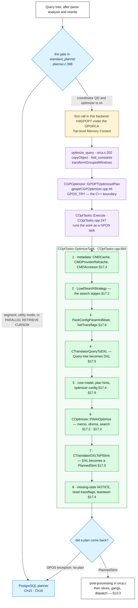

*这张图展示了完整流程，也给出了本章的路线图。`Query` 树抵达 `standard_planner()` 后，由一个 `if` 决定是否尝试将查询交给 ORCA。如果交给 ORCA，`optimize_query()` 会执行所需的预处理，`CGPOptimizer` 跨入 C++，而 `COptTasks::Execute` 则将实际主体 `OptimizeTask` 作为拥有独立内存池的 GPOS 任务运行。步骤 **1–8** 按源码顺序展示这个主体；每个步骤上的 § 标签指出本章哪一节会展开讲解。两条出口最终都汇聚到同一处：得到待派发的 `PlannedStmt`（[§13.3](/cloudberry/core-internals/part-4-query-processing/ch13/#133-dispatch-from-coordinator-plan-to-segment-execution)），或者返回 `NULL`，转向 PostgreSQL 规划器。本节只负责外圈：入口判断、外围封装与两个出口。*

### 17.1.1 standard_planner 中的分岔 {#1711-the-fork-in-standard_planner}

这里恰好只有一个分岔点，就是 `standard_planner()` 开头附近的一个普通 `if`。五个条件必须全部成立，查询才会交给 ORCA：`optimizer` GUC 已开启；当前后端负责派发（`GP_ROLE_DISPATCH`）；它是 Coordinator 上的查询派发器（`IS_QUERY_DISPATCHER()`）；调用者没有要求跳过外表分区（这是 `COPY TO` 设置的一个游标选项，参见 `copyto.c` 的 `BeginCopy()`）；而且这不是 ORCA 不支持的 PARALLEL RETRIEVE CURSOR：

```c {title="src/backend/optimizer/plan/planner.c — standard_planner()"}
	if (optimizer &&
		GP_ROLE_DISPATCH == Gp_role &&
		IS_QUERY_DISPATCHER() &&
		(cursorOptions & CURSOR_OPT_SKIP_FOREIGN_PARTITIONS) == 0 &&
		(cursorOptions & CURSOR_OPT_PARALLEL_RETRIEVE) == 0)
	{
		...                                     /* one-time InitGPOPT() */
		result = optimize_query(parse, cursorOptions, boundParams,
							   optimizer_options);
		...                                     /* Optimizer Time: ... ms */
		if (result)
			return result;
	}
```

不要跳过这个 `if` 上方的长注释，因为两个角色条件并非随意添加的防范措施。ORCA 面向复杂查询，而复杂查询会访问分布式表；Segment 切片本来就无法为这类查询制定有用的计划，因为从 Segment 运行这样的计划，相当于在查询内部再派发一个查询，而 Cloudberry 禁止这种行为（`querytree_safe_for_qe()`，`src/backend/executor/functions.c`）。相同限制也适用于不是 QD 的 Coordinator 切片，`IS_QUERY_DISPATCHER()` 正是在筛选这一条件。至于*确实*在 Segment 上进行的规划，大多针对 pl/language 函数体，而 ORCA 不处理它们。因此规则很简单：ORCA 只在 Coordinator QD 上运行。注意，入口判断中**没有**任何有关查询形态的条件。ORCA 究竟能否处理某个查询，要到很后面才会通过失败得知（[§17.1.5](#1715-fallback-the-exit-that-matters-most)）。

*从另一侧观察入口判断。以 utility 模式直接连接 Segment，`optimizer` 仍显示 `on`——它是普通 GUC，其值会被继承——但计划显然由 PostgreSQL 规划器生成。末尾一行揭示了实际情况。*

```sql
-- PGOPTIONS='-c gp_role=utility' psql -p 7102 -d postgres
SELECT current_setting('optimizer');
EXPLAIN SELECT count(*) FROM m171_t;
```

```text {hl_lines="10" title="output"}
 current_setting 
-----------------
 on
(1 row)

                           QUERY PLAN                           
----------------------------------------------------------------
 Aggregate  (cost=77.58..77.59 rows=1 width=8)
   ->  Seq Scan on m171_t  (cost=0.00..63.66 rows=5566 width=0)
 Optimizer: Postgres query optimizer
(3 rows)
```

这里有两个结论需要明确指出。首先，既然只有 QD 制定计划，Segment 就只会*接收*已经完成的计划及其切片表（[§13.3](/cloudberry/core-internals/part-4-query-processing/ch13/#133-dispatch-from-coordinator-plan-to-segment-execution)）。无论计划在多少个 Segment 上运行，ORCA 的规划时间、内存消耗和缺陷都属于 Coordinator 侧的问题。其次，EXPLAIN 末尾这一行不是简单回显 GUC：它来自 `plannedstmt->planGen`（`src/backend/commands/explain.c` 的 `ExplainOnePlan()`），DXL 到计划的转换器会将该字段标记为 `PLANGEN_OPTIMIZER`（`CTranslatorDXLToPlStmt.cpp` 的 `CTranslatorDXLToPlStmt::GetPlannedStmtFromDXL()`）。因此，它告诉你眼前这个计划究竟由哪个优化器生成；正如后文将展示的，这不一定是你要求使用的优化器。

### 17.1.2 每个后端的一次性初始化及其开销 {#1712-one-time-init-per-backend-and-what-it-costs}

ORCA 是一个 C++ 库，具有自己的内存池管理器、异常机制和工作线程注册表，因此首次使用前必须初始化。初始化在入口判断内部延迟进行，每个后端只执行一次：在 `TopMemoryContext` 下创建专用的 `GPORCA Top-level Memory Context`，运行 `InitGPOPT()`（位于 `gpopt/CGPOptimizer.cpp`：先安装 `CMemoryPoolPallocManager`，然后依次调用 `gpos_init`、`gpdxl_init`、`gpopt_init`），最后置位静态标志 `optimizer_init`。由于 `optimizer_use_gpdb_allocators` 已开启，每个 ORCA 内存池都是该上下文下的普通 PostgreSQL `AllocSet` 子上下文（`gpopt/gpdbwrappers.cpp` 的 `gpdb::GPDBAllocSetContextCreate()`）。因此，ORCA 的内存与其他内存一样，对同一套机制可见并由其统计。后端退出时会运行 `TerminateGPOPT()` 并删除整个上下文（`utils/init/postinit.c` 的 `ShutdownPostgres()`）。

*让一次性初始化变得可见。以 `optimizer=off` 启动的后端从未进入这个入口，因此完全没有 ORCA 内存。执行一条由 ORCA 规划的语句后，`pg_backend_memory_contexts` 会显示顶层上下文，以及每个 ORCA 分配区对应的内存池——共 29 个上下文、3.3 MB，此后将一直保留到会话结束。这是每个后端的开销，而非每个查询的开销：它是一个连接中首次生成 ORCA 计划所需的开销。*

```sql
-- PGOPTIONS='-c optimizer=off' psql -p 7100 -d postgres
SELECT count(*) AS gporca_contexts, coalesce(sum(total_bytes),0) AS bytes
  FROM pg_backend_memory_contexts WHERE name LIKE 'GPORCA%';
SET optimizer=on;
EXPLAIN SELECT count(*) FROM m171_t;      -- first ORCA plan in this backend
SELECT count(*) AS gporca_contexts, sum(total_bytes) AS bytes
  FROM pg_backend_memory_contexts WHERE name LIKE 'GPORCA%';
```

```text {hl_lines="18" title="output"}
 gporca_contexts | bytes 
-----------------+-------
               0 |     0
(1 row)

SET
                                     QUERY PLAN                                     
------------------------------------------------------------------------------------
 Finalize Aggregate  (cost=0.00..431.47 rows=1 width=8)
   ->  Gather Motion 3:1  (slice1; segments: 3)  (cost=0.00..431.47 rows=1 width=8)
         ->  Partial Aggregate  (cost=0.00..431.47 rows=1 width=8)
               ->  Seq Scan on m171_t  (cost=0.00..431.44 rows=16667 width=1)
 Optimizer: GPORCA
(5 rows)

 gporca_contexts |  bytes  
-----------------+---------
             29 | 3352488
(1 row)
```

入口代码还会对调用进行计时。`gp_log_optimization_time` 是最有用且不增加开销的 ORCA 开关：开启后，ORCA 分支记录 `Optimizer Time`（`planner.c` 的 `standard_planner()`），PostgreSQL 分支记录 `Planner Time`（`planner.c` 的 `standard_planner()`）。两者都使用 `elog(LOG, ...)`，所以会话需要执行 `SET client_min_messages=log` 才能看到。分别以两种方式运行同一查询，本章的核心权衡就会立即显现：[§13.1](/cloudberry/core-internals/part-4-query-processing/ch13/#131-the-simple-query-protocol) 测得，在 PostgreSQL 规划器下，规划只占语句生命周期的一小部分；在 ORCA 下，这个比例可不小：

*同一个查询、两个优化器、一个会话。PostgreSQL 规划器花费 1 ms 的地方，ORCA 花费 61 ms——约 60 倍，而查询过于简单，远不足以弥补这笔开销。（`Planner Hook(s)` 一行来自 `planner.c` 中外围的 `planner()` 包装函数；这里预加载了 `pg_stat_statements`，它注册了这个钩子。）还要注意代价列：ORCA 的 `0.00..434.30` 使用 ORCA 自己的标尺，而非 PostgreSQL 的标尺，因此绝不能直接比较两个数值。*

```sql
SET client_min_messages=log;
SET gp_log_optimization_time=on;
EXPLAIN SELECT a, count(*) FROM m171_t WHERE b < 50 GROUP BY a;
SET optimizer=off;                        -- same query, other optimizer
EXPLAIN SELECT a, count(*) FROM m171_t WHERE b < 50 GROUP BY a;
```

```text {hl_lines="1 13" title="output"}
LOG:  Optimizer Time: 61.179 ms
LOG:  Planner Hook(s): 63.363 ms
                                    QUERY PLAN                                     
-----------------------------------------------------------------------------------
 Gather Motion 3:1  (slice1; segments: 3)  (cost=0.00..434.30 rows=24995 width=12)
   ->  HashAggregate  (cost=0.00..433.18 rows=8332 width=12)
         Group Key: a
         ->  Seq Scan on m171_t  (cost=0.00..432.11 rows=8332 width=4)
               Filter: (b < 50)
 Optimizer: GPORCA
(6 rows)

LOG:  Planner Time: 0.987 ms
                                     QUERY PLAN                                      
-------------------------------------------------------------------------------------
 Gather Motion 3:1  (slice1; segments: 3)  (cost=272.99..689.58 rows=24995 width=12)
   ->  HashAggregate  (cost=272.99..356.31 rows=8332 width=12)
   ...
 Optimizer: Postgres query optimizer
(6 rows)
```

*61 ms 并不是稳定状态。同一会话中将一个查询重复运行三次，开销会下降到原来的约六分之一：首次调用要承担 `InitGPOPT` 以及从 relcache 填充元数据缓存的开销，后续调用则复用两者。报告时应如实引用预热后的数值，但对于短连接，也必须记住冷启动数值。（此构建启用了 `--enable-cassert`，因此应将这些结果视为同一台机器上的相对比例，而非基准测试。元数据缓存保存什么、何时失效，见 [§17.4](#174-metadata-layer--cost-model)。）*

```sql
SET client_min_messages=log;
SET gp_log_optimization_time=on;
EXPLAIN SELECT count(*) FROM m171_t;
EXPLAIN SELECT count(*) FROM m171_t;
EXPLAIN SELECT count(*) FROM m171_t;
```

```text {hl_lines="5" title="output"}
LOG:  Optimizer Time: 42.743 ms
...
LOG:  Optimizer Time: 21.739 ms
...
LOG:  Optimizer Time: 7.029 ms
...
```

### 17.1.3 optimize_query：外部优化器的外围封装 {#1713-optimize_query-the-shell-around-a-foreign-optimizer}

`optimize_query()`（`src/backend/optimizer/plan/orca.c`）是最后一站纯 C 代码。它不是优化器，而是一层封装：准备 ORCA 能处理的 `Query` 树，再接回 ORCA 返回的结果。进入时会发生四件事。可更新游标会立即退出。ORCA 得到查询的**独立副本**，因为它会修改收到的内容，而调用者可能需要保留原始查询，以便走回退路径。为扩展安全而添加的一道检查，会拒绝范围表为空但包含支持函数的少见查询。随后进行常量折叠（任何折叠结果的上限为 100 KB，由 `optimizer/clauses.h` 中的 `GPOPT_MAX_FOLDED_CONSTANT_SIZE` 定义），并由 `transformGroupedWindows()` 将混用窗口函数和聚合的查询改写为子查询，因为 ORCA 要求将二者分离：

```c {title="src/backend/optimizer/plan/orca.c — optimize_query()"}
	if ((cursorOptions & CURSOR_OPT_UPDATABLE) != 0)
		return NULL;                       /* never even calls ORCA */
	...
	pqueryCopy = (Query *) copyObject(parse);
	if (pqueryCopy->rtable == NULL && query_contains_support_functions(pqueryCopy))
		return NULL;
	pqueryCopy = fold_constants(root, pqueryCopy, boundParams,
								GPOPT_MAX_FOLDED_CONSTANT_SIZE);
	pqueryCopy = (Query *) transformGroupedWindows((Node *) pqueryCopy, NULL);
	result = GPOPTOptimizedPlan(pqueryCopy, &fUnexpectedFailure, options);
	log_optimizer(result, fUnexpectedFailure);
	if (!result)
		return NULL;                       /* caller falls through to Postgres */
```

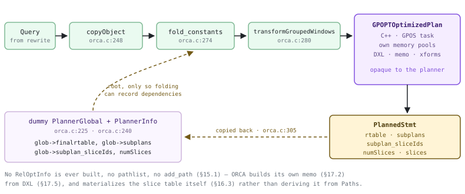

*跨越边界的内容与返回结果。左下角的 `PlannerInfo`/`PlannerGlobal` 组合尤其醒目：`optimize_query` 会构建这对结构（`orca.c`、`orca.c`），源码注释也直言它们的用途——占位。ORCA 从不接触它们。`root` 的存在，是为了让 `fold_constants()` 有地方记录函数和关系依赖；`glob` 的存在，是为了让后处理步骤有地方读取已完成计划的范围表、子计划和切片表（`orca.c` 的 `optimize_query()`）。对照 [§15.1](/cloudberry/core-internals/part-4-query-processing/ch15/#151-query-tree-structure)，其中的 `PlannerInfo` 及其 `RelOptInfo` 路径列表*就是*规划器本身；而在这里，整个结构只是围绕一个不透明调用搭建的支架。*

返回时，计划已经完整：ORCA 已将最终范围表、子计划和切片表填入 `PlannedStmt` 本身。后处理步骤把这五个字段复制到 `glob`，为每个子计划构造一个占位 `subroot`，使共用遍历器能够正常工作，再运行 PostgreSQL 规划器使用的相同收尾流程。这正是占位结构存在的全部理由：它不负责规划，而是让那些处理计划且预期存在 `PlannerGlobal` 的代码继续工作。

### 17.1.4 跨入 C++ {#1714-crossing-into-c}

`GPOPTOptimizedPlan` 在 `orca.c` 中声明为 `extern`，在 `src/backend/gpopt/CGPOptimizer.cpp` 中用 C++ 定义。它的全部职责是充当**两种错误模型之间的防火墙**：一侧是 PostgreSQL 的 `ereport`/longjmp，另一侧是 GPOS 异常。在 `GPOS_TRY` 内部，它调用 `COptTasks`；在 `GPOS_CATCH_EX` 内部，它只作一个决定：这是真正需要呈现给用户的错误，还是 ORCA 只是拒绝处理？经 ORCA 暴露出来的真正 GPDB 错误（`ExmaGPDB` / `ExmiGPDBError`，通常由 `gpdb::` 包装函数抛出）会重新作为 PostgreSQL 错误抛出，语句随之失败。其他情况都意味着没有计划，调用者会回退：

```c {title="src/backend/gpopt/CGPOptimizer.cpp — CGPOptimizer::GPOPTOptimizedPlan()"}
	GPOS_CATCH_EX(ex)
	{
		CHAR *serialized_error_msg =
			gpopt_context.CloneErrorMsg(MessageContext, &clone_failed);
		if (clone_failed || GPOS_MATCH_EX(ex, gpdxl::ExmaGPDB, gpdxl::ExmiGPDBError))
			PG_RE_THROW();                     /* a real error: the user sees it */
		...
		if (optimizer_trace_fallback)          /* CGPOptimizer.cpp:100 */
		{
			errmsg("GPORCA failed to produce a plan, falling back to Postgres-based planner");
			errdetail("%s", serialized_error_msg);
		}
		*had_unexpected_failure = gpopt_context.m_is_unexpected_failure;
	}
	GPOS_CATCH_END;
```

注意第一行的 `CloneErrorMsg`：它在销毁 ORCA 上下文*之前*将消息复制到 `MessageContext`，所以即使 ORCA 的内存全部消失，回退仍能说明原因。再深入一层，`COptTasks::Execute`（`COptTasks.cpp`）才是真正运行工作的地方：它初始化 DXL，取得一个 `CAutoMemoryPool`，将待执行函数、栈基址、连接到 `IsAbortRequested` 的中止标志，以及固定大小的错误缓冲区填入 `gpos_exec_params`，然后调用 `gpos_exec`。ORCA 作为 **GPOS 任务**运行，而不是普通函数调用，因此拥有自己的内存池、工作线程注册和错误上下文。任务写入错误缓冲区的内容会在退出时刷新到服务器日志（`LogExceptionMessageAndDelete`）；这解释了为什么即使没有人开启 ORCA 日志，日志中仍会出现 ORCA 自己的跟踪信息：

*ORCA 内部跟踪信息通过 GPOS 任务的错误缓冲区输出。这里只降低了消息级别，没有开启其他功能；`THD000` 前缀和宽字符时间戳是 GPOS 自己的日志格式，而不是 PostgreSQL 的格式。这清楚表明，文本是在 C++ 任务内部生成后再复制出来的。*

```sql
SET client_min_messages=log;   -- everything else at cluster defaults
EXPLAIN WITH RECURSIVE r(n) AS (
          SELECT 1 UNION ALL SELECT n+1 FROM r WHERE n<5) SELECT * FROM r;
```

```text {hl_lines="1" title="output"}
LOG:  2026-08-14 00:30:30:686542 CST,THD000,NOTICE,"Falling back to Postgres-based planner because GPORCA does not support the following feature: WITH RECURSIVE",
                         QUERY PLAN                          
-------------------------------------------------------------
 Recursive Union  (cost=0.00..2.69 rows=34 width=4)
   ->  Result  (cost=0.00..0.01 rows=1 width=4)
   ->  WorkTable Scan on r  (cost=0.00..0.23 rows=3 width=4)
         Filter: (n < 5)
 Optimizer: Postgres query optimizer
(5 rows)
```

### 17.1.5 回退：最重要的出口 {#1715-fallback-the-exit-that-matters-most}

ORCA 的入口判断不涉及它能处理什么，因此，不受支持的查询通过*正常的回退机制*到达 PostgreSQL 规划器。失败分为两类。`libgpos/src/_api.cpp` 中的两个数组列出了表示“这是已知情况”的异常 ID：不受支持的操作符和谓词、未找到计划、无法满足要求属性，以及对 SQL 功能尤为重要的 `ExmiQuery2DXLUnsupportedFeature`——它在将 `Query` 树转换为 DXL 时抛出。不在这些列表中的任何失败都是**意外**失败，也就是 ORCA 很可能存在缺陷：

```c {title="src/backend/gporca/libgpos/src/_api.cpp — expected_dxl_fallback"}
const ULONG expected_dxl_fallback[] = {
	gpdxl::ExmiMDObjUnsupported,             // unsupported metadata object
	gpdxl::ExmiQuery2DXLUnsupportedFeature,  // unsupported feature, algebrization
	gpdxl::ExmiDXL2PlStmtConversion,         // unsupported in PlannedStmt xlation
	...};

gpos::BOOL
IsLoggableFailure(gpos::CException &exc)
{
	...
	return (!is_opt_failure_expected && !is_dxl_failure_expected);
}
```

这个判断以 `fUnexpectedFailure` 返回，最终传入 `log_optimizer()`（`orca.c`），两个日志开关在这里生效。`optimizer_log` 默认为 **on**，但 `optimizer_log_failure` 默认为 **unexpected**。因此，服务器日志默认不记录常规回退，只在怀疑存在缺陷时记录 `GPORCA failed to produce plan (unexpected)`。面向用户的开关是另一个：`optimizer_trace_fallback` 将同一事件转换为附带原因的 `INFO` 消息。当计划看起来不对劲时，首先应使用这个开关：

*易于理解的情况。`optimizer_trace_fallback` 在 `DETAIL` 行指出不受支持的功能，末尾一行则确认眼前的计划由哪个优化器生成。这是本章最有用的诊断手段，而且可以在会话级设置。*

```sql
SET optimizer_trace_fallback=on;
EXPLAIN WITH RECURSIVE r(n) AS (
          SELECT 1 UNION ALL SELECT n+1 FROM r WHERE n<5) SELECT * FROM r;
```

```text {hl_lines="3" title="output"}
INFO:  GPORCA failed to produce a plan, falling back to Postgres-based planner
DETAIL:  Falling back to Postgres-based planner because GPORCA does not support
         the following feature: WITH RECURSIVE
                         QUERY PLAN                          
-------------------------------------------------------------
 Recursive Union  (cost=0.00..2.69 rows=34 width=4)
   ->  Result  (cost=0.00..0.01 rows=1 width=4)
   ->  WorkTable Scan on r  (cost=0.00..0.23 rows=3 width=4)
         Filter: (n < 5)
 Optimizer: Postgres query optimizer
(5 rows)
```

*不那么整齐、但很有启发性的情况。它通过与 `WITH RECURSIVE` 完全相同的异常 ID 回退，同样属于*预期*情况；只不过没有人为它编写友好的名称，因此 `DETAIL` 显示的是转换器无法处理的原始解析节点。分类与可读性是两回事：节点转储不意味着缺陷，而是表示遇到了未处理的节点类型。应查看 `:op` 和节点标签，不要被其他信息干扰。*

```sql
SET optimizer_trace_fallback=on;
EXPLAIN SELECT xmlelement(name foo, a) FROM m171_t;
```

```text {hl_lines="3" title="output"}
INFO:  GPORCA failed to produce a plan, falling back to Postgres-based planner
DETAIL:  Falling back to Postgres-based planner because GPORCA does not support the
 following feature: {XMLEXPR :op 1 :name foo :named_args <> :arg_names <> :args
 ({VAR :varno 1 :varattno 1 :vartype 23 :vartypmod -1 :varcollid 0
 :varnullingrels (b) :varlevelsup 0 :varnosyn 1 :varattnosyn 1 :location 36})
 :xmloption 0 :type 142 :typmod -1 :location 15}
                                    QUERY PLAN                                     
-----------------------------------------------------------------------------------
 Gather Motion 3:1  (slice1; segments: 3)  (cost=0.00..898.00 rows=50000 width=32)
   ->  Seq Scan on m171_t  (cost=0.00..231.33 rows=16667 width=32)
 Optimizer: Postgres query optimizer
(3 rows)
```

*验证失败分类。使用 `optimizer_log_failure=all` 时，日志包含 `GPORCA failed to produce plan`，但没有 `(unexpected)` 后缀。切换到集群默认值 `unexpected` 后，完全相同的语句不再记录任何消息：ORCA 知道这种情况。必须记住这个陷阱——日志没有消息，不能证明没有发生回退。*

```sql
SET client_min_messages=log;
SET optimizer_log_failure='all';
EXPLAIN WITH RECURSIVE r(n) AS (SELECT 1 UNION ALL SELECT n+1 FROM r WHERE n<5)
        SELECT * FROM r;
SET optimizer_log_failure='unexpected';   -- the default
EXPLAIN WITH RECURSIVE r(n) AS (SELECT 1 UNION ALL SELECT n+1 FROM r WHERE n<5)
        SELECT * FROM r;
```

```text {hl_lines="3" title="output"}
LOG:  2026-08-14 00:30:17:782036 CST,THD000,NOTICE,"Falling back to Postgres-based
      planner because GPORCA does not support the following feature: WITH RECURSIVE",
LOG:  GPORCA failed to produce plan
...
 Optimizer: Postgres query optimizer
(5 rows)

LOG:  2026-08-14 00:30:17:803390 CST,THD000,NOTICE,"Falling back to Postgres-based
      planner because GPORCA does not support the following feature: WITH RECURSIVE",
...
 Optimizer: Postgres query optimizer
(5 rows)
```

*三种回退，三种计时特征。递归查询完整承担 ORCA 的开销，然后将结果丢弃：ORCA 花费 22 ms，随后 PostgreSQL 规划器花费 0.5 ms 生成实际采用的计划。PARALLEL RETRIEVE CURSOR 根本不进入入口，因此完全没有 `Optimizer Time` 行。可更新游标会进入入口，但在 `optimize_query` 的第一行就被拒绝，其特征十分明显：0.001 ms。学会识别这三种形态，无须阅读源码就能知道回退是*在哪里*决定的。*

```sql
SET client_min_messages=log;
SET gp_log_optimization_time=on;
EXPLAIN WITH RECURSIVE r(n) AS (SELECT 1 UNION ALL SELECT n+1 FROM r WHERE n<5)
        SELECT * FROM r;
BEGIN;
DECLARE c1 PARALLEL RETRIEVE CURSOR FOR SELECT * FROM m171_t;
DECLARE c2 CURSOR FOR SELECT * FROM m171_t FOR UPDATE;
ROLLBACK;
```

```text {hl_lines="10" title="output"}
-- WITH RECURSIVE: ORCA ran, threw, and the work was wasted
LOG:  Optimizer Time: 22.426 ms
LOG:  Planner Time: 0.460 ms

-- PARALLEL RETRIEVE CURSOR: gated at planner.c:398, ORCA never entered
LOG:  Planner Time: 1.311 ms
DECLARE PARALLEL RETRIEVE CURSOR

-- updatable cursor: gate opened, rejected at orca.c:218
LOG:  Optimizer Time: 0.001 ms
LOG:  Planner Time: 0.222 ms
DECLARE CURSOR
```

| 运行的内容 | 决策发生的位置 | 如何识别 |
| --- | --- | --- |
| `WITH RECURSIVE …` | Query→DXL 期间的 ORCA 异常；属于*预期*情况 | `INFO` + `DETAIL: … does not support the following feature: WITH RECURSIVE` |
| `SELECT xmlelement(name foo, a) …` | 相同异常 ID；仍属于*预期*情况 | `DETAIL` 是原始节点转储，`{XMLEXPR :op 1 …}` |
| `INSERT … ON CONFLICT DO UPDATE` | Query→DXL；属于*预期*情况 | `DETAIL: … the following feature: ON CONFLICT clause` |
| `SELECT … TABLESAMPLE SYSTEM (1)` | Query→DXL；属于*预期*情况 | `DETAIL: … TABLESAMPLE in the FROM clause` |
| 使用 `optimizer_enable_motions=off` 的任何分布式查询 | 搜索之后：没有结果满足要求属性 | `DETAIL: … no plan has been computed for required properties`；ORCA 自己的跟踪信息以 `ERROR` 而非 `NOTICE` 级别输出 |
| `DECLARE c CURSOR FOR … FOR UPDATE` | `orca.c`（`optimize_query()`），在调用 ORCA 之前 | 完全没有 `INFO`；`Optimizer Time: 0.001 ms` |
| `DECLARE c PARALLEL RETRIEVE CURSOR FOR …` | `planner.c`（`standard_planner()`）中的入口判断——从未进入 ORCA | 没有 `INFO`，**也没有** `Optimizer Time` 行，只有 `Planner Time` |
| 在 Segment 上或 utility 模式中运行的任何内容 | 同一个入口判断（`Gp_role`、`IS_QUERY_DISPATCHER()`） | 末尾为 `Optimizer: Postgres query optimizer`，但 `optimizer` 仍显示 `on` |

因此，诊断顺序是：先看**末尾一行**（哪个优化器生成了计划），再执行 `SET optimizer_trace_fallback=on` 并重新 EXPLAIN（ORCA 为什么拒绝处理），然后执行 `SET gp_log_optimization_time=on`（决策在何处作出、产生了多少开销）。上述实验还带来两点校准。首先，不要猜测哪些查询会回退：在本集群中，`GROUPING SETS`、`percentile_cont(...) WITHIN GROUP`、`to_tsvector`，以及带子查询的普通 `SELECT … FOR UPDATE`，都仍由 GPORCA 处理——不受支持功能的清单，比惯常说法更短，也更出人意料。其次，这里触发的每次回退都被归为*预期*情况，正因如此，默认设置不会输出消息。真正值得关注的是意外失败；对于这类失败，ORCA 可以将查询、元数据和配置写成自包含、可重放的转储。这套机制位于 `libgpopt/src/minidump/`，由 `optimizer_minidump` 控制（默认为 `onerror`）。入口已经厘清，后续各节将深入其中：[§17.2](#172-the-cascades-engine) 展开 memo 和搜索，[§17.3](#173-transformation-framework) 介绍变换，[§17.4](#174-metadata-layer--cost-model) 介绍元数据与代价，[§17.5](#175-translation-query--dxl--plstmt) 介绍两端的 DXL 转换器，[§17.6](#176-steering--introspection) 则说明会话中的一条 `SET` 如何到达一个完全不知道 GUC 的 C++ 优化器。

## 17.2 Cascades 引擎 {#172-the-cascades-engine}

PostgreSQL 的规划器会**沿路径自底向上**搜索：它为每个 `RelOptInfo` 构造具体的 `Path` 节点，并让 `add_path` 丢弃被支配的节点（[§15.1](/cloudberry/core-internals/part-4-query-processing/ch15/#151-query-tree-structure)、[§15.3](/cloudberry/core-internals/part-4-query-processing/ch15/#153-path-cost--add_path)）。ORCA 则**在 memo 上自顶向下**搜索。memo 是一组编号的**组**；每个组都是一组表达式的等价类，这些表达式计算出的逻辑结果都相同；组中的每个成员都是一个**组表达式**——它由一个操作符和一列*子组 ID*组成，而不是子表达式。由于子节点是组，一个组表达式就代表了整个子计划族；几十个条目的 memo 可以编码数千个计划。搜索期间不会把任何内容组装成计划树；直到最后，才从 memo 中*重构*出胜者。

搜索由向下流动的**要求属性**（输出列、排序顺序、分布、可回卷性、分区传播）以及向上回流的**推导属性**驱动。当物理操作符无法提供所要求的属性时，引擎不会拒绝它，而是在上面叠加一个**强制器**：用 `CPhysicalMotion…` 强制分布，用 `CPhysicalSort` 强制顺序。这句话正是它与第 [15](/cloudberry/core-internals/part-4-query-processing/ch15/)–[16](/cloudberry/core-internals/part-4-query-processing/ch16/) 章最深层的区别：分布式规划器发现分布位置不匹配时会*调用* `cdbpath_create_motion_path`（[§16.2](/cloudberry/core-internals/part-4-query-processing/ch16/#162-cdbmotionpath-generation)），而 ORCA 的 Motion 只是作为另一个经过代价计算的备选项*出现在组中*。整个引擎位于 `src/backend/gporca/libgpopt/src/engine/CEngine.cpp`（2407 行）和 `libgpopt/src/search/` 中；`CMemo` 自身的类注释准确地称它为 `Dynamic programming table`（`libgpopt/include/gpopt/search/CMemo.h`）。

| 前缀／后缀 | 含义及真实示例 |
| --- | --- |
| `P…` | 返回或持有一个**指针**。`Pexpr` = `CExpression *`，`Pgexpr` = `CGroupExpression *`，`Pgroup` = `CGroup *`，`Poc` = `COptimizationContext *`，`Pcc` = `CCostContext *`，`Prpp` = `CReqdPropPlan *`，`Pdp` = `CDrvdProp *`，`Pop` = `COperator *`，`Pss` = `CSearchStage *`，`Pdxln` = `CDXLNode *`（[§17.5](#175-translation-query--dxl--plstmt)）。 |
| `F…` | 返回一个 **BOOL**：`FSafeToPrune`、`FSearchTerminated`、`FScalar`、`FExplored`、`FCheckEnfdProps`。 |
| `Ul…`／`Ull…` | 一个 **ULONG／ULLONG** 计数：`UlpGroups`、`UlGrpExprs`、`UllCount`、`ulJobs`、`ulSearchStages`。 |
| `Os…` | 向一个 **ostream** 输出：`OsPrint`、`OsPrintMemoryConsumption`。本节的每个 memo 转储都是一个 `OsPrint`。 |
| `Pdrgp…` | 一个**指针动态数组**：`pdrgpexpr`（表达式）、`pdrgpoc`（子优化上下文）、`pdrgpgroup`（子组）。 |
| `Exf…`／`Eop…`／`Eol…`／`Est…`／`Epet…` | 枚举成员：变换规则 ID（`ExfExpandNAryJoinDPv2`、`ExfInvalid`）、操作符 ID、优化级别（`EolHigh`）、状态（`estExplored`）、属性强制类型（`EpetRequired`）。 |
| `m_…` | 一个成员字段：`m_pmemo`、`m_pqc`、`m_search_stage_array`、`m_eol`、`m_estate`。 |

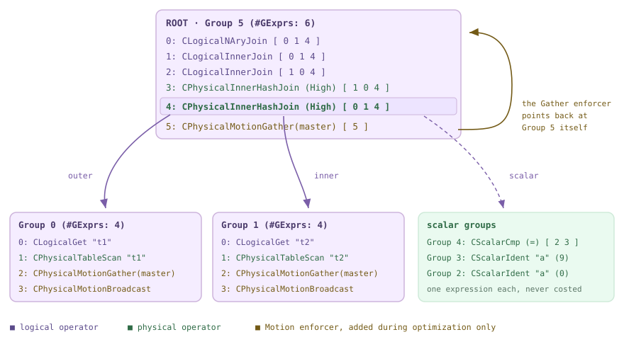

*两个表自连接的 memo，取自下面优化器实际打印的转储。组表达式用组 ID 命名其子节点，因此一个条目代表整个子计划族。*

### 17.2.1 阅读真实的 memo {#1721-reading-a-real-memo}

*优化器自行打印的两个表自连接的完整 memo。本次构建启用了 `--enable-cassert`，因此定义了 `GPOS_DEBUG`（`pg_config.h`），ORCA 的开发者打印跟踪标志确实会输出内容——它们是本章的主要观测工具。*

```sql
CREATE TABLE m172_t(a int);   -- distributed by a
INSERT INTO m172_t SELECT g FROM generate_series(1,1000) g;
ANALYZE m172_t;

SET client_min_messages=log;
SET optimizer_print_memo_after_optimization=on;
EXPLAIN SELECT * FROM m172_t t1 JOIN m172_t t2 ON t1.a=t2.a;
```

```text {hl_lines="11" title="output"}
LOG:  2026-08-14 00:28:26:507616 CST,THD000,TRACE,"MEMO after optimization (stage 0):
",
2026-08-14 00:28:26:507954 CST,THD000,TRACE,"
ROOT
Group 5 (#GExprs: 6):
  0: CLogicalNAryJoin [ 0 1 4 ]
  1: CLogicalInnerJoin [ 0 1 4 ]
  2: CLogicalInnerJoin [ 1 0 4 ]
  3: CPhysicalInnerHashJoin (High) [ 1 0 4 ]
  4: CPhysicalInnerHashJoin (High) [ 0 1 4 ]
  5: CPhysicalMotionGather(master) [ 5 ]

Group 4 ():
  0: CScalarCmp (=) [ 2 3 ]
Group 3 ():
  0: CScalarIdent "a" (9,Used) [ ]
Group 2 ():
  0: CScalarIdent "a" (0,Used) [ ]

Group 1 (#GExprs: 4):
  0: CLogicalGet "t2" ("t2"), Columns: ["a" (9,Used), … ] Key sets: {[1,7]} [ ]
  1: CPhysicalTableScan "t2" ("t2"), Columns: [ … ] [ ]
  2: CPhysicalMotionGather(master) [ 1 ]
  3: CPhysicalMotionBroadcast  [ 1 ]

Group 0 (#GExprs: 4):
  0: CLogicalGet "t1" ("t1"), Columns: ["a" (0,Used), … ] Key sets: {[1,7]} [ ]
  1: CPhysicalTableScan "t1" ("t1"), Columns: [ … ] [ ]
  2: CPhysicalMotionGather(master) [ 0 ]
  3: CPhysicalMotionBroadcast  [ 0 ]
",
                                   QUERY PLAN
 Gather Motion 3:1  (slice1; segments: 3)  (cost=0.00..862.18 rows=1000 width=8)
   ->  Hash Join  (cost=0.00..862.15 rows=334 width=8)
         Hash Cond: (t1.a = t2.a)
         ->  Seq Scan on m172_t t1  (cost=0.00..431.01 rows=334 width=4)
         ->  Hash  (cost=431.01..431.01 rows=334 width=4)
               ->  Seq Scan on m172_t t2  (cost=0.00..431.01 rows=334 width=4)
 Optimizer: GPORCA
```

从 `ROOT` 标签向下阅读。`Group 5 (#GExprs: 6)` 是根等价类，其中有六个组表达式，在组内编号。每个操作符后面的方括号列表是**子组 ID**，顺序与操作符参数一致：`CPhysicalInnerHashJoin (High) [ 0 1 4 ]` 表示*外侧 = Group 0，内侧 = Group 1，标量谓词 = Group 4*。组 2、3、4 打印的是空的 `()`，而不是 `#GExprs` 计数——它们是**标量组**，恰好包含一个表达式，从不参与代价计算；它们的子节点链接负责把 `CScalarIdent "a" (0)` 接回产生列 0 的 `CLogicalGet`（可对照 `README.memo.md`，该文件手工演示了相同的结构）。`(High)` 是 `libgpopt/include/gpopt/search/CGroup.h` 中的 `EOptimizationLevel`：`CGroupExpression::SetOptimizationLevel`（`libgpopt/src/search/CGroupExpression.cpp`）会把哈希连接和哈希聚合提升为 `EolHigh`，使它们在*竞争者之前*得到优化，并尽早建立一个较低的代价界限。

现在看看 Group 5 中有哪些条目。`CLogicalNAryJoin`、两个交换了子节点的 `CLogicalInnerJoin`、两个 `CPhysicalInnerHashJoin` 以及一个 `CPhysicalMotionGather(master)` 全部位于**同一个**组中，因为它们在逻辑上表示同一个关系。这里没有单独的“路径列表”，也没有单独的“计划树”：逻辑备选项、物理实现和强制器交错放在同一个容器中，只通过操作符类加以区分。在组 0 和组 1（两个扫描）中，物理备选项是 `CPhysicalTableScan`、`CPhysicalMotionGather(master)` 和 `CPhysicalMotionBroadcast`。**Motion 是一个 memo 条目。** 在 [§16.2](/cloudberry/core-internals/part-4-query-processing/ch16/#162-cdbmotionpath-generation) 中，分布式规划器发现分布位置不匹配后*插入*了一个 `MotionPath`；这里 ORCA 只记录 Group 0 的广播也是得到 Group 0 的一种方式，为它计算代价，然后让搜索决定。Group 5 的条目 5 明确展示了这个技巧：Gather 的唯一子节点是 `[ 5 ]`，也就是 Group 5 自身。

> [!NOTE]
> 判断是否确实在看 ORCA，最直接的一行是 EXPLAIN 页脚：`Optimizer: GPORCA`。第 [15](/cloudberry/core-internals/part-4-query-processing/ch15/) 和 [16](/cloudberry/core-internals/part-4-query-processing/ch16/) 章的每个演示都在 `SET optimizer=off` 下运行，得到 `Optimizer: Postgres query optimizer`；本章使用集群默认值，即 `on`。[§17.1](#171-entry--dispatch) 介绍控制流如何到达 ORCA，以及它如何回退。

### 17.2.2 memo 机制：组、组表达式与哈希 {#1722-memo-mechanics-groups-group-expressions-hashing}

三个类承载着这个结构。`CGroup`（`libgpopt/src/search/CGroup.cpp`，2163 行）是“Memo 结构中的等价表达式组”：包含 ID、状态、推导的关系属性、统计信息、组表达式列表，以及优化上下文映射。`CGroupExpression`（1232 行）由一个 `COperator *m_pop` 和一个 `CGroupArray *m_pdrgpgroup` 组成，同时还会记住**是哪个 xform 创建了它**（`m_exfidOrigin`），并维护一个用于剪枝的部分计划代价映射（`libgpopt/include/gpopt/search/CGroupExpression.h`）。`CGroupProxy` 是一个有作用域的访问器——它的类注释只有一句“对给定组的独占访问”（`CGroupProxy.h`）——引擎中对组的每次修改都发生在 `{ CGroupProxy gp(pgroup); … }` 代码块内，这正是代码看起来像一系列带大括号的小作用域的原因。

```c {title="src/backend/gporca/libgpopt/src/search/CMemo.cpp — CMemo::PgroupInsert()"}
	ShtAcc shta(m_sht, *pgexpr);

	// we do a lookup since group expression may have been already inserted
	CGroupExpression *pgexprFound = shta.Find();
	if (nullptr == pgexprFound)
	{
		shta.Insert(pgexpr);
		// group proxy scope: gp.Insert(pgexpr), then Add() if this is a new group
		…
		return pgexpr->Pgroup();
	}

	return pgexprFound->Pgroup();
```

这就是 memo 的核心：**所有组表达式共用的一张哈希表** `m_sht`。插入其实是查找；如果表达式已经存在，插入就“失败”，调用者会拿回已经包含该表达式的组。`CEngine::PgroupInsert`（`CEngine.cpp`）先插入子节点，再插入父节点，因此 xform 结果重新发现一个已知子树时，除了哈希计算之外没有其他开销。哈希之所以便宜，正是因为子节点是组：

```c {title="src/backend/gporca/libgpopt/src/search/CGroupExpression.cpp — CGroupExpression::HashValue()"}
	ULONG ulHash = pop->HashValue();

	ULONG arity = pdrgpgroup->Size();
	for (ULONG i = 0; i < arity; i++)
	{
		ulHash = CombineHashes(ulHash, (*pdrgpgroup)[i]->HashValue());
	}
```

对操作符及其子*组 ID*进行哈希的复杂度是 O(arity)，而不是 O(subtree)。因此，“逻辑等价”会变成一次哈希表命中，而不是树比较——正是这一性质让 Cascades 的开销变得可承受。两个组在事后仍可能被发现是重复的：`CEngine::InsertXformResult`（`CEngine.cpp`）会注意到某个 xform 结果落入了不同于源组的组中，检查 `FPossibleDuplicateGroups`（目前只比较输出列），然后调用 `CMemo::MarkDuplicates`（`CMemo.cpp`）。这些维护工作在探索结束时统一完成：`CMemo::GroupMerge` 持续合并并重新哈希（`FRehash`），直到不再出现新的重复项；如果根组本身被合并，还会更新根指针。

*`optimizer_print_optimization_stats` 报告引擎实际构建的 memo，以及哪些变换规则被触发。六个组、十七个组表达式——这就是这个连接的全部搜索空间。*

```sql
SET client_min_messages=log;
SET optimizer_print_optimization_stats=on;
EXPLAIN SELECT * FROM m172_t t1 JOIN m172_t t2 ON t1.a=t2.a;
```

```text {hl_lines="7" title="output"}
LOG:  2026-08-14 00:29:19:430966 CST,THD000,TRACE,"timer:
[OPT]: Group Merge Time: 0ms",
2026-08-14 00:29:19:434291 CST,THD000,TRACE,"timer:
[OPT]: Statistics Derivation Time (stage 0) : 3ms",
…
2026-08-14 00:29:19:437005 CST,THD000,TRACE,"
[OPT]: Memo (stage 0): [6 groups, 0 duplicate groups, 17 group expressions, 4 activated xforms]
[OPT]: stage 0 completed in 12ms,  plan with cost 862.180385 was found
[OPT]: <Begin Xforms - stage 0>
CXformGet2TableScan: 2 calls, 2 total bindings, 2 alternatives generated, 0ms
CXformInnerJoinCommutativity: 1 calls, 1 total bindings, 1 alternatives generated, 0ms
CXformExpandNAryJoinDPv2: 1 calls, 1 total bindings, 3 alternatives generated, 5ms
CXformImplementInnerJoin: 2 calls, 2 total bindings, 2 alternatives generated, 0ms
[OPT]: <End Xforms - stage 0>
",
2026-08-14 00:29:19:437027 CST,THD000,TRACE,"[OPT]: Search terminated at stage 1/1",
```

### 17.2.3 三个阶段：探索、实现、优化 {#1723-three-phases-exploration-implementation-optimization}

每个组都会沿着同一条状态阶梯前进——`estUnexplored`、`estExploring`、`estExplored`、`estImplementing`、`estImplemented`、`estOptimizing`、`estOptimized`（`CGroup.h` — `CGroup`）。**探索**只应用逻辑 xform，扩展逻辑备选项；**实现**只应用实现 xform，把逻辑操作符转换为物理操作符；**优化**则根据要求属性为物理备选项计算代价，并添加强制器。阶段通过求三个 xform 集合的交集来选择——阶段集合、操作符的候选集合，以及当前搜索阶段的集合（`CEngine.cpp` — `CEngine::TransitionGroupExpression()`）：先取 `PxfsExploration()` 或 `PxfsImplementation()`，再取 `CLogical::PxfsCandidates`，最后取 `PxfsCurrentStage()`。阶段之间，`FinalizeExploration` 会运行 `GroupMerge` 并为每个组推导统计信息，而 `FinalizeImplementation` 的主要用途是打印。哪些变换属于哪个集合，是 [§17.3](#173-transformation-framework) 要讨论的主题。

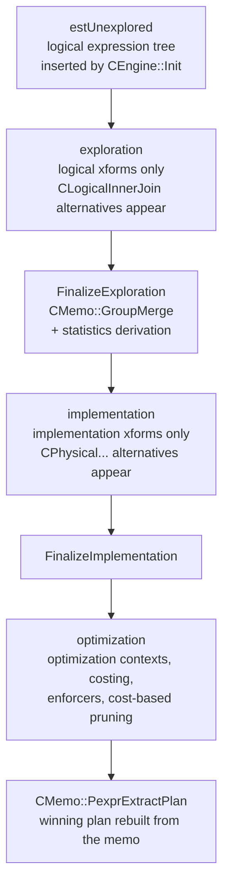

*阶段流水线。探索和实现会扩展 memo；只有优化阶段会计算代价，也只有优化阶段会添加强制器。*

*同一个查询分别在三个会话中各启用一个打印跟踪标志。Group 5 从 3 → 5 → 6 个条目增长，Group 0 从 1 → 2 → 4 个条目增长；Motion 只在最后一次转储中出现。*

```sql
-- three separate sessions, one traceflag each, same query
SET optimizer_print_memo_after_exploration=on;    -- (1)
SET optimizer_print_memo_after_implementation=on; -- (2)
SET optimizer_print_memo_after_optimization=on;   -- (3)
EXPLAIN SELECT * FROM m172_t t1 JOIN m172_t t2 ON t1.a=t2.a;
```

```text {hl_lines="29" title="output"}
(1) MEMO after exploration (stage 0)
ROOT
Group 5 (#GExprs: 3):
  0: CLogicalNAryJoin [ 0 1 4 ]
  1: CLogicalInnerJoin [ 0 1 4 ]
  2: CLogicalInnerJoin [ 1 0 4 ]
…
Group 0 (#GExprs: 1):
  0: CLogicalGet "t1" ("t1"), … [ ]

(2) MEMO after implementation (stage 0)
Group 5 (#GExprs: 5):
  …
  3: CPhysicalInnerHashJoin (High) [ 1 0 4 ]
  4: CPhysicalInnerHashJoin (High) [ 0 1 4 ]
…
Group 0 (#GExprs: 2):
  0: CLogicalGet "t1" ("t1"), … [ ]
  1: CPhysicalTableScan "t1" ("t1"), … [ ]

(3) MEMO after optimization (stage 0):
Group 5 (#GExprs: 6):
  …
  5: CPhysicalMotionGather(master) [ 5 ]
…
Group 0 (#GExprs: 4):
  0: CLogicalGet "t1" ("t1"), … [ ]
  1: CPhysicalTableScan "t1" ("t1"), … [ ]
  2: CPhysicalMotionGather(master) [ 0 ]
  3: CPhysicalMotionBroadcast  [ 0 ]
```

这清楚地证明了 **Motion 不是实现规则**。实现结束后，Group 0 只知道如何扫描 `t1`；Gather 和 Broadcast 在优化期间出现，`CEngine::AddEnforcers`（`CEngine.cpp`）将它们插入，并以 `CXform::ExfInvalid` 作为其源 xform——它们不是由任何变换产生的，而是由扫描无法满足的要求属性产生的。引擎还保留了一条便于调试的非调度器路径，专门用于执行这一步：`CEngine::Explore`、`Implement` 和 `RecursiveOptimize` 通过对 `TransitionGroup`/`TransitionGroupExpression` 进行普通递归来运行三个阶段。`CEngine.cpp` 中的这一整段代码只在 `GPOS_DEBUG` 下编译，因此它存在于启用了断言的构建中，而发布构建中不存在。

### 17.2.4 作业与调度器 {#1724-jobs-and-the-scheduler}

在生产环境中，ORCA 不会递归执行。`CEngine::Optimize` 根据 memo 的大小设置作业池，然后运行一个队列：

```c {title="src/backend/gporca/libgpopt/src/engine/CEngine.cpp"}
	const ULONG ulJobs =
		std::min((ULONG) GPOPT_JOBS_CAP,
				 (ULONG)(m_pmemo->UlpGroups() * GPOPT_JOBS_PER_GROUP));
	CJobFactory jf(m_mp, ulJobs);
	CScheduler sched(m_mp, ulJobs);

	CSchedulerContext sc;
	sc.Init(m_mp, &jf, &sched, this);

	const ULONG ulSearchStages = m_search_stage_array->Size();
	for (ULONG ul = 0; !FSearchTerminated() && ul < ulSearchStages; ul++)
	{
		… ScheduleMainJob(&sc, poc); CScheduler::Run(&sc); …
```

`GPOPT_JOBS_CAP` 是 5000，`GPOPT_JOBS_PER_GROUP` 是 20（`CEngine.cpp`），因此预分配大小为 `min(5000, groups × 20)`——这只是内存池大小提示，不是对实际工作量的限制。`CJobFactory` 从按类型划分的对象池中发放作业（`CJobFactory.cpp` — `CJobFactory::PjCreate()`），而 `CScheduler::ExecuteJobs`（`CScheduler.cpp`）是一个扁平循环：取出作业、执行它，再把结果归类为 `EjrCompleted`、`EjrRunnable` 或 `EjrSuspended`。**递归正是在挂起处消失的。** 需要先优化子节点的作业会安排子作业并挂起（`CScheduler::Add`；`Suspend`）；最后一个子作业完成后，`ResumeParent` 会把它重新放回队列。作业依赖关系*就是*被显式展开的调用栈——而这种按组、按组表达式和按变换分别创建一个作业的分解方式，正是 Cascades 的“任务”设计。

| 作业类 | 一个实例执行的操作 |
| --- | --- |
| `CJobGroupExploration`／`…Implementation`／`…Optimization` | 驱动一个**组**达到 `estExplored`／`estImplemented`／在上下文下完成优化。探索作业和实现作业会在根组上调用 `FinalizeExploration`／`FinalizeImplementation`（`CJobGroupExploration.cpp` — `CJobGroupExploration::EevtExploreChildren()`；`CJobGroupImplementation.cpp` — `CJobGroupImplementation::EevtImplementChildren()`）。 |
| `CJobGroupExpressionExploration`／`…Implementation` | 驱动一个**组表达式**：先推进其子组的状态，然后为每个适用的 xform 安排一个变换作业。 |
| `CJobGroupExpressionOptimization` | 最大的作业类（807 行）。针对每个组表达式*和*优化上下文：计算子节点要求，优化子节点，添加强制器，并为自身计算代价。 |
| `CJobTransformation` | 将一个 xform 应用于一个组表达式，并插入结果（`CEngine::InsertXformResult`）。 |
| `CJobQueue` | 让多个作业等待同一项共享工作，避免重复执行——同一个组永远不会被多个作业并发探索。 |

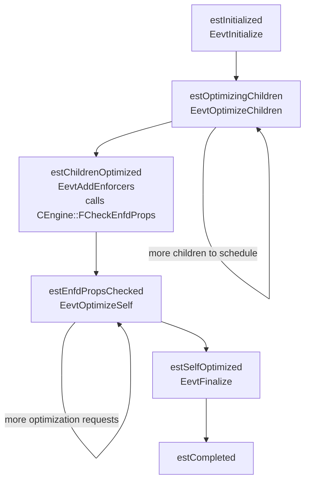

*`CJobGroupExpressionOptimization` 的状态机，根据其源码文件开头的 ASCII 图转录而成（`CJobGroupExpressionOptimization.cpp`）。注意强制器出现的位置：子节点优化完成后、操作符自身计算代价之前。*

### 17.2.5 要求属性、强制器与优化上下文 {#1725-required-properties-enforcers-and-optimization-contexts}

**优化上下文**是一个（组、要求的计划属性）对，也是搜索实际执行优化的单位。`CEngine::Optimize` 根据查询上下文的 `Prpp()` 所给出的属性要求，直接构造根上下文。这些是整个查询必须提供的属性；在 Coordinator 上，这意味着 `SINGLETON (master)`。随后，每个 `CJobGroupExpressionOptimization` 推导子节点要求，并递归地要求子组在*这些要求*下给出计划。因此，一个组会积累多个上下文，并记住每个上下文对应的最佳组表达式。启用 `optimizer_print_optimization_context` 后，memo 转储会增加一个 `Grp OptCtxts` 部分，具体展示这一点：

*Group 0（`t1` 的扫描）被要求满足七种不同的属性要求。其中两种要求只能通过在扫描上叠加 Motion 才能满足。*

```sql
SET client_min_messages=log;
SET optimizer_print_memo_after_optimization=on;
SET optimizer_print_optimization_context=on;
EXPLAIN SELECT * FROM m172_t t1 JOIN m172_t t2 ON t1.a=t2.a;
```

```text {hl_lines="19" title="output"}
Group 0 (#GExprs: 4):
  0: CLogicalGet "t1" ("t1"), … [ ]
  1: CPhysicalTableScan "t1" ("t1"), … [ ]
    Cost Ctxts:
      main ctxt (stage 0)3.0, child ctxts:[], rows:1000.000000 (group), cost: 431.006967
      …
  2: CPhysicalMotionGather(master) [ 0 ]
    Cost Ctxts:
      main ctxt (stage 0)0.0, child ctxts:[1], rows:1000.000000 (group), cost: 431.024353
  3: CPhysicalMotionBroadcast  [ 0 ]
    Cost Ctxts:
      main ctxt (stage 0)5.0, child ctxts:[1], rows:1000.000000 (group), cost: 431.081047
  Grp OptCtxts:
    0 (stage 0): (… req order: [<empty> match: satisfy ], req dist: [SINGLETON (master) match: exact], …) => Best Expr:2
    1 (stage 0): (… req dist: [ANY  EOperatorId: 133  match: satisfy], …) => Best Expr:1
    2 (stage 0): (… req dist: [NON-SINGLETON  match: satisfy], …) => Best Expr:1
    3 (stage 0): (… req dist: [HASHED: [ CScalarIdent "a" (0,Used), nulls colocated ], opfamilies: (0.1977.1.0), match: exact], …) => Best Expr:1
    4 (stage 0): (… req dist: [SINGLETON (master) match: satisfy], …) => Best Expr:2
    5 (stage 0): (… req dist: [REPLICATED match: satisfy], …) => Best Expr:3
    6 (stage 0): (… req dist: [HASHED: … match: satisfy], …) => Best Expr:1
```

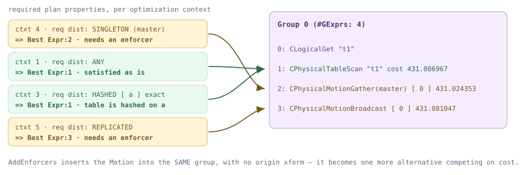

*Group 0 的七个优化上下文中的四个，以及它们各自选出的组表达式。在分布键上使用 `HASHED` 和 `ANY` 不需要额外代价——扫描已经提供了它们。`SINGLETON (master)` 和 `REPLICATED` 则不是，因此最终选择了强制器。*

决策由 `CEngine::FCheckEnfdProps`（`CEngine.cpp`）作出，它由优化作业的 `EevtAddEnforcers` 状态调用（`CJobGroupExpressionOptimization.cpp`）。对于每个可强制的属性——顺序、分布、可回卷性、分区传播——它会要求物理操作符将要求归类为 `EpetRequired`（操作符无法提供该属性：叠加强制器）、`EpetOptional`（把要求传递给子节点并保留它）、`EpetUnnecessary`（已经提供）或 `EpetProhibited`（`libgpopt/include/gpopt/base/CEnfdProp.h` — `CEnfdProp` 的注释用示例说明了这四种类型）。一个 `EpetProhibited` 就会否决该表达式和上下文的*全部*强制器。随后，`AppendEnforcers` 构造强制器表达式，`AddEnforcers` 将它们放入组中。注意头文件注释强调的内容：强制器一旦插入，就与触发它的操作符没有关系；在计算代价时，Gather 完全可能选择一个*不同的*组表达式作为其子节点，因为组内的所有成员都是等价的。这是 ORCA 对 [§16.1](/cloudberry/core-internals/part-4-query-processing/ch16/#161-the-locus-model-cdbpathlocus) 中 `CdbPathLocus` 的回答：思想相同——关系的分布是一种必须被请求、提供或修复的属性；只不过这里是在搜索引擎中以要求／推导属性对实现，而不是作为 `Path` 上的一个字段。

### 17.2.6 搜索阶段、终止与基于代价的剪枝 {#1726-search-stages-termination-and-cost-based-pruning}

`CEngine::Optimize` 中的 `for` 循环遍历一个 `CSearchStageArray`。一个阶段由三部分组成：一组 xform、一个时间阈值和一个代价阈值（`CSearchStage.cpp`）。默认策略——`CSearchStage::PdrgpssDefault`——只有一个阶段，其中包含所有探索 xform，且没有阈值；因此上面的统计信息会显示 `Search terminated at stage 1/1`。非默认策略从 `optimizer_search_strategy_path` 指定的 DXL 文件加载（调用 `COptTasks::LoadSearchStrategy`，位于 `src/backend/gpopt/utils/COptTasks.cpp`）；仓库在 `src/backend/gporca/data/dxl/search/` 下提供了示例。阶段之间会重置状态（`FinalizeSearchStage`、`CEngine.cpp`），但会保留 memo；循环条件 `!FSearchTerminated()`（`CEngine.h`）只有一个含义：*只要某个已完成的阶段找到代价低于或等于其代价阈值的计划，就立即停止*（`CSearchStage::FAchievedReqdCost`、`CSearchStage.h`）。阶段如果耗尽时间，只会停止应用 xform（`FTimedOut`），然后让下一个阶段尝试。

*一个两阶段策略，其第一阶段具有宽松的代价阈值。阶段 0 找到低于该阈值的计划，因此不会进入阶段 1；由于该阶段限制了 xform 集合，memo 中只有 14 个组表达式，而不是 17 个。*

```sql
-- /tmp/cbdb-two-stage.xml declares two dxl:SearchStage elements,
-- the first with TimeThreshold=1000 CostThreshold=10E6
SET client_min_messages=log;
SET optimizer_print_optimization_stats=on;
SET optimizer_search_strategy_path='/tmp/cbdb-two-stage.xml';
EXPLAIN SELECT * FROM m172_t t1 JOIN m172_t t2 ON t1.a=t2.a;
```

```text {hl_lines="6" title="output"}
LOG:  … TRACE,"
[OPT]: Memo (stage 0): [6 groups, 0 duplicate groups, 14 group expressions, 3 activated xforms]
[OPT]: stage 0 completed in 5ms,  plan with cost 862.180385 was found
…
",
2026-08-14 00:35:48:950477 CST,THD000,TRACE,"[OPT]: Search terminated at stage 1/2",
 Optimizer: GPORCA
```

```c {title="src/backend/gporca/libgpopt/src/engine/CEngine.cpp — CEngine::FSafeToPrune()"}
	// check if container group has a plan for given properties
	CGroup *pgroup = pgexpr->Pgroup();
	COptimizationContext *pocGroup =
		pgroup->PocLookupBest(m_mp, UlSearchStages(), prpp);
	if (nullptr != pocGroup && nullptr != pocGroup->PccBest())
	{
		CCost costLowerBound =
			pgexpr->CostLowerBound(m_mp, prpp, pccChild, child_index);
		*pcostLowerBound = costLowerBound;
		if (costLowerBound > pocGroup->PccBest()->Cost())
		{
			// group expression cannot deliver a better plan … can be safely pruned
			return true;
```

*memo 中的分支定界。两个索引嵌套循环连接的*下界*为 65.0，而该组已经有一个代价为 12.0 的哈希连接，因此它们被放弃；其下的子树根本不会得到优化。*

```sql
CREATE INDEX m172_t_a_idx ON m172_t(a);
SET optimizer_print_memo_after_optimization=on;
SET optimizer_print_optimization_context=on;
EXPLAIN SELECT * FROM m172_t t1, m172_t t2 WHERE t1.a=t2.a AND t1.a < 10;
```

```text {hl_lines="6" title="output"}
ROOT
Group 10 (#GExprs: 14):
  …
  7: CPhysicalInnerIndexNLJoin [ 8 18 14 ]
    Cost Ctxts:
      main ctxt (stage 0)0.3, cost lower bound: 65.002316   PRUNED
      main ctxt (stage 0)1.3, cost lower bound: 65.002130   PRUNED
  8: CPhysicalInnerIndexNLJoin [ 8 17 14 ]
    Cost Ctxts:
      main ctxt (stage 0)0.3, cost lower bound: 65.002315   PRUNED
      main ctxt (stage 0)1.3, cost lower bound: 65.002129   PRUNED
  9: CPhysicalInnerHashJoin (High) [ 8 4 9 ]
    Cost Ctxts:
      main ctxt (stage 0)0.3, child ctxts:[4, 4], rows:10.000000 (group), cost: 12.006325
      main ctxt (stage 0)1.0, child ctxts:[6, 6], rows:10.000000 (group), cost: 12.003394
  …
  13: CPhysicalMotionGather(master) [ 10 ]
  Grp OptCtxts:
    0 (stage 0): (… req dist: [SINGLETON (master) match: satisfy], …) => Best Expr:13
```

`FSafeToPrune` 是 Cascades 中对应于 `add_path` 支配性测试的实现（[§15.3](/cloudberry/core-internals/part-4-query-processing/ch15/#153-path-cost--add_path)），但它在一个方面更强，在另一个方面更弱。`add_path` 根据代价和 pathkeys 比较两个**已完整构建**的路径，并丢弃败者；构建败者的工作已经付出。`FSafeToPrune` 比较的是一个**从未构建的计划的下界**与该组在相同要求属性下当前的最佳计划；当这个界限败出时，该组表达式下方的整棵子树都不会得到优化。这就是 `(High)` 优化级别重要的原因：先为哈希连接计算代价，就给这个下界提供了一个可以击败的目标。可以关闭剪枝（`optimizer_enable_space_pruning` 映射到 `EopttraceEnableSpacePruning` 跟踪标志——GUC 到跟踪标志的桥接见 [§17.6](#176-steering--introspection)）；对于统计信息依赖动态分区消除的分区计划，则会有意禁用剪枝（`FSafeToPruneWithDPEStats`、`CEngine.cpp`），因为此时的代价界限不可信。

### 17.2.7 提取计划与计划空间大小 {#1727-extraction-and-the-size-of-the-plan-space}

memo 中没有任何东西本身就是计划。在每个阶段结束时，`CMemo::PexprExtractPlan` 遍历一次 memo，并*构造*出一个计划：

```c {title="src/backend/gporca/libgpopt/src/search/CMemo.cpp"}
	poc = pgroupRoot->PocLookupBest(mp, ulSearchStages, prppInput);
	pgexprBest = pgroupRoot->PgexprBest(poc);
	…
	ULONG arity = pgexprBest->Arity();
	for (ULONG i = 0; i < arity; i++)
	{
		CGroup *pgroupChild = (*pgexprBest)[i];
		COptimizationContext *pocChild = (*poc->PccBest()->Pdrgpoc())[i];
		CExpression *pexprChild = PexprExtractPlan(
			mp, pgroupChild, pocChild->Prpp(), ulSearchStages);
		pdrgpexpr->Append(pexprChild);
	}
```

对于根组，先查找符合要求属性的最佳上下文，取出其中胜出的组表达式，然后在代价上下文记录的子*上下文*下，递归处理每个子*组*。因此，计划提取其实是组表与上下文表之间的一次连接——正是 `README.memo.md` 手工讲解的遍历方式，也正是 memo 打印会在每个代价旁边包含 `child ctxts:[3, 3]` 的原因。如果重构出的表达式最终不满足其要求，`CMemo.cpp` 会引发 `ExmiUnsatisfiedRequiredProperties`，查询随即回退到 PostgreSQL 规划器。从这里开始，胜者离开 ORCA 的世界：它先序列化为 DXL，再由 `CTranslatorDXLToPlStmt` 转换为带切片表的 `PlannedStmt`（[§17.5](#175-translation-query--dxl--plstmt)）；这就是 ORCA 版本的 `create_plan`（[§15.4](/cloudberry/core-internals/part-4-query-processing/ch15/#154-plan-generation)）。

*计划空间的计数与索引。`optimizer_plan_id=3` 提取排名第三的计划，而不是代价最低的计划——它仍是同一个哈希连接，只是交换了输入。*

```sql
SET client_min_messages=log;
SET optimizer_enumerate_plans=on;
EXPLAIN SELECT * FROM m172_t t1 JOIN m172_t t2 ON t1.a=t2.a;
SET optimizer_plan_id=3;
EXPLAIN SELECT * FROM m172_t t1 JOIN m172_t t2 ON t1.a=t2.a;
```

```text {hl_lines="1" title="output"}
LOG:  2026-08-14 00:29:05:168647 CST,THD000,TRACE,"[OPT]: Number of plan alternatives: 8
",
 Gather Motion 3:1  (slice1; segments: 3)  (cost=0.00..862.18 rows=1000 width=8)
   ->  Hash Join  (cost=0.00..862.15 rows=334 width=8)
         Hash Cond: (t1.a = t2.a)
         ->  Seq Scan on m172_t t1  (cost=0.00..431.01 rows=334 width=4)
         ->  Hash  (cost=431.01..431.01 rows=334 width=4)
               ->  Seq Scan on m172_t t2  (cost=0.00..431.01 rows=334 width=4)
 Optimizer: GPORCA

LOG:  statement: SET optimizer_plan_id=3;
2026-08-14 00:29:05:216635 CST,THD000,TRACE,"[OPT]: Number of plan alternatives: 8
",
2026-08-14 00:29:05:216739 CST,THD000,TRACE,"[OPT]: Successfully generated plan: 3
",
 Gather Motion 3:1  (slice1; segments: 3)  (cost=0.00..862.18 rows=1000 width=8)
   ->  Hash Join  (cost=0.00..862.15 rows=334 width=8)
         Hash Cond: (t2.a = t1.a)
         ->  Seq Scan on m172_t t2  (cost=0.00..431.01 rows=334 width=4)
         ->  Hash  (cost=431.01..431.01 rows=334 width=4)
               ->  Seq Scan on m172_t t1  (cost=0.00..431.01 rows=334 width=4)
 Optimizer: GPORCA
```

这个计数不是比喻。`CEngine::Pmemotmap` 构建一个 `MemoTreeMap`——一个以代价上下文为元素的 `CTreeMap`（`CMemo.h`）；其中每一种有效的胜出子节点组合都会被分配一个序号，因此 `UllCount()` 就是计划空间的精确大小，而 `PexprUnrank(plan_id)` 会物化第 *n* 个计划（`CEngine.cpp`）。计划空间的增长方式正如你担心的那样：

| 关于 `m172_t` 的查询（自连接） | 组 | 组表达式 | 计划备选项 |
| --- | --- | --- | --- |
| 2 路：`t1 JOIN t2 ON t1.a=t2.a` | 6 | 17 | 8 |
| 3 路：`t1.a=t2.a AND t2.a=t3.a` | 14 | 57 | 156 |
| 4 路：增加 `t3.a=t4.a` | 25 | 128 | 2016 |

二十五个组和 128 个组表达式代表了 2016 个计划——这正是 memo 值得使用的压缩能力，也是分支定界不可或缺的原因。对于非常大的空间，ORCA 还可以对其进行*抽样*：`optimizer_sample_plans` 让 `CEngine::SamplePlans` 围绕最佳代价均匀随机抽取 `optimizer_samples_number` 个计划，这正是收集代价模型校准数据的方式。最后提醒一下这些参数：它们是开发者工具，不是调优开关。在上述空间中请求 `optimizer_plan_id=5` 会打印一条 `INVALID EXPRESSION` 跟踪信息——某个计划的推导可回卷性与要求不匹配——随后出现 `Falling back to Postgres-based planner because plan does not satisfy required properties`；这很好地展示了属性检查，但不应在会话中一直保留这样的设置。该跟踪中的每个条目都带有 `origin: [Grp:5, GrpExpr:5]` 注释，这是对“计划在这里是 memo 的投影”最清楚的提醒。究竟是什么*填充*了这些组——130 多个 xform 类，以及 `CXformExpandNAryJoinDPv2` 背后的连接顺序枚举器——见 [§17.3](#173-transformation-framework)；基数和代价从何而来，见 [§17.4](#174-metadata-layer--cost-model)。

> [!NOTE]
> 本节演示的收尾工作：`DROP TABLE m172_t;`（对应的索引也随之删除）。这里使用的所有打印 GUC 都是会话级的，并且在 `pg_settings` 中隐藏；它们以 LOG 级别输出，因此每个示例中都有 `SET client_min_messages=log;`。

## 17.3 变换框架 {#173-transformation-framework}

[§17.2](#172-the-cascades-engine) 介绍了*搜索*：由组组成的 memo、调度器，以及推动每个组经过探索、实现和优化的作业。它有意没有介绍的是，搜索究竟*应用*了什么。ORCA 完全没有硬编码的计划形态——没有 `create_hashjoin_path()`，也没有 `make_agg()` 决策树。进入 memo 的每个表达式，无论是逻辑表达式还是物理表达式，都经由一条**变换规则**到来，即一个 `CXform`。因此，优化器由一个小型引擎和一个大型规则库组成；你能对 ORCA 计划施加的几乎所有控制，实际上都在规定哪些规则处于启用状态。本节介绍这个规则库：一条规则的构成、规则目录的组织方式、规则如何找到可处理的对象、如何查看哪些规则已触发，以及主导实际计划的两大类规则——连接顺序枚举和子查询去关联。

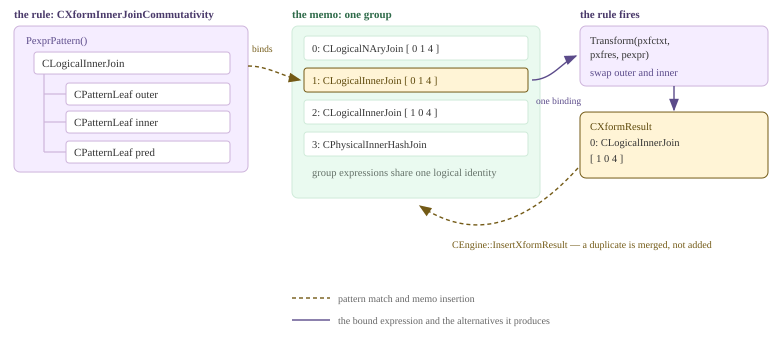

_规则的构成。模式与*组*（而非树）匹配；每次匹配都是一个绑定；Transform 将备选项写入 CXformResult；引擎将它们合并回 memo。_

### 17.3.1 一条规则的构成 {#1731-the-anatomy-of-one-rule}

`CXform`（`libgpopt/include/gpopt/xforms/CXform.h`）是一个很小的抽象类。一条具体规则必须提供四样东西：**ID**（`Exfid()`，是 `CXform::Exf*` 枚举常量之一）、**名称**（`SzId()`，即 `disable_xform` 和跟踪输出使用的字符串）、**适用程度**（`Exfp()`，返回 `ExfpNone` / `ExfpLow` / `ExfpMedium` / `ExfpHigh`——一种开销很小的否决机制，让引擎跳过不可能适用的规则），以及 **`Transform()`**，这是构造新表达式的唯一位置。它还携带一项数据：`m_pexpr`，即**模式**，传给基类构造函数，并由 `PexprPattern()` 返回。两个虚谓词负责分类：`FExploration()` 表示逻辑→逻辑，`FImplementation()` 表示逻辑→物理；子类 `CXformExploration` 和 `CXformImplementation` 只是给出这两个问题的答案。除此之外别无其他——没有应用顺序、没有优先级列表，也没有代价钩子。一条规则就是一个模式加一个函数。来看最简单而又值得讨论的探索规则：内连接交换律。它的全部*适用条件*就是该模式：构造函数创建一个 `CLogicalInnerJoin`，其三个子节点都是 `CPatternLeaf` 通配符（外侧、内侧、谓词）。

```c {title="src/backend/gporca/libgpopt/src/xforms/CXformInnerJoinCommutativity.cpp — CXformInnerJoinCommutativity::CXformInnerJoinCommutativity()"}
CXformInnerJoinCommutativity::CXformInnerJoinCommutativity(CMemoryPool *mp)
	: CXformExploration(
		  // pattern
		  GPOS_NEW(mp) CExpression(
			  mp, GPOS_NEW(mp) CLogicalInnerJoin(mp),
			  GPOS_NEW(mp)
				  CExpression(mp, GPOS_NEW(mp) CPatternLeaf(mp)),  // left child
			  GPOS_NEW(mp) CExpression(
				  mp, GPOS_NEW(mp) CPatternLeaf(mp)),  // right child
			  GPOS_NEW(mp)
				  CExpression(mp, GPOS_NEW(mp) CPatternLeaf(mp)))  // predicate
	  )
{
}
```

随后 `Transform()` 执行很直观的操作：从匹配到的表达式中取出三个子节点，交换左右输入并重新构造连接，然后把结果交给 `CXformResult` 累积器。注意，它只*添加*内容，从不修改现有表达式、从不作出选择，也从不计算代价。生成两个备选项的规则只需调用两次 `pxfres->Add()`；如果规则判定自己无法提供任何结果，就不添加内容，直接返回。实现类规则在结构上完全相同，区别只在输出内容：`CXformImplementInnerJoin`（`libgpopt/src/xforms/CXformImplementInnerJoin.cpp`）绑定相同的 `CLogicalInnerJoin` 模式——不过谓词位置使用 `CPatternTree`，因为它需要查看谓词内部——并生成一个 `CPhysicalInnerHashJoin`；哈希连接未能产生结果时，则回退到 `CPhysicalInnerNLJoin`。一个逻辑操作符、两个可能的物理操作符、一条规则。这就是 ORCA 中“选择连接方法”的全部机制；两者中谁能留下来，要稍后根据代价决定（[§17.4](#174-metadata-layer--cost-model)），就像 [§15.3](/cloudberry/core-internals/part-4-query-processing/ch15/#153-path-cost--add_path) 中 `add_path` 在等价的 `Path` 节点之间作出选择一样——只是这里的备选项必须先由规则*生成*。

```c {title="src/backend/gporca/libgpopt/src/xforms/CXformInnerJoinCommutativity.cpp — CXformInnerJoinCommutativity::Transform()"}
CExpression *pexprLeft = (*pexpr)[0];
CExpression *pexprRight = (*pexpr)[1];
CExpression *pexprScalar = (*pexpr)[2];
...
// assemble transformed expression
CExpression *pexprAlt = CUtils::PexprLogicalJoin<CLogicalInnerJoin>(
	mp, pexprRight, pexprLeft, pexprScalar);
...
// add alternative to transformation result
pxfres->Add(pexprAlt);
```

*两类规则实际触发的过程：交换律先改写连接，随后 `CXformImplementInnerJoin` 将其中一个结果变成物理操作符。本次构建启用了 `--enable-cassert`，因此 ORCA 的开发者打印标志会产生输出；使用 `optimizer_print_xform` 时还需要设置 `optimizer_print_xform_results`（`CGroupExpression.cpp` — `CGroupExpression::PrintXform()`）。输出已作删节：省略了较长的 `Columns: [...]` 列表，保留了一个完整的 TRACE 头。*

```sql
SET client_min_messages=log;
SET optimizer_print_xform=on;
SET optimizer_print_xform_results=on;
EXPLAIN SELECT * FROM m173_a x JOIN m173_b y ON x.id=y.id;
```

```text {hl_lines="7" title="output"}
LOG:  2026-08-14 00:30:29:910742 CST,THD000,TRACE,"Xform: CXformExpandNAryJoinDPv2
Input:
+--CLogicalNAryJoin   rows:20000   width:84  rebinds:1   origin: [Grp:5, GrpExpr:0]
   ...
2026-08-14 00:30:29:911471 CST,THD000,TRACE,"Xform: CXformInnerJoinCommutativity
Input:
+--CLogicalInnerJoin   origin: [Grp:5, GrpExpr:1]
   |--CLogicalGet "x" ("x"), Columns: [ ... ]   origin: [Grp:0, GrpExpr:0]
   |--CLogicalGet "y" ("y"), Columns: [ ... ]   origin: [Grp:1, GrpExpr:0]
   +--CScalarCmp (=)   origin: [Grp:4, GrpExpr:0]
Output:
Alternatives:
0:
+--CLogicalInnerJoin
   |--CLogicalGet "y" ("y"), Columns: [ ... ]   origin: [Grp:1, GrpExpr:0]
   |--CLogicalGet "x" ("x"), Columns: [ ... ]   origin: [Grp:0, GrpExpr:0]
   +--CScalarCmp (=)   origin: [Grp:4, GrpExpr:0]
",
...
2026-08-14 00:30:29:913767 CST,THD000,TRACE,"Xform: CXformImplementInnerJoin
Input:
+--CLogicalInnerJoin   rows:20000   width:84  rebinds:1   origin: [Grp:5, GrpExpr:2]
   ...
Output:
Alternatives:
0:
+--CPhysicalInnerHashJoin   cost:-0.500000
   |--CLogicalGet "y" ("y"), Columns: [ ... ]   origin: [Grp:1, GrpExpr:0]
   |--CLogicalGet "x" ("x"), Columns: [ ... ]   origin: [Grp:0, GrpExpr:0]
   +--CScalarCmp (=)   origin: [Grp:4, GrpExpr:0]
",
```

### 17.3.2 规则目录及其位集表示 {#1732-the-catalogue-and-why-it-is-a-bitset}

`libgpopt/src/xforms/` 中有 133 个 `.cpp` 文件（如果把对象文件也算上，共有 269 个目录条目）；`CXform.h` 枚举了 **177** 个 `Exf*` ID，从 `ExfProject2ComputeScalar = 0` 到 `ExfSplitWindowFunc`（`CXform`），最后是 `ExfInvalid` 和 `ExfSentinel = ExfInvalid`（`CXform`）。其中二十四个 ID 是已停用的占位项，名称写作 `____removed`。头文件解释了为什么不能直接删除它们（`CXform`）：禁用规则的跟踪标志按*位置*引用 ID，因此移动这些 ID 会在无提示的情况下禁用错误的规则。所以，`CXformFactory::Instantiate()`（`CXformFactory.cpp`）恰好执行 152 次 `Add()` 调用，用 `SkipUnused()` 跳过 25 个废弃槽位，并在每次添加时断言所添加的 ID 等于下一个预期位置。`Add()` 还会构建规则集的三个索引：按 ID 索引的数组、按名称索引的哈希映射（`disable_xform('CXform...')` 查找的就是它），以及最重要的两个 `CXformSet` 位集，分别保存目录中的探索规则和实现规则。`CXformSet` 就是 `CEnumSet<CXform::EXformId, CXform::ExfSentinel>`（`CXform.h`）：**已启用规则集确实就是一个以规则 ID 为索引的位集**。因此，本章中从 `optimizer_join_order` 到 `disable_xform` 的所有控制手段，最终都只是在翻转位。

```c {title="src/backend/gporca/libgpopt/src/xforms/CXformFactory.cpp — CXformFactory::Add()"}
m_rgpxf[exfid] = pxform;

// create name -> xform mapping
ULONG length = clib::Strlen(pxform->SzId());
CHAR *szXformName = GPOS_NEW_ARRAY(m_mp, CHAR, length + 1);
clib::Strncpy(szXformName, pxform->SzId(), length + 1);
... m_phmszxform->Insert(szXformName, pxform);

CXformSet *xform_set = m_pxfsExploration;
if (pxform->FImplementation())
{
	xform_set = m_pxfsImplementation;
}
... xform_set->ExchangeSet(exfid);
```

| <span style="display:inline-block;min-width:8em">类别</span> | 改写的内容 | 代表性规则 |
| --- | --- | --- |
| 连接枚举（探索） | 将 n 元连接中间操作符展开为二叉树，并重新排列已有的二元连接 | `CXformExpandNAryJoin`、`CXformExpandNAryJoinDPv2`、`CXformInnerJoinCommutativity`、`CXformJoinAssociativity` |
| 连接实现 | 逻辑连接 → 物理连接操作符 | `CXformImplementInnerJoin`、`CXformLeftOuterJoin2HashJoin`、`CXformLeftAntiSemiJoin2NLJoin`、`CXformImplementFullOuterMergeJoin` |
| 连接类型改写 | 在语义允许时，将一种连接变成另一种连接 | `CXformLeftSemiJoin2InnerJoin`、`CXformLeftJoin2RightJoin`、`CXformExpandFullOuterJoin`、`CXformLeftAntiSemiJoin2CrossProduct` |
| 子查询去嵌套 | 子查询 → Apply → 连接（[§17.3.6](#1736-subquery-decorrelation-done-with-rules)） | `CXformSimplifySelectWithSubquery`、`CXformSelect2Apply`、`CXformLeftSemiApply2LeftSemiJoin`、`CXformInnerApply2InnerJoin` |
| 聚合拆分与下推 | 两阶段聚合、DQA 改写，以及将 GbAgg 下推到连接或联合之下 | `CXformSplitGbAgg`、`CXformSplitDQA`、`CXformPushGbBelowJoin`、`CXformEagerAgg`、`CXformGbAgg2HashAgg` |
| 扫描、索引与位图选择 | 为基表选择访问路径 | `CXformGet2TableScan`、`CXformSelect2IndexGet`、`CXformSelect2IndexOnlyGet`、`CXformSelect2BitmapBoolOp`、`CXformJoin2IndexGetApply`、`CXformMinMax2IndexGet` |
| 分区表与 DPE | 动态扫描和分区选择器，即运行时分区消除 | `CXformDynamicGet2DynamicTableScan`、`CXformDynamicIndexGet2DynamicIndexScan`、`ExfImplementPartitionSelector`、`CXformExpandDynamicGetWithForeignPartitions` |
| 集合操作 | 将 UNION/INTERSECT/EXCEPT 改写为连接和 UNION ALL | `CXformUnion2UnionAll`、`CXformIntersect2Join`、`CXformDifference2LeftAntiSemiJoin`、`CXformPushJoinBelowUnionAll` |
| CTE | 内联消费者，或将生产者物化为 Sequence | `CXformCTEAnchor2Sequence`、`CXformInlineCTEConsumer`、`CXformImplementCTEProducer`、`CXformImplementCTEConsumer` |
| DML 与窗口处理 | 其余顶层形态 | `CXformInsert2DML`、`CXformImplementDML`、`CXformImplementSplit`、`CXformSplitWindowFunc`、`CXformImplementSequenceProject`、`CXformSplitLimit` |
| *（无）*——Motion | **不存在 Motion xform。** 没有任何 `Exf*` ID 或 `src/xforms/` 中的文件提到 Motion | Motion 由 `CEngine::AddEnforcers`（`CEngine.cpp`）添加，用作要求分布属性的*强制器*；它对应于 [§16.2](/cloudberry/core-internals/part-4-query-processing/ch16/#162-cdbmotionpath-generation) 中的 `cdbpath_create_motion_path`。这也是 [§17.2](#172-the-cascades-engine) 的 memo 转储中，Motion 以物理备选项的形式出现在组*内部*的原因 |

### 17.3.3 绑定：模式匹配的是组，而非树 {#1733-binding-a-pattern-matches-a-group-not-a-tree}

规则应用于**组表达式**，而不是表达式；它的模式与 memo 进行匹配。Cascades 优化器之所以能够扩展，正是因为这个区别。当交换律模式的 `CPatternLeaf` 位于一个子*组*之上时，它代表该组现在以及今后包含的每个逻辑表达式。`CBinding`（`libgpopt/src/search/CBinding.cpp`）遍历 memo，逐一枚举这些匹配：`PexprExtract(mp, pgexpr, pattern, pexprLast)` 在子组之间传递游标（`FInitChildCursors` / `FAdvanceChildCursors`），返回下一个符合模式的具体表达式。每个返回的表达式都是一个**绑定**；单个（组表达式、规则）对可以产生许多绑定。下面的循环依靠三道防线避免组合爆炸：`IsApplyOnce()` 允许规则声明只需一个绑定；`FCompatible(m_exfidOrigin)` 在绑定开始前就会被检查，位置是 `CGroupExpression.cpp` 的 `CGroupExpression::Transform()`，它允许规则拒绝处理由自身或相关规则生成的表达式，而交换律声明自己与 `ExfInnerJoinCommutativity` 不兼容（`CXformInnerJoinCommutativity.cpp` — `CXformInnerJoinCommutativity::FCompatible()`），从而避免无休止地来回交换连接；`optimizer_xform_bind_threshold`（`0` 表示无限制，也是这里的默认值）则限制每次调用的绑定数量。该计数器会在 `CEngine::ApplyTransformations`（`CEngine.cpp`）的每次调用中重置，因此它是每条规则、每个组表达式各自的预算，而非全局预算。`CEngine::GetNumberOfBindings` 暴露的正是这些计数器，下面的 `total bindings` 列报告的也是它们。

```c {title="src/backend/gporca/libgpopt/src/search/CGroupExpression.cpp — CGroupExpression::Transform()"}
CExpression *pexprPattern = pxform->PexprPattern();
CExpression *pexpr = binding.PexprExtract(mp, this, pexprPattern, nullptr);
while (nullptr != pexpr)
{
	++(*pulNumberOfBindings);
	ULONG ulNumResults = pxfres->Pdrgpexpr()->Size();
	pxform->Transform(pxfctxt, pxfres, pexpr);
	...
	if ((bindThreshold != 0 && (*pulNumberOfBindings) > bindThreshold) ||
		pxform->IsApplyOnce() || ...)
	{
		// do not apply xform to other possible patterns
		pexpr->Release(); break;
	}
	pexpr = binding.PexprExtract(mp, this, pexprPattern, pexpr);
}
```

<figure class="cloudberry-core-figure">
<div><div style="font-family:ui-monospace,SFMono-Regular,Menlo,monospace;font-size:11.5px;display:flex;gap:12px;flex-wrap:wrap;align-items:stretch"> <div style="flex:1 1 230px;border:1px solid #cdb4db;background:#f5edff;border-radius:6px;padding:10px"> <div style="font-weight:600;color:#4a3a6a;margin-bottom:6px">模式（两层，例如结合律）</div> <div>CLogicalInnerJoin</div> <div style="padding-left:12px">|-- CLogicalInnerJoin</div> <div style="padding-left:26px">|-- CPatternLeaf</div> <div style="padding-left:26px">|-- CPatternLeaf</div> <div style="padding-left:26px">+-- CPatternTree</div> <div style="padding-left:12px">|-- CPatternLeaf</div> <div style="padding-left:12px">+-- CPatternTree</div> </div> <div style="flex:0 0 26px;display:flex;align-items:center;justify-content:center;color:#735a16;font-size:20px">&#8594;</div> <div style="flex:1 1 250px;border:1px solid #cfead9;background:#eafaf0;border-radius:6px;padding:10px"> <div style="font-weight:600;color:#2f6b4a;margin-bottom:6px">正在探索的组</div> <div>0: CLogicalInnerJoin [ G&#8321; G&#8322; G&#8323; ]</div> <div style="margin:8px 0 4px 0;color:#2f6b4a">其子组 G&#8321; 已包含：</div> <div style="background:#fff4d6;border:1px solid #735a16;border-radius:4px;padding:6px;color:#5c4708"> 0: CLogicalInnerJoin [ a b p ]<br/>1: CLogicalInnerJoin [ b a p ]<br/>2: CLogicalNAryJoin&nbsp; [ a b p ] </div> </div> <div style="flex:0 0 26px;display:flex;align-items:center;justify-content:center;color:#735a16;font-size:20px">&#8594;</div> <div style="flex:1 1 200px;border:1px solid #cdb4db;background:#f5edff;border-radius:6px;padding:10px"> <div style="font-weight:600;color:#4a3a6a;margin-bottom:6px">一次 Transform 调用</div> <div><span class="hl">2 个绑定</span> &#8212; 即两个内连接；<br/>NAryJoin 不匹配<br/>模式内部的 CLogicalInnerJoin</div> <div style="margin-top:8px;color:#5b4b8a">每个绑定可向一个 CXformResult 添加<br/>0..n 个备选项</div> </div> </div></div>
<figcaption>一次调用，多个绑定。由于模式的子节点是一个匹配整组的通配符，在该组的各个逻辑表达式上展开模式，便会让一次 Transform 调用产生多个具体匹配；而组后续获得的每个新表达式，又会让同一条规则重新具备触发条件。</figcaption>
</figure>

### 17.3.4 实际触发了哪些规则 {#1734-which-rules-actually-fired}

*`optimizer_print_optimization_stats=on` 会到达 `CEngine::PrintActivatedXforms`（`CEngine.cpp`），该函数按搜索阶段打印每条已激活的规则，以及调用次数、绑定数量、生成的备选项数量和耗时。输出已作删节，省略了计时器 TRACE 行和内存信息行。*

```sql
SET client_min_messages=log;
SET optimizer_print_optimization_stats=on;
EXPLAIN SELECT count(*) FROM m173_t t1 JOIN m173_t t2 ON t1.a=t2.a WHERE t1.b=5;
```

```text {hl_lines="4" title="output"}
LOG:  2026-08-14 00:30:15:020892 CST,THD000,TRACE,"timer:
[OPT]: Query To DXL Translation Time: 3ms",
...
[OPT]: Memo (stage 0): [24 groups, 0 duplicate groups, 42 group expressions, 7 activated xforms]
[OPT]: stage 0 completed in 9ms,  plan with cost 863.809816 was found
[OPT]: <Begin Xforms - stage 0>
CXformGet2TableScan: 2 calls, 2 total bindings, 2 alternatives generated, 0ms
CXformSelect2Filter: 1 calls, 1 total bindings, 1 alternatives generated, 0ms
CXformGbAgg2ScalarAgg: 3 calls, 3 total bindings, 3 alternatives generated, 0ms
CXformInnerJoinCommutativity: 1 calls, 1 total bindings, 1 alternatives generated, 0ms
CXformSplitGbAgg: 1 calls, 1 total bindings, 1 alternatives generated, 0ms
CXformExpandNAryJoinDPv2: 1 calls, 1 total bindings, 3 alternatives generated, 2ms
CXformImplementInnerJoin: 2 calls, 2 total bindings, 2 alternatives generated, 0ms
[OPT]: <End Xforms - stage 0>
...
[OPT]: Total Optimization Time: 20ms",
 Finalize Aggregate  (cost=0.00..863.81 rows=1 width=8)
   ->  Gather Motion 3:1  (slice1; segments: 3)  (cost=0.00..863.81 rows=1 width=8)
         ->  Partial Aggregate  (cost=0.00..863.81 rows=1 width=8)
               ->  Hash Join  (cost=0.00..863.81 rows=67 width=1)
                     Hash Cond: (t2.a = t1.a)
 Optimizer: GPORCA
```

七条规则、十一次调用、十三个备选项——这就是该计划的完整推导过程。从上到下读，整个过程一目了然：`Get2TableScan` 为每个基表提供物理扫描；`Select2Filter` 将 `b = 5` 谓词变为 Filter；`ExpandNAryJoinDPv2` 把 n 元连接中间操作符展开为三个二元备选项；`InnerJoinCommutativity` 添加交换后的顺序；`ImplementInnerJoin` 将留下的两个逻辑连接转换为哈希连接；`SplitGbAgg` + `GbAgg2ScalarAgg` 则生成了计划中可见的 Partial/Finalize 组合（这是 ORCA 自己的两阶段聚合，对应于 [§16.4](/cloudberry/core-internals/part-4-query-processing/ch16/#164-distributed-grouping--direct-dispatch)）。计划中没有任何部分来自其他地方。当 ORCA 计划出乎意料时，首先应查看这个列表；还要注意，相对于 152 条可用规则，这里只有 `7 activated xforms`。优化器从不会尝试整个规则目录：每个逻辑操作符都公布自己的候选集合（`CLogicalInnerJoin::PxfsCandidates`，位于 `libgpopt/src/operators/CLogicalInnerJoin.cpp`，只列出十一条规则，没有其他规则），调度任何工作之前，会先将这个集合与工厂的探索或实现位集求交，再与当前搜索阶段的位集求交（`CJobGroupExpressionExploration.cpp` — `CJobGroupExpressionExploration::ScheduleApplicableTransformations()`）。三个规则位集求交后，只有留下的规则才会被询问适用程度。

### 17.3.5 连接顺序：同一个查询，四组规则 {#1735-join-order-the-same-query-four-rule-sets}

连接枚举值得单独讨论，因为它是唯一一个*规模*会直接影响用户的规则类别。预处理会把连续的一串内连接折叠为单个 n 元中间操作符：`CExpressionPreprocessor::PexprCollapseJoins`（`libgpopt/src/operators/CExpressionPreprocessor.cpp`）构建一个 `CLogicalNAryJoin`，其最后一个子节点是所有连接谓词的合取。没有任何组件能够执行 `CLogicalNAryJoin`；它的存在纯粹是为了让一条规则能够一次看到整个连接，并为其提出连接顺序。承担这项工作的有五条规则，`optimizer_join_order` 负责在它们之间选择。选择方式不是指定其中一条，而是*禁用其余规则*：`CConfigParamMapping.cpp`（`CConfigParamMapping::PackConfigParamInBitset()`）根据 GUC 值分支，合并四个预先计算的位集之一，包括 `CXform::PbsJoinOrderInQueryXforms` 等（`libgpopt/src/xforms/CXform.cpp`）；每个位集都是一份要关闭的规则清单。

| optimizer_join_order | 保持启用的枚举规则 | 交换律／结合律 | 组表达式数 | 阶段 0 | 计划代价 |
| --- | --- | --- | --- | --- | --- |
| `query` | 仅 `CXformExpandNAryJoin`，保留 SQL 中书写的顺序 | 该模式关闭两者 | 74 | 27 ms | 2162.03 |
| `greedy` | `+ ...MinCard`、`+ ...Greedy` | 该模式关闭两者 | 109 | 63 ms | 2160.42 |
| `exhaustive` | `+ ...DP`（受 `optimizer_join_order_threshold` 限制） | 保持启用；结合律还受 `optimizer_enable_associativity` 控制 | 221 | 340 ms | 2160.29 |
| `exhaustive2`（默认） | 仅 `CXformExpandNAryJoinDPv2`；还会关闭 `ExfPushDownLeftOuterJoin` 并设置 `EopttraceEnableLOJInNAryJoin`，让外连接也参与枚举 | 同上 | 236 | 179 ms | 2160.29 |

*同一个五路链式连接在两个极端设置下的表现。实际输出已作删节，只保留枚举规则、memo 概要，以及计划中的连接骨架。*

```sql
-- five tables of 50k / 20k / 5k / 1k / 200 rows, joined a-b-c-d-e in that order
SET optimizer_join_order='query';   -- then 'exhaustive2'
SET optimizer_print_optimization_stats=on;
EXPLAIN SELECT count(*) FROM m173_a a, m173_b b, m173_c c, m173_d d, m173_e e
 WHERE a.id=b.id AND b.id=c.id AND c.id=d.id AND d.id=e.id;
```

```text {hl_lines="12 36" title="output"}
--------------------------- optimizer_join_order = query
[OPT]: Memo (stage 0): [39 groups, 0 duplicate groups, 74 group expressions, 5 activated xforms]
[OPT]: stage 0 completed in 27ms,  plan with cost 2162.032356 was found
CXformExpandNAryJoin: 1 calls, 1 total bindings, 1 alternatives generated, 0ms
CXformImplementInnerJoin: 4 calls, 4 total bindings, 4 alternatives generated, 0ms
               ->  Hash Join  (cost=0.00..2162.03 rows=72 width=1)
                     Hash Cond: (d.id = e.id)
                     ->  Hash Join  (cost=0.00..1730.96 rows=342 width=4)
                           Hash Cond: (c.id = d.id)
                           ->  Hash Join  (cost=0.00..1299.58 rows=1680 width=4)
                                 Hash Cond: (b.id = c.id)
                                 ->  Hash Join  (cost=0.00..867.02 rows=6667 width=4)
                                       Hash Cond: (a.id = b.id)
                                       ->  Seq Scan on m173_a a  (cost=0.00..431.38 rows=16667 width=4)
                                       ->  Hash  (cost=431.15..431.15 rows=6667 width=4)
                                             ->  Seq Scan on m173_b b  (cost=0.00..431.15 rows=6667 width=4)

--------------------------- optimizer_join_order = exhaustive2
[OPT]: Memo (stage 0): [53 groups, 0 duplicate groups, 236 group expressions, 6 activated xforms]
[OPT]: stage 0 completed in 179ms,  plan with cost 2160.294322 was found
CXformInnerJoinCommutativity: 26 calls, 26 total bindings, 26 alternatives generated, 0ms
CXformExpandNAryJoinDPv2: 1 calls, 1 total bindings, 10 alternatives generated, 34ms
CXformImplementInnerJoin: 52 calls, 52 total bindings, 52 alternatives generated, 0ms
               ->  Hash Join  (cost=0.00..2160.29 rows=72 width=1)
                     Hash Cond: (d.id = c.id)
                     ->  Seq Scan on m173_d d  (cost=0.00..431.01 rows=334 width=4)
                     ->  Hash  (cost=1729.21..1729.21 rows=67 width=4)
                           ->  Hash Join  (cost=0.00..1729.21 rows=67 width=4)
                                 Hash Cond: (c.id = b.id)
                                 ->  Seq Scan on m173_c c  (cost=0.00..431.04 rows=1667 width=4)
                                 ->  Hash  (cost=1297.85..1297.85 rows=67 width=4)
                                       ->  Hash Join  (cost=0.00..1297.85 rows=67 width=4)
                                             Hash Cond: (b.id = a.id)
                                             ->  Seq Scan on m173_b b  (cost=0.00..431.15 rows=6667 width=4)
                                             ->  Hash  (cost=865.46..865.46 rows=67 width=4)
                                                   ->  Hash Join  (cost=0.00..865.46 rows=67 width=4)
                                                         Hash Cond: (a.id = e.id)
                                                         ->  Seq Scan on m173_a a  (cost=0.00..431.38 rows=16667 width=4)
                                                         ->  Hash  (cost=431.00..431.00 rows=67 width=4)
                                                               ->  Seq Scan on m173_e e  (cost=0.00..431.00 rows=67 width=4)
```

*在本集群上，`optimizer_enable_associativity` 默认为**关闭**。对同一个五路连接，在 `exhaustive` 模式下启用它，可以看出它带来的开销；也能看到 `CXformJoinAssociativity` 是少数绑定数量多于调用次数的规则之一（[§17.3.3](#1733-binding-a-pattern-matches-a-group-not-a-tree)）。这些都是单次运行结果；不同运行之间，阶段耗时会波动几十毫秒。*

```sql
SET optimizer_join_order='exhaustive';
SET optimizer_enable_associativity=off;  -- default; then on
EXPLAIN SELECT count(*) FROM m173_a a, m173_b b, m173_c c, m173_d d, m173_e e
 WHERE a.id=b.id AND b.id=c.id AND c.id=d.id AND d.id=e.id;
```

```text {hl_lines="8" title="output"}
--------------------------- optimizer_enable_associativity = off (default)
[OPT]: Memo (stage 0): [66 groups, 3 duplicate groups, 221 group expressions, 9 activated xforms]
[OPT]: stage 0 completed in 384ms,  plan with cost 2160.294305 was found
CXformInnerJoinCommutativity: 30 calls, 30 total bindings, 30 alternatives generated, 0ms
CXformImplementInnerJoin: 44 calls, 44 total bindings, 44 alternatives generated, 0ms

--------------------------- optimizer_enable_associativity = on
[OPT]: Memo (stage 0): [106 groups, 5 duplicate groups, 501 group expressions, 10 activated xforms]
[OPT]: stage 0 completed in 1107ms,  plan with cost 2160.294305 was found
CXformInnerJoinCommutativity: 77 calls, 77 total bindings, 77 alternatives generated, 0ms
CXformJoinAssociativity: 59 calls, 69 total bindings, 59 alternatives generated, 0ms
CXformImplementInnerJoin: 136 calls, 136 total bindings, 136 alternatives generated, 0ms
```

这两次运行合在一起揭示了本节真正要说明的内容，而关键并不在代价列。在 `query` 模式下，一条规则触发一次，连接完全按照书写顺序构建，第一个连接就已经估计每个 Segment 有 6667 行；在 `exhaustive2` 模式下，`DPv2` 提出十种顺序，交换律对产生的二十六个连接交换输入，`ImplementInnerJoin` 被调用五十二次而不是四次，计划现在从那张 200 行的表开始，因此第一个连接只有 67 行。为换取 0.08% 的代价改善，组表达式数量达到原来的 3.2 倍，阶段耗时达到原来的 6.6 倍；原因是，对于均匀分布的演示数据上的五表链式连接，ORCA 的估计主要由五次扫描决定。结合律把同样的情况又推进了一步：只增加一条规则，就让组表达式从 221 个增至 501 个，耗时从 384 ms 增至 1107 ms，而胜出计划的代价逐位完全相同。这是因为 `CXformJoinAssociativity` 大多只是在重新推导 `DP` 和 `DPv2` 按其构造方式本来就能得到的顺序，多余结果会被 memo 的重复检测吸收（[§17.2](#172-the-cascades-engine)）。这就是结合律默认关闭的原因。在 Cascades 优化器中，“添加一条规则”从来不是免费的——规则集*就是*搜索空间。因此，对于涉及很多输入的连接，有两个硬性限制来控制开销：`optimizer_join_order_threshold`（10）规定了一个分界点，超过它后，`DPv2` 不再对每层执行完整的动态规划，而是每层只保留一个组（`CJoinOrderDPv2.cpp` — `CJoinOrderDPv2::EnumerateDP()`）；`optimizer_join_arity_for_associativity_commutativity`（18）则让预处理对输入数超过该值的连接直接关闭交换律*和*结合律（`CExpressionPreprocessor.cpp` — `CExpressionPreprocessor::PexprCollapseJoins()`）。

### 17.3.6 用规则完成子查询去关联 {#1736-subquery-decorrelation-done-with-rules}

另一个主要类别是去关联，规则驱动设计的优势在这里体现得最为清楚。[§15.2](/cloudberry/core-internals/part-4-query-processing/ch15/#152-preprocessing) 介绍了 PostgreSQL 规划器的方法：两趟手工编写的递归处理 `pull_up_sublinks` 和 `pull_up_subqueries`，在正式规划开始前就地改写解析树；遇到没有对应处理分支的情况就放弃。ORCA 通过普通的规则机制实现相同目标，分为三个步骤，每一步都有自己的规则类别。首先，**简化**规则尝试将子查询从标量表达式中提升出来（`CXformSimplifySelectWithSubquery`、`CXformSimplifyProjectWithSubquery`）。接着，**Apply** 规则将子查询替换为一种 `CLogicalApply` 变体，即 ORCA 显式表示关联连接的操作符；具体方法是从 `CXformSubqueryUnnest::PexprSubqueryUnnest`（`libgpopt/src/xforms/CXformSubqueryUnnest.cpp`）调用共享辅助类 `CSubqueryHandler`（`libgpopt/include/gpopt/xforms/CSubqueryHandler.h`，即“将子查询表达式转换为 Apply 表达式的辅助类”）。`CXformSelect2Apply`、`CXformProject2Apply`、`CXformGbAgg2Apply` 和 `CXformSubqJoin2Apply` 都只是它的简单子类。最后，**去 Apply** 规则在分析完关联关系后，将 Apply 转换为真正的连接：包括 `CXformLeftSemiApply2LeftSemiJoin`、`CXformInnerApply2InnerJoin`、`CXformLeftOuterApply2LeftOuterJoin`，以及处理简单情形的 `...NoCorrelations` 变体。只有这些规则都不适用时，`ExfImplement...CorrelatedApply` 规则才会保留关联形式，让执行器针对外侧每一行重新执行内侧。

*一个关联 `EXISTS` 被去关联为 Hash Semi Join。已触发规则列表中可以看到这条三步处理链；一个双表查询激活了 21 条规则。*

```sql
SET client_min_messages=log;
SET optimizer_print_optimization_stats=on;
EXPLAIN SELECT count(*) FROM m173_a a
 WHERE EXISTS (SELECT 1 FROM m173_b b WHERE b.id = a.id AND b.y = 3);
```

```text {hl_lines="15" title="output"}
[OPT]: Memo (stage 0): [96 groups, 0 duplicate groups, 196 group expressions, 21 activated xforms]
[OPT]: <Begin Xforms - stage 0>
...
CXformSimplifySelectWithSubquery: 1 calls, 1 total bindings, 3 alternatives generated, 0ms
CXformSelect2Apply: 3 calls, 3 total bindings, 6 alternatives generated, 0ms
CXformLeftOuterApply2LeftOuterJoin: 2 calls, 2 total bindings, 2 alternatives generated, 0ms
CXformImplementLeftOuterCorrelatedApply: 2 calls, 2 total bindings, 2 alternatives generated, 0ms
CXformLeftSemiApply2LeftSemiJoin: 1 calls, 1 total bindings, 1 alternatives generated, 0ms
CXformLeftSemiJoin2NLJoin: 1 calls, 1 total bindings, 1 alternatives generated, 0ms
CXformLeftSemiJoin2HashJoin: 1 calls, 1 total bindings, 1 alternatives generated, 0ms
CXformLeftSemiJoin2InnerJoin: 1 calls, 1 total bindings, 1 alternatives generated, 0ms
...
[OPT]: <End Xforms - stage 0>

               ->  Hash Semi Join  (cost=0.00..866.50 rows=606 width=1)
                     Hash Cond: (a.id = b.id)
                     ->  Seq Scan on m173_a a  (cost=0.00..432.06 rows=16667 width=4)
                           Filter: (NOT (id IS NULL))
                     ->  Hash  (cost=431.38..431.38 rows=606 width=4)
                           ->  Seq Scan on m173_b b  (cost=0.00..431.38 rows=606 width=4)
                                 Filter: (y = 3)
 Optimizer: GPORCA
```

_更难的情况：**目标列表中的关联标量子查询**。ORCA 将其去关联为 Hash Left Join，内侧先行聚合；PostgreSQL 规划器则保留 SubPlan，针对外侧每一行，在内表的广播副本上重新执行。两个代价数值采用不同的尺度，不能直接比较；可以比较的是计划*形态*。_

```sql
EXPLAIN SELECT a.id, (SELECT max(b.y) FROM m173_b b WHERE b.id = a.id)
   FROM m173_a a WHERE a.x = 3;              -- default: optimizer=on
SET optimizer=off;                            -- same query, PostgreSQL planner
```

```text {hl_lines="8 22" title="output"}
--------------------------- Optimizer: GPORCA
CXformSimplifyProjectWithSubquery: 1 calls, 1 total bindings, 3 alternatives generated, 0ms
CXformProject2Apply: 1 calls, 1 total bindings, 2 alternatives generated, 0ms
CXformLeftOuterApply2LeftOuterJoin: 1 calls, 1 total bindings, 1 alternatives generated, 0ms
CXformLeftOuterJoin2HashJoin: 1 calls, 1 total bindings, 1 alternatives generated, 0ms

 Gather Motion 3:1  (slice1; segments: 3)  (cost=0.00..866.70 rows=7135 width=8)
   ->  Hash Left Join  (cost=0.00..866.47 rows=4001 width=8)
         Hash Cond: (a.id = b.id)
         ->  Seq Scan on m173_a a  (cost=0.00..431.97 rows=2379 width=4)
               Filter: (x = 3)
         ->  Hash  (cost=432.09..432.09 rows=6667 width=8)
               ->  HashAggregate  (cost=0.00..432.09 rows=6667 width=8)
                     Group Key: b.id
                     ->  Seq Scan on m173_b b  (cost=0.00..431.15 rows=6667 width=8)
 Optimizer: GPORCA

--------------------------- Optimizer: Postgres query optimizer
 Gather Motion 3:1  (slice1; segments: 3)  (cost=0.00..1644567.38 rows=7135 width=8)
   ->  Seq Scan on m173_a a  (cost=0.00..1644472.25 rows=2378 width=8)
         Filter: (x = 3)
         SubPlan 1
           ->  Aggregate  (cost=691.33..691.34 rows=1 width=4)
                 ->  Result  (cost=0.00..641.33 rows=20000 width=4)
                       Filter: (b.id = a.id)
                       ->  Materialize  (cost=0.00..441.33 rows=20000 width=8)
                             ->  Broadcast Motion 3:3  (slice2; segments: 3)  (cost=0.00..341.33 rows=20000 width=8)
                                   ->  Seq Scan on m173_b b  (cost=0.00..74.67 rows=6667 width=8)
 Optimizer: Postgres query optimizer
```

> [!NOTE]
> 这两大规则类别之间的顺序很重要：去关联必须完成后，才能开始连接枚举。如果 n 元连接的任何子节点仍推导出子查询，`CXformUtils::ExfpExpandJoinOrder`（`libgpopt/src/xforms/CXformUtils.cpp`）就返回 `ExfpNone`，即“应用 xform 之前必须对子查询去嵌套”。引擎并没有一个专门的去关联阶段来表达这种顺序；顺序由规则自身的适用程度函数规定。这就是 Cascades 的取舍：无需维护各趟处理的先后顺序，但每条规则都必须知道何时应该让步。

### 17.3.7 关闭单条规则 {#1737-turning-a-single-rule-off}

由于已启用规则集是以规则 ID 为索引的位集，ORCA 中最精确的调试手段就是只关闭一条规则。两个 SQL 函数负责这项操作：`disable_xform(text)` 和 `enable_xform(text)`（`src/include/catalog/pg_proc.dat`；C 实现为 `src/backend/gpopt/utils/funcs.cpp` 中的 `DisableXform`/`EnableXform`）。两者都会在工厂的名称映射中查找规则名，然后在后端进程全局的 `optimizer_xforms[]` 数组中设置一个标志；`COptTasks::SetXform`（`src/backend/gpopt/utils/COptTasks.cpp`）只有四行。下一次优化时，GUC 到跟踪标志的桥接代码遍历该数组，对每条已标记的规则，在 `EopttraceDisableXformBase + id` 处设置一个禁用位（对应宏为 `CXform.h` 中的 `GPOPT_DISABLE_XFORM_TF`；[§17.6](#176-steering--introspection) 会完整介绍这套桥接机制）。随后，`CGroupExpression::Transform` 在执行任何其他操作之前——检查适用程度之前、绑定之前——检查 `GPOPT_FDISABLED_XFORM`，并立即返回（`CGroupExpression.cpp` — `CGroupExpression::Transform()`）。一个数组条目、一个位、一次提前返回：这就是完整机制。

*关闭一条在 [§17.3.6](#1736-subquery-decorrelation-done-with-rules) 中观察到触发过的规则。这些函数返回文本确认信息，并在本会话余下的时间里生效（该数组属于每个后端进程，不是 GUC；新连接从尚未设置这些标志的状态开始，而 `RESET ALL` 不会撤销它）。*

```sql
SELECT disable_xform('CXformLeftSemiJoin2HashJoin');
EXPLAIN SELECT count(*) FROM m173_a a
 WHERE EXISTS (SELECT 1 FROM m173_b b WHERE b.id = a.id AND b.y = 3);
SELECT disable_xform('CXformNoSuchRule');
SELECT enable_xform('CXformLeftSemiJoin2HashJoin');
```

```text {hl_lines="5 10" title="output"}
              disable_xform
-----------------------------------------
 CXformLeftSemiJoin2HashJoin is disabled

               ->  Hash Join  (cost=0.00..866.57 rows=606 width=1)
                     Hash Cond: (a.id = b.id)
                     ->  Seq Scan on m173_a a  (cost=0.00..432.06 rows=16667 width=4)
                           Filter: (NOT (id IS NULL))
                     ->  Hash  (cost=431.46..431.46 rows=606 width=4)
                           ->  HashAggregate  (cost=0.00..431.46 rows=606 width=4)
                                 Group Key: b.id
                                 ->  Seq Scan on m173_b b  (cost=0.00..431.38 rows=606 width=4)
                                       Filter: (y = 3)
 Optimizer: GPORCA

           disable_xform
------------------------------------
 CXformNoSuchRule is not recognized

              enable_xform
----------------------------------------
 CXformLeftSemiJoin2HashJoin is enabled
```

结果比单纯失去某个计划更有意思。失去半连接到哈希连接的规则后，ORCA 既没有退回嵌套循环，也没有失败，而是*经由规则集中的另一条路径*得到计划：使用 `CXformLeftSemiJoin2InnerJoin` 将半连接改写为先在 `b.id` 上通过 `HashAggregate` 去重，再进行普通哈希连接。该规则也曾出现在 [§17.3.6](#1736-subquery-decorrelation-done-with-rules) 的触发列表中，只是它生成的备选项在代价比较中落败；这个计划的代价为 866.57，而半连接为 866.50。规则集是一个格结构，而不是流水线；这种冗余让我们能够逐条规则地诊断陌生的计划。还要注意这个实验的性质：`disable_xform` 是*诊断工具*，不是计划提示。它表达的是“展示不使用此改写时能够得到的最佳计划”；恰当的用法是查明哪条改写导致了意料之外的计划，然后修正统计信息、分布或查询，而不是带着这个开关上线。

## 17.4 元数据层与代价模型 {#174-metadata-layer--cost-model}

ORCA 并不是 PostgreSQL 的一部分。它是一个独立的 C++ 库，只是恰好链接进了后端进程；正如 [§17.5](#175-translation-query--dxl--plstmt) 将通过 minidump 展示的那样，它完全可以在运行中的服务器之外被驱动。这个架构事实决定了本节的一切。不能调用 `RelationGetDescr()` 的优化器，必须由外部向它*描述数据库*；不共享 PostgreSQL `Path` 结构的优化器，必须使用自己的计算方法给计划*评分*。因此，ORCA 多出了 PostgreSQL 规划器从未需要的两个部分：**元数据层**将系统目录中的信息作为自包含对象跨越边界传入；**代价模型**则位于独立的 `libgpdbcost` 库中，采用自己的计量单位。两者都可以从 SQL 侧观察到，而且有关 ORCA 的大多数意外表现，实际上都源于这两处。

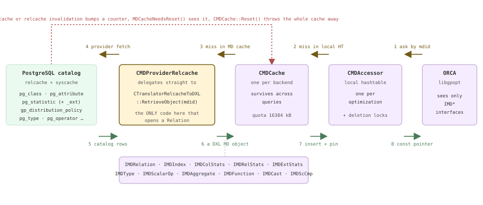

*元数据路径。请求携带 *mdid* 从右向左传递；响应以 DXL 元数据对象的形式从左向右传递。图中只有 `CTranslatorRelcacheToDXL` 可以访问 relcache 条目。*

### 17.4.1 提供器接口边界 {#1741-the-provider-seam}

这个边界是一个抽象接口 `IMDProvider`，其中只有一个值得关注的方法：给定元数据 ID，返回一个元数据对象。ORCA 对数据库的全部了解都经由它获得。在普通查询中，实现类是 `CMDProviderRelcache`（`src/backend/gpopt/relcache/CMDProviderRelcache.cpp`），其实现简单得出奇——它只是一个转发桩。离线实现 `CMDProviderMemory` 则从 minidump 文件读取同样的对象；这就是无需服务器便可重放优化过程的全部诀窍，[§17.5](#175-translation-query--dxl--plstmt) 将展开说明。`COptTasks::OptimizeTask` 在 `src/backend/gpopt/utils/COptTasks.cpp` 中实例化 relcache 提供器，并将它交给访问器。

```c {title="src/backend/gpopt/relcache/CMDProviderRelcache.cpp — CMDProviderRelcache::GetMDObj()"}
// return the requested metadata object
IMDCacheObject *
CMDProviderRelcache::GetMDObj(CMemoryPool *mp, CMDAccessor *md_accessor,
                              IMDId *mdid, IMDCacheObject::Emdtype mdtype) const
{
    IMDCacheObject *md_obj =
        CTranslatorRelcacheToDXL::RetrieveObject(mp, md_accessor, mdid, mdtype);
    GPOS_ASSERT(nullptr != md_obj);
    return md_obj;
}
```

真正的工作在下一层文件 `src/backend/gpopt/translate/CTranslatorRelcacheToDXL.cpp`（3208 行）中。`RetrieveObject` 根据元数据 ID 的*种类*分支并派发：`EmdidRel` → `RetrieveRel`，`EmdidColStats` → `RetrieveColStats`，`EmdidRelStats` → `RetrieveRelStats`，`EmdidInd` → `RetrieveIndex`，`EmdidExtStats` → `RetrieveExtStats`；普通的 `EmdidGeneral` ID 则根据请求类型，进一步解析到 `RetrieveType` / `RetrieveScOp` / `RetrieveAgg` / `RetrieveFunc`。ID 本身是一个字符串，序列化格式为 `MdidType.Oid.Major.Minor`（`libnaucrates/src/md/CMDIdGPDB.cpp` — `CMDIdGPDB::Serialize()`）；类型编码在 `libnaucrates/include/naucrates/md/IMDId.h`（`IMDId`）中枚举：`0` 表示通用，`1` 表示列统计信息，`2` 表示关系统计信息，`6` 表示关系，`7` 表示索引，`10` 表示扩展统计信息。因此，`6.34537.1.0` 表示 *OID 为 34537 的关系*，`1.34537.1.0.2` 表示*该关系第三列的统计信息*。这个字符串也是 MD 缓存的键（`CMDKey`）。

值得看看这类对象的实际样子，因为它不是抽象概念，而是具体且可序列化的记录。最方便的观察窗口是 minidump（[§17.5](#175-translation-query--dxl--plstmt)）：设置 `optimizer_minidump = always` 后，Coordinator 会把每次优化连同元数据一起写入 `<datadir>/minidumps/`。下面是一个含两列且没有索引的演示事实表对应的 `IMDRelation`，除了为页面重新排版之外，其余均为原样。

*IMDRelation 的实际序列化形式。它不包含任何指向 PostgreSQL 内部对象的指针。*

```sql
CREATE TABLE m174_fact (id int, dim_id int, region text, amt numeric)
  DISTRIBUTED BY (id);
INSERT INTO m174_fact SELECT g, g % 500, 'r' || (g % 8), g * 1.5
  FROM generate_series(1,200000) g;
ANALYZE m174_fact;

SET optimizer_minidump = always;
EXPLAIN SELECT count(*) FROM m174_fact f JOIN m174_dim d ON f.dim_id = d.dim_id
  WHERE f.region = 'r3';
-- then read <datadir>/minidumps/Minidump_20260814_003615_6175_2.mdp
```

```text {hl_lines="14" title="output"}
<dxl:Relation Mdid="6.34537.1.0" Name="m174_fact" IsTemporary="false"
              Rows="200000.000000" StorageType="Heap"
              DistributionPolicy="Hash" DistributionColumns="0" Keys="10,4">
  <dxl:Columns>
    <dxl:Column Name="id"     Attno="1" Mdid="0.23.1.0"   Nullable="true" ColWidth="4"/>
    <dxl:Column Name="dim_id" Attno="2" Mdid="0.23.1.0"   Nullable="true" ColWidth="4"/>
    <dxl:Column Name="region" Attno="3" Mdid="0.25.1.0"   Nullable="true" ColWidth="3"/>
    <dxl:Column Name="amt"    Attno="4" Mdid="0.1700.1.0" Nullable="true" ColWidth="7"/>
    <dxl:Column Name="ctid"   Attno="-1" Mdid="0.27.1.0" Nullable="false" ColWidth="6"/>
    …
  </dxl:Columns>
  <dxl:IndexInfoList/>
  <dxl:CheckConstraints/>
  <dxl:DistrOpfamilies><dxl:DistrOpfamily Mdid="0.1977.1.0"/></dxl:DistrOpfamilies>
</dxl:Relation>
```

注意最后一行。**分布策略也经由元数据层传递。**`RetrieveRel` 从 relcache 条目读取 `GpPolicy`，将 `POLICYTYPE_PARTITIONED`+`nattrs>0` 映射为 `EreldistrHash`，将 `nattrs==0` 映射为 `EreldistrRandom`，将 `POLICYTYPE_REPLICATED` 映射为 `EreldistrReplicated`，将 `POLICYTYPE_ENTRY` 映射为 `EreldistrMasterOnly`（`GetRelDistribution`）；它会记录分布列的位置，更关键的是，把每个分布操作符类解析为其**操作符族**（`RetrieveRelDistributionOpFamilies`）。这就是上面的 `gp_distribution_policy.distclass = 10020`（`int4_ops`）变成 `Mdid="0.1977.1.0"`（`integer_ops`）的过程。ORCA 引擎没有 Segment 或哈希函数的概念；它拥有的是可以比较的操作符族标识，这些信息恰好足以判断两张表是否同位分布，以及是否需要 Motion。这对应于 [§16.1](/cloudberry/core-internals/part-4-query-processing/ch16/#161-the-locus-model-cdbpathlocus) 中 `CdbPathLocus` 在 ORCA 一侧的实现：信息相同，只是到达的路径完全不同。

*同一个连接运行两次。唯一改变的是事实表按哪一列分布；而这条信息以操作符族 mdid 的形式到达 ORCA。*

```sql
SELECT localoid::regclass AS tbl, policytype, distkey, distclass
  FROM gp_distribution_policy WHERE localoid::regclass::text LIKE 'm174%';

-- m174_byd is the same 200k rows, DISTRIBUTED BY (dim_id)
EXPLAIN (COSTS OFF) SELECT count(*) FROM m174_byd  b JOIN m174_dim d ON b.dim_id = d.dim_id;
EXPLAIN (COSTS OFF) SELECT count(*) FROM m174_fact f JOIN m174_dim d ON f.dim_id = d.dim_id;
```

```text {hl_lines="14 23" title="output"}
    tbl     | policytype | distkey | distclass
------------+------------+---------+-----------
 m174_fact  | p          | 1       | 10020
 m174_dim   | p          | 1       | 10020
 m174_byd   | p          | 2       | 10020

 Finalize Aggregate                              -- m174_byd: co-located
   ->  Gather Motion 3:1  (slice1; segments: 3)
         ->  Partial Aggregate
               ->  Hash Join
                     Hash Cond: (b.dim_id = d.dim_id)
                     ->  Seq Scan on m174_byd b
                     ->  Hash
                           ->  Seq Scan on m174_dim d      -- no Motion at all

 Finalize Aggregate                              -- m174_fact: not co-located
   ->  Gather Motion 3:1  (slice1; segments: 3)
         ->  Partial Aggregate
               ->  Hash Join
                     Hash Cond: (f.dim_id = d.dim_id)
                     ->  Seq Scan on m174_fact f
                     ->  Hash
                           ->  Broadcast Motion 3:3  (slice2; segments: 3)
                                 ->  Seq Scan on m174_dim d
```

### 17.4.2 CMDAccessor 与 MD 缓存 {#1742-cmdaccessor-and-the-md-cache}

`CMDAccessor`（`libgpopt/src/mdcache/CMDAccessor.cpp`，1331 行）是每次元数据请求都要经过的入口，`GetImdObj` 概括了整个过程：一次**三级**查找。首先查访问器自己的哈希表，该表仅属于本次优化；未命中时查进程级的 `CMDCache`；仍未命中时才访问提供器，这是唯一能到达 `Relation` 的路径。返回的对象会插入 MD 缓存并被钉住，随后还会带着删除锁存放在本地哈希表中。因此，在本次优化的余下过程中，每次 `RetrieveRel(mdid)` 都只是一次哈希表探查，返回稳定的 `const` 指针。这种稳定性很重要：[§17.2](#172-the-cascades-engine) 中的引擎在枚举备选项时，会请求同一个关系数千次。

```c {title="src/backend/gporca/libgpopt/src/mdcache/CMDAccessor.cpp — CMDAccessor::GetImdObj()"}
if (nullptr == pimdobj)
{
    // object not in local hashtable, try lookup in the MD cache
    IMDProvider *pmdp = Pmdp(mdid->Sysid());
    CMDKey mdkey(mdid);
    a_pmdcacc = GPOS_NEW(m_mp) CacheAccessorMD(m_pcache);
    a_pmdcacc->Lookup(&mdkey);
    IMDCacheObject *pmdobjNew = a_pmdcacc->Val();
    if (nullptr == pmdobjNew)
    {
        // object not found in MD cache: retrieve it from MD provider
        pmdobjNew = pmdp->GetMDObj(mp, this, mdidCopy, mdtype);
        …
        IMDCacheObject *pmdobjInserted = a_pmdcacc->Insert(a_pmdkeyCache.Value(), pmdobjNew);
```

MD 缓存**按后端进程独立维护，并在查询之间持续存在**；这正是它的用途。`optimizer_metadata_caching`（这里为 on）决定是否保留它；如果关闭该选项，`OptimizeTask` 会在退出时调用 `CMDCache::Shutdown()`（`COptTasks.cpp`）。`optimizer_mdcache_size`（这里为 16384 kB）是缓存配额，每次优化都会重新应用。你可以直接观察缓存的工作情况：启用 `optimizer_print_optimization_stats` 后，`CMDAccessor` 的析构函数会打印累计的获取和查找耗时（`CMDAccessor.cpp` — `CMDAccessor::~CMDAccessor()`）。本次构建启用了 `--enable-cassert`，ORCA 的开发者打印 GUC 正因如此才会产生输出。

*同一个会话中，同一个查询运行两次。第二次优化*完全没有*从系统目录获取数据。*

```sql
SET client_min_messages = log;
SET optimizer_print_optimization_stats = on;
EXPLAIN (COSTS OFF) SELECT count(*) FROM m174_fact f JOIN m174_dim d
  ON f.dim_id = d.dim_id WHERE f.region = 'r3';
-- ... and again, verbatim
```

```text {hl_lines="7 12" title="output"}
LOG:  2026-08-14 00:31:41:333326 CST,THD000,TRACE,"timer:
[OPT]: Query To DXL Translation Time: 7ms",
…
2026-08-14 00:31:41:364755 CST,THD000,TRACE,"
Memory consumption after exploration Engine: [3.003151] MB, MD Cache: [0.335472] MB, Total: [13.877274] MB",
…
2026-08-14 00:31:41:370394 CST,THD000,TRACE,"[OPT]: Total metadata fetch time: 16.494000ms
[OPT]: Total metadata lookup time (including fetch time): 20.890000ms
",

-- second run
2026-08-14 00:31:41:411058 CST,THD000,TRACE,"[OPT]: Total metadata fetch time: 0.000000ms
[OPT]: Total metadata lookup time (including fetch time): 2.794000ms
",
```

那么，过期条目如何被清除？并不是逐对象清除。ORCA 完全没有细粒度的元数据失效机制。相反，`src/backend/gpopt/gpdbwrappers.cpp` 为九个内容可能进入元数据对象的系统目录注册 syscache 回调，包括 `pg_aggregate`、`pg_amop`、`pg_cast`、`pg_constraint`、`pg_operator`、`pg_opfamily`、`pg_statistic`、`pg_type` 和 `pg_proc`，另外再注册一个涵盖所有关系的 relcache 回调。每个回调只做一件事：`mdcache_invalidation_counter++`。`gpdb::MDCacheNeedsReset()` 将这个计数器与上次看到的值比较，`OptimizeTask` 则通过清空整个缓存作出响应。这是有意采用的粗粒度设计：`CMDCache::Reset()` 的实现确实就是 `Shutdown; Init;`（`libgpopt/src/mdcache/CMDCache.cpp`）。

```c {title="src/backend/gpopt/utils/COptTasks.cpp — COptTasks::OptimizeTask()"}
bool reset_mdcache = gpdb::MDCacheNeedsReset();

// initialize metadata cache, or purge if needed, or change size if requested
if (!CMDCache::FInitialized())
{
    CMDCache::Init();
    CMDCache::SetCacheQuota(optimizer_mdcache_size * 1024L);
}
else if (reset_mdcache)
{
    CMDCache::Reset();
    CMDCache::SetCacheQuota(optimizer_mdcache_size * 1024L);
}
```

*一条无关的 DDL 语句，就会让整个 MD 缓存消失：下一次优化必须再次承担访问系统目录的开销。*

```sql
SET client_min_messages = log;
SET optimizer_print_optimization_stats = on;
EXPLAIN (COSTS OFF) SELECT count(*) FROM m174_fact f JOIN m174_dim d ON f.dim_id = d.dim_id WHERE f.region = 'r3';
EXPLAIN (COSTS OFF) SELECT count(*) FROM m174_fact f JOIN m174_dim d ON f.dim_id = d.dim_id WHERE f.region = 'r3';
CREATE TEMP TABLE m174_ddl(x int);     -- touches nothing in the query above
EXPLAIN (COSTS OFF) SELECT count(*) FROM m174_fact f JOIN m174_dim d ON f.dim_id = d.dim_id WHERE f.region = 'r3';
EXPLAIN (COSTS OFF) SELECT count(*) FROM m174_fact f JOIN m174_dim d ON f.dim_id = d.dim_id WHERE f.region = 'r3';
```

```text {hl_lines="4" title="output"}
[OPT]: Total metadata fetch time: 15.175000ms      -- cold
[OPT]: Total metadata fetch time: 0.000000ms       -- warm
LOG:  statement: CREATE TEMP TABLE m174_ddl(x int);
[OPT]: Total metadata fetch time: 2.668000ms      -- cache was Reset()
[OPT]: Total metadata fetch time: 0.000000ms       -- warm again
```

> [!NOTE]
> 触发这一行为的失效事件，与驱动 PostgreSQL 自身 relcache 和 catcache 清空的事件相同（**[§8.5](/cloudberry/core-internals/part-2-storage-data-layout/ch08/#85-runtime-caching--invalidation)**）；ORCA 只是订阅了该事件，并采用了最直接的响应策略。实际后果是：如果工作负载在查询之间执行 DDL，ORCA 的元数据缓存就没有收益，每个查询都要承担这 15 ms 的系统目录工作。另请注意，`CMDCache` 按*后端进程*维护，因此新连接总是从冷缓存开始。

### 17.4.3 统计信息：相同的系统目录，不同的计算方法 {#1743-statistics-the-same-catalog-different-arithmetic}

ORCA 读取的正是第 [14](/cloudberry/core-internals/part-4-query-processing/ch14/) 章介绍的统计信息，没有额外来源。`RetrieveColStats`（`CTranslatorRelcacheToDXL.cpp`）打开 `pg_statistic` 元组，提取 `stanullfrac`、`stawidth`、`stadistinct`（将负数的*比例*形式转换为绝对 NDV）、MCV 槽位和直方图槽位，并将后两者转换为同一个统一的 DXL 桶数组；一个 MCV 会变成 `DistinctValues="1"` 的单值桶。它还会读取 Cloudberry 自有的 `STATISTIC_KIND_NDV_BY_SEGMENTS` 槽位，即 [§14.1](/cloudberry/core-internals/part-4-query-processing/ch14/#141-basic-statistics) 中的跨 Segment NDV，以及 [§14.2](/cloudberry/core-internals/part-4-query-processing/ch14/#142-extended--multivariate-statistics) 中的扩展统计信息：`RetrieveExtStats` 将 `pg_statistic_ext_data` 中的函数依赖转换为 `CMDDependency` 对象，将不同值数量条目转换为 `CMDNDistinct`。因此，它的输入与规划器相同，连扩展部分也一样。区别在于此后的所有处理。

*一个 IMDColStats。八个单值桶对应均匀分布的文本列的 MCV，另有 Cloudberry 按 Segment 记录的 NDV。*

```bash
-- from the same minidump as above
grep -o '<dxl:ColumnStatistics [^>]*>' Minidump_20260814_003615_6175_2.mdp
```

```text {hl_lines="3" title="output"}
<dxl:ColumnStatistics Mdid="1.34537.1.0.2" Name="region" Width="3.000000"
   NullFreq="0.000000" NdvRemain="0.000000" FreqRemain="0.000000"
   ColStatsMissing="false" NdvBySeg="24.000000">
  <dxl:StatsBucket Frequency="0.12756666541099548" DistinctValues="1.00000000000000000">
    <dxl:LowerBound Closed="true" TypeMdid="0.25.1.0" Value="GAAAAHI3" LintValue="1029747886"/>
    <dxl:UpperBound Closed="true" TypeMdid="0.25.1.0" Value="GAAAAHI3" LintValue="1029747886"/>
  </dxl:StatsBucket>
  <dxl:StatsBucket Frequency="0.12590000033378601" DistinctValues="1.00000000000000000">
  …  (8 buckets, one per distinct value of region)
</dxl:ColumnStatistics>
```

基数推导完全在 ORCA 内部进行，代码位于 `libnaucrates/src/statistics/`：包括 `CStatistics`、`CHistogram`、`CFilterStatsProcessor`、`CJoinStatsProcessor`，每个逻辑操作符都有对应的处理器类。它还采用自己的阻尼机制。对于多个过滤条件的合取，`CScaleFactorUtils::CalcScaleFactorCumulativeConj` 先将各列的缩放因子按降序排列，再将第 *k* 个因子乘以 `optimizer_damping_factor_filter` 的 *k* 次幂进行折减：第一个谓词不加阻尼，第二个乘以 0.75²，第三个乘以 0.75³，依此类推。由于缩放因子是除数，将它*调低*会把估计值*推高*；这是有意针对列间相关性采取的保守措施。[§14.3](/cloudberry/core-internals/part-4-query-processing/ch14/#143-selectivity-estimation) 介绍了规划器出于相同考虑采用的做法；这里是独立实现，并有独立的 GUC。

```c {title="src/backend/gporca/libnaucrates/src/statistics/CScaleFactorUtils.cpp — CScaleFactorUtils::CalcScaleFactorCumulativeConj()"}
for (ULONG ul = 0; ul < num_cols; ul++)
{
    // apply damping factor
    CDouble local_scale_factor = *(*scale_factors)[ul];
    scale_factor =
        scale_factor * std::max(CStatistics::MinRows.Get(),
                                (local_scale_factor *
                                 CScaleFactorUtils::DampedFilterScaleFactor(
                                     stats_config, ul + 1))
                                    .Get());
}
```

*三个确实相互独立的谓词，同一套系统目录，却得到三个答案。真实行数为 6200。*

```sql
-- region = 'r3' is 1 in 8; dim_id < 250 is 1 in 2; id < 100000 is 1 in 2
EXPLAIN SELECT * FROM m174_fact WHERE region='r3' AND dim_id<250 AND id<100000;
SET optimizer = off;                              -- PostgreSQL planner
EXPLAIN SELECT * FROM m174_fact WHERE region='r3' AND dim_id<250 AND id<100000;
RESET optimizer;
SET optimizer_damping_factor_filter = 1.0;        -- ORCA, damping disabled
EXPLAIN SELECT * FROM m174_fact WHERE region='r3' AND dim_id<250 AND id<100000;
SELECT count(*) FROM m174_fact WHERE region='r3' AND dim_id<250 AND id<100000;
```

```text {hl_lines="2 7 12 17" title="output"}
ORCA, default damping 0.75
 Gather Motion 3:1  (slice1; segments: 3)  (cost=0.00..441.23 rows=22338 width=18)
   ->  Seq Scan on m174_fact  (cost=0.00..439.74 rows=7446 width=18)
 Optimizer: GPORCA

PostgreSQL planner
 Gather Motion 3:1  (slice1; segments: 3)  (cost=0.00..1460.97 rows=14123 width=18)
   ->  Seq Scan on m174_fact  (cost=0.00..1272.67 rows=4708 width=18)
 Optimizer: Postgres query optimizer

ORCA, optimizer_damping_factor_filter = 1.0
 Gather Motion 3:1  (slice1; segments: 3)  (cost=0.00..439.98 rows=6315 width=18)
   ->  Seq Scan on m174_fact  (cost=0.00..439.56 rows=2105 width=18)

 count
-------
  6200
```

> [!NOTE]
> 这份输出有两个细节。首先，注意按 Segment 计数的惯例：`7446 × 3 = 22338`。Gather 下方的 ORCA `rows=` 表示*一个* Segment 产生的行数，与 [§15.3](/cloudberry/core-internals/part-4-query-processing/ch15/#153-path-cost--add_path) 完全相同。其次，ORCA 未加阻尼时的估计值（6315）在这里几乎完美，而加阻尼后的估计值高达实际值的 3.6 倍，因为这三列确实相互独立。阻尼就像保险，不管是否需要，都要付出代价。这**不是**缺陷，解决方法也不是全局关闭它。[§14.2](/cloudberry/core-internals/part-4-query-processing/ch14/#142-extended--multivariate-statistics) 展示了相反的情形：ORCA 的保守处理使它成为两者中更准确的那个。还有一个相关陷阱：`optimizer_damping_factor_join = 0` *不*表示“不对连接加阻尼”；此处为零会选择完全不同的算法，对同一对表上的谓词采用平方根方案；任何大于零的值则会重新启用旧的指数算法。对于后者的默认值 0.01，源码自身就指出它会严重高估不相关列的结果（`CScaleFactorUtils.cpp` — `CScaleFactorUtils::CumulativeJoinScaleFactor()`）。

### 17.4.4 缺失的统计信息 {#1744-missing-statistics}

如果某一列没有可用的 `pg_statistic` 行，`RetrieveColStats` 会返回一个*占位* `CDXLColStats`，其直方图通过 `IsColStatsMissing()` 报告统计信息缺失。`CMDAccessor::RecordColumnStats` 会发现这一点（`CMDAccessor.cpp`）；如果 `optimizer_print_missing_stats` GUC 已开启——它在 `CConfigParamMapping.cpp` 中映射到跟踪标志 `EopttracePrintColsWithMissingStats`——就通过 `CStatisticsConfig::AddMissingStatsColumn` 登记该列。优化结束时，`COptTasks::OptimizeTask` 取出该集合中的所有条目，`PrintMissingStatsWarning` 为每列输出一行 `LOG`，为每张表输出一条带有可操作 `HINT` 的 `NOTICE`。这条 NOTICE 是 Cloudberry 中最常见的消息之一；现在你知道了，它是在计划选定*之后*，依据统计信息推导期间收集的集合生成的。

*用户会看到的 NOTICE；先展示它保持沉默的情形。*

```sql
-- (a) nobody has ever ANALYZEd this table: pg_class.reltuples is still -1
CREATE TABLE m174_nostats (a int, b text) DISTRIBUTED BY (a);
INSERT INTO m174_nostats SELECT g, 'x'||g FROM generate_series(1,50000) g;
EXPLAIN SELECT * FROM m174_nostats WHERE a < 100 AND b = 'x5';

-- (b) now reltuples is real, but column c has no pg_statistic row of its own
ANALYZE m174_nostats (a);
ALTER TABLE m174_nostats ADD COLUMN c int;
UPDATE m174_nostats SET c = a % 100;
SET client_min_messages = log;
EXPLAIN SELECT * FROM m174_nostats WHERE c = 7;
```

```text {hl_lines="2 9" title="output"}
-- (a) 50000 rows in the table, no complaint whatsoever
 Gather Motion 3:1  (slice1; segments: 3)  (cost=0.00..431.00 rows=1 width=12)
   ->  Seq Scan on m174_nostats  (cost=0.00..431.00 rows=1 width=12)
         Filter: ((a < 100) AND (b = 'x5'::text))
 Optimizer: GPORCA

-- (b)
LOG:  Missing statistics for column: m174_nostats.c
NOTICE:  One or more columns in the following table(s) do not have statistics: m174_nostats
HINT:  For non-partitioned tables, run analyze <table_name>(<column_list>). For
partitioned tables, run analyze rootpartition <table_name>(<column_list>). See log
for columns missing statistics.
 Gather Motion 3:1  (slice1; segments: 3)  (cost=0.00..433.21 rows=20000 width=14)
   ->  Seq Scan on m174_nostats  (cost=0.00..432.16 rows=6667 width=14)
         Filter: (c = 7)
```

> [!NOTE]
> 情形 (a) 是一个确实存在、且已在源码中说明的漏洞，`COptTasks.cpp` 的 `COptTasks::OptimizeTask()` 中就留有一条 `CBDB_MERGE_FIXME`：*“分析后的空表仍然没有统计信息，因为 CBDB 无法区分空表与缺少统计信息。”* 具体机制如下：当 `reltuples` 为 `0` **或** `-1` 时，`RetrieveRelStats` 会设置 `relation_empty = true`（`CTranslatorRelcacheToDXL.cpp`），而 `RecordColumnStats` 一开始就检查 `!isEmptyTable`。因此，对真正的空表不发出提示是正确的；但从未分析过的表（PostgreSQL 16 在首次 ANALYZE 或 VACUUM 之前将 `reltuples = -1` 保持不变）会被误判为空表，结果既得到毫无意义的 `rows=1`，*又*没有任何警告提示异常。最希望收到提醒的那种估计，恰好被抑制了。情形 (b) 中，`reltuples` 是真实值，因此行为符合设计：总共 50000 行中估计 `rows=20000`，来自 ORCA 固定的默认等值选择率，同时会触发 NOTICE。

### 17.4.5 作为独立库的代价模型 {#1745-the-cost-model-as-a-separate-library}

ORCA 的代价计算位于独立的 `libgpdbcost` 库中：`CCostModelGPDB.cpp` 有 2760 行，`CCostModelParamsGPDB.cpp` 包含 **56 个命名参数**，每个都有校准值和上下界（`CCostModelParamsGPDB.h` 按 `EcpSentinel` 设置数组大小）。`CCostModelGPDB::Cost` 根据物理操作符 ID 分支，派发到 `CostScan`、`CostFilter`、`CostHashJoin`、`CostNLJoin`、`CostMotion`、`CostHashAgg`、`CostSort` 等函数。`optimizer_cost_model` 决定采用哪一组参数：`guc_gp.c` 中的 `optimizer_cost_model_options` 恰好接受 `legacy`、`calibrated`（默认值，本集群也采用此值）和 `experimental` 三种选项；选择结果通过跟踪标志 `EopttraceLegacyCostModel` / `EopttraceExperimentalCostModel` 传入 ORCA（`CConfigParamMapping.cpp` — `CConfigParamMapping::PackConfigParamInBitset()`）。随后，少数 GUC 会在 `COptTasks::SetCostModelParams` 中覆盖个别参数；该函数由 `GetCostModel` 调用，后者使用 Segment 数量构建模型。

最值得阅读的函数是 `CostMotion`，因为 PostgreSQL 中完全没有与之对应的部分：ORCA 将数据移动作为一等操作符来计价，而不是作为添加包装节点时的一项决策。注意 `UlHosts()`，它只是构建模型时传入的 Segment 数量（`CCostModelGPDB.h` — `CCostModelGPDB`）。

```c {title="src/backend/gporca/libgpdbcost/src/CCostModelGPDB.cpp — CCostModelGPDB::CostMotion()"}
if (COperator::EopPhysicalMotionBroadcast == op_id)
{
    // broadcast cost is amplified by the number of segments
    dSendCostUnit = …PcpLookup(EcpBroadcastSendCostUnit)->Get();
    dRecvCostUnit = …PcpLookup(EcpBroadcastRecvCostUnit)->Get();
    recvCost = num_rows_outer * dWidthOuter * pcmgpdb->UlHosts() * dRecvCostUnit;
}
else if (COperator::EopPhysicalMotionHashDistribute == op_id || …)
{
    dSendCostUnit = …PcpLookup(EcpRedistributeSendCostUnit)->Get();
    dRecvCostUnit = …PcpLookup(EcpRedistributeRecvCostUnit)->Get();
    recvCost = pci->Rows() * pci->Width() * dRecvCostUnit;   // no UlHosts()
}
costLocal = CCost(pci->NumRebinds() *
                  (num_rows_outer * dWidthOuter * dSendCostUnit + recvCost));
```

因此，公式有三个部分：行数 × 宽度 × 发送单位代价，加上接收代价，再整体乘以重新绑定次数（即该子树在嵌套循环下被重新执行的次数）。分支之间的不对称*就是*分布式代价模型的体现。一次重分布只为自身的行支付一次代价；广播则支付 `UlHosts()` 倍的代价，因为每个 Segment 都要接收每一行。不仅如此，每字节的常量本身也不对称：`EcpBroadcastSendCostUnit` 为 4.965e-05，`EcpRedistributeSendCostUnit` 为 2.33e-06，相差 21 倍（`CCostModelParamsGPDB.cpp`）。当行数超过 `optimizer_penalize_broadcast_threshold` 时，模型不再建模，而是直接给出判定：`costLocal = CCost(100000000000000.0)`。可以对照 [§16.2](/cloudberry/core-internals/part-4-query-processing/ch16/#162-cdbmotionpath-generation) 中的 `cdbpath_cost_motion`：它在规划器一侧用少得多的机制得出了大致相同的结论；不过，它并不像这里这样是一个可插拔库。

| 控制项（此处的实际值） | 实际影响的取舍 |
| --- | --- |
| `optimizer_cost_model` = `calibrated` | 加载三组参数中的哪一组：`legacy` / `calibrated` / `experimental`。以跟踪标志传递，而非模型参数。 |
| `optimizer_segments` = `0` | *代价模型*假定的 Segment 数量。`0` 表示使用 `gpdb::GetGPSegmentCount()`。不会改变计划实际使用的进程组大小。 |
| `optimizer_nestloop_factor` = `1024` | 乘到嵌套循环的**最终**代价上（`CostNLJoin`、`CCostModelGPDB.cpp`）。库自身的默认值是 1.0；这个 GUC 相当于施加了约 1000 倍的不利权重，抑制嵌套循环连接。 |
| `optimizer_sort_factor` = `1` | 缩放 `EcpSortTupWidthCostUnit` 及其上下界。仅在 != 1.0 时应用。 |
| `optimizer_skew_factor` = `0` | 哈希连接的数据倾斜惩罚。`0` 将倾斜乘数限制在 `EcpPenalizeHJSkewUpperLimit`（10.0）；值 *f* > 0 时代入 `pow(1.0307, f-1)`，在 *f* = 100 时达到约 20 的上限。 |
| `optimizer_penalize_broadcast_threshold` = `100000` | 超过该行数后，Broadcast Motion 的代价直接设为 1e14，不再按模型计算。`0` 完全禁用该惩罚。 |
| `optimizer_damping_factor_filter` = `0.75` | 对第 *k* 个合取过滤谓词应用指数折减时使用的底数。 |
| `optimizer_damping_factor_groupby` = `0.75` | 同上，但用于分组列，指数为 `k+1`（`CScaleFactorUtils.cpp` — `CScaleFactorUtils::DampedGroupByScaleFactor()`）。 |
| `optimizer_damping_factor_join` = `0` | `0` 选择平方根算法；任何大于 0 的值都选择旧的指数算法。 |
| `optimizer_cost_threshold` = `0` | **不是**代价模型参数：它根据最佳计划的代价限定*计划抽样*范围，`0.0` 表示不设限（`guc_gp.c` — `config_real`）。它属于 [§17.2](#172-the-cascades-engine) 的枚举器。 |
| `optimizer_metadata_caching` = `on`，`optimizer_mdcache_size` = `16384 kB` | MD 缓存的生命周期和配额，见 [§17.4.2](#1742-cmdaccessor-and-the-md-cache)。 |

*嵌套循环因子的演示。计划完全相同，代价几乎恰好放大了 1024 倍。*

```sql
-- a non-equi join, so a Nested Loop is the only option and the shape cannot change
EXPLAIN SELECT count(*) FROM m174_dim a, m174_dim b WHERE a.dim_id < b.dim_id;
SET optimizer_nestloop_factor = 1;
EXPLAIN SELECT count(*) FROM m174_dim a, m174_dim b WHERE a.dim_id < b.dim_id;
```

```text {hl_lines="5 12" title="output"}
optimizer_nestloop_factor = 1024 (default)
 Finalize Aggregate  (cost=0.00..1330225.06 rows=1 width=8)
   ->  Gather Motion 3:1  (slice1; segments: 3)  (cost=0.00..1330225.06 rows=1 width=8)
         ->  Partial Aggregate  (cost=0.00..1330225.06 rows=1 width=8)
               ->  Nested Loop  (cost=0.00..1330225.06 rows=27778 width=1)
                     Join Filter: (a.dim_id < b.dim_id)
                     ->  Seq Scan on m174_dim a  (cost=0.00..431.00 rows=167 width=4)
                     ->  Materialize  (cost=0.00..431.04 rows=500 width=4)
                           ->  Broadcast Motion 3:3  (slice2; segments: 3)  (cost=0.00..431.04 rows=500 width=4)

optimizer_nestloop_factor = 1
               ->  Nested Loop  (cost=0.00..1299.05 rows=27778 width=1)
                     Join Filter: (a.dim_id < b.dim_id)
                     ->  Seq Scan on m174_dim a  (cost=0.00..431.00 rows=167 width=4)
                     ->  Materialize  (cost=0.00..431.04 rows=500 width=4)
```

*向代价模型虚报 Segment 数量会改变计划，但不会改变进程组。两个 Motion 仍然显示 3:3。*

```sql
EXPLAIN SELECT count(*) FROM m174_fact f JOIN m174_dim d ON f.dim_id = d.dim_id;
SET optimizer_segments = 100;
EXPLAIN SELECT count(*) FROM m174_fact f JOIN m174_dim d ON f.dim_id = d.dim_id;
```

```text {hl_lines="6 12" title="output"}
optimizer_segments = 0  (model uses the real count, 3)
               ->  Hash Join  (cost=0.00..876.52 rows=66667 width=1)
                     Hash Cond: (f.dim_id = d.dim_id)
                     ->  Seq Scan on m174_fact f  (cost=0.00..432.91 rows=66667 width=4)
                     ->  Hash  (cost=431.04..431.04 rows=500 width=4)
                           ->  Broadcast Motion 3:3  (slice2; segments: 3)  (cost=0.00..431.04 rows=500 width=4)
                                 ->  Seq Scan on m174_dim d  (cost=0.00..431.00 rows=167 width=4)

optimizer_segments = 100
               ->  Hash Join  (cost=0.00..862.46 rows=66667 width=1)
                     Hash Cond: (f.dim_id = d.dim_id)
                     ->  Redistribute Motion 3:3  (slice2; segments: 3)  (cost=0.00..431.10 rows=66667 width=4)
                           Hash Key: f.dim_id
                           ->  Seq Scan on m174_fact f  (cost=0.00..431.06 rows=66667 width=4)
                     ->  Hash  (cost=431.00..431.00 rows=167 width=4)
                           ->  Seq Scan on m174_dim d  (cost=0.00..431.00 rows=167 width=4)
```

最后这个演示最清楚地说明了 Segment 数量在哪里起作用。`OptimizeTask` 读取一次实际数量（`COptTasks.cpp`），并传给 `COptimizer::PdxlnOptimize`；而 `GetCostModel` 构建模型时使用的是*另一个* `num_segments_for_costing`，即非零时的 `optimizer_segments`，否则为实际数量。模型被告知有 100 个 Segment 后，`CostMotion` 中的 `UlHosts()` 放大效应会让广播 500 行维表数据的代价看起来达到实际值的 33 倍，于是 ORCA 改为重分布那张有 200 000 行的事实表。它生成的计划仍在实际存在的三个 Segment 上运行。这个参数是观察代价模型的显微镜，不是拓扑设置。

### 17.4.6 两种代价不在同一尺度上 {#1746-the-costs-are-not-on-the-same-scale}

由此就到了最常见的一种 ORCA 计划误读。由于两种优化器都在 EXPLAIN 的同一列打印 `cost=`，人们会比较这些数值。它们不能比较：既不能比较比值，也不能比较差值，根本不能直接比较。

*同一个查询、同样的统计信息、相同的计划形态、同一个集群。先读代价，再读耗时。*

```sql
EXPLAIN ANALYZE SELECT count(*) FROM m174_fact f JOIN m174_dim d ON f.dim_id = d.dim_id;
SET optimizer = off;
EXPLAIN ANALYZE SELECT count(*) FROM m174_fact f JOIN m174_dim d ON f.dim_id = d.dim_id;
```

```text {hl_lines="9 21" title="output"}
GPORCA
 Finalize Aggregate  (cost=0.00..876.52 rows=1 width=8) (actual time=47.199..47.207 rows=1 loops=1)
   ->  Gather Motion 3:1  (slice1; segments: 3)  (cost=0.00..876.52 …)
         ->  Partial Aggregate  (cost=0.00..876.52 …)
               ->  Hash Join  (cost=0.00..876.52 rows=66667 …) (actual time=6.059..39.638 rows=66711 loops=1)
                     ->  Seq Scan on m174_fact f  (cost=0.00..432.91 rows=66667 …)
                     ->  Hash  (cost=431.04..431.04 rows=500 …)
                           ->  Broadcast Motion 3:3  (cost=0.00..431.04 rows=500 …)
                                 ->  Seq Scan on m174_dim d  (cost=0.00..431.00 rows=167 …)
 Optimizer: GPORCA
 Execution Time: 68.492 ms

Postgres query optimizer
 Finalize Aggregate  (cost=1871.64..1871.65 rows=1 width=8) (actual time=35.595..35.598 rows=1 loops=1)
   ->  Gather Motion 3:1  (slice1; segments: 3)  (cost=1871.58..1871.63 rows=3 …)
         ->  Partial Aggregate  (cost=1871.58..1871.59 …)
               ->  Hash Join  (cost=15.58..1704.92 rows=66667 …) (actual time=3.933..31.640 rows=66711 loops=1)
                     ->  Seq Scan on m174_fact f  (cost=0.00..772.67 rows=66667 …)
                     ->  Hash  (cost=9.33..9.33 rows=500 …)
                           ->  Broadcast Motion 3:3  (cost=0.00..9.33 rows=500 …)
                                 ->  Seq Scan on m174_dim d  (cost=0.00..2.67 rows=167 …)
 Optimizer: Postgres query optimizer
 Execution Time: 36.390 ms
```

计划形态完全相同；总代价分别为 876.52 和 1871.65；对于相同的、Segment 本地的 `m174_dim` 扫描，都是 167 行，ORCA 给出的代价为 **431.00**，规划器给出的代价为 **2.67**，相差 161 倍。431 并不是对某个量的估计：它就是 `DInitScanFacorVal = 431.0`，每次表扫描都以这个固定的校准常量作为起点（`CCostModelParamsGPDB.cpp`）。这解释了为什么 ORCA 扫描一张小表也显得很昂贵，以及为什么基本不存在低于 431 的 ORCA 代价。还要注意，每个 ORCA 节点报告的启动代价都是 `0.00`：ORCA 的 `CCost` 是单个标量，因此 PostgreSQL 用来推断 `LIMIT` 以及嵌套循环两侧放置方式的 `startup..total` 数值对（[§15.3](/cloudberry/core-internals/part-4-query-processing/ch15/#153-path-cost--add_path)），在这里根本没有第二个分量可供填写。三次重复运行中，ORCA 的实测耗时为 50–63 ms，规划器为 37–50 ms；二者范围重叠，与 2.1 倍的代价差距毫无关系。因此，要理解 ORCA 为什么选择一个备选项而不选择另一个，应将 ORCA 代价与*其他 ORCA 代价*比较，正如 [§17.2](#172-the-cascades-engine) 的 memo 转储所做的那样；比较优化器时，则只使用 `EXPLAIN ANALYZE`。提交 ORCA 缺陷报告时，也不要只发送代价，要发送 minidump；下一节 [§17.5](#175-translation-query--dxl--plstmt) 就将介绍它。

## 17.5 转换：Query → DXL → PlStmt {#175-translation-query--dxl--plstmt}

ORCA 不理解 PostgreSQL 的表示方式。它从未见过 `Query` 节点，无法沿着 `varno` 查找范围表，也不会直接交给你一个 `PlannedStmt`。它使用的是 **DXL**，即 Data eXchange Language（数据交换语言），一种承载查询树、计划树*以及*元数据的 XML 方言。因此，在 `standard_planner()`（[§17.1](#171-entry--dispatch)）和 memo（[§17.2](#172-the-cascades-engine)）之间存在一层边界，两侧各有一个接口：进入时是 `CTranslatorQueryToDXL`，返回时是 `CTranslatorDXLToPlStmt`。中间的所有内容都采用另一套类型系统。这是该设计的代价；收益则是，查询及其元数据可以写入一个文件，并在笔记本电脑上重新优化。本节最后一部分将展示这一点。

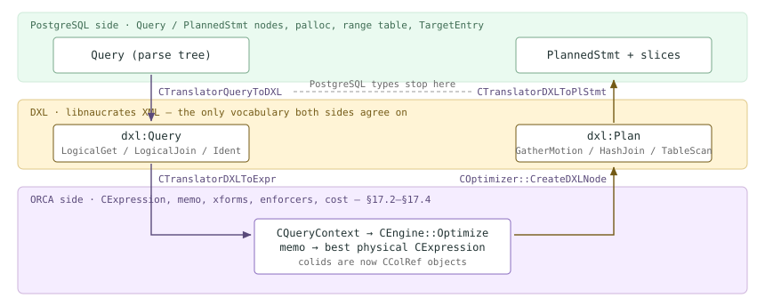

*三层结构：查询经由 DXL 向下进入 ORCA，再沿相同路径向上返回。PostgreSQL 节点类型只存在于最上层。*

### 17.5.1 三个库，三项工作 {#1751-three-libraries-three-jobs}

`src/backend/gporca/` 下的源码树包含的不是一个库，而是四个库。值得记住这种划分，因为它解释了随处可见的命名。`libgpos` 提供操作系统抽象：内存池、异常、任务。`libnaucrates` 负责序列化和元数据交换，DXL 就位于这里。`libgpopt` 是优化器本体。`libgpdbcost` 则是代价模型（[§17.4](#174-metadata-layer--cost-model)）。

| 库 | 内容 | 规模（.cpp / .h） | 为什么会反复遇到它 |
| --- | --- | --- | --- |
| `libgpos` | `src/{memory,error,task,io,string,common}` | 98 / 145 | 内存池（`CMemoryPool`、`CAutoMemoryPool`）、异常机制、`CTask`；它们构成 `libgpopt` 的运行环境，替代 PostgreSQL 的对应环境 |
| `libnaucrates` | `src/{operators,parser,md,statistics,xml}` | 414 / 454 | **DXL**：41 个 `CDXLPhysical*`、19 个 `CDXLLogical*`、60 个 `CDXLScalar*` 操作符类，42 个元数据类，以及用于读回 DXL 的 **185** 个 `CParseHandler*` SAX 处理器 |
| `libgpopt` | `src/{base,engine,search,xforms,operators,mdcache,minidump,hints}` | 440 / 520 | 优化器：memo 与搜索（[§17.2](#172-the-cascades-engine)）、变换（[§17.3](#173-transformation-framework)）、元数据访问器（[§17.4](#174-metadata-layer--cost-model)）、minidump（下文） |
| `libgpdbcost` | `CCostModelGPDB.cpp` 及参数 | 3 / 2 | 代价模型，有意保持可插拔；见 [§17.4](#174-metadata-layer--cost-model) |

> [!NOTE]
> `GPOS_*` 宏是 `libgpos` 对一些语言功能的替代实现；在 PostgreSQL 的 C 环境中，这些功能有不同的做法。`GPOS_NEW(mp)` 是在内存池中执行 placement-new（`libgpos/include/gpos/memory/CMemoryPool.h`），必须使用 `GPOS_DELETE` 释放；`GPOS_RAISE(...)` 就是 `CException::Raise(__FILE__, __LINE__, ...)`（`libgpos/include/gpos/error/CException.h`），因此 ORCA 错误消息会以 *(init.cpp:58)* 这样的源码位置结尾；`GPOS_TRY` / `GPOS_CATCH_EX(ex)` / `GPOS_CATCH_END` 包装 C++ 的 `try/catch`，以便为外层任务关联错误处理器。[§17.1](#171-entry--dispatch) 展示了最外层的 `GPOS_TRY` 代码块：它会把所有逃逸异常转换为*回退到 PostgreSQL 规划器*。

### 17.5.2 Query → DXL：有意丢弃范围表 {#1752-query--dxl-losing-the-range-table-on-purpose}

`COptTasks::OptimizeTask` 通过工厂函数 `CTranslatorQueryToDXL::QueryToDXLInstance`（`src/backend/gpopt/translate/CTranslatorQueryToDXL.cpp`）构建转换器。该函数分配一个 `CContextQueryToDXL`，即所有嵌套转换层共享的查询级状态，然后调用 `TranslateQueryToDXL()`。这个驱动函数根据 `commandType` 分为四条路径，分别派发到 `TranslateSelectQueryToDXL`、`TranslateInsertQueryToDXL`、`TranslateDeleteQueryToDXL` 或 `TranslateUpdateQueryToDXL`；如果 `SELECT` 的 `parentStmtType` 不是 `PARENTSTMTTYPE_NONE`，则转而进入 `TranslateCTASToDXL`。标量表达式交给配套的 `CTranslatorScalarToDXL.cpp`，少数结构则在转换前由 `CQueryMutators.cpp` 改写。除 DXL 树之外，转换器还返回调用者需要的四项信息：`GetQueryOutputCols()`、`GetCTEs()`，以及两项分布信息 `HasDistributedTables()` / `GetDistributionHashOpsKind()`（`src/include/gpopt/translate/CTranslatorQueryToDXL.h` — `CTranslatorQueryToDXL`）。

这个转换器最有影响的一项工作，是消除范围表。PostgreSQL 的 `Var` 是一个*坐标*——`(varlevelsup, varno, varattno)`；离开它所索引的 `rtable`，便没有意义。DXL 没有范围表，只有平面的整数 **colid**。`CMappingVarColId` 完成这一扁平化过程：它根据绝对查询层级和 `Var` 坐标构建 `CGPDBAttInfo`，以此作为哈希映射的键：

```c {title="src/backend/gpopt/translate/CMappingVarColId.cpp — CMappingVarColId::GetGPDBAttOptColMapping()"}
	// absolute query level of var
	ULONG abs_query_level = current_query_level - var->varlevelsup;

	// extract varno
	ULONG var_no = var->varno;
	…
	CGPDBAttInfo *gpdb_att_info =
		GPOS_NEW(m_mp) CGPDBAttInfo(abs_query_level, var_no, var->varattno);
	CGPDBAttOptCol *gpdb_att_opt_col_info =
		m_gpdb_att_opt_col_mapping->Find(gpdb_att_info);
```

`GetColId()` 是这次查找对外暴露的简单接口。它运行之后，查询中的每一列都只是一个整数，ORCA 无需解析任何关系就能推理等价类、函数依赖和要求的输出列；这正是优化器得以独立于 PostgreSQL 解析表示的原因。反向转换（[§17.5.5](#1755-dxl--plannedstmt-rebuilding-postgresql)）则必须从头重建这些坐标。

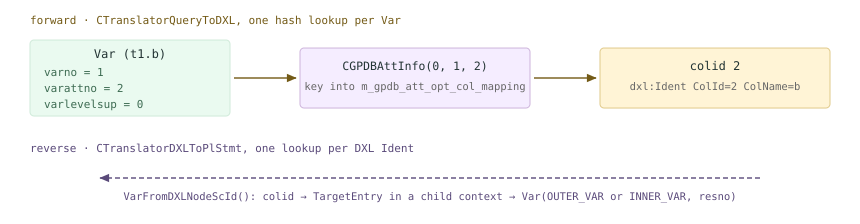

*一列的三种表示。正向：Var 的坐标三元组变成哈希键，再变成平面的 colid。反向：通过子转换上下文解析 colid，将其还原为 Var。*

*从 ORCA 内部看到的扁平列空间。本次构建启用了 --enable-cassert，因此开发者打印 GUC 才会产生输出。*

```sql
SET client_min_messages=log;
SET optimizer_print_query=on;
EXPLAIN SELECT t1.b, t2.c FROM m175_t t1 JOIN m175_t t2
        ON t1.a=t2.a WHERE t1.b=3;
```

```text {hl_lines="5" title="output"}
LOG:  2026-08-14 00:31:57:075798 CST,THD000,TRACE,"
Algebrized query: 
+--CLogicalSelect
   |--CLogicalNAryJoin
   |  |--CLogicalGet "t1" ("t1"), Columns: ["a" (0,Used), "b" (1,Used), "c" (2,Unused), … "gp_foreign_server" (10,Unknown)] Key sets: {[3,9]}
   |  |--CLogicalGet "t2" ("t2"), Columns: ["a" (11,Used), "b" (12,Unused), "c" (13,Used), … "gp_foreign_server" (21,Unknown)] Key sets: {[3,9]}
   |  +--CScalarCmp (=)
   |     |--CScalarIdent "a" (0,Used)
   |     +--CScalarIdent "a" (11,Used)
   +--CScalarCmp (=)
      |--CScalarIdent "b" (1,Used)
      +--CScalarConst (3)
",
```

两张表、二十二列、一个平面的命名空间 `0…21`，其中也包含系统列；ORCA 携带这些列，是因为 DML 计划可能需要 `ctid` 和 `gp_segment_id`。还要注意 `optimizer_print_query` 实际打印的内容：不是 DXL，而是 ORCA 在读回 DXL *之后*构建的 `CExpression` 树。因此，这里存在两个 colid 空间，而且二者的编号在此相差 1：转换器从 `GPDXL_COL_ID_START` = 1 开始编号（定义于 `src/include/gpopt/translate/CContextQueryToDXL.h`，由 `CContextQueryToDXL.cpp` 中的 `CIdGenerator` 使用），而 `CTranslatorDXLToExpr` 在解析时从 0 开始创建新的 `CColRef`。`t1.b` 在查询 DXL 中的 colid 为 2，在优化器的所有打印内容中则为 1。两者都是平面的整数，都不是坐标。

### 17.5.3 “GPORCA does not support …”究竟来自哪里 {#1753-where-gporca-does-not-support--actually-comes-from}

[§17.1](#171-entry--dispatch) 展示了用户可见的回退行为。它的来源就在这里。查询转换器有 **52** 处会引发 `ExmiQuery2DXLUnsupportedFeature`；`CTranslatorScalarToDXL.cpp` 另有 20 处，`CTranslatorUtils.cpp` 还有 4 处。最简单的例子，是在转换尚未开始时就会检查的一张静态节点标签表：

```c {title="src/backend/gpopt/translate/CTranslatorQueryToDXL.cpp — CTranslatorQueryToDXL::CheckUnsupportedNodeTypes()"}
	static const SUnsupportedFeature unsupported_features[] = {
		{T_RowExpr, GPOS_WSZ_LIT("ROW EXPRESSION")},
		{T_RowCompareExpr, GPOS_WSZ_LIT("ROW COMPARE")},
		{T_FieldStore, GPOS_WSZ_LIT("FIELDSTORE")},
		{T_CoerceToDomainValue, GPOS_WSZ_LIT("COERCETODOMAINVALUE")},
		{T_GroupId, GPOS_WSZ_LIT("GROUPID")},
		{T_CurrentOfExpr, GPOS_WSZ_LIT("CURRENT OF")},
	};
```

*让该表中的两行显现出来。DETAIL 文本就是数组中的字符串字面量。*

```sql
SET optimizer_trace_fallback=on;
EXPLAIN SELECT ROW(a,b) FROM m175_t;
EXPLAIN SELECT * FROM m175_t WHERE (a,b) < (5,5);
```

```text {hl_lines="2" title="output"}
INFO:  GPORCA failed to produce a plan, falling back to Postgres-based planner
DETAIL:  Falling back to Postgres-based planner because GPORCA does not support the following feature: ROW EXPRESSION
…
 Optimizer: Postgres query optimizer

INFO:  GPORCA failed to produce a plan, falling back to Postgres-based planner
DETAIL:  Falling back to Postgres-based planner because GPORCA does not support the following feature: ROW COMPARE
```

这句话本身并不在转换器中；它是 `libnaucrates/src/exception.cpp`（`gpdxl::EresExceptionInit()`）里关联到异常次级编码的消息模板，严重性被声明为 `ExsevNotice`，带有一个 `%ls` 参数，即功能名称。完整机制就是：引发一个携带宽字符串的指定类型异常，再让 `CGPOptimizer.cpp` 中的边界处理代码决定它属于预期回退还是真正的错误（[§17.1](#171-entry--dispatch)）。同一张表还驱动第二个退出机制：转换结束后会立即查询 `GetDistributionHashOpsKind()` 和 `HasDistributedTables()`，并将结果转换为跟踪标志，在搜索空间尚未形成前就改变它的形态：

```c {title="src/backend/gpopt/utils/COptTasks.cpp — COptTasks::OptimizeTask()"}
			BOOL is_master_only =
				!optimizer_enable_motions ||
				(!optimizer_enable_motions_masteronly_queries &&
				 !query_to_dxl_translator->HasDistributedTables());
			// See NoteDistributionPolicyOpclasses() in .../CTranslatorQueryToDXL.cpp
			BOOL use_legacy_opfamilies =
				(query_to_dxl_translator->GetDistributionHashOpsKind() ==
				 DistrUseLegacyHashOps);
			CAutoTraceFlag atf1(EopttraceDisableMotions, is_master_only);
			CAutoTraceFlag atf2(EopttraceUseLegacyOpfamilies,
								use_legacy_opfamilies);
```

因此，只访问 Coordinator 本地表的查询在运行时会完全关闭 Motion 强制；而使用旧式哈希操作符族创建的表（`NoteDistributionPolicyOpclasses`、`CTranslatorQueryToDXL.cpp`），则会让 ORCA 采用与旧代码相同的哈希方式，使重分布后的行真正落到存储层预期的位置。[§17.6](#176-steering--introspection) 会总体介绍跟踪标志机制；这里的两个标志由转换器设置，而非 GUC。

### 17.5.4 查看 DXL {#1754-seeing-the-dxl}

DXL 并非调试格式，它就是接口，因此可以直接请求它。`EXPLAIN` 有一个未写入文档的 `DXL` 选项（`src/backend/commands/explain.c` — `ExplainQuery()`），其处理器 `ExplainDXL` 会重新执行 [§17.1](#171-entry--dispatch) 的预处理，然后调用 `SerializeDXLPlan`（`ExplainDXL()`）；调用最终到达 `COptTasks::Optimize`，打印序列化后的物理计划，而不是计划树。

*物理计划，采用 ORCA 实际输出的形式。内容已作删节；每层都会重复出现 Properties/ProjList 块。*

```sql
EXPLAIN (DXL on) SELECT t1.b, t2.c FROM m175_t t1 JOIN m175_t t2
                 ON t1.a=t2.a WHERE t1.b=3;
```

```text {hl_lines="4" title="output"}
<?xml version="1.0" encoding="UTF-8"?>
<dxl:DXLMessage xmlns:dxl="http://greenplum.com/dxl/2010/12/">
  <dxl:Plan Id="0" SpaceSize="8">
    <dxl:GatherMotion InputSegments="0,1,2" OutputSegments="-1">
      <dxl:Properties>
        <dxl:Cost StartupCost="0" TotalCost="862.227940" Rows="285.997152" Width="9"/>
      </dxl:Properties>
      <dxl:ProjList>
        <dxl:ProjElem ColId="1" Alias="b">
          <dxl:Ident ColId="1" ColName="b" TypeMdid="0.23.1.0"/>
        </dxl:ProjElem>
        …
      </dxl:ProjList>
      <dxl:Filter/>
      <dxl:SortingColumnList/>
      <dxl:HashJoin JoinType="Inner">
        …
        <dxl:HashCondList>
          <dxl:Comparison ComparisonOperator="=" OperatorMdid="0.96.1.0">
            <dxl:Ident ColId="11" ColName="a" TypeMdid="0.23.1.0"/>
            <dxl:Ident ColId="0" ColName="a" TypeMdid="0.23.1.0"/>
          </dxl:Comparison>
        </dxl:HashCondList>
        <dxl:TableScan>
          …
          <dxl:TableDescriptor Mdid="6.34547.1.0" TableName="t2" LockMode="1" AclMode="2">
            <dxl:Columns>
              <dxl:Column ColId="11" Attno="1" ColName="a" TypeMdid="0.23.1.0" ColWidth="4"/>
              …
            </dxl:Columns>
          </dxl:TableDescriptor>
        </dxl:TableScan>
        …
      </dxl:HashJoin>
    </dxl:GatherMotion>
  </dxl:Plan>
</dxl:DXLMessage>
```

[§17.2](#172-the-cascades-engine) 的 memo 转储中的所有内容，在这里都能认出来，只是名称不同：`CPhysicalMotionGather(master)` 变成了带 `OutputSegments="-1"` 的 `dxl:GatherMotion`（Segment −1 即 Coordinator）；`CPhysicalInnerHashJoin` 变成带 `HashCondList` 的 `dxl:HashJoin`；`CPhysicalTableScan` 则变成 `dxl:TableScan` 加一个 `TableDescriptor`。代价仍是 ORCA 自身的数值，完全没有改变：`862.227940` 就是 EXPLAIN 页脚将显示的 `cost=0.00..862.23`。而 `dxl:Column` 内的 `Attno` 属性，是计划中 PostgreSQL 属性编号得以保留的*唯一*位置；反向转换器正是利用这个线索，为基表重建 `Var`。

> [!NOTE]
> `Mdid` 属性是 ORCA 的元数据标识符，其解码方式很清楚（`libnaucrates/include/naucrates/md/IMDId.h` — `IMDId`）：第一个字段是 mdid 的*种类*——0 `EmdidGeneral`、1 `EmdidColStats`、2 `EmdidRelStats`、6 `EmdidRel`——随后是对象 OID，再后面是一对版本号。因此，`6.34547.1.0` 表示关系 34547（`m175_t`），`0.23.1.0` 表示类型 23（`integer`），`0.96.1.0` 表示操作符 96（`=`），`1.34547.1.0.1` 则表示属性 1 的列统计信息。每个标识符都对应一个请求，由 [§17.4](#174-metadata-layer--cost-model) 中的 MD 访问器从 relcache 获取数据来满足。

*Redistribute Motion，以及决定每行去向的哈希表达式列表。注意切片编号。*

```sql
EXPLAIN SELECT count(*) FROM m175_t t1 JOIN m175_t t2 ON t1.b=t2.b;
EXPLAIN (DXL on) SELECT count(*) FROM m175_t t1 JOIN m175_t t2 ON t1.b=t2.b;
```

```text {hl_lines="18" title="output"}
Finalize Aggregate  (cost=0.00..862.97 rows=1 width=8)
  ->  Gather Motion 3:1  (slice1; segments: 3)  (cost=0.00..862.97 rows=1 width=8)
        ->  Partial Aggregate  (cost=0.00..862.97 rows=1 width=8)
              ->  Hash Join  (cost=0.00..862.97 rows=190477 width=1)
                    Hash Cond: (t1.b = t2.b)
                    ->  Redistribute Motion 3:3  (slice2; segments: 3)  ...
                          Hash Key: t1.b
                          ->  Seq Scan on m175_t t1  ...
                    ->  Hash  (cost=431.03..431.03 rows=667 width=4)
                          ->  Redistribute Motion 3:3  (slice3; segments: 3)  ...
                                Hash Key: t2.b
                                ->  Seq Scan on m175_t t2  ...
Optimizer: GPORCA

            <dxl:RedistributeMotion InputSegments="0,1,2" OutputSegments="0,1,2">
              …
              <dxl:HashExprList>
                <dxl:HashExpr Opfamily="0.1977.1.0">
                  <dxl:Ident ColId="1" ColName="b" TypeMdid="0.23.1.0"/>
                </dxl:HashExpr>
              </dxl:HashExprList>
```

`Opfamily="0.1977.1.0"` 就是 `integer_ops`：重分布指定了必须使用其哈希函数的操作符族。这是在 DXL 层对前述旧式操作符族标志的呼应，也是 ORCA 能够可靠地将行与哈希分布表同位放置的原因。EXPLAIN 中的 `Hash Key: t1.b` 就是这个元素再经过一次转换后的形式。

<figure class="cloudberry-core-figure">
<div><div style="font-family:ui-monospace,SFMono-Regular,Menlo,monospace;font-size:12.5px;line-height:1.5;margin:.4rem 0"> <div style="display:grid;grid-template-columns:1fr auto;gap:3px 14px;align-items:center"> <div style="padding-left:0em;color:#555">dxl:Plan Id=0 SpaceSize=32</div><div></div> <div style="padding-left:1em;background:#eafaf0;border-left:3px solid #7aa98c;padding-top:2px;padding-bottom:2px">dxl:Aggregate AggregationStrategy=Plain</div><div style="background:#eafaf0;padding:1px 8px;border-radius:3px;font-size:11px;color:#3d6b52">切片 0 &#183; Coordinator</div> <div style="padding-left:2em;background:#f5edff;border-left:3px solid #8a6dbf;padding-top:2px;padding-bottom:2px">dxl:GatherMotion InputSegments=0,1,2 OutputSegments=-1</div><div style="background:#f5edff;padding:1px 8px;border-radius:3px;font-size:11px;color:#5a4a7a"><span class="hl"> 切片 1 </span></div> <div style="padding-left:3em;background:#f5edff;border-left:3px solid #8a6dbf">dxl:Aggregate AggregationStrategy=Plain</div><div></div> <div style="padding-left:4em;background:#f5edff;border-left:3px solid #8a6dbf">dxl:HashJoin JoinType=Inner</div><div></div> <div style="padding-left:5em;background:#fff4d6;border-left:3px solid #735a16;padding-top:2px;padding-bottom:2px">dxl:RedistributeMotion &#183; HashExprList ColId=1</div><div style="background:#fff4d6;padding:1px 8px;border-radius:3px;font-size:11px;color:#735a16">切片 2</div> <div style="padding-left:6em;background:#fff4d6;border-left:3px solid #735a16">dxl:TableScan t1</div><div></div> <div style="padding-left:5em;background:#fff9e8;border-left:3px solid #c9a94a;padding-top:2px;padding-bottom:2px">dxl:RedistributeMotion &#183; HashExprList ColId=12</div><div style="background:#fff9e8;padding:1px 8px;border-radius:3px;font-size:11px;color:#735a16">切片 3</div> <div style="padding-left:6em;background:#fff9e8;border-left:3px solid #c9a94a">dxl:TableScan t2</div><div></div> </div></div></div>
<figcaption>重分布计划的 DXL 嵌套结构，标出了各棵子树最终所属的切片。切片编号正是按这一深度优先顺序分配的。</figcaption>
</figure>

### 17.5.5 DXL → PlannedStmt：重建 PostgreSQL 表示 {#1755-dxl--plannedstmt-rebuilding-postgresql}

返回路径从 `COptTasks::ConvertToPlanStmtFromDXL`（`src/backend/gpopt/utils/COptTasks.cpp`）开始。它创建三个 `CIdGenerator`：计划 ID 从 0 开始，Motion ID 从 1 开始，参数 ID 从 0 开始；随后将它们封装进一个 `CContextDXLToPlStmt`，并调用 `CTranslatorDXLToPlStmt::GetPlannedStmtFromDXL`（`src/backend/gpopt/translate/CTranslatorDXLToPlStmt.cpp`）。这是 ORCA 将 `create_plan` **和** `set_plan_references`（[§15.4](/cloudberry/core-internals/part-4-query-processing/ch15/#154-plan-generation)）合并为一趟递归遍历的实现，其中最难的工作是 [§17.5.2](#1752-query--dxl-losing-the-range-table-on-purpose) 的逆操作：将 colid 重新变成坐标。`CMappingColIdVarPlStmt::VarFromDXLNodeScId`（`CMappingColIdVarPlStmt.cpp`）首先尝试基表上下文，失败后再搜索子转换上下文；在第一个子节点中找到，意味着 `OUTER_VAR`，在第二个中找到，意味着 `INNER_VAR`。随后构建节点：

```c {title="src/backend/gpopt/translate/CMappingColIdVarPlStmt.cpp — CMappingColIdVarPlStmt::VarFromDXLNodeScId()"}
	Var *var = gpdb::MakeVar(varno, attno,
							 CMDIdGPDB::CastMdid(dxlop->MdidType())->Oid(),
							 dxlop->TypeModifier(),
							 0	// varlevelsup
	);

	// set varnoold and varoattno since makeVar does not set them properly
	var->varnosyn = varno_old;
	var->varattnosyn = attno_old;
```

`OUTER_VAR` / `INNER_VAR` 以及 `varnosyn`/`varattnosyn` 的记录方式应该很熟悉：这与 `set_plan_references` 在 PostgreSQL 计划中留下的表示相同，因此 EXPLAIN 才能为 ORCA 计划打印 `t2.a = t1.a`。范围表在这里是被*构建*出来，而不是被读取使用：每次基表转换都会通过 `CContextDXLToPlStmt::AddRTE`（`CContextDXLToPlStmt.cpp`）追加一个 `RangeTblEntry`；`GetPlannedStmtFromDXL` 末尾的组装代码遍历该列表，收集 `relationOids`，再把 `rtable`、`permInfos`、`subplans`、`paramExecTypes`、`resultRelations` 和 `planGen = PLANGEN_OPTIMIZER` 填入一个新的 `PlannedStmt`。

对 CBDB 至关重要的是，同一趟遍历还会构建切片表。`GetPlannedStmtFromDXL` 首先分配切片 0——`sliceIndex = 0`、`parentIndex = -1`、`gangType = GANGTYPE_UNALLOCATED`——并将其设为当前切片。随后，递归期间遇到的每个 DXL Motion 都会在向下访问子节点前，为其*发送*侧创建一个新切片：

```c {title="src/backend/gpopt/translate/CTranslatorDXLToPlStmt.cpp — CTranslatorDXLToPlStmt::TranslateDXLMotion()"}
	PlanSlice *sendslice = (PlanSlice *) gpdb::GPDBAlloc(sizeof(PlanSlice));
	memset(sendslice, 0, sizeof(PlanSlice));

	sendslice->sliceIndex = m_dxl_to_plstmt_context->AddSlice(sendslice);
	sendslice->parentIndex = recvslice->sliceIndex;
	m_dxl_to_plstmt_context->SetCurrentSlice(sendslice);
```

`AddSlice` 只是将编号设为 `list_length(m_slices_list)`，然后追加条目（`CContextDXLToPlStmt.cpp`）。因此，切片编号就是深度优先遍历时发现 Motion 的顺序；这正是上述会话中 `slice1`/`slice2`/`slice3` 的编号方式，也解释了为什么 Gather 总是切片 1。进程组类型由 Motion 的 `InputSegments` 决定：一个输入 Segment 表示单实例或入口数据库读取进程，多个输入则表示跨 `m_num_of_segments` 个 Segment 的 `GANGTYPE_PRIMARY_READER`；`motion->motionID = sendslice->sliceIndex` 将执行器的 Motion 节点与其切片关联起来。最后，`planned_stmt->slices = m_dxl_to_plstmt_context->GetSlices(&planned_stmt->numSlices)` 将切片表物化为平面数组，再将 DXL `DirectDispatchInfo` 中的直接派发信息填入其中。得到的 `PlannedStmt` 形态与 [§16.3](/cloudberry/core-internals/part-4-query-processing/ch16/#163-parallelization-cdbllize--cdbmutate) 生成的相同，切片表也与 [§13.3](/cloudberry/core-internals/part-4-query-processing/ch13/#133-dispatch-from-coordinator-plan-to-segment-execution) 的派发器使用的相同。

> [!NOTE]
> 结果确实具有*相同的形态*，但生成路径完全独立。ORCA 计划从不经过 `set_plan_references()` 或 `cdbllize_build_slice_table()`：`standard_planner()` 在 ORCA 调用成功后立即返回（`src/backend/optimizer/plan/planner.c`，`if (result) return result;`）；这两个函数只会在更后面的 PostgreSQL 规划器路径上被调用，分别位于 `standard_planner()` 和 `standard_planner()` 中。切片构造有两套独立实现，却采用同一种输出格式；当切片相关缺陷只在某一个优化器下重现时，要记住这处重复实现。

### 17.5.6 Minidump：用一个文件保存整次优化 {#1756-minidump-the-whole-optimization-in-one-file}

由于输入、元数据和输出都有序列化形式，整次优化可以写入一个文件并重放。这个文件称为 **minidump**。它在 `COptimizer::PdxlnOptimize`（`libgpopt/src/optimizer/COptimizer.cpp`）内部组装：先在栈上声明四个 RAII“可序列化”对象——`CSerializableStackTrace`、`CSerializableOptimizerConfig`、`CSerializableMDAccessor`、`CSerializableQuery`——待计划生成后再加上 `CSerializablePlan`。每个对象都向一个 `CMiniDumperDXL` 注册；随后 `CMinidumperUtils::Finalize` 遍历它们并写出文档。关键在于，`CSerializableMDAccessor` 转储的是*优化器实际请求过的内容*，因此文件恰好携带搜索使用过的元数据。这还是 [§17.4](#174-metadata-layer--cost-model) 中相同的 MD 提供器接口，只是数据可以从文件读取，而非从 relcache 读取。

*生成一个 minidump。名称来自 CMinidumperUtils::GenerateMinidumpFileName（CMinidumperUtils.cpp）以及 CUtils::GenerateFileName（CUtils.cpp）中的模板：minidumps/Minidump_%04d%02d%02d_%02d%02d%02d_sessionid_cmdid.mdp。该路径相对于后端进程的当前工作目录，即 Coordinator 数据目录。*

```sql
-- session-level only; the default is optimizer_minidump = onerror
SET optimizer_minidump=always;
EXPLAIN SELECT t1.b, t2.c FROM m175_t t1 JOIN m175_t t2
        ON t1.a=t2.a WHERE t1.b=3;

$ ls -la $COORDINATOR_DATA_DIRECTORY/minidumps/
```

```text {hl_lines="9" title="output"}
 Gather Motion 3:1  (slice1; segments: 3)  (cost=0.00..862.23 rows=286 width=9)
   ->  Hash Join  (cost=0.00..862.22 rows=96 width=9)
   …
 Optimizer: GPORCA

total 44
drwx------  2 gpadmin gpadmin    49 Aug 14 00:34 .
drwx------ 23 gpadmin gpadmin  4096 Aug 14 00:34 ..
-rw-------  1 gpadmin gpadmin 40929 Aug 14 00:34 Minidump_20260814_003424_6153_1.mdp
```

一个双表连接占用四十千字节，而且没有换行，整个文件就是一长行 XML。展开之后，各部分的顺序就是可序列化对象的声明顺序；它给出了完整的重现材料：

*.mdp 的构成，提取自实际文件。较长的属性列表已作删节。*

```bash
$ head -c 260 Minidump_20260814_003424_6153_1.mdp
$ python3 -c "..."   # locate each section in the single-line document
```

```text {hl_lines="4" title="output"}
<?xml version="1.0" encoding="UTF-8"?><dxl:DXLMessage xmlns:dxl="http://greenplum.com/dxl/2010/12/"><dxl:Thread Id="0"><dxl:OptimizerConfig><dxl:EnumeratorConfig Id="0" PlanSamples="0" CostThreshold="0"/><dxl:StatisticsConfig DampingFactorFilter="0.750000" …

   119  <dxl:OptimizerConfig>  … CostModelConfig CostModelType="1" SegmentsForCosting="3", Hint, WindowOids
   930  <dxl:TraceFlags Value="102001,102002,…,103001,103014,…,106000"/>
  1145  <dxl:Metadata SystemIds="0.GPDB">
  1178    <dxl:Type Mdid="0.16.1.0" Name="bool" IsRedistributable="true" IsHashable="true" …/>
  6455    <dxl:ColumnStatistics Mdid="1.34547.1.0.1" Name="b" Width="4.000000" NdvBySeg="21.000000">
           <dxl:StatsBucket Frequency="0.14249856770038605" DistinctValues="1.0"> …   (107 buckets)
 31729    <dxl:RelationStatistics Mdid="2.34547.1.0" Name="m175_t" Rows="2000.000000" RelPages="3"/>
 31859    <dxl:Relation Mdid="6.34547.1.0" Name="m175_t" StorageType="Heap"
                        DistributionPolicy="Hash" DistributionColumns="0" Keys="9,3">
 33268    <dxl:GPDBScalarOp Mdid="0.96.1.0" Name="=" ComparisonType="Eq" …/>
 33955  <dxl:Query><dxl:OutputColumns>…</dxl:OutputColumns><dxl:CTEList/>
           <dxl:LogicalSelect><dxl:Comparison ComparisonOperator="="…>
             <dxl:LogicalJoin JoinType="Inner">
               <dxl:LogicalGet HasSecurityQuals="false"><dxl:TableDescriptor …TableName="t1">
               <dxl:LogicalGet HasSecurityQuals="false"><dxl:TableDescriptor …TableName="t2">
 36820  <dxl:Plan Id="0" SpaceSize="0"><dxl:GatherMotion InputSegments="0,1,2" …
```

终于可以看到转换边界逻辑一侧的内容了：`dxl:LogicalSelect` 之下是 `dxl:LogicalJoin`，再下面是两个 `dxl:LogicalGet`。它们就是 [§17.2](#172-the-cascades-engine) 中 memo 的输入，其中 Group 0 和 Group 1 正是这两个 Get。这也解释了为什么该文件是一份*完整的*缺陷报告。`dxl:OptimizerConfig` 固定了代价模型和阻尼因子；`dxl:TraceFlags` 记录了当时启用的 24 个标志，包括 `103001`（`EopttraceMinidump` 自身）和 `102xxx` 区段。后者就是 `EopttraceDisableXformBase + xformID`，精确记录了被关闭的变换集合（`libnaucrates/include/naucrates/traceflags/traceflags.h` — `EOptTraceFlag`）。元数据部分携带优化器接触过的每个类型、操作符、关系和直方图；`dxl:Plan` 则记录其最终决策。重放不会因系统目录变化而偏移，因为它不从运行中的系统目录读取任何内容。

这种重放并非假设。`src/backend/gporca/server/` 就是离线测试框架：一个独立二进制程序，有自己的 `CMakeLists.txt`、位于 `server/dxl.xsd` 的 DXL XML 模式（1747 行），以及 25 个 minidump 测试类；其执行引擎是 `CMinidumperUtils::PdxlnExecuteMinidump`（`CICGTest.cpp` — `CICGTest::EresUnittest_RunUnsupportedMinidumpTests()`）。测试语料位于 `src/backend/gporca/data/dxl/minidump/`：**1187** 个已纳入版本控制的 `.mdp` 文件，每个都包含一个查询、它的元数据以及预期计划。因此，ORCA 的回归测试套件就是一批无需数据库便可进行优化的 minidump。这是承担转换边界代价后获得的实际收益，也是 PostgreSQL 规划器的任何部分都做不到的事。

> [!NOTE]
> 源码明确说明了两个注意事项。首先，`optimizer_minidump` 是一个枚举 GUC，却通过 `bool *` 读取（`src/backend/gpopt/config/CConfigParamMapping.cpp` 中的注释承认这“有点不规范”）；因此，`onerror` = 0 会让 `EopttraceMinidump` 保持未设置，`always` = 1 则会将其设置（`src/backend/utils/misc/guc_gp.c` — `optimizer_minidump_options`、`config_enum`）。其次，转储器是在 `PdxlnOptimize` *内部*创建的，因此更早引发的失败——即 `CTranslatorQueryToDXL` 中的任何失败，而大多数回退都在这里发生——无法被捕获。实际观察到，在默认设置下，一次 `WITH RECURSIVE` 回退根本没有创建 `minidumps/` 目录。如果正在追查 ORCA 缺陷，可设置 `optimizer_minidump=always`，预期每条语句产生一个文件。

### 17.5.7 转换边界的代价 {#1757-what-the-membrane-costs}

当*输出*转换器拒绝处理时，代价就显现出来了。`CTranslatorDXLToPlStmt` 也有自己的不支持功能异常，而它们触发时，搜索已经完成：

*在返回途中才发现需要回退。优化器已经得到完整计划，但反向转换器拒绝构建它。*

```sql
CREATE FUNCTION m175_trg() RETURNS trigger AS
  $$ BEGIN RETURN NEW; END $$ LANGUAGE plpgsql;
CREATE TRIGGER m175_upd BEFORE UPDATE ON m175_t
  FOR EACH ROW EXECUTE FUNCTION m175_trg();
SET optimizer_trace_fallback=on;
SET gp_log_optimization_time=on;
EXPLAIN UPDATE m175_t SET c = 'x' WHERE b = 3;
```

```text {hl_lines="5" title="output"}
LOG:  ...,THD000,NOTICE,"Falling back to Postgres-based planner because GPORCA does not
      support the following feature: UPDATE on a table with UPDATE triggers",
INFO:  GPORCA failed to produce a plan, falling back to Postgres-based planner
DETAIL:  ... GPORCA does not support the following feature: UPDATE on a table with UPDATE triggers
LOG:  Optimizer Time: 45.605 ms
LOG:  Planner Time: 0.884 ms
 Update on m175_t  (cost=0.00..9.33 rows=0 width=0)
   ->  Seq Scan on m175_t  (cost=0.00..9.33 rows=95 width=42)
         Filter: (b = 3)
 Optimizer: Postgres query optimizer
```

memo、变换和代价计算耗费的四十五毫秒，被 `CTranslatorDXLToPlStmt.cpp`（`CTranslatorDXLToPlStmt::TranslateDXLDml()`）中的一行检查全部丢弃；而 PostgreSQL 规划器完成整个任务只需 0.9 ms。这就是这一取舍的真实面貌。转换边界的代价包括：额外的序列化边界、必须与 PostgreSQL 保持同步的另一套类型体系（mdid、colid、DXL 操作符），以及一类只有在返回途中才能发现的失败。换来的则是一个不依赖外围服务器的优化器：可以交给它一个文件来代替数据库，可以用跟踪标志列表固定搜索空间，缺陷可以作为四十千字节的附件传递。第 [18](/cloudberry/core-internals/part-4-query-processing/ch18/) 章将运行从三层结构顶部返回的 `PlannedStmt`；[§17.6](#176-steering--introspection) 则转向最后一个问题——会话中的一条 `SET`，如何到达一个从未听说过 GUC 的 C++ 优化器。

## 17.6 控制与内省 {#176-steering--introspection}

本章此前介绍的都是供你观察的机制。本节介绍你能*操作*的机制，并从一个颇为棘手的问题开始。ORCA 是独立的 C++ 库。它链接的是 `libgpos`，而非 PostgreSQL 的 GUC 子系统；它不知道 `config_generic` 是什么，没有 `SET` 命令，也没有 `pg_settings`。那么，当你输入 `SET optimizer_enable_hashjoin = off` 时，这个设置如何到达深藏于 `libgpopt` 三层之下的一条变换规则？

答案是一张转换表 `src/backend/gpopt/config/CConfigParamMapping.cpp`，每个查询执行一次。它读取作为 GUC 存储的 C 全局变量，并将它们打包为 ORCA 使用的形式：包含**跟踪标志**的 `CBitSet`。跟踪标志是 101000–104999 范围内的小整数，引擎通过 `GPOS_FTRACE()` 检查它们。有的 GUC 变成一个跟踪标志，有的则变成整组 *xform 禁用位*。`SetTraceflags` 在本次优化期间安装位集，`ResetTraceflags` 则恢复旧值。这就是完整的桥接机制。理解它之后，手册里的每个 ORCA 控制项便都有了明确的实现依据。

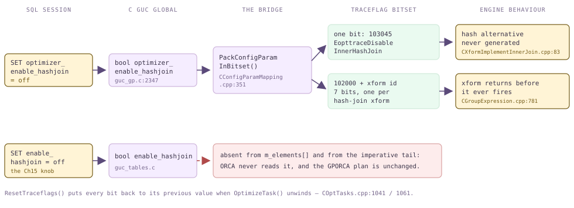

*从 SET 到引擎行为：一个 GUC 以跟踪标志位、一组 xform 禁用位或二者兼有的形式跨越 C/C++ 边界。普通 PostgreSQL 的 enable_\* 参数族根本不会跨过这道边界。*

### 17.6.1 一张表，两种机制 {#1761-one-table-two-mechanisms}

`CConfigParamMapping.cpp` 分为两部分。第一部分是静态数组 `m_elements[]`，由 `{traceflag, &guc_variable, negate, description}` 四元组组成，共六十多行，完全采用声明形式。之所以有 `negate` 列，是因为 ORCA 标志表达的是*禁用*（`EopttraceDisableSort`），GUC 表达的却是*启用*（`optimizer_enable_sort`），因此多数条目在传递时都会反转布尔值。第二部分是 `PackConfigParamInBitset()` 末尾的命令式代码，一连串 `if (!some_guc)` 语句改为设置 **xform 禁用位**：位编号为 `EopttraceDisableXformBase + xform_id`，基值为 102000（`traceflags.h:92`），计算由 `GPOPT_DISABLE_XFORM_TF()` 宏完成（`CXform.h`）。

```c {title="src/backend/gpopt/config/CConfigParamMapping.cpp"}
// declarative half: one GUC pointer -> one traceflag  (m_elements[], :30)
	{EopttraceDisableMotions, &optimizer_enable_motions,
	 true,	// m_negate_param
	 GPOS_WSZ_LIT("Disable motion nodes in optimizer.")},
	...
	{EopttraceDisableInnerHashJoin, &optimizer_enable_hashjoin,
	 true,	// m_negate_param
	 GPOS_WSZ_LIT("Explore hash join alternatives")},

// imperative half: one GUC -> a whole set of xform-disable bits  (:437)
	if (!optimizer_enable_hashjoin)
	{
		CBitSet *hash_join_bitste = CXform::PbsHashJoinXforms(mp);
		traceflag_bitset->Union(hash_join_bitste);
```

`optimizer_enable_hashjoin` 恰好*同时*使用两种机制，其原因很有启发性。外连接、半连接和反连接各自有专门的哈希连接 xform，因此 `PbsHashJoinXforms()`（`CXform.cpp`）只需列出七个 ID 并将它们全部禁用；其中包括 `ExfLeftJoin2RightJoin`，因为右连接始终只通过哈希连接实现。但*内连接*的实现只有一个 xform，它能生成哈希连接和嵌套循环两种备选项，因此不能整体关闭。它转而自行读取跟踪标志：

```c {title="src/backend/gporca/libgpopt/src/xforms/CXformImplementInnerJoin.cpp — CXformImplementInnerJoin::Transform()"}
	if (!GPOS_FTRACE(EopttraceDisableInnerHashJoin))
	{
		CXformUtils::ImplementHashJoin<CPhysicalInnerHashJoin>(pxfctxt, pxfres,
															   pexpr);
	}

	if ((GPOS_FTRACE(EopttraceForceComprehensiveJoinImplementation) ||
		 pxfres->Size() == 0) &&
		!GPOS_FTRACE(EopttraceDisableInnerNLJ))
	{
		CXformUtils::ImplementNLJoin<CPhysicalInnerNLJoin>(pxfctxt, pxfres,
														   pexpr);
	}
```

注意第二个代码块中的 `pxfres->Size == 0` 检查：默认情况下，一旦生成哈希连接，ORCA 甚至不会*考虑*嵌套循环。只有哈希备选项*不存在*，嵌套循环才有机会出现。这也揭示了与第 [15](/cloudberry/core-internals/part-4-query-processing/ch15/) 章最鲜明的区别。在那里，`enable_hashjoin = off` 会给一个仍然构建、仍然参与竞争的路径加上 `disable_cost`（[§15.3](/cloudberry/core-internals/part-4-query-processing/ch15/#153-path-cost--add_path)）；计划空间不变，如果没有其他选择，哈希连接仍可能胜出。而这里根本不会构建该备选项。`optimizer_enable_*` GUC 移除的是一条*规则*，计划空间会实际缩小；你还可以观察到这一点，因为 `optimizer_enumerate_plans` 会打印其大小。

*两个参数族互不相交。enable_hashjoin 在 ORCA 下不生效；optimizer_enable_hashjoin 则会移除规则，使计划空间从 4 个备选项缩小为 3 个。*

```sql
SET client_min_messages = log;
SET optimizer_enumerate_plans = on;

SET enable_hashjoin = off;             -- the Ch15 planner's knob
EXPLAIN (COSTS OFF) SELECT b.c, s.d
  FROM m176_big b JOIN m176_small s ON b.a = s.a;

SET optimizer_enable_hashjoin = off;   -- ORCA's knob
EXPLAIN (COSTS OFF) SELECT b.c, s.d
  FROM m176_big b JOIN m176_small s ON b.a = s.a;
```

```text {hl_lines="2 13" title="output"}
-- with enable_hashjoin = off  (ORCA does not care)
LOG:  2026-08-14 00:40:11:749503 CST,THD000,TRACE,"[OPT]: Number of plan alternatives: 4
",
 Gather Motion 3:1  (slice1; segments: 3)
   ->  Hash Join
         Hash Cond: (b.a = s.a)
         ->  Seq Scan on m176_big b
         ->  Hash
               ->  Seq Scan on m176_small s
 Optimizer: GPORCA

-- with optimizer_enable_hashjoin = off
LOG:  … TRACE,"[OPT]: Number of plan alternatives: 3
",
 Gather Motion 3:1  (slice1; segments: 3)
   ->  Nested Loop
         Join Filter: true
         ->  Seq Scan on m176_small s
         ->  Index Scan using m176_big_a_idx on m176_big b
               Index Cond: (a = s.a)
 Optimizer: GPORCA
```

*推到极端：移除 Motion 后，分布式查询根本没有可用计划。对照 [§16.2](/cloudberry/core-internals/part-4-query-processing/ch16/#162-cdbmotionpath-generation)：Motion 是要求分布属性的强制器，不是可有可无的装饰。*

```sql
SET optimizer_trace_fallback = on;
SET optimizer_enable_motions = off;
EXPLAIN (COSTS OFF) SELECT b.c, s.d
  FROM m176_big b JOIN m176_small s ON b.a = s.a;
```

```text {hl_lines="2 3" title="output"}
INFO:  GPORCA failed to produce a plan, falling back to Postgres-based planner
DETAIL:  Falling back to Postgres-based planner because no plan has been computed
         for required properties in GPORCA
 Gather Motion 3:1  (slice1; segments: 3)
   ->  Hash Join
         Hash Cond: (b.a = s.a)
         ->  Seq Scan on m176_big b
         ->  Hash
               ->  Seq Scan on m176_small s
 Optimizer: Postgres query optimizer
```

### 17.6.2 optimizer_enable_* 参数族及其隐藏位置 {#1762-the-optimizer_enable_-family-and-where-it-hides}

这个参数族分为三个层次，区分它们能避免许多困惑。第一层变成**跟踪标志**，由引擎内部某个决策点读取。第二层变成 **xform 禁用位**，在 `CGroupExpression::Transform`（`CGroupExpression.cpp`）中很早就读取一次，使函数在规则运行之前返回。第三层根本不会进入 ORCA 位集，而是由 Query→DXL 转换器直接读取；值为 `false` 时，转换器引发*不支持的功能*异常，通过 [§17.1](#171-entry--dispatch) 的回退路径将查询交给 PostgreSQL 规划器。

| GUC（本集群的默认值） | 传入 ORCA 的形式 | 效果 |
| --- | --- | --- |
| `optimizer_enable_hashjoin`——on，隐藏 | 跟踪标志 `EopttraceDisableInnerHashJoin`（103045）**以及** `PbsHashJoinXforms()` 位集 | 移除内连接和所有外连接／半连接／反连接变体的哈希连接备选项 |
| `optimizer_enable_nljoin`、`optimizer_enable_indexjoin`——on，隐藏 | `PbsNLJoinXforms()` / `PbsIndexJoinXforms()` 位集，加上跟踪标志 `EopttraceDisableInnerNLJ` | 移除嵌套循环和索引嵌套循环实现 |
| `optimizer_enable_tablescan`——on，隐藏 | `ExfGet2TableScan`、`ExfGet2ParallelTableScan` 对应的位 | 强制使用索引路径，否则完全无法生成计划 |
| `optimizer_enable_indexscan`、`optimizer_enable_indexonlyscan`、`optimizer_enable_bitmapscan`——on，隐藏 | `ExfIndexGet2IndexScan`、`ExfIndexOnlyGet2IndexOnlyScan`、`PbsBitmapIndexXforms()` 对应的位 | 扫描方法参数族；`dynamic*` 变体对分区表执行同样的控制 |
| `optimizer_enable_hashagg`、`optimizer_enable_groupagg`——on，隐藏 | `ExfGbAgg2HashAgg`（+`Dedup`）/ `ExfGbAgg2StreamAgg`（+`Dedup`）对应的位 | 聚合策略；可对照 [§16.4](/cloudberry/core-internals/part-4-query-processing/ch16/#164-distributed-grouping--direct-dispatch) 中的两阶段聚合 |
| `optimizer_enable_mergejoin`——on，隐藏 | `ExfImplementFullOuterMergeJoin` 对应的单个位 | 控制范围远小于名称暗示的范围：ORCA 只对 FULL OUTER JOIN 使用归并连接 |
| `optimizer_enable_associativity`——**off**，可见 | `ExfJoinAssociativity` 对应的位 | 默认关闭有其原因，见下文 |
| `optimizer_enable_right_outer_join`——on，可见 | `ExfLeftJoin2RightJoin`、`ExfRightOuterJoin2HashJoin` 对应的位 | 移除右外连接计划形态 |
| `optimizer_enable_motions` 以及 `_motion_broadcast` / `_motion_gather` / `_motion_redistribute` 三个选项——on，隐藏 | 跟踪标志 `EopttraceDisableMotions`、`…MotionBroadcast`、`…MotionGather`、`…MotionHashDistribute` / `…MotionRandom` / `…MotionRountedDistribute` | 移除 Motion **强制器**（[§16.2](/cloudberry/core-internals/part-4-query-processing/ch16/#162-cdbmotionpath-generation)）；对于分布式查询，这通常会彻底清空计划空间 |
| `optimizer_enable_sort`、`optimizer_enable_materialize`——on，隐藏 | 跟踪标志 `EopttraceDisableSort` / `EopttraceDisableSpool` | 移除 Sort 和 Spool 强制器 |
| `optimizer_enable_replicated_table`、`optimizer_enable_foreign_table`、`optimizer_enable_query_parameter`——on，可见 | **不传入**，由转换器读取（`CTranslatorQueryToDXL.cpp` — `CTranslatorQueryToDXL::NoteDistributionPolicyOpclasses()`、`CTranslatorRelcacheToDXL.cpp` — `CTranslatorRelcacheToDXL::RetrieveRelStorageType()`、`CTranslatorScalarToDXL.cpp` — `CTranslatorScalarToDXL::TranslateScalarToDXL()`） | 直接否决查询：ORCA 引发*不支持的功能*异常，并执行 [§17.1](#171-entry--dispatch) 的回退 |

*多数值得关注的控制项都带有 GUC_NO_SHOW_ALL，因此 pg_settings 和 SHOW ALL 会跳过它们（guc_funcs.c — ShowAllGUCConfig，:1015）；但 SHOW、SET 和 pg_settings_get_flags 均正常工作。*

```sql
SELECT count(*) AS in_pg_settings
  FROM pg_settings WHERE name LIKE 'optimizer_print%';

SELECT g, current_setting(g) AS value, pg_settings_get_flags(g) AS flags
  FROM (VALUES ('optimizer'), ('optimizer_minidump'),
               ('optimizer_enable_hashjoin'),
               ('optimizer_print_memo_after_optimization'),
               ('optimizer_segments')) v(g);
```

```text {hl_lines="9" title="output"}
 in_pg_settings
----------------
              0

                    g                    |  value  |            flags
-----------------------------------------+---------+-----------------------------
 optimizer                               | on      | {}
 optimizer_minidump                      | onerror | {}
 optimizer_enable_hashjoin               | on      | {NO_SHOW_ALL,NOT_IN_SAMPLE}
 optimizer_print_memo_after_optimization | off     | {NO_SHOW_ALL,NOT_IN_SAMPLE}
 optimizer_segments                      | 0       | {NO_SHOW_ALL,NOT_IN_SAMPLE}
```

`select name, setting from pg_settings where name like 'optimizer%'` 在本集群中返回 44 行，这*并不是*整个参数族。相关标志是 `GUC_NO_SHOW_ALL`（`guc_gp.c` 的 `config_bool` 中，`optimizer_enable_hashjoin` 带有此标志，每个 `optimizer_print_*` 条目也一样）；`show_all_settings()` 会遵守该标志，跳过相应行。这么做的理由是它们属于开发者选项；实际结果却是，在 `pg_settings` 中搜索可能会让你误以为某个参数不存在，但它确实存在。还有一点经常引起疑问，值得明确说明：两个 GUC 参数族**没有**交集。规划器的 `enable_hashjoin`、`enable_nestloop`、`enable_seqscan` 等参数既不出现在 `CConfigParamMapping.cpp` 中，也完全不出现在 `src/backend/gpopt/` 或 `libgpopt` 中。在 `optimizer=on` 下，它们不起作用，正如前面的演示所示。

*并排展示三个层次中的两个。启用连接结合律后，计划空间扩大到原来的两倍以上（86 → 183），但找到的计划完全相同；第三层 GUC 则让 ORCA 退出处理，并在 DETAIL 中注明自己的名称。*

```sql
SET client_min_messages = log;
SET optimizer_enumerate_plans = on;
SET optimizer_trace_fallback = on;

-- three-way join, associativity off (the default)
EXPLAIN (COSTS OFF) SELECT count(*) FROM m176_big b
  JOIN m176_small s ON b.a = s.a JOIN m176_other o ON b.b = o.k;
SET optimizer_enable_associativity = on;
EXPLAIN (COSTS OFF) SELECT count(*) FROM m176_big b
  JOIN m176_small s ON b.a = s.a JOIN m176_other o ON b.b = o.k;

-- tier three: a translator-level veto
RESET optimizer_enable_associativity;
SET plan_cache_mode = force_generic_plan;
SET optimizer_enable_query_parameter = off;
PREPARE p(int) AS SELECT count(*) FROM m176_big WHERE b = $1;
EXPLAIN (COSTS OFF) EXECUTE p(3);
```

```text {hl_lines="2 5" title="output"}
-- associativity off
LOG:  … TRACE,"[OPT]: Number of plan alternatives: 86
",
-- associativity on: same winning plan, twice the search
LOG:  … TRACE,"[OPT]: Number of plan alternatives: 183
",
 Finalize Aggregate
   ->  Gather Motion 3:1  (slice1; segments: 3)
         ->  Partial Aggregate
               ->  Hash Join
                     Hash Cond: (o.k = b.b)
                     ->  Seq Scan on m176_other o
                     ->  Hash
                           ->  Redistribute Motion 3:3  (slice2; segments: 3)
                                 Hash Key: b.b
                                 ->  Hash Join
                                       Hash Cond: (b.a = s.a)
                                       …
 Optimizer: GPORCA

-- tier three
INFO:  GPORCA failed to produce a plan, falling back to Postgres-based planner
DETAIL:  Falling back to Postgres-based planner because GPORCA does not support
         the following feature: Use optimizer_enable_query_parameter to enable
         Orca with query parameters
 Optimizer: Postgres query optimizer
```

### 17.6.3 控制整个优化器的开关 {#1763-whole-optimizer-switches}

有三个控制项作用于整个优化器，而不是计划空间。`optimizer` 就是入口开关，在 `planner.c`（`standard_planner()`）中检查；它属于 `PGC_USERSET`，因此可以按查询执行 `SET optimizer = off`，按角色执行 `ALTER ROLE … SET optimizer = off`，也可以按数据库执行 `ALTER DATABASE … SET optimizer = off`。角色级和数据库级默认值，是让某个有问题的工作负载继续使用第 [15](/cloudberry/core-internals/part-4-query-processing/ch15/) 章的规划器、又不影响其他负载的常用方式。`optimizer_control` 则是控制开关的开关：它属于 `PGC_SUSET`（`guc_gp.c` — `config_bool`），唯一职责是通过 `guc_gp.c` 中的检查钩子 `check_optimizer()`，使 `optimizer` 不可更改。该钩子拒绝所有 `GucSource` 大于或等于 `PGC_S_INTERACTIVE` 的赋值。这包括 `SET`，也包括 `ALTER ROLE`/`ALTER DATABASE … SET` 所执行的 `PGC_S_TEST` 验证过程（`guc.c` — `validate_option_array_item()`）。因此，当 `optimizer_control = off` 时，用户无论向哪个方向切换，都无法改变管理员的选择，而此前从 `postgresql.conf` 加载的值仍然生效。`optimizer_segments`（`guc_gp.c` — `config_int`）又有所不同：它不改变 ORCA 能构建什么，只改变 ORCA *相信的条件*。`COptTasks::OptimizeTask` 从 `gpdb::GetGPSegmentCount()` 读取实际数量；如果 `optimizer_segments` 非零，就改为把该数值交给代价模型（`COptTasks.cpp` — `COptTasks::OptimizeTask()`）。[§17.4](#174-metadata-layer--cost-model) 介绍代价模型如何使用这个值；这里只需知道，执行结构没有改变，变化的只是数值。

*optimizer_control 锁定入口开关；optimizer_segments 向代价模型虚报数量。注意，计划及其 3:1 Gather 完全相同，改变的只有代价。*

```sql
SET optimizer_control = off;
SET optimizer = off;                 -- refused
SET optimizer_control = on;

SET optimizer_segments = 100;        -- pretend we have 100 segments
EXPLAIN SELECT count(*) FROM m176_big WHERE b < 50;
RESET optimizer_segments;            -- back to the real 3
EXPLAIN SELECT count(*) FROM m176_big WHERE b < 50;
```

```text {hl_lines="4 12" title="output"}
ERROR:  cannot change the value of "optimizer"

-- optimizer_segments = 100
 Finalize Aggregate  (cost=0.00..431.13 rows=1 width=8)
   ->  Gather Motion 3:1  (slice1; segments: 3)  (cost=0.00..431.13 rows=1 width=8)
         ->  Partial Aggregate  (cost=0.00..431.13 rows=1 width=8)
               ->  Seq Scan on m176_big  (cost=0.00..431.13 rows=33285 width=1)
                     Filter: (b < 50)
 Optimizer: GPORCA

-- optimizer_segments = 0 (use the real count)
 Finalize Aggregate  (cost=0.00..435.24 rows=1 width=8)
   ->  Gather Motion 3:1  (slice1; segments: 3)  (cost=0.00..435.24 rows=1 width=8)
         ->  Partial Aggregate  (cost=0.00..435.24 rows=1 width=8)
               ->  Seq Scan on m176_big  (cost=0.00..435.24 rows=33285 width=1)
                     Filter: (b < 50)
 Optimizer: GPORCA
```

### 17.6.4 计划提示 {#1764-plan-hints}

GUC 是一种粗粒度工具，会影响查询中的每张表和每个连接。提示则允许更精细的控制，而 ORCA 的实现相当务实。`libgpopt/src/hints/` 中的 `README` 直言，*编写解析器很难*，所以 ORCA 不自己编写解析器。相反，加载 `pg_hint_plan` 扩展后，扩展会将自己的解析器安装到 `plan_hint_hook` 函数指针中（声明于 `COptTasks.cpp`）。`COptTasks::GetPlanHints` 调用该钩子，得到一个装满 pg_hint_plan 结构的 `HintState`，再把它们转换为 ORCA 自己的 `CPlanHint`。后者随 `COptimizerConfig` 一起传递，并与其他内容一同序列化为 DXL。提示文本由 PostgreSQL 代码解析，却由从未见过注释的 C++ 代码执行。

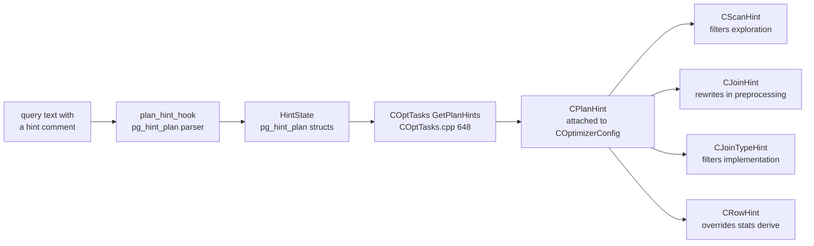

*提示处理流水线：PostgreSQL 扩展的解析器通过函数指针向 C++ 优化器提供输入。CPlanHint 保存四个列表，各自在搜索的不同位置被使用。*

| 提示 | ORCA 结构 | 生效位置 |
| --- | --- | --- |
| `SeqScan(t)`、`NoSeqScan`、`IndexScan`、`NoIndexScan`、`IndexOnlyScan`、`NoIndexOnlyScan`、`BitmapScan`、`NoBitmapScan` | `CScanHint` | 探索阶段：`CHintUtils::SatisfiesPlanHints()`（`CHintUtils.cpp`）拒绝任何违反提示的 `CLogicalGet` / `CLogicalIndexGet` / `CLogicalDynamicGet` 备选项 |
| `HashJoin(a b)`、`NoHashJoin`、`NestLoop`、`NoNestLoop`、`MergeJoin`、`NoMergeJoin` | `CJoinTypeHint` | 实现阶段：不匹配的物理连接备选项不会保留（`COptTasks.cpp` — `COptTasks::GetPlanHints()`） |
| `Leading((a (b c)))`，以及不指定方向的 `Leading(a b c)` | `CJoinHint` | 预处理阶段：在搜索开始*之前*，将 n 元连接改写为所要求的内连接树（`COptTasks.cpp` — `COptTasks::GetPlanHints()`） |
| `Rows(a b #1)`，以及采用相对值的形式 | `CRowHint` | 统计信息推导阶段：在 `CLogicalJoin` 的推导过程中覆盖连接行数估计（`COptTasks.cpp` — `COptTasks::GetPlanHints()`）；估计本身见 [§14](/cloudberry/core-internals/part-4-query-processing/ch14/) |
| `TidScan`、`NoTidScan`、`Parallel` | — | 由 pg_hint_plan 解析，但**不**进行转换；ORCA 忽略它们，README 也将它们列为不支持项 |
| Motion 提示 | — | README 对应小节写的就是 `TODO`，`GetPlanHints` 也没有处理 Motion 的循环；目前无法为 Motion 提供提示 |

*本集群在普通会话中就能使用提示：LOAD 即可，无需 shared_preload_libraries。开启 pg_hint_plan.debug_print 后，ORCA 会回显转换后的 CPlanHint（EopttracePrintPgHintPlanLog 路径，COptTasks.cpp — COptTasks::GetPlanHints），从中可以看出它实际理解了哪些提示。*

```sql
LOAD 'pg_hint_plan';
SET client_min_messages = log;
SET pg_hint_plan.debug_print = on;

EXPLAIN (COSTS OFF) /*+ NoHashJoin(b s) SeqScan(b) */
  SELECT b.c, s.d FROM m176_big b JOIN m176_small s ON b.a = s.a;

EXPLAIN /*+ Rows(b s #1) */
  SELECT b.c, s.d FROM m176_big b JOIN m176_small s ON b.a = s.a;
```

```text {hl_lines="3 4" title="output"}
LOG:  2026-08-14 00:40:26:832625 CST,THD000,TRACE,"PlanHint: [
used hint:
ScanHint: b[indexes: types:SeqScan]
JoinTypeHint: aliases:b,s type:NoHashJoin
not used hint:
]",
 Gather Motion 3:1  (slice1; segments: 3)
   ->  Nested Loop
         Join Filter: (b.a = s.a)
         ->  Seq Scan on m176_big b
         ->  Seq Scan on m176_small s
 Optimizer: GPORCA

LOG:  … TRACE,"PlanHint: [
used hint:
RowHint: b,s #1.000000
not used hint:
]",
 Gather Motion 3:1  (slice1; segments: 3)  (cost=0.00..877.25 rows=1 width=11)
   ->  Hash Join  (cost=0.00..877.25 rows=1 width=11)
         Hash Cond: (b.a = s.a)
         ->  Seq Scan on m176_big b  (cost=0.00..432.80 rows=66667 width=11)
         ->  Hash  (cost=431.00..431.00 rows=167 width=8)
               ->  Seq Scan on m176_small s  (cost=0.00..431.00 rows=167 width=8)
 Optimizer: GPORCA
```

> [!NOTE]
> 有两项限制需要记住。首先是 README 自己的表述：提示*只能用于强制选择 ORCA 计划空间中已经存在的计划*。提示无法凭空创造 xform 目录从不生成的备选项，只会改变已有备选项中哪一个能留下来。其次，调试输出的 `not used hint:` 部分会列出存在笔误或别名拼写错误的提示；如果某个提示出现在那里，或者根本没有出现，ORCA 就从未应用它。还要注意，`Rows` 是唯一不作为过滤条件的提示：它向统计信息提供虚构的值，因此能把计划引向任何 `Scan`/`Join` 提示都无法达到的方向；这也正是它在四类提示中风险最高的原因。

### 17.6.5 内省速查表 {#1765-the-introspection-cheat-sheet}

可以随时回来查阅这张表。下列每个条目都是本集群中可在会话内设置的 GUC；它们都以 `LOG` 级别写入服务器日志，所以执行 `SET client_min_messages = log` 之前，在 psql 中看不到任何内容；而且几乎所有条目都在 `pg_settings` 中隐藏。右栏列出解释相应输出的小节，这里不再重复展示输出。

| GUC | 写入日志的内容 | 说明位置 |
| --- | --- | --- |
| `optimizer_print_query` | 输入查询表达式树的 DXL | [§17.5](#175-translation-query--dxl--plstmt) |
| `optimizer_print_plan` | 胜出计划表达式树的 DXL | [§17.5](#175-translation-query--dxl--plstmt) |
| `optimizer_print_memo_after_exploration` | 当前搜索阶段完成探索后的 memo，仅包含逻辑备选项 | [§17.2](#172-the-cascades-engine) |
| `optimizer_print_memo_after_implementation` | 添加物理备选项后的 memo | [§17.2](#172-the-cascades-engine) |
| `optimizer_print_memo_after_optimization` | `MEMO after optimization (stage N)`，以及包含已计算代价的物理表达式的完整 memo。这是最有用的打印 GUC（`CEngine.cpp` — `CEngine::ProcessTraceFlags()`、`ProcessTraceFlags`） | [§17.2](#172-the-cascades-engine) |
| `optimizer_print_optimization_context` | 各组的优化上下文，以及每个物理组表达式上的代价上下文（`CGroupExpression.cpp` — `CGroupExpression::OsPrintCostContexts()`） | [§17.2](#172-the-cascades-engine)、[§17.4](#174-metadata-layer--cost-model) |
| `optimizer_print_optimization_stats` | `[OPT]: Memo (stage N): [G groups, D duplicate groups, E group expressions, X activated xforms]`、各阶段耗时、最佳代价、已激活 xform 的统计分布以及内存消耗 | [§17.2](#172-the-cascades-engine)、[§17.3](#173-transformation-framework) |
| `optimizer_print_xform` | 在 memo 转储中的每个组表达式上标注生成它的 xform（`Origin: …`） | [§17.3](#173-transformation-framework) |
| `optimizer_print_xform_results` | 每次触发时的输入和输出表达式树。**还需要同时启用 `optimizer_print_xform`**，因为 `PrintXform` 会检查两个标志（`CGroupExpression.cpp`） | [§17.3](#173-transformation-framework) |
| `optimizer_print_expression_properties` | 每次打印表达式时，输出其推导和要求的关系／物理属性（`CExpression.cpp` — `CExpression::OsPrintExpression()`） | [§17.4](#174-metadata-layer--cost-model) |
| `optimizer_print_group_properties` | 对组输出同类信息（`CGroup.cpp` — `CGroup::OsPrintGrpProps()`） | [§17.2](#172-the-cascades-engine) |
| `optimizer_print_job_scheduler` | 每个作业完成时输出调度器队列。**仅限启用断言的构建**，调用点位于 `#ifdef GPOS_DEBUG` 内（`CScheduler.cpp` — `CScheduler::ExecuteJobs()`） | [§17.2](#172-the-cascades-engine) |
| `optimizer_print_preprocess_result` | 每个预处理步骤之后的表达式树。**仅限启用断言的构建**，否则 `TRCAE_PREPROCESS_*` 宏为空（`CExpressionPreprocessor.cpp`） | [§17.1](#171-entry--dispatch) |
| `optimizer_print_missing_stats` | 熟悉的 `WARNING: missing statistics for column …`（`COptTasks::PrintMissingStatsWarning`） | [§14.1](/cloudberry/core-internals/part-4-query-processing/ch14/#141-basic-statistics)、[§17.4](#174-metadata-layer--cost-model) |
| `optimizer_enumerate_plans` | `[OPT]: Number of plan alternatives: N`，即枚举出的计划空间大小 | [§17.2](#172-the-cascades-engine) |
| `optimizer_plan_id`（整数，默认为 0） | 强制提取第 N 个备选项，而不是代价最低的备选项；日志记录 `[OPT]: Successfully generated plan: N` | [§17.2](#172-the-cascades-engine) |
| `optimizer_sample_plans`、`optimizer_samples_number`（1000）、`optimizer_cost_threshold`（0） | 在代价界限内对计划空间随机抽样，而非完整枚举 | [§17.2](#172-the-cascades-engine)、[§17.4](#174-metadata-layer--cost-model) |
| `optimizer_trace_fallback` | 每次 ORCA 放弃时，输出一条 `INFO` 以及注明不支持功能的 `DETAIL`（`CGPOptimizer.cpp` — `CGPOptimizer::GPOPTOptimizedPlan()`） | [§17.1](#171-entry--dispatch) |
| `optimizer_log`（默认 **on**）、`optimizer_log_failure`（`unexpected` / `expected` / `all`） | 在 `DEBUG1` 级别输出 `GPORCA produced plan`，或在 `LOG` 级别输出 `GPORCA failed to produce plan (unexpected)`（`orca.c` — `log_optimizer()`） | [§17.1](#171-entry--dispatch) |
| `gp_log_optimization_time` | 在整个 ORCA 调用外围记录 `LOG: Optimizer Time: N ms`（`planner.c` — `standard_planner()`） | [§17.1](#171-entry--dispatch) |
| `optimizer_minidump`（默认 `onerror`，或设为 `always`） | 将自包含、可重放的 `.mdp` 写入相对于 Coordinator 数据目录的 `minidumps/Minidump_YYYYMMDD_HHMMSS_<sessionid>_<cmdcount>.mdp`（`CMinidumperUtils.cpp` — `CMinidumperUtils::GenerateMinidumpFileName()`、`CUtils.cpp` — `CUtils::GenerateFileName()`） | [§17.5](#175-translation-query--dxl--plstmt) |

> [!NOTE]
> 关于启用断言的构建。本集群配置了 `--enable-cassert`（`show debug_assertions` → `on`），`configure.ac:895` 将其转换为 `#define GPOS_DEBUG 1`，即 ORCA 自己的调试开关。需要准确说明它究竟带来了什么，因为实际范围小于惯常说法：memo 转储、xform 打印、优化统计信息、计划枚举以及 `optimizer_plan_id` 都会无条件编译进程序（`CEngine::ProcessTraceFlags` 外围没有 `#ifdef`），因此在发布构建中也能使用。真正仅限断言构建的打印 GUC 只有两个：`optimizer_print_job_scheduler` 和 `optimizer_print_preprocess_result`（另有 `optimizer_debug_cte`）；映射表自身在 `CConfigParamMapping.cpp` 的描述字符串中也说明了这一点。断言构建实际增加的是断言检查及其带来的速度开销；根据它的运行结果判断性能时应当谨慎。

### 17.6.6 排查步骤 {#1766-a-playbook}

将本章内容综合起来，可以得到一套固定的排查顺序。沿列表向下检查，找到答案后便停止；每一步的开销都很小，而且都能排除一整类可能的解释。

- **1——这个查询究竟由 ORCA 规划吗？** 阅读 `EXPLAIN` 页脚：是 `Optimizer: GPORCA`，还是 `Optimizer: Postgres query optimizer`。如果是后者，执行 `SET optimizer_trace_fallback = on`，查找注明不支持功能的 `INFO`/`DETAIL`。如果完全没有 `INFO`，意味着查询在调用 ORCA *之前*就已转向其他路径（`INSERT … ON CONFLICT`、`CURSOR_OPT_UPDATABLE`、非 Coordinator 计划）；入口条件见 [§17.1](#171-entry--dispatch)。
- **2——耗时多久？** `SET gp_log_optimization_time = on` 会输出 `Optimizer Time: N ms`。ORCA 是搜索引擎；对于涉及很多输入的连接，其搜索可能占据规划时间的大部分。如果耗时很大，首先应尝试 `optimizer_join_order` 和 `optimizer_join_order_threshold`（[§17.2](#172-the-cascades-engine)），而 `optimizer_xform_bind_threshold` 可以限制失控的绑定数量。
- **3——估计值合理吗？** 好的优化器生成坏计划，通常是统计信息问题，而非搜索问题。将 `EXPLAIN ANALYZE` 的实际行数与估计值比较，检查 `optimizer_print_missing_stats`，并重读第 [14](/cloudberry/core-internals/part-4-query-processing/ch14/) 章。ORCA 与第 [15](/cloudberry/core-internals/part-4-query-processing/ch15/) 章的规划器读取同样的 `pg_statistic` 行，但采用自己的方式重新推导基数（[§17.4](#174-metadata-layer--cost-model)）。因此，ORCA 下错误的估计在 `optimizer=off` 下可能正常；这种差异是排查线索，本身不等于缺陷。
- **4——搜索实际考虑了什么？** 执行 `SET client_min_messages = log; SET optimizer_print_memo_after_optimization = on;`，然后阅读 memo（[§17.2](#172-the-cascades-engine)）。`optimizer_enumerate_plans` 告诉你空间有多大；`optimizer_plan_id` 让你提取并运行自己*想要*的备选项，从而把“ORCA 做不到 X”转化为“ORCA 将 X 的代价估为 N”。
- **5——哪些规则被触发了？** `optimizer_print_optimization_stats` 提供已激活 xform 的统计分布；`optimizer_print_xform` 与 `optimizer_print_xform_results` 一起提供变换前后的树。[§17.3](#173-transformation-framework) 讲解了如何阅读这些输出。
- **6——隔离问题。** 使用能重现该变化的最小控制项缩小范围：先用 `disable_xform('CXform…')` 控制单条规则（[§17.3](#173-transformation-framework)），再用上文的 `optimizer_enable_*` 参数族控制整个操作符类别。记住计划空间会缩小；如果某个开关使 ORCA 完全回退，你移除的是一个*强制器*，而不是一个可选项。
- **7——捕获现场。** 执行 `SET optimizer_minidump = always;`，再运行一次查询。Coordinator 的 `minidumps/` 目录下生成的 `.mdp` 是完整、可重放的重现材料，包含查询 DXL、全部元数据、配置和计划；ORCA 缺陷报告就应包含它。[§17.5](#175-translation-query--dxl--plstmt) 解释其内容及重放方法。

*在一个会话中执行步骤 1 和 2。注意，回退路径也会计时：ORCA 花费 17 ms 后放弃，随后 PostgreSQL 规划器用 0.4 ms 生成实际运行的计划。*

```sql
SET client_min_messages = log;
SET gp_log_optimization_time = on;
SET optimizer_trace_fallback = on;

EXPLAIN (COSTS OFF) SELECT b.c, count(*) FROM m176_big b
  JOIN m176_small s ON b.a = s.a GROUP BY 1;

EXPLAIN (COSTS OFF)
  WITH RECURSIVE r(n) AS (SELECT 1 UNION ALL SELECT n+1 FROM r WHERE n<5)
  SELECT * FROM r;
```

```text {hl_lines="14" title="output"}
LOG:  Optimizer Time: 51.822 ms
LOG:  Planner Hook(s): 53.671 ms
 Gather Motion 3:1  (slice1; segments: 3)
   ->  HashAggregate
         Group Key: b.c
         ->  Redistribute Motion 3:3  (slice2; segments: 3)
               Hash Key: b.c
               ->  Hash Join
                     …
 Optimizer: GPORCA

INFO:  GPORCA failed to produce a plan, falling back to Postgres-based planner
DETAIL:  … GPORCA does not support the following feature: WITH RECURSIVE
LOG:  Optimizer Time: 17.185 ms
LOG:  Planner Time: 0.367 ms
 Recursive Union
   ->  Result
   ->  WorkTable Scan on r
         Filter: (n < 5)
 Optimizer: Postgres query optimizer
```

最后坦诚地补充一点：最有效的 ORCA 控制项，往往就是关闭它的开关。`SET optimizer = off` 并不是认输，而是合理的查询级、角色级或数据库级选择。对于涉及很多表的星型模式连接、分区表，以及值得花费几十毫秒搜索以确定连接顺序和 Motion 位置的查询，ORCA 能够发挥价值。对于短小的 OLTP 型语句，它的规划时间纯属开销，无法带来收益；对于不支持的功能，它同样没有收益，因为承担一次失败搜索的开销后，最终还是要回退。第 [15](/cloudberry/core-internals/part-4-query-processing/ch15/) 和 [16](/cloudberry/core-internals/part-4-query-processing/ch16/) 章介绍的是一个完全胜任的优化器；让某个工作负载继续使用它，而系统其余部分使用 ORCA，是常规的运维判断，并非权宜之计。无论选择哪种方式，本章最终产出的都是同一种结果：包含切片表和 Motion 节点的 `PlannedStmt`。**第 [18](/cloudberry/core-internals/part-4-query-processing/ch18/) 章**接过它并执行；**第 [19](/cloudberry/core-internals/part-4-query-processing/ch19/) 章**则将这些 Motion 转换为 Interconnect 上的网络流量。
