<style>
/*
 * Licensed to the Apache Software Foundation (ASF) under one
 * or more contributor license agreements.  See the NOTICE file
 * distributed with this work for additional information
 * regarding copyright ownership.  The ASF licenses this file
 * to you under the Apache License, Version 2.0 (the
 * "License"); you may not use this file except in compliance
 * with the License.  You may obtain a copy of the License at
 *
 *   http://www.apache.org/licenses/LICENSE-2.0
 *
 * Unless required by applicable law or agreed to in writing,
 * software distributed under the License is distributed on an
 * "AS IS" BASIS, WITHOUT WARRANTIES OR CONDITIONS OF ANY
 * KIND, either express or implied.  See the License for the
 * specific language governing permissions and limitations
 * under the License.
 */

/* Layout for the HTML-and-CSS figures, lifted from the handbook's own
   stylesheet so the figures render identically here. */

/* These four come from the handbook's own stylesheet; a consuming site has no
   such definitions, and an undefined custom property invalidates its whole
   declaration. Define them here, scoped to the figure.

   Deliberately NOT themed. The artwork below is light-only: band and tile
   backgrounds are hard-coded pastels, and the injected markup carries some 800
   more hard-coded light colours in inline styles. Giving --fg a dark-theme
   value paints near-white text onto a near-white band -- measured at 1.08:1,
   worse than the bug that replaced. The handbook's light values are correct in
   both themes; what changes for dark mode is the surface underneath. */
.cloudberry-core-figure {
  --border: #d8dee4;
  --soft:   #f6f8fa;
  --fg:     #1f2328;
  --muted:  #636c76;
  margin: 1.4rem 0;
}

/* Light-only artwork needs a light ground AND a dark ink, or it bleeds into a
   dark page. Setting only the ground is not enough: any text in these figures
   without its own inline colour inherits the site's near-white body colour, so
   it lands white-on-pastel -- measured at 1.03:1 across 184 text nodes. The
   colour has to be restored at the same place the ground is. */
[data-bs-theme='dark'] .cloudberry-core-figure > div {
  background: #ffffff;
  color: #1f2328;
  border-radius: 8px;
  padding: 10px;
}
/* Descendants that inherit rather than carry an inline colour. */
[data-bs-theme='dark'] .cloudberry-core-figure > div :not([style*="color"]) {
  color: inherit;
}
.cloudberry-core-figure figcaption {
  margin-top: .5rem;
  font-size: .9em;
  /* --ifm-color-emphasis-600 resolves to rgb(141,148,158) in the light theme,
     which is 3.06:1 on white -- below WCAG AA for the 37 figure captions.
     (The dark theme's value is fine, so only light is overridden.) */
  color: #636b75;
}
[data-bs-theme='dark'] .cloudberry-core-figure figcaption {
  color: #a6adb4;
}

/* Selective highlight: the handbook wraps a key token so it stands out.
   Scoped to the component. The class name .hl is two letters and this file
   lands in the consuming site's single global stylesheet, so an unscoped
   rule would style every page of that site. The standalone edition's
   figure.code / figure.session variants are dropped: those classes do not
   occur anywhere in this tree. */
.cloudberry-core-figure .hl { border-radius: 2px; font-weight: 700;
                   background: #fff8c5; color: #1f2328; padding: 0 2px; }

/* Layered module map and the banded brick figures. */
.cloudberry-core-figure .bricks { border:1px solid var(--border);border-radius:12px;overflow:hidden;background:var(--soft) }
.cloudberry-core-figure .bk-band { display:flex;align-items:stretch;border-top:1px solid var(--border) }
.cloudberry-core-figure .bk-band:first-child { border-top:none }
.cloudberry-core-figure .bk-lbl { flex:0 0 116px;display:flex;flex-direction:column;justify-content:center;gap:2px;padding:10px 13px }
.cloudberry-core-figure .bk-lbl b { font-size:12.5px;font-weight:800;color:var(--fg);line-height:1.2 }
.cloudberry-core-figure .bk-lbl span { font-size:9.5px;font-weight:700;color:var(--muted);text-transform:uppercase;letter-spacing:.5px }
.cloudberry-core-figure .bk-row { flex:1 1 auto;display:flex;flex-wrap:wrap;gap:7px;padding:9px 10px }
.cloudberry-core-figure .bk { flex:1 1 118px;min-width:104px;display:flex;flex-direction:column;justify-content:center;gap:2px; padding:8px 11px;border-radius:7px;border:1px solid;background:#fff;text-decoration:none;transition:.13s }
.cloudberry-core-figure .bk-t2 { font-size:12.5px;font-weight:700;line-height:1.25 }
.cloudberry-core-figure .bk-ch { font-size:10.5px;font-weight:700;font-variant-numeric:tabular-nums;opacity:.8 }
.cloudberry-core-figure a.bk:hover { transform:translateY(-2px);box-shadow:0 4px 12px #0000001f;text-decoration:none }
.cloudberry-core-figure .bk-q { background:#eef6ff }
.cloudberry-core-figure .bk-q .bk { border-color:#54aeff66;color:#0a3069;background:#ddf4ff }
.cloudberry-core-figure .bk-s { background:#eefcf2 }
.cloudberry-core-figure .bk-s .bk { border-color:#4ac26b80;color:#04260f;background:#dafbe1 }
.cloudberry-core-figure .bk-t { background:#fff6ef }
.cloudberry-core-figure .bk-t .bk { border-color:#fb8f4480;color:#5e2700;background:#fff1e5 }
.cloudberry-core-figure .bk-h { background:#fff4f3 }
.cloudberry-core-figure .bk-h .bk { border-color:#ff818280;color:#5c0011;background:#ffebe9 }
.cloudberry-core-figure .bk-r { background:#f3f5f8 }
.cloudberry-core-figure .bk-r .bk { border-color:#afb8c1;color:#1f2328;background:#eaeef2 }
@media (max-width: 560px) {
  .cloudberry-core-figure .bk-band { flex-direction:column }
  .cloudberry-core-figure .bk-lbl { flex-basis:auto;border-bottom:1px solid var(--border) }
}

</style>

<!--
  Licensed to the Apache Software Foundation (ASF) under one
  or more contributor license agreements.  See the NOTICE file
  distributed with this work for additional information
  regarding copyright ownership.  The ASF licenses this file
  to you under the Apache License, Version 2.0 (the
  "License"); you may not use this file except in compliance
  with the License.  You may obtain a copy of the License at

    http://www.apache.org/licenses/LICENSE-2.0

  Unless required by applicable law or agreed to in writing,
  software distributed under the License is distributed on an
  "AS IS" BASIS, WITHOUT WARRANTIES OR CONDITIONS OF ANY
  KIND, either express or implied.  See the License for the
  specific language governing permissions and limitations
  under the License.
-->


<a id="18-the-executor"></a>

## 18.1 执行器框架与生命周期 {#181-executor-framework--lifecycle}

第 [15](/cloudberry/core-internals/part-4-query-processing/ch15/)–[17](/cloudberry/core-internals/part-4-query-processing/ch17/) 章生成了一个 `PlannedStmt`：一棵指令树，以及一组关于每个步骤会输出多少行的预测。本章负责执行它。`src/backend/executor/` 中有 90 908 行 C 代码，其中绝大部分以八十多种形式重复着同一结构：一个知道如何产生下一个元组的节点。本节介绍这些节点所处的框架：状态树如何建立和拆除，每个元组由谁调用谁，内存和快照位于何处，一个操作符如何把元组交给下一个操作符而双方都无需了解对方的存储格式，以及——这是所有人实际都需要、却几乎没人解释的部分——当三个 Segment 共同工作时，`EXPLAIN ANALYZE` 中的数字究竟意味着什么。

### 18.1.1 按需拉取模型与两棵树 {#1811-the-demand-pull-model-and-the-two-trees}

`Plan` 节点本身是静态的。它没有游标、哈希表或打开的文件，只是一份描述，因此可以被序列化并发送到 Segment（[§15.4](/cloudberry/core-internals/part-4-query-processing/ch15/#154-plan-generation)、[§17.5](/cloudberry/core-internals/part-4-query-processing/ch17/#175-translation-query--dxl--plstmt)、[§13.3](/cloudberry/core-internals/part-4-query-processing/ch13/#133-dispatch-from-coordinator-plan-to-segment-execution)）。因此执行还需要第二棵树：每个 `Plan` 节点对应一个 `PlanState` 节点，保存该操作符运行时的可变状态。这两棵树形状相同，由 `ExecInitNode`（`src/backend/executor/execProcnode.c`）通过对计划节点标签递归执行 `switch` 同时构建——在 `ExecInitNode()` 中，`case T_SeqScan: result = (PlanState *) ExecInitSeqScan(...)`，本手册中的每种节点类型都遵循相同方式。每个状态节点都保存一个指向其计划的反向指针（`ps->plan`），以及一个指向共享 `EState` 的指针（`ps->state`）。

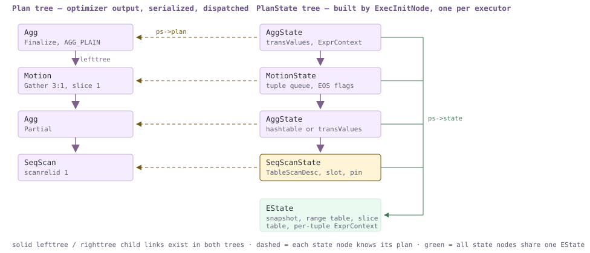

*`SELECT count(*) FROM t` 的两棵树：形状相同，但边有三种不同含义。*

元组按需拉取，而非主动推送。父节点调用 `ExecProcNode` 向子节点请求一个元组；这是 `src/include/executor/executor.h` 中的内联函数，它先检查 `chgParam`，再通过子节点自己的函数指针进行一次间接调用。子节点返回一个恰好包含一个元组的 `TupleTableSlot`，或者返回表示*流结束*的 NULL/空槽位。这就是全部约定。它采用经典的**火山模型**（也称**迭代器模型**），这里有必要固定相关术语：节点是被*拉取*的，从不被推送；`NULL` 表示已完成，而不是空；两个节点之间不会批量处理或物化，除非某个节点明确选择缓冲数据（Material、Sort、Hash——[§18.3](#183-sort--aggregate-nodes)、[§18.4](#184-join-nodes)、[§18.6](#186-subqueries--other-nodes)）。

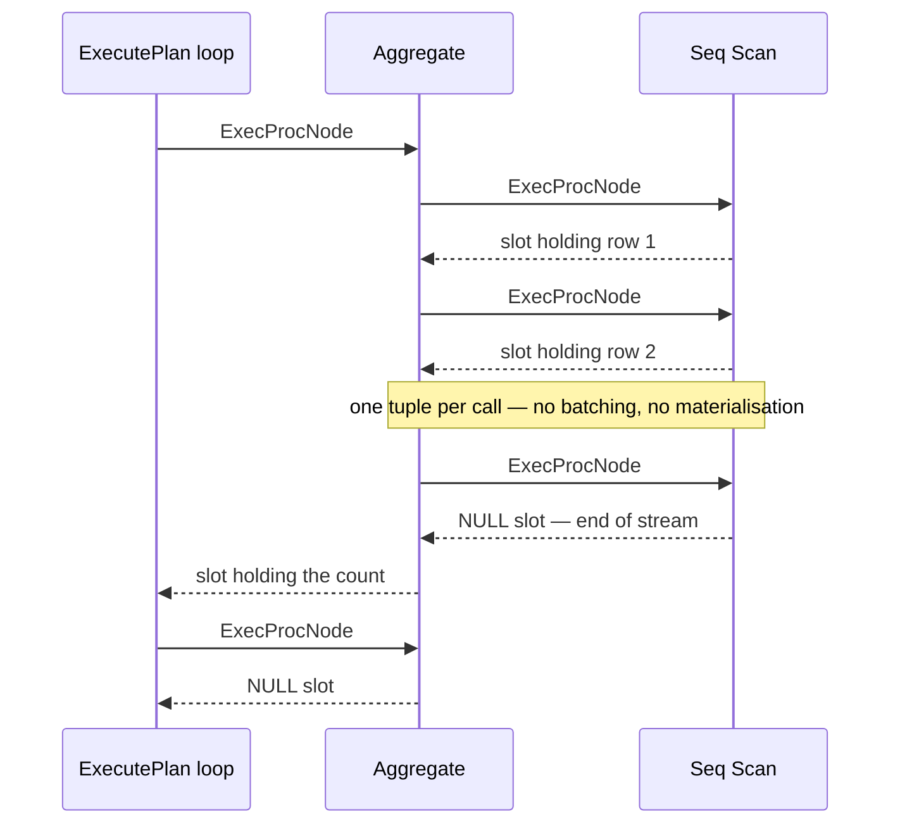

*每次调用返回一个元组。顶部的循环持续拉取，直到根节点返回 NULL。*

本章其余内容都建立在两个后果之上。第一，内存上限取决于*阻塞型*操作符选择保留多少数据，而不是中间结果的大小；这正是 `work_mem` 属于操作符属性、溢出是操作符决策的原因（[§18.3](#183-sort--aggregate-nodes)）。第二，如果消费者停止请求，生产者也会停止工作：`LIMIT` 因而自然具备低成本提前结束的能力。在单进程 PostgreSQL 中，第二个性质只是一个优化。在 Cloudberry 中，生产者可能是另一台主机上的另一个进程，且发送队列已经填满，这就变成了正确性问题；解决办法是 `ExecSquelchNode`，见 [§18.1.7](#1817-rescan-and-the-cloudberry-only-idea-of-squelch)。

### 18.1.2 启动、运行、收尾与结束 {#1812-start-run-finish-end}

每次执行都会经过 `src/backend/executor/execMain.c` 中的四个函数。每个函数都是一个薄封装：如果安装了扩展钩子就调用钩子，否则调用 `standard_` 实现——`ExecutorStart`（检查钩子，`standard_ExecutorStart`）、`ExecutorRun`（`standard_ExecutorRun()`）、`ExecutorFinish`（`standard_ExecutorFinish()`）和 `ExecutorEnd`（`standard_ExecutorEnd()`）。`pg_stat_statements` 等扩展正是挂接在这个接口上。`ExecutorStart` 调用 `CreateExecutorState`（`standard_ExecutorStart()`），注册快照（`standard_ExecutorStart()`），在 Coordinator 上构建切片表（`InitSliceTable`，`standard_ExecutorStart()`），然后调用 `InitPlan`；后者打开结果关系，初始化 init-plan，最后在计划树上调用 `ExecInitNode`（`InitPlan()`）。

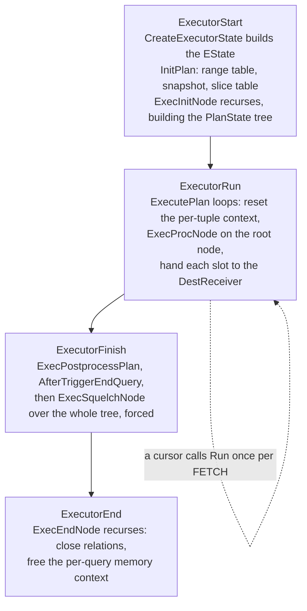

*四个阶段。游标每次 FETCH 都会重新进入第 2 阶段。*

```c {title="src/backend/executor/execMain.c — ExecutePlan()"}
	for (;;)
	{
		ResetPerTupleExprContext(estate);        /* :2895 */
		slot = ExecProcNode(planstate);          /* :2900 */
		if (TupIsNull(slot))
		{
			estate->es_got_eos = true;
			(void) ExecShutdownNode(planstate);  /* :2916 */
			break;
		}
		if (!dest->receiveSlot(slot, dest))      /* :2947, junk filter elided */
			break;
```

`ExecutePlan` 中的这个循环*就是* `ExecutorRun`：重置每元组内存，从根节点拉取一个元组，再把它交给 `DestReceiver`；在 Coordinator 上，后者写入客户端协议（[§13.1](/cloudberry/core-internals/part-4-query-processing/ch13/#131-the-simple-query-protocol)），在 Segment 上则把元组送入 Motion 的发送端。随后 `ExecutorFinish` 运行 AFTER 触发器，并在 `standard_ExecutorFinish()` 中对整棵树调用 `ExecSquelchNode(planstate, true)`：执行器拆除状态前的最后一个动作，就是通知所有节点不再有人读取数据。`ExecutorEnd` 调用 `ExecEndNode`（`execProcnode.c`），后者是 `ExecInitNode` 的镜像操作，递归向下关闭关系并释放状态。

### 18.1.3 一条语句，N+1 个执行器 {#1813-one-statement-n1-executors}

在 Coordinator 上，这个生命周期由 portal 驱动（[§13.1](/cloudberry/core-internals/part-4-query-processing/ch13/#131-the-simple-query-protocol)）：`pquery.c` 中的 `ProcessQuery()` 依次调用 `ExecutorStart`、`ExecutorRun`、`ExecutorFinish`、`ExecutorEnd`。在 Segment 上，*同样的四个函数*从完全不同的入口进入：`'M'` 消息（`tcop/postgres.c` — `SocketBackend()`、`PostgresMain()`）将序列化计划和切片表传给 `exec_mpp_query`，后者构造 `QueryDesc`，并运行完全相同的生命周期。因此，对于一条用户语句，系统会有 **N+1 个执行器**：每个 Segment 一个，再加上 Coordinator 的执行器；每个执行器都有自己的 `EState`、自己的 `PlanState` 树和自己的执行统计数据，同时运行，并且都认为自己正在执行“这条”查询。

*四个进程、一个 `sess_id`、一条语句。Segment −1 是 QD。*

```sql
-- session A, kept busy for 9 s; the subquery runs once per segment
SELECT count(*) FROM (SELECT pg_sleep(9) FROM gp_dist_random('gp_id')) x;

-- session B, while A is still running: who is executing it?
SELECT gp_execution_segment() AS seg, pid, sess_id, state
  FROM gp_dist_random('pg_stat_activity') WHERE query LIKE 'SELECT count(%'
UNION ALL
SELECT -1, pid, sess_id, state
  FROM pg_stat_activity WHERE query LIKE 'SELECT count(%'
ORDER BY 1;
```

```text {hl_lines="3" title="output"}
 seg |  pid  | sess_id | state
-----+-------+---------+--------
  -1 | 20203 |    6338 | active
   0 | 20205 |    6338 | active
   1 | 20206 |    6338 | active
   2 | 20207 |    6338 | active
(4 rows)
```

每个执行器都会收到*完整*计划，但只负责其中一个切片。`standard_ExecutorStart` 通过 `getGpExecIdentity`（`execMain.c`）判断自己属于三种角色中的哪一种：`GP_ROOT_SLICE`（驱动计划顶部）、`GP_NON_ROOT_ON_QE`（驱动根节点为发送 Motion 的切片，`standard_ExecutorStart()`），或 `GP_IGNORE`（无需执行任何工作，`standard_ExecutorStart()`）。`EState.eliminateAliens` 允许它完全跳过属于其他切片的*外来*节点的初始化。哪些切片存在、每个切片运行在哪些 Segment 上，已在 [§16.3](/cloudberry/core-internals/part-4-query-processing/ch16/#163-parallelization-cdbllize--cdbmutate) 中决定；元组实际如何在它们之间传递，见第 [19](/cloudberry/core-internals/part-4-query-processing/ch19/) 章。

### 18.1.4 EState 与 ExprContext {#1814-estate-and-exprcontext}

`EState`（`src/include/nodes/execnodes.h`）是每个查询的容器，所有节点都通过 `ps->state` 访问它。这是一个很大的结构体，从头读到尾并没有太大帮助；真正重要的是，它保存了节点无法自行创造的四件事：*哪些内容可见*、*有哪些关系*、*内存来自哪里*，以及*我是哪一个执行器*。

| `EState` 字段 | 用途 |
| --- | --- |
| `es_snapshot`、`es_crosscheck_snapshot` | 本查询看到的可见性；在 QE 上，它来自随派发到达的分布式快照（[§10.1](/cloudberry/core-internals/part-3-transactions-mvcc-concurrency/ch10/#101-snapshots--row-version-visibility)、[§10.5](/cloudberry/core-internals/part-3-transactions-mvcc-concurrency/ch10/#105-distributed-snapshots--the-distributed-log)）。 |
| `es_range_table`、`es_relations` | RTE 列表，以及 `InitPlan` 期间打开的 `Relation` 数组；扫描节点用 `scanrelid` 索引该数组来找到自己的表。 |
| `es_result_relations`、`es_output_cid` | INSERT/UPDATE/DELETE 的目标关系，以及写入其元组的命令 ID（[§9.2](/cloudberry/core-internals/part-3-transactions-mvcc-concurrency/ch09/#92-the-transaction-manager)）。 |
| `es_query_cxt`、`es_per_tuple_exprcontext` | 两种内存生命周期；节点分配的所有内容都存在于其中之一。 |
| `es_instrument` | `INSTRUMENT_*` 位掩码。这是 `EXPLAIN ANALYZE` 设置的唯一标志，[§18.1.8](#1818-instrumentation-where-explain-analyzes-numbers-come-from) 中的一切都由它引出。 |
| `es_sliceTable`、`currentSliceId` — Cloudberry | [§16.3](/cloudberry/core-internals/part-4-query-processing/ch16/#163-parallelization-cdbllize--cdbmutate) 中的切片表，以及*本*执行器当前正在运行的切片。 |
| `eliminateAliens`、`locallyExecutableSubplans` — Cloudberry | 跳过属于其他切片的计划部分的初始化。 |
| `showstatctx`、`dispatcherState` — Cloudberry | 从 QE 回传的 `EXPLAIN ANALYZE` 统计信息的汇总位置，以及已派发进程组（gang）的句柄（[§13.3](/cloudberry/core-internals/part-4-query-processing/ch13/#133-dispatch-from-coordinator-plan-to-segment-execution)）。 |
| `es_got_eos` — Cloudberry | 是否已到达流结束，以便游标的 `ExecutorEnd` 正确拆除执行状态。 |

下一层是 `ExprContext`（`execnodes.h`），即每元组容器。它的 `ecxt_scantuple`、`ecxt_innertuple` 和 `ecxt_outertuple` 是表达式读取 `Var` 的槽位；`ecxt_per_query_memory` 与 `ecxt_per_tuple_memory` 则再次体现了两种生命周期。后者正是执行器不会泄漏内存的原因：表达式结果在短生命周期上下文中通过 palloc 分配，整个上下文每个元组重置一次；这就是上面循环开头的 `ResetPerTupleExprContext`，而会迭代的节点内部也遵循同样的规则。[§18.5](#185-expression-evaluation) 就建立在这个结构上。还需注意 Cloudberry 的一项增加：当 `explain_memory_verbosity = detail` 时，`ExecInitNode` 为每个节点分配自己的 `MemoryContext`（`execProcnode.c`，存储在 `PlanState.node_context` 中），纯粹为了统计各节点的内存用量；代价是失去所有跨节点复用。

### 18.1.5 ExecProcNode 跳板 {#1815-the-execprocnode-trampoline}

`PlanState` 携带*两个*函数指针：调用者使用的 `ExecProcNode`，以及节点真正的方法 `ExecProcNodeReal`。这种间接层换来一次性的技巧。每个节点通过 `ExecSetExecProcNode` 注册自己的方法，但该函数并不直接安装方法，而是安装一个桩函数。

```c {title="src/backend/executor/execProcnode.c"}
void ExecSetExecProcNode(PlanState *node, ExecProcNodeMtd function)
{
	node->ExecProcNodeReal = function;
	node->ExecProcNode = ExecProcNodeFirst;        /* :595 */
}

static TupleTableSlot *ExecProcNodeFirst(PlanState *node)   /* :604 */
{
	check_stack_depth();
	node->ExecProcNode = ExecProcNodeGPDB;         /* :631 — retarget */
	return node->ExecProcNode(node);
}
```

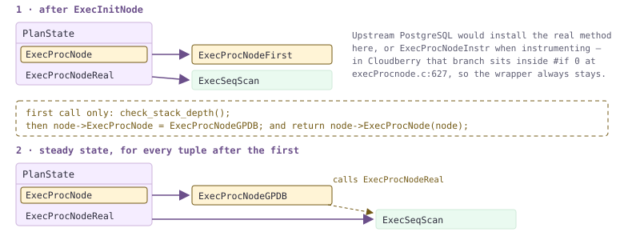

*指针会在第一次调用时自行改写。之后每个元组只需支付一次间接调用，不再进行判断。*

这里是 Cloudberry 与上游实现分道扬镳的地方，值得了解，因为流行的说法恰好相反。在 PostgreSQL 中，如果未启用执行统计，`ExecProcNodeFirst` 会将指针重定向到 `ExecProcNodeReal`；启用执行统计时则重定向到 `ExecProcNodeInstr`。因此，`EXPLAIN ANALYZE` 确实会改变调用路径，而未启用执行统计的查询无需为每个元组付出额外代价。在这棵代码树中，这项优化被**禁用**：`ExecProcNodeFirst()` 中的重定向以及整个 `ExecProcNodeInstr` 都被 `#if 0` 包围，`ExecProcNodeFirst()` 无条件安装 `ExecProcNodeGPDB`，因为 Cloudberry 有些逐元组工作无论如何都必须在每个节点上执行。

```c {title="src/backend/executor/execProcnode.c — ExecProcNodeGPDB()"}
	if (QueryFinishPending && !IsA(node, MotionState))
		return NULL;
	if (node->squelched)
		elog(ERROR, "cannot execute squelched plan node of type: %d",
			 (int) nodeTag(node));
	if (node->instrument)
		InstrStartNode(node->instrument);
	result = node->ExecProcNodeReal(node);
	if (node->instrument)
		InstrStopNode(node->instrument, TupIsNull(result) ? 0.0 : 1.0);
```

### 18.1.6 TupleTableSlot：一个元组，四种物理形式 {#1816-tupletableslot-one-tuple-four-physical-forms}

对堆表执行的 `Seq Scan` 将元组交给 `Sort`，后者再交给 `Hash Join`，随后交给 Motion。这些操作符都无需知道，扫描取得的元组来自共享缓冲区页面，而排序又曾将它写入临时文件。`TupleTableSlot`（`src/include/executor/tuptable.h`）正是实现这一点的抽象：固定头部包括 `tts_flags`、`tts_nvalid`、`tts_tupleDescriptor`、`tts_values`/`tts_isnull` 数组，此外还有 `const TupleTableSlotOps *tts_ops` 虚函数表，以及随子类型而异的尾部，用来保存槽位实际包装的物理元组。`execTuples.c` 恰好定义了四种这样的虚函数表。

| `tts_ops` | 槽位背后的物理形式 | 你会在哪里遇到它 |
| --- | --- | --- |
| **TTSOpsVirtual**（`execTuples.c`） | 完全没有物理元组，只有 `tts_values`/`tts_isnull` 数组，其中的 Datum 可能指向其他对象的内存。`.get_heap_tuple` 和 `.get_minimal_tuple` 特意设为 NULL。 | 每个投影节点的结果槽位；尤其是，`table_slot_callbacks` 为 **AO**（`appendonlyam_handler.c` — `appendonly_slot_callbacks()`）、**AOCO**（`aocsam_handler.c` — `aoco_slot_callbacks()`）和 **PAX**（`pax_access_handle.cc` — `PaxAccessMethod::SlotCallbacks()`）返回的槽位类型。 |
| **TTSOpsHeapTuple** | 一个由 palloc 分配、槽位可能拥有并释放的 `HeapTuple`（`TTS_FLAG_SHOULDFREE`）。 | 通过 TID 取出的元组、触发器元组，以及由 `heap_form_tuple` 新构造的任何元组（[§4.2](/cloudberry/core-internals/part-2-storage-data-layout/ch04/#42-row-version-layout)）。 |
| **TTSOpsMinimalTuple** | 一个 `MinimalTuple`：相同的数据布局，但没有 23 字节头部，因为可见性信息反正不会随它继续传递。 | Tuplestore、tuplesort 有序段、哈希连接批次文件：所有会将元组写入临时存储的地方（[§18.3](#183-sort--aggregate-nodes)、[§18.4](#184-join-nodes)）。 |
| **TTSOpsBufferHeapTuple** | 一个直接指向共享缓冲区页面的 `HeapTuple`；只要槽位持有该元组，就一直保持该缓冲区的 pin。 | `heapam_slot_callbacks`（`heapam_handler.c`）；因此所有堆扫描都会遇到它（[§3.4](/cloudberry/core-internals/part-2-storage-data-layout/ch03/#34-ring-buffers--bulk-eviction)、[§18.2](#182-scan-nodes)）。 |

这里有两个结论。第一，AO/AOCO/PAX 处理器都返回 `TTSOpsVirtual`，这正是列存储表能够与堆表进行连接而所有节点都无需区分存储格式的全部原因：AM 将自己的 MemTuple 或列条带（[§5.1](/cloudberry/core-internals/part-2-storage-data-layout/ch05/#51-memtuple--the-ao-file-format)、[§6.2](/cloudberry/core-internals/part-2-storage-data-layout/ch06/#62-micro-partition-file-format--manifest-catalog)）直接解码到 `tts_values`，从这里往上的节点都无法分辨其存储来源。第二，元组解构是**惰性的**：只有在 `tts_nvalid < attnum` 时，`slot_getattr`（`tuptable.h` — `slot_getsomeattrs()`）才调用 `slot_getsomeattrs`，因此槽位只展开属性 1..*n*，然后停止。由于堆元组的属性只能通过越过前面的属性来定位，读取某一列的成本会随其序号位置增加；这一点可以直接测量。

*`m181_w`：30 个 `int` 列，2 000 000 行，堆表。行数相同，谓词相同，但列不同。*

```sql
\timing on
SELECT count(c01) FROM m181_w;
SELECT count(c30) FROM m181_w;
SELECT count(c01) FROM m181_w;
SELECT count(c30) FROM m181_w;
```

```text {hl_lines="20" title="output"}
  count
---------
 2000000
(1 row)
Time: 254.458 ms
  count
---------
 2000000
(1 row)
Time: 375.425 ms
  count
---------
 2000000
(1 row)
Time: 257.727 ms
  count
---------
 2000000
(1 row)
Time: 303.286 ms
```

### 18.1.7 重扫描，以及 Cloudberry 独有的 squelch 概念 {#1817-rescan-and-the-cloudberry-only-idea-of-squelch}

某些子树会运行多次。`ExecReScan`（`src/backend/executor/execAmi.c`）重置节点，使其可以再次读取：它结束当前执行统计周期（`InstrEndLoop`），清除 `node->squelched`，向子节点传播 `chgParam`，并派发到节点自己的 `ExecReScanXxx`。这就是嵌套循环的内侧子树针对每个外侧行都会执行的过程（[§18.4](#184-join-nodes)），也是 `EXPLAIN ANALYZE` 中 `loops` 大于 1 的*唯一*来源。

*嵌套循环，使用 PostgreSQL 规划器，禁用哈希连接和归并连接。内侧的 `Materialize` 会针对每个外侧行重扫描一次。*

```sql
SET optimizer=off;
SET enable_hashjoin=off; SET enable_mergejoin=off;
EXPLAIN (ANALYZE, TIMING OFF, COSTS OFF)
  SELECT count(*) FROM m181_d d, m181_skew s WHERE s.grp = d.grp;
```

```text {hl_lines="8" title="output"}
 Finalize Aggregate (actual rows=1 loops=1)
   ->  Gather Motion 3:1  (slice1; segments: 3) (actual rows=3 loops=1)
         ->  Partial Aggregate (actual rows=1 loops=1)
               ->  Nested Loop (actual rows=90000 loops=1)
                     Join Filter: (d.grp = s.grp)
                     Rows Removed by Join Filter: 180000
                     ->  Seq Scan on m181_skew s (actual rows=90000 loops=1)
                     ->  Materialize (actual rows=3 loops=90000)
                           ->  Seq Scan on m181_d d (actual rows=3 loops=1)
 ...
 Optimizer: Postgres query optimizer
```

这个操作的相反方向在上游完全没有对应实现。`ExecSquelchNode`（`execAmi.c`，带有一段很长的解释性注释）告诉一个*尚未返回数据结束*的子树，以后不会再有人读取它。注释直截了当地说明了真正原因：**“这是为了避免与 Motion 节点发生死锁。”** 该子树中的接收 Motion 在其他 Segment 上有发送端；如果某个发送端的发送队列已满，它会永远阻塞，等待一个已经悄然离开的读取器，而等待同一发送端的兄弟 QE 也会随之饥饿。squelch 将这一消息向下传递：在 `ExecSquelchNode()`–`ExecSquelchNode()` 中设置 `node->squelched = true`，递归进入两个子节点，并对需要特殊处理的情况调用节点专用处理函数（`ExecSquelchMotion`、`ExecSquelchAppend`、`ExecSquelchSequence` 等）。它还有一个附带的内存收益：大多数处理函数会调用 `ExecEagerFree*`，让已完成操作符的 `work_mem` 归还给仍在运行的操作符。被 squelch 的节点并没有死亡，只是停止营业；`ExecReScan` 会解除其 squelch，而对它调用 `ExecProcNode` 会抛出 `cannot execute squelched plan node`。在 Motion 上方使用 `LIMIT` 是最典型的触发方式。

*`LIMIT 3` 位于内侧输入为 `Broadcast Motion` 的 Hash Join 上方。slice2 中的发送端扫描了 90 000 行中的 4 501 行，然后停止。*

```sql
SET optimizer=off;
EXPLAIN (ANALYZE, TIMING OFF, COSTS OFF)
  SELECT a.id, b.grp FROM m181_t a JOIN m181_skew b ON a.grp = b.grp LIMIT 3;
```

```text {hl_lines="7" title="output"}
 Limit (actual rows=3 loops=1)
   ->  Gather Motion 3:1  (slice1; segments: 3) (actual rows=3 loops=1)
         ->  Limit (actual rows=3 loops=1)
               ->  Hash Join (actual rows=3 loops=1)
                     Hash Cond: (b.grp = a.grp)
                     ->  Broadcast Motion 3:3  (slice2; segments: 3) (actual rows=1 loops=1)
                           ->  Seq Scan on m181_skew b (actual rows=4501 loops=1)
                     ->  Hash (actual rows=100172 loops=1)
                           Buckets: 524288  Batches: 1  Memory Usage: 8009kB
                           ->  Seq Scan on m181_t a (actual rows=100172 loops=1)
 ...
 Optimizer: Postgres query optimizer
```

### 18.1.8 执行统计：EXPLAIN ANALYZE 中的数字从何而来 {#1818-instrumentation-where-explain-analyzes-numbers-come-from}

`EXPLAIN ANALYZE` 设置 `EState.es_instrument`，使 `ExecInitNode` 为每个节点附加一个 `Instrumentation` 结构体（`src/include/executor/instrument.h`）。随后 `ExecProcNodeGPDB` 在每次调用前后分别执行 `InstrStartNode`（`instrument.c`）和 `InstrStopNode`：前者记录时间戳，后者将经过时间累积到 `counter` 中，并在返回元组时将 `tuplecount` 加 1。`InstrEndLoop` 结束一个*周期*：将 `counter` 合并到 `total`，将 `tuplecount` 合并到 `ntuples`，并递增 `nloops`。它由 `ExecReScan` 和关闭流程调用。理解输出时，这一点很关键，因为 `explain.c`（`ExplainNode()`）计算 `rows = instrument->ntuples / nloops`：**`actual rows` 是每次循环的平均值，而不是总数。** 上面的 `Materialize` 实际产生了 270 000 个元组，但报告为 3。

*先看事实，再看计划。`m181_skew` 是刻意制造的倾斜：seg0 有 90 000 行，seg1 有 10 000 行，seg2 完全没有行。*

```sql
SELECT gp_segment_id, count(*) FROM m181_skew GROUP BY 1 ORDER BY 1;

SET optimizer=off;
SET gp_enable_explain_allstat=on;
EXPLAIN (ANALYZE, COSTS OFF) SELECT count(*) FROM m181_skew;
```

```text {hl_lines="11" title="output"}
 gp_segment_id | count
---------------+-------
             0 | 90000
             1 | 10000
(2 rows)

 Finalize Aggregate (actual time=15.545..15.551 rows=1 loops=1)
   ->  Gather Motion 3:1  (slice1; segments: 3) (actual time=1.620..15.518 rows=3 loops=1)
         ->  Partial Aggregate (actual time=13.947..13.952 rows=1 loops=1)
               allstat: seg_firststart_total_ntuples/seg0_2.296 ms_14 ms_1/seg1_2.260 ms_1.559 ms_1/seg2_2.362 ms_0.030 ms_1//end
               ->  Seq Scan on m181_skew (actual time=0.070..9.088 rows=90000 loops=1)
                     allstat: seg_firststart_total_ntuples/seg0_2.298 ms_9.088 ms_90000/seg1_2.262 ms_1.057 ms_10000/seg2_2.364 ms_0.018 ms_0//end
 ...
 Optimizer: Postgres query optimizer
 Execution Time: 16.813 ms
```

规则已经由事实确立，而不是凭假设得出。该表有 100 000 行，`Seq Scan` 报告 90 000 行。这**不是总和，也不是平均值，而是某一个 Segment 自己的计数，即该节点产生元组最多的 Segment 的计数**。`gp_enable_explain_allstat` 会在下面打印每个 Segment 的原始三元组并证明这一点（90 000 / 10 000 / 0）。机制位于 `explain_gp.c`：每个 QE 将自己的 `Instrumentation` 发送给 QD，`cdbexplain_depStatAcc_upd` 跟踪哪个 Segment 持有最大值，然后 QD 将该 Segment 的整条执行统计记录复制到 `EXPLAIN` 要打印的 `PlanState` 中。

```c {title="src/backend/commands/explain_gp.c — cdbexplain_depositStatsToNode()"}
	if (ntuples.agg.vcnt > 0)
		nodeAcc = &ntuples;
	else if (nloops.agg.vcnt > 0)
		nodeAcc = &nloops;
	if (nodeAcc)
	{
		instr->counter    = nodeAcc->nsimax->counter;
		instr->ntuples    = nodeAcc->nsimax->ntuples;
		instr->nloops     = nodeAcc->nsimax->nloops;
		instr->nfiltered1 = nodeAcc->nsimax->nfiltered1;
		instr->workmemused = nodeAcc->nsimax->workmemused;
		/* ... every other counter, from the same winner ... */
```

请仔细阅读这条规则，因为它会带来一个出人意料的后果：最大值是**按节点独立选择**的。一个计划中相邻的两行可能报告两个不同的 Segment；某行的耗时、过滤计数和 `Extra Text` 都来自*该行*选中的 Segment，而不是全局选择的“最差” Segment。如果某个节点在任何地方都没有产生元组，则按 `nloops` 决胜，实质上再按到达顺序决定。

| 你正在读取的内容 | 数字实际来自哪里 |
| --- | --- |
| `actual rows`、Segment 切片上的 `loops` | 某一个 Segment 自己的数值，即**该节点**产生元组最多的 Segment 的数值。绝不是总和。而 `actual rows` 本身是 `ntuples / nloops`，即每次循环的平均值（`explain.c` — `ExplainNode()`）。 |
| `actual time`、`Rows Removed by Filter`、`Sort Method`、`Extra Text: (segN)` | 从该节点行数所对应的*同一个 Segment*复制而来（`explain_gp.c` — `cdbexplain_depositStatsToNode()`）。不同的行可能来自不同 Segment；`Extra Text` 会标出其 Segment，因此可以据此判断。 |
| `slice0` 中的任何内容，即计划顶部的 `Gather Motion` | 真实计数，因为 slice0 恰好只有一个工作进程，即 Coordinator。 |
| 每节点的 `Executor Memory: X  Segments: N  Max: Y (segment S)`（`explain_memory_verbosity = detail`） | 这里的约定反过来：`X` 是 `N` 个报告工作进程的**总和**，`Y` 是各 Segment 中的最大值，`S` 指出最大值所在位置。 |
| `(sliceN) Executor memory: A avg x Nx(M) workers, B max (segS)` | 该切片的执行器峰值内存：`A` 是报告数据的 `N` 个 Segment 的平均值，`B` 是最大值，`segS` 是最大值所在处。`M` 是启动的 PostgreSQL 并行工作进程数；除非启用 `enable_parallel`，否则为 `0`（[§18.2](#182-scan-nodes)）。 |
| `Work_mem: X max, Y wanted` | 该切片所有节点和所有工作进程中的最大值（`explain_gp.c` — `gpexplain_formatSlicesOutput()`）。只有某个操作符在有更多内存时可以避免溢出，才会出现 `Y wanted`。 |
| 切片行开头的 `*` | 由打印 `wanted` 的同一分支设置：`es->str->data[flag] = '*'`（`explain_gp.c` — `gpexplain_formatSlicesOutput()`）回头覆盖行首的占位字符。它的含义正是“该切片发生了溢出”。 |
| `Memory used:` / `Memory wanted:` | 语句级而非切片级：资源管理器为该语句授予的 `query_mem`（`cdbexplain_showExecStatsEnd()`），以及为避免所有溢出本来需要的内存（`cdbexplain_showExecStatsEnd()`）。内存配额的分配机制见第 [21](/cloudberry/core-internals/part-6-resource-management/ch21/) 章。 |

*收紧语句内存预算后，整个页脚都会显示出来。注意，`Rows Removed by Filter` 和 `Seq Scan` 的行数来自*不同*的 Segment；`m181_t` 在 seg0/1/2 上分别有 99 877、99 951、100 172 行。*

```sql
SET optimizer=off;
SET statement_mem='2MB';
EXPLAIN (ANALYZE, TIMING OFF, COSTS OFF)
  SELECT grp, count(*) FROM m181_t GROUP BY grp, id HAVING count(*) > 1;
```

```text {hl_lines="5" title="output"}
 Gather Motion 3:1  (slice1; segments: 3) (actual rows=0 loops=1)
   ->  HashAggregate (actual rows=0 loops=1)
         Group Key: grp, id
         Filter: (count(*) > 1)
         Rows Removed by Filter: 99877
         Extra Text: (seg0)   hash table(s): 1; 99877 groups total in 5 batches, 294688 spill partitions; disk usage: 2816KB; chain length 2.2 avg, 7 max; using 99877 of 327680 buckets; total 0 expansions.
         ->  Seq Scan on m181_t (actual rows=100172 loops=1)
 Planning Time: 1.558 ms
   (slice0)    Executor memory: 1565K bytes.
 * (slice1)    Executor memory: 2951K bytes avg x 3x(0) workers, 2951K bytes max (seg0).  Work_mem: 5777K bytes max, 13841K bytes wanted.
 Memory used:  2048kB
 Memory wanted:  14040kB
 Optimizer: Postgres query optimizer
 Execution Time: 149.575 ms
```

*`explain_memory_verbosity = detail` 会增加每节点一行，并展示总和与最大值的约定：3 个 Segment 合计 330 kB，每个 110 kB。*

```sql
SET optimizer=off;
SET explain_memory_verbosity='detail';
EXPLAIN (ANALYZE, TIMING OFF, COSTS OFF) SELECT count(*) FROM m181_skew;
```

```text {hl_lines="8" title="output"}
 Finalize Aggregate (actual rows=1 loops=1)
   Executor Memory: 125kB  Segments: 1  Max: 125kB (segment -1)
   ->  Gather Motion 3:1  (slice1; segments: 3) (actual rows=3 loops=1)
         Executor Memory: 118kB  Segments: 1  Max: 118kB (segment -1)
         ->  Partial Aggregate (actual rows=1 loops=1)
               Executor Memory: 672kB  Segments: 3  Max: 224kB (segment 0)
               ->  Seq Scan on m181_skew (actual rows=90000 loops=1)
                     Executor Memory: 330kB  Segments: 3  Max: 110kB (segment 0)
 ...
 Optimizer: Postgres query optimizer
```

*`TIMING OFF` 与默认设置的对比，各运行 6 次：9 M 行，每个 Segment 约 3 M 行，只显示 `Execution Time`。比例来自一台机器、启用断言的构建，不是基准测试。*

```sql
-- x6:
EXPLAIN (ANALYZE, TIMING OFF, COSTS OFF) SELECT count(*) FROM m181_big WHERE id > 0;
-- x6:
EXPLAIN (ANALYZE,            COSTS OFF) SELECT count(*) FROM m181_big WHERE id > 0;
```

```text {hl_lines="13" title="output"}
-- TIMING OFF
 Execution Time: 1002.310 ms
 Execution Time: 984.674 ms
 Execution Time: 991.330 ms
 Execution Time: 971.711 ms
 Execution Time: 963.955 ms
 Execution Time: 969.497 ms
-- TIMING ON (the default)
 Execution Time: 1109.578 ms
 Execution Time: 997.255 ms
 Execution Time: 991.228 ms
 Execution Time: 1079.157 ms
 Execution Time: 916.240 ms
 Execution Time: 960.514 ms
```

之所以存在 `TIMING OFF`，是因为 `InstrStartNode`/`InstrStopNode` 会对每个节点的每个元组记录时间戳，在某些平台上确实代价很高。在这台机器上无法测出差异：每个 Segment 处理三百万行、各运行六次，结果完全重叠，而且最快的一次反而启用了 `TIMING ON`。原因有二。这里的 `INSTR_TIME_SET_CURRENT` 通过 vDSO 调用 `clock_gettime`，只需几十纳秒，不经过系统调用；此外，根据 [§18.1.5](#1815-the-execprocnode-trampoline)，无论是否启用执行统计，Cloudberry 都会在每个元组上支付 `ExecProcNodeGPDB` 封装器的成本，因此时间戳的边际成本只是原本就存在的开销中的很小一部分。应把 `TIMING OFF` 当作保险，而不是习惯；它不会影响 `actual rows`，而这正是本章关心的数字。

> [!NOTE]
> 上述内容都与优化器无关：同一计划在 **GPORCA** 下运行时，执行统计所用的字段逐字相同，只有 `Optimizer:` 页脚变化，因为 [§17.5](/cloudberry/core-internals/part-4-query-processing/ch17/#175-translation-query--dxl--plstmt) 交给执行器的 `PlannedStmt` 与 PostgreSQL 规划器相同。本节有两个值得记住的参数：`gp_enable_explain_allstat` 会直接输出逐 Segment 的真实数据，免去根据各 Segment 最大值猜测；`explain_memory_verbosity`（`suppress` / `summary` / `detail`）中的 `summary` 为每个切片增加 `Vmem reserved`，`detail` 则要付出每个节点一个内存上下文的代价。接下来，本章深入节点本身：[§18.2](#182-scan-nodes) 讲扫描，[§18.3](#183-sort--aggregate-nodes) 讲排序与聚合，[§18.4](#184-join-nodes) 讲连接，[§18.5](#185-expression-evaluation) 讲表达式，[§18.6](#186-subqueries--other-nodes) 讲子查询及其余节点，[§18.7](#187-cloudberry-specific-nodes) 讲 Cloudberry 特有操作符；将这台单进程机器变成 MPP 系统的 Motion 节点，则见第 [19](/cloudberry/core-internals/part-4-query-processing/ch19/) 章。

## 18.2 扫描节点 {#182-scan-nodes}

扫描节点是每棵计划树的叶节点，也是执行器从遍历树转为读取字节的地方。因此，本节正好连接第三部分与第一部分：`EXPLAIN` 输出中的 `Seq Scan` 表示某个组件会把元组向上交付，而第 [4](/cloudberry/core-internals/part-2-storage-data-layout/ch04/)、[5](/cloudberry/core-internals/part-2-storage-data-layout/ch05/) 和 [6](/cloudberry/core-internals/part-2-storage-data-layout/ch06/) 章共同回答“由什么组件交付”。Cloudberry 比 PostgreSQL 更进一步实现了这种间接层：同一个计划节点、同一个 `nodeSeqscan.c` 中的 474 行代码，可以读取堆页面、追加优化行存储的分段、列存储分段文件或 PAX 块，而计划文本完全不变。我们先从这里开始，再向外展开：`execScan.c` 中共享的扫描循环，大型扫描使用的缓冲区策略，索引扫描与位图扫描，Cloudberry 的运行时分区 `Dynamic*` 系列，最后是 Cloudberry 3.0 真正新增的扫描功能——Segment 内部的并行执行。

### 18.2.1 一个节点，四种存储引擎 {#1821-one-node-four-storage-engines}

`nodeSeqscan.c` 并不知道什么是堆。其核心函数 `SeqNext`（`nodeSeqscan.c`）打开扫描，并通过**表访问方法**拉取槽位；Cloudberry 的入口不是上游的 `table_beginscan`，而是 `table_beginscan_es`（`src/include/access/tableam.h`），后者还会把节点自己的 `PlanState` 传给访问方法。此后的每一步都是通过函数指针调用由关系 `relam` 指定的 `TableAmRoutine`。

```c {title="src/backend/executor/nodeSeqscan.c — SeqNext()"}
	scandesc = table_beginscan_es(node->ss.ss_currentRelation,
								  estate->es_snapshot,
								  nkeys, keys,
								  NULL,
								  &node->ss.ps);
	node->ss.ss_currentScanDesc = scandesc;
	...
	if (table_scan_getnextslot(scandesc, direction, slot))
		return slot;
```

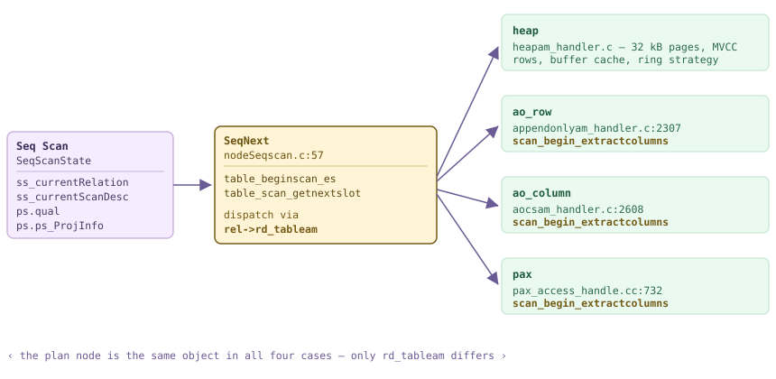

*一个 PlanState，四个 TableAmRoutine。扫描节点通过 rd_tableam 调用，访问方法决定“下一个元组”需要付出什么代价。图中以琥珀色标出的三个访问方法还实现了 scan_begin_extractcolumns，因此 table_beginscan_es 会把 PlanState 向下传递。*

*四种访问方法，一个计划节点。其他三个 EXPLAIN 的结果除了关系名外逐字相同。*

```sql
SET optimizer = off;              -- ORCA prints the same node here
CREATE TABLE m182_heap (id int, k int, city text, payload text) DISTRIBUTED BY (id);
CREATE TABLE m182_ao   (LIKE m182_heap) WITH (appendonly=true)                     DISTRIBUTED BY (id);
CREATE TABLE m182_aoco (LIKE m182_heap) WITH (appendonly=true, orientation=column) DISTRIBUTED BY (id);
CREATE TABLE m182_pax  (LIKE m182_heap) USING pax                                  DISTRIBUTED BY (id);
-- 600 000 identical rows loaded into each

SELECT relname, amname, pg_size_pretty(pg_total_relation_size(c.oid)) sz
  FROM pg_class c JOIN pg_am a ON a.oid = c.relam
 WHERE relname LIKE 'm182%' ORDER BY 1;

EXPLAIN (COSTS OFF) SELECT count(*) FROM m182_aoco WHERE k = 42;
```

```text {hl_lines="14" title="output"}
  relname  |  amname   |   sz
-----------+-----------+---------
 m182_ao   | ao_row    | 52 MB
 m182_aoco | ao_column | 44 MB
 m182_heap | heap      | 62 MB
 m182_pax  | pax       | 5356 kB
(4 rows)

                   QUERY PLAN
------------------------------------------------
 Finalize Aggregate
   ->  Gather Motion 3:1  (slice1; segments: 3)
         ->  Partial Aggregate
               ->  Seq Scan on m182_aoco
                     Filter: (k = 42)
 Optimizer: Postgres query optimizer
```

那么究竟改变了什么？由访问方法决定需要读取多少数据。由于 `table_beginscan_es` 会传递 `PlanState`，列存储可以查看计划的目标列表和限定条件，只打开查询提到的列；`aoco_beginscan_extractcolumns`（`aocsam_handler.c`）遍历 `ps->plan->targetlist` 和 `ps->plan->qual`，将用到的列记录到 `cols[]` 位图中，还有一个很有意思的特殊情况：如果查询完全没有点名列（`count(*)`），它会扫描第 1 列，以便有内容可计数。堆没有这个选择；行存储必须读取整行。两张各有 300 000 行的表，都包含一个窄 `int` 列和一个 2 560 字节的文本列，清楚地显示了这种差距。

*列投影是访问方法的属性，而不是计划属性。下面两个查询使用的是同一个 `Seq Scan`；当没有引用宽列时，AOCO 查询只需完成 1/9 的工作。时间是某台启用 --enable-cassert 机器上的比例，不是基准测试。*

```sql
-- same 300 000 rows, same 2 560-byte blob column, two access methods
CREATE TABLE m182_wideh (id int, k int, blob text) DISTRIBUTED BY (id);              -- heap, 782 MB
CREATE TABLE m182_wide  (id int, k int, blob text)
  WITH (appendonly=true, orientation=column, compresstype=none) DISTRIBUTED BY (id); -- AOCO, 737 MB
	iming on
echo heap  narrow
SELECT count(k)    FROM m182_wideh;
echo heap  wide
SELECT count(blob) FROM m182_wideh;
echo AOCO  narrow
SELECT count(k)    FROM m182_wide;
echo AOCO  wide
SELECT count(blob) FROM m182_wide;
```

```text {hl_lines="9" title="output"}
heap  narrow
 300000
Time: 73.719 ms
heap  wide
 300000
Time: 78.100 ms
AOCO  narrow
 300000
Time: 14.042 ms
AOCO  wide
 300000
Time: 122.095 ms
```

### 18.2.2 扫描循环 {#1822-the-scan-loop}

所有带有限定条件或投影的扫描节点都会汇入一个 110 行的函数 `ExecScan`（`execScan.c`）。它的接口约定很简单，却值得记住，因为这解释了扫描节点下 `EXPLAIN ANALYZE` 输出的大部分内容：重置每元组内存上下文，向访问方法请求一个槽位，将该槽位发布到 `econtext->ecxt_scantuple`，运行 `ExecQual`，然后执行投影（[§18.5](#185-expression-evaluation)）或返回原始槽位。未通过限定条件的元组会递增 `InstrCountFiltered1`；`Rows Removed by Filter` 这一行只来自这个计数器。既没有限定条件也没有投影的节点会在 `execScan.c`（`ExecScan()`）处直接跳过整个循环，原样返回访问方法的槽位。

```c {title="src/backend/executor/execScan.c — ExecScan()"}
	for (;;)
	{
		slot = ExecScanFetch(node, accessMtd, recheckMtd);
		if (TupIsNull(slot)) ...
		econtext->ecxt_scantuple = slot;
		qual = node->ps.qual;
		if (qual == NULL || ExecQual(qual, econtext))
			return projInfo ? ExecProject(projInfo) : slot;
		else
			InstrCountFiltered1(node, 1);
		ResetExprContext(econtext);
	}
```

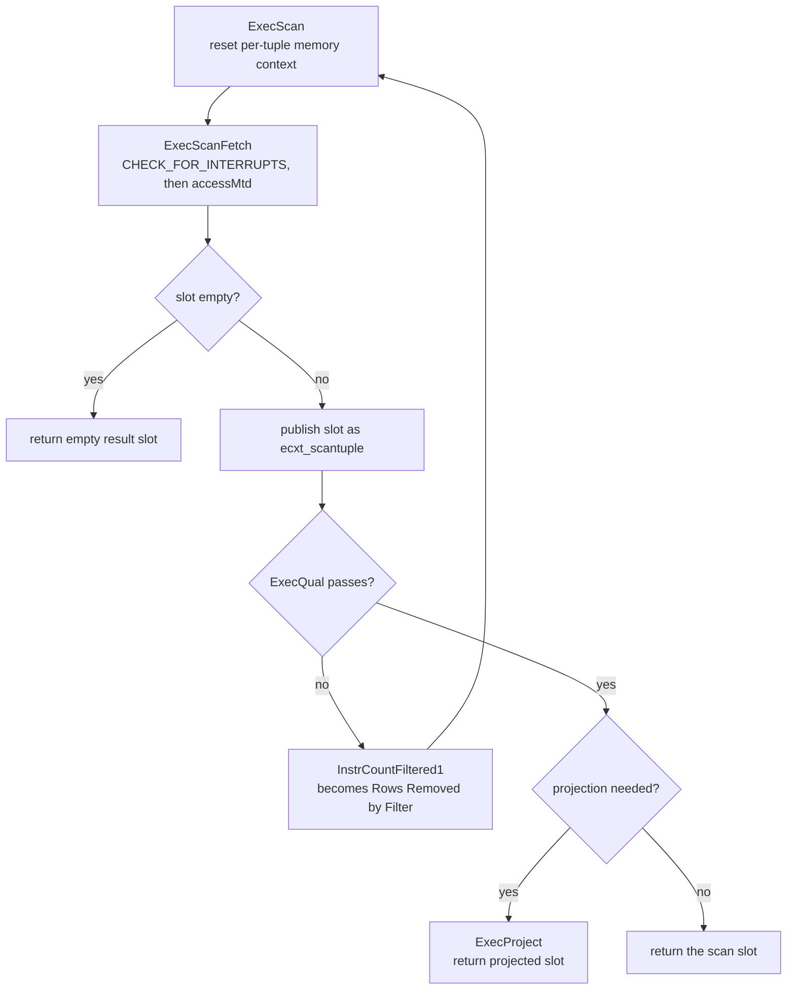

*ExecScan 的骨架。只有两个阴影标出的决策属于节点专有：accessMtd 由 nodeSeqscan/nodeIndexscan/nodeTidscan 提供，recheckMtd 只用于 EvalPlanQual 路径。*

`ExecScanFetch`（`execScan.c`）还有另一项工作。当设置了 `estate->es_epq_active` 时，执行器正在进行 `EvalPlanQual` 重检查：它要重新评估一个在 `SELECT FOR UPDATE` 或 `UPDATE` 下发生变化的行，此时获取操作会被调用方提供的测试元组替代，由 `recheckMtd` 验证。`nodeSeqscan.c` 的 `SeqRecheck()`（`SeqRecheck`）只返回 `true`，注释也承认顺序扫描从未将键推入访问方法，因此没有需要再次验证的内容；真正执行这项工作的是索引扫描。

*过滤计数器的实际表现：最繁忙的 Segment 上有 221 行通过，200 046 行未通过。注意缺少的内容：即使请求了 BUFFERS，也只报告 Coordinator 的规划缓冲区。*

```sql
SET optimizer = off;
EXPLAIN (ANALYZE, BUFFERS, TIMING OFF, COSTS OFF)
  SELECT count(*) FROM m182_heap WHERE k = 42;
```

```text {hl_lines="6" title="output"}
 Finalize Aggregate (actual rows=1 loops=1)
   ->  Gather Motion 3:1  (slice1; segments: 3) (actual rows=3 loops=1)
         ->  Partial Aggregate (actual rows=1 loops=1)
               ->  Seq Scan on m182_heap (actual rows=221 loops=1)
                     Filter: (k = 42)
                     Rows Removed by Filter: 200046
 Planning:
   Buffers: shared hit=267
 Planning Time: 1.568 ms
   (slice0)    Executor memory: 114K bytes.
   (slice1)    Executor memory: 119K bytes avg x 3x(0) workers, 119K bytes max (seg0).
 Optimizer: Postgres query optimizer
 Execution Time: 54.812 ms
```

> [!NOTE]
> 在这个集群中，Motion 下从不会出现逐节点的 `Buffers:` 行：扫描在三个 QE 上运行，`BufferUsage` 计数器不会随元组一起发送回 Coordinator。位图计数器在 [§18.2.5](#1825-bitmap-scans) 中也是如此。需要这些数据时，应在某个 Segment 上以 utility 模式运行查询；关于 QE 侧 `Instrumentation` 能报告什么、不能报告什么，见 [§18.1](#181-executor-framework--lifecycle)。

### 18.2.3 缓冲访问——大扫描不会驱逐缓存 {#1823-buffered-access--a-big-scan-does-not-evict-the-cache}

顺序扫描一张大于缓冲区缓存的表，直觉上似乎会让一次查询丢弃整个缓存。实际并不会。`initscan`（`heapam.c`）将关系大小与 `NBuffers / 4` 比较；超过该阈值后，它请求 `BAS_BULKREAD` 策略（`heapam.c` — `initscan()`），即一个大小为 `256 kB` 的**环形缓冲区**（`freelist.c` — `GetAccessStrategy()`），再由 `freelist.c` — `GetAccessStrategyWithSize()` 将其换算为缓冲区数量。在本集群中，`block_size` 是 **32 kB**，因此环恰好有 **8 个缓冲区**：整个表扫描期间只循环复用自己的八个帧，而不是每页分配一个帧（[§3.4](/cloudberry/core-internals/part-2-storage-data-layout/ch03/#34-ring-buffers--bulk-eviction)）。PG16 的 `pg_stat_io` 让我们可以直接观察这一点，因为 `BAS_BULKREAD` 映射到自己的 I/O 上下文（`freelist.c` — `IOContextForStrategy()`）。

*通过一个有 4 000 个缓冲区的缓存扫描 6 110 页。`reuses` 统计从扫描自身的环中循环复用的帧，`evictions` 统计不得不驱逐的、原本属于其他对象的页面。由于 pg_stat_io 按实例统计，这里在 Segment 0 上以 utility 模式运行。*

```sql
-- PGOPTIONS='-c gp_role=utility' psql -p 7102 -d postgres
-- step 1, own transaction: snapshot the counters
CREATE TABLE m182_io0 AS
  SELECT context, reads, evictions, reuses FROM pg_stat_io
   WHERE backend_type = 'client backend' AND object = 'relation';

-- step 2, own transaction: one full scan of a table bigger than the cache
SELECT relpages, current_setting('block_size') bs,
       (SELECT count(*) FROM pg_buffercache) nbuffers
  FROM pg_class WHERE relname = 'm182_ring';
SELECT count(*) FROM m182_ring;

-- step 3: the delta, plus what is left resident
SELECT n.context, n.reads-o.reads d_reads, n.evictions-o.evictions d_evictions,
       n.reuses-o.reuses d_reuses
  FROM pg_stat_io n JOIN m182_io0 o USING (context)
 WHERE n.backend_type='client backend' AND n.object='relation'
   AND n.context IN ('bulkread','normal');
SELECT count(*) AS ring_pages_resident FROM pg_buffercache
 WHERE relfilenode = pg_relation_filenode('m182_ring') AND relforknumber = 0;
```

```text {hl_lines="11" title="output"}
 relpages |  bs   | nbuffers
----------+-------+----------
     6110 | 32768 |     4000

 count
--------
 366564

 context  | d_reads | d_evictions | d_reuses
----------+---------+-------------+----------
 bulkread |    6094 |           7 |   6086
 normal   |       0 |           0 |
(2 rows)

 ring_pages_resident
---------------------
                  24
```

> [!NOTE]
> 两点需要如实说明。第一，只有**堆**和 PAX 的读取会经过共享缓冲区；`aocsam.c` 和 `appendonlyam.c` 中完全没有 `ReadBuffer` 调用，AO 与 AOCO 扫描通过 `AppendOnlyStorageRead` 和自有缓冲区读取，因此不会使用环形策略，也不会有 `pg_buffercache` 行来描述它们。第二，上面的驻留页面数只有在 Segment 没有其他活动时，作为增量才有意义：一张 6 110 页的表留下了 **24** 个页面，但任何共享这 4 000 个缓冲区的并发会话都会使这个数字变得混杂。应以 `pg_stat_io` 的增量为可靠依据。

### 18.2.4 索引扫描与仅索引扫描 {#1824-index-and-index-only-scans}

`nodeIndexscan.c` 会替换访问方法：`ExecIndexBuildScanKeys`（`nodeIndexscan.c`）在初始化时将计划的 `indexqual` 转为 `ScanKey` 数组，`index_beginscan`（`IndexNext()`）打开索引，`index_getnext_slot`（`IndexNext()`）遍历索引。对计划来说，有两个后果很重要。输出按照索引顺序排列，因此可以满足 pathkeys 而无需 Sort（[§15.4](/cloudberry/core-internals/part-4-query-processing/ch15/#154-plan-generation)）。当可见性映射表明某页面全可见时，`nodeIndexonlyscan.c` 还可以完全跳过堆（`nodeIndexonlyscan.c` — `IndexOnlyNext()`，[§4.4](/cloudberry/core-internals/part-2-storage-data-layout/ch04/#44-fsm--visibility-map)）；每次无法跳过时，`InstrCountTuples2` 都会触发（`IndexOnlyNext()`），并在 EXPLAIN 中显示为 `Heap Fetches` 行（`explain.c` — `ExplainNode()`）。

*相同的谓词，两个节点。在 VACUUM 设置可见性映射后，仅索引扫描完全没有触碰堆。*

```sql
CREATE INDEX m182_heap_k ON m182_heap (k);
VACUUM ANALYZE m182_heap;
SET optimizer = off; SET enable_seqscan = off; SET enable_bitmapscan = off;

EXPLAIN (ANALYZE, TIMING OFF, COSTS OFF) SELECT id, city FROM m182_heap WHERE k = 42;
EXPLAIN (ANALYZE, TIMING OFF, COSTS OFF) SELECT k        FROM m182_heap WHERE k = 42;
```

```text {hl_lines="9" title="output"}
 Gather Motion 3:1  (slice1; segments: 3) (actual rows=600 loops=1)
   ->  Index Scan using m182_heap_k on m182_heap (actual rows=221 loops=1)
         Index Cond: (k = 42)
 Execution Time: 4.575 ms

 Gather Motion 3:1  (slice1; segments: 3) (actual rows=600 loops=1)
   ->  Index Only Scan using m182_heap_k on m182_heap (actual rows=221 loops=1)
         Index Cond: (k = 42)
         Heap Fetches: 0
 Execution Time: 0.976 ms
```

分布式环境带来一个变化：这里不存在一个统一的索引。对分布式表执行 `CREATE INDEX` 会在每个 Segment 上创建一个**独立的物理索引**，每个索引只覆盖该 Segment 所持有的行（[§7.1](/cloudberry/core-internals/part-2-storage-data-layout/ch07/#71-index-fundamentals)）；每个索引产生的有序流由其上方的 Motion 合并，这体现为 `Merge Key:` 注释，也正是每个 Segment 上的 `ORDER BY … LIMIT` 仍能产生全局有序结果的原因。

*三个 Segment，三个相互独立的索引关系，每个有 43 页；Coordinator 只看到它们合并后的输出。*

```bash
-- one physical index per segment, reached in utility mode
for p in 7102 7103 7104; do
  PGOPTIONS='-c gp_role=utility' psql -p $p -d postgres -qtAc     "select $p, relname, pg_relation_filenode(oid), relpages
       from pg_class where relname='m182_heap_k';"
done

-- and how their orderings are combined
EXPLAIN (ANALYZE, TIMING OFF, COSTS OFF)
  SELECT id FROM m182_heap ORDER BY id LIMIT 5;
```

```text {hl_lines="7" title="output"}
7102|m182_heap_k|25217|43
7103|m182_heap_k|25211|43
7104|m182_heap_k|25211|43

 Limit (actual rows=5 loops=1)
   ->  Gather Motion 3:1  (slice1; segments: 3) (actual rows=5 loops=1)
         Merge Key: id
         ->  Limit (actual rows=5 loops=1)
               ->  Index Only Scan using m182_heap_id on m182_heap (actual rows=5 loops=1)
                     Heap Fetches: 0
```

### 18.2.5 位图扫描 {#1825-bitmap-scans}

位图扫描将索引扫描拆成两步。`MultiExecBitmapIndexScan`（`nodeBitmapIndexscan.c`）根本不是普通的 `ExecProcNode`：它通过 `index_getbitmap`（`MultiExecBitmapIndexScan()`）在一次调用中返回完整位图，并提供自己的执行统计数据（`MultiExecBitmapIndexScan()`），因为它从不返回元组。随后 `nodeBitmapHeapscan.c` 按**物理块顺序**访问堆，将分散的随机读取变成更接近顺序读取的形式。`nodeBitmapAnd.c` 和 `nodeBitmapOr.c` 位于二者之间，用来组合位图。代价是内存：当位图超过 `work_mem` 时，会逐页退化；**有损**页面只记录“这里有某行匹配”，而堆扫描必须对其中每一行重新应用 `Recheck Cond`。

*在 Segment 0 上以 utility 模式运行，因为这些计数器只在 QE 本地统计。在 64 kB 的 work_mem 下，660 个页面中有 650 个变为有损页面，重检查丢弃了 118 088 行。*

```sql
-- PGOPTIONS='-c gp_role=utility' psql -p 7102 -d postgres
SET optimizer = off; SET enable_seqscan = off;
SET enable_indexscan = off; SET enable_indexonlyscan = off;
SET work_mem = '64kB';
EXPLAIN (ANALYZE, TIMING OFF, COSTS OFF)
  SELECT count(city) FROM m182_heap WHERE k < 400;
```

```text {hl_lines="5" title="output"}
 Aggregate (actual rows=1 loops=1)
   ->  Bitmap Heap Scan on m182_heap (actual rows=79921 loops=1)
         Recheck Cond: (k < 400)
         Rows Removed by Index Recheck: 118088
         Heap Blocks: exact=10 lossy=650
         ->  Bitmap Index Scan on m182_heap_k (actual rows=79921 loops=1)
               Index Cond: (k < 400)
 Planning Time: 1.874 ms
   (slice0)    Executor memory: 12859K bytes (seg0).
 Optimizer: Postgres query optimizer
 Execution Time: 61.273 ms
```

这里有两个名为“bitmap”的东西，但它们并不是同一回事。位图**扫描**是一种执行策略，适用于实现 `amgetbitmap` 的任意索引访问方法，通常是 B-树。Cloudberry 另外提供了一种位图**索引类型**（`USING bitmap`，[§7.6](/cloudberry/core-internals/part-2-storage-data-layout/ch07/#76-bitmap-index-cloudberry-specific)）；它的 `bmgetbitmap`（`bitmap.c`）返回的是延迟迭代的 `StreamBitmap`，而不是物化的 `TIDBitmap`。`nodeBitmapIndexscan.c` — `MultiExecBitmapIndexScan()` 接受这两种结果。这一设计会以一种值得识别的方式反映在 `EXPLAIN` 中：`bmgetbitmap` 在注释“我们无法精确知道涉及多少堆元组”下以字面形式 `return 1` 结束（`bitmap.c` — `bmgetbitmap()`），因此位图访问方法的索引扫描总是报告 `actual rows=1`。

*由两种不同索引访问方法提供输入的 BitmapAnd。B-树一侧统计 TID；位图访问方法一侧报告一行，因为 bmgetbitmap 就是这样返回的。*

```sql
CREATE INDEX m182_bm_a ON m182_bm USING btree  (a);   -- 100 distinct values
CREATE INDEX m182_bm_b ON m182_bm USING bitmap (b);   -- 100 distinct values
VACUUM ANALYZE m182_bm;
SET optimizer = off; SET enable_seqscan = off;
EXPLAIN (ANALYZE, TIMING OFF, COSTS OFF)
  SELECT count(tag) FROM m182_bm WHERE a = 5 AND b = 7;
```

```text {hl_lines="7" title="output"}
 Finalize Aggregate (actual rows=1 loops=1)
   ->  Gather Motion 3:1  (slice1; segments: 3) (actual rows=3 loops=1)
         ->  Partial Aggregate (actual rows=1 loops=1)
               ->  Bitmap Heap Scan on m182_bm (actual rows=23 loops=1)
                     Recheck Cond: ((b = 7) AND (a = 5))
                     ->  BitmapAnd (actual rows=1 loops=1)
                           ->  Bitmap Index Scan on m182_bm_b (actual rows=1 loops=1)
                                 Index Cond: (b = 7)
                           ->  Bitmap Index Scan on m182_bm_a (actual rows=3066 loops=1)
                                 Index Cond: (a = 5)
 Optimizer: Postgres query optimizer
 Execution Time: 43.364 ms
```

> [!NOTE]
> 三个较小的扫描节点补齐了这一系列，它们的行为与上游完全相同，这里只列出名称：`nodeTidscan.c`（`Tid Scan`，`ctid = …` 查找——在分布式表上，Cloudberry 会警告 `ctid` 只有与 `gp_segment_id` 结合才唯一）、`nodeTidrangescan.c`（`Tid Range Scan`，PG14 的块范围扫描）和 `nodeSamplescan.c`（`Sample Scan`，`TABLESAMPLE`；在此集群中，对 600 000 行执行 `TABLESAMPLE SYSTEM (1)`，最繁忙的 Segment 上返回 `actual rows=3333`）。三者都经过 [§18.2.2](#1822-the-scan-loop) 的同一个 `ExecScan` 循环。

### 18.2.6 Dynamic* 系列——运行时选择分区 {#1826-the-dynamic-family--partitions-chosen-at-run-time}

这里 Cloudberry 与 PostgreSQL 完全不同。PostgreSQL 将分区表表示为一个 `Append`，每个保留分区对应一个子计划节点（[§18.6](#186-subqueries--other-nodes)）；分区在规划时剪枝，对于参数化情况还会在运行时再次剪枝。ORCA 则生成一个**单独的** `Dynamic*` 节点，其中保存一组*分区 OID*，执行时逐个打开这些分区。`nodeDynamicSeqscan.c` 的头部直截了当地说明了动机：每个分区一个节点的计划必须在规划时为每个子节点固定列映射；而“当分区很多且列很多时，计划大小的改善会非常大，在某些情况下可达 100+ MB”。这一系列由六个文件实现，并在 `execDynamicIndexes.c` 中共享索引支持代码。

| 文件 | 计划标签 | 相对于静态节点增加的内容 |
| --- | --- | --- |
| `nodeDynamicSeqscan.c` (315) | `Dynamic Seq Scan` | 遍历 `partOids`，对每个分区调用 `ExecInitSeqScanForPartition` |
| `nodeDynamicIndexscan.c` (140) | `Dynamic Index Scan` | 通过 `execDynamicIndexes.c` 打开该分区自己的索引 |
| `nodeDynamicIndexOnlyscan.c` (135) | `Dynamic Index Only Scan` | 相同，但保留可见性映射捷径 |
| `nodeDynamicBitmapIndexscan.c` (282) | `Dynamic Bitmap Index Scan` | 为当前分区构建 TID 位图 |
| `nodeDynamicBitmapHeapscan.c` (329) | `Dynamic Bitmap Heap Scan` | 针对该分区的存储消费位图 |
| `nodeDynamicForeignscan.c` (324) | `Dynamic Foreign Scan` | 外表／外部表分区 |

```c {title="src/backend/executor/nodeDynamicSeqscan.c — initNextTableToScan()"}
	if (++node->whichPart < node->nOids)
		pid = &node->partOids[node->whichPart];
	else
		return false;
	if (NULL != scanState->ps.instrument)
		scanState->ps.instrument->numPartScanned++;      /* -> "Partitions scanned:" */
	currentRelation = scanState->ss_currentRelation =
		table_open(node->partOids[node->whichPart], AccessShareLock);
	...
	attMap = build_attrmap_by_name_if_req(partTupDesc, lastTupDesc, false);
	...
	node->seqScanState = ExecInitSeqScanForPartition(&plan->seqscan, estate,
													 currentRelation);
```

*相同的查询，相同的表，两种优化器。ORCA 保留一个节点并收窄 OID 列表；PostgreSQL 规划器在规划时解析分区，并按名称扫描子关系。*

```sql
CREATE TABLE m182_part (id int, dt date, amt numeric) DISTRIBUTED BY (id)
  PARTITION BY RANGE (dt)
  (START (date '2026-01-01') END (date '2026-07-01') EVERY (interval '1 month'));

SET optimizer = on;
EXPLAIN (COSTS OFF) SELECT count(*) FROM m182_part WHERE dt = date '2026-03-15';
SET optimizer = off;
EXPLAIN (COSTS OFF) SELECT count(*) FROM m182_part WHERE dt = date '2026-03-15';
```

```text {hl_lines="4" title="output"}
 Finalize Aggregate
   ->  Gather Motion 3:1  (slice1; segments: 3)
         ->  Partial Aggregate
               ->  Dynamic Seq Scan on m182_part
                     Number of partitions to scan: 1 (out of 6)
                     Filter: (dt = '2026-03-15'::date)
 Optimizer: GPORCA

 Finalize Aggregate
   ->  Gather Motion 3:1  (slice1; segments: 3)
         ->  Partial Aggregate
               ->  Seq Scan on m182_part_1_prt_3 m182_part
                     Filter: (dt = '2026-03-15'::date)
 Optimizer: Postgres query optimizer
```

常量谓词是简单情况。这个系列的意义在于处理规划时剪枝器无法处理的情况：分区键要与只有查询运行后才存在的值进行比较。`ExecDynamicSeqScan`（`nodeDynamicSeqscan.c`）在第一次调用时处理这一情况；如果计划携带 `join_prune_paramids`，它会请求 `ExecFindMatchingSubPlans` 判断哪些分区仍然保留，并在打开任何内容之前**原地重写 `partOids`**。此时两行 `EXPLAIN` 表达的是不同含义：`Number of partitions to scan` 是计划估计值，而 `Partitions scanned` 是运行时事实，由上面的 `numPartScanned++` 计数，并在 `explain_gp.c`（`cdbexplain_showExecStats()`）中格式化。

*运行时分区消除。计划保留了全部 6 个分区，执行时只打开了 1 个。驱动剪枝的 Partition Selector 属于 [§18.7](#187-cloudberry-specific-nodes) 的节点，而不是本节的节点。*

```sql
SET optimizer = on;
EXPLAIN (ANALYZE, TIMING OFF, COSTS OFF)
  SELECT count(*) FROM m182_part p JOIN m182_days d ON p.dt = d.dt;
```

```text {hl_lines="8" title="output"}
 Finalize Aggregate (actual rows=1 loops=1)
   ->  Gather Motion 3:1  (slice1; segments: 3) (actual rows=3 loops=1)
         ->  Partial Aggregate (actual rows=1 loops=1)
               ->  Hash Join (actual rows=1526 loops=1)
                     Hash Cond: (p.dt = d.dt)
                     ->  Dynamic Seq Scan on m182_part p (actual rows=22973 loops=1)
                           Number of partitions to scan: 6 (out of 6)
                           Partitions scanned:  Avg 1.0 x 3 workers.  Max 1 parts (seg0).
                     ->  Hash (actual rows=2 loops=1)
                           ->  Partition Selector (selector id: $0) (actual rows=2 loops=1)
                                 ->  Seq Scan on m182_days d (actual rows=2 loops=1)
 Optimizer: GPORCA
 Execution Time: 15.491 ms
```

> [!NOTE]
> 这里有两个故意留出的未展开部分。驱动这些扫描的 `Partition Selector` 和 `Sequence` 节点属于**[§18.7](#187-cloudberry-specific-nodes)**。此外，`initNextTableToScan` 的后半部分——`build_attrmap_by_name_if_req` 接着 `change_varattnos_of_a_varno`——存在的原因是兄弟分区在执行 `DROP COLUMN` 后可能拥有不同的物理列编号；`Dynamic*` 节点从一个分区走向下一个分区时，会重新映射其限定条件和目标列表中的 `Var`，而 `Append` 计划在规划阶段就要完成同样的工作。

### 18.2.7 Segment 内并行扫描 {#1827-intra-segment-parallel-scan}

Cloudberry 一直支持跨 Segment 并行。Cloudberry 3.0 又增加了单个 Segment 内部的并行，开关是 `enable_parallel`（`guc_gp.c` — `config_bool`，默认值为 `off`）。打开后，扫描会变成 `Parallel Seq Scan`；但真正醒目的变化在更上方的 Motion 中。`FillSliceGangInfo`（`execUtils.c`）会扩展进程组：`planNumSegments = numsegments * factor`，其中 `factor` 是该切片的 `parallel_workers`。三个 Segment、每个两个工作进程就是六个发送端，因此 Gather Motion 的基数从 `3:1` 变为 `6:1`。将 `max_parallel_workers_per_gather` 提高到 4 后，就会变成 `12:1`。

```c {title="src/backend/executor/execUtils.c — FillSliceGangInfo()"}
	int factor = ps->parallel_workers ? ps->parallel_workers : 1;
	int numsegments = ps->numsegments;

	slice->useMppParallelMode = (ps->parallel_workers != 0);
	slice->parallel_workers = factor;
	switch (slice->gangType)
	{
		...
		case GANGTYPE_PRIMARY_READER:
			slice->planNumSegments = numsegments * factor;
```

*一个 GUC，三种计划形状。变化的只有 Motion 基数和 Parallel 一词；扫描节点仍然是 nodeSeqscan.c。ORCA 产生相同形状，这不是规划器专有功能。*

```sql
SET optimizer = off;
EXPLAIN (COSTS OFF) SELECT count(*) FROM m182_ring WHERE payload LIKE '%z%';
SET enable_parallel = on;
EXPLAIN (COSTS OFF) SELECT count(*) FROM m182_ring WHERE payload LIKE '%z%';
SET max_parallel_workers_per_gather = 4;
EXPLAIN (COSTS OFF) SELECT count(*) FROM m182_ring WHERE payload LIKE '%z%';
```

```text {hl_lines="5 9" title="output"}
         ->  Partial Aggregate
   ->  Gather Motion 3:1  (slice1; segments: 3)
               ->  Seq Scan on m182_ring

   ->  Gather Motion 6:1  (slice1; segments: 6)
         ->  Partial Aggregate
               ->  Parallel Seq Scan on m182_ring

   ->  Gather Motion 12:1  (slice1; segments: 12)
         ->  Partial Aggregate
               ->  Parallel Seq Scan on m182_ring
 Optimizer: Postgres query optimizer
```

<figure class="cloudberry-core-figure">
<div><div style="font-family:ui-monospace,SFMono-Regular,Menlo,monospace;font-size:12px;line-height:1.45"> <div style="display:inline-block;border:1.5px solid #cdb4db;background:#f5edff;border-radius:7px;padding:7px 12px;color:#3d2b57;font-weight:700">QD &#8212; Gather Motion <span class="hl">6:1</span> (slice1; segments: 6)</div> <div style="color:#6b5b95;margin:6px 0 10px 14px">&#8593; 6 个发送端，1 个接收端</div> <div style="display:flex;gap:10px;flex-wrap:wrap"> <div style="flex:1 1 200px;border:1.5px solid #cfead9;background:#eafaf0;border-radius:7px;padding:8px"> <div style="font-weight:700;color:#1f5c3d">seg0 &#183; 端口 7102</div> <div style="margin-top:6px;border:1px solid #dcc48a;background:#fff4d6;border-radius:5px;padding:5px 7px;color:#5c4a12">QE 工作进程 0 &#183; Parallel Seq Scan</div> <div style="margin-top:5px;border:1px solid #dcc48a;background:#fff4d6;border-radius:5px;padding:5px 7px;color:#5c4a12">QE 工作进程 1 &#183; Parallel Seq Scan</div> <div style="margin-top:6px;color:#2c6b4a">共享 DSM + build_barrier</div> </div> <div style="flex:1 1 200px;border:1.5px solid #cfead9;background:#eafaf0;border-radius:7px;padding:8px"> <div style="font-weight:700;color:#1f5c3d">seg1 &#183; 端口 7103</div> <div style="margin-top:6px;border:1px solid #dcc48a;background:#fff4d6;border-radius:5px;padding:5px 7px;color:#5c4a12">QE 工作进程 0 &#183; Parallel Seq Scan</div> <div style="margin-top:5px;border:1px solid #dcc48a;background:#fff4d6;border-radius:5px;padding:5px 7px;color:#5c4a12">QE 工作进程 1 &#183; Parallel Seq Scan</div> <div style="margin-top:6px;color:#2c6b4a">共享 DSM + build_barrier</div> </div> <div style="flex:1 1 200px;border:1.5px solid #cfead9;background:#eafaf0;border-radius:7px;padding:8px"> <div style="font-weight:700;color:#1f5c3d">seg2 &#183; 端口 7104</div> <div style="margin-top:6px;border:1px solid #dcc48a;background:#fff4d6;border-radius:5px;padding:5px 7px;color:#5c4a12">QE 工作进程 0 &#183; Parallel Seq Scan</div> <div style="margin-top:5px;border:1px solid #dcc48a;background:#fff4d6;border-radius:5px;padding:5px 7px;color:#5c4a12">QE 工作进程 1 &#183; Parallel Seq Scan</div> <div style="margin-top:6px;color:#2c6b4a">共享 DSM + build_barrier</div> </div> </div> <div style="margin-top:10px;color:#6b5b95">planNumSegments &#61; numsegments &#215; parallel_workers &#61; 3 &#215; 2 &#61; 6 &#8212; execUtils.c:1698</div> </div></div>
<figcaption>额外发送端的来源。每个 Segment 为并行切片运行 parallel_workers 个 QE；它们共享一个以 (gp_command_count, sliceIndex, gp_session_id) 为键的 DSM 段，并通过普通的 ParallelTableScanDesc 分配关系块。</figcaption>
</figure>

这种机制是混合的。*工作进程*是进程组中额外的 QE，像其他 QE 一样被派发（[§13.3](/cloudberry/core-internals/part-4-query-processing/ch13/#133-dispatch-from-coordinator-plan-to-segment-execution)），而不是 PostgreSQL 后台工作进程。但*工作划分*来自上游：块交接仍通过共享内存中的 `ParallelTableScanDesc` 完成，`ExecSeqScanInitializeDSM` / `ExecSeqScanInitializeWorker`（`nodeSeqscan.c`）也是 PostgreSQL 使用的同一组钩子。桥接代码是 `GpInsertParallelDSMHash`（`parallel.c`），当 `estate->useMppParallelMode` 已设置时由 `ExecutorRun` 调用（`execMain.c` — `ExecutePlan()`）：同一 Segment 上同一切片的兄弟 QE 查找以 `(gp_command_count, sliceIndex, gp_session_id)` 为键的 DSM 段（`parallel.c` — `GpInsertParallelDSMHash()`）；第一个到达者创建它并启动 `Barrier`，其余进程附加上来，所有进程在扫描开始前通过 `BarrierArriveAndWait` 汇合。

*同一会话中交替切换 GUC，对 110 万行的过滤扫描进行热缓存重复测试。约为 1.8 倍，使用启用 --enable-cassert 的构建；应把它看作比例，而非基准测试。*

```sql
SET optimizer = off;
SELECT count(*) FROM m182_ring WHERE payload LIKE '%zzz%';   -- warm the cache
	iming on
SET enable_parallel = off;
SELECT count(*) FROM m182_ring WHERE payload LIKE '%zzz%';
SELECT count(*) FROM m182_ring WHERE payload LIKE '%zzz%';
SET enable_parallel = on;
SELECT count(*) FROM m182_ring WHERE payload LIKE '%zzz%';
SELECT count(*) FROM m182_ring WHERE payload LIKE '%zzz%';
```

```text {hl_lines="10" title="output"}
-- enable_parallel = off
 1100000
Time: 186.469 ms
 1100000
Time: 162.008 ms
-- enable_parallel = on
 1100000
Time: 100.434 ms
 1100000
Time: 84.379 ms
```

这就引出一个显而易见的问题：PostgreSQL 自己的 `Gather` 和 `Gather Merge` 到哪里去了？`nodeGather.c`（477 行）和 `nodeGatherMerge.c`（789 行）仍然编译进这个二进制文件，但执行路径不会到达它们。所有可能生成它们的路径都已关闭：`generate_gather_paths`（`allpaths.c`）、`generate_useful_gather_paths`（`allpaths.c`）和 `gather_grouping_paths`（`planner.c`）都以 `Assert(false)` 开头，而 `planner.c` 中的调用点位于 `#if 0` 代码块中（`planner.c` — `create_ordinary_grouping_paths()`、`add_paths_to_grouping_rel()`）。Motion 就是 gather；`execMain.c` — `ExecutePlan()` 中的执行器注释也说明了这一点：“CBDB 风格的并行不会干扰 PG 风格的并行机制”。在此集群的 `EXPLAIN` 中从不会打印这两个节点。因此，Cloudberry 并行计划只有一种汇聚机制，它属于第 [19](/cloudberry/core-internals/part-4-query-processing/ch19/) 章。

> [!NOTE]
> 最后如实说明已检查的几个细节。`parallel_leader_participation`（这里为 `off`）对计划**毫无影响**；改为 `on` 后仍是 `Gather Motion 6:1`，因为这套机制中没有 PostgreSQL 的主导进程，六个进程全是 QE。`EXPLAIN ANALYZE` 也不显示逐工作进程明细；相应地，逐切片内存页脚从 `3x(0) workers` 变为 `6x(0) workers`，即这些工作进程按进程组成员计数（[§18.1](#181-executor-framework--lifecycle)）。另外，`enable_parallel_hash` / `enable_parallel_append` 默认已为 `on`，因此它们也受 `enable_parallel` 控制，并非独立开关。

## 18.3 排序与聚合节点 {#183-sort--aggregate-nodes}

本章其他节点原则上都可以逐个元组地处理，而这些节点不行：排序必须看到最后一行，才能输出第一行；哈希聚合则必须为遇到的每个不同键保留一个活跃的转移状态。因此，[§18.3](#183-sort--aggregate-nodes) 专门讨论*内存*：`work_mem`、Cloudberry 的 `statement_mem`、溢出到工作文件，以及说明内存使用距上限还有多远的 `EXPLAIN ANALYZE` 页脚。也正是在这里，Cloudberry 的数字开始与 PostgreSQL 不同：在有三个 Segment 的集群中，一个 `Sort` 节点实际对应三个独立排序，`Sort Method:` 旁的 `Memory:` 数字是三者的**总和**，不是其中任何一个的用量。把这个数字误读成三倍，是阅读 Cloudberry 计划时最常见的错误，因此我们先厘清这一点，再做计算。下面的演示使用表 `m183_t`，包含按 `id` 分布的 100 万行，每个 Segment 约 334 000 行。

### 18.3.1 Sort：tuplesort 之上的薄封装 {#1831-sort-a-thin-node-over-tuplesort}

`nodeSort.c` 有 647 行，却几乎没有真正排序的代码。`ExecSort`（`nodeSort.c`）在首次调用时做三件事：构建 `Tuplesortstate`，通过紧凑循环读完子节点（`nodeSort.c` — `ExecSort()`），再把整批数据交给 `tuplesort_performsort`。之后每次调用都只用一行代码，从已完成的排序中取数据（`ExecSort()`）。所有值得关注的行为都在 `src/backend/utils/sort/tuplesort.c`（3306 行）中；从 PostgreSQL 15 起，各数据类型的适配代码被拆到 `tuplesortvariants.c`（1606 行）。在内部，tuplesort 是一个小型状态机：元组不断积累到 `SortTuple` 结构体数组中，预算计数器 `availMem` 则按每个元组实际分配的大小递减。当预算变为负数时——由 `tuplesort.c` 中的 `LACKMEM` 宏判断——数组会被排序，并作为一个*有序段*写入逻辑磁带。排序最终所处的状态，正是 `Sort Method:` 报告的内容；对应关系定义在 `tuplesort.c`（`tuplesort_get_stats()`）中。

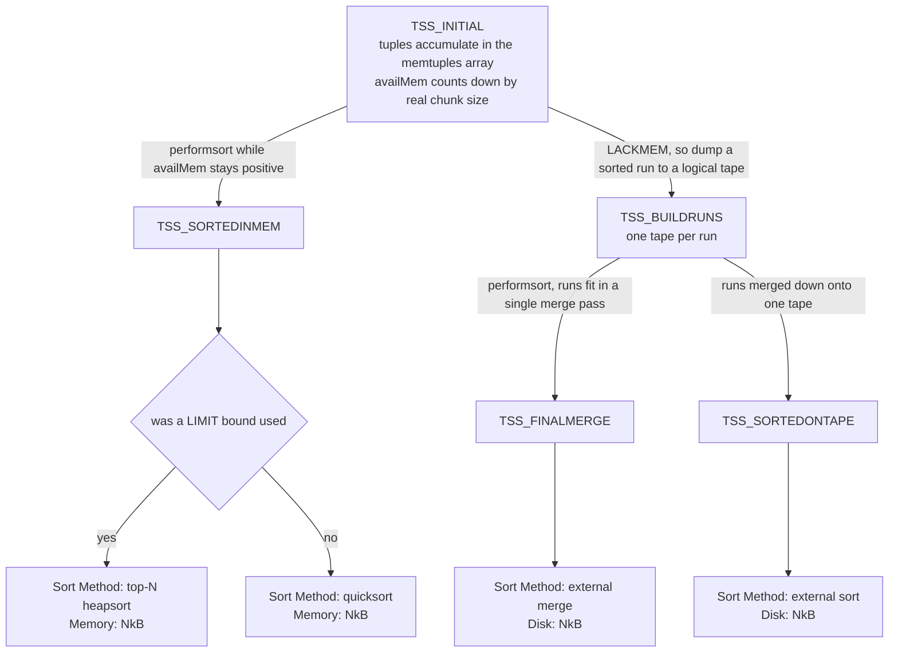

*tuplesort 的最终状态决定 `Sort Method:` 字符串。*

*同一种查询形态，展示四种排序方法中的三种。*

```sql
SET optimizer = off;   -- PostgreSQL planner, so the plan shape is stable

-- (a) a LIMIT makes the sort bounded: keep a 10-element heap, discard the rest
EXPLAIN (ANALYZE, TIMING OFF, COSTS OFF)
  SELECT id, amt FROM m183_t ORDER BY amt DESC, id LIMIT 10;

-- (b) 66 820 rows per segment, and they all fit
EXPLAIN (ANALYZE, TIMING OFF, COSTS OFF)
  SELECT id FROM m183_t WHERE g < 200 ORDER BY txt;

-- (c) identical query, but the whole statement gets 2 MB
SET statement_mem = '2MB';
EXPLAIN (ANALYZE, TIMING OFF, COSTS OFF)
  SELECT id FROM m183_t WHERE g < 200 ORDER BY txt;
```

```text {hl_lines="8 16 25" title="output"}
-- (a)
 Limit (actual rows=10 loops=1)
   ->  Gather Motion 3:1  (slice1; segments: 3) (actual rows=10 loops=1)
         Merge Key: amt, id
         ->  Limit (actual rows=10 loops=1)
               ->  Sort (actual rows=10 loops=1)
                     Sort Key: amt DESC, id
                     Sort Method:  top-N heapsort  Memory: 78kB
                     ->  Seq Scan on m183_t (actual rows=334042 loops=1)

-- (b)
 Gather Motion 3:1  (slice1; segments: 3) (actual rows=200000 loops=1)
   Merge Key: txt
   ->  Sort (actual rows=66820 loops=1)
         Sort Key: txt
         Sort Method:  quicksort  Memory: 18593kB
         ->  Seq Scan on m183_t (actual rows=66820 loops=1)
               Filter: (g < 200)
               Rows Removed by Filter: 266347
 Execution Time: 368.707 ms

-- (c)
   ->  Sort (actual rows=66820 loops=1)
         Sort Key: txt
         Sort Method:  external merge  Disk: 4992kB
         ->  Seq Scan on m183_t (actual rows=66820 loops=1)
 Memory used:  2048kB
 Execution Time: 449.423 ms
```

> [!NOTE]
> 第四个字符串 **external sort** 对应 `TSS_SORTEDONTAPE` 状态：排序发生了溢出，但在 `performsort` 完成时，所有有序段已经归并到一条磁带，因此回读时只需顺序扫描这条磁带，无需进行 *N* 路归并。这需要支持随机访问的排序（例如可滚动游标）；我们未能在此集群上构造出这种情况。还要注意，从 (b) 到 (c) 的实际耗时仅增加到 449/369 ≈ 1.2 倍：溢出确实有代价，但在缓存已预热时，远没有传言中那么灾难性。这是启用 `--enable-cassert` 的构建，因此这里的所有时间都应看作同一台机器上的比值，不能作为基准测试结果。

### 18.3.2 这些千字节属于谁，又花在了哪里？ {#1832-whose-kilobytes-are-those--and-where-do-they-go}

`show_sort_info`（`explain.c`）输出的不是单个 Segment 的数字。它遍历 QD 从各 QE 收集的 `CdbExplain_NodeSummary`，输出 `agg->vsum`，也就是执行该节点的所有 Segment 的总和（`explain.c` — `show_sort_info()`）。逐 Segment 的数据确实存在，但只有开启 `VERBOSE` 才会显示，而且出现在一条奇怪地没有缩进的续行上。

*`Memory:` 和 `Disk:` 是集群总和；`VERBOSE` 会给出分项。*

```sql
SET optimizer = off;
EXPLAIN (ANALYZE, VERBOSE, TIMING OFF, COSTS OFF)
  SELECT id FROM m183_t WHERE g < 200 ORDER BY txt;

SET statement_mem = '2MB';   -- and again, spilling
EXPLAIN (ANALYZE, VERBOSE, TIMING OFF, COSTS OFF)
  SELECT id FROM m183_t WHERE g < 200 ORDER BY txt;
```

```text {hl_lines="4 9" title="output"}
   ->  Sort (actual rows=66820 loops=1)
         Sort Key: m183_t.txt
         Sort Method:  quicksort  Memory: 18593kB
   Max Memory: 6205kB  Avg Memory: 6197kB (3 segments)
         ->  Seq Scan on public.m183_t (actual rows=66820 loops=1)

-- the disk figure aggregates the same way
         Sort Method:  external merge  Disk: 5184kB
   Max Memory: 1728kB  Avg Memory: 1728kB (3 segments)
```

6197 × 3 = 18 591 ≈ 18 593；1728 × 3 则恰好等于 5184。因此，解读排序执行统计数据的规则是：**`Memory:` 和 `Disk:` 按 Segment 求和，必须先除以 Segment 数量，才能与内存预算比较。**这*不是* `actual rows` 采用的约定；[§18.1](#181-executor-framework--lifecycle) 已经说明后者。两种汇总方式确实不同，只是在 `explain_gp.c` 中并排计算。有了逐 Segment 的数字，就可以核算其来源，因为排序的内存占用恰好分成两部分。第一部分是 `memtuples` 数组：每行对应一个 24 字节的 `SortTuple`（`tuplesort.h`），保存一个指针和 `datum1`。后者是预先提取的第一个排序键；如果类型支持，也可以是*缩略键*，即一个按值传递的替代值，大部分比较都无需访问元组本身（`tuplesort.h`）。数组从 1024 个槽位开始倍增（`grow_memtuples`，`tuplesort.c`），因此实际大小是高于行数的下一个 2 的幂。第二部分是元组本身，它们以 `MinimalTuple` 的形式复制到专用子上下文，并通过 `GetMemoryChunkSpace` 按实际分配大小计费（`tuplesort.c` — `tuplesort_puttuple_common()`）。

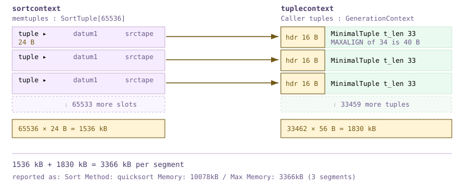

*排序内存占用的两部分，大小依据实测数据绘制。*

这两部分都可以精确预测到字节。对于上述 `(id int, txt text)` 投影，`txt` 长 5 到 10 个字符，所以每个 `MinimalTuple` 包含 `MAXALIGN(15)` = 16 字节的头部、4 字节的 `id`，以及 1+N 字节的短 varlena，共 26 到 31 字节。元组上下文会将其向上取整为 32 字节的内存块，再加上 16 字节的 `MemoryChunk` 头部：**每行固定 48 字节**。乘以行数，加上倍增后的数组，就能与集群实际报告的数值比较。注意最后两行：行数只增加 11 %，内存却增加 43 %，因为数组越过了 65 536 个槽位的边界，容量翻倍。排序内存呈**阶梯状**而非线性增长，每级高度等于 24 字节乘以原数组长度。多出的 1 kB 来自 `tuplesort_get_stats` 的向上取整，即 `tuplesort.c` 中的 `spaceUsed = (maxSpace + 1023) / 1024`。

| 每个 Segment 的行数 | memtuples 槽位数 | 数组 kB | 元组 kB（每个 48 B） | 预测 kB | 实测 Max Memory |
| --- | --- | --- | --- | --- | --- |
| 33 407 | 65 536 | 1536 | 1566 | 3102 | 3102kB |
| 50 069 | 65 536 | 1536 | 2347 | 3883 | 3884kB |
| 60 087 | 65 536 | 1536 | 2817 | 4353 | 4353kB |
| 66 820 | 131 072 | 3072 | 3132 | 6204 | 6205kB |

### 18.3.3 值得验证的说法：PostgreSQL 16 对 tuplesort 的重写 {#1833-a-claim-worth-testing-the-postgresql-16-tuplesort-rewrite}

PostgreSQL 15 和 16 重构了 tuplesort 的内存管理，通常认为这显著缩短了实际耗时；此前在同一集群上的一次研究却得出结论：可复现的效果是排序内存降至原来的约 1/2.3–1/2.5，而 MPP 环境中的实际耗时基本不变。现在我们已经具备核查机制的基础，无需重复引用任何一组数字。这个机制就是一个 `if`。无界排序从 **generation** 上下文为调用方元组分配内存，该上下文按 `MAXALIGN(size)` 发放内存块，不划分大小类别，也不逐块释放；有界排序则沿用旧的 `aset.c` 上下文，因为 top-N 堆会按任意顺序 pfree 元组，需要空闲链表。

```c {title="src/backend/utils/sort/tuplesort.c — tuplesort_begin_batch()"}
	if (state->base.sortopt & TUPLESORT_ALLOWBOUNDED)
		state->base.tuplecontext = AllocSetContextCreate(state->base.sortcontext,
														 "Caller tuples",
														 ALLOCSET_DEFAULT_SIZES);
	else
		state->base.tuplecontext = GenerationContextCreate(state->base.sortcontext,
														   "Caller tuples",
														   ALLOCSET_DEFAULT_SIZES);
```

这个 `if` 也提供了一个可以*在当前构建上*运行的实验：加入 `LIMIT` 可以切换分配器，而不改变算法，前提是上限足够大，排序不会切换为堆（`ExecSetTupleBound`，`execProcnode.c`，只设置 `bounded`；真正的切换发生在之后，阈值为上限的两倍）。`aset.c` 将请求向上取整到 2 的幂大小类别；generation 则取整到 `MAXALIGN(size + 1)`。因此，节省量完全取决于元组宽度相对类别边界的位置，也就*可以预测*。一个 33 字节的 `MinimalTuple` 在 `aset.c` 下占 16 + 64 = 80 字节，在 generation 下占 16 + 40 = 56 字节；一个 32 字节的元组在 `aset.c` 下占 16 + 32 = 48 字节，在 generation 下却占 16 + 40 = 56 字节，也就是说，generation *反而更差*。下面比较这两种情况，其中一列只比另一列多一个字符：

*每个 Segment 33 462 行，同样使用 `quicksort`，由 `LIMIT` 切换分配器。*

```sql
-- m183_s.txt is 11 chars (t_len 32); m183_s.txt12 is 12 chars (t_len 33)
SET optimizer = off;

EXPLAIN (ANALYZE, VERBOSE, TIMING OFF, COSTS OFF) SELECT id FROM m183_s ORDER BY txt;
EXPLAIN (ANALYZE, VERBOSE, TIMING OFF, COSTS OFF) SELECT id FROM m183_s ORDER BY txt   LIMIT 30000;
EXPLAIN (ANALYZE, VERBOSE, TIMING OFF, COSTS OFF) SELECT id FROM m183_s ORDER BY txt12;
EXPLAIN (ANALYZE, VERBOSE, TIMING OFF, COSTS OFF) SELECT id FROM m183_s ORDER BY txt12 LIMIT 30000;
```

```text {hl_lines="12 16" title="output"}
-- t_len 32, unbounded -> GenerationContext, MAXALIGN(33) = 40  =>  56 B/row
         Sort Method:  quicksort  Memory: 10078kB
   Max Memory: 3366kB  Avg Memory: 3359kB (3 segments)

-- t_len 32, bounded   -> AllocSetContext,   size class  = 32  =>  48 B/row
         Sort Method:  quicksort  Memory: 9297kB
   Max Memory: 3105kB  Avg Memory: 3099kB (3 segments)
                     work_mem: 3125kB  Segments: 3  Max: 1046kB (segment 0)  Workfile: (0 spilling)

-- t_len 33, unbounded -> GenerationContext, MAXALIGN(34) = 40  =>  56 B/row
         Sort Method:  quicksort  Memory: 10078kB
   Max Memory: 3366kB  Avg Memory: 3359kB (3 segments)

-- t_len 33, bounded   -> AllocSetContext,   size class  = 64  =>  80 B/row
         Sort Method:  quicksort  Memory: 12422kB
   Max Memory: 4151kB  Avg Memory: 4140kB (3 segments)
```

对于 `t_len` 为 33 的情况，预测值是 1536 kB 数组加上 33 462 × 56 = 1830 kB，即 generation 上下文占 **3366 kB**；`aset.c` 则占 1536 + 33 462 × 80 = **4150 kB**。实测值为 **3366 kB 和 4151 kB**。元组存储部分的用量比恰好为 80/56 = 1.43，总占用比为 1.23。宽度少一个字节、`t_len` 为 32 时，generation 上下文每行*反而多占* 8 字节（3366 对 3105 kB）；而对于 [§18.3.2](#1832-whose-kilobytes-are-those--and-where-do-they-go) 中 `m183_t` 的结构，两种分配器都使用 32 字节内存块，这项改动毫无收益。因此，如实的结论是：**机制确实存在，而且可以精确测量到字节，但“2.3–2.5 倍”不是 PostgreSQL 16 固有的性质，而是特定元组宽度的结果。**收益受限于 2 的幂大小类别与下一个 8 字节边界之间的差距；对于只占一个内存块的元组，元组部分的用量比最高接近 1.6，总占用的改善更小。至于实际耗时，在能够同条件比较的 [§18.3.1](#1831-sort-a-thin-node-over-tuplesort) 中，同一查询溢出与不溢出的耗时相差 1.2 倍。我们未能复现实际耗时的大幅改善，也不预期会看到：这里的排序只是 `Gather Motion` 后方三个并发排序之一，Interconnect 的开销很容易掩盖这点差异。

> [!NOTE]
> 有两点限制，都与本构建有关。第一，`--enable-cassert` 会启用 `MEMORY_CONTEXT_CHECKING`（`pg_config_manual.h`），使 `MemoryChunk` 从 8 字节增至 16 字节，并让 `generation.c` — `GenerationAlloc()` 通过 `MAXALIGN(size + 1)` 预留一个哨兵字节。在发布构建中，同一个 33 字节元组占 8 + 40 = 48 字节，而不是 56 字节，generation 的优势还会*扩大*，所以我们的发现偏保守，而非偏乐观。第二，`work_mem:` 行只出现在有界排序中，因为 `tuplesort_get_stats` 仅在设置了 `TUPLESORT_ALLOWBOUNDED` 时才填充 `stats->workmemused`（`tuplesort.c`）。这是执行统计数据的缺口，不是行为上的差异。

### 18.3.4 溢出取决于 `statement_mem`，而非 `work_mem` {#1834-spilling-it-is-statement_mem-not-work_mem}

注意，为了触发溢出，我们修改的是 `statement_mem`，而非 `work_mem`。在本集群上设置 `work_mem = '1MB'` 对 `Sort` *毫无影响*。使用资源队列时（这里是 `gp_resource_manager = queue`、`gp_resqueue_memory_policy = eager_free`），派发的计划已经带有逐节点预算 `Plan.operatorMemKB`，由 `memquota.c`（`PolicyAutoAssignWalker()`）中的配额策略从 `statement_mem` 中划分出来；执行器读取的是*这项预算*，而非 GUC。`nodeSort.c`（`ExecSort()`）直接将它传入 `tuplesort_begin_*`，完全不读取 `work_mem`。

```c {title="src/backend/executor/execUtils.c — PlanStateOperatorMemKB()"}
uint64 PlanStateOperatorMemKB(const PlanState *ps)
{
	uint64 result = 0;
	if (ps->plan->operatorMemKB == 0)
		/* statements that do not go through the resource queue */
		result = work_mem;
	else
		result = ps->plan->operatorMemKB;
	return result;
}
```

*逐步调整 `statement_mem`，寻找每个 Segment 66 820 行时的溢出阈值。*

```sql
SET optimizer = off;
-- for each M in 2MB 4MB 6MB 8MB 10MB 16MB:
SET statement_mem = :M;
EXPLAIN (ANALYZE, TIMING OFF, COSTS OFF)
  SELECT id FROM m183_t WHERE g < 200 ORDER BY txt;
```

```text {hl_lines="3" title="output"}
statement_mem=2MB    Sort Method:  external merge  Disk: 4992kB     449 ms
statement_mem=4MB    Sort Method:  external merge  Disk: 4992kB     380 ms
statement_mem=6MB    Sort Method:  quicksort  Memory: 15420kB      408 ms
statement_mem=8MB    Sort Method:  quicksort  Memory: 17469kB       344 ms
statement_mem=10MB   Sort Method:  quicksort  Memory: 18593kB       379 ms
statement_mem=16MB   Sort Method:  quicksort  Memory: 18593kB       364 ms
```

阈值介于 4 和 6 MB 之间，其中最值得关注的是 6 MB 那行：`Memory: 15420kB` 是总和，每个 Segment 为 5140 kB，完全在每条语句 6 MB 的预算内。如果读成 15 MB，就会误以为排序用了三倍配额。还要注意，同一次排序在 6 MB 时报告的内存*少于* 10 MB 时：6 MB 的预算在中途耗尽，数组便提前停止倍增，tuplesort 以增加比较次数换取更少的闲置空间，而非溢出。排序发生溢出期间，可以在集群范围内观察工作文件：四个 `gp_toolkit` 视图读取各 Segment 上的共享工作文件管理器，其中 `gp_workfile_entries` 每个打开的文件集占一行，`gp_workfile_usage_per_query` 按会话汇总，`gp_workfile_usage_per_segment` 按 Segment 汇总。它们反映实时状态，因此需要在查询运行期间从第二个会话观察。哪些节点可能出现在其中，由 `nodeSupportWorkfileCaching`（`explain_gp.c`）决定：`Sort`、`HashJoin`、`Material` 和 `Agg`，其中最后一种仅限策略为 `AGG_HASHED` 时。

*会话 B 观察会话 A 的外部归并排序，采样三次。*

```sql
-- session A:  SET statement_mem='1MB';
--   SELECT count(*) FROM (SELECT g,k,amt,txt FROM m183_t ORDER BY txt, amt) x;

-- session B, repeatedly:
SELECT segid, slice, optype, size, prefix FROM gp_toolkit.gp_workfile_entries ORDER BY segid;
SELECT sess_id, segid, size, numfiles, substr(query,1,44) AS q
  FROM gp_toolkit.gp_workfile_usage_per_query ORDER BY segid;
```

```text {hl_lines="14 15 16" title="output"}
 segid | slice | optype  |  size   |  prefix
-------+-------+---------+---------+-----------
     0 |     1 | Logtape | 2392064 | Logtape_1
     1 |     1 | Logtape | 2719744 | Logtape_1
     2 |     1 | Logtape | 2555904 | Logtape_4

 sess_id | segid |  size   | numfiles |                q
---------+-------+---------+----------+----------------------------------------------
      25 |     0 | 4390912 |        1 | SELECT count(*) FROM (SELECT g, k, amt, txt
      25 |     1 | 4390912 |        1 | SELECT count(*) FROM (SELECT g, k, amt, txt
      25 |     2 | 4390912 |        1 | SELECT count(*) FROM (SELECT g, k, amt, txt

-- ~1 s later                                  -- ~2 s later
 0 | 1 | Logtape | 5996544 | Logtape_1          0 | 1 | Logtape | 7372800 | Logtape_1
 1 | 1 | Logtape | 5996544 | Logtape_1          1 | 1 | Logtape | 7372800 | Logtape_1
 2 | 1 | Logtape | 5767168 | Logtape_4          2 | 1 | Logtape | 7372800 | Logtape_4
```

> [!NOTE]
> 排序和哈希聚合的 `optype` 都是 `Logtape`，因为二者都通过 `logtape.c` 溢出。`slice` 列指出发生溢出的是*哪个*执行器；对于包含多个高内存需求切片的计划，这非常有用，因为页脚只为每个切片报告一个数字。`gp_workfile_mgr_used_diskspace` 提供相同的总量，无需按查询进行连接。

### 18.3.5 增量排序 {#1835-incremental-sort}

`nodeIncrementalSort.c`（1258 行）利用已按所需键的*前缀*排序的输入：它不一次排序全部数据，而是分别排序前缀值相等的各组。因此，内存用量取决于最大的组，第一组结束后就可以开始输出行。其状态机同时维护两个 tuplesort，并在二者之间派发工作（`switchToPresortedPrefixMode`，`nodeIncrementalSort.c`）；`show_incremental_sort_info`（`explain.c`）则将逐组统计汇总为 `Full-sort Groups:` 和 `Pre-sorted Groups:` 两行。它在**本集群上默认关闭**（`enable_incremental_sort = off`），寻找这种计划前应先了解这一点。下面，40 个前缀组各用 28–41 kB 排序，替代了一次整体占用 3341 kB（每个 Segment 1114 kB）的排序。峰值内存取决于最大组而非全部输入，而且本例中速度也快了一倍。注意，这些行上的 `Peak Memory` 确实是*各组之间*的峰值，而非总和：同一计划上出现了第三种汇总约定，本章正是要提醒读者留意这类不一致。

*索引提供 `g` 的顺序，因此只需逐组排序 `amt`。*

```sql
SET optimizer = off;
SET enable_incremental_sort = on;
SET enable_seqscan = off; SET enable_bitmapscan = off;   -- force the ordered index path

EXPLAIN (ANALYZE, TIMING OFF, COSTS OFF)
  SELECT g, amt, id FROM m183_t WHERE g < 40 ORDER BY g, amt;
```

```text {hl_lines="5 6 7" title="output"}
 Gather Motion 3:1  (slice1; segments: 3) (actual rows=40000 loops=1)
   Merge Key: g, amt
   ->  Incremental Sort (actual rows=13358 loops=1)
         Sort Key: g, amt
         Presorted Key: g
         Full-sort Groups: 40  Sort Method: quicksort  Average Memory: 28kB  Peak Memory: 28kB
         Pre-sorted Groups: 40  Sort Method: quicksort  Average Memory: 41kB  Peak Memory: 41kB
         ->  Index Scan using m183_t_g_idx on m183_t (actual rows=13358 loops=1)
               Index Cond: (g < 40)
 Execution Time: 29.908 ms

-- the same rows through a plain Sort, for contrast:
         Sort Method:  quicksort  Memory: 3341kB          Execution Time: 61.950 ms
```

### 18.3.6 四种聚合策略 {#1836-four-aggregation-strategies}

`nodeAgg.c` 有 5249 行，是执行器中第二大的文件，它实现的是一个具备四种策略的节点。`ExecAgg`（`nodeAgg.c`）用四路分支隐藏了所有细节，按 `node->phase->aggstrategy` 派发。无论进入哪个分支，每组都执行相同的两件事：`advance_aggregates`（`nodeAgg.c`）针对每个输入行调用各聚合的状态转移函数，将持续更新的 `transValue` 保存在 `curaggcontext` 中；哈希分组使用 `hashcontext`，其他分组使用 `aggcontexts[setno]`（`nodeAgg.c` — `select_current_set()`）。组结束时，`finalize_aggregates`（`nodeAgg.c`）再把这些状态转换为输出值。

- **`AGG_PLAIN`**：没有 `GROUP BY`，全部输入共用一个 `AggStatePerGroup`，输出一行。显示为 `Aggregate`。
- **`AGG_SORTED`**：输入已按分组键排序；检测到键变化时，计算最终结果并重置。内存相对于组数为 O(1)，代价已由下方的 `Sort` 承担。显示为 `GroupAggregate`。
- **`AGG_HASHED`**：每个不同键对应一个哈希表条目，各自的转移状态保存在 `hashcontext` 中。内存为 O(groups)，因此这种策略可能溢出。显示为 `HashAggregate`。
- **`AGG_MIXED`**：处理分组集时，在同一遍处理中，一部分集合使用哈希，一个集合由有序输入提供，因此多个哈希表同时存在。显示为 `MixedAggregate`。

*通过 `enable_hashagg` 控制，使同一查询分别使用 `HashAggregate` 和 `GroupAggregate`。*

```sql
SET optimizer = off;
EXPLAIN (ANALYZE, TIMING OFF, COSTS OFF) SELECT g, count(*), sum(amt) FROM m183_t GROUP BY g;

SET enable_hashagg = off;
EXPLAIN (ANALYZE, TIMING OFF, COSTS OFF) SELECT g, count(*), sum(amt) FROM m183_t GROUP BY g;
```

```text {hl_lines="5 23" title="output"}
-- enable_hashagg = on
 Gather Motion 3:1  (slice1; segments: 3) (actual rows=1000 loops=1)
   ->  Finalize HashAggregate (actual rows=340 loops=1)
         Group Key: g
         Extra Text: (seg0)   hash table(s): 1; chain length 2.4 avg, 5 max; using 337 of 512 buckets; total 0 expansions.
         ->  Redistribute Motion 3:3  (slice2; segments: 3) (actual rows=1020 loops=1)
               Hash Key: g
               ->  Streaming Partial HashAggregate (actual rows=1000 loops=1)
                     Group Key: g
                     Extra Text: (seg0)   hash table(s): 1; chain length 2.5 avg, 6 max; using 1000 of 2048 buckets; total 0 expansions.
                     ->  Seq Scan on m183_t (actual rows=334042 loops=1)
 Execution Time: 161.249 ms

-- enable_hashagg = off
 Finalize GroupAggregate (actual rows=1000 loops=1)
   Group Key: g
   ->  Gather Motion 3:1  (slice1; segments: 3) (actual rows=3000 loops=1)
         Merge Key: g
         ->  Partial GroupAggregate (actual rows=1000 loops=1)
               Group Key: g
               ->  Sort (actual rows=334042 loops=1)
                     Sort Key: g
                     Sort Method:  quicksort  Memory: 83739kB
                     ->  Seq Scan on m183_t (actual rows=334042 loops=1)
 Execution Time: 397.948 ms
```

取舍非常明显：哈希计划在一个 2048 桶的表中保存 1000 个组状态，不物化任何输入；有序计划不必为所有组保留状态，却必须先对每个 Segment 的全部 334 042 行排序，内存合计 83 739 kB（各 27 913 kB），实际耗时为前者的 2.5 倍。`nodeGroup.c`（255 行）实现了第五种不含聚合的变体，即单纯的 `Group` 节点，但本规划器在我们的测试中从未选择它；即使设置 `enable_hashagg = off`，`SELECT DISTINCT k` 也生成 `GroupAggregate`。其中的 `Extra Text:` 行是 Cloudberry 特有的，由 `agg_hash_explain_extra_message`（`nodeAgg.c`）根据计数器组装；这些计数器由 `hash_agg_update_metrics`（`nodeAgg.c`）在哈希表逐渐填满时更新。QD 保留一个代表性 Segment 的消息并标注来源，所以这里写着 `(seg0)`，而同一行上的 `actual rows` 却是三个 Segment 采用另一种方式汇总的结果。逐字段说明如下：

| 字段 | 来源 | 解读方式 |
| --- | --- | --- |
| `hash table(s): 1` | `aggstate->num_hashes` | 每个哈希分组集对应一个表；`MixedAggregate` 会显示多个 |
| `chain length 2.4 avg, 5 max` | `tuplehash_coll_stat` | `simplehash` 表中的冲突链长度；平均值超过约 3，说明表已拥挤 |
| `using 337 of 512 buckets` | `hashtab->members` / `hashtab->size` | seg0 上有 337 个不同组落入一个 512 桶的表。该数值跨轮次和批次累加，因此可能超过真实组数 |
| `total 0 expansions` | `hashtab->num_expansions` | `simplehash` 必须扩展并重新哈希的次数。非零表示规划器的 `numGroups` 估计偏低 |
| `N groups total in B batches, P spill partitions` | `hash_batches_used` | **仅在表曾发生溢出时**输出，见 [§18.3.7](#1837-hash-agg-spill-and-hash_mem_multiplier) |
| `disk usage: NKB` | `aggstate->hash_disk_used` | 此节点在每个 Segment 上的工作文件字节数 |

### 18.3.7 哈希聚合溢出与 `hash_mem_multiplier` {#1837-hash-agg-spill-and-hash_mem_multiplier}

PostgreSQL 13 之前，哈希聚合如果估错组数，就会直接超出 `work_mem`。现在，它会将输入分区并溢出，触发溢出的预算来自 `hash_agg_set_limits`（`nodeAgg.c`）。Cloudberry 修改了开头几行：先取 `work_mem` 与 [§18.3.4](#1834-spilling-it-is-statement_mem-not-work_mem) 中计划的 `operatorMemKB` 两者中*较小*的值作为限制，然后才应用 `hash_mem_multiplier`。

```c {title="src/backend/executor/nodeAgg.c — hash_agg_set_limits()"}
	uint64		strict_memlimit = work_mem;

	if (aggstate)
	{
		uint64 operator_mem = PlanStateOperatorMemKB((PlanState *) aggstate);
		if (operator_mem < strict_memlimit)
			strict_memlimit = operator_mem;
	}

	strict_memlimit = strict_memlimit * hash_mem_multiplier;
```

*固定 `work_mem = '1MB'`，调整 `hash_mem_multiplier`；每个 Segment 334 042 个组。*

```sql
SET optimizer = off;
SET work_mem = '1MB';    -- small enough to win the min() against operatorMemKB
-- for each M in 1, 2, 4:
SET hash_mem_multiplier = :M;
EXPLAIN (ANALYZE, VERBOSE, TIMING OFF, COSTS OFF)
  SELECT count(*) FROM (SELECT id, count(*) c FROM m183_t GROUP BY id) x;
```

```text {hl_lines="2 3 7 8 12 13" title="output"}
-- hash_mem_multiplier = 1
   work_mem: 3217kB  Segments: 3  Max: 1073kB (segment 0)  Workfile: (3 spilling)
   Extra Text: (seg1)  hash table(s): 1; 332791 groups total in 73 batches, 2606120 spill
               partitions; disk usage: 13504KB; chain length 2.2 avg, 7 max; ...

-- hash_mem_multiplier = 2
   work_mem: 6193kB  Segments: 3  Max: 2065kB (segment 0)  Workfile: (3 spilling)
   Extra Text: (seg0)  hash table(s): 1; 333167 groups total in 17 batches, 5090768 spill
               partitions; disk usage: 12000KB; chain length 2.7 avg, 13 max; ...

-- hash_mem_multiplier = 4
   work_mem: 12337kB  Segments: 3  Max: 4113kB (segment 0)  Workfile: (3 spilling)
   Extra Text: (seg1)  hash table(s): 1; 332791 groups total in 9 batches, 2280488 spill
               partitions; disk usage: 13408KB; chain length 2.6 avg, 14 max; ...
```

1073、2065、4113 kB，相对于 1024 kB 的 `work_mem`，分别是 1 倍、2 倍、4 倍，再加上固定约 40 kB 的表元数据，与源码完全一致。本集群的默认值为 2，所以哈希节点得到的内存确实是排序节点的两倍。批次数从 73 降到 17，再降到 9：每次翻倍，都大致将遍历溢出数据的次数减半，这正是此参数的作用。与 `statement_mem` 不同，聚合*不发生*溢出时，`hash_mem_multiplier` 不带来额外代价。下面在 1 MB 的语句预算下运行同一个查询，页脚说明了它实际想要多少内存：

*聚合需要的内存超过配额时的内存页脚。*

```sql
SET optimizer = off;
SET statement_mem = '1MB';
EXPLAIN (ANALYZE, VERBOSE, TIMING OFF, COSTS OFF)
  SELECT count(*) FROM (SELECT id, count(*) c FROM m183_t GROUP BY id) x;
```

```text {hl_lines="3 11" title="output"}
               ->  HashAggregate (actual rows=334042 loops=1)
                     Group Key: m183_t.id
                     work_mem: 5905kB  Segments: 3  Max: 1969kB (segment 0)  Workfile: (3 spilling)
                     Work_mem wanted: 18747K bytes avg, 19345K bytes max (seg1)
                                      to lessen workfile I/O affecting 3 workers.
                     Extra Text: (seg1)   hash table(s): 1; 332791 groups total in 29 batches,
                       5150156 spill partitions; disk usage: 12000KB; chain length 2.7 avg, 11 max;
                       using 332791 of 933888 buckets; total 1 expansions.
                     ->  Seq Scan on public.m183_t (actual rows=334042 loops=1)
 * (slice1)    Executor memory: 1676K bytes avg x 3x(0) workers, 1690K bytes max (seg2).
               Work_mem: 1969K bytes max, 19345K bytes wanted.
 Memory used:  1024kB
 Memory wanted:  19744kB
```

`(slice1)` 前面的 `*` 是一个醒目的信号，表明某切片想要的内存超过配额。逐节点的 `work_mem:` / `Work_mem wanted:` 行来自 `explain_gp.c` — `cdbexplain_showExecStats()`。`19345K bytes wanted` 从何而来？它不是模型估算值，而是 `hash_agg_update_metrics` 在执行过程中累加得到的：第一遍执行 `instrument->workmemwanted += meta_mem`，每一遍再加上 `hashkey_mem`（`nodeAgg.c` — `hash_agg_update_metrics()`）。也就是说，这是实测得到的、若允许同时保存所有组时该表会达到的大小。如果希望查询停止溢出，就应据此设置 `statement_mem`；最后一行的 `Memory wanted: 19744kB` 是所有切片需求的最大值，也是页脚中可以直接据以调整的数字。

### 18.3.8 两阶段聚合的执行，以及“流式”的含义 {#1838-two-stage-aggregation-executed--and-what-makes-it-streaming}

[§16.4](/cloudberry/core-internals/part-4-query-processing/ch16/#164-distributed-grouping--direct-dispatch) 解释了规划器如何把聚合拆成两段，[§17.3](/cloudberry/core-internals/part-4-query-processing/ch17/#173-transformation-framework) 则介绍了 ORCA 如何做同样的事；[§18.3.6](#1836-four-aggregation-strategies) 中的哈希计划就是这种拆分的实际执行。每个 Segment 都包含 `g` 的全部 1000 个值（表按 `id` 分布），因此**部分**聚合先在本地将 334 042 行压缩为 1000 个部分组状态。这些状态经过按 `g` 哈希的 `Redistribute Motion`，再由**最终**聚合合并：报告数据的那个 Segment 收到 1020 个部分结果行，即 340 组 × 3 个发送方，最终压缩为 340 组；`Extra Text` 则独立确认 seg0 上有 337 组。在 Interconnect 看到任何字节*之前*，数据量就已缩减到约三百分之一；这才是拆分带来的收益，而不在聚合本身。（[§18.1](#181-executor-framework--lifecycle) 说明了如何跨 Segment 解读这些 `actual rows` 计数器；这里仅依靠它们的内部一致性。）

第一阶段标为 `Streaming Partial HashAggregate`，其中 Streaming 完全是 Cloudberry 特有的：只要设置了 `Agg->streaming`，`explain.c`（`ExplainNode()`）就会加上这个前缀；规划器根据 `gp_use_streaming_hashagg` 设置它（`cdbgroupingpaths.c` — `add_first_stage_hash_agg_path()`，GUC 位于 `guc_gp.c` — `config_bool`）。流式哈希聚合**拒绝溢出**。哈希表填满时，它停止接纳新组；一旦设置了 `table_filled`，便将 `p_isnew` 传为 `NULL`（`nodeAgg.c` — `lookup_hash_entries()`）。随后，它将已有结果输出给下游，重置各表，再从剩余输入重新开始，而不调用 `agg_refill_hash_table`（`nodeAgg.c` — `agg_retrieve_hash_table()`）。因此，它只做*部分*去重：同一组可能每轮都输出一次。部分聚合的输出本来就会在下游再次聚合，所以这样完全正确；取舍在于此处的磁盘 I/O 与彼处 Interconnect 上增加的行数。对于高基数键，在 1 MB 预算下，行为与 `nodeAgg.c`（`ExecAgg()`）的注释完全一致：

*同一个两阶段计划，分别开启和关闭 `Streaming`，`statement_mem = '1MB'`。*

```sql
SET optimizer = off;
SET statement_mem = '1MB';
SET gp_eager_two_phase_agg = on;    -- force the split on a key with ~1M distinct values
-- for each of on / off:
SET gp_use_streaming_hashagg = :S;
EXPLAIN (ANALYZE, VERBOSE, TIMING OFF, COSTS OFF)
  SELECT count(*) FROM (SELECT txt, count(*) c FROM m183_t GROUP BY txt) y;
```

```text {hl_lines="4 12 14" title="output"}
-- gp_use_streaming_hashagg = on
   ->  Redistribute Motion 3:3  (slice2; segments: 3) (actual rows=333742 loops=1)
         ->  Streaming Partial HashAggregate (actual rows=334042 loops=1)
               work_mem: 2161kB  Segments: 3  Max: 721kB (segment 0)  Workfile: (0 spilling)
               Extra Text: (seg2) hash table(s): 1; chain length 2.9 avg, 15 max;
                 using 334042 of 507904 buckets; total 0 expansions.
 Execution Time: 964.481 ms

-- gp_use_streaming_hashagg = off
   ->  Redistribute Motion 3:3  (slice2; segments: 3) (actual rows=333742 loops=1)
         ->  Partial HashAggregate (actual rows=334042 loops=1)
               work_mem: 3409kB  Segments: 3  Max: 1201kB (segment 0)  Workfile: (3 spilling)
               Extra Text: (seg0) hash table(s): 1; 333167 groups total in 73 batches,
                 2621824 spill partitions; disk usage: 13792KB; chain length 2.3 avg, 13 max;
                 using 333167 of 1114112 buckets; total 1 expansions.
 Execution Time: 1201.320 ms
```

一边是零工作文件、721 kB 内存，另一边是三个 Segment 都发生溢出，各有 73 个批次、占用 13.8 MB 磁盘；结果相同，耗时减少 20 %。反例也确实存在：对于*低*基数键，我们测得流式阶段输出 278 382 行，而非流式阶段只输出 9973 行，白白将 Motion 载荷增至三倍，因为原本根本不需要溢出。`gp_use_streaming_hashagg` 默认为 `on`，作为拆分聚合第一阶段的默认设置是合理的，但它是对组数的押注，并非没有代价的收益。

### 18.3.9 窗口函数 {#1839-window-functions}

`nodeWindowAgg.c`（4014 行）是仅次于 `nodeAgg.c` 的最大单节点文件，原因在于窗口帧。窗口函数可能访问分区内的任意行，所以 `WindowAgg` 会将当前整个分区缓存在 tuplestore 中，并向函数提供其中的读取指针（`nodeWindowAgg.c`）；`WinFuncExprState` 为每个函数保存一对 `markptr`/`readptr`，让它们可以独立移动；`update_frameheadpos` / `update_frametailpos` 跟踪窗口帧边界，`WinSetMarkPosition` 则允许 tuplestore 丢弃已落在帧头之前的行。它*不负责*排序：`WindowAgg` 要求输入已经先按 `PARTITION BY`、再按 `ORDER BY` 排序，所以每个窗口函数都直接位于 `Sort` 之上；在 MPP 中，其下方还要有 `Redistribute Motion`，因为必须先将一个分区完整地放在同一 Segment 上，才能划定窗口帧。

*实际的窗口帧子句；两个优化器都构建相同的三层节点结构。*

```sql
EXPLAIN (ANALYZE, TIMING OFF, COSTS OFF)
  SELECT k, id,
         sum(amt) OVER (PARTITION BY k ORDER BY id
                        ROWS BETWEEN 2 PRECEDING AND CURRENT ROW)
    FROM m183_t WHERE g < 5;
```

```text {hl_lines="3 8" title="output"}
 Gather Motion 3:1  (slice1; segments: 3) (actual rows=5000 loops=1)
   ->  WindowAgg (actual rows=3000 loops=1)
         Partition By: k
         Order By: id
         ->  Sort (actual rows=3000 loops=1)
               Sort Key: k, id
               Sort Method:  quicksort  Memory: 404kB
               ->  Redistribute Motion 3:3  (slice2; segments: 3) (actual rows=3000 loops=1)
                     Hash Key: k
                     ->  Index Scan using m183_t_g_idx on m183_t (actual rows=1739 loops=1)
                           Index Cond: (g < 5)
 Optimizer: GPORCA          Execution Time: 9.978 ms
 (identical shape with Optimizer: Postgres query optimizer, 42.433 ms)
```

> [!NOTE]
> ORCA 有一个参数 `optimizer_force_window_hash_agg`，在 `CConfigParamMapping.cpp` 中映射到 `EopttraceEnableWindowHashAgg` 跟踪标志。**不要在本构建上使用它。**启用后，ORCA 会生成 `T_WindowHashAgg` 计划节点，但 `ExecInitNode` 没有对应分支；`grep T_WindowHashAgg src/backend/executor/` 找不到任何结果。因此，连 `EXPLAIN` 都会因 `ERROR: unrecognized node type: 63 (execProcnode.c — ExecInitNode)` 而失败。它被声明为开发者选项，在 `guc_gp.c`（`config_bool`）中带有注释 `// TODO: remove it before merge`，这足以概括其当前状态。

### 18.3.10 `TupleSplit`：一次遍历处理多个 DISTINCT {#18310-tuplesplit-several-distincts-in-one-pass}

在 MPP 中，`count(DISTINCT a)` 很容易处理：按 `a` 重分布，各 Segment 在本地计数即可。`count(DISTINCT a), count(DISTINCT b)` 则很难，因为两个聚合需要的重分布方式*互不兼容*。`nodeTupleSplit.c`（281 行，Cloudberry 特有）通过将一个输入行变成多个行解决这一问题：对于 *N* 个带 DISTINCT 限定的聚合中的每一个，它都会输出一份副本，将与该聚合无关的所有列**设为 NULL**，并附上合成的 `AggExprId`，记录该聚合的索引。按 `(AggExprId, a, b)` 分组后，一次哈希处理就能同时对全部 *N* 个不同值集合去重；重分布键中的 `AggExprId` 则防止各副本相互混淆。

```c {title="src/backend/executor/nodeTupleSplit.c — ExecTupleSplit()"}
	for (AttrNumber attno = 1; attno <= node->outerslot->tts_nvalid; attno++)
	{
		/* If the column is relevant to the current dqa, keep it */
		if (bms_is_member(attno, node->dqa_split_bms[node->currentExprId]))
			continue;

		/* otherwise, null this column out */
		isnull[attno - 1] = true;
	}
	result = ExecProject(node->ss.ps.ps_ProjInfo);
	/* the next DQA to process */
	node->currentExprId = (node->currentExprId + 1) % node->numDisDQAs;
```

只有当 `currentExprId` 回绕到 0 时，才会获取外侧槽位（`nodeTupleSplit.c` — `ExecTupleSplit()`），因此子节点只扫描一次，每个元组从同一槽位重复输出 *N* 次。行数倍增不会增加 I/O；下推至此、作用于各 DQA 的 `FILTER` 子句还可以直接跳过某份副本（`nodeTupleSplit.c` — `ExecTupleSplit()`）。该节点只由 PostgreSQL 规划器路径生成；除非启用 `optimizer_enable_multiple_distinct_aggs`（`guc_gp.c` — `config_bool`），否则 ORCA 会拒绝此查询，并在 `CTranslatorQueryToDXL.cpp`（`CTranslatorQueryToDXL::CreateSimpleGroupBy()`）中触发回退。可行的用法见 `src/test/regress/sql/gp_dqa.sql`：

*两个 DISTINCT：ORCA 回退，规划器在 `TupleSplit` 上方构建 `Streaming HashAggregate`。*

```sql
SET optimizer = off;
SET enable_hashagg = on; SET enable_groupagg = off;
SET gp_motion_cost_per_row = 2;    -- as in src/test/regress/sql/gp_dqa.sql

EXPLAIN (ANALYZE, TIMING OFF, COSTS OFF)
  SELECT count(distinct g), count(distinct k) FROM m183_t;

RESET ALL;  SET optimizer_trace_fallback = on;    -- now let ORCA try
EXPLAIN (COSTS OFF) SELECT count(distinct g), count(distinct k) FROM m183_t;
```

```text {hl_lines="5 10" title="output"}
 Finalize Aggregate (actual rows=1 loops=1)
   ->  Gather Motion 3:1  (slice1; segments: 3) (actual rows=3 loops=1)
         ->  Partial Aggregate (actual rows=1 loops=1)
               ->  Redistribute Motion 3:3  (slice2; segments: 3) (actual rows=1083 loops=1)
                     Hash Key: g, k, (AggExprId)
                     ->  Streaming HashAggregate (actual rows=1050 loops=1)
                           Group Key: AggExprId, g, k
                           Extra Text: (seg0)   hash table(s): 1; chain length 2.4 avg, 6 max;
                             using 1050 of 2048 buckets; total 0 expansions.
                           ->  TupleSplit (actual rows=668084 loops=1)
                                 Split by Col: (g), (k)
                                 ->  Seq Scan on m183_t (actual rows=334042 loops=1)
 Optimizer: Postgres query optimizer          Execution Time: 247.061 ms

-- under ORCA:
INFO:  GPORCA failed to produce a plan, falling back to Postgres-based planner
DETAIL:  Falling back to Postgres-based planner because GPORCA does not support the
  following feature: Multiple Distinct Qualified Aggregates are disabled in the optimizer
```

`Split by Col: (g), (k)` 列出了两个不同值集合，`actual rows = 668084` 恰好等于 2 × 334 042，让行数倍增清晰可见。在下游，每个 Segment 的 1050 个组同时覆盖两个集合（`g` 的 1000 个值，加上 `k` 的 50 个值），因此 Interconnect 只需传输约一千行，而不是两次各传输一百万行。诀窍就在这里：在本地扫描上付出双倍处理代价，避免对整张表进行第二次重分布。至此，执行器中内存需求较大的这一半已经介绍完毕。[§18.4](#184-join-nodes) 将讨论另一类哈希表，即 `nodeHash.c` 中的哈希表，以及它们自己的分批处理、`Extra Text`，还有 Cloudberry 中避免死锁的问题；[§18.5](#185-expression-evaluation) 则深入一层，解释本节中的状态转移函数和窗口帧条件如何实际求值。承载本节所有部分聚合结果的 `Motion` 节点见第 [19](/cloudberry/core-internals/part-4-query-processing/ch19/) 章；决定最初允许设置多大 `statement_mem` 的集群级限制见第 [21](/cloudberry/core-internals/part-6-resource-management/ch21/) 章。

## 18.4 连接节点 {#184-join-nodes}

三种算法完成同一项任务：接收两棵子树，输出满足一组子句的所有元组对。计划已经选定算法，[§15.3](/cloudberry/core-internals/part-4-query-processing/ch15/#153-path-cost--add_path) 和 [§17.3](/cloudberry/core-internals/part-4-query-processing/ch17/#173-transformation-framework) 也已介绍选择背后的代价推理。执行器则将代价模型中的估算变成具体的控制流、具体的内存占用，以及 Cloudberry 中具体的风险：任一输入都可能通过 Motion 从三个 Segment 同时到达。下面所有内容都围绕一个不对称性展开：**内侧会被重读或缓冲**，而外侧只流式读取一次。嵌套循环针对每个外侧元组重扫描整棵内侧子树；归并连接同步推进两条有序流，但必须能够让内侧回退；哈希连接则读完整个内侧并保存下来。因此，本节几乎所有控制手段——`Materialize`、批次文件、预取——都围绕内侧。在开始之前，还有一个 Cloudberry 特有的意外：三种算法中有两种默认**关闭**。

*本集群启动时的连接 GUC：应查看 boot_val，而不只是 setting（guc_tables.c — config_bool 和 :962；上游 PostgreSQL 的两个默认值都是 true）。*

```sql
SELECT name, setting, boot_val, source
  FROM pg_settings
 WHERE name IN ('enable_hashjoin','enable_mergejoin','enable_nestloop',
                'enable_memoize','gp_hashjoin_tuples_per_bucket');
```

```text {hl_lines="5 6" title="output"}
             name              | setting | boot_val | source
-------------------------------+---------+----------+---------
 enable_hashjoin               | on      | on       | default
 enable_memoize                | on      | on       | default
 enable_mergejoin              | off     | off    | default
 enable_nestloop               | off     | off    | default
 gp_hashjoin_tuples_per_bucket | 5       | 5        | default
(5 rows)
```

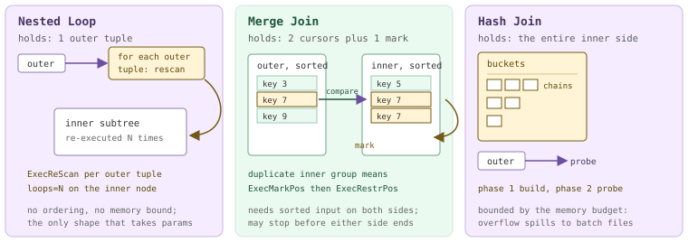

*各连接节点运行时保留的内容。外侧只流式读取一次；内侧则会被重读、回退或缓冲。*

### 18.4.1 嵌套循环：重扫描内侧 {#1841-nested-loop-rescanning-the-inner-side}

`nodeNestloop.c` 有 770 行，是三者中最短的，实现也正如其名。获取一个外侧元组；遍历内侧子树直至耗尽，输出所有通过 `joinqual` 的元组对；获取下一个外侧元组；对内侧子树执行 `ExecReScan`；如此重复。唯一微妙之处位于“下一个外侧元组”与“重扫描”之间：如果计划在节点上附加了 `nestParams`，外侧元组的值就会被写入 `PARAM_EXEC` 槽位，并标记为已变更；正是这一步，让内侧子树的索引扫描在每次迭代中变成一次*不同的*索引扫描。

```c {title="src/backend/executor/nodeNestloop.c — ExecNestLoop_guts()"}
foreach(lc, nl->nestParams)
{
    NestLoopParam *nlp = (NestLoopParam *) lfirst(lc);
    ParamExecData *prm = &(econtext->ecxt_param_exec_vals[nlp->paramno]);

    prm->value = slot_getattr(outerTupleSlot,
                              nlp->paramval->varattno, &(prm->isnull));
    /* Flag parameter value as changed */
    innerPlan->chgParam = bms_add_member(innerPlan->chgParam, nlp->paramno);
}
/* now rescan the inner plan */
ExecReScan(innerPlan);
```

这就是参数化嵌套循环，也称*索引*嵌套循环，是让该算法值得保留的计划形态。下面的外侧表有 50 行，带索引的内侧表有 300 000 行。应关注内侧扫描中的 `loops=5`。记住 [§18.1](#181-executor-framework--lifecycle) 的规则：`actual rows` 是*每轮平均值*，而且两个数字都来自某一个 Segment（产出元组最多的那个），而非整个集群。该 Segment 的连接节点收到了五个外侧元组，位图扫描运行五次，103 × 5 = 515 恰好等于连接节点报告的行数。

*参数化嵌套循环：每个外侧元组触发内侧子树运行一次（PostgreSQL 规划器）。*

```sql
SET optimizer = off;
SET enable_hashjoin = off; SET enable_mergejoin = off; SET enable_nestloop = on;
EXPLAIN (ANALYZE, TIMING OFF, COSTS OFF)
SELECT count(*) FROM m184_s s, m184_f f WHERE f.did = s.sid AND s.sid < 6;
```

```text {hl_lines="8" title="output"}
 Aggregate (actual rows=1 loops=1)
   ->  Gather Motion 3:1  (slice1; segments: 3) (actual rows=1500 loops=1)
         ->  Nested Loop (actual rows=515 loops=1)
               ->  Broadcast Motion 3:3  (slice2; segments: 3) (actual rows=5 loops=1)
                     ->  Seq Scan on m184_s s (actual rows=3 loops=1)
                           Filter: (sid < 6)
                           Rows Removed by Filter: 15
               ->  Bitmap Heap Scan on m184_f f (actual rows=103 loops=5)
                     Recheck Cond: ((did = s.sid) AND (did < 6))
                     ->  Bitmap Index Scan on m184_f_did_idx (actual rows=103 loops=5)
                           Index Cond: ((did = s.sid) AND (did < 6))
 Optimizer: Postgres query optimizer
```

去掉索引后，该节点便退化为教科书中的双重循环，计划中可以看到两个后果。子句从内侧扫描移出，成为逐元组对求值的 `Join Filter`：三个外侧元组 × 196 个内侧行，共检查 588 对，保留 147 对，因此是 `Rows Removed by Join Filter: 441`。规划器还会在内侧子树之上插入 `Materialize`（[§18.6](#186-subqueries--other-nodes)），其 `loops` 读数值得注意：`Materialize` 显示 `loops=3`，因为每个外侧元组都会触发一次重扫描；其子节点 `Seq Scan` 却显示 `loops=1`，因为 tuplestore 承接了这些重扫描，从未要求底层扫描再次运行。这一差别就是在此放置该节点的全部意义。

*非参数化嵌套循环：Materialize 承接重扫描，子句成为逐元组对求值的 Join Filter。*

```sql
SET enable_indexscan = off; SET enable_bitmapscan = off; SET enable_indexonlyscan = off;
EXPLAIN (ANALYZE, TIMING OFF, COSTS OFF)
SELECT count(*) FROM m184_s s, m184_d d WHERE d.grp = s.sid AND s.sid < 4;
```

```text {hl_lines="7" title="output"}
         ->  Nested Loop (actual rows=147 loops=1)
               Join Filter: (s.sid = d.grp)
               Rows Removed by Join Filter: 441
               ->  Broadcast Motion 3:3  (slice2; segments: 3) (actual rows=3 loops=1)
                     ->  Seq Scan on m184_s s (actual rows=2 loops=1)
                           Filter: (sid < 4)
               ->  Materialize (actual rows=196 loops=3)
                     ->  Seq Scan on m184_d d (actual rows=196 loops=1)
                           Filter: (grp < 4)
 Optimizer: Postgres query optimizer
```

### 18.4.2 归并连接：同步推进两条流 {#1842-merge-join-two-streams-in-lockstep}

`nodeMergejoin.c`（1827 行）从不缓冲完整的一侧。它在两条有序流中各维护一个游标，比较归并键，并推进落后的那一侧；键相等时产生输出。复杂之处在于重复值：如果外侧有两个键为 7 的元组，内侧有三个，那么第二个外侧元组必须再次访问这三个内侧元组。因此，在处理一组重复值之前，节点会在内侧子树上调用 `ExecMarkPos`，之后再调用 `ExecRestrPos` 回退到标记处（`execAmi.c`；调用点位于 `nodeMergejoin.c` — `ExecMergeJoin_guts()`）。并非所有节点都支持标记和恢复，这也是内侧下方往往直接放置 `Sort` 或有序索引的另一个原因。整个实现是一个显式状态机：`nodeMergejoin.c` 中有 11 个状态，由长循环中的 `switch` 驱动。状态名称*就是*算法本身：

| 状态 | 执行的操作 |
| --- | --- |
| `EXEC_MJ_INITIALIZE_OUTER` | 首次调用：获取第一个外侧元组，计算其归并键。 |
| `EXEC_MJ_INITIALIZE_INNER` | 获取第一个内侧元组，将其作为初始标记。 |
| `EXEC_MJ_SKIP_TEST` | 比较当前两个键，判断哪一侧落后。 |
| `EXEC_MJ_SKIPOUTER_ADVANCE` | 外侧键较小：若为左连接，输出补 NULL 的行，然后推进外侧。 |
| `EXEC_MJ_SKIPINNER_ADVANCE` | 内侧键较小：若为右连接，输出补 NULL 的行，然后推进内侧。 |
| `EXEC_MJ_JOINTUPLES` | 键匹配：检查其余限定条件，输出连接后的元组。 |
| `EXEC_MJ_NEXTINNER` | 在当前内侧重复值组中前进一步。 |
| `EXEC_MJ_NEXTOUTER` | 内侧组已耗尽：推进外侧流。 |
| `EXEC_MJ_TESTOUTER` | 将新的外侧元组与*已标记的*内侧元组比较；若相等，调用 `ExecRestrPos` 并重新遍历该组。 |
| `EXEC_MJ_ENDOUTER` | 外侧已耗尽：输出剩余未匹配的内侧元组（右连接和全连接）。 |
| `EXEC_MJ_ENDINNER` | 内侧已耗尽：输出剩余未匹配的外侧元组（左连接和全连接）。 |

下面是两侧都有 `Sort` 的实际执行。值得关注的是内侧 `Sort` 的数字：它输出 **99 861** 行，而其子扫描产生了 100 172 行。没有数据丢失，只是归并连接停止请求数据了。外侧流的最大键为 997，所以内侧游标一旦越过它，就能确定连接已完成，最后几百个内侧元组从未被拉取。哈希连接和嵌套循环都做不到这一点；这正是同步推进能够补偿排序代价的地方。

*两个输入都有 Sort 的归并连接，内侧被有意保留为尚未读完的状态。*

```sql
SET optimizer = off;
SET enable_hashjoin = off; SET enable_nestloop = off; SET enable_mergejoin = on;
SET enable_indexscan = off; SET enable_bitmapscan = off; SET enable_indexonlyscan = off;
EXPLAIN (ANALYZE, TIMING OFF, COSTS OFF)
SELECT count(*) FROM m184_f f JOIN m184_d d ON f.did = d.did WHERE d.grp = 3;
```

```text {hl_lines="10" title="output"}
         ->  Partial Aggregate (actual rows=1 loops=1)
               ->  Merge Join (actual rows=14323 loops=1)
                     Merge Cond: (d.did = f.did)
                     ->  Sort (actual rows=143 loops=1)
                           Sort Key: d.did
                           Sort Method:  quicksort  Memory: 75kB
                           ->  Broadcast Motion 3:3  (slice2; segments: 3) (actual rows=143 loops=1)
                                 ->  Seq Scan on m184_d d (actual rows=54 loops=1)
                                       Filter: (grp = 3)
                     ->  Sort (actual rows=99861 loops=1)
                           Sort Key: f.did
                           Sort Method:  quicksort  Memory: 9219kB
                           ->  Seq Scan on m184_f f (actual rows=100172 loops=1)
 Optimizer: Postgres query optimizer
```

> [!NOTE]
> **哪个优化器会生成归并连接？**实践中只有 PostgreSQL 规划器。ORCA 的整个 xform 库只有一条归并连接实现规则，即 `CXformImplementFullOuterMergeJoin.cpp`，所以只有 `FULL OUTER JOIN` 才可能使用归并连接；即便如此，本集群开启 `optimizer_enable_mergejoin=on`（隐藏的开发者 GUC，`guc_gp.c` — `config_bool`）后，仍然因代价更低而选择 `Hash Full Join`。因此，本节所有归并连接都先设置 `optimizer=off`，与 [§17.6](/cloudberry/core-internals/part-4-query-processing/ch17/#176-steering--introspection) 的观察一致。

### 18.4.3 哈希连接：构建、探测与报告数字 {#1843-hash-join-build-probe-and-the-numbers-it-reports}

`nodeHashjoin.c`（2591 行）与 `nodeHash.c`（4478 行）实现了 Zeller 和 Gray 的*混合哈希连接*，文件头对此有明确说明。计划形态揭示了两个阶段：`Hash Join` 总以 `Hash` 节点作为内侧子节点，而这个 `Hash` 节点是阻塞操作符。第一阶段 `HJ_BUILD_HASHTABLE` 将其全部读入桶数组；第二阶段流式读取外侧，对每个元组计算哈希，并遍历一条桶链。与归并连接一样，这也是显式状态机，在 `nodeHashjoin.c`（`HJ_BUILD_HASHTABLE`）中有六个状态；正是这个循环结构，让半连接、外连接和分批处理都能由同一套代码完成。每个 `Hash` 节点都会在 `EXPLAIN ANALYZE` 下报告三个数字，Cloudberry 还会添加自己特有的第四行。

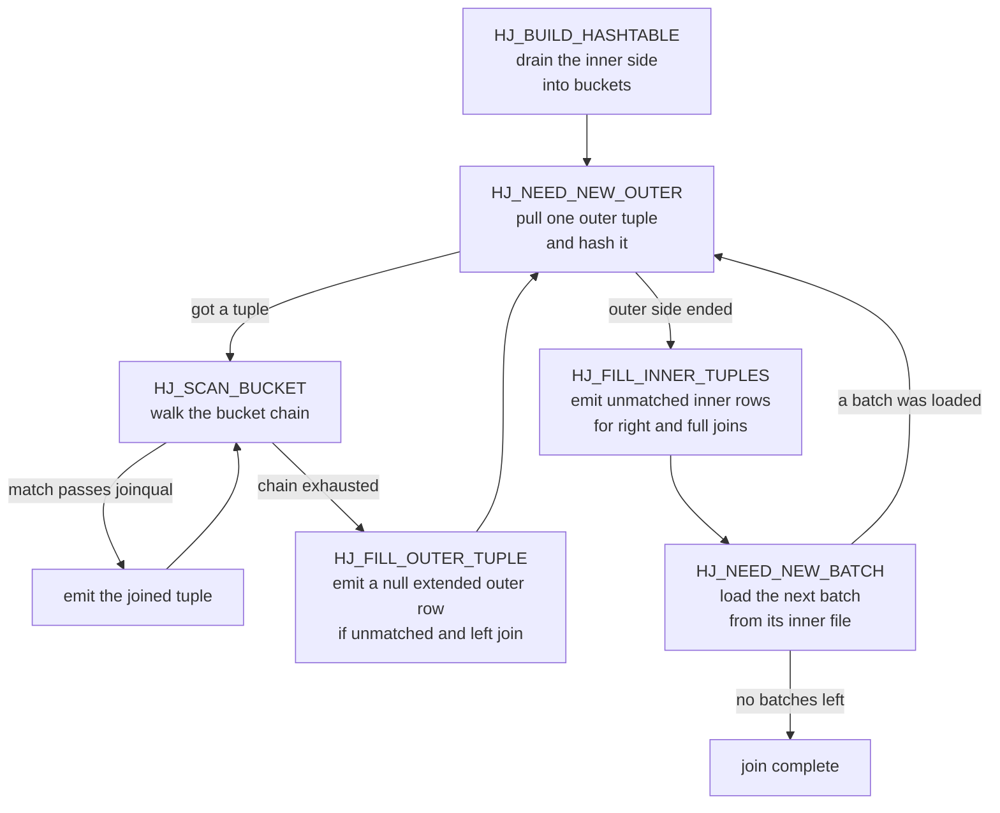

*ExecHashJoinImpl 的 HJ_\* 状态机。分批处理增加了经 HJ_NEED_NEW_BATCH 返回的循环；外连接增加了两个 FILL 状态。*

*GPORCA 下只需一个批次的哈希连接：300 000 行事实表探测广播过来的 143 行维表。Buckets/Batches/Memory Usage 来自上游；Extra Text 行属于 Cloudberry。*

```sql
SET optimizer = on;
EXPLAIN (ANALYZE, TIMING OFF, COSTS OFF)
SELECT count(*) FROM m184_f f JOIN m184_d d ON f.did = d.did WHERE d.grp = 3;
```

```text {hl_lines="3" title="output"}
               ->  Hash Join (actual rows=14323 loops=1)
                     Hash Cond: (f.did = d.did)
                     Extra Text: (seg2)   Hash chain length 1.0 avg, 1 max, using 143 of 524288 buckets.
                     ->  Seq Scan on m184_f f (actual rows=100172 loops=1)
                     ->  Hash (actual rows=143 loops=1)
                           Buckets: 524288  Batches: 1  Memory Usage: 4102kB
                           ->  Broadcast Motion 3:3  (slice2; segments: 3) (actual rows=143 loops=1)
                                 ->  Seq Scan on m184_d d (actual rows=54 loops=1)
                                       Filter: (grp = 3)
   (slice1)    Executor memory: 4158K bytes avg x 3x(0) workers, 4158K bytes max (seg0).  Work_mem: 4102K bytes max.
 Optimizer: GPORCA
```

要留意这些数字属于谁。`Buckets`/`Batches`/`Memory Usage` 由上游的 `show_hash_info`（`explain.c`）从 `SharedHashInfo` 中输出；在 PostgreSQL 中，这个结构为每个并行工作进程保存一个条目。Cloudberry 将该结构复用于 Segment：`explain_gp.c` — `cdbexplain_depositStatsToNode()` 把每个 QE 的 `HashInstrumentation` 送回并重建数组，注释对此说得很明确；随后 `show_hash_info` 取各条目的**最大值**（`explain.c`）。因此，`Memory Usage: 4102kB` 是用量*最大*的 Segment 上的峰值，绝不是总和。`Extra Text` 行又有不同来源：`ExecHashTableExplainEnd`（`nodeHash.c`）在每个 QE 上生成它，`explain_gp.c` 只输出其认为最值得关注的一个 Segment，因此带有 `(seg2)` 标记。桶数也是 Cloudberry 真正不同的地方：上游的目标约为每桶一个元组，这里的 `ExecChooseHashTableSize` 却将 `gp_hashjoin_tuples_per_bucket`（默认 5）视为*下*界；如果预计表可以放入内存，还会将其与一个正比于内存预算的界限取平均，并将最小桶数设为 1024（`nodeHash.c` — `ExecChooseHashTableSize()`）。因此，同一张 143 行的表，在 128 MB 预算下得到 524 288 个桶，在 512 kB 预算下得到 2048 个桶。最后，`of 524288 buckets` 的分母是 `nonemptybatches × nbuckets`（`nodeHash.c` — `ExecHashTableExplainEnd()`），这个等式稍后可以核实。

### 18.4.4 内侧放不下时：分批处理 {#1844-when-the-inner-side-does-not-fit-batches}

如果内侧超出预算，连接既不会失败，也不会反复抖动，而是进行分区。两侧都根据哈希位拆成*批次*：批次 0 驻留内存，批次 1…n−1 各写入一对临时文件，一个保存内侧元组，一个保存外侧元组。第一遍结束后，连接进入循环：将批次 k 的内侧文件载入此时已清空的桶数组，再流式读取批次 k 的外侧文件进行探测，如此重复。这就是上图中的 `HJ_NEED_NEW_BATCH` 回边，整个方案依赖一个小函数。

```c {title="src/backend/executor/nodeHash.c — ExecHashGetBucketAndBatch()"}
if (nbatch > 1)
{
    *bucketno = hashvalue & (nbuckets - 1);
    *batchno = pg_rotate_right32(hashvalue,
                                hashtable->log2_nbuckets) & (nbatch - 1);
}
```

低位选择桶，*紧接着的更高位*选择批次。由于批次位在桶位之上，`nbatch` 翻倍会多用一位，只可能把元组移到*更晚的*批次，绝不会移到更早的批次。因此，构建过程中可以安全地将批次数翻倍，重扫描驻留表，把新落到当前范围之外的元组写入各自的文件（`nodeHash.c` — `ExecHashIncreaseNumBatches()`）。

<figure class="cloudberry-core-figure">
<div><div style="overflow-x:auto"><div style="font-family:ui-monospace,SFMono-Regular,Menlo,monospace;font-size:11.5px;min-width:640px"> <div style="display:flex;align-items:stretch;border:1px solid #cdb4db;border-radius:6px;overflow:hidden"> <div style="flex:16;background:#f7f7f9;padding:8px 10px;border-right:1px solid #cdb4db"> <div style="color:#666">位 31 .. 16</div><div style="color:#707070;margin-top:4px">未使用</div></div> <div style="flex:5;background:#eafaf0;padding:8px 10px;border-right:1px solid #cdb4db"> <div style="color:#20553a">位 15 .. 11</div><div style="color:#20553a;font-weight:600;margin-top:4px">批次，5 位</div> <div style="color:#3d7a5a;margin-top:2px">32 个批次</div></div> <div style="flex:11;background:#fff4d6;padding:8px 10px"> <div style="color:#735a16">位 10 .. 0</div><div style="color:#735a16;font-weight:600;margin-top:4px">桶，11 位</div> <div style="color:#735a16;margin-top:2px">2048 个桶</div></div> </div> <div style="margin-top:12px;color:#4a3663"><span class="hl">bucketno</span> = hashvalue &amp; 2047 &nbsp;&nbsp;&nbsp; <span class="hl">batchno</span> = rotate_right32(hashvalue, 11) &amp; 31</div> <div style="margin-top:14px;display:flex;gap:6px;flex-wrap:wrap"> <div style="background:#f5edff;border:1px solid #cdb4db;border-radius:4px;padding:6px 8px">批次&nbsp;0<br/><span style="color:#666">驻留：内存中的桶</span></div> <div style="background:#fff;border:1px solid #cdb4db;border-radius:4px;padding:6px 8px">批次&nbsp;1<br/><span style="color:#666">innerBatchFile[1]<br/>outerBatchFile[1]</span></div> <div style="background:#fff;border:1px solid #cdb4db;border-radius:4px;padding:6px 8px">批次&nbsp;2<br/><span style="color:#666">innerBatchFile[2]<br/>outerBatchFile[2]</span></div> <div style="background:#fff;border:1px solid #cdb4db;border-radius:4px;padding:6px 8px;color:#707070">…</div> <div style="background:#fff;border:1px solid #cdb4db;border-radius:4px;padding:6px 8px">批次&nbsp;31<br/><span style="color:#666">innerBatchFile[31]<br/>outerBatchFile[31]</span></div> </div> <div style="margin-top:10px;color:#666">2 个文件 × 31 个非驻留批次 = 每个 Segment 62 个临时文件</div> </div></div></div>
<figcaption>nbuckets=2048、nbatch=32 时，32 位哈希值如何划分；这些数值来自下方 512 kB 预算的运行</figcaption>
</figure>

*同一个自连接，分别使用 128 MB、2 MB 和 512 kB。注意所用参数：本集群的 gp_resource_manager 为 queue，因此每个操作符的内存来自 statement_mem，只设置 work_mem 不起作用；nodeHash.c 使用 PlanStateOperatorMemKB 进行比较。语句内存策略见第 [21](/cloudberry/core-internals/part-6-resource-management/ch21/) 章。*

```sql
SET optimizer = off;
SET statement_mem = '128MB';   -- then '2MB', then '512kB'
EXPLAIN (ANALYZE, TIMING OFF, COSTS OFF)
SELECT count(*) FROM m184_f a JOIN m184_f b ON a.id = b.id AND a.did = b.did;
```

```text {hl_lines="4 17 28" title="output"}
-- statement_mem = 128MB
                     Extra Text: (seg2)   Hash chain length 1.1 avg, 5 max, using 91229 of 524288 buckets.
                     ->  Hash (actual rows=100172 loops=1)
                           Buckets: 524288  Batches: 1  Memory Usage: 8009kB
   (slice1)    Executor memory: 8061K bytes avg x 3x(0) workers, 8072K bytes max (seg1).  Work_mem: 8009K bytes max.
 Memory used:  128000kB

-- statement_mem = 2MB
                     Extra Text: (seg2)   Initial batch 0:
 (seg2)     Wrote 2016K bytes to inner workfile.
 (seg2)     Wrote 3168K bytes to outer workfile.
 (seg2)   Initial batches 1..3:
 (seg2)     Read 2060K bytes from inner workfile: 687K avg x 3 nonempty batches, 690K max.
 (seg2)     Read 3210K bytes from outer workfile: 1070K avg x 3 nonempty batches, 1075K max.
 (seg2)   Hash chain length 2.0 avg, 8 max, using 51189 of 65536 buckets.
                     ->  Hash (actual rows=100172 loops=1)
                           Buckets: 16384  Batches: 4  Memory Usage: 1112kB
 * (slice1)    Executor memory: 1351K bytes avg x 3x(0) workers, 1351K bytes max (seg0).  Work_mem: 1112K bytes max, 4041K bytes wanted.
 Memory used:  2048kB
 Memory wanted:  4640kB

-- statement_mem = 512kB
                     Extra Text: (seg2)   Initial batches 1..31:
 (seg2)     Read 2653K bytes from inner workfile: 86K avg x 31 nonempty batches, 88K max.
 (seg2)     Read 4134K bytes from outer workfile: 134K avg x 31 nonempty batches, 137K max.
 (seg2)   Hash chain length 2.0 avg, 8 max, using 51189 of 65536 buckets.
                     ->  Hash (actual rows=100172 loops=1)
                           Buckets: 2048  Batches: 32  Memory Usage: 141kB
 * (slice1)    Executor memory: 2185K bytes avg x 3x(0) workers, 2185K bytes max (seg0).  Work_mem: 141K bytes max, 3929K bytes wanted.
 Memory used:  512kB
 Memory wanted:  4528kB
```

有两点需要手工核算。首先是桶数等式：4 × 16 384 = 65 536，32 × 2048 = 65 536，两次运行都报告 `of 65536 buckets`，恰好等于 `nonemptybatches × nbuckets`。其次，`Work_mem: … bytes wanted` **仅在** `nbatch > 1` 时出现：`ExecHashTableExplainEnd` 将已完成批次的最终哈希空间与尚未读到的内侧工作文件大小相加，只有总和超过操作符预算时才报告（`nodeHash.c` — `ExecHashTableExplainEnd()`）。它回答的是“多少内存能让这个连接只用一个批次”，而非“我们用了多少内存”。

*从第二个会话捕获正在探测的 32 批次连接的批次文件：62 = 2 x (32 - 1)，因为批次 0 不需要文件。*

```sql
-- session 1: SET statement_mem='512kB'; a deliberately slow probe of the same join
-- session 2, while it runs:
SELECT segid, slice, optype, numfiles, size
  FROM gp_toolkit.gp_workfile_entries ORDER BY segid;
```

```text {hl_lines="3" title="output"}
 segid | slice |  optype  | numfiles |  size
-------+-------+----------+----------+---------
     0 |     1 | HashJoin |     62 | 4784128
     1 |     1 | HashJoin |       62 | 5079040
     2 |     1 | HashJoin |       62 | 4030464
(3 rows)
```

`slice` 列让你能够在包含多个连接的计划中定位溢出来源；同系列的 `gp_workfile_usage_per_query`、`gp_workfile_usage_per_segment` 和 `gp_workfile_mgr_used_diskspace` 视图汇总的是同一批数据，[§18.3](#183-sort--aggregate-nodes) 用它们观察排序和聚合溢出。不过，分批处理也有克星：单个热点连接键。相同键的元组具有相同哈希值，因此无论使用多少批次位，都无法将它们分开。下面，内侧有 150 000 行，却只有*一个*不同的连接键，预算为 512 kB。执行器将批次数从 32 翻倍为 64，发现问题批次仍保留全部元组，于是放弃继续拆分。最终，驻留表在 512 kB 预算下占用了 5274 kB，全部位于同一个桶中，链长达 150 000。

*数据倾斜使分批处理失效：内侧只有一个热点键，批次数翻倍毫无作用，链长达到 150000。*

```sql
SET optimizer = off; SET statement_mem = '512kB';
EXPLAIN (ANALYZE, TIMING OFF, COSTS OFF)
SELECT count(*) FROM m184_f f JOIN m184_k2 k ON k.did = f.did;   -- every k.did = 5000
```

```text {hl_lines="10" title="output"}
               ->  Hash Join (actual rows=0 loops=1)
                     Hash Cond: (f.did = k.did)
                     Extra Text: (seg1)   Initial batch 0:
 (seg1)     Wrote 3488K bytes to inner workfile.
 (seg1)   Initial batches 1..31:
 (seg1)     Read 3516K bytes from inner workfile.
 (seg1)     Wrote 3488K bytes to inner workfile.
 (seg1)   Secondary Overflow batches 32..63:
 (seg1)     Read 3516K bytes from inner workfile.
 (seg1)   Hash chain length 150000.0 avg, 150000 max, using 1 of 27648 buckets.  Skipped 37 empty batches.
                     ->  Redistribute Motion 3:3  (slice2; segments: 3) (actual rows=96600 loops=1)
                           ->  Seq Scan on m184_f f (actual rows=100172 loops=1)
                     ->  Hash (actual rows=150000 loops=1)
                           Buckets: 1024 (originally 1024)  Batches: 64 (originally 32)  Memory Usage: 5274kB
 * (slice1)    Executor memory: 2235K bytes avg x 3x(0) workers, 6401K bytes max (seg1).  Work_mem: 5274K bytes max, 5282K bytes wanted.
 Memory wanted:  5981kB
```

上游确实具备数据倾斜处理机制，这里也能触发，但它无法帮助当前情形。`ExecHashBuildSkewHash`（`nodeHash.c`）从预算中最多划出 `SKEW_HASH_MEM_PERCENT` = 2 %，用于专用桶，保存匹配**外侧**关系最常见值的内侧元组，从而让它们永不溢出。其前提是：构建时 `nbatch > 1`（`nodeHash.c` — `ExecHashTableCreate()`）；只有一个哈希子句，且外侧是基表上的普通 `Var`（`skewTable` 在 `createplan.c` — `create_hashjoin_plan()` 中设置）；该列具有 MCV 统计信息；头部 MCV 至少覆盖外侧的 `SKEW_MIN_OUTER_FRACTION` = 1 %。上述计划满足所有条件，但这里的热点键位于*内侧*，这个机制并不处理它。还要注意，ORCA 转换器根本不会设置 `skewTable`，所以在 `optimizer=on` 下，从设计上就不可能使用这项倾斜优化。

> [!NOTE]
> **两种不同的“hash table”行。**`HashAggregate` 也会输出 `Extra Text` 行，而且相似得容易混淆：`hash table(s): 1; chain length 2.4 avg, 5 max; using 337 of 512 buckets; total 0 expansions.` 这一行来自 `agg_hash_explain_extra_message`（`nodeAgg.c`），属于 [§18.3](#183-sort--aggregate-nodes)；其中 `total N expansions` 统计 *simplehash* 聚合表的扩展次数，在哈希连接中没有对应项。连接的这一行总以 `Hash chain length` 开头，来自 `nodeHash.c`（`ExecHashTableExplainEnd()`）。

### 18.4.5 半连接、反连接与外连接 {#1845-semi-anti-and-outer-joins}

图中的状态已覆盖全部连接类型；各变体的区别只在于启用了哪些状态。这由两个宏决定（`nodeHashjoin.c` — `HJ_FILL_OUTER` 和 `HJ_FILL_INNER`）：初始化节点时若创建了补 NULL 的*内侧*元组槽位，`HJ_FILL_OUTER` 就为真，表示未匹配的外侧行仍须输出；若存在补 NULL 的*外侧*槽位，`HJ_FILL_INNER` 就为真。`hj_MatchedOuter` 记录当前外侧元组是否找到过匹配。半连接设置 `js.single_match`，使 `HJ_SCAN_BUCKET` 找到第一个匹配就停止，而非遍历整条链；反连接则恰好在 `hj_MatchedOuter` 仍为假时输出外侧元组。全部实现只有十来行：

```c {title="src/backend/executor/nodeHashjoin.c — ExecHashJoinImpl()"}
case HJ_FILL_OUTER_TUPLE:
    node->hj_JoinState = HJ_NEED_NEW_OUTER;

    if (!node->hj_MatchedOuter && HJ_FILL_OUTER(node))
    {
        /* Generate a fake join tuple with nulls for the inner tuple */
        econtext->ecxt_innertuple = node->hj_NullInnerTupleSlot;

        if (otherqual == NULL || ExecQual(otherqual, econtext))
            return ExecProject(node->js.ps.ps_ProjInfo);
    }
    break;
```

*在同两张表上执行半连接、反连接和左连接，哈希表同为 143 行，外侧扫描同为 100 172 行，所以只有标签和计数变化。EXISTS 得到 14 323，NOT EXISTS 得到 85 849，14 323 + 85 849 = 100 172；每个外侧行恰好属于其中一种。*

```sql
SET optimizer = off;
EXPLAIN (ANALYZE, TIMING OFF, COSTS OFF) SELECT count(*) FROM m184_f f
  WHERE EXISTS (SELECT 1 FROM m184_d d WHERE d.did = f.did AND d.grp = 3);
EXPLAIN (ANALYZE, TIMING OFF, COSTS OFF) SELECT count(*) FROM m184_f f
  WHERE NOT EXISTS (SELECT 1 FROM m184_d d WHERE d.did = f.did AND d.grp = 3);
EXPLAIN (ANALYZE, TIMING OFF, COSTS OFF) SELECT count(d.dname) FROM m184_f f
  LEFT JOIN m184_d d ON f.did = d.did AND d.grp = 3;
```

```text {hl_lines="2 8 13" title="output"}
-- EXISTS
               ->  Hash Semi Join (actual rows=14323 loops=1)
                     Hash Cond: (f.did = d.did)
                     ->  Seq Scan on m184_f f (actual rows=100172 loops=1)
                     ->  Hash (actual rows=143 loops=1)
                           Buckets: 524288  Batches: 1  Memory Usage: 4102kB
-- NOT EXISTS
               ->  Hash Anti Join (actual rows=85849 loops=1)
                     Hash Cond: (f.did = d.did)
                     ->  Seq Scan on m184_f f (actual rows=100172 loops=1)
                     ->  Hash (actual rows=143 loops=1)
-- LEFT JOIN
               ->  Hash Left Join (actual rows=100172 loops=1)
                     Hash Cond: (f.did = d.did)
                     ->  Seq Scan on m184_f f (actual rows=100172 loops=1)
                     ->  Hash (actual rows=143 loops=1)
```

还会遇到两个不同于通常上游标签的名称。第一个是 PostgreSQL 16 的 `Hash Right Anti Join`（`JOIN_RIGHT_ANTI`，`nodes.h` — `JoinType`）：如果需要过滤的是*被哈希的*那一侧，规划器会交换连接两侧，让 `HJ_FILL_INNER_TUPLES` 完成工作；把同一个 `NOT EXISTS` 换个方向写，就会生成它。第二个是 Cloudberry 自有的 `JOIN_LASJ_NOTIN`（`nodes.h` — `JoinType`），显示为 `Left Anti Semi (Not-In)`（`explain.c` — `ExplainNode()`）：它是具有 SQL `NOT IN` 语义的左反半连接，内侧只要出现一个 NULL，就必须抑制*全部*输出。`nodeHashjoin.c`（`ExecHashJoinImpl()`）和 `nodeNestloop.c`（`ExecNestLoop_guts()`）包含实现这一行为的额外 NULL 检查，ORCA 会为 `NOT IN` 生成这种连接：

*Cloudberry 特有的连接类型：GPORCA 将 NOT IN 转为 Left Anti Semi (Not-In) Join。*

```sql
SET optimizer = on;
EXPLAIN (ANALYZE, TIMING OFF, COSTS OFF)
SELECT count(*) FROM m184_f f WHERE f.did NOT IN (SELECT did FROM m184_d WHERE grp = 3);
```

```text {hl_lines="1" title="output"}
               ->  Hash Left Anti Semi (Not-In) Join (actual rows=85849 loops=1)
                     Hash Cond: (f.did = m184_d.did)
                     Extra Text: (seg2)   Hash chain length 1.0 avg, 1 max, using 143 of 524288 buckets.
                     ->  Seq Scan on m184_f f (actual rows=100172 loops=1)
                     ->  Hash (actual rows=143 loops=1)
                           ->  Broadcast Motion 3:3  (slice2; segments: 3) (actual rows=143 loops=1)
                                 ->  Seq Scan on m184_d (actual rows=54 loops=1)
 Optimizer: GPORCA
```

### 18.4.6 Memoize：参数化内侧之前的缓存 {#1846-memoize-a-cache-in-front-of-a-parameterized-inner-side}

`nodeMemoize.c`（1239 行）专门处理一种情形：参数化嵌套循环的外侧反复出现相同参数值。在第十次遇到 `did = 7` 时，`Memoize` 不必再扫描内侧子树，而是维护一个以参数为键的 LRU 哈希表，重放已缓存的元组。它之所以值得使用，是因为规划器能够估计*不同*参数值的数量；一旦估错，缓存就只剩开销。Cloudberry 原样继承了该节点，这里的 PostgreSQL 规划器也确实会选用它。

*参数化索引扫描之上的实际 Memoize：将两个 loops 计数对照阅读。*

```sql
SET optimizer = off;
SET enable_hashjoin = off; SET enable_mergejoin = off;
SET enable_nestloop = on; SET enable_memoize = on;
EXPLAIN (ANALYZE, TIMING OFF, COSTS OFF)
SELECT count(d.dname) FROM m184_f a, m184_d d WHERE d.did = a.did AND a.id < 20000;
```

```text {hl_lines="6" title="output"}
               ->  Nested Loop (actual rows=6800 loops=1)
                     ->  Redistribute Motion 3:3  (slice2; segments: 3) (actual rows=6800 loops=1)
                           Hash Key: a.did
                           ->  Seq Scan on m184_f a (actual rows=6780 loops=1)
                                 Filter: (id < 20000)
                     ->  Memoize (actual rows=1 loops=6800)
                           Cache Key: a.did
                           Cache Mode: logical
                           ->  Index Scan using m184_d_did_idx on m184_d d (actual rows=1 loops=340)
                                 Index Cond: (did = a.did)
 Optimizer: Postgres query optimizer
```

`Memoize` 被请求了 6800 次，下方的索引扫描却只运行 340 次。缓存承接了 6460 次重扫描；解读方式与 [§18.4.1](#1841-nested-loop-rescanning-the-inner-side) 中的 `Materialize` 相同，只是多了一层间接访问。这里*缺少*上游的 `Hits: … Misses: … Evictions: …` 行，原因很有启发性。`show_memoize_info` 从本地 `MemoizeState` 的 `mstate->stats` 输出该行，若 `cache_misses` 为零，就整行跳过（`explain.c` — `show_memoize_info()`）。在派发的计划中，Coordinator 上的 `MemoizeState` 从未实际执行；而且与 `HashInstrumentation` 不同，Memoize 的计数器不在 `explain_gp.c` 从 QE 回传的字段之列（`explain_gp.c` — `cdbexplain_collectStatsFromNode()`）。所以，在 Cloudberry 中能看到来自 `Plan` 的 `Cache Key` 和 `Cache Mode`，但命中率必须从两个 `loops` 值推算。

### 18.4.7 MPP 特有的问题：预取内侧 {#1847-the-mpp-twist-prefetching-the-inner-side}

现在来看上游没有的部分。连接节点本能地先查看外侧；即使是哈希连接，也会在构建前先看一个外侧元组，以便在外侧为空时完全跳过构建。在单进程执行器中，这一眼没有代价。在 Cloudberry 中，任一输入都可能是由一整组发送进程提供数据的 Motion，这一眼却可能让集群挂起。`cdbllize.c`（`motion_sanity_walker()`）中的长注释详细说明了原因：Motion 发送方的发送缓冲区填满后，如果无人读取，就会阻塞。Segment A 的连接已取到一个外侧元组，正从内侧发送方拉取数据；Segment B 的连接还在等待*第一个*外侧元组。A 忙于内侧，无法继续读取外侧发送方；B 尚未通过外侧这一步，无法读取内侧发送方。四个进程形成一个环：

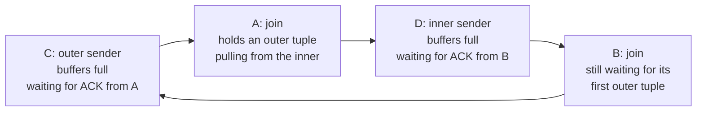

*执行器要避免的 Motion 死锁。每个箭头都表示“等待”。*

- **`prefetch_inner`**：消除一半处理内侧、一半处理外侧的状态，在接触外侧前先读完内侧。对于哈希连接，这只是*禁止*预先窥探外侧是否为空（`nodeHashjoin.c` — `ExecHashJoinImpl()`），因为构建阶段本就会读完内侧。对于嵌套循环（`nodeNestloop.c` — `ExecNestLoop_guts()`）和归并连接（`nodeMergejoin.c` — `ExecMergeJoin_guts()`），节点先从内侧子树拉取一个元组，再对其执行 `ExecReScan`。
- **`prefetch_joinqual`**：同一种风险还会出现在下一层，*连接限定条件*自身可能包含带 Motion 的 SubPlan。`ExecPrefetchQual`（`execUtils.c`）使用构造的全 NULL 内侧和外侧元组对限定条件求值一次，目的仅仅是强制该 Motion 运行并读尽数据。
- **`prefetch_qual`**：对节点中不属于连接条件的 `qual` 采用相同处理。

为什么只拉取*一个*元组就会读完内侧？因为规划器保证其顶部有一个阻塞操作符。`create_mergejoin_plan` 要求“某种严格的解耦操作符……在产生一行输出之前消耗全部输入”，并放置 `Sort`，或设置了 `cdb_strict` 的 `Material`（`createplan.c` — `create_mergejoin_plan()`）；`ExecMaterial` 看到 `cdb_strict` 后，会在首次调用时循环读取整个子计划，存入 tuplestore（`nodeMaterial.c`）。一次拉取，读尽整个 Motion，循环等待就此打破。

```c {title="src/backend/executor/nodeMergejoin.c — ExecMergeJoin_guts()"}
if (node->prefetch_inner)
{
    innerTupleSlot = ExecProcNode(innerPlan);
    node->mj_InnerTupleSlot = innerTupleSlot;

    ExecReScan(innerPlan);
    ResetExprContext(econtext);

    node->prefetch_inner = false;
}
```

这三个标志（`plannodes.h` — `Join`）由谁设置？使用 PostgreSQL 规划器时，只要*任意一个*子路径存在 Motion 风险，`create_hashjoin_plan` 就会开启 `prefetch_inner`（`createplan.c`）；归并连接在*两侧*都有风险时开启（`create_mergejoin_plan()`）；嵌套循环则还要求已经在内侧下方放置严格的 `Material`（`:5569-5572`）。所以，对于必须等外侧提供值才能运行的参数化内侧扫描，即使位于 Motion 下方，也会得到 `prefetch_inner false`。ORCA 更直接：转换器无条件为所有哈希连接设置此标志（`CTranslatorDXLToPlStmt.cpp` — `CTranslatorDXLToPlStmt::TranslateDXLHashJoin()`），也为所有*非*索引嵌套循环设置它；索引嵌套循环除外，是“因为内侧子节点依赖来自外侧子节点的变量”。`EXPLAIN` 不显示这些信息；无论是否使用 `VERBOSE`，`explain.c` 中都找不到字符串 `prefetch`。但 `outfuncs.c`（`_outJoinPlanInfo()`）会写出这些字段，因此可通过 `debug_print_plan` 看到它们。

*计划转储中的预取标志：共置连接不需要它们；任一侧下方增加一个 Motion，就会使标志翻转。*

```sql
SET optimizer = off; SET client_min_messages = log; SET debug_print_plan = on;
-- (1) both sides distributed by id, joined on id: no Motion at all
EXPLAIN (COSTS OFF) SELECT count(*) FROM m184_f a JOIN m184_f b ON a.id = b.id;
-- (2) joined on a non-distribution column: the inner side gets a Broadcast Motion
EXPLAIN (COSTS OFF) SELECT count(*) FROM m184_f f JOIN m184_d d ON f.did = d.grp;
```

```text {hl_lines="3 11" title="output"}
-- (1)
               {HASHJOIN
               :prefetch_inner false
               :prefetch_joinqual false
               :prefetch_qual false
   ->  Gather Motion 3:1  (slice1; segments: 3)
               ->  Hash Join

-- (2)
               {HASHJOIN
               :prefetch_inner true
               :prefetch_joinqual false
               :prefetch_qual false
   ->  Gather Motion 3:1  (slice1; segments: 3)
               ->  Hash Join
                           ->  Broadcast Motion 3:3  (slice2; segments: 3)
```

*归并连接的两侧都有 Motion。gp_enable_motion_deadlock_sanity（guc_gp.c — config_bool）跟踪规划器的死锁遍历；预取过的内侧 Sort 显示 loops=2，一遍用于预取，一遍用于连接。*

```sql
SET optimizer = off;
SET enable_hashjoin = off; SET enable_nestloop = off; SET enable_mergejoin = on;
SET gp_enable_motion_deadlock_sanity = on; SET client_min_messages = debug5;
EXPLAIN (ANALYZE, TIMING OFF, COSTS OFF) SELECT count(*)
  FROM m184_f a, m184_f b WHERE a.did = b.did AND a.id < 30 AND b.id > 299970;
```

```text {hl_lines="7" title="output"}
DEBUG:  Motion Deadlock Sanity Check
DEBUG:      MJ going left
DEBUG:     found motion
DEBUG:      MJ going right
DEBUG:     found motion
DEBUG:      MJ branch point left 0x1 right 0x1
DEBUG:      MJ branch point left 0x1 right 0x1 res 0x1 deadlock safe: prefetching
...
               ->  Merge Join (actual rows=0 loops=1)
                     Merge Cond: (a.did = b.did)
                     ->  Sort (actual rows=12 loops=1)
                           ->  Redistribute Motion 3:3  (slice2; segments: 3) (actual rows=12 loops=1)
                                 ->  Seq Scan on m184_f a (actual rows=12 loops=1)
                     ->  Sort (actual rows=2 loops=2)
                           ->  Redistribute Motion 3:3  (slice3; segments: 3) (actual rows=13 loops=1)
                                 ->  Seq Scan on m184_f b (actual rows=13 loops=1)
 Optimizer: Postgres query optimizer
```

输出中有两个细节值得留意。启用相应 GUC 后，规划结束时会运行 `motion_sanity_check`（`planner.c` — `standard_planner()`）；如果计划不安全，就会报 `Post-planning sanity check detected motion deadlock`；`deadlock safe: prefetching` 的判断来自 `cdbllize.c` — `motion_sanity_walker()`。此外，内侧 `Sort` 的 `loops=2` 是预取留在普通 `EXPLAIN ANALYZE` 中的痕迹：预取阶段从它拉取了一次，随后 `ExecReScan` 借助 `EXEC_FLAG_REWIND` 将其倒回，以供真正的执行使用；归并连接*仅在*预取时才请求这个标志（`nodeMergejoin.c` — `ExecInitMergeJoin()`）。较少见的 `prefetch_joinqual` 情形要求 Motion 位于限定条件内部，而不是子节点下方；`test_print_prefetch_joinqual`（`guc_gp.c` — `config_bool`）会让执行器报告这一动作。该报告也提醒我们，这里的“一个节点”意味着什么：连接在计划中只出现一次，在运行时却存在四份。

*prefetch_joinqual 在每个 QE 上触发一次：连接限定条件内的 Motion 由 ExecPrefetchQual 读尽。*

```sql
SET optimizer = off; SET test_print_prefetch_joinqual = on;
SELECT count(*) FROM m184_d d LEFT JOIN m184_f f
    ON f.did = d.did
   AND NOT EXISTS (SELECT 1 FROM m184_s s WHERE s.sid = d.grp + f.did);
```

```text {hl_lines="2" title="output"}
NOTICE:  prefetch join qual in slice 0 of plannode 3
NOTICE:  prefetch join qual in slice 1 of plannode 3  (seg0 slice1 10.100.0.3:7102 pid=9156)
NOTICE:  prefetch join qual in slice 1 of plannode 3  (seg1 slice1 10.100.0.3:7103 pid=9157)
NOTICE:  prefetch join qual in slice 1 of plannode 3  (seg2 slice1 10.100.0.3:7104 pid=9158)
 count
--------
 285947
(1 row)
```

> [!NOTE]
> 预取是一对配套机制中的一个。它防止发送方因为*暂时*无人读取而阻塞；[§18.1](#181-executor-framework--lifecycle) 的 `ExecSquelchNode`（`execAmi.c`）则防止发送方因为*此后再也*无人读取而阻塞，例如 `LIMIT` 提前满足，或反连接因 NULL 而短路。这两种机制存在的唯一原因，是该执行器中的子树可能位于另一个进程。发送缓冲区填满为什么会阻塞、ACK 协议如何工作、Motion 标签中的 `3:3` 意味着什么代价，都属于**第 [19](/cloudberry/core-internals/part-4-query-processing/ch19/) 章**。还有一个与连接有关的节点值得指明：从哈希连接内侧构建、再下推到外侧扫描的 `RuntimeFilter`（[§18.7](#187-cloudberry-specific-nodes)）。

连接系列到此结束。`nodeNestloop.c`、`nodeMergejoin.c`、`nodeHashjoin.c` 和 `nodeHash.c` 的 9666 行上游 PostgreSQL 代码上，只增添了三个 `bool` 字段、一行 `Extra Text` 和一种额外连接类型；MPP 执行器的关键恰恰就在这些小改动中。下一节深入一层，介绍这些节点用来求值 `Hash Cond`、`Merge Cond` 或 `Join Filter` 的表达式机制。

## 18.5 表达式求值 {#185-expression-evaluation}

本章其他各节讨论的都是*元组*的流动。本节讨论计算*值*的代码：决定元组能否保留的 `WHERE` 子句、构造父节点所见元组的目标列表，以及聚合内部的哈希计算与相等性检查。这些代码在每个 Segment 上，针对**每个元组**的每个表达式都要运行一次，因此处于整个系统最内层的循环中；也正因如此，它采用了不同寻常的设计。

规划器交付的限定条件是一棵 `Expr` 节点树（[§15.1](/cloudberry/core-internals/part-4-query-processing/ch15/#151-query-tree-structure)）。如果每个元组都遍历这棵树，每一层就都要追踪指针，并按节点类型执行 `switch`。所以执行器不这样做。`src/backend/executor/execExpr.c`（4 639 行）会**一次性将树编译成平坦的 `ExprEvalStep` 数组**，相当于一种小型字节码，再由 `src/backend/executor/execExprInterp.c`（4 943 行）运行该数组。下图展示了一次真实编译的结果，从正在运行的 Segment 后端进程中转储而来。

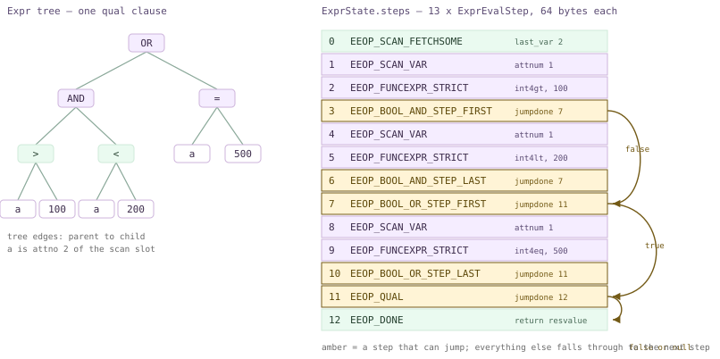

*`WHERE (a > 100 AND a < 200) OR a = 500` 的 Expr 树，以及编译所得的 13 步数组。琥珀色步骤可以跳转；箭头表示短路路径。*

从上到下阅读数组，设计便一目了然。运行时没有递归，也没有节点类型检查：步骤 1 从扫描槽位取出 `a`，步骤 2 调用 `int4gt`，步骤 3 判断能否跳过 `AND` 的剩余部分。短路不是从递归调用中 `return`，而是一个*索引*：步骤 3 带有 `jumpdone = 7`，指向最后一个合取项之后的步骤。

> [!NOTE]
> **本节的步骤数组如何获取。**编译后的表达式没有对应的 SQL 视图，因此我将 `gdb` 附加到 Segment 0 上的后端进程（通过 `PGOPTIONS='-c gp_role=utility' psql -p 7102` 打开），在 `ExecReadyInterpretedExpr` 上设断点——调用它时数组已经构建完毕——然后遍历 `state->steps`，输出 `(ExprEvalOp) opcode` 及相关的 `d` 联合体字段。下面的所有清单都是这些 printf 输出的节选。utility 模式下的 Segment 会话编译限定条件的方式与 QE 完全相同，而且只有一个进程，因此比 Coordinator 更适合作为实验环境。

### 18.5.1 从树到步骤数组 {#1851-from-tree-to-step-array}

有三个公共入口，它们都进行同样的递归遍历，只是外围包装不同：`ExecInitExpr`（`execExpr.c`）处理标量表达式，`ExecInitQual` 处理隐含 AND 的子句列表，`ExecBuildProjectionInfo` 处理目标列表。每个入口都会创建 `ExprState`，调用递归函数 `ExecInitExprRec`，在末尾追加 `EEOP_DONE`，再调用 `ExecReadyExpr`。

```c {title="src/backend/executor/execExpr.c"}
	/* Initialize ExprState with empty step list */
	state = makeNode(ExprState);
	state->expr = node;
	state->parent = parent;
	/* Insert setup steps as needed */
	ExecCreateExprSetupSteps(state, (Node *) node);
	/* Compile the expression proper */
	ExecInitExprRec(node, state, &state->resvalue, &state->resnull);
	/* Finally, append a DONE step */
	scratch.opcode = EEOP_DONE;
	ExprEvalPushStep(state, &scratch);
	ExecReadyExpr(state);
```

`ExecInitExprRec` 是一个按 `nodeTag` 分支的大型 `switch`，每种 `Expr` 对应一个分支；各分支填充栈上的临时 `ExprEvalStep`，交给 `ExprEvalPushStep`，后者通过 memcpy 将它复制到一个按倍增方式扩展的数组中。注意递归中向下传递的两个指针：`resv`/`resnull` 指定*子表达式应把结果写到哪里*。在顶层，它们是 `&state->resvalue` / `&state->resnull`，即 `ExprState` 自身的临时槽位；函数调用则改为传入参数槽位，使嵌套调用能将结果直接写入父调用的 `FunctionCallInfo`。这就是整个调用约定：不用栈，只预先连接好结果位置。

`ExprEvalStep` 包含一个操作码、上述两个结果指针，以及一个保存各操作码专用数据的联合体（`execExpr.h`）。联合体的大小被刻意限制，以便整个结构体放进一个缓存行；它确实做到了：在本构建上执行 `gdb -batch -ex 'p sizeof(ExprEvalStep)'`，输出为 `64`。

*包含两个子句的 WHERE 编译所得的步骤数组（Segment 0，utility 模式，gdb）。*

```sql
-- gdb: break ExecReadyInterpretedExpr, then walk state->steps
SELECT count(*) FROM m185_t WHERE a > 100 AND s = 'row5';
```

```text {hl_lines="15" title="output"}
Breakpoint 1.1, ExecReadyInterpretedExpr (state=0x55fdc0115f88)
=== steps_len=8 flags=1
step  0  EEOP_SCAN_FETCHSOME
step  1  EEOP_SCAN_VAR
step  2  EEOP_FUNCEXPR_STRICT
step  3  EEOP_QUAL
step  4  EEOP_SCAN_VAR
step  5  EEOP_FUNCEXPR_STRICT
step  6  EEOP_QUAL
step  7  EEOP_DONE

-- second pass over the same ExprState, printing the union payloads:
step0 last_var=3 fixed=1
step1 attnum=1        step4 attnum=2
step2 fn_oid=147 nargs=2 args[1].value=100 args[1].isnull=0
step5 fn_oid=67  nargs=2 fn_strict=1
step3 jumpdone=7      step6 jumpdone=7
```

这份转储中有几处值得仔细看。`flags=1` 是 `EEO_FLAG_IS_QUAL`（`execnodes.h`），由 `ExecInitQual` 设置，以便 `ExecQual` 随后对其作断言。`fn_oid=147` 和 `67` 分别是 `int4gt` 和 `texteq`。步骤 0 是*准备*步骤：一次 `slot_getsomeattrs` 解构到第 3 个属性，将它提前到所有步骤之前，使解释器不必两次解构元组。字面量 `100` 并没有对应的 `EEOP_CONST` 步骤，看看它实际去了哪里。

```c {title="src/backend/executor/execExpr.c — ExecInitFunc()"}
		if (IsA(arg, Const))
		{
			/*
			 * Don't evaluate const arguments every round; especially
			 * interesting for constants in comparisons.
			 */
			Const	   *con = (Const *) arg;

			fcinfo->args[argno].value = con->constvalue;
			fcinfo->args[argno].isnull = con->constisnull;
		}
```

常量参数在编译时写入函数的 `FunctionCallInfo`，此后便不再改动；所以还没检查任何元组，`args[1].value` 就已经是 `100`。接下来，`ExecInitFunc` 选择操作码；[§18.5.3](#1853-the-opcode-vocabulary) 将回到这一选择。

### 18.5.2 事后回填跳转目标 {#1852-jumps-are-patched-in-afterwards}

平坦数组在构建时还无法知道自己的跳转目标：`AND` 短路要跳到*最后一个合取项之后的步骤*，而这个索引尚不存在。所以，每次加入跳转时先用 `-1` 占位，并将该跳转自身的索引记入列表；待整组构建完毕，再遍历列表回填。`ExecInitQual` 是这一模式最简短的例子。

```c {title="src/backend/executor/execExpr.c"}
	foreach(lc, qual)
	{
		Expr	   *node = (Expr *) lfirst(lc);
		/* first evaluate expression */
		ExecInitExprRec(node, state, &state->resvalue, &state->resnull);
		/* then emit EEOP_QUAL to detect if it's false (or null) */
		scratch.d.qualexpr.jumpdone = -1;
		ExprEvalPushStep(state, &scratch);
		adjust_jumps = lappend_int(adjust_jumps, state->steps_len - 1);
	}
	/* adjust jump targets */
	foreach(lc, adjust_jumps)
	{
		ExprEvalStep *as = &state->steps[lfirst_int(lc)];
		Assert(as->d.qualexpr.jumpdone == -1);
		as->d.qualexpr.jumpdone = state->steps_len;
	}
```

这也解释了前面转储中*两个* `EEOP_QUAL` 步骤为何都有 `jumpdone=7`：回填发生在追加 `EEOP_DONE` 之前，因此 `state->steps_len` 恰好就是 `DONE` 将获得的索引。任何失败的子句都会跳到同一位置。还要注意，顶层 `AND` 实际上并没有变成 `BOOL_AND` 步骤。规划器把 `WHERE` 交付为一个隐含 AND 的*列表*，`ExecInitQual` 为每个元素生成一个廉价的 `EEOP_QUAL`。注释说明了为什么值得设置专门的操作码，而不是复用 `BOOL_AND`：限定条件只需要*假或 NULL → 假*，无需跟踪三值逻辑状态。

当 `AND` 保留在更大的布尔表达式内部时，才会产生真正的 `BOOL_*` 步骤。`ExecInitExprRec` 的 `T_BoolExpr` 分支将 `AND`/`OR` 拆成 `_STEP_FIRST` / `_STEP` / `_STEP_LAST` 变体：第一个步骤重置共享的 `anynull` 标志，该标志在 `ExecInitExprRec()` 中针对每个 `BoolExpr` 节点 `palloc` 一次；随后在 `ExecInitExprRec()` 中应用同样的回填循环。图中画的就是这个表达式。

*OR 内嵌 AND：BOOL 步骤及其回填后的跳转目标。*

```sql
-- same gdb recipe
SELECT count(*) FROM m185_t WHERE (a > 100 AND a < 200) OR a = 500;
```

```text {hl_lines="5" title="output"}
=== steps_len=13 flags=1
step  0  EEOP_SCAN_FETCHSOME       last_var=2
step  1  EEOP_SCAN_VAR             attnum=1
step  2  EEOP_FUNCEXPR_STRICT      fn_oid=147   (int4gt)
step  3  EEOP_BOOL_AND_STEP_FIRST  jumpdone=7   anynull=0x55fdc01ef3f0
step  4  EEOP_SCAN_VAR             attnum=1
step  5  EEOP_FUNCEXPR_STRICT      fn_oid=66    (int4lt)
step  6  EEOP_BOOL_AND_STEP_LAST   jumpdone=7
step  7  EEOP_BOOL_OR_STEP_FIRST   jumpdone=11  anynull=0x55fdc01eefc8
step  8  EEOP_SCAN_VAR             attnum=1
step  9  EEOP_FUNCEXPR_STRICT      fn_oid=65    (int4eq)
step 10  EEOP_BOOL_OR_STEP_LAST    jumpdone=11
step 11  EEOP_QUAL                 jumpdone=12
step 12  EEOP_DONE
```

两个 `AND` 步骤共享一个 `anynull` 存储单元和同一个目标 7，即外层负责接收其判断结果的 `OR` 步骤。对步骤 3 来说，这一跳会略过两个实际步骤；对步骤 6 来说，目标恰好是下一步，所以跳转与顺序执行没有区别。两个 `OR` 步骤行为相同，目标为 11。这里没有任何 Cloudberry 特有之处：单节点 PostgreSQL 也会构建相同的数组，只是在这里由三个 QE 分别独立编译。

### 18.5.3 操作码一览 {#1853-the-opcode-vocabulary}

`src/include/executor/execExpr.h` 中的 `enum ExprEvalOp` 包含 **100 个操作码**以及哨兵 `EEOP_LAST`。它们的*顺序*至关重要：解释器的派发表按位置索引，`execExprInterp.c`（`ExecInterpExpr()`）用 `StaticAssertDecl` 断言其长度等于 `EEOP_LAST + 1`，因此在错误位置添加操作码会导致编译错误，而不是难以追查的崩溃。

| 类别 | 成员（数量） | 作用 |
| --- | --- | --- |
| 槽位访问 | `EEOP_INNER/OUTER/SCAN_FETCHSOME`、`_VAR`、`_SYSVAR`、`EEOP_WHOLEROW`（10） | 将槽位解构到第 *n* 个属性，再从内侧、外侧或扫描元组读取一个属性；它们对应 `ExprContext` 提供的三个槽位（[§18.1](#181-executor-framework--lifecycle)） |
| 结果赋值 | `EEOP_ASSIGN_INNER/OUTER/SCAN_VAR`、`EEOP_ASSIGN_TMP[_MAKE_RO]`（5） | 写入*结果*槽位的一列；仅用于投影 |
| 常量 | `EEOP_CONST`（1） | 将 `Const` 复制到结果位置 |
| 函数调用 | `EEOP_FUNCEXPR`、`_STRICT`、`_FUSAGE`、`_STRICT_FUSAGE`（4） | 通过缓存的 `FmgrInfo` 调用一个 `pg_proc` 函数 |
| 控制流 | `EEOP_BOOL_AND/OR_STEP{,_FIRST,_LAST}`、`EEOP_BOOL_NOT_STEP`、`EEOP_QUAL`、`EEOP_JUMP{,_IF_NULL,_IF_NOT_NULL,_IF_NOT_TRUE}`、`EEOP_DONE`（13） | 唯一不会简单地顺序执行到下一步的步骤 |
| 检查 | `EEOP_NULLTEST_*`（4）、`EEOP_BOOLTEST_*`（4） | 内联执行 `IS NULL`、`IS TRUE` 等检查 |
| 参数 | `EEOP_PARAM_EXEC/EXTERN/CALLBACK`（3） | 来自预备语句（[§13.2](/cloudberry/core-internals/part-4-query-processing/ch13/#132-the-extended-query-protocol)）的 `$n`，或来自外层查询 SubPlan 的参数（[§18.6](#186-subqueries--other-nodes)） |
| 聚合支持 | `EEOP_AGG_*`（15）以及 `EEOP_AGGREF`、`EEOP_GROUPING_FUNC`、`EEOP_AGGEXPR_ID`（共 18） | `nodeAgg.c` 通过 `ExecBuildAggTrans` 构建的逐组状态转移函数调用，见 [§18.3](#183-sort--aggregate-nodes) |
| 其他 | `EEOP_IOCOERCE`、`EEOP_ARRAYEXPR`、`EEOP_ROWCOMPARE_*`、`EEOP_MINMAX`、`EEOP_FIELDSELECT`、`EEOP_SBSREF_*`、`EEOP_DOMAIN_*`、`EEOP_XMLEXPR`、`EEOP_JSON_CONSTRUCTOR`、`EEOP_IS_JSON`、`EEOP_WINDOW_FUNC`、`EEOP_SUBPLAN`、… | 在解释器中各有一个分支，多数委托给导出的 `ExecEval*` 辅助函数 |

为什么有这么多近乎重复的操作码？因为特化*正是*这种设计的性能依据。比较两种函数调用操作码：严格函数必须跳过带 NULL 参数的实际调用，非严格函数则不能，而这一选择在编译时就已确定。因此，它们被拆成两个操作码，解释器无需为每个元组检查严格性。

```c {title="src/backend/executor/execExprInterp.c — ExecInterpExpr()"}
		EEO_CASE(EEOP_FUNCEXPR_STRICT)
		{
			FunctionCallInfo fcinfo = op->d.func.fcinfo_data;
			NullableDatum *args = fcinfo->args;
			int			nargs = op->d.func.nargs;

			/* strict function, so check for NULL args */
			for (int argno = 0; argno < nargs; argno++)
				if (args[argno].isnull) { *op->resnull = true; goto strictfail; }
			fcinfo->isnull = false;
			*op->resvalue = op->d.func.fn_addr(fcinfo);
			*op->resnull = fcinfo->isnull;
	strictfail:
			EEO_NEXT();
```

选择只进行一次，位于 `ExecInitFunc`（`execExpr.c`）：严格、*且*有参数、*且*未收集函数使用统计时，选择 `EEOP_FUNCEXPR_STRICT`。每种组合都有自己的操作码，因此运行时路径不包含任何早已可以决定的分支。

Cloudberry 在枚举中添加了六个自有操作码，恰好概括了 MPP 执行器在 PostgreSQL 之外的需求：`EEOP_GROUP_ID` 和 `EEOP_GROUPING_SET_ID` 实现 `GROUP_ID()` 及跨两阶段聚合保留的分组集记账；`EEOP_AGGEXPR_ID` 为拆分后的元组标记所属聚合（[§18.3](#183-sort--aggregate-nodes) 的多 DQA 机制）；`EEOP_ROWIDEXPR` 在去重半连接广播前为行加上唯一 ID（[§18.4](#184-join-nodes)）；`EEOP_SCALARARRAYOP_FAST_INT` / `_FAST_STR` 则是 `IN` 列表的快速路径。后两者在普通查询中都会触发。

*Cloudberry 的 IN 列表操作码，实际运行示例。*

```sql
-- gdb, same recipe; s is text, a is int4
SELECT count(*) FROM m185_s WHERE s IN ('v7','v8','v9') AND a IN (70,80,90);
```

```text {hl_lines="4" title="output"}
=== expr steps_len=8 flags=1
  step  0  EEOP_SCAN_FETCHSOME
  step  1  EEOP_SCAN_VAR                  attnum=2
  step  2  EEOP_SCALARARRAYOP_FAST_STR    opfuncid=67   (texteq)
  step  3  EEOP_QUAL                      jumpdone=7
  step  4  EEOP_SCAN_VAR                  attnum=1
  step  5  EEOP_SCALARARRAYOP_FAST_INT    opfuncid=65   (int4eq)
  step  6  EEOP_QUAL                      jumpdone=7
  step  7  EEOP_DONE
```

`ExecInitScalarArrayOpFastPath`（`execExpr.c`）只接受以下情况：数组一侧是非 NULL 的 `Const`，操作符属于 `int2eq`/`int4eq`/`int8eq`/`date_eq`/`texteq`/`bpchareq` 之一，且对于文本类型，排序规则能由 `memcmp` 正确处理。随后，它在编译时将数组*一次性*拆解成普通 `Datum` 数组，`ExecEvalScalarArrayOpFastInt`（`execExprInterp.c`）直接循环比较 Datum，无需为每个元素调用 `FunctionCallInvoke`。上游 PostgreSQL 16 则将较大的 `IN` 列表转为 `EEOP_HASHED_SCALARARRAYOP`；这里两种操作码并存。

### 18.5.4 解释执行：计算式 goto {#1854-interpretation-computed-goto}

`ExecInterpExpr`（`execExprInterp.c`）是一个庞大的函数，每个操作码对应一个代码块，有两种编译方式。可移植的方式是将代码块作为循环内 `switch` 的 `case` 标签，即 *switch 串接派发*。在 GCC 和 Clang 上，代码块则使用普通标签并取其*地址*（标签作为值的扩展）；每个块结束时直接跳到下一块的地址，中央 `switch` 完全消失，即*直接串接派发*。文件头注释称，后者是不写汇编时已知最快的程序解释方式之一，因为跳转来自多个位置而非一个位置，使分支预测有据可循。

```c {title="src/backend/executor/execExprInterp.c — EEO_SWITCH"}
#define EEO_SWITCH()
#define EEO_CASE(name)		CASE_##name:
#define EEO_DISPATCH()		goto *((void *) op->opcode)
#define EEO_OPCODE(opcode)	((intptr_t) dispatch_table[opcode])

#else							/* !EEO_USE_COMPUTED_GOTO */

#define EEO_SWITCH()		starteval: switch ((ExprEvalOp) op->opcode)
#define EEO_CASE(name)		case name:
#define EEO_DISPATCH()		goto starteval
#define EEO_OPCODE(opcode)	(opcode)
```

当且仅当定义了 `HAVE_COMPUTED_GOTO` 时，才定义 `EEO_USE_COMPUTED_GOTO`。在本构建（GCC 12.2.1）中，无论安装目录还是源码目录，`pg_config.h` 都包含 `#define HAVE_COMPUTED_GOTO 1`。因此这里确实使用直接串接派发，而且可以直接观察到：`ExecReadyInterpretedExpr` 将每个 `opcode` 字段替换为对应代码块的地址，并设置 `EEO_FLAG_DIRECT_THREADED`。

*同一步骤，在数组就绪之前与之后的变化。*

```sql
-- gdb: print steps[3].opcode at ExecReadyInterpretedExpr entry,
-- then again at the first evaluation (ExecInterpExprStillValid)
SELECT count(*) FROM m185_s WHERE a > 100 AND s = 'v18';
```

```text {hl_lines="1" title="output"}
at ExecReadyInterpretedExpr entry: flags=1  steps[3].opcode=28
at first evaluation:  flags=7  steps[3].opcode=0x55fdb69efa84  decoded=EEOP_QUAL
  steps[0].opcode=0x55fdb69f01e3 decoded=EEOP_SCAN_FETCHSOME
  evalfunc_private=0x55fdb69ef910          <-- == &ExecInterpExpr
```

`28` 是 `EEOP_QUAL` 在枚举中的序号；片刻之后，同一个字段便保存了 postgres 代码段内的地址，而 `flags` 从 `1` 变成 `7`，即 `IS_QUAL | INTERPRETER_INITIALIZED | DIRECT_THREADED`。由于数字操作码已被替换，任何需要取回操作码的地方（`EXPLAIN`、JIT 提供程序、本次调试会话）都必须调用 `ExecEvalStepOp`。它对反向表执行 `bsearch`；该表由 `ExecInitInterpreter` 在首次使用时构建，而该函数通过调用 `ExecInterpExpr(NULL, NULL, NULL)` 获取派发表。这是一个特殊分支，只返回表的地址，不进行任何求值。

因此，让表达式就绪的过程是一棵小型决策树，最有意思的分支位于串接派发*之前*：对于最小的表达式，连进入解释器的开销都能测出来，所以 `ExecReadyInterpretedExpr` 会识别 14 种精确的两步或三步模式，改为安装一个手写的 C 函数。

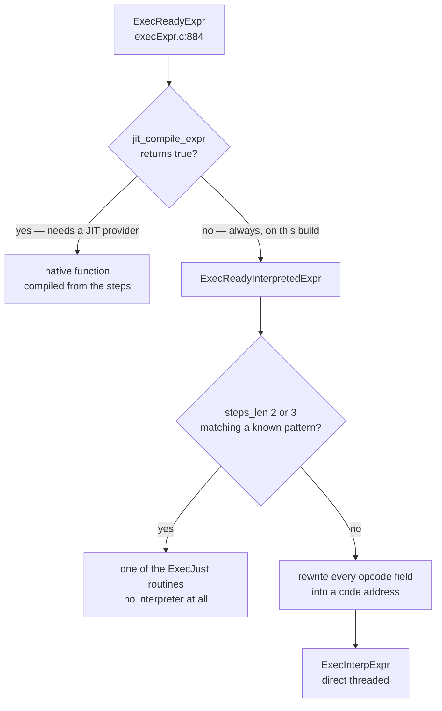

*ExecReadyExpr：编译后步骤数组的三种可能去向。*

`ExecJustScanVar`、`ExecJustAssignOuterVar`、`ExecJustConst`、`ExecJustApplyFuncToCase` 及其 `…Virt` 变体（用于已经是虚拟形式、无需解构的槽位），都将对应模式的操作直接内联。单列投影恰好就是其中一种模式；只要统计函数入口次数，就能看到两条路径的分工。

*谁在求值什么：Segment 0 上的断点命中次数（该处有 12 行，其中 9 行通过限定条件）。*

```sql
-- gdb: break ExecJust*, ExecInterpExpr with huge ignore counts,
-- run to ExecutorEnd, then: info breakpoints
SELECT s FROM m185_s WHERE a > 50;
```

```text {hl_lines="2" title="output"}
2       breakpoint  in ExecJustAssignScanVar at execExprInterp.c:2267
	breakpoint already hit 9 times
6       breakpoint  in ExecInterpExpr at execExprInterp.c:519
	breakpoint already hit 12 times
7       breakpoint  in ExecutorEnd at execMain.c:1242
	breakpoint already hit 1 time
```

解释器进入 12 次，对应该 Segment 保存的每个元组各进行一次限定条件求值；快速路径进入 9 次，对应每个保留下来的元组各进行一次投影。将目标列表改成两列，投影就不再匹配 `Just` 模式：同一查询使用 `SELECT a, s` 时，`ExecInterpExpr` 命中 21 次，快速路径一次也不命中。这两个数字就概括了该子系统的整个代价模型。

### 18.5.5 限定条件、投影与每元组上下文 {#1855-quals-projection-and-the-per-tuple-context}

调用方从不直接操作步骤，而是使用 `src/include/executor/executor.h` 中的两个内联包装函数：`ExecQual` 断言 `IS_QUAL` 标志，并通过 `DatumGetBool` 返回结果；`ExecProject` 对投影求值，并将结果槽位标记为有效的虚拟元组。二者都经过 `ExecEvalExprSwitchContext`，由它完成每次表达式求值都必须先做的一件事。

```c {title="src/include/executor/executor.h — ExecEvalExprSwitchContext()"}
ExecEvalExprSwitchContext(ExprState *state, ExprContext *econtext,
						  bool *isNull)
{
	Datum		retDatum;
	MemoryContext oldContext;

	oldContext = MemoryContextSwitchTo(econtext->ecxt_per_tuple_memory);
	retDatum = state->evalfunc(state, econtext, isNull);
	MemoryContextSwitchTo(oldContext);
	return retDatum;
}
```

表达式结果分配在 `ecxt_per_tuple_memory` 中，`ResetExprContext` 针对每个元组将其*统一*释放；`ExecQualAndReset` 甚至将这两个操作合并，供高频调用方使用。因此，表达式很难造成内存泄漏，目标列表中的 `text` 拼接也不会使内存不断积累：没有人逐项释放对象，只需丢弃整个上下文。`ExprContext` 本身属于 `PlanState`，归 [§18.1](#181-executor-framework--lifecycle) 讨论。

`EXPLAIN (VERBOSE)` 是在 SQL 层查看这两个 `ExprState` 的方式：`Filter` 对应限定条件，`Output` 对应投影的目标列表。注意，上方的 `Gather Motion` 也有自己的 `Output` 列表；Motion 同样执行投影（第 [19](/cloudberry/core-internals/part-4-query-processing/ch19/) 章）。

*EXPLAIN 中显示的限定条件与投影（PostgreSQL 规划器）。*

```sql
SET optimizer = off;
EXPLAIN (VERBOSE, COSTS OFF)
  SELECT id, a*2 AS dbl, upper(s) AS us FROM m185_t
   WHERE a > 100 AND s = 'row5';
```

```text {hl_lines="7" title="output"}
                            QUERY PLAN
------------------------------------------------------------------
 Gather Motion 3:1  (slice1; segments: 3)
   Output: id, ((a * 2)), (upper(s))
   ->  Seq Scan on public.m185_t
         Output: id, (a * 2), upper(s)
         Filter: ((m185_t.a > 100) AND (m185_t.s = 'row5'::text))
 Settings: optimizer = 'off'
 Optimizer: Postgres query optimizer
```

这个目标列表编译为六个步骤，展示了 `ExecBuildProjectionInfo` 自己的特化机制：普通且类型安全的 `Var` 变成单个 `EEOP_ASSIGN_SCAN_VAR`，直接从输入槽位复制到输出槽位（`execExpr.c` — `ExecBuildProjectionInfo()`）；计算列则先在 `resvalue` 中求值，再由 `EEOP_ASSIGN_TMP` 移入。变长结果改用 `EEOP_ASSIGN_TMP_MAKE_RO`（`ExecBuildProjectionInfo()`），因为上层节点可能多次引用同一列，不能向其提供可写的展开值。编译 `SELECT a, upper(s)` 恰好得到这一序列：`SCAN_FETCHSOME, ASSIGN_SCAN_VAR, SCAN_VAR, FUNCEXPR_STRICT, ASSIGN_TMP_MAKE_RO, DONE`。

这一切有多大代价？比较对同一张 300 000 行表的两次扫描，两者的限定条件都接受*所有*行，因此计划之间的唯一区别是每个元组的处理量。

*相同计划、相同行数、不同限定条件：全部差异都来自表达式求值。*

```sql
SET optimizer = off;
EXPLAIN (ANALYZE, COSTS OFF) SELECT count(*) FROM m185_t WHERE a >= 0;
EXPLAIN (ANALYZE, COSTS OFF)
  SELECT count(*) FROM m185_t WHERE length(md5(s||s||s)) >= 0;
```

```text {hl_lines="15" title="output"}
 Finalize Aggregate (actual time=30.094..30.096 rows=1 loops=1)
   ->  Gather Motion 3:1  (slice1; segments: 3) (actual ... rows=3 loops=1)
         ->  Partial Aggregate (actual time=19.241..19.242 rows=1 loops=1)
               ->  Seq Scan on m185_t (actual time=0.093..21.537 rows=100172 loops=1)
                     Filter: (a >= 0)
 ...
 Execution Time: 31.211 ms

 Finalize Aggregate (actual time=165.026..165.029 rows=1 loops=1)
   ->  Gather Motion 3:1  (slice1; segments: 3) (actual ... rows=3 loops=1)
         ->  Partial Aggregate (actual time=130.550..130.551 rows=1 loops=1)
               ->  Seq Scan on m185_t (actual time=0.642..157.476 rows=100172 loops=1)
                     Filter: (length(md5(((s || s) || s))) >= 0)
 ...
 Execution Time: 165.664 ms
```

行数完全相同，节点形态完全相同，耗时却相差 **5.3** 倍；各重复三次取最好结果，则是 22.4 ms 对 141.2 ms，相差 **6.3** 倍。每个元组多出的四个 `EEOP_FUNCEXPR_STRICT` 步骤——两次 `textcat`、一次 `md5`、一次 `length`——主导了每个 Segment 扫描 100 000 行的成本。昂贵的不是本节介绍的派发机制，而是它所调用的函数。

> [!NOTE]
> 请只比较比值。本构建启用了 `--enable-cassert`（`debug_assertions` = on），恰好增加了这条代码路径的负担，因为解释器中到处是 `Assert`。同一台机器上紧接着测得的两个数字可以相互比较，不能用于其他比较。

### 18.5.6 哈希与分组支持 {#1856-hashing-and-grouping-support}

还有一个使用编译表达式的模块值得介绍，因为另外两节都依赖它。`src/backend/executor/execGrouping.c`（570 行）提供 `TupleHashTable`，供哈希聚合（[§18.3](#183-sort--aggregate-nodes)）、哈希 `SubPlan`（[§18.6](#186-subqueries--other-nodes)）、`SetOp` 和 `RecursiveUnion` 使用。`execTuplesHashPrepare` 将相等*操作符*列表转换成相等函数的 OID 以及哈希函数的 `FmgrInfo`，随后 `BuildTupleHashTableExt` 请求表达式编译器构造比较逻辑。

```c {title="src/backend/executor/execGrouping.c"}
	/* build comparator for all columns */
	hashtable->tab_eq_func = ExecBuildGroupingEqual(inputDesc, inputDesc,
													NULL, &TTSOpsMinimalTuple,
													numCols,
													keyColIdx, eqfuncoids, collations,
													allow_jit ? parent : NULL);
```

`ExecBuildGroupingEqual`（`execExpr.c`）构建一个 `ExprState`，以*无区别*语义比较 `ExprContext` 中的内侧和外侧元组，两个 NULL 也匹配；它通过 `ExecQual` 调用，因为比较本身就是布尔表达式。在 PostgreSQL 16 中，哈希计算本身没有被编译：`TupleHashTableHash_internal`（`ExecBuildProjectionInfo()`）对逐列的 `FunctionCall1Coll` 结果执行循环移位和异或，再用 `murmurhash32` 扰动。注意 `allow_jit ? parent : NULL` 参数：如果表达式的生命周期与 JIT 上下文不匹配，调用方可以通过传入 NULL 父节点来明确*禁止* JIT（`ExecInitQual()`）。

### 18.5.7 返回集合的函数 {#1857-set-returning-functions}

目标列表中返回*集合*的函数打破了每步只产生一个值的约定，因此从 PostgreSQL 10 起，它不再放在普通投影中：规划器插入 `ProjectSet` 节点，并保证返回集合的函数*直接*位于其目标列表顶层；必要时会加入更多 `ProjectSet` 节点（`nodeProjectSet.c`）。`ExecProjectSRF` 对各元素求值，观察 `ExprMultipleResult`（当前输入元组还会产生更多行）和 `ExprEndResult`（该函数本轮已耗尽）；只有所有 SRF 都结束后，才推进子节点。

*目标列表中的 SRF 对应 ProjectSet 节点；FROM 中的 SRF 对应 Function Scan。*

```sql
SET optimizer = off;
EXPLAIN (COSTS OFF) SELECT id, generate_series(1, a % 3 + 1) AS g
                      FROM m185_s WHERE id <= 3;
EXPLAIN (COSTS OFF) SELECT * FROM generate_series(1,3) g;
```

```text {hl_lines="5" title="output"}
                      QUERY PLAN
-------------------------------------------------------
 Gather Motion 3:1  (slice1; segments: 3)
   Output: id, (generate_series(1, ((a % 3) + 1)))
   ->  ProjectSet
         Output: id, generate_series(1, ((a % 3) + 1))
         ->  Seq Scan on public.m185_s
               Filter: (m185_s.id <= 3)

             QUERY PLAN
-------------------------------------
 Function Scan on generate_series g
 Optimizer: Postgres query optimizer
```

这两条路径在 `src/backend/executor/execSRF.c` 汇合，但对 `ReturnSetInfo` 的两种返回协议支持不同。目标列表路径 `ExecMakeFunctionResultSet` 只允许 `SFRM_ValuePerCall` 和 `SFRM_Materialize`（`ExecMakeFunctionResultSet()`）：像 `generate_series` 这样的 C 函数每行重新进入一次，而 PL/pgSQL 函数先填充 tuplestore，再由调用方读完（`ExecMakeFunctionResultSet()`）。`FROM` 路径 `ExecMakeTableFunctionResult` 还提供 `SFRM_Materialize_Preferred` 和 `_Random`（`ExecMakeTableFunctionResult()`），因为 `Function Scan` 可能需要重扫描。ORCA 下的 `ProjectSet` 也是同一个节点，这种计划形态并不专属于某个优化器。

### 18.5.8 JIT：能够做什么，以及为何在这里没有作用 {#1858-jit-what-it-would-do-and-why-it-does-nothing-here}

运行步骤数组还有第四种方式。PostgreSQL 可以将它交给 LLVM 后端，为*这个*表达式生成原生代码：`llvm_compile_expr`（`src/backend/jit/llvm/llvmjit_expr.c`）为每个步骤创建一个 LLVM 基本块，通过 `ExecEvalStepOp` 获取各操作码（`llvm_compile_expr()`），内联生成该块的逻辑，再跳转到下一块。解释器的派发开销——平坦数组原本就是为了降低它而设计——连同逐步骤的指针间接访问一起完全消失；复杂操作码仍调用相同的导出 `ExecEval*` 辅助函数，这也正是 `execExprInterp.c` 导出这些函数的原因，文件头注释对此有说明。

这条路径经过两个决策。若启用 `jit`，且顶层计划总代价超过 `jit_above_cost`，规划器便设置 `PlannedStmt.jitFlags`（`planner.c` — `standard_planner()`）；超过各自阈值时添加 `PGJIT_OPT3` / `PGJIT_INLINE`，并按 GUC 添加 `PGJIT_EXPR` / `PGJIT_DEFORM`。随后，`ExecReadyExpr` 调用 `jit_compile_expr`（`jit.c`），检查这些标志，并让 `provider_init` 加载提供程序的共享库。

*如实读取状态：jit 已开启，但 JIT 不可用。*

```sql
SELECT name, setting FROM pg_settings WHERE name LIKE 'jit%' ORDER BY 1;
SELECT pg_jit_available();
-- shell:
ls $GPHOME/lib/postgresql/ | grep -i llvm
pg_config --configure
```

```text {hl_lines="14" title="output"}
          name           | setting
-------------------------+---------
 jit                     | on
 jit_above_cost          | 100000
 jit_expressions         | on
 jit_inline_above_cost   | 500000
 jit_optimize_above_cost | 500000
 jit_provider            | llvmjit
 jit_tuple_deforming     | on
 (jit_debugging_support, jit_dump_bitcode, jit_profiling_support = off)

 pg_jit_available
------------------
 f

$ ls $GPHOME/lib/postgresql/ | grep -i llvm      # no output
$ pg_config --configure
 '--prefix=/usr/local/cloudberry-db' '--enable-debug' '--enable-cassert'
 '--enable-depend' '--with-lz4' '--with-zstd' '--with-gssapi' '--enable-orafce'
 '--enable-ic-proxy' '--enable-orca' '--enable-gpcloud' '--with-libxml' ...
 # no --with-llvm
```

这是最清楚的证据：构建时从未传入 `--with-llvm`，因此没有生成 `llvmjit.so`，于是 `provider_init`（`jit.c`）对 `$pkglibdir/llvmjit.so` 的 `file_exists` 检查失败，记录 `provider_failed_loading` 以免重试，`jit_compile_expr` 返回 false。本集群的所有表达式都落到 `ExecReadyInterpretedExpr`。`pg_jit_available()` 就是把这项检查暴露为函数。

*强制将阈值设为零，也没有可观察到的变化。*

```sql
SET optimizer = off;
SET jit_above_cost = 0;   -- session-local; every plan is now flagged for JIT
EXPLAIN (ANALYZE, COSTS OFF, TIMING OFF)
  SELECT count(*) FROM m185_t WHERE length(md5(s||s||s)) >= 0;
```

```text {hl_lines="9" title="output"}
 Finalize Aggregate (actual rows=1 loops=1)
   ->  Gather Motion 3:1  (slice1; segments: 3) (actual rows=3 loops=1)
         ->  Partial Aggregate (actual rows=1 loops=1)
               ->  Seq Scan on m185_t (actual rows=100172 loops=1)
                     Filter: (length(md5(((s || s) || s))) >= 0)
 Planning Time: 1.148 ms
 Memory used:  128000kB
 Optimizer: Postgres query optimizer
 Execution Time: 138.518 ms      -- no "JIT:" section anywhere
```

设置 `jit_above_cost = 0` 后，`PlannedStmt` 确实携带 `PGJIT_PERFORM | PGJIT_EXPR | PGJIT_DEFORM`，但 `EXPLAIN ANALYZE` 仍不输出 `JIT:` 块，因为没有创建任何函数时，`ExplainPrintJIT` 会立即返回（`explain.c`），这里确实一个也没有。与 [§18.5.5](#1855-quals-projection-and-the-per-tuple-context) 中未设置这些标志的运行相比，执行时间在测量噪声范围内没有变化。

> [!NOTE]
> **明确说明：**本构建无法实际测试 JIT。上文关于 `llvm_compile_expr` 的全部内容都来自对 `src/backend/jit/llvm/` 源码的阅读（5 146 行 C，另加 C++ 内联器），并非测量结果。其他地方关于 Cloudberry JIT 加速的任何说法，都必须建立在使用 `--with-llvm` 配置、且 `$GPHOME/lib/postgresql/` 中存在 `llvmjit.so` 的构建上才有意义；在 MPP 集群中，还必须*逐 Segment* 测量，因为每个 QE 都要为同一个表达式支付自己的编译成本。

执行器中负责计算值的部分到此结束。接下来是建立在它之上的节点类型：[§18.6](#186-subqueries--other-nodes) 的子查询与辅助节点，以及 [§18.7](#187-cloudberry-specific-nodes) 中 Cloudberry 自有的节点。

## 18.6 子查询与其他节点 {#186-subqueries--other-nodes}

[§18.2](#182-scan-nodes) 的扫描读取表，[§18.4](#184-join-nodes) 的连接组合它们，[§18.3](#183-sort--aggregate-nodes) 的聚合汇总它们，但真实查询几乎不会只由这些组成。它们之间还有第三类节点：让计划引用*另一个*计划，缓冲结果以供二次读取，迭代直到不再变化，拼接分支，提前停止，去重，或将行写回。本节逐一介绍它们。其中两个主题确实深入，即子计划与参数机制、递归 CTE 循环，因此占据大部分篇幅；其余是完整实现可容于一页的小节点，但缺少它们，SQL 就无法正常工作。始终记住本章反复强调的一点：**能看到哪些节点，取决于哪个优化器规划了查询**。其中一些节点在 Cloudberry 中与上游 PostgreSQL 行为不同，因为这里的子计划可能必须先*派发*（[§13.3](/cloudberry/core-internals/part-4-query-processing/ch13/#133-dispatch-from-coordinator-plan-to-segment-execution)），才能求值。

### 18.6.1 运行子查询的三种方式 {#1861-three-ways-to-run-a-subquery}

`PlannedStmt` 包含主 `planTree` 和 `subplans` 列表。主树引用子计划时，不使用子节点指针，而是通过**参数**，即 `EState.es_param_exec_vals` 中的槽位。`nodeSubplan.c`（1582 行）实现了三种差别很大的槽位填充方式，人们却经常将它们混为一谈：

- **InitPlan**：子查询*不相关*，内部没有任何内容依赖外层查询。因此，它只求值**一次**，由 `ExecSetParamPlan`（`nodeSubplan.c`）将结果存入 `PARAM_EXEC` 槽位，主计划只需像读取常量一样读取 `$0`。EXPLAIN 将其标为 `InitPlan N (returns $0)`。
- **SubPlan**：子查询*相关*，外侧元组会向其传入 `parParam` 值。`ExecScanSubPlan`（`nodeSubplan.c`）设置这些参数，对子计划调用 `ExecReScan`，并**针对每个外侧元组重新运行**。EXPLAIN 将其标为 `SubPlan N`，其下方节点上大于 1 的 `loops=N` 就是明显特征。
- **哈希 SubPlan**：右侧不相关的 `IN`/`NOT IN`（`ANY_SUBLINK`）。`buildSubPlanHash`（`nodeSubplan.c`）将子查询**一次性**读入 `TupleHashTable`，该表使用 [§18.5](#185-expression-evaluation) 的 `execGrouping.c` 机制构建；`ExecHashSubPlan`（`execTuplesHashPrepare()`）则将每次检查转化为哈希探测。EXPLAIN 在限定条件中写作 `hashed SubPlan N`。

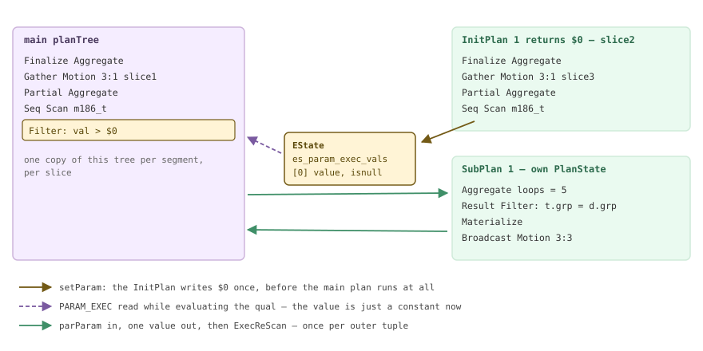

*并非一棵树的计划树：主计划与分离的子计划树，通过一个参数槽位相连。*

*不相关的聚合子查询变成 InitPlan（已删去 VERBOSE 的 Output 行）。*

```sql
SET optimizer = off;
EXPLAIN (ANALYZE, VERBOSE, TIMING OFF, COSTS OFF)
  SELECT count(*) FROM m186_t WHERE val > (SELECT avg(val) FROM m186_t);
```

```text {hl_lines="2" title="output"}
 Finalize Aggregate (actual rows=1 loops=1)
   InitPlan 1 (returns $0)  (slice2)
     ->  Finalize Aggregate (actual rows=1 loops=1)
           ->  Gather Motion 3:1  (slice3; segments: 3) (actual rows=3 loops=1)
                 ->  Partial Aggregate (actual rows=1 loops=1)
                       ->  Seq Scan on public.m186_t m186_t_1 (actual rows=66711 loops=1)
   ->  Gather Motion 3:1  (slice1; segments: 3) (actual rows=3 loops=1)
         ->  Partial Aggregate (actual rows=1 loops=1)
               ->  Seq Scan on public.m186_t (actual rows=33451 loops=1)
                     Filter: ((m186_t.val)::numeric > $0)
                     Rows Removed by Filter: 33260
 Settings: optimizer = 'off'
   (slice0)    Executor memory: 115K bytes.
   (slice1)    Executor memory: 120K bytes avg x 3x(0) workers, 120K bytes max (seg0).
   (slice2)    Executor memory: 59K bytes.
 ...
 Optimizer: Postgres query optimizer
 Execution Time: 31.517 ms
```

`InitPlan 1` 旁边的 `(slice2)` 是 Cloudberry 特有的部分，并非装饰。上游 PostgreSQL **延迟**求值 InitPlan，直到首次读取参数时才执行：`ExecEvalParamExec`（`execExprInterp.c`）发现 `prm->execPlan != NULL` 后，就在表达式求值过程中调用 `ExecSetParamPlan`。Cloudberry 无法这样做，因为一个 InitPlan 自身可能跨越多个切片，需要进程组和 Interconnect。因此，`ExecSetParamPlan` 被重写为派发执行：

```c {title="src/backend/executor/nodeSubplan.c"}
	if (Gp_role == GP_ROLE_DISPATCH && planstate != NULL &&
		planstate->plan != NULL && queryDesc)
	{
		int  subsliceIndex = queryDesc->plannedstmt->subplan_sliceIds[subplan->plan_id - 1];
		ExecSlice *subslice = &estate->es_sliceTable->slices[subsliceIndex];

		if (subslice->gangType != GANGTYPE_UNALLOCATED || subslice->children)
			shouldDispatch = true;
	}
	...
	if (shouldDispatch)
	{
		CdbDispatchPlan(queryDesc, estate->es_param_exec_vals, needDtx, true);
		CurrentMotionIPCLayer->SetupInterconnect(queryDesc->estate);   /* for the initplan's root slice */
	}
```

> [!NOTE]
> 所以，Cloudberry 中的 InitPlan 是一个独立的小查询：有自己的切片（`subplan_sliceIds[]`，`plannodes.h` — `PlannedStmt`）、自己的进程组、自己的 Interconnect 建立与拆除过程，以及内存页脚中的独立一行。由于必须在派发主计划之前完成，它会被**提前**执行：`ExecutorRun` 在派发主计划之前调用 `preprocess_initplans(queryDesc)`（`execMain.c` — `standard_ExecutorStart()`）；实现位于 `cdbsubplan.c`，会遍历 `es_param_exec_vals`，触发所有切片为根切片的 InitPlan。嵌套 InitPlan 之所以能工作，是因为不断增加的已计算 `PARAM_EXEC` 值会在每次派发时重新序列化。这清楚地展示了上游的*延迟*机制为了适应派发而改为*提前*执行的一个实例（[§13.3](/cloudberry/core-internals/part-4-query-processing/ch13/#133-dispatch-from-coordinator-plan-to-segment-execution)）。

*相关标量子查询变成 SubPlan，loops=5 说明了一切。*

```sql
SET optimizer = off;
EXPLAIN (ANALYZE, VERBOSE, TIMING OFF, COSTS OFF)
  SELECT d.grp, (SELECT count(*) FROM m186_t t WHERE t.grp = d.grp) FROM m186_dim d;
```

```text {hl_lines="6" title="output"}
 Gather Motion 3:1  (slice1; segments: 3) (actual rows=10 loops=1)
   Output: d.grp, ((SubPlan 1))
   ->  Seq Scan on public.m186_dim d (actual rows=5 loops=1)
         Output: d.grp, (SubPlan 1)
         SubPlan 1
           ->  Aggregate (actual rows=1 loops=5)
                 ->  Result (actual rows=20000 loops=5)
                       Filter: (t.grp = d.grp)
                       ->  Materialize (actual rows=200000 loops=5)
                             work_mem: 34270kB  Segments: 3  Max: 11424kB (segment 0)  Workfile: (0 spilling)
                             ->  Broadcast Motion 3:3  (slice2; segments: 3) (actual rows=200000 loops=1)
                                   ->  Seq Scan on public.m186_t t (actual rows=66711 loops=1)
 ...
 Optimizer: Postgres query optimizer
 Execution Time: 445.614 ms
```

向下阅读 `loops` 列：`Aggregate` 和 `Result` 运行了 **5 次**（该 Segment 上每个 `m186_dim` 行一次），但下方的 `Broadcast Motion` 只运行**一次**。这一差别完全来自夹在二者之间的 `Materialize`，即 [§18.6.2](#1862-materialize-buffering-a-subtree) 的主题。没有它，每个外侧元组都会重新打开一个 Motion；重跑 Motion 五次不仅慢，还可能让 Interconnect 死锁。还要注意，逐节点的 `rows` 是*每轮平均值*：`Result` 报告 20 000，`loops=5`，即总共从 tuplestore 拉取 100 000 个元组，只为让 `count(*)` 每次过滤汇总成一行。相关子计划就是执行器不多不少地执行 SQL 文本提出的要求。

*无法上拉的 IN 子查询变成哈希 SubPlan：构建一次，探测 66 711 次。*

```sql
SET optimizer = off;
EXPLAIN (ANALYZE, VERBOSE, TIMING OFF, COSTS OFF)
  SELECT count(*) FROM m186_t t
   WHERE t.val < 0 OR t.grp IN (SELECT grp FROM m186_dim WHERE label <> 'g3');
```

```text {hl_lines="5" title="output"}
 Finalize Aggregate (actual rows=1 loops=1)
   ->  Gather Motion 3:1  (slice1; segments: 3) (actual rows=3 loops=1)
         ->  Partial Aggregate (actual rows=1 loops=1)
               ->  Seq Scan on public.m186_t t (actual rows=60006 loops=1)
                     Filter: ((t.val < 0) OR (hashed SubPlan 1))
                     Rows Removed by Filter: 6647
                     SubPlan 1
                       ->  Broadcast Motion 3:3  (slice2; segments: 3) (actual rows=9 loops=1)
                             ->  Seq Scan on public.m186_dim (actual rows=4 loops=1)
                                   Filter: (m186_dim.label <> 'g3'::text)
 ...
 Optimizer: Postgres query optimizer
 Execution Time: 31.633 ms
```

`OR` 阻止了子查询被展平为半连接；规划器退而求其次，将其哈希化。Motion 上的 `loops=1` 证明子查询只运行了一次。`buildSubPlanHash` 实际构建**两个**哈希表：`node->hashtable` 保存不含 NULL 的行，`node->hashnulls` 保存包含 NULL 的行（`nodeSubplan.c` — `buildSubPlanHash()`）。这不是为了整齐，而是为了 `IN` 的三值逻辑：探测未命中 `hashtable` 时，还必须调用 `findPartialMatch`，检查是否存在某行，若将 NULL 换成实际值就可能匹配；如果存在，结果应为 NULL，而不是 false。对可空列使用 `NOT IN` 之所以缓慢又容易出乎意料，正是这个原因；这里展示的就是实现它的代码。

*ORCA 下的同两个查询：没有 InitPlan，也没有 SubPlan，子查询已去相关并转为连接。*

```sql
SET optimizer = on;
EXPLAIN (ANALYZE, TIMING OFF, COSTS OFF)
  SELECT count(*) FROM m186_t WHERE val > (SELECT avg(val) FROM m186_t);
EXPLAIN (ANALYZE, TIMING OFF, COSTS OFF)
  SELECT d.grp, (SELECT count(*) FROM m186_t t WHERE t.grp = d.grp) FROM m186_dim d;
```

```text {hl_lines="4 15" title="output"}
 Finalize Aggregate (actual rows=1 loops=1)
   ->  Gather Motion 3:1  (slice1; segments: 3) (actual rows=3 loops=1)
         ->  Partial Aggregate (actual rows=1 loops=1)
               ->  Nested Loop (actual rows=33451 loops=1)
                     Join Filter: ((m186_t.val)::numeric > (avg(m186_t_1.val)))
                     ->  Broadcast Motion 1:3  (slice2) (actual rows=1 loops=1)
                           ->  Finalize Aggregate (actual rows=1 loops=1)
                                 ->  Gather Motion 3:1  (slice3; segments: 3) (actual rows=3 loops=1)
                                       ->  Partial Aggregate (actual rows=1 loops=1)
                                             ->  Seq Scan on m186_t m186_t_1 (actual rows=66711 loops=1)
                     ->  Seq Scan on m186_t (actual rows=33356 loops=2)
 Optimizer: GPORCA

 Gather Motion 3:1  (slice1; segments: 3) (actual rows=10 loops=1)
   ->  Hash Left Join (actual rows=5 loops=1)
         Hash Cond: (d.grp = t.grp)
         ->  Seq Scan on m186_dim d (actual rows=5 loops=1)
         ->  Hash (actual rows=5 loops=1)
               ->  Finalize HashAggregate (actual rows=5 loops=1)
                     Group Key: t.grp
                     ->  Redistribute Motion 3:3  (slice2; segments: 3) (actual rows=15 loops=1)
                           ->  Streaming Partial HashAggregate (actual rows=10 loops=1)
                                 ->  Seq Scan on m186_t t (actual rows=66711 loops=1)
 Optimizer: GPORCA
 Execution Time: 29.462 ms
```

> [!NOTE]
> 这让 [§17.3](/cloudberry/core-internals/part-4-query-processing/ch17/#173-transformation-framework)/[§17.5](/cloudberry/core-internals/part-4-query-processing/ch17/#175-translation-query--dxl--plstmt) 的机制变得可见：ORCA 倾向于**去相关**，将逐元组执行的 `SubPlan` 变为一次遍历的 `Hash Left Join`，其内侧先进行聚合。在本机上，耗时从 445 ms 降至 29 ms（只是同一个启用断言构建上的比值，不是基准测试）。这并不意味着 ORCA 无法生成子计划：上面受 `OR` 限制的 `IN` 在 ORCA 下仍是 `hashed SubPlan 1`，外面包着自己的 `Materialize`。本章反复强调的经验是：**调优 `SubPlan` 之前，先查看 `Optimizer:` 页脚**，因为另一个优化器可能根本不生成该节点。

### 18.6.2 Materialize：缓冲子树 {#1862-materialize-buffering-a-subtree}

`nodeMaterial.c`（548 行）是执行器对“这份数据需要读取多次”的回应。它从子节点拉取元组，逐个存入 tuplestore 后返回；重扫描时，则重放 tuplestore，而不是重新执行子节点。规划器会将它插入嵌套循环的内侧（[§18.4](#184-join-nodes)）、刚看到的相关子计划下方，以及归并连接需要标记和恢复的位置。它也是让 `ExecMaterialMarkPos` 得以实现的节点。

*收紧操作符内存预算后，三个 Segment 上的 tuplestore 都发生溢出。*

```sql
SET optimizer = off;
SET statement_mem = '2MB';
EXPLAIN (ANALYZE, VERBOSE, TIMING OFF, COSTS OFF)
  SELECT d.grp, (SELECT count(*) FROM m186_t t WHERE t.grp = d.grp) FROM m186_dim d;
```

```text {hl_lines="6" title="output"}
         SubPlan 1
           ->  Aggregate (actual rows=1 loops=5)
                 ->  Result (actual rows=20000 loops=5)
                       Filter: (t.grp = d.grp)
                       ->  Materialize (actual rows=200000 loops=5)
                             work_mem: 4344kB  Segments: 3  Max: 1448kB (segment 0)  Workfile: (3 spilling)
                             Work_mem wanted: 9582K bytes avg, 9582K bytes max (seg0) to lessen workfile I/O affecting 3 workers.
                             ->  Broadcast Motion 3:3  (slice2; segments: 3) (actual rows=200000 loops=1)
 ...
 * (slice1)    Executor memory: 1103K bytes avg x 3x(0) workers, 1103K bytes max (seg0).  Work_mem: 1448K bytes max, 9582K bytes wanted.
 Memory used:  2048kB
 Memory wanted:  10181kB
 Execution Time: 690.646 ms
```

> [!NOTE]
> 阅读时要知道两点。第一，**Cloudberry 不输出上游针对 Material 的 `Storage: Memory` / `Maximum Storage: NkB` 行**，它们已被移除；取而代之的是逐 Segment 的 `work_mem: … Workfile: (N spilling)` 行，以及页脚中带星号的切片（语义见 [§18.1](#181-executor-framework--lifecycle)）。第二，这里的预算并非直接使用 `work_mem`：`ExecMaterial` 通过 `PlanStateOperatorMemKB(&node->ss.ps)` 创建 tuplestore（`nodeMaterial.c`），采用规划器从 `statement_mem` 中为该操作符划出的份额。因此，单独降低 `work_mem` 没有使其溢出，而降低 `statement_mem` 则会。

```c {title="src/backend/executor/nodeMaterial.c — ExecMaterial()"}
		/*
		 * MPP: If requested, fetch all rows from subplan and put them
		 * in the tuplestore.  This decouples a middle slice's receiving
		 * and sending Motion operators to neutralize a deadlock hazard.
		 */
		if (((Material *) node->ss.ps.plan)->cdb_strict)
		{
			for (;;)
			{
				TupleTableSlot *outerslot = ExecProcNode(outerPlanState(node));
				if (TupIsNull(outerslot))
					break;
				tuplestore_puttupleslot(tuplestorestate, outerslot);
			}
			node->eof_underlying = true;
```

这个标志是 Cloudberry 自有的。设置了 `cdb_strict` 的 `Material` 不会延迟缓冲，而是在返回任何元组之前，先读完整个子节点。当某切片既从一个 Motion 接收数据，又向另一个 Motion 发送数据时，规划器会在 `createplan.c`（`create_nestloop_plan()`）及 `create_mergejoin_plan()` 中设置它，否则就可能停在只读了一半的状态，让其他进程等待（[§18.4](#184-join-nodes) 介绍配套的内侧预取机制；第 [19](/cloudberry/core-internals/part-4-query-processing/ch19/) 章解释未被读取的 Motion 为何阻塞）。所以，在 Cloudberry 中，`Materialize` 不只是优化，有时也是保证正确性的手段。

### 18.6.3 递归 CTE：用两个 tuplestore 构建迭代 {#1863-recursive-ctes-iteration-built-from-two-tuplestores}

`WITH RECURSIVE` 是 SQL 中唯一真正的循环，`nodeRecursiveunion.c`（371 行）通过两个 tuplestore 和一次交换实现它。非递归项求值一次，写入**工作表**。随后递归项运行，通过 `WorkTableScan`（`nodeWorktablescan.c`，229 行）读取工作表，并将产生的内容写入**中间表**。递归项返回 EOF 后，中间表成为新的工作表，再创建空的中间表，并重扫描递归项。当某次迭代不产生任何内容时，循环结束。

```c {title="src/backend/executor/nodeRecursiveunion.c — ExecRecursiveUnion()"}
			/* done with old working table ... */
			tuplestore_end(node->working_table);

			/* intermediate table becomes working table */
			node->working_table = node->intermediate_table;
			for (int k = 1; k < node->refcount; k++)
				tuplestore_alloc_read_pointer(node->working_table, EXEC_FLAG_REWIND);

			/* create new empty intermediate table */
			node->intermediate_table = tuplestore_begin_heap(false, false, work_mem);
			node->intermediate_empty = true;

			/* reset the recursive term */
			innerPlan->chgParam = bms_add_member(innerPlan->chgParam, plan->wtParam);
```

注意迭代的触发方式：不是使用循环计数器，而是把 `wtParam` 加入递归项的 `chgParam`，让 [§18.1](#181-executor-framework--lifecycle) 的 `ExecReScan` 机制在下一次拉取时重新初始化整棵子树。另一半是去重检查。对于 `UNION ALL`，`numCols` 为 0，所有元组都会保留；对于 `UNION`，初始化时会构建 `TupleHashTable`（`build_hash_table()`），每个候选元组先经过 `LookupTupleHashEntry`，使有环图能够终止，而不至于无限循环。种子循环和递归循环都执行此检查，因此 `UNION` 的代价是为整个传递闭包保存一张哈希表。

*WITH RECURSIVE 迫使 ORCA 交回查询，递归完全落在 Coordinator 上。*

```sql
SET optimizer = on;  SET optimizer_trace_fallback = on;
EXPLAIN (ANALYZE, TIMING OFF, COSTS OFF) WITH RECURSIVE d(node,depth) AS (
    SELECT 1, 0
  UNION ALL
    SELECT e.dst, d.depth+1 FROM m186_edge e JOIN d ON e.src = d.node WHERE d.depth < 6)
SELECT count(*), max(depth) FROM d;
```

```text {hl_lines="3" title="output"}
INFO:  GPORCA failed to produce a plan, falling back to Postgres-based planner
DETAIL:  Falling back to Postgres-based planner because GPORCA does not support
         the following feature: WITH RECURSIVE

 Aggregate (actual rows=1 loops=1)
   ->  Recursive Union (actual rows=1093 loops=1)
         ->  Result (actual rows=1 loops=1)
         ->  Hash Join (actual rows=156 loops=7)
               Hash Cond: (d.node = e.src)
               ->  WorkTable Scan on d (actual rows=52 loops=7)
                     Filter: (depth < 6)
                     Rows Removed by Filter: 104
               ->  Hash (actual rows=40000 loops=1)
                     Buckets: 524288  Batches: 1  Memory Usage: 5659kB
                     ->  Gather Motion 3:1  (slice1; segments: 3) (actual rows=40000 loops=1)
                           ->  Seq Scan on m186_edge e (actual rows=13504 loops=1)
   (slice0)    Executor memory: 5777K bytes.  Work_mem: 5659K bytes max.
   (slice1)    Executor memory: 112K bytes avg x 3x(0) workers, 112K bytes max (seg0).
 Optimizer: Postgres query optimizer
 Execution Time: 19.874 ms
```

这在实际运行中确认了 [§17.1](/cloudberry/core-internals/part-4-query-processing/ch17/#171-entry--dispatch) 的回退机制，并带来一个应明确说明的结果：**`RecursiveUnion` 和 `WorkTableScan` 只会由 PostgreSQL 规划器路径生成。**无论怎样调整 ORCA，都不会改变递归查询的执行方式，因为它从未规划该查询。值得逐节点解读这个计划，因为计数器能精确还原遍历过程。种子是节点 1，树中每个节点有三个子节点，`depth < 6` 条件在六轮有产出的迭代后截断递归。

<figure class="cloudberry-core-figure">
<div><div style="font-family:ui-monospace,SFMono-Regular,Menlo,monospace;font-size:12px;overflow-x:auto"> <div style="display:grid;grid-template-columns:74px 250px 250px 1fr;gap:5px 12px;align-items:center;min-width:660px"> <div style="color:#555;font-weight:600">迭代</div> <div style="color:#4a3a5e;font-weight:600">工作表 &mdash; WorkTable Scan 读取</div> <div style="color:#2c6a4c;font-weight:600">中间表 &mdash; RecursiveUnion 写入</div> <div style="color:#555;font-weight:600">发生了什么</div> <div>种子</div><div style="color:#707070">&mdash;</div> <div><span style="display:inline-block;height:9px;width:4px;background:#cfead9;border:1px solid #3f8f68"></span> 1</div> <div style="color:#666">非递归项：SELECT 1, 0</div> <div>1</div><div><span style="display:inline-block;height:9px;width:4px;background:#cdb4db"></span> 1</div> <div><span style="display:inline-block;height:9px;width:8px;background:#cfead9;border:1px solid #3f8f68"></span> 3</div><div></div> <div>2</div><div><span style="display:inline-block;height:9px;width:8px;background:#cdb4db"></span> 3</div> <div><span style="display:inline-block;height:9px;width:14px;background:#cfead9;border:1px solid #3f8f68"></span> 9</div><div></div> <div>3</div><div><span style="display:inline-block;height:9px;width:14px;background:#cdb4db"></span> 9</div> <div><span style="display:inline-block;height:9px;width:26px;background:#cfead9;border:1px solid #3f8f68"></span> 27</div><div></div> <div>4</div><div><span style="display:inline-block;height:9px;width:26px;background:#cdb4db"></span> 27</div> <div><span style="display:inline-block;height:9px;width:50px;background:#cfead9;border:1px solid #3f8f68"></span> 81</div><div></div> <div>5</div><div><span style="display:inline-block;height:9px;width:50px;background:#cdb4db"></span> 81</div> <div><span style="display:inline-block;height:9px;width:100px;background:#cfead9;border:1px solid #3f8f68"></span> 243</div><div></div> <div>6</div><div><span style="display:inline-block;height:9px;width:100px;background:#cdb4db"></span> 243</div> <div><span style="display:inline-block;height:9px;width:200px;background:#cfead9;border:1px solid #3f8f68"></span> 729</div><div></div> <div style="background:#fff4d6;border-radius:3px;padding:1px 4px">7</div> <div style="background:#fff4d6;border-radius:3px;padding:1px 4px"><span style="display:inline-block;height:9px;width:200px;background:#cdb4db"></span> 729</div> <div style="background:#fff4d6;border-radius:3px;padding:1px 4px">0</div> <div style="background:#fff4d6;border-radius:3px;padding:1px 4px;color:#5a4708">全部 729 行的深度都是 6，未通过过滤条件 &rarr; 中间表为空 &rarr; 循环结束</div> <div style="border-top:1px solid #ddd;padding-top:4px">总计</div> <div style="border-top:1px solid #ddd;padding-top:4px">读取 1093 行，364 行通过过滤条件</div> <div style="border-top:1px solid #ddd;padding-top:4px">递归项产生 1092 行</div> <div style="border-top:1px solid #ddd;padding-top:4px;color:#666"><span class="hl">1 + 1092 = 1093 = Recursive Union 的 actual rows</span></div> </div></div></div>
<figcaption>从 loops=7 还原七轮迭代；条形宽度与行数成正比</figcaption>
</figure>

计划中的每个数字都可以从该表推导。`WorkTable Scan` 报告 `rows=52 loops=7`，52 × 7 = 364，恰好是通过 `depth < 6` 的行数（1+3+9+27+81+243）。其 `Rows Removed by Filter: 104` × 7 = 728，与深度为 6 的 729 行仅差每轮取整造成的误差。`Hash Join` 报告 `rows=156 loops=7`，156 × 7 = 1092，是递归项的总输出；加上种子，就得到 `Recursive Union` 的 1093。这是本章最清楚的例子，说明 EXPLAIN 的 `rows` 是**每轮平均值**，不是总量（[§18.1](#181-executor-framework--lifecycle)）。

接下来是上述计划只回答了一半的 MPP 问题。`Hash` 显示 `loops=1`：基于 `m186_edge` 的 40 000 行哈希表只构建**一次**，并保留到七次重扫描全部结束，所以 `Gather Motion` 只运行一次；执行器没有在每轮迭代中重新通过 Interconnect 拉取整张表。但循环本身在哪里运行？这里在 Coordinator（slice0）上，因为种子 `SELECT 1` 的分布位置类型为 General。这不是固定规则；Cloudberry 在规划器中，让工作表继承*非递归项*的分布位置：

```c {title="src/backend/optimizer/util/pathnode.c — create_worktablescan_path()"}
	switch (ctelocus.locustype)
	{
		case CdbLocusType_Entry:
		case CdbLocusType_General:
		case CdbLocusType_OuterQuery:
			break;                                    /* loop stays where the seed is */
		case CdbLocusType_SingleQE:
			CdbPathLocus_MakeSingleQE(&ctelocus, numsegments);
			break;
		case CdbLocusType_SegmentGeneral:
			elog(ERROR, "worktable scan path can never have segmentgeneral locus.");
		default:
			CdbPathLocus_MakeStrewn(&ctelocus, numsegments, 0);   /* one loop per segment */
	}
```

*让种子的分布位置为分布式，同样的递归就会在每个 Segment 上运行一次。*

```sql
SET optimizer = off;
EXPLAIN (ANALYZE, TIMING OFF, COSTS OFF) WITH RECURSIVE d(node,depth) AS (
    SELECT src, 0 FROM m186_edge WHERE src = 1
  UNION ALL
    SELECT e.dst, d.depth+1 FROM m186_edge e JOIN d ON e.src = d.node WHERE d.depth < 6)
SELECT count(*) FROM d;
```

```text {hl_lines="4 12" title="output"}
 Finalize Aggregate (actual rows=1 loops=1)
   ->  Gather Motion 3:1  (slice1; segments: 3) (actual rows=3 loops=1)
         ->  Partial Aggregate (actual rows=1 loops=1)
               ->  Recursive Union (actual rows=3279 loops=1)
                     ->  Seq Scan on m186_edge (actual rows=3 loops=1)
                           Filter: (src = 1)
                     ->  Hash Join (actual rows=468 loops=7)
                           Hash Cond: (d.node = e.src)
                           ->  WorkTable Scan on d (actual rows=156 loops=7)
                                 Filter: (depth < 6)
                           ->  Hash (actual rows=40000 loops=1)
                                 ->  Broadcast Motion 3:3  (slice2; segments: 3) (actual rows=40000 loops=1)
                                       ->  Seq Scan on m186_edge e (actual rows=13504 loops=1)
   (slice1)    Executor memory: 5783K bytes avg x 3x(0) workers, 5847K bytes max (seg1).  Work_mem: 5659K bytes max.
 Optimizer: Postgres query optimizer
 Execution Time: 45.214 ms
```

> [!NOTE]
> `Recursive Union` 从 slice0 移到了 slice1：**三个独立循环，每个 Segment 一个，各自拥有一对 tuplestore**。正确性由 `Broadcast Motion 3:3` 保证：每个 Segment 都获得边表的完整副本，因此从 Segment 1 开始的遍历无需与其他进程通信，就能在那里完成。这带来两个结果。并行程度只取决于*种子*的分散程度；这里三个种子行全部哈希到 Segment 1，因此一个 Segment 产生了 3279 = 3 &times; 1093 行，另外两个发现工作表为空，迭代一次后就停止。而且广播面向每个 Segment，因此内侧所需内存要乘以 Segment 数量，而不是除以它；页脚中的 5659K 是*每个 Segment* 的用量。另外，上游假设工作表只有一个读取者，但 Cloudberry 可以为同一个 `RecursiveUnion` 规划多个 `WorkTableScan`，所以每个扫描都有自己的 tuplestore 读取指针（`execnodes.h` 解释原因，`nodeWorktablescan.c` — `WorkTableScanNext()` 和 `ExecInitWorkTableScan()` 负责实现）；交换代码中的 `refcount` 循环分配的正是这些指针。

### 18.6.4 Append 与 MergeAppend：多个子节点，一条输出流 {#1864-append-and-mergeappend-many-children-one-stream}

`nodeAppend.c`（1277 行）的任务不过是“返回子节点 1 的全部内容，再返回子节点 2 的全部内容，……”，文件却出乎意料地大。大部分代码负责选择：普通情形使用 `choose_next_subplan_locally`，Append 支持并行协作时使用 `choose_next_subplan_for_leader`/`_for_worker`（`choose_next_subplan_for_worker()`），并发外表扫描则使用异步机制（`ExecAppendAsyncBegin`）。`Append` 会出现在 `UNION ALL`、继承或分区层次结构，以及 `SetOp` 下方。它有两个值得关注的行为：子节点**延迟**启动，从未被请求的子节点显示 `(never executed)`；同时，它参与**分区剪枝**。

*规划时剪枝留下两个子节点；通用计划改在运行时剪枝，并明确报告。*

```sql
SET optimizer = off;
-- constant predicate: the planner removes 2024 outright
EXPLAIN (ANALYZE, TIMING OFF, COSTS OFF) SELECT count(*) FROM m186_part WHERE dt >= '2025-06-01';

-- a generic plan cannot know $1, so pruning is deferred to the executor
SET plan_cache_mode = force_generic_plan;
PREPARE q186(date) AS SELECT count(*) FROM m186_part WHERE dt >= $1;
EXPLAIN (ANALYZE, TIMING OFF, COSTS OFF) EXECUTE q186('2026-01-01');
```

```text {hl_lines="10" title="output"}
               ->  Append (actual rows=14563 loops=1)
                     ->  Seq Scan on m186_part_2025 m186_part_1 (actual rows=6463 loops=1)
                           Filter: (dt >= '2025-06-01'::date)
                           Rows Removed by Filter: 4481
                     ->  Seq Scan on m186_part_2026 m186_part_2 (actual rows=8100 loops=1)
                           Filter: (dt >= '2025-06-01'::date)
 Optimizer: Postgres query optimizer

               ->  Append (actual rows=8100 loops=1)
                     Subplans Removed: 2
                     ->  Seq Scan on m186_part_2026 m186_part_1 (actual rows=8100 loops=1)
                           Filter: (dt >= $1)
 Optimizer: Postgres query optimizer
 Execution Time: 5.625 ms
```

`Subplans Removed: 2` 表明执行器自身正在剪枝。`ExecInitAppend` 将计划的 `PartitionPruneInfo` 传给 `ExecInitPartitionPruning`（`execPartition.c`）；如果剪枝步骤只依赖外部参数，就在初始化时求值一次，将保留的子节点记录在 `as_valid_subplans`（`nodeAppend.c` — `ExecInitAppend()`）中；如果步骤依赖*执行期*参数，例如嵌套循环的外侧值、InitPlan 的 `$0`，则每次重扫描都由 `ExecFindMatchingSubPlans`（`execPartition.c`）重新求值。

*MergeAppend 通过二叉堆归并各子节点，保留它们的排序顺序。*

```sql
SET optimizer = off;
SET enable_seqscan = off;  SET enable_sort = off;
EXPLAIN (ANALYZE, TIMING OFF, COSTS OFF) SELECT val, dt FROM m186_part ORDER BY val LIMIT 4;
```

```text {hl_lines="5" title="output"}
 Limit (actual rows=4 loops=1)
   ->  Gather Motion 3:1  (slice1; segments: 3) (actual rows=4 loops=1)
         Merge Key: m186_part.val
         ->  Limit (actual rows=4 loops=1)
               ->  Merge Append (actual rows=4 loops=1)
                     Sort Key: m186_part.val
                     ->  Index Scan using m186_part_2024_val_idx on m186_part_2024 m186_part_1 (actual rows=4 loops=1)
                     ->  Index Scan using m186_part_2025_val_idx on m186_part_2025 m186_part_2 (actual rows=1 loops=1)
                     ->  Index Scan using m186_part_2026_val_idx on m186_part_2026 m186_part_3 (actual rows=1 loops=1)
 Optimizer: Postgres query optimizer
 Execution Time: 2.912 ms
```

> [!NOTE]
> 行数揭示了机制：`nodeMergeAppend.c` 先从**每个**子节点取一个元组来初始化 `binaryheap`（`ExecMergeAppend()`），之后反复取堆中最小值，并补充对应的那一个槽位（`ExecMergeAppend()`&ndash;`ExecMergeAppend()`）。因此，胜出的子节点提供四行，其他各提供一行，这是保持顺序的归并不可避免的代价。这里给出两处交叉引用，不再重复解释。通过 `Append` 进行分区剪枝是上游 PostgreSQL 的机制；Cloudberry 另有一套独立机制，即由 `PartitionSelector` 驱动的 `Dynamic*` 扫描系列，ORCA 会改为生成它们（扫描见 [§18.2](#182-scan-nodes)，选择器见 [§18.7](#187-cloudberry-specific-nodes)）。目标相同，实现有两种，采用哪一种由 `Optimizer:` 行决定。另外，这里的 `enable_parallel_append` 为 `on`，但 Segment 内并行属于 [§18.2](#182-scan-nodes) 的主题。

### 18.6.5 小而不可或缺的节点 {#1865-the-small-essential-nodes}

- **Limit — `nodeLimit.c`（586）**：一个小型状态机（`LIMIT_INITIAL`、`LIMIT_INWINDOW`、`LIMIT_SUBPLANEOF`、`LIMIT_WINDOWEND`、…，`execnodes.h` — `LimitStateCond`），跳过 `OFFSET` 行，传递 `count` 行，然后停止。它还会*告诉子节点*只需要多少行：`ExecSetTupleBound(compute_tuples_needed(node), outerPlanState(node))`。
- **Unique — `nodeUnique.c`（195）**：只去除*相邻*重复值，因此要求输入有序；它保留最后输出的元组，并使用 `ExecQualAndReset`（`ExecUnique()`）比较。`DISTINCT` 的哈希实现则是 `nodeAgg.c` 的 `AGG_HASHED`（[§18.3](#183-sort--aggregate-nodes)）。
- **SetOp — `nodeSetOp.c`（653）**：通过统计各输入的出现次数实现 `INTERSECT`/`EXCEPT`（及其 `ALL` 形式）；`SETOP_SORTED` 模式处理排序后的 `Append`，`SETOP_HASHED` 模式则先填充哈希表（`setop_fill_hash_table`）。
- **Result — `nodeResult.c`（359）**：或者不带子节点，生成一个计算所得的行（单行 `VALUES` 的情形、`INSERT` 的数据源）；或者充当**闸门**，只检查一次 `resconstantqual`（`rs_checkqual`，`ExecResult()`），若为假，整棵子树就不返回任何内容。
- **FunctionScan / ValuesScan / TableFuncScan**：分别对应 `FROM` 中的 `generate_series(…)`、字面 `VALUES` 列表，以及 `XMLTABLE`/`JSON_TABLE`。三者都显示为叶子扫描，背后没有关系。
- **CteScan / NamedTuplestoreScan**：在上游，分别读取物化 CTE 和 AFTER 触发器的过渡表。在 Cloudberry 中，如后文所示，两种节点都不会被使用。
- **LockRows — `nodeLockRows.c`（404）**：用于 `SELECT … FOR UPDATE`，从子计划重新获取每行并加锁；若行已移动，由 `EvalPlanQual` 重新检查。锁语义见 [§11.1](/cloudberry/core-internals/part-3-transactions-mvcc-concurrency/ch11/#111-heavyweight-relation-level-locks)/[§11.2](/cloudberry/core-internals/part-3-transactions-mvcc-concurrency/ch11/#112-row-level-locks--multixacts)。

*Limit 从每个 Segment 向上传递 OFFSET+count 行，并将上限传给下方的 Sort。*

```sql
SET optimizer = off;
EXPLAIN (ANALYZE, TIMING OFF, COSTS OFF)
  SELECT id, val FROM m186_t ORDER BY val DESC, id OFFSET 5 LIMIT 3;
```

```text {hl_lines="4" title="output"}
 Limit (actual rows=3 loops=1)
   ->  Gather Motion 3:1  (slice1; segments: 3) (actual rows=8 loops=1)
         Merge Key: val, id
         ->  Limit (actual rows=8 loops=1)
               ->  Sort (actual rows=8 loops=1)
                     Sort Key: val DESC, id
                     Sort Method:  top-N heapsort  Memory: 75kB
                     ->  Seq Scan on m186_t (actual rows=66711 loops=1)
   (slice1)    Executor memory: 134K bytes avg x 3x(0) workers, 134K bytes max (seg0).  Work_mem: 1K bytes max.
 Optimizer: Postgres query optimizer
 Execution Time: 22.376 ms
```

八行输出展示了三种机制。计划有**两个** `Limit` 节点，因为 LIMIT 不能直接分配到各 Segment 独立执行：逐 Segment 的节点必须传递 `OFFSET + LIMIT` = 8 行，因为它不知道哪些行是全局应丢弃的前五行；只有 Coordinator 的 `Limit` 才应用偏移量并返回三行。`Sort Method: top-N heapsort` 证明 `ExecSetTupleBound` 已传到排序节点，使其只保留大小为 8 的有界堆，而非排序全部 66 711 行（有界排序见 [§18.3](#183-sort--aggregate-nodes)）。`ExecLimit` 结束时还会调用 `ExecSquelchNode(node, false)`（`nodeLimit.c`），发送 Cloudberry 的“不会再有人读取你”的信号，让仍在向该 Motion 发送数据的 Segment 停止，而不至于阻塞其他进程（[§18.1](#181-executor-framework--lifecycle)）。

*Unique 需要有序输入；SetOp 有排序和哈希两种形态；Result 可以拦住整个计划。*

```sql
SET optimizer = off;  SET enable_hashagg = off;
EXPLAIN (ANALYZE, TIMING OFF, COSTS OFF)
  SELECT grp FROM m186_dim UNION SELECT val FROM m186_t WHERE val < 3;
EXPLAIN (ANALYZE, TIMING OFF, COSTS OFF)
  SELECT grp FROM m186_t INTERSECT SELECT grp FROM m186_dim;
RESET enable_hashagg;
EXPLAIN (ANALYZE, TIMING OFF, COSTS OFF) SELECT count(*) FROM m186_t WHERE 1 = 0;
```

```text {hl_lines="2 12 20" title="output"}
 Gather Motion 3:1  (slice1; segments: 3) (actual rows=10 loops=1)
   ->  Unique (actual rows=5 loops=1)
         Group Key: m186_dim.grp
         ->  Sort (actual rows=402 loops=1)
               Sort Method:  quicksort  Memory: 75kB
               ->  Redistribute Motion 3:3  (slice2; segments: 3) (actual rows=402 loops=1)
                     ->  Append (actual rows=213 loops=1)
                           ->  Seq Scan on m186_dim (actual rows=5 loops=1)
                           ->  Seq Scan on m186_t (actual rows=208 loops=1)

 Gather Motion 3:1  (slice1; segments: 3) (actual rows=10 loops=1)
   ->  SetOp Intersect (actual rows=5 loops=1)
         ->  Sort (actual rows=100005 loops=1)
               Sort Method:  quicksort  Memory: 15521kB
               ->  Append (actual rows=100005 loops=1)
                     ->  Subquery Scan on "*SELECT* 2" (actual rows=5 loops=1)
                     ->  Redistribute Motion 3:3  (slice2; segments: 3) (actual rows=100000 loops=1)

 Aggregate (actual rows=1 loops=1)
   ->  Result (actual rows=0 loops=1)
         One-Time Filter: false
   (slice0)    Executor memory: 12K bytes.
 Execution Time: 0.052 ms
```

关于前两个计划有两点说明。`Unique` 和 `SetOp` 都要求先按组对输入哈希，让每个组集中到一个 Segment，所以其下方有 `Redistribute Motion`；集合运算是分布式去重，真正关键的工作由 `Motion` 完成。重新开启 `enable_hashagg` 后，同一个 `INTERSECT` 变成 `HashSetOp Intersect`，15 MB 的排序便消失了。第三个计划是本章中代价最低的：带 `One-Time Filter: false` 的 `Result` 从未打开表，完全不需要进程组，slice0 的页脚只显示 12K 字节。

清单中有两个节点在这个系统上永远看不到，原因值得了解。`CteScan` 在 Cloudberry 中是死代码：`create_ctescan_plan`（`createplan.c`）会在内联子计划或 `ShareInputScan` 上方构建 `SubqueryScan`，而 `make_ctescan` 自身标记为 `pg_attribute_unused()`；一个被引用两次的 `WITH … AS MATERIALIZED` 会转为 `Shared Scan (share slice:id 1:0)`（[§18.7](#187-cloudberry-specific-nodes)）。`NamedTuplestoreScan` 无法使用则是另一原因：过渡表需要语句级触发器，而 `CREATE TRIGGER … FOR EACH STATEMENT` 在解析时就被拒绝，报“Triggers for statements are not yet supported”（`gram.y`）；控制它的 GUC 只为允许从旧主版本执行 `pg_restore` 而存在。

*Cloudberry 为 FunctionScan 提供了第三种 InitPlan：结果是整个 tuplestore。*

```sql
SET optimizer = off;
CREATE FUNCTION m186_gen() RETURNS SETOF int LANGUAGE sql
  EXECUTE ON INITPLAN AS $$ SELECT i FROM generate_series(1,3) i $$;
EXPLAIN (ANALYZE, TIMING OFF, COSTS OFF)
  SELECT count(*) FROM m186_t t, m186_gen() g WHERE t.id = g;
```

```text {hl_lines="2" title="output"}
 Finalize Aggregate (actual rows=1 loops=1)
   InitPlan 1 (returns $0)  (slice3)
     ->  Function Scan on m186_gen g_1 (actual rows=3 loops=1)
   ->  Gather Motion 3:1  (slice1; segments: 3) (actual rows=3 loops=1)
         ->  Partial Aggregate (actual rows=1 loops=1)
               ->  Hash Join (actual rows=2 loops=1)
                     Hash Cond: (t.id = g.g)
                     ->  Seq Scan on m186_t t (actual rows=66653 loops=1)
                     ->  Hash (actual rows=2 loops=1)
                           ->  Redistribute Motion 1:3  (slice2) (actual rows=2 loops=1)
                                 ->  Function Scan on m186_gen g (actual rows=3 loops=1)
   (slice3)    Executor memory: 197K bytes.  Work_mem: 17K bytes max.
 Optimizer: Postgres query optimizer
```

> [!NOTE]
> `EXECUTE ON INITPLAN` 是 Cloudberry 特有的函数属性，上游没有对应项，它对 InitPlan 概念作了有趣的扩展。规划器将 `FunctionScan` 克隆到 InitPlan，并在原节点上设置 `resultInTupleStore`（`createplan.c` — `append_initplan_for_function_scan()`）；运行时，InitPlan 副本实际调用函数，把结果行写入**共享 tuplestore 文件**，主计划中的 `Function Scan` 则读取该文件，不再调用函数（`nodeFunctionscan.c` — `FunctionNext_guts()`，通过 `tuplestore_open_shared`）。参数 `$0` 只是占位。将 SQL 函数体换成会发出通知的 PL/pgSQL 函数体，可以看到，即使三个 Segment 都消费其输出，函数体也**恰好只运行一次**；这正是目的：在 Coordinator 上一次性求值易变或昂贵的返回集合函数，再共享结果。

*LockRows 确实存在，但只能出现在不可能有 Motion 的地方；这里是 Coordinator 上的 utility 模式会话。*

```sql
-- normal session, GDD off: no LockRows node at all
SET optimizer = off;
EXPLAIN (ANALYZE, TIMING OFF, COSTS OFF) SELECT id FROM m186_dml WHERE id = 42 FOR UPDATE;

-- PGOPTIONS='-c gp_role=utility' psql -p 7100 -d postgres
SET optimizer = off;
EXPLAIN (ANALYZE, TIMING OFF, COSTS OFF) SELECT id FROM m186_dml WHERE id = 42 FOR UPDATE;
```

```text {hl_lines="6" title="output"}
 Gather Motion 1:1  (slice1; segments: 1) (actual rows=1 loops=1)
   ->  Index Scan using m186_dml_pkey on m186_dml (actual rows=1 loops=1)
         Index Cond: (id = 42)
 Optimizer: Postgres query optimizer

 LockRows (actual rows=0 loops=1)
   ->  Index Scan using m186_dml_pkey on m186_dml (actual rows=0 loops=1)
         Index Cond: (id = 42)
   (slice0)    Executor memory: 115K bytes.
 Optimizer: Postgres query optimizer
```

```c {title="src/backend/parser/analyze.c — checkCanOptSelectLockingClause()"}
bool
checkCanOptSelectLockingClause(SelectStmt *stmt)
{
	if (!IS_QUERY_DISPATCHER())                     return false;
	if (!gp_enable_global_deadlock_detector && Gp_role != GP_ROLE_UTILITY)
		return false;
	if (optimizer)                                  return false;  /* ORCA cannot emit LockRows */
	if (stmt->op != SETOP_NONE)                     return false;
	if (list_length(stmt->fromClause) != 1)         return false;
	if (!IsA(linitial(stmt->fromClause), RangeVar)) return false;
	...
	return true;
}
```

`planner.c`（`grouping_planner()`）中的注释说：“在 Apache Cloudberry 中锁定元组并不容易，因为元组可能经由 Motion 节点获取。”通过 Interconnect 到达的行，在检查它的进程中已经不再具有可供加锁的身份。因此，只有 `canOptSelectLockingClause` 为真时才会创建 `LockRows` 路径；它要求启用全局死锁检测器（这里为 `off`）、只有一张普通表、使用 PostgreSQL 规划器，且没有子查询。否则 Cloudberry 会把行锁升级为表级锁，正如 [§11.1](/cloudberry/core-internals/part-3-transactions-mvcc-concurrency/ch11/#111-heavyweight-relation-level-locks)/[§11.2](/cloudberry/core-internals/part-3-transactions-mvcc-concurrency/ch11/#112-row-level-locks--multixacts) 所述。上面的 utility 模式会话没有分布式执行，也没有 Motion，自然满足条件，因此出现了该节点。还要注意检查中的最后一个子句：即使启用 GDD，`if (optimizer) return false` 也意味着 ORCA 计划根本不会包含 `LockRows` 节点。

### 18.6.6 ModifyTable：一个节点，四种语句 {#1866-modifytable-one-node-four-statements}

`nodeModifyTable.c` 是执行器最大的文件，共 5482 行，几乎全部服务于同一种节点。一个 `ModifyTable` 驱动 `INSERT`、`UPDATE`、`DELETE`，以及 PG15 起的 `MERGE`，只通过 `operation` 字段区分。其形态与本章其他节点相反：它位于计划*顶部*，主动从子计划拉取元组，而不是等待上层拉取，通常不返回任何值。

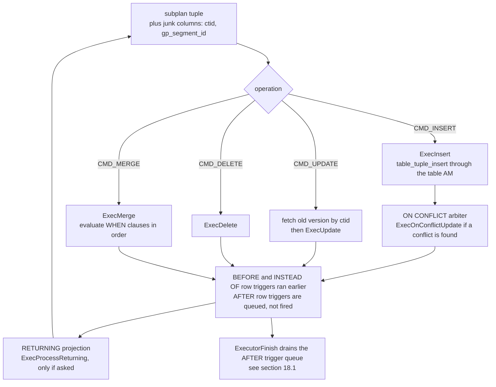

*从子计划拉取一个元组后的通用 DML 生命周期。*

几个值得说明的部分：`ExecInitModifyTable` 为每个目标关系构建一个 `ResultRelInfo`，注册到 `EState.es_result_relations`；目标为分区表时，`ExecPrepareTupleRouting` 为每行选择叶子分区，`mt_lastResultOid` 缓存上一次选择，使有序流无需重复查找。行身份来自规划器添加到子计划目标列表中的辅助列：堆使用 `ctid`；对于仅有 TID 不够的 AO/AOCO 和 PAX，则使用整行属性。写入通过表访问方法（`table_tuple_insert`/`_update`/`_delete`）执行，因此同一个节点能写入堆、AO、AOCO 和 PAX（[§5](/cloudberry/core-internals/part-2-storage-data-layout/ch05/)、[§6](/cloudberry/core-internals/part-2-storage-data-layout/ch06/)）。`RETURNING` 是初始化时构建的投影，由 `ExecProcessReturning` 求值；正是它让 DML 语句重新成为会产生元组的操作。

*UPDATE 不需要 Gather Motion；RETURNING 会添加一个；MERGE 和 ON CONFLICT 都会将查询交给 PostgreSQL 规划器。*

```sql
SET optimizer = off;
EXPLAIN (ANALYZE, VERBOSE, TIMING OFF, COSTS OFF) UPDATE m186_dml SET val = val + 1 WHERE grp = 3;
EXPLAIN (ANALYZE, TIMING OFF, COSTS OFF) DELETE FROM m186_dml WHERE id > 49990 RETURNING id, val;

SET optimizer = on;  SET optimizer_trace_fallback = on;
EXPLAIN (COSTS OFF) INSERT INTO m186_dml VALUES (1,1,1)
  ON CONFLICT (id) DO UPDATE SET val = excluded.val;
```

```text {hl_lines="3 14" title="output"}
 Update on public.m186_dml (actual rows=0 loops=1)
   ->  Seq Scan on public.m186_dml (actual rows=2385 loops=1)
         Output: (val + 1), ctid, gp_segment_id
         Filter: (m186_dml.grp = 3)
   (slice0)    Executor memory: 129K bytes avg x 3x(0) workers, 129K bytes max (seg0).

 Gather Motion 3:1  (slice1; segments: 3) (actual rows=10 loops=1)
   ->  Delete on m186_dml (actual rows=4 loops=1)
         ->  Index Scan using m186_dml_pkey on m186_dml (actual rows=4 loops=1)
               Index Cond: (id > 49990)

INFO:  GPORCA failed to produce a plan, falling back to Postgres-based planner
DETAIL:  Falling back to Postgres-based planner because GPORCA does not support
         the following feature: ON CONFLICT clause
 Insert on m186_dml
   Conflict Resolution: UPDATE
   Conflict Arbiter Indexes: m186_dml_pkey
   ->  Result
 Optimizer: Postgres query optimizer
```

普通 `UPDATE` 完全没有 Motion：`Update` 节点位于各 Segment 的 slice0，每个 QE 只更新自己的行，Coordinator 只收到行数。加上 `RETURNING` 后，顶部就出现 `Gather Motion`，因为此时语句有结果需要送回。注意辅助列列表：Cloudberry 除了 `ctid` 还需要 `gp_segment_id`，因为行身份只在*一个 Segment 内部*唯一。而 `ON CONFLICT` 和 `MERGE` 都会触发 [§17.1](/cloudberry/core-internals/part-4-query-processing/ch17/#171-entry--dispatch) 的回退：ORCA 不支持它们，因此无论怎样设置 `optimizer`，最终得到的都是 PostgreSQL 规划器生成的计划。

> [!NOTE]
> 关于 `MERGE` 的执行统计数据，有一个限制必须如实说明。对一个确实更新了三行、插入了五行的 `MERGE` 运行 `EXPLAIN ANALYZE`（已在同一事务中查询表确认），却只输出 `Tuples: skipped=5`。这一行根据本地 `ModifyTableState` 计算 `total − mt_merge_inserted − mt_merge_updated − mt_merge_deleted`（`explain.c` — `show_modifytable_info()`），而派发计划不会从 QE 收回这些计数器。因此，这里的 `Tuples:` 明细不可靠，应相信语句标签或 `SELECT` 结果。`MERGE` 计划还在 `Explicit Redistribute Motion` 下包含 `Split Merge`；对分布键的 `UPDATE` 则会变成 `Split Update`，即一次删除加一次插入，因为该行必须物理移动到另一个 Segment。这两个节点属于 **[§18.7](#187-cloudberry-specific-nodes)**，不在本节讨论。

### 18.6.7 本节未涵盖的内容 {#1867-what-this-catalogue-leaves-out}

这里有意留下两个空缺。Cloudberry 特有操作符——`Split Update` 和 `Split Merge`、`Assert`、`Shared Scan` 和 `Sequence`、`RuntimeFilter`、`PartitionSelector`、`TupleSplit`——属于 [§18.7](#187-cloudberry-specific-nodes)，它们各自解决了 PostgreSQL 没有的 MPP 执行问题。而本节几乎每个计划都出现、却一直未作解释的 `Motion`，属于**第 [19](/cloudberry/core-internals/part-4-query-processing/ch19/) 章**：`nodeMotion.c` 只有 1405 行，但真正有意思的内容都位于其下方的 Interconnect。为递归项提供输入的每个 `Broadcast Motion`、使 `Unique` 结果正确的每个 `Redistribute Motion`、将 `RETURNING` 行送回的每个 `Gather Motion`，都是下一章的主题。有了它们，计划树终于不再是单个进程的私事。

## 18.7 Cloudberry 特有节点 {#187-cloudberry-specific-nodes}

[§18.1](#181-executor-framework--lifecycle)–[§18.6](#186-subqueries--other-nodes) 的全部内容，都是在 Cloudberry 语境中阅读上游 PostgreSQL 执行器。`Plan`→`PlanState` 的对应关系、拉取循环、`nodeSeqscan.c`、`nodeAgg.c`、`nodeHashjoin.c`、`execExprInterp.c`，与 PostgreSQL 16 有着相同的文件、算法和结构体名称。本节介绍的是*增量*：少数在上游完全没有对应项的操作符。它们回答的问题，只有在表被分散到多个 Segment、且任何进程都不能写入另一进程的存储时才会出现。

这份增量很小，也很容易数清。`ExecInitNode` 的派发 switch（`execProcnode.c`）有 **58** 个 `case T_…` 分支。其中 **42** 个来自 PostgreSQL，另外 **16** 个属于 Cloudberry。由于移植代码的维护方式，多数新增分支恰好集中在 switch 最末尾的一段，位于 `T_Limit` 和 `T_Motion` 之后（`execProcnode.c` — `ExecInitNode()`），仿佛有人在写完的书后附加了一章。事实也大致如此。

<figure class="cloudberry-core-figure">
<div><div style="font-family:ui-monospace,SFMono-Regular,Menlo,monospace;font-size:12px;line-height:1.55"> <div style="display:grid;grid-template-columns:1fr 1.45fr;gap:14px;align-items:start"> <div style="border:1px solid #cdb4db;background:#f5edff;border-radius:9px;padding:11px 12px"> <div style="font-weight:700;font-size:12.5px;margin-bottom:7px">继承自上游 &mdash; 58 个分支中的 42 个</div> <div style="line-height:1.85;color:#333">Result &middot; ProjectSet &middot; ModifyTable &middot; Append &middot; MergeAppend &middot; RecursiveUnion &middot; BitmapAnd &middot; BitmapOr &middot; SeqScan &middot; SampleScan &middot; IndexScan &middot; IndexOnlyScan &middot; BitmapIndexScan &middot; BitmapHeapScan &middot; TidScan &middot; TidRangeScan &middot; SubqueryScan &middot; FunctionScan &middot; TableFuncScan &middot; ValuesScan &middot; CteScan &middot; NamedTuplestoreScan &middot; WorkTableScan &middot; ForeignScan &middot; CustomScan &middot; NestLoop &middot; MergeJoin &middot; HashJoin &middot; Material &middot; Sort &middot; IncrementalSort &middot; Memoize &middot; Group &middot; Agg &middot; WindowAgg &middot; Unique &middot; Gather &middot; GatherMerge &middot; Hash &middot; SetOp &middot; LockRows &middot; Limit</div> <div style="margin-top:9px;padding-top:7px;border-top:1px dashed #cdb4db;color:#5b4a6b">与 PostgreSQL&nbsp;16 使用相同的 C 文件 &mdash; &sect;18.1&ndash;&sect;18.6 已介绍</div> </div> <div style="border:1px solid #735a16;background:#fff4d6;border-radius:9px;padding:11px 12px"> <div style="font-weight:700;font-size:12.5px;margin-bottom:7px">Cloudberry 特有 &mdash; 58 个分支中的 16 个</div> <table style="border-collapse:collapse;width:100%"> <tr><td style="padding:2px 8px 2px 0;white-space:nowrap;font-weight:700">Motion</td><td style="padding:2px 0;color:#444">元组必须到达另一个 Segment &mdash; <b>第&nbsp;19&nbsp;章</b></td></tr> <tr><td style="padding:2px 8px 2px 0;white-space:nowrap;font-weight:700">SplitUpdate</td><td style="padding:2px 0;color:#444">UPDATE 将行移出此 Segment</td></tr> <tr><td style="padding:2px 8px 2px 0;white-space:nowrap;font-weight:700">SplitMerge</td><td style="padding:2px 0;color:#444">同上，适用于 MERGE 的逐行动作组合</td></tr> <tr><td style="padding:2px 8px 2px 0;white-space:nowrap;font-weight:700">AssertOp</td><td style="padding:2px 0;color:#444">SQL 基数规则只作为运行时检查保留下来</td></tr> <tr><td style="padding:2px 8px 2px 0;white-space:nowrap;font-weight:700">ShareInputScan</td><td style="padding:2px 0;color:#444">一个子树，多个读取者，<i>可能位于其他进程中</i></td></tr> <tr><td style="padding:2px 8px 2px 0;white-space:nowrap;font-weight:700">Sequence</td><td style="padding:2px 0;color:#444">子节点必须按顺序运行，而非按需运行</td></tr> <tr><td style="padding:2px 8px 2px 0;white-space:nowrap;font-weight:700">PartitionSelector</td><td style="padding:2px 0;color:#444">保留的分区只有在运行时才能确定</td></tr> <tr><td style="padding:2px 8px 2px 0;white-space:nowrap;font-weight:700">RuntimeFilter</td><td style="padding:2px 0;color:#444">在进行连接探测之前排除事实表行</td></tr> <tr><td style="padding:2px 8px 2px 0;white-space:nowrap;font-weight:700">TableFunctionScan</td><td style="padding:2px 0;color:#444">参数是<i>表</i>、且输入已分散的函数</td></tr> <tr><td style="padding:2px 8px 2px 0;white-space:nowrap;font-weight:700">TupleSplit</td><td style="padding:2px 0;color:#444">两阶段处理多 DQA &mdash; &sect;18.3</td></tr> <tr><td style="padding:2px 8px 2px 0;vertical-align:top;font-weight:700">Dynamic&hairsp;*<br/><span style="font-weight:400;color:#7a6a3a">6&nbsp;个分支</span></td><td style="padding:2px 0;color:#444">在运行时选定的分区集合上执行 SeqScan / IndexScan / IndexOnlyScan / BitmapIndexScan / BitmapHeapScan / ForeignScan &mdash; §18.2</td></tr> </table> <div style="margin-top:9px;padding-top:7px;border-top:1px dashed #d9b96a;color:#6b5a1a"><span class="hl">&nbsp;本节负责下方正文中以粗体显示的八个节点&nbsp;</span></div> </div> </div></div></div>
<figcaption>执行器的节点清单：ExecInitNode 的 58 个分支，42 个继承自上游，16 个为原生节点；每个 Cloudberry 节点按其解决的分布式执行问题标注。</figcaption>
</figure>

> [!NOTE]
> 这十六个节点中的三类已在别处介绍，这里只给出交叉引用。**Motion** 规模够大，也足够有趣，因此与承载它的 Interconnect 一起独占**第 [19](/cloudberry/core-internals/part-4-query-processing/ch19/) 章**。六个 **Dynamic*** 扫描属于 **[§18.2](#182-scan-nodes)**。**TupleSplit** 属于 **[§18.3](#183-sort--aggregate-nodes)**。余下八个操作符，下面六个小节将围绕问题而非文件组织。

### 18.7.1 Split Update：必须跨 Segment 移动的行 {#1871-split-update-a-row-that-has-to-change-segments}

PostgreSQL 中堆上的 `UPDATE` 是本地操作：将旧元组标为失效，写入新版本，最好位于同一页（[§4.3](/cloudberry/core-internals/part-2-storage-data-layout/ch04/#43-operations-on-tuples)、[§4.5](/cloudberry/core-internals/part-2-storage-data-layout/ch04/#45-page-pruning--hot-updates)）。现在假设表为 `DISTRIBUTED BY (a)`，你更新了 `a`。新行的哈希值不再映射到当前 Segment。但 QE 无法写入另一个 Segment 的文件：没有共享存储，也没有远程写入路径。因此，这次更新*不能*仍作为更新执行，必须变成此处的 `DELETE` 和彼处的 `INSERT`，元组也必须随之传输。

这正是 `Split Update`（`nodeSplitUpdate.c`）进行的拆分。规划器仅根据目标列表判断是否需要它：`check_splitupdate()` 的结果在 `preptlist.c`（`preprocess_targetlist()`）中缓存为 `root->is_split_update`。通过一对 EXPLAIN 就能看到区别：

*更新分布键会产生 Split Update 和 Motion；更新载荷列则两者都没有（GPORCA，本集群的默认优化器）。*

```sql
-- m187_t (a int, b int, c text) DISTRIBUTED BY (a), 1000 rows
EXPLAIN (COSTS OFF) UPDATE m187_t SET a = a + 1     WHERE b = 5;   -- touches the key
EXPLAIN (COSTS OFF) UPDATE m187_t SET c = c || 'x'  WHERE b = 5;   -- does not
```

```text {hl_lines="9" title="output"}
                            QUERY PLAN
------------------------------------------------------------------
 Update on m187_t
   ->  Result
         One-Time Filter: true
         ->  Result
               ->  Redistribute Motion 3:3  (slice1; segments: 3)
                     Hash Key: a
                     ->  Split Update
                           ->  Seq Scan on m187_t
                                 Filter: (b = 5)
 Optimizer: GPORCA
(10 rows)

        QUERY PLAN
--------------------------
 Update on m187_t
   ->  Seq Scan on m187_t
         Filter: (b = 5)
 Optimizer: GPORCA
(4 rows)
```

节点本身简单得近乎过分，而简单正是关键：这是一个*一进二出*操作符。每个输入元组展开为两个虚拟元组，一个包含旧列值和 `DML_DELETE`，另一个包含新值和 `DML_INSERT`。节点在交替调用中依次向上交出它们，只用一个 `bool` 跟踪状态：

```c {title="src/backend/executor/nodeSplitUpdate.c — ExecSplitUpdate()"}
	/* Returns INSERT TupleTableSlot. */
	if (!node->processInsert)
	{
		result = node->insertTuple;

		node->processInsert = true;
	}
	else
	{
		/* Creates both TupleTableSlots. Returns DELETE TupleTableSlots.*/
		slot = ExecProcNode(outerNode);
```

`SplitTupleTableSlot()` 遍历目标列表，填充两个槽位；动作码写入 `DMLActionExpr` 条目（`SplitTupleTableSlot()`），`evalHashKey()` 对*新*值运行 `cdbhash`，确定 INSERT 那一半应落在哪个 Segment。因此，行数恰好在这个节点翻倍，`EXPLAIN ANALYZE` 对此显示得很清楚：

*行数在 Split Update 处翻倍，详细目标列表显示节点为两部分各自添加的 DMLAction 列。（PostgreSQL 规划器路径；行数为各 Segment 的最大值，见 [§18.1](#181-executor-framework--lifecycle)。）*

```sql
SET optimizer = off;
EXPLAIN (COSTS OFF, VERBOSE) UPDATE m187_t SET a = a + 1 WHERE b = 5;
BEGIN;
EXPLAIN (COSTS OFF, ANALYZE, TIMING OFF) UPDATE m187_t SET a = a + 1 WHERE b = 5;
ROLLBACK;
```

```text {hl_lines="7 17 18" title="output"}
                              QUERY PLAN
-----------------------------------------------------------------------
 Update on public.m187_t
   ->  Explicit Redistribute Motion 3:3  (slice1; segments: 3)
         Output: ((a + 1)), b, c, ctid, gp_segment_id, (DMLAction)
         ->  Split Update
               Output: ((a + 1)), b, c, ctid, gp_segment_id, DMLAction
               ->  Seq Scan on public.m187_t
                     Output: (a + 1), b, c, ctid, gp_segment_id
                     Filter: (m187_t.b = 5)
 Optimizer: Postgres query optimizer

                                       QUERY PLAN
----------------------------------------------------------------------------------------
 Update on m187_t (actual rows=0 loops=1)
   ->  Explicit Redistribute Motion 3:3  (slice1; segments: 3) (actual rows=78 loops=1)
         ->  Split Update (actual rows=84 loops=1)
               ->  Seq Scan on m187_t (actual rows=42 loops=1)
                     Filter: (b = 5)
                     Rows Removed by Filter: 298
 Optimizer: Postgres query optimizer
```

注意，两个优化器在该节点上方放置了*不同的* Motion，原因值得了解。ORCA 生成普通的 `Redistribute Motion`，带 `Hash Key: a`，由 Motion 计算目标 Segment；PostgreSQL 规划器生成 **`Explicit Redistribute Motion`**，直接从元组的 `gp_segment_id` 辅助列读取目标 Segment 编号，也就是 `evalHashKey()` 计算的编号。`createplan.c` — `create_splitupdate_plan()` 中的注释明确解释了这种差别，也解释了为什么规划器让 `deleteColIdx` 全为 `-1`，而 ORCA 会填入旧键值：后者的 Redistribute Motion 需要这些值，将 DELETE 那一半送回拥有旧行的 Segment。

最终效果就是行在物理上更换了归属，这也是该节点存在的全部理由。QD 在所有这些操作之前就已在表上获取 `RowExclusiveLock`（[§11.1](/cloudberry/core-internals/part-3-transactions-mvcc-concurrency/ch11/#111-heavyweight-relation-level-locks)），两部分都位于同一个分布式事务内（[§9.2](/cloudberry/core-internals/part-3-transactions-mvcc-concurrency/ch09/#92-the-transaction-manager)、[§10.5](/cloudberry/core-internals/part-3-transactions-mvcc-concurrency/ch10/#105-distributed-snapshots--the-distributed-log)），因此任何时刻都不会同时看到该行的两份副本：

*行 v11 离开 Segment 2，抵达 Segment 1。这是在同一个事务中，由一个 QE 执行 DELETE，另一个 QE 执行 INSERT。*

```sql
BEGIN;
SELECT gp_segment_id, a, c FROM m187_t WHERE a = 11;
UPDATE m187_t SET a = a + 1 WHERE a = 11;
SELECT gp_segment_id, a, c FROM m187_t WHERE c = 'v11';
ROLLBACK;
```

```text {hl_lines="3 9" title="output"}
 gp_segment_id | a  |  c
---------------+----+-----
           2 | 11 | v11
(1 row)

UPDATE 1
 gp_segment_id | a  |  c
---------------+----+-----
           1 | 12 | v11
(1 row)
```

`MERGE` 面临同样的问题，而且更复杂一层：一条语句混合了*逐行*决定的 `INSERT`、`UPDATE` 和 `DELETE` 动作，有些行必须移动，有些则不能移动。这由 `nodeSplitMerge.c` 处理，它也是这两个文件中较大的一个（662 行，对比 292 行）。它携带逐行动作列，并增加第三个值 `SPLITMERGE_ACTION_PASSTHROUGH = -1`，表示“将此行交给 `ModifyTable` 的普通 `ExecMerge` 路径”。只有设置 `hasSplitUpdate` 时，才把匹配行拆成 DELETE+INSERT（`ExecSplitMerge()`）。规划器在 `preptlist.c` — `preprocess_targetlist()` 中，对每个 `WHEN MATCHED THEN UPDATE` 动作列表调用相同的 `check_splitupdate()` 作出判断。ORCA 完全不参与：它没有 `MERGE` 转换逻辑，因此所有 `MERGE` 都会回退。

*MERGE 回退到 PostgreSQL 规划器，在 Explicit Redistribute Motion 下生成 Split Merge。键发生变化的匹配行确实会移动。*

```sql
SET optimizer_trace_fallback = on;
EXPLAIN (COSTS OFF) MERGE INTO m187_t t USING m187_src s ON t.a = s.a
  WHEN MATCHED     THEN UPDATE SET a = s.a + 10000
  WHEN NOT MATCHED THEN INSERT (a,b,c) VALUES (s.a, s.b, 'new');
```

```text {hl_lines="3 8" title="output"}
INFO:  GPORCA failed to produce a plan, falling back to Postgres-based planner
DETAIL:  Falling back to Postgres-based planner because GPORCA does not
         support the following feature: MERGE command
                          QUERY PLAN
---------------------------------------------------------------
 Merge on m187_t t
   ->  Explicit Redistribute Motion 3:3  (slice1; segments: 3)
         ->  Split Merge
               ->  Hash Right Join
                     Hash Cond: (t.a = s.a)
                     ->  Seq Scan on m187_t t
                     ->  Hash
                           ->  Seq Scan on m187_src s
 Optimizer: Postgres query optimizer
(9 rows)
```

### 18.7.2 Assert：在运行时验证 SQL 解析时承诺的保证 {#1872-assert-proving-at-run-time-what-sql-promised-at-parse-time}

`SELECT (SELECT c FROM t WHERE b = 7) FROM t` 包含一个*标量*子查询，SQL 规定标量子查询返回超过一行就是错误。PostgreSQL 用计划结构保留这项保证：子查询成为 `SubPlan`/`InitPlan`（[§18.6](#186-subqueries--other-nodes)），`ExecSetParamPlan` 一旦取到第二行就报错。ORCA 不保留这种结构；去相关（[§17.3](/cloudberry/core-internals/part-4-query-processing/ch17/#173-transformation-framework)）将子查询重写为*连接*，而连接完全可以产生多行，于是基数保证在重写中消失。

ORCA 的解决办法，是把这项保证重新具体化为操作符。它使用窗口函数为子查询的行编号，并插入 `Assert` 节点，在元组流过时检查编号：

*ORCA 将“至多一行”转为关于 row_number 的谓词，并用 Assert 节点求值。*

```sql
EXPLAIN (COSTS OFF) SELECT (SELECT c FROM m187_t WHERE b = 7) FROM m187_t LIMIT 1;
```

```text {hl_lines="9 10" title="output"}
                                        QUERY PLAN
------------------------------------------------------------------------------------------
 Limit
   ->  Gather Motion 3:1  (slice1; segments: 3)
         ->  Limit
               ->  Nested Loop Left Join
                     Join Filter: true
                     ->  Seq Scan on m187_t m187_t_1
                     ->  Assert
                           Assert Cond: ((row_number() OVER (?)) = 1)
                           ->  Materialize
                                 ->  Broadcast Motion 1:3  (slice2)
                                       ->  WindowAgg
                                             ->  Gather Motion 3:1  (slice3; segments: 3)
                                                   ->  Seq Scan on m187_t
                                                         Filter: (b = 7)
 Optimizer: GPORCA
(15 rows)
```

这个节点只有 151 行，每个元组只做一件事：求值 `ps.qual`，若结果为假，就调用 `ereport`。它之所以通用，而非写死的基数检查，是因为 SQLSTATE 和消息文本都随*计划*传递：ORCA 的 DXL 断言操作符携带五字符 SQL 状态码，`TranslateDXLAssert` 在 `CTranslatorDXLToPlStmt.cpp` 中将它转为 `errcode`，消息列表则来自 DXL 约束。因此，一个 C 节点就能服务于 ORCA 可表达的所有运行时断言。

```c {title="src/backend/executor/nodeAssertOp.c — CheckForAssertViolations()"}
	if (!isNull && !DatumGetBool(expr_value))
	{
		String *valErrorMessage = list_nth(plannode->errmessage, 0);
		...
		appendStringInfo(&errorString, "%s\n", strVal(valErrorMessage));

		ereport(ERROR,
				(errcode(plannode->errcode),
				 errmsg("one or more assertions failed"),
				 errdetail("%s", errorString.data)));
	}
```

实际触发一次更有说服力。`b = 7` 匹配 100 行，因此子查询不合法；去掉 `LIMIT`，让元组真正流过，再并排运行两个优化器：

*同一个非法查询、两个优化器、两条完全不同的报错路径：Segment 上的 Assert 节点（P0003），与 QD 上的 SubPlan 机制（21000）。*

```sql
\set VERBOSITY verbose
SELECT (SELECT c FROM m187_t WHERE b = 7) FROM m187_t;      -- optimizer = on
SET optimizer = off;
SELECT (SELECT c FROM m187_t WHERE b = 7) FROM m187_t;      -- same query
```

```text {hl_lines="1 3 6" title="output"}
ERROR:  P0003: one or more assertions failed  (seg1 slice1 10.100.0.3:7103 pid=22587)
DETAIL:  Expected no more than one row to be returned by expression
LOCATION:  CheckForAssertViolations, nodeAssertOp.c:55

SET
ERROR:  21000: more than one row returned by a subquery used as an expression
LOCATION:  ExecSetParamPlan, nodeSubplan.c:1322
```

仔细看这两行，因为差别不只是表面形式。ORCA 报 `P0003`（`ERRCODE_TOO_MANY_ROWS`，`errcodes.h:360`，也是 PL/pgSQL 违反 `STRICT` 要求时使用的代码），由一个操作符在数据流中途于 **Segment 1 上**抛出。规划器报 `21000`（`cardinality_violation`），由 `nodeSubplan.c` 的控制逻辑在 **QD 上**抛出。相同 SQL、相同违规，却有不同 SQLSTATE 和不同报告方；如果应用代码按错误码分支处理，就应了解这一点。

> [!NOTE]
> 本集群上还有一个需要如实说明的情况：保留 `LIMIT 1` 时，ORCA 计划**根本不报错**，而是返回一行；规划器路径则会报错。节点本身没有失效，只是其上方的 `Limit` 在第一个元组后就停止拉取，因此本应带有 `row_number = 2` 的第二行从未被获取，而操作符只能对自己看到的元组作断言。这精确展示了“火山模型、按需拉取”（&sect;18.1）的一个小小代价：以节点实现的检查，其覆盖程度受上方需求限制。

### 18.7.3 ShareInputScan 与 Sequence：计算一次，多个进程读取 {#1873-shareinputscan-and-sequence-compute-once-read-from-several-processes}

被引用两次的 CTE，或 ORCA 的多 DQA 重写，会生成包含一棵昂贵子树和两个或更多消费者的计划。`Materialize`（[§18.6](#186-subqueries--other-nodes)）解决了单消费者、单进程情形，却无法解决 Cloudberry 的版本，因为 MPP 计划中的消费者可能位于**不同切片**，也就是不同 QE *进程*中；一个后端进程内存里的私有 tuplestore 对另一个进程不可见。`ShareInputScan`（`nodeShareInputScan.c`，1064 行，是最大的原生节点）正是为填补这个空缺而存在。它有两种形式，计划节点通过一个 `bool cross_slice` 区分（`plannodes.h` — `ShareInputScan`）。

先看简单的形式。下面三个 `Shared Scan` 节点都报告相同的 `share slice:id 1:0`，`explain.c`（`ExplainNode()`）说明了读法：第一个数字是 EXPLAIN 当前遍历所在的切片，第二个是 `sisc->share_id`。三者位于同一切片 ⇒ 同一进程 ⇒ *本地*共享，完全没有 IPC：

*ORCA 下读取两次的 CTE：Sequence 下方是一个生产者 Shared Scan 和两个消费者 Shared Scan，全部位于 slice 1。聚合只运行一次。*

```sql
EXPLAIN (COSTS OFF, ANALYZE, TIMING OFF)
WITH c AS (SELECT b, count(*) n FROM m187_t GROUP BY b)
SELECT * FROM c x JOIN c y ON x.b = y.b;
```

```text {hl_lines="2 3" title="output"}
 Gather Motion 3:1  (slice1; segments: 3) (actual rows=10 loops=1)
   ->  Sequence (actual rows=5 loops=1)
         ->  Shared Scan (share slice:id 1:0) (actual rows=0 loops=1)
               ->  Finalize HashAggregate (actual rows=5 loops=1)
                     Group Key: m187_t.b
                     ->  Redistribute Motion 3:3  (slice2; segments: 3) (actual rows=15 loops=1)
                           Hash Key: m187_t.b
                           ->  Streaming Partial HashAggregate (actual rows=10 loops=1)
                                 ->  Seq Scan on m187_t (actual rows=340 loops=1)
         ->  Hash Join (actual rows=5 loops=1)
               Hash Cond: (share0_ref3.b = share0_ref2.b)
               ->  Shared Scan (share slice:id 1:0) (actual rows=5 loops=1)
               ->  Hash (actual rows=5 loops=1)
                     ->  Shared Scan (share slice:id 1:0) (actual rows=5 loops=1)
 Optimizer: GPORCA
```

输出中有两个细节值得再看一遍。哈希条件中的消费者名为 `share0_ref2` 和 `share0_ref3`，这是 ORCA 对“共享对象 0 的第 2 和第 3 个引用”的别名。**生产者**报告 `actual rows=0`，每个消费者却报告 5。这不是缺陷：生产者负责填充存储，不负责输出，所以 ORCA 的 CTE 生产者设置了 `discard_output`（`plannodes.h` — `ShareInputScan`），`ExecShareInputScan` 在物化后立即返回 `NULL`（`nodeShareInputScan.c`）。五个聚合行只计算一次，却读取两次。

现在改变连接键，让每个消费者都需要自己的重分布，计划形态就完全改变了。生产者留在 slice 1，消费者移至 slice 5 和 6。三个进程，一个 tuplestore：

*按非键列连接 CTE，使两个消费者进入各自的切片，形成真正的跨切片共享。*

```sql
EXPLAIN (COSTS OFF)
WITH c AS (SELECT b, count(*) n FROM m187_t GROUP BY b)
SELECT count(*) FROM c x JOIN c y ON x.n = y.n;
```

```text {hl_lines="2 12 15" title="output"}
         ->  Sequence
               ->  Shared Scan (share slice:id 1:0)      <-- producer
                     ->  Finalize HashAggregate
                           ...
               ->  Redistribute Motion 1:3  (slice3)
                     ->  Finalize Aggregate
                           ->  Gather Motion 3:1  (slice4; segments: 3)
                                 ->  Partial Aggregate
                                       ->  Hash Join
                                             Hash Cond: (share0_ref3.n = share0_ref2.n)
                                             ->  Redistribute Motion 3:3  (slice5; segments: 3)
                                                   ->  Shared Scan (share slice:id 5:0)
                                             ->  Hash
                                                   ->  Redistribute Motion 3:3  (slice6; segments: 3)
                                                         ->  Shared Scan (share slice:id 6:0)
 Optimizer: GPORCA
```

跨进程共享比本地共享多需要三件事：一个让其他进程能打开并读取元组的存储位置、一种表示*就绪*的方式，以及一种表示*读取完成*的方式，使生产者知道何时可以删除文件。Cloudberry 依次采用：`SharedFileSet` 中的 `BufFile`，名为 `SIRW_⟨session_id⟩_⟨command_count⟩_⟨share_id⟩`（`nodeShareInputScan.c` — `shareinput_create_bufname_prefix()`）；共享内存哈希表中的 `shareinput_Xslice_state` 条目，包含两个原子变量 `ready` 和 `ndone`；以及每个条目**一个**双向使用的 `ConditionVariable`，即 `ready_done_cv`。

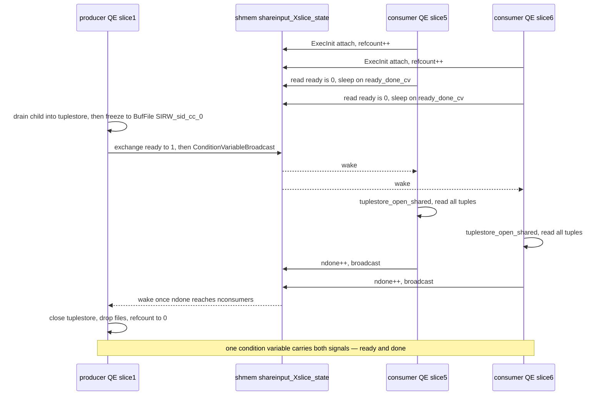

*一个 Segment 内的跨切片握手：生产者物化并冻结 tuplestore，设置 ready，再广播通知；消费者等待在同一个条件变量上，读取后再次用它报告完成。*

这幅图中的过程可以直接验证。`debug_shareinput_xslice` 会记录握手的每一步；设置 `client_min_messages = log` 后，QE 日志行会经派发通道回传，并标注 Segment、切片和 pid：

*实际握手过程，仅保留一个 Segment 的日志。生产者尚未创建存储时，消费者就已阻塞；生产者的 notify_ready 释放所有消费者；nconsumers = 2 则释放生产者。*

```sql
SET debug_shareinput_xslice = on;
SET client_min_messages = log;
WITH c AS (SELECT b, count(*) n FROM m187_t GROUP BY b)
SELECT count(*) FROM c x JOIN c y ON x.n = y.n;
```

```text {hl_lines="2 5 10" title="output"}
LOG:  SISC (shareid=0, slice=5): initialized xslice state         (seg0 slice5 pid=25319)
LOG:  SISC READER (shareid=0, slice=5): Waiting for producer      (seg0 slice5 pid=25319)
LOG:  SISC READER (shareid=0, slice=6): Waiting for producer        (seg0 slice6 pid=25325)
LOG:  SISC WRITER (shareid=0, slice=1): No tuplestore yet, creating tuplestore  (seg0 slice1 pid=25291)
LOG:  SISC WRITER (shareid=0, slice=1): wrote notify_ready        (seg0 slice1 pid=25291)
LOG:  SISC READER (shareid=0, slice=5): Wait ready got writer's handshake       (seg0 slice5 pid=25319)
LOG:  SISC READER (shareid=0, slice=6): Wait ready got writer's handshake       (seg0 slice6 pid=25325)
LOG:  SISC READER (shareid=0, slice=5): wrote notify_done           (seg0 slice5 pid=25319)
LOG:  SISC READER (shareid=0, slice=6): wrote notify_done           (seg0 slice6 pid=25325)
LOG:  SISC WRITER (shareid=0, slice=1): got DONE message from 2 readers       (seg0 slice1 pid=25291)
LOG:  SISC (shareid=0, slice=1): decreased xslice state refcount to 0           (seg0 slice1 pid=25291)
LOG:  SISC (shareid=0, slice=1): removed xslice state              (seg0 slice1 pid=25291)
```

```c {title="src/backend/executor/nodeShareInputScan.c — shareinput_reader_waitready()"}
static void
shareinput_reader_waitready(shareinput_Xslice_reference *ref)
{
	shareinput_Xslice_state *state = ref->xslice_state;

	for (;;)
	{
		/* pg_atomic_exchange_u32() in the writer acts as a memory barrier */
		int ready = pg_atomic_read_u32(&state->ready);
		if (ready)
			break;
		ConditionVariableSleep(&state->ready_done_cv, WAIT_EVENT_SHAREINPUT_SCAN);
	}
	ConditionVariableCancelSleep();
}
```

普通的按需拉取机制无法让这一切运转，因为生产者上方没有任何节点*向它请求*元组，消费者位于树的其他地方。这就是 `Sequence`（`nodeSequence.c`，168 行）的作用，也解释了它为什么总出现在共享扫描上方。它是执行器中唯一**提前、按顺序**运行子节点的节点：首次调用时，通过 `completeSubplan()` 将除最后一个之外的所有子计划运行至耗尽，丢弃输出，然后才开始从最后一个子计划拉取（`ExecSequence()`–`ExecSequence()`）。先生产者，后消费者；若消费者切片在生产者完成之前启动，`shareinput_reader_waitready` 会让它等待。`Sequence` 并非共享机制专用；[§18.2](#182-scan-nodes) 用它让 `PartitionSelector` 先于 `Dynamic*` 扫描运行。第 [19](/cloudberry/core-internals/part-4-query-processing/ch19/) 章将解释这些切片最初是如何同时运行起来的。

### 18.7.4 Partition Selector：查询运行时决定剪枝 {#1874-partition-selector-pruning-decided-while-the-query-runs}

静态分区剪枝发生在规划器中：`WHERE` 子句中的常量在计划完成之前就排除分区，`Append` 甚至不会列出它们（[§18.6](#186-subqueries--other-nodes)）。但星型模式中值得关注的情况不是常量，而是连接。`WHERE dim.proj_id = 1` 选出少量维表行，它们的 `did` 值决定哪些事实表分区可能匹配；而在读完维表一侧之前，没有人知道这些值。Cloudberry 用*一对*协作节点解决：内侧（哈希构建侧）的 `PartitionSelector` 观察流经的每一行，累积它们所指示的分区集合；外侧能识别分区的扫描查询该结果。两个优化器都能构建这种形态，但方式不同。

*PostgreSQL 规划器形式：构建侧的 Partition Selector 将结果发布到 $0；探测侧的 Append 读取它，使五个分区中的四个从未执行。*

```sql
SET optimizer = off;
EXPLAIN (COSTS OFF, ANALYZE, TIMING OFF)
SELECT count(*) FROM m187_fact f, m187_dim d WHERE f.did = d.did AND d.proj_id = 1;
```

```text {hl_lines="4 5 7 8 9 11" title="output"}
               ->  Hash Join (actual rows=16772 loops=1)
                     Hash Cond: (f.did = d.did)
                     ->  Append (actual rows=16772 loops=1)
                           Partition Selectors: $0
                           ->  Seq Scan on m187_fact_1_prt_2 f_1 (never executed)
                           ->  Seq Scan on m187_fact_1_prt_3 f_2 (actual rows=16772 loops=1)
                           ->  Seq Scan on m187_fact_1_prt_4 f_3 (never executed)
                           ->  Seq Scan on m187_fact_1_prt_5 f_4 (never executed)
                           ->  Seq Scan on m187_fact_1_prt_other f_5 (never executed)
                     ->  Hash (actual rows=10 loops=1)
                           ->  Partition Selector (selector id: $0) (actual rows=10 loops=1)
                                 ->  Broadcast Motion 3:3  (slice2; segments: 3) (actual rows=10 loops=1)
                                       ->  Seq Scan on m187_dim d (actual rows=5 loops=1)
                                             Filter: (proj_id = 1)
                                             Rows Removed by Filter: 8
 Optimizer: Postgres query optimizer
```

*同一查询、同样的 Partition Selector，但 ORCA 将其与 Dynamic Seq Scan 配对（[§18.2](#182-scan-nodes)）；后者报告每个 Segment 上保留的分区数量，而不是把子节点标记为从未执行。*

```sql
SET optimizer = on;
EXPLAIN (COSTS OFF, ANALYZE, TIMING OFF)
SELECT count(*) FROM m187_fact f, m187_dim d WHERE f.did = d.did AND d.proj_id = 1;
```

```text {hl_lines="3 5" title="output"}
               ->  Hash Join (actual rows=16772 loops=1)
                     Hash Cond: (f.did = d.did)
                     ->  Dynamic Seq Scan on m187_fact f (actual rows=16772 loops=1)
                           Number of partitions to scan: 5 (out of 5)
                           Partitions scanned:  Avg 1.0 x 3 workers.  Max 1 parts (seg0).
                     ->  Hash (actual rows=10 loops=1)
                           ->  Partition Selector (selector id: $0) (actual rows=10 loops=1)
                                 ->  Broadcast Motion 3:3  (slice2; segments: 3) (actual rows=10 loops=1)
                                       ->  Seq Scan on m187_dim d (actual rows=5 loops=1)
                                             Filter: (proj_id = 1)
 Optimizer: GPORCA
```

两种执行统计风格表达的是同一个事实：规划器的 `Append` 显示四个 `never executed` 子节点；ORCA 的 `Dynamic Seq Scan` 显示 `Number of partitions to scan: 5 (out of 5)`，这是*规划时*的数量，五个分区都还有可能，随后才是实际发生的情况 `Max 1 parts (seg0)`。五个分区中只打开了一个。`(out of 5)` 来自 EXPLAIN 时的 `countLeafPartTables()`（`explain.c` — `ExplainNode()`），描述的是计划而非运行；`Partitions scanned` 行才描述实际运行。

两个节点通过普通执行器 `Param` 槽位通信，将其作为信箱。选择器逐元组剪枝，将结果累积到 `part_prune_result`，只有输入耗尽、集合*最终确定*时，才将指向自身的指针发布到 `es_param_exec_vals[paramid]`。消费者 `Append` 或 `Dynamic*` 解引用该 Param，而不运行自己的剪枝步骤。这能够成立，是因为探测侧读取之前，保证已完整读完哈希侧；哈希连接天然提供了这一顺序（[§18.4](#184-join-nodes)）：

```c {title="src/backend/executor/nodePartitionSelector.c — ExecPartitionSelector()"}
	if (TupIsNull(inputSlot))
	{
		/* The set of surviving partitions is now complete. */
		ParamExecData *param;

		param = &(estate->es_param_exec_vals[ps->paramid]);
		param->value = PointerGetDatum(node);
		return NULL;
	}
	econtext->ecxt_outertuple = inputSlot;
	node->part_prune_result = ExecAddMatchingSubPlans(node->prune_state,
													  node->part_prune_result);
```

> [!NOTE]
> 两个优化器都会生成此节点，这在原生节点中并不常见。PostgreSQL 规划器路径位于 `joinpartprune.c` &mdash; 上游规划器内部一个完全属于 Cloudberry 的文件 &mdash; 它的 70 行头部注释是整个源码树中对该机制最清楚的描述，包括 `create_plan()` 中的三阶段构建：先 `push_partition_selector_candidate_for_join()`，构建 `Append` 时调用 `make_partition_join_pruneinfos()`，最后 `pop_and_inject_partition_selectors()`。ORCA 则通过 `CTranslatorDXLToPlStmt.cpp`（`CTranslatorDXLToPlStmt::TranslateDXLOperatorToPlan()`）生成同一个节点。

### 18.7.5 RuntimeFilter：事实表之前的布隆过滤器 {#1875-runtimefilter-a-bloom-filter-in-front-of-the-fact-table}

分区选择器以整个分区为粒度剪枝。`RuntimeFilter`（`nodeRuntimeFilter.c`）以*行*为粒度过滤，理由相同：星型连接中，绝大多数事实表行都不会匹配过滤后的小维表一侧，却仍逐行被读取、构造成槽位、计算哈希并探测。如果哈希表已构建好，就可以用比探测便宜得多的布隆过滤器，回答“这个键是否肯定不存在”。这就是整个节点：327 行代码包装 `Hash Join` 的外侧输入，在连接看到行之前将其排除。

它默认关闭（`gp_enable_runtime_filter = off`），而且是**仅 PostgreSQL 规划器支持**的节点。是否采用它由 `try_runtime_filter()` 决定；`joinpath.c`（`hash_inner_and_outer()`）找到哈希子句时调用该函数。开启后，计划会被重写：

*一个 GUC，多一个节点。m187_frf 有 100 000 行，m187_drf 有 10 000 行，维表谓词保留其中 20%。*

```sql
SET optimizer = off;                         -- required: ORCA never emits this node
SET gp_enable_runtime_filter = off;
EXPLAIN (COSTS OFF) SELECT COUNT(*) FROM m187_frf, m187_drf
  WHERE m187_frf.did = m187_drf.did AND proj_id < 2;
SET gp_enable_runtime_filter = on;
EXPLAIN (COSTS OFF) SELECT COUNT(*) FROM m187_frf, m187_drf
  WHERE m187_frf.did = m187_drf.did AND proj_id < 2;
```

```text {hl_lines="12" title="output"}
               ->  Hash Join
                     Hash Cond: (m187_frf.did = m187_drf.did)
                     ->  Seq Scan on m187_frf
                     ->  Hash
                           ->  Broadcast Motion 3:3  (slice2; segments: 3)
                                 ->  Seq Scan on m187_drf
                                       Filter: (proj_id < 2)
 Optimizer: Postgres query optimizer

               ->  Hash Join
                     Hash Cond: (m187_frf.did = m187_drf.did)
                     ->  RuntimeFilter
                           ->  Seq Scan on m187_frf
                     ->  Hash
                           ->  Broadcast Motion 3:3  (slice2; segments: 3)
                                 ->  Seq Scan on m187_drf
                                       Filter: (proj_id < 2)
 Optimizer: Postgres query optimizer
```

*同一计划的实际执行。过滤器下方的扫描产生 33 462 行，只有 6 682 行到达连接；80% 的行无需探测就被排除。（这是同一 --enable-cassert 构建上的比值，不是基准测试。）*

```sql
EXPLAIN (COSTS OFF, ANALYZE, TIMING OFF) SELECT COUNT(*) FROM m187_frf, m187_drf
  WHERE m187_frf.did = m187_drf.did AND proj_id < 2;
```

```text {hl_lines="4 5 7" title="output"}
               ->  Hash Join (actual rows=6682 loops=1)
                     Hash Cond: (m187_frf.did = m187_drf.did)
                     Extra Text: (seg1)   Hash chain length 1.0 avg, 2 max, using 1996 of 524288 buckets.
                     ->  RuntimeFilter (actual rows=6682 loops=1)
                           Bloom Bits: 1048576
                           Extra Text: (seg1)   Inner Processed: 2000, Flase Positive Rate: 0.000000
                           ->  Seq Scan on m187_frf (actual rows=33462 loops=1)
                     ->  Hash (actual rows=2000 loops=1)
                           Buckets: 524288  Batches: 1  Memory Usage: 4167kB
                           ->  Broadcast Motion 3:3  (slice2; segments: 3) (actual rows=2000 loops=1)
                                 ->  Seq Scan on m187_drf (actual rows=689 loops=1)
                                       Filter: (proj_id < 2)
                                       Rows Removed by Filter: 2679
 Optimizer: Postgres query optimizer
```

`Bloom Bits: 1048576` 不是巧合，其背后的大小规则也不是。`ExecInitHashJoin`（`nodeHashjoin.c`）以*估计的*内侧行数调用 `ExecInitRuntimeFilterFinish`，`bloom_create_aggresive`（`bloomfilter.c`）将位集大小限制在 `[128 kB, 2 MB]`，向下取整为 2 的幂；若所得大小不足每元素 1.6 位，就直接拒绝并返回 `NULL`。若能达到每元素 3.5 位，则选择三个哈希函数，否则选两个。这是刻意保持低成本的过滤器：小到能留在缓存中，大小设计追求*速度*而非*精确度*；反正连接会再次检查所有保留下来的行。

```c {title="src/backend/executor/nodeRuntimeFilter.c — ExecInitRuntimeFilterFinish()"}
	node->bf = bloom_create_aggresive((int64) inner_rows, work_mem, random());
	if (node->bf == NULL)
		node->build_suspend = true;
	/* we can't handle inner table which is bigger than this threshold */
	node->inner_threshold = bloom_total_bits(node->bf) / 1.6;
```

由此引出这项设计最值得借鉴的部分：节点不盲信自身估计，并能自行关闭。`inner_threshold` 是*运行时*上限，值为 `bits / 1.6`；每加入一个内侧行，`inner_processed` 就递增，一旦超过上限，节点便设置 `build_suspend = true`（`RFAddTupleValues()`）。随后 `ExecRuntimeFilter` 退化为直接透传，即 `if (!node->build_finish || node->build_suspend) return ExecProcNode(outerPlan);`（`ExecRuntimeFilter()`）。因此，即使严重低估哈希侧，也只会浪费一次布隆过滤器构建，没有更多代价。此时 `EXPLAIN ANALYZE` 会输出 `Suspend`（`ExecRuntimeFilterExplainEnd()`）。还要注意两个有意保留的例外：NULL 键不过滤，直接传递（`RuntimeFilterTupleNext()`）；只信任 `bloom_lacks_element` 的否定结果，*命中*仅表示“可能存在”，所以每个保留下来的行仍会进行真正的探测。

规划器自身的判断也值得验证，因为它拒绝的情况比接受更多。`try_runtime_filter`（`costsize.c`）会基于四种独立理由退出，`gp_runtime_filter` 回归测试也围绕这些条件构建：

*三种拒绝情况：选择性较低的维表谓词、不能被消除的 LEFT JOIN，以及 ORCA；即使 gp_enable_runtime_filter 仍开启，它们也都没有 RuntimeFilter。*

```sql
SET gp_enable_runtime_filter = on;   SET optimizer = off;
EXPLAIN (COSTS OFF) SELECT COUNT(*) FROM m187_frf, m187_drf
  WHERE m187_frf.did = m187_drf.did AND proj_id < 7;              -- bad filter rate
EXPLAIN (COSTS OFF) SELECT COUNT(*) FROM m187_frf LEFT JOIN m187_drf
  ON m187_frf.did = m187_drf.did WHERE proj_id IS NULL OR proj_id < 2;
SET optimizer = on;
EXPLAIN (COSTS OFF) SELECT COUNT(*) FROM m187_frf, m187_drf
  WHERE m187_frf.did = m187_drf.did AND proj_id < 2;              -- the winning shape
```

```text {hl_lines="6 14" title="output"}
               ->  Hash Join                              <-- no RuntimeFilter
                     Hash Cond: (m187_frf.did = m187_drf.did)
                     ->  Seq Scan on m187_frf
                     ...  Filter: (proj_id < 7)

               ->  Hash Left Join                        <-- no RuntimeFilter
                     Hash Cond: (m187_frf.did = m187_drf.did)
                     Filter: ((m187_drf.proj_id IS NULL) OR (m187_drf.proj_id < 2))
                     ->  Seq Scan on m187_frf

               ->  Hash Join                              <-- no RuntimeFilter
                     Hash Cond: (m187_frf.did = m187_drf.did)
                     ->  Seq Scan on m187_frf
 Optimizer: GPORCA
```

四个退出条件按函数检查顺序如下。**连接类型**：只支持 `INNER`、`RIGHT` 和 `SEMI`；构建侧的布隆过滤器只能说明某行*没有匹配*，对于左连接或反连接，这意味着可以提前*输出*，而不是提前排除，这种行为尚未实现（`nodeHashjoin.c` — `CreateRuntimeFilter()` 的注释解释了原因）。**绝对数量**：如果过滤器能省下的外侧行少于 10 000，就不值得花费 CPU 周期。**选择性**：保留行数必须低于外侧行数的 `RUNTIME_FILTER_RATE_THRESHOLD = 0.6`，即至少排除 40%（`costsize.c`），`proj_id < 7` 正是未满足这一条件。**按引用传递的类型**会被直接拒绝（`try_runtime_filter()`），因为节点对固定宽度的 `Datum` 计算哈希。上面第三个示例则是整个优化器层面的拒绝：ORCA 没有运行时过滤器的转换逻辑，因此在本集群上，无论 GUC 如何设置，都不会生成该节点。

一个相似的名称后面还隐藏着第二套完全独立的机制。`gp_enable_runtime_filter_pushdown` **不增加任何计划节点**：在 `ExecInitHashJoin` 阶段，仅在 QE 上，`CreateRuntimeFilter`（`nodeHashjoin.c`）沿外侧向下寻找 `SeqScanState` 或 `DynamicSeqScanState`，将带有自身布隆过滤器的 `AttrFilter` 直接挂到扫描上；扫描在自己的元组循环内、投影之前检查键（`nodeSeqscan.c` — `SeqNext()`）。过滤下移了*一层*，计数位置也随之下移：

*采用下推而非独立节点：Seq Scan 自身现在报告输出 6 682 行，并带有自己的排除计数器。对比前一组输出，那里扫描仍输出 33 462 行。*

```sql
SET gp_enable_runtime_filter = off;            -- no RuntimeFilter node
SET gp_enable_runtime_filter_pushdown = on;   -- filter inside the scan instead
EXPLAIN (COSTS OFF, ANALYZE, TIMING OFF) SELECT COUNT(*) FROM m187_frf, m187_drf
  WHERE m187_frf.did = m187_drf.did AND proj_id < 2;
```

```text {hl_lines="3 4" title="output"}
               ->  Hash Join (actual rows=6682 loops=1)
                     Hash Cond: (m187_frf.did = m187_drf.did)
                     ->  Seq Scan on m187_frf (actual rows=6682 loops=1)
                           Rows Removed by Pushdown Runtime Filter: 26645
                     ->  Hash (actual rows=2000 loops=1)
                           Buckets: 524288  Batches: 1  Memory Usage: 4167kB
                           ->  Broadcast Motion 3:3  (slice2; segments: 3) (actual rows=2000 loops=1)
                                 ->  Seq Scan on m187_drf (actual rows=689 loops=1)
                                       Filter: (proj_id < 2)
 Optimizer: Postgres query optimizer
```

这两种机制**不能**组合，原因是结构限制，而非刻意设计：`FindTargetNodes`（`nodeHashjoin.c`）只会向下穿过 `HashJoinState`、`ResultState` 和 `AppendState`，因此连接与扫描之间的 `RuntimeFilter` 会直接阻断搜索。两个 GUC 都开启时，计划会有 `RuntimeFilter` 节点，但不会下推；本集群已验证这一点。在 Segment 内并行模式下（`estate->useMppParallelMode`，`ExecInitHashJoin()`），也会完全跳过下推。至此，“扫描在运行时获得信息”共有四种相关机制，值得并列比较：

| 机制 | 扫描获得的信息 | 结果的传递方式 | 由谁生成 |
| --- | --- | --- | --- |
| `Partition Selector` + `Append` | 哪些分区可能包含匹配 | 将 `Bitmapset` 发布到 `es_param_exec_vals[$n]` | PostgreSQL 规划器和 ORCA |
| `Partition Selector` + `Dynamic Seq Scan` | 同样的信息，用于 `Dynamic*` 系列（[§18.2](#182-scan-nodes)） | 同样使用执行器 Param | ORCA |
| `RuntimeFilter` 节点 | 当前行的键是否肯定不存在于哈希侧 | 节点拥有的布隆过滤器，带有指回 `hjstate` 的指针 | 仅 PostgreSQL 规划器，`gp_enable_runtime_filter` |
| 下推，无独立节点 | 同样的检查，位于扫描循环内部 | QE 上在 `ExecInit` 时挂到 `HashState` 的 `AttrFilter` 列表 | 仅 PostgreSQL 规划器，`gp_enable_runtime_filter_pushdown` |

### 18.7.6 Table Function Scan：以表为参数的函数 {#1876-table-function-scan-a-function-whose-argument-is-a-table}

八个操作符中最后一个历史最久，也最少使用。Cloudberry 支持以伪类型 `anytable` 声明的函数，通过 `f( TABLE(subquery SCATTER BY …) )` 调用。由于参数是整个关系而非标量，解析器会将范围表条目转换为 `RTE_TABLEFUNCTION`（`parse_relation.c` — `addRangeTableEntryForFunction()`），计划中则出现以子查询为子节点的 `TableFunctionScan`。`nodeTableFunction.c` 的头部将其区分为*普通*表函数（`FunctionScan`，没有输入）和*增强*表函数（位于子计划之上的 `TableFunctionScan`）。函数体通过 `tablefuncapi.h` 中的 `AnyTable` 句柄拉取输入，因此实际上这是仅供 C 使用的接口；参考实现位于 `src/test/regress/regress.so`。

*在 m187_t 上执行增强表函数。SCATTER BY 是此特性的 MPP 部分，决定输入如何分布给执行函数体的 QE。*

```sql
SET compute_query_id = off;   -- see note
CREATE FUNCTION m187_multiset(a anytable) RETURNS TABLE(a int, b text)
  AS '.../src/test/regress/regress.so', 'multiset_example'
  LANGUAGE C READS SQL DATA;
EXPLAIN (COSTS OFF) SELECT * FROM
  m187_multiset( TABLE(SELECT a, c FROM m187_t WHERE b = 3 SCATTER BY a) );
EXPLAIN (COSTS OFF) SELECT count(*) FROM
  m187_multiset( TABLE(SELECT a, c FROM m187_t WHERE b = 3 SCATTER BY c) );
```

```text {hl_lines="4 12" title="output"}
                 QUERY PLAN
--------------------------------------------
 Gather Motion 3:1  (slice1; segments: 3)
   ->  Table Function Scan on m187_multiset
         ->  Seq Scan on m187_t
               Filter: (b = 3)

 Finalize Aggregate
   ->  Gather Motion 3:1  (slice1; segments: 3)
         ->  Partial Aggregate
               ->  Table Function Scan on m187_multiset
                     ->  Redistribute Motion 3:3  (slice2; segments: 3)
                           Hash Key: m187_t.c
                           ->  Seq Scan on m187_t
                                 Filter: (b = 3)
 Optimizer: Postgres query optimizer
```

`SCATTER BY a` 要求按分布键组织输入，而输入本来就是如此，所以函数在三个 Segment 上处理本地数据，没有 Motion。`SCATTER BY c` 要求按其他列组织输入，于是出现 `Redistribute Motion` 来满足请求。这就是该子句存在的全部理由：逐组计算的表函数需要每个组完整地到达同一个 QE，查询作者通过 `SCATTER BY` 声明函数体所依赖的分组方式。

> [!NOTE]
> 如实报告编写本节时发现的一个真实缺陷：使用集群默认的 `compute_query_id` 且加载 `pg_stat_statements` 时，任何包含 `TABLE(...)` 参数的查询都会报 `ERROR: unrecognized RTE kind: 10 (queryjumble.c — JumbleRangeTable)`。上游的查询指纹计算代码没有 `RTE_TABLEFUNCTION` 分支。`SET compute_query_id = off` 可以在会话内绕过此问题。节点本身没有问题 &mdash; 上面的计划和结果都来自实际运行。

### 18.7.7 本章结语 {#1877-closing-the-chapter}

这就是全部增量。执行器的 58 种节点中，42 种原样运行上游 PostgreSQL 的实现，[§18.1](#181-executor-framework--lifecycle)–[§18.6](#186-subqueries--other-nodes) 已介绍它们。Cloudberry 在那些内容中贡献的是*上下文*：每个切片、每个 Segment 都有一个执行器，同时运行，把实际数据与另一台机器上产生的估计比较。现在，每个原生节点存在的理由都可以用一句话说明：必须更换归属的行（`Split Update`、`Split Merge`）；被去相关破坏的保证（`Assert`）；多个*进程*都要读取的子树（`ShareInputScan`，由 `Sequence` 保证先执行）；只能在运行时作出的剪枝决定（`Partition Selector` 和 [§18.2](#182-scan-nodes) 的 `Dynamic*` 扫描）；在付出探测成本之前就排除的行（`RuntimeFilter`）；以分布式关系为参数的函数（`TableFunctionScan`）；以及 [§18.3](#183-sort--aggregate-nodes) 中两阶段聚合的 `TupleSplit`。

注意，所有这些都源于同一个事实：数据分散在多个 Segment 上，而每个 Segment 只能访问自己的数据。还剩第十六个，也是最大的那个：`Motion`，真正负责搬运的操作符。`nodeMotion.c` 有 1 405 行，它以 `Gather Motion 3:1`、`Redistribute Motion 3:3`、`Broadcast Motion 1:3`、`Explicit Redistribute Motion` 的形式，静静地出现在本章几乎每个计划中。我们一直把这些标签当作注释阅读。**第 [19](/cloudberry/core-internals/part-4-query-processing/ch19/) 章**将把它们作为机制来解读：切片是什么，QE 进程组如何组建并运行切片，元组如何序列化并发送到网络，接收方比发送方慢时 Interconnect 如何处理，以及为什么两个 Motion 向同一个连接供数时，若无人预取（[§18.4](#184-join-nodes)）或抑制发送（[§18.1](#181-executor-framework--lifecycle)），计划就可能死锁。计划作出预测，执行器检验预测，Interconnect 则让这项检验成为分布式执行。
