<style>
/*
 * Licensed to the Apache Software Foundation (ASF) under one
 * or more contributor license agreements.  See the NOTICE file
 * distributed with this work for additional information
 * regarding copyright ownership.  The ASF licenses this file
 * to you under the Apache License, Version 2.0 (the
 * "License"); you may not use this file except in compliance
 * with the License.  You may obtain a copy of the License at
 *
 *   http://www.apache.org/licenses/LICENSE-2.0
 *
 * Unless required by applicable law or agreed to in writing,
 * software distributed under the License is distributed on an
 * "AS IS" BASIS, WITHOUT WARRANTIES OR CONDITIONS OF ANY
 * KIND, either express or implied.  See the License for the
 * specific language governing permissions and limitations
 * under the License.
 */

/* Layout for the HTML-and-CSS figures, lifted from the handbook's own
   stylesheet so the figures render identically here. */

/* These four come from the handbook's own stylesheet; a consuming site has no
   such definitions, and an undefined custom property invalidates its whole
   declaration. Define them here, scoped to the figure.

   Deliberately NOT themed. The artwork below is light-only: band and tile
   backgrounds are hard-coded pastels, and the injected markup carries some 800
   more hard-coded light colours in inline styles. Giving --fg a dark-theme
   value paints near-white text onto a near-white band -- measured at 1.08:1,
   worse than the bug that replaced. The handbook's light values are correct in
   both themes; what changes for dark mode is the surface underneath. */
.cloudberry-core-figure {
  --border: #d8dee4;
  --soft:   #f6f8fa;
  --fg:     #1f2328;
  --muted:  #636c76;
  margin: 1.4rem 0;
}

/* Light-only artwork needs a light ground AND a dark ink, or it bleeds into a
   dark page. Setting only the ground is not enough: any text in these figures
   without its own inline colour inherits the site's near-white body colour, so
   it lands white-on-pastel -- measured at 1.03:1 across 184 text nodes. The
   colour has to be restored at the same place the ground is. */
[data-bs-theme='dark'] .cloudberry-core-figure > div {
  background: #ffffff;
  color: #1f2328;
  border-radius: 8px;
  padding: 10px;
}
/* Descendants that inherit rather than carry an inline colour. */
[data-bs-theme='dark'] .cloudberry-core-figure > div :not([style*="color"]) {
  color: inherit;
}
.cloudberry-core-figure figcaption {
  margin-top: .5rem;
  font-size: .9em;
  /* --ifm-color-emphasis-600 resolves to rgb(141,148,158) in the light theme,
     which is 3.06:1 on white -- below WCAG AA for the 37 figure captions.
     (The dark theme's value is fine, so only light is overridden.) */
  color: #636b75;
}
[data-bs-theme='dark'] .cloudberry-core-figure figcaption {
  color: #a6adb4;
}

/* Selective highlight: the handbook wraps a key token so it stands out.
   Scoped to the component. The class name .hl is two letters and this file
   lands in the consuming site's single global stylesheet, so an unscoped
   rule would style every page of that site. The standalone edition's
   figure.code / figure.session variants are dropped: those classes do not
   occur anywhere in this tree. */
.cloudberry-core-figure .hl { border-radius: 2px; font-weight: 700;
                   background: #fff8c5; color: #1f2328; padding: 0 2px; }

/* Layered module map and the banded brick figures. */
.cloudberry-core-figure .bricks { border:1px solid var(--border);border-radius:12px;overflow:hidden;background:var(--soft) }
.cloudberry-core-figure .bk-band { display:flex;align-items:stretch;border-top:1px solid var(--border) }
.cloudberry-core-figure .bk-band:first-child { border-top:none }
.cloudberry-core-figure .bk-lbl { flex:0 0 116px;display:flex;flex-direction:column;justify-content:center;gap:2px;padding:10px 13px }
.cloudberry-core-figure .bk-lbl b { font-size:12.5px;font-weight:800;color:var(--fg);line-height:1.2 }
.cloudberry-core-figure .bk-lbl span { font-size:9.5px;font-weight:700;color:var(--muted);text-transform:uppercase;letter-spacing:.5px }
.cloudberry-core-figure .bk-row { flex:1 1 auto;display:flex;flex-wrap:wrap;gap:7px;padding:9px 10px }
.cloudberry-core-figure .bk { flex:1 1 118px;min-width:104px;display:flex;flex-direction:column;justify-content:center;gap:2px; padding:8px 11px;border-radius:7px;border:1px solid;background:#fff;text-decoration:none;transition:.13s }
.cloudberry-core-figure .bk-t2 { font-size:12.5px;font-weight:700;line-height:1.25 }
.cloudberry-core-figure .bk-ch { font-size:10.5px;font-weight:700;font-variant-numeric:tabular-nums;opacity:.8 }
.cloudberry-core-figure a.bk:hover { transform:translateY(-2px);box-shadow:0 4px 12px #0000001f;text-decoration:none }
.cloudberry-core-figure .bk-q { background:#eef6ff }
.cloudberry-core-figure .bk-q .bk { border-color:#54aeff66;color:#0a3069;background:#ddf4ff }
.cloudberry-core-figure .bk-s { background:#eefcf2 }
.cloudberry-core-figure .bk-s .bk { border-color:#4ac26b80;color:#04260f;background:#dafbe1 }
.cloudberry-core-figure .bk-t { background:#fff6ef }
.cloudberry-core-figure .bk-t .bk { border-color:#fb8f4480;color:#5e2700;background:#fff1e5 }
.cloudberry-core-figure .bk-h { background:#fff4f3 }
.cloudberry-core-figure .bk-h .bk { border-color:#ff818280;color:#5c0011;background:#ffebe9 }
.cloudberry-core-figure .bk-r { background:#f3f5f8 }
.cloudberry-core-figure .bk-r .bk { border-color:#afb8c1;color:#1f2328;background:#eaeef2 }
@media (max-width: 560px) {
  .cloudberry-core-figure .bk-band { flex-direction:column }
  .cloudberry-core-figure .bk-lbl { flex-basis:auto;border-bottom:1px solid var(--border) }
}

</style>

<!--
  Licensed to the Apache Software Foundation (ASF) under one
  or more contributor license agreements.  See the NOTICE file
  distributed with this work for additional information
  regarding copyright ownership.  The ASF licenses this file
  to you under the Apache License, Version 2.0 (the
  "License"); you may not use this file except in compliance
  with the License.  You may obtain a copy of the License at

    http://www.apache.org/licenses/LICENSE-2.0

  Unless required by applicable law or agreed to in writing,
  software distributed under the License is distributed on an
  "AS IS" BASIS, WITHOUT WARRANTIES OR CONDITIONS OF ANY
  KIND, either express or implied.  See the License for the
  specific language governing permissions and limitations
  under the License.
-->


<a id="19-motion--the-interconnect"></a>

## 19.1 分布式执行原理 {#191-distributed-execution-principles}

前六章中的每份计划都包含以下节点之一：`Gather Motion 3:1`、`Redistribute Motion 3:3`、`Broadcast Motion 1:3`、`Explicit Redistribute Motion`。此前我们每次都把它当成注释，仿佛只是在旁边注明*接下来数据会移动*。但它并非注释。Motion 是一个计划节点，有自己的 `ExecInitMotion`、`ExecMotion` 和 `ExecEndMotion`，与 Sort 或 Hash Join 一样占据计划树中的一个位置。其余机制之所以能运转，正是因为有它。

这个设计选择决定了整个架构。[§18.1](/cloudberry/core-internals/part-4-query-processing/ch18/#181-executor-framework--lifecycle) 将执行器描述为按需拉取的火山模型：父节点对孩子调用 `ExecProcNode`，得到一个元组，或得到表示流结束的 NULL。Cloudberry 没有为这个协议增加*把数据发送到别处*的原语，而是插入一个**孩子恰好位于另一个进程中**的节点。Motion 的父节点调用 `ExecProcNode` 并取得元组，完全察觉不到元组是通过套接字到达的。Motion 的孩子也无法察觉：调用它的父节点会把结果横向发送出去，而不是向上返回。树中的其他节点对此一无所知，这也是我们能够独立讲解第 [13](/cloudberry/core-internals/part-4-query-processing/ch13/)–[18](/cloudberry/core-internals/part-4-query-processing/ch18/) 章的原因。

这立即带来三个结果，也构成了本章余下部分的基本概念。第一，计划在 **Motion 边界处分割**为**查询切片（slice）**：[§16.3](/cloudberry/core-internals/part-4-query-processing/ch16/#163-parallelization-cdbllize--cdbmutate) 介绍了规划时如何分割，[§19.3](#193-slice-tables--planslice--gang-mapping) 将介绍相关数据结构。第二，每个查询切片由一个**进程组（gang）**运行：每个 Segment 一个进程，在不同数据上运行同一份计划的同一个切片（[§19.2](#192-the-dispatcher-gangs--async-dispatch)）。第三，也是这里最重要的一点：QD 派发完计划后，**就不再有任何全局调度**。每个进程运行自己的火山模型循环，输入为空时阻塞，输出缓冲区已满时也阻塞。执行期间不存在全局协调者。

*本章贯穿始终的例子：一次聚合、两个 Motion、三个查询切片。*

```sql
CREATE TABLE m191_sales (id int, region int, amt numeric) DISTRIBUTED BY (id);
INSERT INTO m191_sales SELECT g, g % 97, (g % 1000)::numeric FROM generate_series(1,4000000) g;
ANALYZE m191_sales;

EXPLAIN (costs off) SELECT region, count(*) FROM m191_sales GROUP BY region;
```

```text {hl_lines="9" title="output"}
CREATE TABLE
INSERT 0 4000000
ANALYZE
                         QUERY PLAN                         
------------------------------------------------------------
 Gather Motion 3:1  (slice1; segments: 3)
   ->  Finalize HashAggregate
         Group Key: region
         ->  Redistribute Motion 3:3  (slice2; segments: 3)
               Hash Key: region
               ->  Streaming Partial HashAggregate
                     Group Key: region
                     ->  Seq Scan on m191_sales
 Optimizer: GPORCA
(9 rows)
```

`region` 不是分布键，因此各分组散布在全部三个 Segment 上，只能通过两阶段聚合完成计算（[§16.4](/cloudberry/core-internals/part-4-query-processing/ch16/#164-distributed-grouping--direct-dispatch) 规划了这种形态，[§18.3](/cloudberry/core-internals/part-4-query-processing/ch18/#183-sort--aggregate-nodes) 介绍了其执行）。两个 Motion 将计划切成三个查询切片：扫描与部分聚合、最终聚合，以及由 QD 运行的根切片。Motion 节点上打印的切片编号始终属于其下方的**发送方**切片，因此根节点是未标出编号的 `slice0`；编号规则见 [§19.3](#193-slice-tables--planslice--gang-mapping)。下图将同一份计划映射到了实际运行它的各个进程。

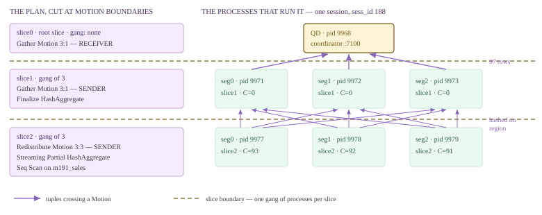

*一个查询、三个查询切片，以及运行它们的七个进程。虚线表示切片边界，实线箭头表示跨越 Motion 的元组。进程 ID 来自下方的实际采集结果。*

slice2 与 slice1 之间的九条箭头不是绘图上的夸张：`Redistribute Motion 3:3` 确实是全互连，每个发送方都可能与每个接收方通信。[§19.5](#195-interconnect-implementations) 必须为此提供传输机制。为验证这幅进程图，我们让同一查询运行足够长的时间，以便捕获现场：通过与 `generate_series` 连接，将每行扩展 120 倍，让语句持续约四十秒，但不改变查询切片结构，然后从另一个会话统计进程。

*七个进程，一条分布式语句。QD 行来自 Coordinator 自身的 pg_stat_activity，六个 Segment 进程行来自 gp_dist_random。*

```sql
-- session A, held open ~40 s (same three slices, 120x more input rows):
--   SELECT region, count(*) FROM m191_sales, generate_series(1,120) g GROUP BY region;

-- session B, while A runs:
SELECT 'seg'||gp_execution_segment() AS host, sess_id, pid, state, left(query,26) AS query
  FROM gp_dist_random('pg_stat_activity') WHERE sess_id = 188
UNION ALL
SELECT 'QD  ', sess_id, pid, state, left(query,26) FROM pg_stat_activity WHERE sess_id = 188
ORDER BY 1, 3;
```

```text {hl_lines="10" title="output"}
 host | sess_id | pid  | state  |           query            
------+---------+------+--------+----------------------------
 QD   |     188 | 9968 | active | select region, count(*) fr
 seg0 |     188 | 9971 | active | select region, count(*) fr
 seg0 |     188 | 9977 | active | select region, count(*) fr
 seg1 |     188 | 9972 | active | select region, count(*) fr
 seg1 |     188 | 9978 | active | select region, count(*) fr
 seg2 |     188 | 9973 | active | select region, count(*) fr
 seg2 |     188 | 9979 | active | select region, count(*) fr
(7 rows)
```

七个进程、一个 `sess_id`、一条语句：QD 加上每个非根切片各自包含三个进程的进程组。操作系统看到的情况完全一致，还为我们标出了各个切片：Cloudberry QE 会将切片编号写入进程标题，因此 `ps` 可以直接显示切片树。注意 `C` 列，即内核对 CPU 使用率的估计，对应 `ps -ef` 的第四列。

*ps 显示了查询切片树。三个 slice2 进程满负荷运行，而三个 slice1 进程完全没有消耗 CPU。*

```bash
$ ps -ef | grep -E "con188 (seg|cmd)" | grep -v grep | sed 's/  */ /g' | sed 's/^gpadmin //'
```

```text {hl_lines="5" title="output"}
9968 19803 1 01:54 ? 00:00:00 postgres: 7100, gpadmin postgres [local] con188 cmd5 SELECT
9971 19768 0 01:54 ? 00:00:00 postgres: 7102, gpadmin postgres 10.100.0.3(57978) con188 seg0 cmd6 slice1 MPPEXEC SELECT
9972 19772 0 01:54 ? 00:00:00 postgres: 7103, gpadmin postgres 10.100.0.3(41800) con188 seg1 cmd6 slice1 MPPEXEC SELECT
9973 19773 0 01:54 ? 00:00:00 postgres: 7104, gpadmin postgres 10.100.0.3(38304) con188 seg2 cmd6 slice1 MPPEXEC SELECT
9977 19768 93 01:54 ? 00:00:07 postgres: 7102, gpadmin postgres 10.100.0.3(57984) con188 seg0 cmd6 slice2 MPPEXEC SELECT
9978 19772 92 01:54 ? 00:00:07 postgres: 7103, gpadmin postgres 10.100.0.3(41806) con188 seg1 cmd6 slice2 MPPEXEC SELECT
9979 19773 91 01:54 ? 00:00:07 postgres: 7104, gpadmin postgres 10.100.0.3(38310) con188 seg2 cmd6 slice2 MPPEXEC SELECT
```

> [!NOTE]
> 这次采集**正好验证**了不存在全局协调者这一说法。没有谁让三个 `slice1` 进程睡眠，也不会有人唤醒它们：每个进程都停留在自己的 Redistribute Motion 接收端，因为输入为空而阻塞，元组一到就会恢复执行。也没有谁在限制三个 `slice2` 进程的速度；它们会一直扫描，直到输出缓冲区已满。这里的 QD 不是调度器，它只是恰好运行根切片的进程，同时也是启动其他所有进程的派发器（[§13.3](/cloudberry/core-internals/part-4-query-processing/ch13/#133-dispatch-from-coordinator-plan-to-segment-execution)、[§19.2](#192-the-dispatcher-gangs--async-dispatch)）。这些数字只是某台机器上的一次快照，不应视为性能测量：本构建启用了 `--enable-cassert`。

### 19.1.1 一个计划节点，两种角色 {#1911-one-plan-node-two-roles}

分布式计划只在 QD 上序列化**一次**，随后原样发送给每个 QE（[§13.3](/cloudberry/core-internals/part-4-query-processing/ch13/#133-dispatch-from-coordinator-plan-to-segment-execution) 介绍派发，[§19.2](#192-the-dispatcher-gangs--async-dispatch) 介绍实际传输的内容）。因此，每个进程都持有*同一棵*树，包括属于它永远不会执行的其他切片的 Motion 节点。不同的是各进程**进入**树的位置。QE 找到位于*自身*切片顶端的 Motion 节点，将该节点作为自己的计划根。

```c {title="src/backend/executor/execMain.c — InitPlan()"}
	if (estate->eliminateAliens)
	{
		Motion *m = findSenderMotion(plannedstmt, LocallyExecutingSliceIndex(estate));

		if (NULL != m)
		{
			start_plan_node = (Plan *) m;
			ExecSlice *sendSlice = &estate->es_sliceTable->slices[m->motionID];
			estate->currentSliceId = sendSlice->parentIndex;
```

`findSenderMotion` 搜索整个计划，找到 `motionID` 等于本进程切片索引的 Motion；`Motion.motionID` *就是*发送方切片的索引（`nodeMotion.c` — `ExecInitMotion()`）。该子树之外的一切都是不属于本进程的节点，从不初始化；默认开启的开发者 GUC `execute_pruned_plan` 控制这一行为（`execMain.c` — `standard_ExecutorStart()`）。接收方 Motion 甚至不会初始化自己的孩子：节点不是发送方时，`nodeMotion.c` 中的 `ExecInitMotion()` 会跳过递归调用 `ExecInitNode`。随后，在发送方和接收方共同持有的那个 Motion 节点内部，只需一次比较就能区分两种角色。

```c {title="src/backend/executor/nodeMotion.c — ExecInitMotion()"}
		if (LocallyExecutingSliceIndex(estate) == recvSlice->sliceIndex)
		{
			/* this is recv */
			motionstate->mstype = MOTIONSTATE_RECV;
		}
		else if (LocallyExecutingSliceIndex(estate) == sendSlice->sliceIndex)
		{
			/* this is send */
			motionstate->mstype = MOTIONSTATE_SEND;
		}
```

其他所有行为都由这一个字段决定。`ExecMotion` 在做任何事之前就根据它分支（`nodeMotion.c`）；只有 `mstype == MOTIONSTATE_SEND` 时才会构建哈希键表达式和 `CdbHash` 对象（`nodeMotion.c` — `ExecInitMotion()`），因此接收方甚至没有哈希函数；有序汇集使用的归并比较器则只为 `MOTIONSTATE_RECV` 构建（`nodeMotion.c` — `ExecInitMotion()`）。QD 一侧与之配套的判断是 [§18.1](/cloudberry/core-internals/part-4-query-processing/ch18/#181-executor-framework--lifecycle) 中的 `getGpExecIdentity`（`execUtils.c`）：本进程运行树顶时返回 `GP_ROOT_SLICE`；运行以发送方 Motion 为顶端的切片时返回 `GP_NON_ROOT_ON_QE`，此时调用完全不返回元组，所有元组都经 Interconnect 发出；本地无事可做时则返回 `GP_IGNORE`。

- **查询切片（slice）** — 计划树中不跨越 Motion 边界的最大连通部分，也是并行与派发的单位。规划器负责切分（[§16.3](/cloudberry/core-internals/part-4-query-processing/ch16/#163-parallelization-cdbllize--cdbmutate)、[§17.5](/cloudberry/core-internals/part-4-query-processing/ch17/#175-translation-query--dxl--plstmt)）；EXPLAIN 从 slice0（根）开始向上编号（[§19.3](#193-slice-tables--planslice--gang-mapping)）。
- **进程组（gang）** — 运行一个查询切片的进程集合，通常每个 Segment 一个 QE，有时则是任意位置上的单个 QE。分配、复用和销毁见 [§19.2](#192-the-dispatcher-gangs--async-dispatch)。
- **发送方／接收方切片** — 对每个 Motion 而言，其下方的切片发送数据，包含它的切片接收数据。`Motion.motionID` 标识发送方切片，`PlanSlice.parentIndex` 标识接收方。
- **路由（route）** — 发送方用于标识一个目标进程的本地索引，取值为 0..N-1，另有表示*所有接收方*的伪路由 `BROADCAST_SEGIDX` = -2（`src/include/cdb/tupchunk.h`）。如何选择路由，是各种 Motion 类型的区别所在。

### 19.1.2 数据的三种形态 {#1912-three-shapes-of-data}

[§16.1](/cloudberry/core-internals/part-4-query-processing/ch16/#161-the-locus-model-cdbpathlocus) 通过分布位置（locus）代数介绍了规划器一侧的模型。执行时，行集只有三种物理形态，Motion 就是用来在这些形态之间转换的。

- **分区（partitioned）** — N 个进程持有 N 个互不相交的行集，其并集才是完整结果。`DISTRIBUTED BY` 或 `DISTRIBUTED RANDOMLY` 表，以及任何 Redistribute 的输出都属于这种形态。大多数计划中的大多数行集都是如此。
- **复制（replicated）** — N 个进程持有 N 份完全相同的行集。磁盘上的 `DISTRIBUTED REPLICATED` 表如此，Broadcast Motion 刚刚送达的数据也会暂时呈现这种形态。用它参与连接的成本低，但生成它的成本高。
- **单例（singleton）** — 恰好一个进程持有全部数据：可能是 QD、位于某个 Segment 上仅含一个 QE 的读取进程组，或 Coordinator 上的 entry-db 读取进程。客户端看到的始终是单例，所以几乎每份计划都以 Gather 结束。

*复制表参与连接时不需要 Motion，汇集时也只需要一个发送方。*

```sql
-- m191_dim: 97 rows, DISTRIBUTED BY (region)
CREATE TABLE m191_rep (region int, rname text) DISTRIBUTED REPLICATED;
INSERT INTO m191_rep SELECT * FROM m191_dim;

EXPLAIN (costs off) SELECT s.id, r.rname FROM m191_sales s JOIN m191_rep r
                     ON s.region = r.region WHERE s.id < 5;
EXPLAIN (costs off) SELECT count(*) FROM m191_rep;
```

```text {hl_lines="18" title="output"}
CREATE TABLE
INSERT 0 97
                QUERY PLAN                
------------------------------------------
 Gather Motion 3:1  (slice1; segments: 3)
   ->  Hash Join
         Hash Cond: (s.region = r.region)
         ->  Seq Scan on m191_sales s
               Filter: (id < 5)
         ->  Hash
               ->  Seq Scan on m191_rep r
 Optimizer: GPORCA
(8 rows)

                   QUERY PLAN                   
------------------------------------------------
 Finalize Aggregate
   ->  Gather Motion 1:1  (slice1; segments: 1)
         ->  Partial Aggregate
               ->  Seq Scan on m191_rep
 Optimizer: GPORCA
(5 rows)
```

这两份计划直观地展示了形态代数。连接的内侧完全不需要 Motion，因为每个 Segment 都已经持有全部 97 行维表数据，所以只需分别在本地构建三个哈希表。聚合的方向正相反：如果从三个 Segment 分别对复制表计数，每行就会被计算三次。因此，规划器为切片安排仅含一个 Segment 的进程组，并执行 `1:1` 汇集。复制行集通过*忽略*集群中的三分之二来转换为单例。

### 19.1.3 各种 Motion 类型转换什么 {#1913-what-each-motion-type-converts}

`MotionType` 有七个值（`src/include/nodes/plannodes.h`），其中四个最常见。区分它们的关键，是 `doSendTuple` 针对每个元组提出的同一个问题：**这行通过哪条路由发出，目的地由谁确定？**

| EXPLAIN 节点 | MotionType | 输入形态 → 输出形态 | 谁计算目的地 |
| --- | --- | --- | --- |
| Gather Motion N:1 | MOTIONTYPE_GATHER | 分区 → 单例 | 无需计算。只有一条路由，发送方直接使用 targetRoute = 0（nodeMotion.c — doSendTuple）。 |
| Explicit Gather Motion N:1 | MOTIONTYPE_GATHER_SINGLE | 复制 → 单例 | 无需计算。子计划在 N 个 Segment 上运行，但只有规划器选定的那个 Segment 发送数据。 |
| Redistribute Motion N:M | MOTIONTYPE_HASH | 按键 A 分区 → 按键 B 分区 | 发送方逐元组计算：对 Hash Key 表达式执行 cdbhash（evalHashKey，nodeMotion.c — doSendTuple）。哈希本身见 [§19.4](#194-motion-nodes)。 |
| Broadcast Motion N:M | MOTIONTYPE_BROADCAST | 分区或单例 → 复制 | 无需计算。发送方写入伪路由 BROADCAST_SEGIDX（-2），Motion 层将元组发送给每个接收方。 |
| Broadcast Workers Motion | MOTIONTYPE_BROADCAST_WORKERS | 分区 → 每个 Segment 复制一份，交给其中一个工作进程 | 发送方在每个 Segment 的工作进程集合内随机选择（nodeMotion.c — doSendTuple）。这是 Segment 内部并行的变体，见 [§18.2](/cloudberry/core-internals/part-4-query-processing/ch18/#182-scan-nodes)。 |
| Explicit Redistribute Motion N:M | MOTIONTYPE_EXPLICIT | 分区 → 按行中携带的 Segment 编号分区 | 无需计算。目的地已经是元组中的一列。 |
| （从不执行） | MOTIONTYPE_OUTER_QUERY | 相关子计划内的占位符 | 在计划完成前解析为 Gather 或 Broadcast。 |

*验证 Broadcast：输入时每个 Segment 一行，输出时每个 Segment 两行。*

```sql
EXPLAIN (analyze, timing off, costs off, summary off)
SELECT count(*) FROM m191_sales s JOIN m191_dim d ON s.region = d.region
 WHERE d.rname IN ('r5','r7');
```

```text {hl_lines="12" title="output"}
                                              QUERY PLAN                                               
-------------------------------------------------------------------------------------------------------
 Finalize Aggregate (actual rows=1 loops=1)
   ->  Gather Motion 3:1  (slice1; segments: 3) (actual rows=3 loops=1)
         ->  Partial Aggregate (actual rows=1 loops=1)
               ->  Hash Join (actual rows=27610 loops=1)
                     Hash Cond: (s.region = d.region)
                     Extra Text: (seg1)   Hash chain length 1.0 avg, 1 max, using 2 of 524288 buckets.
                     ->  Seq Scan on m191_sales s (actual rows=1334931 loops=1)
                     ->  Hash (actual rows=2 loops=1)
                           Buckets: 524288  Batches: 1  Memory Usage: 4097kB
                           ->  Broadcast Motion 3:3  (slice2; segments: 3) (actual rows=2 loops=1)
                                 ->  Seq Scan on m191_sales d (actual rows=1 loops=1)
                                       Filter: (rname = ANY ('{r5,r7}'::text[]))
                                       Rows Removed by Filter: 63
```

按照 [§18.1](/cloudberry/core-internals/part-4-query-processing/ch18/#181-executor-framework--lifecycle) 的报告约定，这些 `actual rows` 是每个 Segment 的数值，恰好印证了上面的形态表：Motion 下方，最忙的 Segment 产生 **1** 行匹配的维表数据（整个集群共有两行）；Motion 上方，每个接收方都持有 **2** 行。输入是分区形态，输出变为复制形态，网络上传输的总行数为 `senders × rows`。这正是 [§16.2](/cloudberry/core-internals/part-4-query-processing/ch16/#162-cdbmotionpath-generation) 为广播估计远高于重分布的代价的原因。Redistribute 则保留行数，只改变行*属于谁*；每个输入都需要一个查询切片，因此两侧都重分布的连接还要多用一个进程组。

*四个查询切片、四个进程组：一条 SELECT 使用 1 + 3 × 3 = 10 个进程。*

```sql
-- m191_ship: 2 000 000 rows, DISTRIBUTED BY (sid)
EXPLAIN (costs off) SELECT count(*) FROM m191_sales s JOIN m191_ship p
                     ON s.region = p.region AND s.amt = p.qty;

-- then, from a second session while that query actually runs (sess_id 47):
SELECT count(*) AS processes FROM (
        SELECT 1 FROM gp_dist_random('pg_stat_activity') WHERE sess_id = 47
  UNION ALL
        SELECT 1 FROM pg_stat_activity                   WHERE sess_id = 47) z;
```

```text {hl_lines="20" title="output"}
                                      QUERY PLAN                                       
---------------------------------------------------------------------------------------
 Finalize Aggregate
   ->  Gather Motion 3:1  (slice1; segments: 3)
         ->  Partial Aggregate
               ->  Hash Join
                     Hash Cond: ((s.region = p.region) AND (s.amt = (p.qty)::numeric))
                     ->  Redistribute Motion 3:3  (slice2; segments: 3)
                           Hash Key: s.region, s.amt
                           ->  Seq Scan on m191_sales s
                     ->  Hash
                           ->  Redistribute Motion 3:3  (slice3; segments: 3)
                                 Hash Key: p.region, (p.qty)::numeric
                                 ->  Seq Scan on m191_ship p
 Optimizer: GPORCA
(13 rows)

 processes 
-----------
        10
```

四种常见类型中的最后一种比较特殊，却是分布式表能够执行 DML 的关键。`UPDATE` 修改分布键时，行必须移动到另一个 Segment，但*旧*版本必须在原位置删除。[§18.7](/cloudberry/core-internals/part-4-query-processing/ch18/#187-cloudberry-specific-nodes) 介绍过 `Split Update` 节点，它将一次更新变成一个删除元组和一个插入元组；删除的那一半已经知道自己属于哪里，不能重新计算哈希。因此，规划器把 Segment 编号放进了行本身。

*显式重分布：gp_segment_id 作为元组中的一列传送。*

```sql
SET optimizer = off;   -- ORCA renders this shape as Split Update + Redistribute
EXPLAIN (costs off, verbose) UPDATE m191_sales SET id = id + 1 WHERE region = 5;
```

```text {hl_lines="6" title="output"}
SET
                                  QUERY PLAN                                   
-------------------------------------------------------------------------------
 Update on public.m191_sales
   ->  Explicit Redistribute Motion 3:3  (slice1; segments: 3)
         Output: ((id + 1)), region, amt, ctid, gp_segment_id, (DMLAction)
         ->  Split Update
               Output: ((id + 1)), region, amt, ctid, gp_segment_id, DMLAction
               ->  Seq Scan on public.m191_sales
                     Output: (id + 1), region, amt, ctid, gp_segment_id
                     Filter: (m191_sales.region = 5)
 Optimizer: Postgres query optimizer
 Settings: optimizer = 'off'
```

```c {title="src/backend/executor/nodeMotion.c — doSendTuple()"}
	else if (motion->motionType == MOTIONTYPE_EXPLICIT)
	{
		Datum		segidColIdxDatum;

		Assert(motion->segidColIdx > 0 && motion->segidColIdx <= list_length((motion->plan).targetlist));
		bool		is_null = false;

		segidColIdxDatum = slot_getattr(outerTupleSlot, motion->segidColIdx, &is_null);
		targetRoute = Int32GetDatum(segidColIdxDatum);
		Assert(!is_null);
	}
```

这里没有哈希函数、分布策略或键：只需在规划器记录于 `Motion.segidColIdx`（`plannodes.h`）的属性编号上调用一次 `slot_getattr`，得到的整数*就是*路由。这是唯一将路由作为数据携带、而非通过计算得出的 Motion 类型。它之所以能这样做，是因为行原本就从某个特定 Segment 读取，可以记住来源并被送回原处。目标列表中与它相邻的 `ctid` 是另一半关键；DML 一侧见 [§18.7](/cloudberry/core-internals/part-4-query-processing/ch18/#187-cloudberry-specific-nodes)，发送一侧见 [§19.4](#194-motion-nodes)。

### 19.1.4 读懂 N:M 标签 {#1914-reading-the-nm-label}

这两个数字表示**发送方数 : 接收方数**，是进程组大小，而不是行数。EXPLAIN 在打印节点时根据查询切片表计算它们：发送方数等于以此 Motion 为顶端的切片大小，接收方数等于其父切片大小。

```c {title="src/backend/commands/explain.c — ExplainNode()"}
				motion_snd = list_length(es->currentSlice->segments);

				motion_recv = parentSlice == NULL ? 1 : list_length(parentSlice->segments);

				/* ... the motionType switch forces motion_recv = 1 for both
				 * gather flavours, and picks sname ... */

				pname = psprintf("%s %d:%d", sname, motion_snd, motion_recv);
```

因此，`Gather Motion 3:1` 表示三个发送进程组成员和按定义唯一的接收方；`Redistribute Motion 3:3` 表示双方各有三个进程，形成章首图中的全互连网络；`Gather Motion 1:1` 则是复制表使用的单 Segment 进程组。容易让人意外的是 `1:3`，它需要发送方切片中恰好只有一个进程，例如只能在 Coordinator 上执行的系统目录扫描。

*Broadcast Motion 1:3：Coordinator 一侧的单个发送方，将数据发送给整个集群。*

```sql
EXPLAIN (costs off) SELECT count(*) FROM m191_sales s, pg_class c WHERE s.region = c.relnatts;
```

```text {hl_lines="8" title="output"}
                       QUERY PLAN                       
--------------------------------------------------------
 Finalize Aggregate
   ->  Gather Motion 3:1  (slice1; segments: 3)
         ->  Partial Aggregate
               ->  Hash Join
                     Hash Cond: (c.relnatts = s.region)
                     ->  Broadcast Motion 1:3  (slice2)
                           ->  Seq Scan on pg_class c
                     ->  Hash
                           ->  Seq Scan on m191_sales s
 Optimizer: Postgres query optimizer
(10 rows)
```

注意这里*缺少*什么：本节其他 Motion 都打印了 `(sliceN; segments: N)`，唯独这个只打印 `(slice2)`。对于 `GANGTYPE_UNALLOCATED` 或 `GANGTYPE_ENTRYDB_READER` 切片，`show_dispatch_info` 报告的 Segment 数为零（`explain.c`，在 `show_dispatch_info()` 中打印）。Coordinator 上的系统目录扫描使用的正是 entry-db 读取进程：一个位于 Coordinator、与 QD 并存的 QE。其数据是单例，Broadcast 将单例转换为复制形态，让各 Segment 能在本地用它参与连接。改变发送／接收数量的另一种方式是 Segment 内部并行，它增加*进程*数，但不改变 Segment 数。

*使用 Segment 内部并行时，发送方数 = Segment 数 × 工作进程数，也会出现不对称的 6:3。*

```sql
SET enable_parallel = on;
EXPLAIN (costs off) SELECT count(*) FROM m191_sales;
EXPLAIN (costs off) SELECT region, count(*) FROM m191_sales GROUP BY region;
```

```text {hl_lines="16" title="output"}
SET
                    QUERY PLAN                     
---------------------------------------------------
 Finalize Aggregate
   ->  Gather Motion 6:1  (slice1; segments: 6)
         ->  Partial Aggregate
               ->  Parallel Seq Scan on m191_sales
 Optimizer: GPORCA
(5 rows)

                         QUERY PLAN                         
------------------------------------------------------------
 Gather Motion 3:1  (slice1; segments: 3)
   ->  Finalize HashAggregate
         Group Key: region
         ->  Redistribute Motion 6:3  (slice2; segments: 6)
               Hash Key: region
               ->  Streaming Partial HashAggregate
                     Group Key: region
                     ->  Parallel Seq Scan on m191_sales
 Optimizer: GPORCA
(9 rows)
```

三个 Segment，每个两个工作进程，因此发送进程组有六个成员，标签显示 `6`。*标签*的含义没有变化，仍然是 `list_length(sendSlice->segments)`；只有三个 Segment 时为何列表中会有六项（`numsegments × parallel_workers`），见 [§19.3](#193-slice-tables--planslice--gang-mapping)。第二份计划尤其值得记住：`6:3` 完全合法，六个发送方向三个接收方重分布数据。因此，Motion 两端的进程数不是集群的属性，而是它连接的两个查询切片的属性。规划器为何选择六个进程，见 [§18.2](/cloudberry/core-internals/part-4-query-processing/ch18/#182-scan-nodes)。

### 19.1.5 这个模型的代价 {#1915-what-the-model-costs}

这些机制都有成本，需要明确说明。当连接键或分组键与数据分布不一致时，Motion 是完成计算的*唯一*办法。因此，规划器必须推理数据分布（[§16.1](/cloudberry/core-internals/part-4-query-processing/ch16/#161-the-locus-model-cdbpathlocus)），并为传输元组提供专门的代价函数，即 [§16.2](/cloudberry/core-internals/part-4-query-processing/ch16/#162-cdbmotionpath-generation) 中的 `cdbpath_cost_motion`。每个 Motion 边界还会增加一整组进程：上面统计出的十个进程只为执行一条 `SELECT count(*)`，而每个进程都有自己的工作内存、快照和资源预算份额（第 [21](/cloudberry/core-internals/part-6-resource-management/ch21/) 章）。

更隐蔽的成本来自结构本身，也是贯穿本章余下部分的线索。发送方与接收方是**具有有限缓冲区的独立操作系统进程**：发送队列满时发送方阻塞，没有数据到达时接收方阻塞。让四个这样的进程形成环路，例如两个 Motion 分别向一个连接的两侧供数，执行器就可能自行陷入死锁；其中没有锁、没有锁表，[§11.5](/cloudberry/core-internals/part-3-transactions-mvcc-concurrency/ch11/#115-the-global-deadlock-detector-gdd) 的死锁检测器也无从发现。本手册已经介绍了两种预防机制：[§18.1](/cloudberry/core-internals/part-4-query-processing/ch18/#181-executor-framework--lifecycle) 的 `ExecSquelchNode`（`src/backend/executor/execAmi.c`）通知不再需要的发送方停止，避免它永远填满队列；[§18.4](/cloudberry/core-internals/part-4-query-processing/ch18/#184-join-nodes) 的 `prefetch_inner`（`plannodes.h` — `Join`）则强制连接在访问外侧 Motion 前，先耗尽内侧 Motion。前两节尚未展示的是底层机制：接收方的*停止*请求如何真正到达发送方，以及请求传输途中网络上发生了什么。

> [!NOTE]
> 本章余下部分围绕这些问题展开。**[§19.2](#192-the-dispatcher-gangs--async-dispatch)** 讨论 QD 一侧：如何分配、复用和回收进程组，以及派发实际发送什么。**[§19.3](#193-slice-tables--planslice--gang-mapping)** 逐字段展开本节反复提到的查询切片表。**[§19.4](#194-motion-nodes)** 深入 `nodeMotion.c`，介绍发送循环、接收循环、分块，以及回应死锁问题的停止协议。**[§19.5](#195-interconnect-implementations)** 从 `SendTupleChunkToAMS` 继续向下，进入 Interconnect 本身；事实证明，它甚至不属于后端。**[§19.6](#196-parallel-retrieve-cursor--endpoint)** 以一种允许客户端完全跳过 Gather、直接从 Segment 读取数据的功能，结束第三部分。

*（以上采集完成后，已删除演示对象 `m191_sales`、`m191_dim`、`m191_rep` 和 `m191_ship`。）*

## 19.2 派发器：进程组与异步派发 {#192-the-dispatcher-gangs--async-dispatch}

[§13.3](/cloudberry/core-internals/part-4-query-processing/ch13/#133-dispatch-from-coordinator-plan-to-segment-execution) 用一句话概括派发：QD 将计划序列化后发送给进程组。这句话隐藏了三个工程问题。派生一个后端需要数毫秒，而一条语句可能需要九个后端，这些执行器进程从哪里来？QD 如何同时与九个进程通信，避免自身的准备延迟变成九次往返的总和？九个进程中有一个死亡时，如何让客户端收到一条错误，而不是永远挂起？

答案是**进程组**（一组作为整体分配的 QE，每个 Segment 一个）、跨语句保留的会话级**空闲 QE 缓存**，以及基于 `PQsendQuery` 和 `poll()` 的**异步 libpq 派发器**。这三者均位于 `src/backend/cdb/dispatcher/`：`cdbgang.c`（1246 行）、`cdbgang_async.c`（427 行）、`cdbdisp_query.c`（1864 行）、`cdbdisp_async.c`（1226 行）、`cdbconn.c`（873 行）；空闲 QE 池则位于 `cdbutil.c`。源码树中还有设计说明：`src/backend/cdb/dispatcher/README.md`。

*一个客户端连接，十一个后端。先运行两条语句，一条重分布自连接，一条与仅位于 Coordinator 的系统目录连接；随后 gp_backend_info 报告此会话持有的全部 QE。*

```sql
select count(*) from m192_t a join m192_t b on a.b = b.b;
select count(*) from m192_t t, gp_segment_configuration c where t.a = c.dbid;
select * from gp_backend_info() order by id;
```

```text {hl_lines="23" title="output"}
   count
-----------
 514285716
(1 row)

 count
-------
     4
(1 row)

 id | type | content |    host    | port |  pid
----+------+---------+------------+------+-------
 -1 | Q    |      -1 | cbdb-node1 | 7100 | 22404
  0 | w    |       0 | cbdb-node1 | 7102 | 22408
  1 | w    |       1 | cbdb-node1 | 7103 | 22409
  2 | w    |       2 | cbdb-node1 | 7104 | 22410
  3 | r    |       0 | cbdb-node1 | 7102 | 22414
  4 | r    |       1 | cbdb-node1 | 7103 | 22415
  5 | r    |       2 | cbdb-node1 | 7104 | 22416
  6 | r    |       0 | cbdb-node1 | 7102 | 22420
  7 | r    |       1 | cbdb-node1 | 7103 | 22421
  8 | r    |       2 | cbdb-node1 | 7104 | 22422
  9 | R    |      -1 | cbdb-node1 | 7100 | 23012
(11 rows)
```

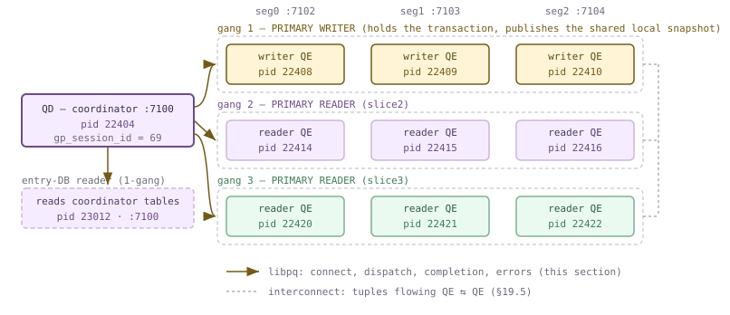

*一个会话（上方采集中的 gp_session_id 69）：QD、写入进程组、两个读取进程组，以及一个 entry-DB 读取进程。每个 pid 都是真实的。琥珀色实线表示 libpq，即 QD 到每个 QE 的私有控制通道；灰色虚线表示 Interconnect，详见 [§19.5](#195-interconnect-implementations)。*

> [!NOTE]
> **两次建立过程，两套网络。** 建立进程组和建立 Interconnect 是两回事，需要先明确边界。建立进程组通过 **QD → QE 的 libpq 连接**进行，连接的是各 Segment 的普通 postmaster 端口，本例为 7102/7103/7104；这就是本节的主题。建立 Interconnect 则通过独立的临时监听端口进行 **QE ↔ QE** 通信，见 [§19.5](#195-interconnect-implementations)。两者仅在一处衔接：QD 完成 libpq 连接后，立即向新的 QE 查询其 Motion 监听端口（`cdbconn.c` — `cdbconn_doConnectComplete()`）；若没有监听端口，就拒绝建立该进程组。随后，这个端口会随查询切片表发送给所有对端。

### 19.2.1 一个写入者，多个读取者 {#1921-one-writer-many-readers}

进程组刻意保持精简：一个类型、一个大小，以及一个连接描述符数组（`cdbgang.h` — `Gang`）。真正有意义的策略都由*类型*决定，以下五个值十五年来一直没有变化：

```c {title="src/include/nodes/plannodes.h — GangType"}
typedef enum GangType
{
	GANGTYPE_UNALLOCATED,       /* a root slice executed by the qDisp */
	GANGTYPE_ENTRYDB_READER,    /* a 1-gang with read access to the entry db */
	GANGTYPE_SINGLETON_READER,	/* a 1-gang to read the segment dbs */
	GANGTYPE_PRIMARY_READER,    /* a 1-gang or N-gang to read the segment dbs */
	GANGTYPE_PRIMARY_WRITER		/* the N-gang that can update the segment dbs */
} GangType;
```

- **GANGTYPE_UNALLOCATED** — 实际上没有进程组：切片在 QD 自身运行。每份计划的切片 0 都属于此类。`InventorySliceTree` 仍通过 `getCdbProcessesForQD` 为它填充进程列表（`cdbgang.c` — `setupCdbProcessList()`），因为即使无人向 QD 派发计划，它仍是一个 Motion 端点。
- **GANGTYPE_ENTRYDB_READER** — 位于 **Coordinator** 上、仅含一个进程的进程组，用于必须扫描 Coordinator 专有关系的计划。这对应上面采集结果中的 `id=9, type=R, content=-1, port=7100` 行：Coordinator 连接自己的 postmaster，为自己派生了一个后端。
- **GANGTYPE_SINGLETON_READER** — 位于**一个** Segment 上、仅含一个进程的进程组，用于 `numsegments=1` 的切片，例如直接派发之后（[§16.4](/cloudberry/core-internals/part-4-query-processing/ch16/#164-distributed-grouping--direct-dispatch)），或通过 `Gather` 汇集到单个 Segment 的情况。
- **GANGTYPE_PRIMARY_READER** — 最常用的类型：N 个进程，切片的 Segment 列表中每个 Segment 一个。相对于分布式事务，它们只执行读取。
- **GANGTYPE_PRIMARY_WRITER** — 同样有 N 个进程，但此进程组**在每个 Segment 上拥有事务**。一个会话最多有一个，没有它就不能存在读取进程组。

最后这种不对称关系是关键，因为事务必须归属于某个进程。每个 Segment 都是完整的 PostgreSQL 实例，有自己的 XID 空间、锁表和快照机制；分布在三个 Segment 上的九个对等进程，不能各自独立开启事务却又组成同一个原子单元。因此，每个 Segment 上恰好有一个 QE，即写入者，负责开始本地事务、代表整个会话持锁（见 `execUtils.c` — `AssignWriterGangFirst()` 对 `lockHolderProcPtr` 的讨论），并将本地快照发布到共享内存中。读取者则附着到它。这个分支在每个后端的 `InitPostgres` 期间只执行一次：

```c {title="src/backend/utils/init/postinit.c"}
	else if (Gp_role == GP_ROLE_EXECUTE)
	{
		if (Gp_is_writer)
		{
			addSharedSnapshot("Writer qExec", gp_session_id);
		}
		else
		{
			/*
			 * NOTE: This assumes that the Slot has already been
			 *       allocated by the writer.  ...
			 */
			lookupSharedSnapshot("Reader qExec", "Writer qExec", gp_session_id);
		}
	}
```

应把这段注释理解为对派发器的调度约束，因为它确实如此。必须先创建写入者，否则同一 Segment 上所有读取者的 `SharedSnapshotLookup`（`sharedsnapshot.c`）都会失败。QD 明确遵循这一要求：`AssignGangs` 调用 `AssignWriterGangFirst`（`execUtils.c`），先沿切片树向下查找 `GANGTYPE_PRIMARY_WRITER` 切片，然后 `InventorySliceTree`（`execUtils.c`）才按普通的自顶向下顺序分配其他进程组。`execUtils.c` 中 `AssignWriterGangFirst()` 的注释解释了迫使系统这样做的情况：可写 CTE 的更新切片位于读取切片*下方*，简单的自顶向下遍历会把写入 QE 分配给错误的切片。同一约束也解释了本节其余行为：会话的写入进程组不能在事务中途被回收掉（`cdbgang.c` — `DisconnectAndDestroyAllGangs()` 明确说明了这一点），杀死写入者会重置整个会话，而不仅仅让一条语句失败。

> [!NOTE]
> **是否为写入者，是 QE 的属性，而非进程组的属性。** 普通 `SELECT` 请求 `SEGMENTTYPE_ANY`，其切片类型为 `GANGTYPE_PRIMARY_READER`；上面自连接的调试日志中，三个切片均为 `gangtype=3`。但 `gp_backend_info()` 仍报告三个 `w` 后端。原因在于 `cdbutil.c` — `cdbcomponent_allocateIdleQE()`：`isWriter = contentId == -1 ? false : (cdbinfo->numIdleQEs == 0 && cdbinfo->numActiveQEs == 0)`。不论请求来自哪里，会话在一个 Segment 上创建的*第一个* QE 都会成为写入者。DML 语句则会*强制*要求这一角色：`INSERT` 日志记录 `segment type = 1`（`SEGMENTTYPE_EXPLICT_WRITER`）和 `gangtype=4`，直接派发时为 `gangsize=1`。

### 19.2.2 创建进程组 {#1922-bringing-a-gang-into-being}

分配路径共有四层调用，每层只负责一件事。`AssignGangs`（`execUtils.c`）遍历切片树；`AllocateGang`（`cdbgang.c`）将切片的 `GangType` 映射为 `SegmentType` 请求，并将进程组记录到派发器状态中，以便稍后回收；`buildGangDefinition`（`cdbgang.c` — `segment_failure_due_to_fault_injector()`）遍历 Segment 列表，调用 `cdbcomponent_allocateIdleQE(contentId, segmentType)`；后者从该 Segment 的空闲链表取出一个描述符，或创建一个新描述符。注意 `buildGangDefinition` 的职责边界：它只*预留*描述符，此时尚未建立任何连接。正因为如此，下一步才能批量进行。

QE 并非特殊的进程类型。它是普通后端，由 Segment 自己的 postmaster 响应普通 libpq 连接而派生；`cdbconn.c` 中的 `cdbconn_doConnectStart()` 调用 `PQconnectStartParams`。使它成为 QE 的，是 CBDB 为 libpq 本身增加的两个连接参数（`fe-connect.c` — `PQconninfoOptions`）：`gpqeid` 和 `options`/`diff_options`。`gpqeid` 是以分号分隔的字符串，构造时不调用 palloc 或 elog，因为这段代码过去在线程中运行：

```c {title="src/backend/cdb/dispatcher/cdbgang.c — build_gpqeid_param()"}
	len = snprintf(buf, bufsz, "%d;" TIMESTAMP_FORMAT ";%s;%d;%d;%d;%d",
				   gp_session_id, PgStartTime,
				   (is_writer ? "true" : "false"), identifier, hostSegs, icHtabSize,
				   qeidx);
```

`postmaster.c` 中的 `ProcessStartupPacket()` 从启动包取出 `gpqeid`，然后 `cdbgang_parse_gpqeid_params`（`cdbgang.c` — `gpqeid_next_param()`）在认证前以 `PGC_S_OVERRIDE` 应用它，因此当 `postinit.c` — `InitPostgres()` 需要 `gp_is_writer` 时，该值已经设置好。`options` 字符串则不同：`makeOptions`（`cdbgang.c`）为**每个**带 `GUC_GPDB_NEED_SYNC` 标记的 GUC 生成其*重置值*对应的 `-c name=value`，并附上 QD 自身的主机名和端口；会话后来修改过的 GUC 会进入另一份 `diff_options` 列表，由 QE 以 `PGC_S_SESSION` 应用（`postinit.c` — `process_startup_options()`），从而保留重置值。在本集群上，这个字符串包含 **193 对 `-c` 参数，共 6380 字节**，每次连接发送一次。设置 `gp_log_gang = debug` 会打印完整字符串，以及 QD 刚获知的 Interconnect 端口：

*新连接上设置 gp_log_gang=debug。省略了 6380 字节的 options 字符串；展示的每个片段均保持原文和实际顺序（字母顺序）。*

```bash
PGOPTIONS='-c gp_log_gang=debug -c client_min_messages=log' psql -p 7100 -d postgres
select count(*) from m192_s;
```

```text {hl_lines="5" title="output"}
LOG:  AllocateGang begin.
LOG:  createGang size = 3, segment type = 3
LOG:  buildGangDefinition:Starting 3 qExec processes for gang
LOG:  buildGangDefinition done
LOG:  Connected to seg1 10.100.0.3:7103 motionListenerPorts=38140/0 with options
       -c gp_qd_hostname=10.100.0.3 -c gp_qd_port=7100
       -c allow_dml_directory_table=false -c array_nulls=true
       [... 187 more -c name=value pairs ...]
       -c gp_interconnect_type=udpifc -c gp_max_packet_size=8192
       -c statement_mem=128000 -c work_mem=32768
LOG:  createGang: 3 processes requested; 3 successful connections 0 in recovery
LOG:  AllocateGang end.
LOG:  getCdbProcessList slice1 gangtype=3 gangsize=3
LOG:  Gang assignment: slice1 seg0 10.100.0.3:58041 pid=14392
LOG:  Gang assignment: slice1 seg1 10.100.0.3:38140 pid=14393
LOG:  Gang assignment: slice1 seg2 10.100.0.3:50190 pid=14394
```

日志中有两个细节值得注意。`motionListenerPorts=38140/0` 将两个端口打包到一个字中（`cdbconn.c` — `cdbconn_doConnectComplete()` 分别掩码提取低半部和高半部），分别是 UDP 和 TCP 监听端口；根据 `gp_interconnect_type`，只会填入其中一个。而 `Gang assignment` 行打印的是 `10.100.0.3:58041`：到这里，QD 已不再关心 postmaster 端口，记录的是将交给对端的 *Interconnect* 端点。连接按照 `buildGangDefinition` 准备好的方式批量打开：`cdbgang_async.c` 为全部 N 个 Segment 发起 `cdbconn_doConnectStart`（`cdbgang_createGang_async()`），再用一个 `poll()` 循环推进它们直到完成（`cdbgang_createGang_async()`），截止时间由 `gp_segment_connect_timeout` 计算，本例为 180 秒（`getPollTimeout`）。每个 QE 的耗时都会被记录，`gp_print_create_gang_time` 会将其打印出来：

*gp_print_create_gang_time=on：同一个包含三个切片的自连接运行两次。耗时仅用于比较同一个启用 --enable-cassert 的构建中的比例，不是基准测试。*

```sql
set gp_print_create_gang_time = on;
select count(*) from m192_s a join m192_s b on a.b=b.b;
select count(*) from m192_s a join m192_s b on a.b=b.b;
```

```text {hl_lines="6" title="output"}
INFO:  The shortest establish conn time: 6.04 ms, segindex: 0,
       The longest  establish conn time: 6.57 ms, segindex: 2
INFO:  (Slice2) The shortest establish conn time: 5.21 ms, segindex: 0,
                The longest  establish conn time: 5.81 ms, segindex: 1
INFO:  (Slice3) The shortest establish conn time: 5.01 ms, segindex: 0,
                The longest  establish conn time: 5.77 ms, segindex: 2
INFO:  (Slice1) is reused
 count
-------
 10002
(1 row)

INFO:  (Slice2) is reused
INFO:  (Slice3) is reused
INFO:  (Slice1) is reused
 count
-------
 10002
(1 row)
```

三个 Segment 中，同一进程组最慢的连接仅比最快的晚 0.5–0.8 毫秒完成，说明派生进程和认证工作重叠执行了；若串行进行，成本会是三者之和。进程组创建循环还有一条通常看不到的重试路径：若 `PGRES_POLLING_FAILED` 的错误文本匹配 `POSTMASTER_IN_STARTUP_MSG` 或 `POSTMASTER_IN_RECOVERY_MSG`（`segment_failure_due_to_recovery`，`cdbgang.c` — `AllocateGang()`，这里确实检索了消息字符串，注释也承认这种做法并不理想），就认为可以重试，经过 `gp_gang_creation_retry_timer` 后重新执行整个 `create_gang_retry` 标签。包括超时在内的其他所有情况，都会变成 `ERROR: failed to acquire resources on one or more segments`，具体原因放在 `errdetail` 中：可能是 `timeout expired`（`cdbgang_async.c` — `cdbgang_createGang_async()`）、libpq 消息，或 `FTS detected one or more segments are down`。本集群没有人为制造 Segment 宕机。

### 19.2.3 进程组跨越语句存活 {#1923-gangs-outlive-statements}

这一点最容易被误解：进程组**不是**每条语句创建一次。`cdbdisp_destroyDispatcherState` 回收会话的进程组，而非销毁它们；`cdbcomponent_recycleIdleQE` 将每个描述符连同仍然有效的 libpq 连接，一起放回各 Segment 的空闲链表。下一条语句直接从中取用。进程 ID 不变就是证据：

*九个 QE，两条语句，pid 相同。随后将 gp_vmem_idle_resource_timeout 降为 100 毫秒，让客户端空闲两秒。注释中的 600000 毫秒是这个启用断言的构建的默认值；发布构建的默认值为 18000。*

```sql
select count(*) from m192_s a join m192_s b on a.b=b.b;
select count(*) as qes, string_agg(pid::text,' ' order by id) as pids
  from gp_backend_info() where content>=0;
select count(*) from m192_s a join m192_s b on a.b=b.b;   -- same statement again
select count(*) as qes, string_agg(pid::text,' ' order by id) as pids
  from gp_backend_info() where content>=0;
set gp_vmem_idle_resource_timeout = 100;   -- ms; default is 600000
\! sleep 2
```

```text {hl_lines="14" title="output"}
 qes |                         pids
-----+-------------------------------------------------------
   9 | 22031 22032 22033 22037 22038 22039 22043 22044 22045
(1 row)

 qes |                         pids
-----+-------------------------------------------------------
   9 | 22031 22032 22033 22037 22038 22039 22043 22044 22045
(1 row)

SET
 qes |       pids
-----+-------------------
   3 | 22031 22032 22033
(1 row)
```

先是九个，接着是同样的九个，最后剩三个，而幸存者恰好都是写入者，pid 为 `22031 22032 22033`。这是 `DisconnectAndDestroyUnusedQEs` 调用 `cdbcomponent_cleanupIdleQEs(false)` 的结果，其中 `false` 表示*不要动写入者*；为何不能动它们，见 [§19.2.1](#1921-one-writer-many-readers)。回收的 QE 是回到空闲链表还是被销毁，由 `cleanupQE` 及其后的长度检查共同决定：

```c {title="src/backend/cdb/cdbutil.c — cdbcomponent_recycleIdleQE()"}
	if (forceDestroy || !cleanupQE(segdbDesc))
		goto destroy_segdb;

	/* If freelist length exceed gp_cached_gang_threshold, destroy it */
	maxLen = segdbDesc->segindex == -1 ?
					MAX_CACHED_1_GANGS : gp_cached_gang_threshold;
	if (!isWriter && list_length(cdbinfo->freelist) >= maxLen)
		goto destroy_segdb;
```

| 什么会结束 QE 的生命 | 位置 | 说明 |
| --- | --- | --- |
| 调用者显式要求 `forceDestroy` | `RecycleGang(gp, true)`，`cdbgang.c`（`gangTypeToString()`） | 扩展查询／命名门户进程组，以及创建到一半触发 `PG_CATCH` 的进程组会设置此标记 |
| 连接已经失效，或 FTS 报告 Segment 宕机 | `cleanupQE`，`cdbutil.c` | 死连接绝不进入缓存 |
| 读取者的峰值内存超过 `gp_vmem_protect_segworker_cache_limit`（500 MB） | `cdbutil.c`（`cleanupQE()`） | 使用 libpq 的 `mop_high_watermark`；内存消耗过大的读取者会被销毁，不再复用 |
| 尝试丢弃结果 20 次后 QE 仍然忙碌 | `cdbconn_discardResults`，`cdbutil.c`（`cleanupQE()`） | 记录 `cleaning up segN while it is still busy` 日志 |
| 空闲链表已达到 `gp_cached_segworkers_threshold`（5） | `cdbutil.c`（`cdbcomponent_recycleIdleQE()`） | 只限制读取者；写入者豁免，始终缓存 |
| 会话空闲时间超过 `gp_vmem_idle_resource_timeout`（18000 毫秒；本次采集使用的断言构建为 600000） | `DisconnectAndDestroyUnusedQEs`，`src/backend/cdb/dispatcher/cdbgang.c` | 只影响读取者 |
| 写入进程组丢失 | `markCurrentGxactWriterGangLost`，`cdbutil.c`（`cdbcomponent_recycleIdleQE()`） | 强制执行 `resetSessionForPrimaryGangLoss`，并分配新的 `gp_session_id` |

很容易观察空闲链表上限的作用。将其降为 1 后，读取进程组就不能全部缓存，因此不同语句之间读取者的 pid 会变化，而写入者保持不动：

*gp_cached_segworkers_threshold=1：每个 Segment 只允许缓存一个空闲读取者，因此第二条语句必须派生新的读取者。*

```sql
set gp_cached_segworkers_threshold = 1;   -- real GUC name; default 5
select count(*) from m192_s a join m192_s b on a.b=b.b;
select type, string_agg(pid::text,' ' order by id) as pids
  from gp_backend_info() where content>=0 group by type order by type;
select count(*) from m192_s a join m192_s b on a.b=b.b;
select type, string_agg(pid::text,' ' order by id) as pids
  from gp_backend_info() where content>=0 group by type order by type;
```

```text {hl_lines="9" title="output"}
 type |       pids
------+-------------------
 r    | 23454 23455 23456
 w    | 23440 23441 23442
(2 rows)

 type |       pids
------+-------------------
 r    | 23464 23465 23466
 w    | 23440 23441 23442
(2 rows)
```

缓存的 QE 是带着旧 GUC 状态的进程，因此复用时必须满足一个要求：每条 `SET` 都要在已有进程组上重放。`CdbDispatchSetCommand`（`cdbdisp_query.c`）正是这样做的：它将 `SET` 文本派发给除扩展查询进程组外的所有存活进程组，并在之后将被排除的那些进程组标记为不可回收复用（`cdbdisp_markNamedPortalGangsDestroyed`），因为它们错过了更新：

*SET 前后是同样的三个 QE，但它们内部的值已经改变。*

```sql
select seg, setting from gp_dist_random('m192_wm') order by seg;  -- view over pg_settings
select string_agg(pid::text,' ' order by id) as qe_pids
  from gp_backend_info() where content>=0;
set work_mem = '64MB';
select seg, setting from gp_dist_random('m192_wm') order by seg;
select string_agg(pid::text,' ' order by id) as qe_pids
  from gp_backend_info() where content>=0;
```

```text {hl_lines="16" title="output"}
 seg | setting
-----+---------
   0 | 32768
   1 | 32768
   2 | 32768
(3 rows)

      qe_pids
-------------------
 23475 23476 23477
(1 row)

SET
 seg | setting
-----+---------
   0 | 65536
   1 | 65536
   2 | 65536
(3 rows)

      qe_pids
-------------------
 23475 23476 23477
(1 row)
```

可以量化复用的收益。上面建立一个 QE 需要 5–7 毫秒，并携带 6380 字节的 GUC 选项；三个切片的自连接需要九个 QE。没有缓存时，会话中的每条语句都要支付这笔成本。在具有 48 个 Segment 的真实集群上，一份九切片计划意味着每条语句都要派生并认证 432 个进程。这也是 [§13.2](/cloudberry/core-internals/part-4-query-processing/ch13/#132-the-extended-query-protocol) 所说“预备语句复用的不只是计划”的另一层含义：在 CBDB 上，预热会话也预热了*进程*，连接后的第一条语句明显更昂贵。

### 19.2.4 异步派发：一个 QD，N 个套接字 {#1924-async-dispatch-one-qd-n-sockets}

进程组准备好后，QD 持有九个打开的 libpq 连接和一份序列化计划。它不会按顺序等待每个连接完成。`cdbdisp_dispatchToGang_async`（`cdbdisp_async.c`）遍历进程组，对每个成员调用 `dispatchCommand`；后者只是对 `PQsendGpQuery_shared(conn, query_text, query_text_len, true)` 的简单封装（`dispatchCommand()`），其中 `true` 表示*非阻塞*，因此拥塞的套接字不会拖住循环。只有启动了全部查询切片，QD 才开始读取结果。两个循环完成这项工作：`cdbdisp_waitDispatchFinish_async` 轮询 `POLLOUT` 并刷出剩余数据，随后 `checkDispatchResult` 轮询 `POLLIN`：

```c {title="src/backend/cdb/dispatcher/cdbdisp_async.c"}
			/*
			 * Add socket to fd_set if still connected.
			 */
			sock = PQsocket(conn);
			Assert(sock >= 0);
			fds[nfds].fd = sock;
			fds[nfds].events = POLLIN;
			nfds++;
		}
		/* Break out when no QEs still running or required QEs acked. */
		if (nfds <= 0 || ...)
			break;
		n = poll(fds, nfds, timeout);
```

哪个描述符变为可读，就交给 `handlePollSuccess` → `processResults` → `PQconsumeInput` / `PQisBusy`，没有固定顺序。启用 `gp_log_gang = debug` 后，一份跟踪日志就能展示派发的完整形态：

*一条语句、三个进程组、九个 QE。为便于阅读，省略了穿插其中的“PQsocket says”和“-> ok SELECT 0”行；所示行的顺序与实际采集完全一致。*

```bash
PGOPTIONS='-c gp_log_gang=debug -c client_min_messages=log' psql -p 7100 -d postgres
select count(*) from m192_s a join m192_s b on a.b=b.b;
```

```text {hl_lines="7" title="output"}
LOG:  createGang: 3 processes requested; 3 successful connections 0 in recovery
LOG:  getCdbProcessList slice1 gangtype=3 gangsize=3
LOG:  createGang: 3 processes requested; 3 successful connections 0 in recovery
LOG:  getCdbProcessList slice2 gangtype=3 gangsize=3
LOG:  createGang: 3 processes requested; 3 successful connections 0 in recovery
LOG:  getCdbProcessList slice3 gangtype=3 gangsize=3
LOG:  Query plan size to dispatch: 2KB
LOG:  Command dispatched to QE (seg0 slice2 10.100.0.3:7102 pid=23814)
LOG:  Command dispatched to QE (seg1 slice2 10.100.0.3:7103 pid=23815)
LOG:  Command dispatched to QE (seg2 slice2 10.100.0.3:7104 pid=23816)
LOG:  Command dispatched to QE (seg0 slice3 10.100.0.3:7102 pid=23822)
LOG:  Command dispatched to QE (seg1 slice3 10.100.0.3:7103 pid=23823)
LOG:  Command dispatched to QE (seg2 slice3 10.100.0.3:7104 pid=23824)
LOG:  Command dispatched to QE (seg0 slice1 10.100.0.3:7102 pid=23808)
LOG:  Command dispatched to QE (seg1 slice1 10.100.0.3:7103 pid=23809)
LOG:  Command dispatched to QE (seg2 slice1 10.100.0.3:7104 pid=23810)
LOG:  processResults says we are finished with 4 of 9 (seg0 slice3 ... pid=23822)
LOG:  processResults says we are finished with 5 of 9 (seg1 slice3 ... pid=23823)
LOG:  processResults says we are finished with 6 of 9 (seg2 slice3 ... pid=23824)
LOG:  processResults says we are finished with 2 of 9 (seg1 slice2 ... pid=23815)
LOG:  processResults says we are finished with 3 of 9 (seg2 slice2 ... pid=23816)
LOG:  processResults says we are finished with 1 of 9 (seg0 slice2 ... pid=23814)
LOG:  processResults says we are finished with 9 of 9 (seg2 slice1 ... pid=23810)
LOG:  processResults says we are finished with 7 of 9 (seg0 slice1 ... pid=23808)
LOG:  processResults says we are finished with 8 of 9 (seg1 slice1 ... pid=23809)
```

从这份跟踪可以得到四个事实。**派发任何内容之前，三个进程组就已全部分配完毕**：`AssignGangs` 在 `cdbdisp_query.c` 的 `cdbdisp_dispatchX()` 中运行，位于序列化之前。**计划只序列化一次**：九次发送只对应一条 `Query plan size to dispatch` 日志，`PQsendGpQuery_shared` 甚至不复制缓冲区，而是将每个 `PGconn->outBuffer` 指向共享文本（`cdbpq.c`），完成后再恢复原指针。**切片从叶子开始派发**：先 `slice2`、`slice3`，再到根 `slice1`，因为 `fillSliceVector` 按依赖孩子的数量排序（`compare_slice_order`，`cdbdisp_query.c`），确保消费者开始拉取前，生产者已经运行。最后，**完成结果无序到达**，顺序为 4、5、6、2、3、1、9、7、8，这就是异步机制的内部表现。同步派发器会将九次 `PQexec` 往返串行化，为本可完全并行的实际工作增加九次准备延迟；过去控制这类行为的线程池参数 `gp_connections_per_thread` 已经不在源码树中。还有一个细节：这里每个 QE 的 libpq 结果都是 `ok SELECT 0`，包括根切片的发送方。元组从不通过这些套接字传输。libpq 只承载控制和完成状态，数据通过 Interconnect 传输（[§19.5](#195-interconnect-implementations)）。

### 19.2.5 网络上实际传输什么 {#1925-what-actually-crosses-the-wire}

“派发计划”对应一条类型为 `'M'` 的消息，由 `buildGpQueryString`（`cdbdisp_query.c`）手工封装。其大小计算代码是源码树中对派发载荷最精简的清单：

```c {title="src/backend/cdb/dispatcher/cdbdisp_query.c — buildGpQueryString()"}
	total_query_len = 1 /* 'M' */ +
		sizeof(len) /* message length */ +
		sizeof(gp_command_count) +
		sizeof(sessionUserId) + sizeof(outerUserId) + sizeof(currentUserId) +
		sizeof(n32) * 2 /* currentStatementStartTimestamp */ +
		sizeof(is_hs_dispatch) +
		sizeof(command_len) + sizeof(plantree_len) +
		sizeof(sddesc_len) + sizeof(dtxContextInfo_len) +
		dtxContextInfo_len + command_len + plantree_len + sddesc_len +
		sizeof(numsegments) + sizeof(resgroupInfo.len) + resgroupInfo.len +
		sizeof(tempNamespaceId) + sizeof(tempToastNamespaceId);
```

载荷主要由三个变长数据块组成。`plantree` 是序列化后的 `PlannedStmt`，由 `serializeNode`（`cdbdisp_query.c` — `cdbdisp_buildPlanQueryParms()`）生成并**压缩**；该函数同时返回传输长度和未压缩长度，`gp_max_plan_size` 限制的是后者。`sddesc` 是序列化后的 `QueryDispatchDesc`（`execdesc.h`），保存 QD 无法放进计划的本次派发附加信息：`SliceTable` 本身（[§19.3](#193-slice-tables--planslice--gang-mapping)）、包含 `PARAM_EXTERN` 和已求值 `PARAM_EXEC` 的 `paramInfo`、确保 `CREATE` 在所有 Segment 上选择相同 OID 的 `oidAssignments`、`cursorPositions`、供 [§19.6](#196-parallel-retrieve-cursor--endpoint) 使用的 `parallelCursorName`、`secContext`，以及物化视图字段。`dtxContextInfo` 则是来自 `qdSerializeDtxContextInfo` 的分布式事务上下文和快照（[§12.2](/cloudberry/core-internals/part-3-transactions-mvcc-concurrency/ch12/#122-cloudberrys-2pc-cdbtm-dtxstate--dtxcontext)、[§10.5](/cloudberry/core-internals/part-3-transactions-mvcc-concurrency/ch10/#105-distributed-snapshots--the-distributed-log)），这使九个 QE 看到一致的数据库状态。其余字段虽小，却不可或缺：三个用户 OID 保证 `SECURITY DEFINER` 和 `SET ROLE` 正确工作；语句开始时间戳使所有进程中的 `now()` 一致；还有临时名字空间 OID 和资源组数据块（第 [21](/cloudberry/core-internals/part-6-resource-management/ch21/) 章）。`command` 字段是 SQL 文本，存在计划时会刻意截断到 `QUERY_STRING_TRUNCATE_SIZE`，因为它仅供 Segment 上的 `pg_stat_activity` 使用。

| 查询 | 派发的切片数 | 未压缩计划大小 |
| --- | --- | --- |
| `select count(*) from m192_s` | 1 | 0 KB |
| 非分布键上的两表自连接 | 3 | 2 KB |
| 三表自连接 | 4 | 3 KB |
| 四表自连接 | 5 | 4 KB |
| 六表自连接 | 7 | 6 KB |

在这个模式下，每个切片大约对应 1 KB，发给每个 QE 的字节完全相同。载荷随*计划*增长，而不随 Segment 数增长。随后每个 QE 在 `postgres.c` 的 `PostgresMain` 中解析消息（`case 'M': /* MPP dispatched stmt from QD */`），先根据 DTX 上下文设置快照，再调用 `exec_mpp_query`（`postgres.c` — `PostgresMain()`）。后者安装查询切片表，确定自身所属切片（[§18.1](/cloudberry/core-internals/part-4-query-processing/ch18/#181-executor-framework--lifecycle) 的 `getGpExecIdentity`），再进入普通执行器生命周期。该协议见 [§13.3](/cloudberry/core-internals/part-4-query-processing/ch13/#133-dispatch-from-coordinator-plan-to-segment-execution)，这里补充的是一对多发送的视角：一次 `buildGpQueryString`、一个 2 KB 缓冲区、九次 `PQsendGpQuery_shared` 调用，以及十次独立的 `ExecutorStart`/`ExecutorRun` 遍历同一棵计划树，只是每次进入的高度不同。

### 19.2.6 QE 死亡时 {#1926-when-a-qe-dies}

本手册中的每条 Segment 端错误都带有括号后缀，例如 `(seg0 slice1 10.100.0.3:7102 pid=9934)`。它由 **QD** 上的 `cdbconn_setQEIdentifier` 生成，而非由 Segment 生成；每次 QE 被分配给不同切片时都会重新构造：

```c {title="src/backend/cdb/dispatcher/cdbconn.c"}
	if (segdbDesc->segindex >= 0)
	{
		appendStringInfo(&string, "seg%d", segdbDesc->segindex);
		if (sliceIndex > 0)
			appendStringInfo(&string, " slice%d", sliceIndex);
	}
	else
		appendStringInfo(&string, SEGMENT_IS_ACTIVE_PRIMARY(cdbinfo) ?
						 "entry db" : "mirror entry db");
	appendStringInfo(&string, " %s:%d", cdbinfo->config->hostip, cdbinfo->config->port);
	if (segdbDesc->backendPid != 0)
		appendStringInfo(&string, " pid=%d", segdbDesc->backendPid);
```

结果保存在 `segdbDesc->whoami`，并作为私有诊断字段 `PG_DIAG_GP_PROCESS_TAG` 附加到每个收到的 `PGresult` 上（`cdbdispatchresult.c` — `cdbdisp_appendResult()`）。`cdbdisp_get_PQerror` 将 QE 错误重建为本地 `ErrorData` 时，会取出此标记并构造 `errmsg("%s  (%s)", fld, whoami)`（`cdbdisp_get_PQerror()`），同时保留 QE 的 SQLSTATE、文件、行号和函数。因此，Segment 错误看起来就像附带来源地址的本地错误。为观察它，我们在一个长时间连接运行期间，通过 utility 模式连接终止 seg0 上的读取 QE，并设置 `statement_timeout` 作为保护：

*在语句执行中途杀死一个读取 QE。会话 A 以 statement_timeout=90s 运行两次连接；两次之间，第二个连接执行 PGOPTIONS='-c gp_role=utility' psql -p 7102 -c 'select pg_terminate_backend(10791)'。*

```sql
-- session A
SET statement_timeout = '90s';
select min(pid) from gp_backend_info() where type='r' and content=0;   --> 10791
select count(*) from m192_t a join m192_t b on a.b = b.b;
-- (meanwhile, on seg 7102 in utility mode: pg_terminate_backend(10791))
select 'SESSION A STILL ALIVE' as post;
select count(*) from m192_s;
```

```text {hl_lines="6" title="output"}
   count
-----------
 514285716
(1 row)

ERROR:  terminating connection due to administrator command  (seg0 slice2 10.100.0.3:7102 pid=10791)
         post
-----------------------
 SESSION A STILL ALIVE
(1 row)

 count
-------
   300
(1 row)
```

QE 的 `FATAL` 到达 QD 后变成了 `ERROR`。这是刻意设计的，`cdbdispatchresult.c` 中 `cdbdisp_get_PQerror()` 的注释明确指出：QE 死亡不能导致 QD 死亡。但这条语句必然失败。系统无法只重跑一个切片：该 QE 曾持有部分哈希表和一半重分布数据流，而它的对端 Motion 接收方已经在等待一条永远不会再产生数据块的路由。因此，派发器会升级处理：一旦任意 QE 报错且设置了 `cancelOnError`，`checkDispatchResult` 就将 `waitMode` 升为 `DISPATCH_WAIT_CANCEL`（`cdbdisp_async.c` — `checkDispatchResult()`）；`signalQEs` 向幸存者发送 libpq 取消请求，`cdbdisp_getDispatchResults` 重新抛出最先收集到的错误。清理随后通过 `RecycleGang` 进行，写入者与读取者的不对称关系在这里最后一次发挥作用：因为被杀的是*读取者*，只销毁了它的描述符，会话的写入进程组和事务存活，下一条语句在重建的读取者上正常运行。如果死亡的是写入者，`markCurrentGxactWriterGangLost`（`cdbutil.c` — `cdbcomponent_recycleIdleQE()`）就会强制执行 `resetSessionForPrimaryGangLoss`：分配新的 `gp_session_id`，删除临时表，并记录日志*“The previous session was reset because its gang was disconnected”*（`cdbgang.c` — `GpDropTempTables()`）。以上机制都没有涉及*准入*：集群允许同时持有多少个进程组，暂时不能准入时又会怎样。这是第 [21](/cloudberry/core-internals/part-6-resource-management/ch21/) 章的主题。在此之前，[§19.3](#193-slice-tables--planslice--gang-mapping) 将拆开载荷中的查询切片表，说明它如何告诉这九个进程各自所属的切片。

## 19.3 查询切片表与 PlanSlice ↔ 进程组映射 {#193-slice-tables--planslice--gang-mapping}

派发计划是一种*广播*：每个执行器收到的 `PlannedStmt` 逐字节相同。其中没有任何信息直接指定“你负责扫描，你负责接收”。但十二个进程必须无需进一步协商，就能分工执行这棵树。让这一切成为可能的是**查询切片表**。它有两种形式和两种不同的生命周期：规划器写入、派发器发送的 `PlanSlice`，以及各执行器在本地构建、且只有它知道进程信息的 `ExecSlice`。

本节介绍这两个结构及其绑定关系。[§19.1](#191-distributed-execution-principles) 给出了基本概念：查询切片是并行单位，Motion 是其边界；[§19.2](#192-the-dispatcher-gangs--async-dispatch) 介绍了*进程*，即如何创建、复用和回收进程组。这里专注于映射：每个切片的身份、哪些进程属于它、QE 如何发现自身身份，以及最实用的一点——如何从 `EXPLAIN` 读出切片树，在执行前计算计划需要多少进程。

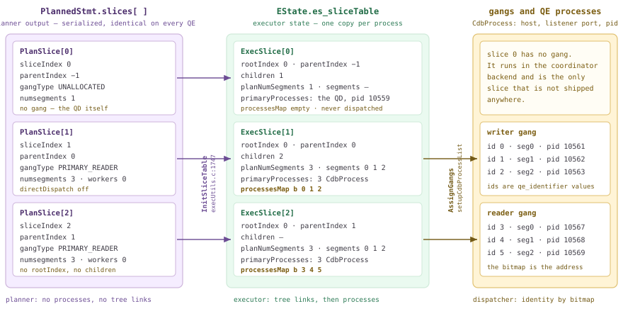

*一份查询切片表，两种表示。左侧是规划器的决定，随计划传输；中间是执行器据此构建的内容；右侧是派发器为其绑定的内容。`sliceIndex` 是三者共同的关联键。*

### 19.3.1 两个结构，两种生命周期 {#1931-two-structs-two-lifetimes}

规划器的查询切片表是挂在 `PlannedStmt` 上的数组：`slices` 中有 `numSlices` 项（`src/include/nodes/plannodes.h`），另有并列数组 `subplan_sliceIds`（`PlannedStmt`），将每个 SubPlan 映射到其所属切片。单个条目如下：

```c {title="src/include/nodes/plannodes.h — PlanSlice"}
typedef struct PlanSlice
{
	int			sliceIndex;
	int			parentIndex;

	GangType	gangType;

	/* # of segments in the gang, for PRIMARY_READER/WRITER slices */
	int			numsegments;
	int			parallel_workers;
	/* segment to execute on, for SINGLETON_READER slices */
	int			segindex;

	/* direct dispatch information, for PRIMARY_READER/WRITER slices */
	DirectDispatchInfo directDispatch;
} PlanSlice;
```

这就是规划器对切片的*全部*描述：一个索引、一个父节点、来自 `GangType` 枚举的进程组**类型**（`plannodes.h`）、Segment **数量**，以及可选的特定 Segment 限定。没有进程、地址或树链接。通过 `debug_print_plan` 可以直接从计划中读出这个数组，它会被原样序列化（`src/backend/nodes/outfuncs.c` — `_outPlannedStmt()`）。

*从派发的 PlannedStmt 中读取两表连接的规划器查询切片表。*

```sql
SET optimizer = off;
SET debug_print_plan = on;
SET client_min_messages = log;
SELECT count(*) FROM m193_fact f JOIN m193_cust c ON f.cust = c.cust;
```

```text {hl_lines="5" title="output"}
LOG:  plan:
DETAIL:     {PLANNEDSTMT
   ...
   :subplan_sliceIds  <>
   :numSlices 3
   :slices[i].sliceIndex 0
   :slices[i].parentIndex -1
   :slices[i].gangType 0
   :slices[i].numsegments 1
   :slices[i].parallel_workers 0
   :slices[i].segindex 0
   :slices[i].directDispatch.isDirectDispatch false
   :slices[i].directDispatch.contentIds <>
   :slices[i].sliceIndex 1
   :slices[i].parentIndex 0
   :slices[i].gangType 3
   :slices[i].numsegments 3
   :slices[i].parallel_workers 0
   :slices[i].segindex 0
   :slices[i].directDispatch.isDirectDispatch false
   :slices[i].directDispatch.contentIds <>
   :slices[i].sliceIndex 2
   :slices[i].parentIndex 1
   :slices[i].gangType 3
   :slices[i].numsegments 3
   :slices[i].parallel_workers 0
   ...
```

`gangType 0` 表示 `GANGTYPE_UNALLOCATED`，`3` 表示 `GANGTYPE_PRIMARY_READER`。注意切片 0，也就是 Coordinator 自身运行的切片，*也在*数组中，`numsegments 1`，没有分配进程组类型；[§13.3](/cloudberry/core-internals/part-4-query-processing/ch13/#133-dispatch-from-coordinator-plan-to-segment-execution) 已指出，这个切片从不派发。执行器一侧的结构则丰富得多。

```c {title="src/include/executor/execdesc.h — ExecSlice"}
typedef struct ExecSlice
{
	int			sliceIndex;
	int			rootIndex;
	int			parentIndex;
	int			planNumSegments;	/* nominal, for hash calculations */
	List	   *children;			/* child slices = receiving Motions */
	GangType	gangType;
	List	   *segments;			/* segment ids that run this slice */
	struct Gang *primaryGang;
	List	   *primaryProcesses;	/* one CdbProcess per worker */
	Bitmapset  *processesMap;		/* which QE runs this slice */
} ExecSlice;
```

| 问题 | `PlanSlice`（规划器） | `ExecSlice`（执行器） |
| --- | --- | --- |
| 存放位置 | `PlannedStmt.slices[]` | `EState.es_sliceTable->slices[]` |
| 谁负责写入 | `cdbllize_build_slice_table`（[§16.3](/cloudberry/core-internals/part-4-query-processing/ch16/#163-parallelization-cdbllize--cdbmutate)）或 ORCA 的 DXL 转换器（[§17.5](/cloudberry/core-internals/part-4-query-processing/ch17/#175-translation-query--dxl--plstmt)） | `ExecutorStart` 时的 `InitSliceTable`，以及派发时的 `AssignGangs` |
| 生命周期 | 规划 → 序列化 → 每个 QE 读取相同字节 | 每个进程、每条语句一个实例 |
| 树链接 | 只有 `parentIndex` | `parentIndex` + `rootIndex` + `children` 列表 |
| Segment 信息 | `numsegments`（数量）+ `directDispatch.contentIds` | `segments`（实际 ID 列表）+ `planNumSegments` |
| 进程 | 无 | `primaryGang`、`primaryProcesses`、`processesMap` |
| 并行工作进程 | 不并行时 `parallel_workers` = 0 | 不并行时 `parallel_workers` = 1，另有 `useMppParallelMode` |
| 表示谁的身份 | 不表示任何一方，数组是对称的 | `SliceTable.localSlice` 指明*哪一项是我* |

### 19.3.2 交接：先 InitSliceTable，再 AssignGangs {#1932-the-hand-off-initslicetable-then-assigngangs}

Coordinator 上的 `ExecutorStart` 调用 `InitSliceTable`（`execMain.c` — `standard_ExecutorStart()` → `execUtils.c`）。它复制数组，然后完成规划器尚未做的两件事：沿 `parentIndex` 向上遍历，计算每个切片的 `rootIndex`，并将孩子加入父节点的 `children` 列表（`execUtils.c` — `InitSliceTable()`）；再通过 `FillSliceGangInfo` 将 `numsegments` 展开为具体的 Segment 列表。

```c {title="src/backend/executor/execUtils.c"}
	int factor = ps->parallel_workers ? ps->parallel_workers : 1;
	int numsegments = ps->numsegments;
	...
		case GANGTYPE_PRIMARY_WRITER:
		case GANGTYPE_PRIMARY_READER:
			slice->planNumSegments = numsegments * factor;
			if (dd->isDirectDispatch)
			{
				/* ... one entry per dd->contentIds member, x factor ... */
			}
			else
			{
				for (i = 0; i < numsegments; i++)
					for (j = 0; j < factor; j++)
						slice->segments = lappend_int(slice->segments,
													  i % getgpsegmentCount());
```

`planNumSegments = numsegments × parallel_workers` 就是 [§18.2](/cloudberry/core-internals/part-4-query-processing/ch18/#182-scan-nodes) 从扫描角度介绍的计算；这里可以看到，它最终生成的是*进程组大小*。现在通过 `debug_print_slice_table`（`guc_gp.c` — `config_bool`）转储 Coordinator 的副本，它在 `InitPlan` 后立即以 `DEBUG3` 级别输出（`execMain.c` — `standard_ExecutorStart()`）。

*InitSliceTable 刚完成时 Coordinator 的查询切片表：结构齐全，进程信息尚不存在。*

```sql
SET debug_print_slice_table = on;
SET client_min_messages = debug3;
SELECT count(*) FROM m193_fact f JOIN m193_cust c ON f.cust = c.cust;
```

```text {hl_lines="23" title="output"}
DEBUG:  slice table:
DETAIL:     {SLICETABLE
   :localSlice 0
   :numSlices 3
   :slices[i].sliceIndex 0
   :slices[i].rootIndex 0
   :slices[i].parentIndex -1
   :slices[i].planNumSegments 1
   :slices[i].children (i 1)
   :slices[i].gangType 0
   :slices[i].segments <>
   ...
   :slices[i].sliceIndex 1
   :slices[i].rootIndex 0
   :slices[i].parentIndex 0
   :slices[i].planNumSegments 3
   :slices[i].children (i 2)
   :slices[i].gangType 3
   :slices[i].segments (i 0 1 2)
   :slices[i].useMppParallelMode false
   :slices[i].parallel_workers 1
   :slices[i].primaryGang <>
   :slices[i].primaryProcesses <>
   :slices[i].processesMap (b)
   ...
   :hasMotions true
   :ic_instance_id 0
   }
DEBUG:  Query plan size to dispatch: 2KB
```

`children (i 1)` 和 `children (i 2)` 将规划器仅隐含表达的树显式建立起来。`primaryProcesses` 和 `processesMap` 仍为空，因为这次转储发生在派发*之前*：稍后 `AssignGangs`（`execUtils.c`）通过 `InventorySliceTree` 为切片树分配进程组，再调用 `setupCdbProcessList`（`cdbgang.c` — `makeCdbProcess()`），为每个工作进程填入一个 `CdbProcess`，包含主机、Interconnect 监听端口、pid、contentid 和 dbid（`src/include/cdb/cdbgang.h`），并将其标识符记入位图（`cdbgang.c` — `setupCdbProcessList()`）。QE 收到的是填充后的*结果*。

*QE 收到的同一份查询切片表。现在每个工作进程都有地址，位图将进程划分给各个切片。*

```sql
-- excerpt from the QE-side copy of the dump above (execMain.c:620)
```

```text {hl_lines="19" title="output"}
DEBUG:  slice table:  (seg0 slice1 10.100.0.3:7102 pid=10561)
DETAIL:     {SLICETABLE
   :localSlice 1
   :numSlices 3
   ...
   :slices[i].sliceIndex 1
   :slices[i].planNumSegments 3
   :slices[i].segments (i 0 1 2)
   :slices[i].primaryProcesses (
      {CDBPROCESS
      :listenerAddr \10.100.0.3
      :listenerPort 50429
      :pid 10561
      :contentid 0
      :dbid 2
      }
      ... 2 more, pid 10562 seg1 / pid 10563 seg2 ...
   )
   :slices[i].processesMap (b 0 1 2)
   :slices[i].sliceIndex 2
   :slices[i].segments (i 0 1 2)
   :slices[i].primaryProcesses (
      ... pid 10567 seg0 / pid 10568 seg1 / pid 10569 seg2 ...
   )
   :slices[i].processesMap (b 3 4 5)
   :hasMotions true
   :ic_instance_id 1
   }
```

这些 `listenerAddr`/`listenerPort` 对，正是查询切片表必须随计划传输的原因：切片 2 中的发送方 Motion 通过查找父切片的 `primaryProcesses`，获知接收方的 UDP 端点（[§19.5](#195-interconnect-implementations) 会使用它们）。两个不相交的位图 `(b 0 1 2)` / `(b 3 4 5)` 则是计划到进程组映射最紧凑的表示。也可以从外部观察同一映射：`gp_log_gang = debug` 让 `EXPLAIN` 使用进程组第一个成员的标识符标注每个切片（`explain.c` — `show_dispatch_info()`），而 `gp_backend_info()` 按标识符列出会话的后端。

*一份包含五个切片的计划：四个进程组、十二个 QE，以及将它们关联起来的标识符计算。*

```sql
SET gp_log_gang = debug;
EXPLAIN (ANALYZE, COSTS OFF, TIMING OFF)
SELECT count(*) FROM (SELECT c.region, p.cat, sum(f.amt)
                      FROM m193_fact f JOIN m193_cust c ON f.cust = c.cust
                                       JOIN m193_prod p ON f.prod = p.prod
                      GROUP BY 1,2) x;
SELECT id, type, content, pid FROM gp_backend_info() ORDER BY type DESC, id;
```

```text {hl_lines="2" title="output"}
 Finalize Aggregate (actual rows=1 loops=1)
   ->  Gather Motion 3:1  (slice1; gang0; segments: 3) (actual rows=3 loops=1)
         ->  Partial Aggregate (actual rows=1 loops=1)
               ->  Finalize HashAggregate (actual rows=13 loops=1)
                     ->  Redistribute Motion 3:3  (slice2; gang3; segments: 3) (actual rows=39 loops=1)
                           ->  Streaming Partial HashAggregate (actual rows=35 loops=1)
                                 ->  Hash Join (actual rows=66711 loops=1)
                                       ->  Hash Join (actual rows=66711 loops=1)
                                             ->  Seq Scan on m193_fact f (actual rows=66711 loops=1)
                                             ->  Hash (actual rows=1000 loops=1)
                                                   ->  Broadcast Motion 3:3  (slice3; gang6; segments: 3)
                                                         ->  Seq Scan on m193_cust c (actual rows=340 loops=1)
                                       ->  Hash (actual rows=50 loops=1)
                                             ->  Broadcast Motion 3:3  (slice4; gang9; segments: 3)
                                                   ->  Seq Scan on m193_prod p (actual rows=18 loops=1)
   (slice0)    Executor memory: 136K bytes.
 * (slice1)    Executor memory: 130K bytes avg x 3x(0) workers, 130K bytes max (seg0).
 * (slice2)    Executor memory: 2199K bytes avg x 3x(0) workers, 2199K bytes max (seg0).
   (slice3)    Executor memory: 113K bytes avg x 3x(0) workers, 113K bytes max (seg0).
   (slice4)    Executor memory: 113K bytes avg x 3x(0) workers, 113K bytes max (seg0).

 id | type | content |  pid
----+------+---------+-------
  0 | w    |       0 | 12551
  1 | w    |       1 | 12552
  2 | w    |       2 | 12553
  3 | r    |       0 | 12557
 ...
 11 | r    |       2 | 12571
 -1 | Q    |      -1 | 12549
```

> [!NOTE]
> gang 标签不是进程组 ID；GPDB 5 曾使用进程组 ID，后来取消了。这里的值是 `slice->primaryGang->db_descriptors[0]->identifier`，即进程组*第一个*成员的 `qe_identifier`（`explain.c` — `show_dispatch_info()`）。因此，在三个 Segment 上，`gang0 / gang3 / gang6 / gang9` 分别对应标识符 0–2、3–5、6–8、9–11，恰好与 `processesMap` 位图及 `gp_backend_info()` 的 `id` 列一致。一条 `SELECT` 使用了十二个 QE。

### 19.3.3 QE 如何获知自身所属切片 {#1933-how-a-qe-learns-which-slice-it-is}

QE 不能从计划本身推断自己的角色，也无法询问，因为派发是单向且异步的（[§19.2](#192-the-dispatcher-gangs--async-dispatch)）。身份通过旁路传入：Coordinator 打开 libpq 连接时传递 `gpqeid` 选项，其第四个字段是工作进程的 `qe_identifier`（`cdbgang.c` — `cdbgang_parse_gpqeid_params()`，在认证前解析）。到 `MPPEXEC` 时，QE 反序列化查询切片表，并在位图中查找自己的编号。

```c {title="src/backend/tcop/postgres.c — exec_mpp_query()"}
			/* Identify slice to execute */
			for (i = 0; i < sliceTable->numSlices; i++)
			{
				slice = &sliceTable->slices[i];

				if (bms_is_member(qe_identifier, slice->processesMap))
					break;
			}
			if (i == sliceTable->numSlices)
				elog(ERROR, "could not find QE identifier in process map");
			sliceTable->localSlice = slice->sliceIndex;
```

因此，`localSlice` 是传输的查询切片表中各进程之间*唯一*不同的字段，而且由接收方写入，而非发送方。其他一切均由它派生：`LocallyExecutingSliceIndex`（`execUtils.c`）、`RootSliceIndex`，以及 [§18.1](/cloudberry/core-internals/part-4-query-processing/ch18/#181-executor-framework--lifecycle) 中 `getGpExecIdentity` 得出的 `GP_ROOT_SLICE` / `GP_NON_ROOT_ON_QE` / `GP_IGNORE` 判断。跨进程检索 [§19.3.2](#1932-the-hand-off-initslicetable-then-assigngangs) 的转储，可以一次看到所有进程的情况。

*六个 QE 和一个 QD，各自持有相同的查询切片表，但 localSlice 不同。*

```bash
$ grep -n 'slice table:' st.txt
$ grep -n ':localSlice' st.txt
```

```text {hl_lines="9" title="output"}
20:DEBUG:  slice table:
94:DEBUG:  slice table:  (seg0 slice1 10.100.0.3:7102 pid=10561)
192:DEBUG:  slice table:  (seg1 slice1 10.100.0.3:7103 pid=10562)
294:DEBUG:  slice table:  (seg0 slice2 10.100.0.3:7102 pid=10567)
391:DEBUG:  slice table:  (seg2 slice1 10.100.0.3:7104 pid=10563)
493:DEBUG:  slice table:  (seg1 slice2 10.100.0.3:7103 pid=10568)
602:DEBUG:  slice table:  (seg2 slice2 10.100.0.3:7104 pid=10569)

22:   :localSlice 0
96:   :localSlice 1
194:   :localSlice 1
296:   :localSlice 2
393:   :localSlice 1
495:   :localSlice 2
604:   :localSlice 2
```

切片身份从这个整数传播到每个 Motion 节点。`ExecInitMotion` **用 Motion 自身的 `motionID`** 查找发送方切片；[§19.3.4](#1934-reading-a-slice-tree-from-explain) 将依靠这两个编号相同的关系。随后，它比较本地切片与 Motion 两端的切片，决定节点角色。

```c {title="src/backend/executor/nodeMotion.c — ExecInitMotion()"}
	/* Look up the sending and receiving gang's slice table entries. */
	sendSlice = &sliceTable->slices[node->motionID];
	Assert(sendSlice->sliceIndex == node->motionID);
	recvSlice = &sliceTable->slices[parentIndex];
	...
		if (LocallyExecutingSliceIndex(estate) == recvSlice->sliceIndex)
		{
			/* this is recv */
			motionstate->mstype = MOTIONSTATE_RECV;
		}
		else if (LocallyExecutingSliceIndex(estate) == sendSlice->sliceIndex)
		{
			/* this is send */
			motionstate->mstype = MOTIONSTATE_SEND;
		}
```

既不是此 QE 的发送端、也不是接收端的 Motion 保持 `MOTIONSTATE_NONE`；若执行它，就会报 `cannot execute inactive Motion`（`nodeMotion.c` — `ExecMotion()`）。正常情况下不会发生，因为 QE 甚至不会*构建*树中属于其他切片的部分：`execute_pruned_plan`（默认开启，`guc_gp.c` — `config_bool`）设置 `estate->eliminateAliens`（`execMain.c` — `standard_ExecutorStart()`），随后 `InitPlan` 找到本地切片的发送方 Motion，从**那里**开始 `ExecInitNode`，而非从计划根开始（`execMain.c` — `InitPlan()`），同时限制初始化哪些 SubPlan（`:1972-1973`）。关闭剪枝，就能看出这个设计前提。

*禁用异属节点消除后，QE 初始化整棵树，随即尝试执行属于另一个切片的 Motion。*

```sql
SET explain_memory_verbosity = detail;
SET execute_pruned_plan = on;   -- default
EXPLAIN (ANALYZE, COSTS OFF, TIMING OFF)
  SELECT count(*) FROM m193_fact f JOIN m193_cust c ON f.cust = c.cust;
-- ... plan prints normally, with per-slice memory:
--    (slice0) Executor memory: 261K bytes.  Vmem reserved: 15360K bytes.
--    (slice1) Executor memory: 4524K bytes avg x 3x(0) workers ...
--    (slice2) Executor memory: 125K bytes avg x 3x(0) workers ...

SET execute_pruned_plan = off;
EXPLAIN (ANALYZE, COSTS OFF, TIMING OFF)
  SELECT count(*) FROM m193_fact f JOIN m193_cust c ON f.cust = c.cust;
```

```text {hl_lines="1" title="output"}
ERROR:  cannot execute inactive Motion (nodeMotion.c:197)  (seg1 slice2 10.100.0.3:7103 pid=11745) (nodeMotion.c:197)
```

### 19.3.4 从 EXPLAIN 读出切片树 {#1934-reading-a-slice-tree-from-explain}

`EXPLAIN` 提供 Cloudberry 特有的 `SLICETABLE` 选项，按源码注释使用的格式附加执行器查询切片表（`explain.c` — `ExplainPrintSliceTable()`）。这是观察树缩进只能暗示的结构的最快方式。下面是带两阶段聚合的三表连接，共五个切片，其中一个属于 Coordinator。

*五个查询切片。缩进树展示包含关系，切片表展示父子关系图。*

```sql
SET optimizer = off;
EXPLAIN (SLICETABLE ON, COSTS OFF)
SELECT count(*) FROM (SELECT c.region, p.cat, sum(f.amt)
                      FROM m193_fact f JOIN m193_cust c ON f.cust = c.cust
                                       JOIN m193_prod p ON f.prod = p.prod
                      GROUP BY 1,2) x;
```

```text {hl_lines="24" title="output"}
 Finalize Aggregate
   ->  Gather Motion 3:1  (slice1; segments: 3)
         ->  Partial Aggregate
               ->  Finalize HashAggregate
                     Group Key: c.region, p.cat
                     ->  Redistribute Motion 3:3  (slice2; segments: 3)
                           Hash Key: c.region, p.cat
                           ->  Streaming Partial HashAggregate
                                 Group Key: c.region, p.cat
                                 ->  Hash Join
                                       Hash Cond: (f.prod = p.prod)
                                       ->  Hash Join
                                             Hash Cond: (f.cust = c.cust)
                                             ->  Seq Scan on m193_fact f
                                             ->  Hash
                                                   ->  Broadcast Motion 3:3  (slice3; segments: 3)
                                                         ->  Seq Scan on m193_cust c
                                       ->  Hash
                                             ->  Broadcast Motion 3:3  (slice4; segments: 3)
                                                   ->  Seq Scan on m193_prod p
 Slice 0: Dispatcher; root 0; parent -1; gang size 0
 Slice 1: Reader; root 0; parent 0; gang size 3
 Slice 2: Reader; root 0; parent 1; gang size 3
 Slice 3: Reader; root 0; parent 2; gang size 3
 Slice 4: Reader; root 0; parent 2; gang size 3
 Optimizer: Postgres query optimizer
```

应这样读取：**Motion 上的 `sliceN` 标签标识其*下方*的切片**，即发送方，因为切片索引*就是* Motion 的 `motionID`。接收方是包含 Motion 节点的切片，其索引为 `parentIndex`。因此，切片 3 和 4 都报告 `parent 2`，代表两个 Broadcast Motion 向同一个哈希连接切片供数，这也是该结构是一棵*树*而非链条的原因。切片 0 属于 Coordinator（`Dispatcher`、`GANGTYPE_UNALLOCATED`、`gang size 0`，从不派发）；顶层 Gather 始终为 `slice1`，因为 Motion ID 在构建切片表时分配（[§16.3](/cloudberry/core-internals/part-4-query-processing/ch16/#163-parallelization-cdbllize--cdbmutate)；ORCA 为此查询生成相同形态，见 [§17.5](/cloudberry/core-internals/part-4-query-processing/ch17/#175-translation-query--dxl--plstmt)）。最后，`segments: N` 是 `list_length(slice->segments)`（`explain.c` — `show_dispatch_info()`），**不是** `planNumSegments`，两者恰好在使用直接派发时不同。

*直接派发：一个 QE 运行切片，但哈希计算仍按三个 Segment 进行。*

```sql
EXPLAIN (SLICETABLE ON, COSTS OFF) SELECT * FROM m193_fact WHERE id = 42;
-- then, with debug_print_slice_table on, the same query:
```

```text {hl_lines="11" title="output"}
 Gather Motion 1:1  (slice1; segments: 1)
   ->  Seq Scan on m193_fact
         Filter: (id = 42)
 Slice 0: Dispatcher; root 0; parent -1; gang size 0
 Slice 1: Reader; root 0; parent 0; gang size 1

DEBUG:  slice table:
   ...
   :slices[i].sliceIndex 1
   :slices[i].parentIndex 0
   :slices[i].planNumSegments 3
   :slices[i].gangType 3
   :slices[i].segments (i 0)

-- and the planner-side entry, from debug_print_plan:
   :slices[i].numsegments 3
   :slices[i].directDispatch.isDirectDispatch true
   :slices[i].directDispatch.contentIds (i 0)
```

这正是 `execdesc.h` 中 `ExecSlice` 注释的含义：“用于哈希计算的名义 Segment 数；直接派发时可以不同于 gangSize。”`id = 42` 所在的 Segment 是通过三路哈希选出的（[§16.4](/cloudberry/core-internals/part-4-query-processing/ch16/#164-distributed-grouping--direct-dispatch)），因此即使只剩一个 QE，它也必须继续按模 3 计算哈希。Segment 内部并行则让同一个数值朝相反方向变化。

*启用 Segment 内部并行后，Segment 列表中出现重复项：3 个 Segment × 2 个工作进程 = 6 个成员的进程组。*

```sql
SET enable_parallel = on;
SET min_parallel_table_scan_size = 0;
SET parallel_setup_cost = 0;
EXPLAIN (SLICETABLE ON, COSTS OFF) SELECT count(*) FROM m193_fact;
-- with debug_print_slice_table on:
```

```text {hl_lines="11" title="output"}
 Finalize Aggregate
   ->  Gather Motion 6:1  (slice1; segments: 6)
         ->  Partial Aggregate
               ->  Parallel Seq Scan on m193_fact
 Slice 0: Dispatcher; root 0; parent -1; gang size 0
 Slice 1: Reader; root 0; parent 0; gang size 6

DEBUG:  slice table:
   :slices[i].sliceIndex 1
   :slices[i].planNumSegments 6
   :slices[i].segments (i 0 0 1 1 2 2)
   :slices[i].useMppParallelMode true
   :slices[i].parallel_workers 2
```

| 此三 Segment 集群上的查询 | 切片数 | QE 切片数 × 进程组大小 | 会话中的 QE 数 |
| --- | --- | --- | --- |
| `SELECT * FROM m193_fact WHERE id = 42` | 2 | 1 × 1（直接派发） | **1** |
| 两表连接上的 `count(*)` | 3 | 2 × 3 | **6** |
| 三表连接加两阶段聚合上的 `count(*)` | 5 | 4 × 3 | **12** |
| 启用 `enable_parallel = on` 的 `count(*)` | 2 | 1 × 6（3 个 Segment × 2 个工作进程） | **6** |
| 含不相关标量子查询的 `count(*)` | 4 | 2 × 3，依次运行 | **3**（复用进程组） |

> [!NOTE]
> 五个数值都在新会话中通过 `gp_backend_info()` 测得，使用 `PGOPTIONS` 而不是 `SET`，因为 `SET` 语句本身会经过 `CdbDispatchSetCommand`，在**全部 Segment 上分配完整的写入进程组**（`cdbdisp_query.c`）。如果在直接派发查询之前运行一次 `SET`，会话就会显示 3 个 QE，而非 1 个。另外，`numSlices` 有上限：设置 `SET gp_max_slices = 3` 后运行五切片查询，会在创建任何进程组之前，由 `execUtils.c` 的 `InitSliceTable()` 报出 `ERROR: at most 3 slices are allowed in a query, current number: 5`。

### 19.3.5 SubPlan、InitPlan 切片与 rootIndex 的用途 {#1935-subplan-and-initplan-slices-and-what-rootindex-is-for}

此前所有例子都只有一个根。之所以需要 `rootIndex`，是因为一份查询切片表可以容纳**多棵互不相连的切片树**：[§18.6](/cloudberry/core-internals/part-4-query-processing/ch18/#186-subqueries--other-nodes) 已展示，InitPlan 有自己的进程组和 Interconnect。从结构上说，它的顶层切片具有 `parentIndex = -1`，即同一数组中的第二个根。

*四个切片，两个根。切片 2 是第二个 Dispatcher 切片，切片 3 挂在它下面。*

```sql
EXPLAIN (SLICETABLE ON, COSTS OFF)
SELECT count(*) FROM m193_fact WHERE amt > (SELECT avg(amt) FROM m193_fact);
```

```text {hl_lines="13" title="output"}
 Finalize Aggregate
   InitPlan 1 (returns $0)  (slice2)
     ->  Finalize Aggregate
           ->  Gather Motion 3:1  (slice3; segments: 3)
                 ->  Partial Aggregate
                       ->  Seq Scan on m193_fact m193_fact_1
   ->  Gather Motion 3:1  (slice1; segments: 3)
         ->  Partial Aggregate
               ->  Seq Scan on m193_fact
                     Filter: (amt > $0)
 Slice 0: Dispatcher; root 0; parent -1; gang size 0
 Slice 1: Reader; root 0; parent 0; gang size 3
 Slice 2: Dispatcher; root 2; parent -1; gang size 0
 Slice 3: Reader; root 2; parent 2; gang size 3
```

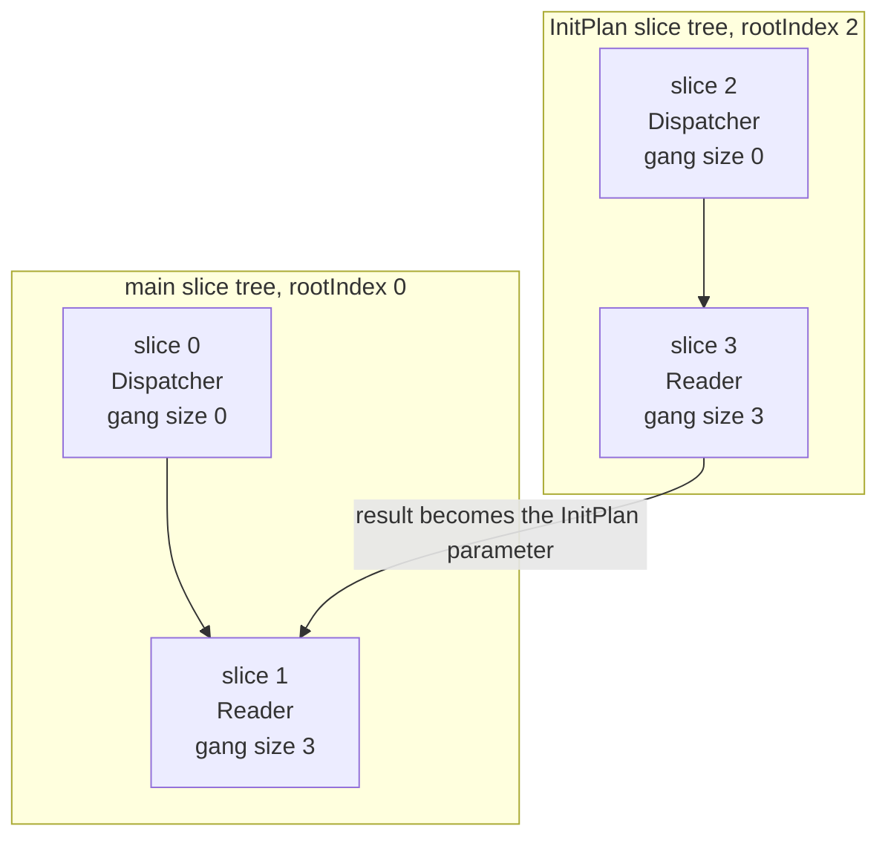

*同一份查询切片表中的两棵切片树。InitPlan 树整体先派发，之后主树才开始执行。*

规划器在 `subplan_sliceIds` 中记录归属关系。对此计划，`debug_print_plan` 打印 `:subplan_sliceIds  2`，一个条目对应一个 SubPlan。Coordinator 据此*重新定位自身*：`preprocess_initplans` 读取数组，检查切片确实是根（`parentIndex == -1`，否则它只是切片 0 上的普通子计划），然后临时改写自身的 `localSlice`。

```c {title="src/backend/cdb/cdbsubplan.c — preprocess_initplans()"}
			if (qDispSliceId > 0)
			{
				/*
				 * Adjust for the slice to execute on the QD.
				 */
				rootIndex = qDispSliceId;
				queryDesc->estate->es_sliceTable->localSlice = rootIndex;

				/* set our global sliceid variable for elog. */
				currentSliceId = rootIndex;
				...
				ExecSetParamPlan(sps, sps->planstate->ps_ExprContext, queryDesc);
```

因此，Coordinator 将切片 3 作为单独的语句派发，汇集得到标量，将 `localSlice` 恢复为 0（`cdbsubplan.c` — `preprocess_initplans()`），然后才派发主树。`EXPLAIN ANALYZE` 中可以看到两个结果：两棵树从不同时运行，因此能够共用一个进程组；主派发完全不将 InitPlan 切片的工作进程计入其中。

*slice1 和 slice3 都报告 gang0，即同样的三个 QE 被使用两次。slice3 的工作进程被标记为不属于本次派发。*

```sql
SET gp_log_gang = debug;
EXPLAIN (ANALYZE, COSTS OFF, TIMING OFF)
SELECT count(*) FROM m193_fact WHERE amt > (SELECT avg(amt) FROM m193_fact);
```

```text {hl_lines="4" title="output"}
 Finalize Aggregate (actual rows=1 loops=1)
   InitPlan 1 (returns $0)  (slice2)
     ->  Finalize Aggregate (actual rows=1 loops=1)
           ->  Gather Motion 3:1  (slice3; gang0; segments: 3) (actual rows=3 loops=1)
                 ->  Partial Aggregate (actual rows=1 loops=1)
                       ->  Seq Scan on m193_fact m193_fact_1 (actual rows=66711 loops=1)
   ->  Gather Motion 3:1  (slice1; gang0; segments: 3) (actual rows=3 loops=1)
         ->  Partial Aggregate (actual rows=1 loops=1)
               ->  Seq Scan on m193_fact (actual rows=33778 loops=1)
                     Filter: (amt > $0)
                     Rows Removed by Filter: 32858
   (slice0)    Executor memory: 116K bytes.
   (slice1)    Executor memory: 120K bytes avg x 3x(0) workers, 120K bytes max (seg0).
   (slice2)    Executor memory: 60K bytes.
 _ (slice3)    Workers: Workers: 3 not dispatched;.
 Executor memory: 119K bytes avg x 3x(0) workers, 119K bytes max (seg0).
```

### 19.3.6 观测工具 {#1936-instruments}

- **`EXPLAIN (SLICETABLE ON)`** — 应首先使用的工具。为每个切片打印 `Slice N: <gang type>; root R; parent P; gang size G`，单例读取者还会追加 `; segment S`（`explain.c` — `ExplainPrintSliceTable()`）。无需 `ANALYZE` 即可使用，因此不必执行查询。
- **`gp_log_gang = debug`** — 为 `EXPLAIN` 中每个切片标签添加 `gang<id>`，其中 ID 是该进程组第一个成员的 `qe_identifier`（`explain.c` — `show_dispatch_info()`）。结合 `gp_backend_info()`，用两次查询就能得到“切片 → 进程组 → pid”的映射。
- **`gp_backend_info()`** — QD 一侧的会话后端清单，包含 `id`（`processesMap` 使用的 `qe_identifier`）、`type`（`Q`/`w`/`r`）、`content`、`host`、`port` 和 `pid`。可用于统计计划实际需要的 QE 数。
- **`debug_print_slice_table`** — 以 `DEBUG3` 级别转储整个 `SliceTable` 节点：Coordinator 在派发前输出未绑定的表（`execMain.c` — `standard_ExecutorStart()`），每个 QE 在派发后输出已绑定的表，包含 `CdbProcess` 地址和 `localSlice`。这是观察 `processesMap` 和 Interconnect 端点的唯一方式。
- **`debug_print_plan`** — 原样包含规划器一侧的 `PlanSlice` 数组和 `subplan_sliceIds`（`outfuncs.c` — `_outPlannedStmt()`）。应在这里检查执行器重新解释*之前*的 `numsegments`、`parallel_workers` 和 `directDispatch.contentIds`。
- **`gp_log_interconnect = debug`** — 让每个 QE 记录一行 `seg%d executing slice%d under root slice%d`（`execMain.c` — `standard_ExecutorStart()`），是确认切片身份最轻量的方式。此 GUC 打印的其他内容见 [§19.5](#195-interconnect-implementations)。

> [!NOTE]
> 一个需要留意的陷阱：`debug_print_slice_table` 列在 `src/include/utils/unsync_guc_name.h` 中，因此**不属于** Coordinator 放入 QE 启动选项的 GUC（`cdbgang.c` — `makeOptions()` 只转发带 `GUC_GPDB_NEED_SYNC` 标记的参数）。普通 `SET` 会到达写入进程组及所有*当前空闲*的读取 QE（`cdbdisp_query.c` — `CdbDispatchSetCommand()`），所以如果会话的第一条语句就是启用它，只有写入进程组的 QE 会输出自己的副本。先运行任意查询，让读取进程组存在，再执行 `SET`，它们就都会输出。本集群已验证两种情况。

映射过程至此完整：计划以只知道数量的 `PlanSlice` 数组进入执行器，经 `AssignGangs` 后变成知道主机名、端口和 pid 的 `ExecSlice` 数组；N+1 个进程各自查找连接时获知的那个整数，在数组中定位自己。[§19.4](#194-motion-nodes) 将打开 Motion 节点本身，沿着一个元组从发送方 `ExecProcNode` 到接收方的路径继续追踪，所用的正是刚才看到的 `primaryProcesses` 列表。

## 19.4 Motion 节点 {#194-motion-nodes}

第 [13](/cloudberry/core-internals/part-4-query-processing/ch13/) 至 [18](/cloudberry/core-internals/part-4-query-processing/ch18/) 章的计划中都有 `Gather Motion 3:1`、`Redistribute Motion 3:3` 这样的行，我们一直将它们当作说明来看。现在要进入代码。`Motion` 是普通的 `Plan` 节点，具有普通的 `ExecProcNode` 回调（`nodeMotion.c` — `ExecInitMotion()`），并在参与查询的**每个**进程中初始化；但进程处于网络的哪一端，决定了它完全不同的行为。[§19.1](#191-distributed-execution-principles) 介绍了这种双重角色，[§19.3](#193-slice-tables--planslice--gang-mapping) 回答了身份问题，即*我属于哪个切片*；本节则介绍具体机制。

这里叠加了三层，需要区分清楚。`nodeMotion.c`（1405 行）是**执行器节点**：决定发送或接收角色，为每个元组计算目标路由，并为有序 Gather 维护归并堆。`cdbmotion.c`（1400 行）是 **Motion 层**：将槽序列化为字节流，拆分为 `TupleChunk`，按发送方将数据块重组为元组，统计流结束标记，并维护每个节点的统计信息。再往下只有一次函数指针调用 `CurrentMotionIPCLayer->SendTupleChunkToAMS()`，其后的全部内容属于 [§19.5](#195-interconnect-implementations)。

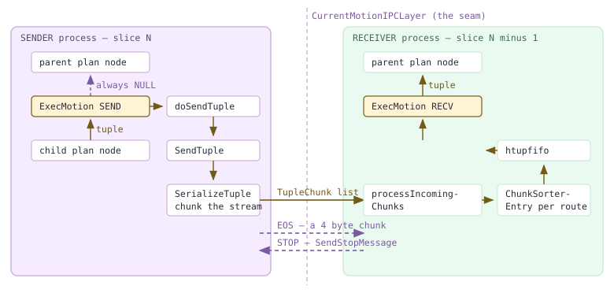

*一个 Motion 节点，两种实现。发送方从孩子拉取数据，向上返回 NULL；接收方从 Interconnect 拉取数据，向上返回元组。竖直虚线表示 [§19.5](#195-interconnect-implementations) 中的函数表接口边界。*

> [!NOTE]
> 再看左栏：发送方的 `ExecMotion` **始终返回 NULL**，从不返回元组。它是合法的计划节点，但其 `ExecProcNode` 完全不产生向上的输出：耗尽孩子，将每个元组横向送入网络，发送流结束标记，然后向上报告“没有行”，使切片顶层的 `ExecutePlan` 循环结束。本手册其他节点都向父节点返回元组，唯独它是数据的汇。

### 19.4.1 一个节点，两种实现 {#1941-one-node-two-implementations}

`ExecMotion` 先按 `MotionState.mstype` 进行三路分支，再根据计划是否要求保持顺序进一步分支。

```c {title="src/backend/executor/nodeMotion.c — ExecMotion()"}
	if (node->mstype == MOTIONSTATE_RECV)
	{
		...
		if (motion->sendSorted)
			tuple = execMotionSortedReceiver(node);
		else
			tuple = execMotionUnsortedReceiver(node);
		...
	}
	else if (node->mstype == MOTIONSTATE_SEND)
		return execMotionSender(node);
	else
		elog(ERROR, "cannot execute inactive Motion");
```

`mstype` 只在 `ExecInitMotion` 中确定一次。QE 将 `LocallyExecutingSliceIndex(estate)` 与节点跨越的两个切片索引直接比较（`nodeMotion.c` — `ExecInitMotion()`）：等于*父*切片表示接收，等于*发送*切片表示发送，两者都不等则说明本进程不属于这个 Motion，节点保持 `MOTIONSTATE_NONE`。在 QD 上，`Gather` 的接收切片就是根切片，因此 QD 始终是接收方（`nodeMotion.c` — `ExecInitMotion()`）。发送／接收双重角色的机制仅此而已：没有协商，没有运行时角色选举，只是与 [§19.3](#193-slice-tables--planslice--gang-mapping) 随计划传来的查询切片表做一次整数比较。

发送方是一个紧凑循环，只有三种退出原因：孩子耗尽、接收方要求停止，或发生错误。

```c {title="src/backend/executor/nodeMotion.c — execMotionSender()"}
		if (done || TupIsNull(outerTupleSlot))
		{
			doSendEndOfStream(motion, node);
			done = true;
		}
		...
		else
		{
			doSendTuple(motion, node, outerTupleSlot);
			if (node->stopRequested)
			{
				ExecSquelchNode(outerNode, true);   /* tell the children */
				done = true;
			}
		}
```

注意这里*没有*做什么：在停止路径上，发送方退出时**不发送**流结束标记。接收方已经表示不再需要数据，也就没有人再关心这个标记。循环的后置条件是不变量 `Assert(node->stopRequested || node->numTuplesFromChild == node->numTuplesToAMS)`（`nodeMotion.c` — `execMotionSender()`）：从孩子取得的元组要么全部进入网络，要么发送已被停止。`ExecSquelchNode` 见 [§18.1](/cloudberry/core-internals/part-4-query-processing/ch18/#181-executor-framework--lifecycle)；Motion 节点只是网络级停止重新转换为执行器级终止的位置。

### 19.4.2 四种 Motion 类型与路由计算 {#1942-the-four-motion-types-and-how-a-route-is-computed}

路由是一个小整数，表示接收进程在父切片 `primaryProcesses` 列表中的索引。`doSendTuple`（`nodeMotion.c`）负责将元组映射为路由，它只是按 `motion->motionType` 判断的一串 if 分支。枚举有六个值（`plannodes.h` — `MotionType`），其中 `MOTIONTYPE_OUTER_QUERY` 是执行前解析掉的规划器占位符，因此五个值会到达执行器。

| EXPLAIN 标签 | MotionType | 如何计算目标路由 | 源码 |
| --- | --- | --- | --- |
| Gather Motion | MOTIONTYPE_GATHER | 固定为路由 0。父切片恰好只有一个进程，因此代码甚至不必查询它。 | nodeMotion.c — doSendTuple |
| Explicit Gather Motion | MOTIONTYPE_GATHER_SINGLE | 同样使用路由 0，但只有一个 Segment 实际发送：GpIdentity.segindex 等于 gp_session_id 对 numInputSegs 取模结果的那个 Segment。其他进程执行子计划后丢弃元组。 | nodeMotion.c — execMotionSender |
| Redistribute Motion | MOTIONTYPE_HASH | 对 Motion 的 hashExprs 执行 cdbhash，再用 cdbhashreduce 归约为 Segment 索引；启用 Segment 内部并行时，第二次哈希选择工作进程。 | nodeMotion.c — doSendTuple |
| Broadcast Motion | MOTIONTYPE_BROADCAST | 伪路由 BROADCAST_SEGIDX，值为 -2，绝不会与真实路由冲突。只调用一次 SendTuple，由传输层负责向各接收方分发。 | nodeMotion.c — doSendTuple，tupchunk.h — BROADCAST_SEGIDX |
| Broadcast Workers Motion | MOTIONTYPE_BROADCAST_WORKERS | 节点自身遍历接收 Segment，每个调用一次 SendTuple，并在各 Segment 内用随机数对 parallel_workers 取模，选出一个工作进程。 | nodeMotion.c — doSendTuple |
| Explicit Redistribute Motion | MOTIONTYPE_EXPLICIT | 对 motion->segidColIdx 指定的辅助列执行 slot_getattr，目的地随元组一起传送。 | nodeMotion.c — doSendTuple |

最值得关注的是 `MOTIONTYPE_HASH`，它提出了本手册从 [§16.1](/cloudberry/core-internals/part-4-query-processing/ch16/#161-the-locus-model-cdbpathlocus) 起一直围绕的问题：Redistribute Motion 使用的哈希，是否与存储层放置行时使用的*同一个哈希*？[§16.4](/cloudberry/core-internals/part-4-query-processing/ch16/#164-distributed-grouping--direct-dispatch) 已证明直接派发使用 `cdbhash`。下面给出明确的答案。

```c {title="src/backend/executor/nodeMotion.c — evalHashKey()"}
		cdbhashinit(h);
		i = 0;
		foreach(hk, hashkeys)
		{
			keyval = ExecEvalExpr((ExprState *) lfirst(hk), econtext, &isNull);
			cdbhash(h, i + 1, keyval, isNull);
			i++;
		}
		target_seg = cdbhashreduce(h);
```

这就是 `evalHashKey`，其调用顺序与 `cdbtargeteddispatch.c` 中的 `GetContentIdsFromPlanForSingleRelation()`（直接派发，见 [§16.4](/cloudberry/core-internals/part-4-query-processing/ch16/#164-distributed-grouping--direct-dispatch)）、`copyfrom.c` — `GetTargetSeg()`（COPY 的行放置），以及 `nodeSplitUpdate.c` — `evalHashKey()` 完全相同。`CdbHash` 在 `nodeMotion.c` — `ExecInitMotion()` 中由 `makeCdbHash(numHashSegments, nkeys, node->hashFuncs)` 构建；`hashFuncs` 则在规划阶段由 `cdb_hashproc_in_opfamily()` 填入（`cdbmutate.c` — `make_hashed_motion()`），使用的正是分布策略解析出的同一操作符类哈希过程。并非类似实现，而是相同函数、相同归约（`cdbhash.c` — `cdbhashreduce()`）。这意味着，对列 `k` 执行 Redistribute Motion，会将每行准确送到 `DISTRIBUTED BY (k)` 表原本存储该行的 Segment。可以直接观察：在 Gather *下方*求值的 `gp_execution_segment()` 会报告实际处理该行的 Segment。

*左侧：哈希分布表实际存放各个键的位置。右侧：从随机分布表读出相同键后，Redistribute Motion 将它们送达的位置。逐行完全一致。*

```sql
-- storage placement
SELECT gp_segment_id, k FROM m194_hash ORDER BY k;

-- routing decided by Redistribute Motion (m194_rand is DISTRIBUTED RANDOMLY)
EXPLAIN (costs off) SELECT gp_execution_segment() AS seg, k
  FROM (SELECT k FROM m194_rand GROUP BY k) t;
SELECT gp_execution_segment() AS seg, k
  FROM (SELECT k FROM m194_rand GROUP BY k) t ORDER BY k;
```

```text {hl_lines="32 43" title="output"}
 gp_segment_id | k  
---------------+----
             1 |  1
             0 |  2
             0 |  3
             0 |  4
             2 |  5
             2 |  6
             0 |  7
             0 |  8
             2 |  9
             2 | 10
             2 | 11
             1 | 12
(12 rows)

                            QUERY PLAN                            
------------------------------------------------------------------
 Gather Motion 3:1  (slice1; segments: 3)
   ->  GroupAggregate
         Group Key: k
         ->  Sort
               Sort Key: k
               ->  Redistribute Motion 3:3  (slice2; segments: 3)
                     Hash Key: k
                     ->  Seq Scan on m194_rand
 Optimizer: GPORCA
(9 rows)

 seg | k  
-----+----
   1 |  1
   0 |  2
   0 |  3
   0 |  4
   2 |  5
   2 |  6
   0 |  7
   0 |  8
   2 |  9
   2 | 10
   2 | 11
   1 | 12
(12 rows)
```

`MOTIONTYPE_EXPLICIT` 采用相反的设计：发送方不计算目的地，而是直接从元组中读取。[§18.7](/cloudberry/core-internals/part-4-query-processing/ch18/#187-cloudberry-specific-nodes) 展示了该值的来源：`Split Update` 将行原来的 `gp_segment_id` 作为辅助列输出，`EXPLAIN VERBOSE` 可以看到它随 Motion 的输出列表传送。

*一个 Explicit Redistribute Motion。目标表采用 DISTRIBUTED RANDOMLY，因此修改后的行必须回到原来的 Segment；gp_segment_id 贯穿连接传递，正是为了这个目的。*

```sql
SET optimizer=off;
EXPLAIN (costs off, verbose) UPDATE m194_rand r SET v = h.v FROM m194_hash h WHERE r.k = h.k;
```

```text {hl_lines="5" title="output"}
                            QUERY PLAN                            
------------------------------------------------------------------
 Update on public.m194_rand r
   ->  Explicit Redistribute Motion 3:3  (slice1; segments: 3)
         Output: h.v, r.ctid, r.gp_segment_id, h.ctid
         ->  Hash Join
               Output: h.v, r.ctid, r.gp_segment_id, h.ctid
               Hash Cond: (r.k = h.k)
               ->  Redistribute Motion 3:3  (slice2; segments: 3)
                     Output: r.ctid, r.gp_segment_id, r.k
                     Hash Key: r.k
                     ->  Seq Scan on public.m194_rand r
               ->  Hash
                     Output: h.v, h.ctid, h.k
                     ->  Seq Scan on public.m194_hash h
(17 rows)
```

> [!NOTE]
> 关于特殊类型再补充两点。**Broadcast** 与 **Broadcast Workers** 对分发职责的分配不同：普通广播只用路由 `-2` 调用*一次* `SendTuple`，让传输层复制数据；并行变体则在 `doSendTuple` 内循环。因此，广播永远不能使用 [§19.4.3](#1943-serialization-and-chunking--and-who-chooses-the-chunk-size) 的零拷贝路径，因为 `CandidateForSerializeDirect()` 会直接拒绝路由 `-2`（`tupser.c`）。另外，**Explicit Gather Motion** 确实罕见：只有发送方分布位置为 `Replicated` 时才生成（`createplan.c` — `create_motion_plan()`），具体由哪个 Segment 发送取决于 `gp_session_id % numInputSegs`。这是一种分摊负载的办法，让相同查询在不同会话中由不同 Segment 发送。

### 19.4.3 序列化、分块，以及谁决定块大小 {#1943-serialization-and-chunking--and-who-chooses-the-chunk-size}

`SendTuple`（`cdbmotion.c`）有快速路径和慢速路径，先尝试快速路径。它向传输层索取直接指向待发送数据包缓冲区的指针（`GetTransportDirectBuffer`，`cdbmotion.c` — `SendTuple()`）；如果整个元组能放下，`SerializeTuple` 就*原地*写入数据块头部和元组体，并返回字节数，无需数据块列表或中间复制。

```c {title="src/backend/cdb/motion/tupser.c — SerializeTuple()"}
	if (CandidateForSerializeDirect(targetRoute, b) &&
		tuplen + TUPLE_CHUNK_HEADER_SIZE <= b->prilen)
	{
		memcpy(b->pri + TUPLE_CHUNK_HEADER_SIZE, &tupbodylen, sizeof(tupbodylen));
		memcpy(b->pri + TUPLE_CHUNK_HEADER_SIZE + sizeof(int), tupbody, tupbodylen);
		dataSize += tuplen;
		SetChunkType(b->pri, TC_WHOLE);
		SetChunkDataSize(b->pri, dataSize - TUPLE_CHUNK_HEADER_SIZE);
		return dataSize;
	}
```

元组的序列化形式很简单：先是 4 字节的正文长度，再是原始 `MinimalTuple` 正文，即从 `MINIMAL_TUPLE_DATA_OFFSET` 开始的全部内容。经过 TOAST 处理的属性会先还原（`tupser.c` — `SerializeTuple()`），因为 TOAST 指针在另一个进程中毫无意义；这与 [§19.4.5](#1945-tupleremap--a-typmod-is-a-process-local-name) 中 `tupleremap.c` 为 record typmod 解决的问题属于同一类。若元组*放不下*直接缓冲区，`addByteStringToChunkList`（`tupser.c`）就将流拆为 `TupleChunk`，每个数据块附加 4 字节头部：一个 `uint16` 载荷长度和一个 `uint16` 类型标记。

```c {title="src/include/cdb/tupchunk.h — TupleChunkType"}
typedef enum TupleChunkType
{
	TC_WHOLE,			/* Contains a whole tuple. */
	TC_PARTIAL_START,	/* Contains the starting portion of a tuple. */
	TC_PARTIAL_MID,		/* Contains a middle part of a tuple. */
	TC_PARTIAL_END,		/* Contains the final portion of a tuple. */
	TC_END_OF_STREAM,	/* Indicates "end of tuples" from this source. */
	TC_EMPTY,			/* Empty tuple */
	TC_MAXVAL
} TupleChunkType;
```

最大数据块大小既不是常量，也不是 GUC，而是每次查询通过函数表向传输层询问一次：`Gp_max_tuple_chunk_size = CurrentMotionIPCLayer->GetMaxTupleChunkSize()`（`cdbmotion.c` — `createMotionLayerState()`）。`udpifc` 返回 `Gp_max_packet_size - sizeof(struct icpkthdr) - 4`（`ic_udpifc.c` — `GetMaxTupleChunkSizeUDP()`），`tcp` 返回 `Gp_max_packet_size - PACKET_HEADER_SIZE - 4`（`ic_tcp.c` — `GetMaxTupleChunkSizeTCP()`）。本集群 `gp_max_packet_size = 8192`，`sizeof(icpkthdr)` = 88，而 TCP 长度前缀只有 4 字节，因此 **UDP 为 8100 字节，TCP 为 8184 字节**。同一个元组会因加载的传输实现不同而采用不同分块方式，这最清楚地展示了函数表接口边界的价值。

<figure class="cloudberry-core-figure">
<div><div style="overflow-x:auto;font-family:ui-monospace,SFMono-Regular,Menlo,monospace;font-size:12px;line-height:1.5;color:#2b2b3a"> <div style="margin-bottom:10px;color:#5a4a6a">TupleChunk 头部 — 4 字节，长度不包含头部（tupchunk.h:34-49）</div> <div style="display:flex;max-width:520px;margin-bottom:4px"> <div style="flex:2;background:#f5edff;border:1.5px solid #cdb4db;padding:7px 6px;text-align:center">uint16 有效载荷长度</div> <div style="flex:2;background:#fff4d6;border:1.5px solid #735a16;border-left:none;padding:7px 6px;text-align:center">uint16 &nbsp;TupleChunkType</div> </div> <div style="display:flex;max-width:520px;color:#735a16;margin-bottom:16px"> <div style="flex:1;text-align:center">&#8593;0</div><div style="flex:1;text-align:center">1</div> <div style="flex:1;text-align:center">2&#8593;</div><div style="flex:1;text-align:center">3</div> </div> <div style="margin-bottom:6px;color:#5a4a6a">分块前的序列化元组 — 16 310 字节</div> <div style="display:flex;max-width:700px;margin-bottom:16px"> <div style="width:120px;background:#eafaf0;border:1.5px solid #cfead9;padding:7px 6px;text-align:center">int32 = 16306</div> <div style="flex:1;background:#ffffff;border:1.5px solid #cdb4db;border-left:none;padding:7px 6px;text-align:center">MinimalTuple 正文 — 16 306 字节</div> </div> <div style="margin-bottom:6px;color:#5a4a6a">按 Gp_max_tuple_chunk_size = 8100 分块（8192 − 88 − 4）</div> <div style="display:flex;align-items:stretch;margin-bottom:3px;max-width:700px"> <div style="width:44px;background:#f5edff;border:1.5px solid #cdb4db;padding:6px 2px;text-align:center;font-size:10.5px">8096</div> <div style="width:120px;background:#fff4d6;border:1.5px solid #735a16;border-left:none;padding:6px 2px;text-align:center;font-size:10.5px">TC_PARTIAL_START</div> <div style="width:88px;background:#eafaf0;border:1.5px solid #cfead9;border-left:none;padding:6px 2px;text-align:center;font-size:10.5px">len 字段 4 B</div> <div style="flex:1;background:#ffffff;border:1.5px solid #cdb4db;border-left:none;padding:6px 2px;text-align:center;font-size:10.5px">正文 [0 … 8091] 8092 B</div> <div style="width:96px;padding:6px 2px;text-align:right;color:#735a16;font-size:10.5px">&#8721; 8100 B</div> </div> <div style="display:flex;align-items:stretch;margin-bottom:3px;max-width:700px"> <div style="width:44px;background:#f5edff;border:1.5px solid #cdb4db;padding:6px 2px;text-align:center;font-size:10.5px">8096</div> <div style="width:120px;background:#fff4d6;border:1.5px solid #735a16;border-left:none;padding:6px 2px;text-align:center;font-size:10.5px">TC_PARTIAL_MID</div> <div style="flex:1;background:#ffffff;border:1.5px solid #cdb4db;border-left:none;padding:6px 2px;text-align:center;font-size:10.5px">正文 [8092 … 16187] 8096 B</div> <div style="width:96px;padding:6px 2px;text-align:right;color:#735a16;font-size:10.5px">&#8721; 8100 B</div> </div> <div style="display:flex;align-items:stretch;margin-bottom:3px;max-width:700px"> <div style="width:44px;background:#f5edff;border:1.5px solid #cdb4db;padding:6px 2px;text-align:center;font-size:10.5px">118</div> <div style="width:120px;background:#fff4d6;border:1.5px solid #735a16;border-left:none;padding:6px 2px;text-align:center;font-size:10.5px">TC_PARTIAL_END</div> <div style="width:180px;background:#ffffff;border:1.5px solid #cdb4db;border-left:none;padding:6px 2px;text-align:center;font-size:10.5px">正文 [16188 … 16305]</div> <div style="flex:1"></div> <div style="width:96px;padding:6px 2px;text-align:right;color:#735a16;font-size:10.5px">&#8721; 122 B</div> </div> <div style="display:flex;align-items:stretch;margin-bottom:6px;max-width:700px"> <div style="width:44px;background:#f5edff;border:1.5px solid #cdb4db;padding:6px 2px;text-align:center;font-size:10.5px">0</div> <div style="width:120px;background:#fff4d6;border:1.5px solid #735a16;border-left:none;padding:6px 2px;text-align:center;font-size:10.5px">TC_END_OF_STREAM</div> <div style="flex:1;padding:6px 8px;color:#5a4a6a;font-size:10.5px">仅含头部 — 静态缓冲区，cdbmotion.c:51 和 :176</div> <div style="width:96px;padding:6px 2px;text-align:right;color:#735a16;font-size:10.5px">&#8721; 4 B</div> </div> <div style="max-width:700px;text-align:right;border-top:1.5px solid #735a16;padding-top:6px;color:#735a16"><span class="hl"> 线路上传输的总量：16 326 B </span></div> <div style="max-width:700px;text-align:right;color:#5a4a6a;font-size:11px;margin-top:6px">使用 tcp，容量为 8184：8184 + 8134 + 4 = <span class="hl"> 3 块，共 16 322 B </span></div> </div></div>
<figcaption>一个 16 310 字节的序列化元组，逐块穿过 udpifc Interconnect。图中的每个数字都与下方查询由 Motion 层报告的字节总数核对过。</figcaption>
</figure>

为了测量这一点，我们让表中一条宽而未压缩的行依次经各传输实现发送。`gp_interconnect_type` 的上下文为 `backend`，因此可以通过 `PGOPTIONS` 为每次连接切换，无需重启。同时设置 `gp_log_interconnect = verbose`，让 Motion 层在清理时转储各节点的计数器。

*同一个元组，同样的 16 310 字节元组数据，经 udpifc 为四个数据块，经 tcp 为三个，因为块大小由传输层而非执行器决定。Segment 0 和 2 没有匹配行，只发送一个 4 字节的流结束块。*

```sql
CREATE TABLE m194_wide(id int, payload text) DISTRIBUTED BY (id);
ALTER TABLE m194_wide ALTER COLUMN payload SET STORAGE EXTERNAL;
INSERT INTO m194_wide SELECT 1, repeat('ab', 8148);   -- length 16296

-- run 1: default interconnect
SET gp_log_interconnect='verbose';
SELECT payload FROM m194_wide;
-- run 2: PGOPTIONS='-c gp_interconnect_type=tcp' psql -p 7100 ... same query

-- then, from the segment logs:
$ grep 'Interconnect seg' .../dbfast*/demoDataDir*/log/gpdb-*.csv
```

```text {hl_lines="3 8" title="output"}
-- udpifc  (Gp_max_tuple_chunk_size = 8100)
Interconnect seg0 slice1 sent 0 tuples,     4 total bytes,     0 tuple bytes, 1 chunks.
Interconnect seg1 slice1 sent 1 tuples, 16326 total bytes, 16310 tuple bytes, 4 chunks.
Interconnect seg2 slice1 sent 0 tuples,     4 total bytes,     0 tuple bytes, 1 chunks.

-- tcp  (Gp_max_tuple_chunk_size = 8184)
Interconnect seg0 slice1 sent 0 tuples,     4 total bytes,     0 tuple bytes, 1 chunks.
Interconnect seg1 slice1 sent 1 tuples, 16322 total bytes, 16310 tuple bytes, 3 chunks.
Interconnect seg2 slice1 sent 0 tuples,     4 total bytes,     0 tuple bytes, 1 chunks.
```

字节计算完全吻合。UDP 下，16 306 字节正文加 4 字节长度字段分布到大小为 8100、8100 和 122 字节的三个块，再加一个 4 字节 EOS 块，总计 16 326。TCP 的容量更大，两个块就能容纳正文，8184 + 8134，再加 EOS，总计 16 322。两者相差的 4 字节恰好是一个块头部，其他内容没有变化，执行器两次都产生了相同字节流。

另一个极端是 `TC_EMPTY`：**完全没有列**的元组。半连接上的 `count(*)` 不需要 Segment 提供任何值，只需要知道某行满足条件，因此 Gather Motion 的目标列表为空，每个匹配行仅占 4 字节头部。

*网络上一条零列的行。Gather 完全没有 Output 列表；两个 Segment 各有一行满足条件，每行都是只含头部的单个 TC_EMPTY 块（tupser.c — SerializeTuple）。*

```sql
SET optimizer=off; SET gp_log_interconnect='verbose';
EXPLAIN (costs off, verbose) SELECT count(*) FROM m194_hash h
  WHERE EXISTS (SELECT 1 FROM m194_dim d WHERE d.d = h.k);
SELECT count(*) FROM m194_hash h
  WHERE EXISTS (SELECT 1 FROM m194_dim d WHERE d.d = h.k);
```

```text {hl_lines="15 16" title="output"}
                      QUERY PLAN                       
-------------------------------------------------------
 Aggregate
   Output: count(*)
   ->  Gather Motion 3:1  (slice1; segments: 3)      <-- no Output line
         ->  Hash Semi Join
               Hash Cond: (h.k = d.d)
               ->  Seq Scan on public.m194_hash h
                     Output: h.k, h.v
               ->  Hash
                     Output: d.d
                     ->  Seq Scan on public.m194_dim d

-- segment logs:
Interconnect seg0 slice1 sent 1 tuples, 12 total bytes, 4 tuple bytes, 2 chunks.
Interconnect seg1 slice1 sent 1 tuples, 12 total bytes, 4 tuple bytes, 2 chunks.
Interconnect seg2 slice1 sent 0 tuples,  4 total bytes,  0 tuple bytes, 1 chunks.
```

> [!NOTE]
> 注意 `4 tuple bytes` 的含义：它比真实值多了 4 字节。直接缓冲区路径中，`SendTuple` 设置 `serialized_data_length = sent`，而 `sent` 包含块头部（`cdbmotion.c`），因此每次走直接路径发送时，*tuple bytes* 都虚增 4。统计辅助函数上方的注释也承认：“唯一要求有效的字段是 `num_chunks` 和 `serialized_data_length`”（`cdbmotion.c` — `statSendTuple()`）。零列元组实际没有任何载荷：`SetChunkDataSize(b->pri, 0)`。

### 19.4.4 接收方：逐发送方状态与流结束计数 {#1944-the-receiver-per-sender-state-and-counting-end-of-stream}

`RecvTupleFrom`（`cdbmotion.c`）围绕队列循环：FIFO 中若有完整元组就返回；否则，若此来源已经结束则返回 NULL；再否则，调用 `processIncomingChunks` 后重试。实际工作都在 `addChunkToSorter`（`cdbmotion.c`）中，按数据块类型执行 switch 分支。

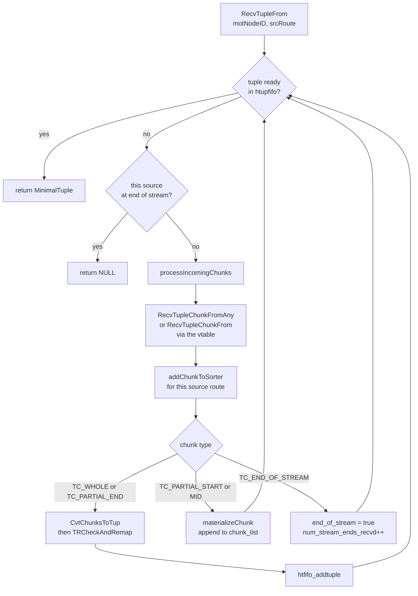

*接收循环。数据块按来源路由到达，累积在该路由的 ChunkSorterEntry 中，直到 TC_WHOLE 或 TC_PARTIAL_END 组成完整元组；完整元组在 htupfifo 中等待。*

关键状态是 `ChunkSorterEntry`（`cdbinterconnect.h`），**每条来源路由各有一个**，而不是每个 Motion 节点一个。原因在 `TupleChunkListData` 的注释中：数据块不携带元组身份，“预期它们按顺序发送、接收，并且不会丢失”（`tupchunklist.h`）。顺序只在单个发送方流*内部*有保证。如果使用一个全局数据块列表，Segment 0 的 `TC_PARTIAL_MID` 就可能插入 Segment 1 的开始和结束片段之间，悄悄破坏两个元组。因此，每个发送方都有自己的部分元组累积器，`addChunkToSorter` 会严格检查序列：仍有未完成的部分数据时收到 `TC_WHOLE`，会触发 `ERRCODE_GP_INTERCONNECTION_ERROR`，而非可恢复的情况。

完整元组则可以共享队列，也可以不共享。无序 Motion 将每条路由的 `ready_tuples` 指向同一个 `htup_fifo`，因为接收方不关心谁发送了什么；保持顺序的 Motion 为每条路由提供独立 FIFO，因为 [§19.4.6](#1946-sorted-motion-an-n-way-merge-in-the-receiver) 的归并必须能够专门请求*发送方 k 的下一个元组*（`cdbmotion.c` — `getChunkSorterEntry()`）。`htupfifo.c` 只是带空闲链表的单链表实现，共 176 行，这已经足够。

终止通过计数判断。`UpdateMotionExpectedReceivers` 将 `num_senders` 设置为子切片中存活 `CdbProcess` 条目的数量（`cdbmotion.c` — `UpdateMotionExpectedReceivers()`）。这里强调存活，是因为直接派发会为未被要求运行的 Segment 留下 NULL 占位。每个 `TC_END_OF_STREAM` 递增计数，只有计数达到 `num_senders` 时，节点才宣布流结束：

```c {title="src/backend/cdb/motion/cdbmotion.c — addChunkToSorter()"}
			/* Mark the state as "end of stream." */
			chunkSorterEntry->end_of_stream = true;
			pMNEntry->num_stream_ends_recvd++;

			if (pMNEntry->num_stream_ends_recvd == pMNEntry->num_senders)
				pMNEntry->moreNetWork = false;

			CurrentMotionIPCLayer->DeregisterReadInterest(transportStates, motNodeID,
														  srcRoute, "end of stream");
```

*逐路由的 ChunkSorterEntry：三个来源路由、三个条目，在三个 Segment 上的有序 Gather 清理时打印。*

```sql
SET optimizer=off;
SET gp_log_interconnect='debug';
SET client_min_messages='debug4';
SELECT k FROM m194_hash ORDER BY k;   -- output elided
```

```text {hl_lines="1 3 5" title="output"}
DEBUG:  Chunk-sorter entry [route=0,node=1] statistics:
	Available Tuples High-Watermark: 10
DEBUG:  Chunk-sorter entry [route=1,node=1] statistics:
	Available Tuples High-Watermark: 10
DEBUG:  Chunk-sorter entry [route=2,node=1] statistics:
	Available Tuples High-Watermark: 10
```

> [!NOTE]
> 相信这些数字前，还应了解采集中暴露的一处代码老化问题。高水位为每条路由打印一次，但三行都报告 **10**，尽管三个发送方分别贡献了 5、2、5 个元组。`statNewTupleArrived` 的注释承诺“如果 Motion 节点保持顺序，也会跟踪每个发送方的高水位”（`cdbmotion.c` — `statNewTupleArrived()`），但函数只维护节点级的 `pMNEntry->stat_tuples_available_hwm`，没有使用 `ChunkSorterEntry` 参数。因此数值本身是真实的，却是同一个节点级数值重复打印，并非逐发送方明细。

### 19.4.5 tupleremap：typmod 是进程本地的名称 {#1945-tupleremap--a-typmod-is-a-process-local-name}

这里有一个单节点数据库不会遇到的问题。PostgreSQL 求值 `ROW(k, v)` 时，会生成 `RECORD` 类型的值，并为其附加*临时 typmod*。这是从后端本地计数器分配的小整数，用作该后端匿名元组描述符缓存的索引；本质上是以整数表示的私有内存指针。Segment 0 的 typmod 3 与 Coordinator 的 typmod 3 毫无关系。

因此，不能简单地将 record 值序列化后发送：元组头部携带的数字在另一端没有意义，接收方也无法得知原记录的形态。这两个问题都必须解决，`tupleremap.c` 就是解决方案：773 行，改编自上游用于并行工作进程的 `tqueue.c`。

该协议是**发送方推送、增量更新、逐连接维护**的。每次 `SendTuple` 之前，`doSendTuple` 都调用 `CheckAndSendRecordCache`（`nodeMotion.c`）。它将发送方当前的临时 typmod 计数器与保存在*连接上*的高水位比较：`conn->sent_record_typmod`，经 `CurrentMotionIPCLayer->GetMotionSentRecordTypmod` 访问（`ic_common.c`）。计数器若已前进，就序列化所有新注册的元组描述符，通过与数据相同的块流推送出去；特殊的魔数长度使接收方能将它与普通元组区分：

```c {title="src/backend/cdb/motion/tupser.c — SerializeRecordCacheIntoChunks()"}
	typelist = build_tuple_node_list(sent_record_typmod);
	buf = serializeNode((Node *) typelist, &size, NULL);
	list_free_deep(typelist);

	/* we use magic tuplen to identify that this chunk (or list of chunks)
	 * actually carries the serialized record cache table. */
	int tupbodylen = RECORD_CACHE_MAGIC_TUPLEN;    /* -1 */
	addByteStringToChunkList(tcList, (char *) &tupbodylen, sizeof(int), ...);
```

这个门控检查成本很低：除非 Motion 的元组描述符至少包含一个非基本类型，否则 `ShouldSendRecordCache` 返回 false（`pSerInfo->has_record_types`，在 `tupser.c` 的 `InitSerTupInfo` 中设置）。因此，只传输 `int` 和 `text` 的 Motion 完全不会承担这些成本。接收方在 `CvtChunksToTup`（`tupser.c`）中识别魔数长度，将列表交给 `TRHandleTypeLists`，在*自己的*缓存中注册每个描述符，并记录转换关系：

```c {title="src/backend/cdb/motion/tupleremap.c"}
		/* assign_record_type_typmod() will update tdtypmod to the local typmod */
		assign_record_type_typmod(descnode->tuple);
		local_typmod = descnode->tuple->tdtypmod;

		remapper->typmodmap[remote_typmod] = local_typmod;

		if (!remapper->remap_needed && local_typmod != remote_typmod)
			remapper->remap_needed = true;
```

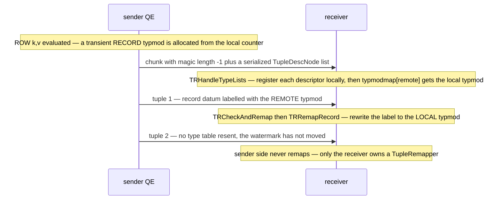

*record 缓存握手。接收方不发起请求；发送方在第一个需要新类型的元组之前推送类型表，每个连接对每个新类型只推送一次。*

随后，每个收到的元组都经过 `TRCheckAndRemap`（`cdbmotion.c` — `reconstructTuple()`）；`remap_needed` 为 false 时直接短路返回。需要重映射时，`BuildFieldRemapInfo` 遍历一次元组描述符，构建由 `TupleRemapInfo` 节点组成的树，标记哪些属性可能包含组合类型。它会递归处理数组、范围和域，因为记录可能隐藏在任意深度（`tupleremap.c` — `BuildTupleRemapInfo()`）。接着，`TRRemapRecord` 拆解该值，替换 typmod 标记，递归修正字段，再重建它；只有内容确实发生变化时才重建（`tupleremap.c` — `TRRemapRecord()`）。

这一过程可以测量。由于 `CheckAndSendRecordCache` 的推送也经过 `statSendTuple`，类型表会在计数器中表现为**一次额外的、并非元组的发送**。

*相同的 12 行，运行两次。增加一个 record 列后，每个发送方恰好多一次发送、多一个数据块，即类型表，约增加 106 字节；同时，每行也变大，因为 record 数据值带有自己的元组头部。*

```sql
SET optimizer=off; SET gp_log_interconnect='verbose';
SELECT k, v FROM m194_hash;          -- run 1
SELECT row(k,v) AS r FROM m194_hash; -- run 2
```

```text {hl_lines="7 8 9" title="output"}
-- run 1: plain columns, no record types in the tupdesc
Interconnect seg0 slice1 sent 5 tuples, 129 total bytes, 105 tuple bytes, 6 chunks.
Interconnect seg1 slice1 sent 2 tuples,  55 total bytes,  43 tuple bytes, 3 chunks.
Interconnect seg2 slice1 sent 5 tuples, 131 total bytes, 107 tuple bytes, 6 chunks.

-- run 2: one record column
Interconnect seg0 slice1 sent 6 tuples, 342 total bytes, 314 tuple bytes, 7 chunks.
Interconnect seg1 slice1 sent 3 tuples, 205 total bytes, 189 tuple bytes, 4 chunks.
Interconnect seg2 slice1 sent 6 tuples, 344 total bytes, 316 tuple bytes, 7 chunks.
```

五行变为六次发送，两行变为三次，五行变为六次；每个 Segment 恰好多一次，不会更多，因为高水位阻止了第二次推送。大小也印证了这一点：Segment 0 发送 5 行，共 314 元组字节；Segment 1 发送 2 行，共 189 字节。因此每行约 41.7 字节，两者的固定部分都约为 106 字节，即只发送一次的序列化 `TupleDescNode` 列表。

*record 值经过更复杂的 Motion 仍保持有效：两端都不是 Coordinator 的 Segment 间 Broadcast Motion，以及嵌套在数组和其他记录中的 record 值。*

```sql
SET optimizer=off;
SELECT count(*) FROM (SELECT row(k,v) r FROM m194_rand) a
  JOIN (SELECT row(k,v) r FROM m194_hash) b ON a.r = b.r;

SELECT array[row(k,v)] AS arr, row(k, row(v,k)) AS nested
  FROM m194_hash ORDER BY k LIMIT 2;
```

```text {hl_lines="3" title="output"}
 count 
-------
    12
(1 row)

    arr     |    nested    
------------+--------------
 {"(1,v1)"} | (1,"(v1,1)")
 {"(2,v2)"} | (2,"(v2,2)")
(2 rows)
```

> [!NOTE]
> typmod 属于进程本地这一事实，还带来两个结构细节。第一，`TupleRemapper` 挂在**连接**上，而不是 Motion 节点上；`processIncomingChunks` 通过 `GetMotionConnTupleRemapper(transportStates, motNodeID, srcRoute)` 获取它（`cdbmotion.c`、`ic_common.c`）。必须如此，因为两个发送方可能为相同形态分配不同 typmod，各自都需要独立转换表。第二，广播没有单一路由，因此 `GetMotionSentRecordTypmod` 会将 `BROADCAST_SEGIDX` 折叠到路由 0（`ic_common.c`），用这一个连接的高水位代表所有连接。

### 19.4.6 有序 Motion：接收方中的 N 路归并 {#1946-sorted-motion-an-n-way-merge-in-the-receiver}

`Gather Motion` 通常按数据块实际到达的顺序返回元组。但如果各发送方的流*已经*有序，接收方就能反复选取各发送方队首的最小值，生成全局有序结果。这样，分布式 `ORDER BY ... LIMIT` 完全不需要在 Coordinator 上排序。规划器用 `sendSorted` 标记这种 Motion，`EXPLAIN` 为它打印 `Merge Key:` 行（`explain.c` — `ExplainNode()`，`explain_gp.c` — `show_motion_keys()`）。

*Merge Key 行，以及使其成立的逐 Segment Sort 和 Limit。各 Segment 在本地排序并截断，Coordinator 只负责归并。*

```sql
SET optimizer=off;
EXPLAIN (costs off) SELECT k FROM m194_hash ORDER BY k LIMIT 5;
```

```text {hl_lines="5" title="output"}
                   QUERY PLAN                   
------------------------------------------------
 Limit
   ->  Gather Motion 3:1  (slice1; segments: 3)
         Merge Key: k
         ->  Limit
               ->  Sort
                     Sort Key: k
                     ->  Seq Scan on m194_hash
```

归并也可以从输出本身观察。添加 `gp_execution_segment()`，分别运行带和不带 `ORDER BY` 的查询：无序时，行按各 Segment 成块出现；有序时，各 Segment 的行在堆的控制下交错输出。

*左侧，无序 Gather：每个发送方的整块数据按到达顺序输出。右侧，有序 Gather：发送方交错输出，k 全局有序；这种交错正是二叉堆逐行选择路由的结果。*

```sql
SELECT gp_execution_segment() AS seg, k FROM m194_hash;            -- unsorted
SELECT gp_execution_segment() AS seg, k FROM m194_hash ORDER BY k;  -- sorted
```

```text {hl_lines="3 7 9 11 14" title="output"}
 seg | k  |     | seg | k  
-----+----      -----+----
   0 |  2  |       1 |  1
   0 |  3  |        0 |  2
   0 |  4  |        0 |  3
   0 |  7  |        0 |  4
   0 |  8  |       2 |  5
   2 |  5  |        2 |  6
   2 |  6  |       0 |  7
   2 |  9  |        0 |  8
   2 | 10  |       2 |  9
   2 | 11  |        2 | 10
   1 |  1  |        2 | 11
   1 | 12  |       1 | 12
(12 rows)     (12 rows)
```

`execMotionSortedReceiver`（`nodeMotion.c`）用 `lib/binaryheap.h` 实现归并，堆中存放的是*路由编号*，而非元组。首次调用时，它对发送切片中的每个存活进程调用一次 `RecvTupleFrom(..., iSegIdx)`，将元组暂存在各路由的槽中，将路由索引无序加入堆，然后只调用一次 `binaryheap_build`，比 N 次插入更便宜。以后每次调用只需三行状态维护：

```c {title="src/backend/executor/nodeMotion.c — execMotionSortedReceiver()"}
		inputTuple = RecvTupleFrom(..., motion->motionID, node->routeIdNext);
		if (inputTuple)
		{
			ExecStoreMinimalTuple(inputTuple, node->slots[node->routeIdNext], true);
			slot_getsomeattrs(node->slots[node->routeIdNext], node->lastSortColIdx);
			binaryheap_replace_first(hp, Int32GetDatum(node->routeIdNext));
		}
		else
			binaryheap_remove_first(hp);   /* that sender hit EOS */
```

比较器 `CdbMergeComparator`（`nodeMotion.c`）直接从槽的 `tts_values` 数组读取键列，这也是调用者先运行 `slot_getsomeattrs(slot, node->lastSortColIdx)` 的原因。它用 `INVERT_COMPARE_RESULT` 反转结果，因为 `binaryheap` 是最大堆，而这里需要最小值在堆顶。堆为空时，所有发送方都已发送 EOS，节点返回 NULL。从结构上看，这就是将 [§18.6](/cloudberry/core-internals/part-4-query-processing/ch18/#186-subqueries--other-nodes) 的 `MergeAppend` 子计划替换成网络来源：相同的堆、每个输入一个槽的相同约束、相同的摊还成本。区别只在输入位置：`MergeAppend` 归并单进程内的有序子计划，有序 Gather 归并有序的*进程输出*。

> [!NOTE]
> 接收端的前提早已准备好：`ExecInitMotion` 将 `node->sendSorted` 作为 `preserveOrder` 传给 `UpdateMotionLayerNode`（`nodeMotion.c`），因此 `getChunkSorterEntry` 为每条路由提供自己的 `htup_fifo`，而非一个共享队列（`cdbmotion.c`）。保持顺序的代价是每个发送方一个队列。还要注意文件注释指出的不对称性（`nodeMotion.c`）：只有*接收方*具有有序实现。有序 Gather 的发送方仍走普通无序路径，因为它们的孩子已经生成有序输出。

### 19.4.7 停止与流结束 {#1947-stop-and-end-of-stream}

Motion 流可以通过两种不对称的方式结束。`TC_END_OF_STREAM` 正向传输，表示*发送方已完成*；停止消息反向传输，表示*接收方不再需要数据*。[§18.1](/cloudberry/core-internals/part-4-query-processing/ch18/#181-executor-framework--lifecycle) 将 `ExecSquelchNode` 介绍为执行器通用的“提前停止”遍历；Motion 节点正是它跨越进程边界的位置。

接收端的 `ExecSquelchMotion`（`nodeMotion.c`）设置 `stopRequested`，调用 `SendStopMessage`，并将节点标记为已终止。`SendStopMessage` 在 Motion 层设置 `pEntry->stopped`，然后通过函数表继续转发（`cdbmotion.c`）；传输层负责把标志送达对端，详见 [§19.5](#195-interconnect-implementations)。已终止的 Motion 如果又被执行，会报错而不是悄悄丢行，`ExecMotion` 在入口处就检查这一点（`nodeMotion.c`）。

发送端没有回调或信号处理函数。停止通过*返回值*同步发现：`SendTupleChunkToAMS` 返回 false，`SendTuple` 将其转换为 `STOP_SENDING`（`cdbmotion.c`），`doSendTuple` 设置 `node->stopRequested`，发送循环终止自己的孩子子树后退出，不发送 EOS。Coordinator 上满足要求的 `LIMIT` 正是通过这套机制停止 Segment 上的扫描，并留下非常明显的特征。

*一个 EXISTS 子计划，其 Gather Motion 只需要一行。每个 Segment 持有约 100 000 行，并都已开始发送；发送方各发送约 1 351 行后被停止，大约只扫描了表的 1.4%。这个差距完全来自 Interconnect 中尚在传输的缓冲数据。*

```sql
SET optimizer=off;
SELECT gp_segment_id, count(*) FROM m194_big GROUP BY 1 ORDER BY 1;
EXPLAIN (analyze, costs off, summary off)
  SELECT count(*) FROM m194_dim WHERE EXISTS (SELECT 1 FROM m194_big WHERE k > 0);
```

```text {hl_lines="11 12" title="output"}
 gp_segment_id | count  
---------------+--------
             0 |  99877
             1 |  99951
             2 | 100172

                                         QUERY PLAN                                         
--------------------------------------------------------------------------------------------
 Aggregate (actual time=0.535..0.537 rows=1 loops=1)
   InitPlan 1 (returns $0)  (slice2)
     ->  Gather Motion 3:1  (slice3; segments: 3) (actual time=0.965..0.965 rows=1 loops=1)
           ->  Seq Scan on m194_big (actual time=0.063..0.253 rows=1351 loops=1)
                 Filter: (k > 0)
   ->  Gather Motion 3:1  (slice1; segments: 3) (actual time=0.445..0.524 rows=2 loops=1)
         ->  Result (actual time=0.056..0.057 rows=1 loops=1)
               One-Time Filter: $0
               ->  Seq Scan on m194_dim (actual time=0.055..0.056 rows=1 loops=1)
```

> [!NOTE]
> 按 [§18.1](/cloudberry/core-internals/part-4-query-processing/ch18/#181-executor-framework--lifecycle) 的约定，这些 `rows=` 是三个 Segment 的平均值，本构建还启用了 `--enable-cassert`，因此应将 1 351 视为数量级而非常量；它取决于停止消息返回前，发送方成功推入发送队列的数据量。关键是其形态：交付 **1** 行、扫描 **1 351** 行、可用 **100 000** 行。由于被停止的发送方跳过 EOS，接收方清理时必须容忍缺少该标记，因此 `EndMotionLayerNode`（`cdbmotion.c`）中有 `!pMNEntry->stopped && !pCSEntry->end_of_stream` 检查。如果没有其中的 `stopped`，每条 `LIMIT` 查询都会在日志中提示缺少标记。

### 19.4.8 Motion 节点实际报告什么 {#1948-what-a-motion-node-actually-reports}

Motion 层维护许多计数：发送、接收、数据块、传输字节、元组字节、队列高水位，既有全局统计，也有逐节点统计。人们很容易以为其中一部分会进入 `EXPLAIN ANALYZE`，事实却并非如此。必须明确这一点，因为它决定了如何排查 Interconnect 问题。

*跨两个 Motion 节点执行 EXPLAIN ANALYZE VERBOSE。Motion 行打印的全部内容都是通用观测数据：行数、循环次数、时间，以及规划阶段的 Hash Key。没有数据块数、字节数或确认数。切片页脚报告的是执行器内存，不是 Interconnect 流量。*

```sql
SET optimizer=off;
EXPLAIN (analyze, verbose, costs off, timing off)
  SELECT k, count(*) FROM m194_rand GROUP BY k;
```

```text {hl_lines="1 7" title="output"}
 Gather Motion 3:1  (slice1; segments: 3) (actual rows=12 loops=1)
   Output: k, (count(*))
   ->  HashAggregate (actual rows=5 loops=1)
         Output: k, count(*)
         Group Key: m194_rand.k
         work_mem: 72kB  Segments: 3  Max: 24kB (segment 0)  Workfile: (0 spilling)
         ->  Redistribute Motion 3:3  (slice2; segments: 3) (actual rows=5 loops=1)
               Output: k
               Hash Key: k
               ->  Seq Scan on public.m194_rand (actual rows=6 loops=1)
                     Output: k
   (slice0)    Executor memory: 114K bytes.
 * (slice1)    Executor memory: 122K bytes avg x 3x(0) workers, 122K bytes max (seg0).
   (slice2)    Executor memory: 112K bytes avg x 3x(0) workers, 112K bytes max (seg0).
```

`explain.c` 的 `ExplainNode()` 中，`T_Motion` 分支只做三件事：为有序或哈希 Motion 调用 `show_motion_keys`；`numHashSegments` 与接收方数量不同时打印 `Hash Module`；然后落入通用的 `cdbexplain_showExecStats`。`show_motion_keys`（`explain_gp.c`）反解析的是规划阶段表达式，从不接触运行时计数器。检索源码树也证实这一点：`stat_total_chunks_sent`、`stat_total_bytes_sent` 及其他同类字段在 `cdbmotion.c` 写入，其他地方从不读取。`MotionState` 自己的 `numTuplesFromChild` / `numTuplesToAMS` / `numTuplesFromAMS` / `numTuplesToParent` 声明于 `execnodes.h`（`MotionState`），只用于断言，以及编译期宏 `MEASURE_MOTION_TIME` 保护的 `elog`（`nodeMotion.c` — `ExecEndMotion()`）；此处该宏已被 `#undef`。

| 计数器 | 统计内容 | 实际查看位置 |
| --- | --- | --- |
| stat_total_sends | SendTuple 调用数，加上每次 record 缓存推送；因此 record 列会多出一个并不存在的元组 | gp_log_interconnect = verbose，在节点清理时输出：cdbmotion.c — EndMotionLayerNode |
| stat_total_chunks_sent | 交给传输层的 TupleChunk 数，包括 EOS 块 | 同一条日志 |
| stat_total_bytes_sent / stat_tuple_bytes_sent | 包含和不包含 4 字节块头部的传输字节数；每次直接路径发送会虚增 4 字节 | 同一条日志 |
| stat_total_chunks_recvd / _bytes_recvd / stat_total_recvs | 接收侧的对应统计，按发送切片编号报告 | gp_log_interconnect = verbose：cdbmotion.c — EndMotionLayerNode |
| stat_tuples_available_hwm | 重组队列达到的最大深度 | 需要 gp_log_interconnect >= debug 且日志级别为 DEBUG4，只用于保持顺序的节点：cdbmotion.c — EndMotionLayerNode |
| MotionLayerState 全局总计 | 整个查询的数据块与字节总数 | 无法直接查看，受编译期宏 AMS_VERBOSE_LOGGING 保护：cdbmotion.c — RemoveMotionLayer |
| numTuplesFromChild / ToAMS / FromAMS / ToParent | 执行器节点自己的元组计数 | 无法直接查看，只用于断言及 MEASURE_MOTION_TIME：nodeMotion.c — ExecEndMotion |

因此，要知道“这个 Motion 移动了多少字节”，实际办法是将 `gp_log_interconnect` 设为 `verbose` 并读取 Segment 日志。本节引用的每个字节数都来自 `cdbmotion.c` 中 `EndMotionLayerNode()` 的那一次 `elog`，这也是 Motion 层唯一能在生产环境直接查看的计量信息。其余内容——包装数据块的数据包头部、序列号、确认，以及基于丢包的流量控制如何决定被停止的发送方在收到停止消息前能够推送多少 `m194_big` 数据——都位于 `SendTupleChunkToAMS` 的另一侧，即 [§19.5](#195-interconnect-implementations) 的可插拔 Interconnect 模块中。

## 19.5 Interconnect 实现 {#195-interconnect-implementations}

本章此前的内容都在后端*内部*：`nodeMotion.c` 决定元组必须发送到路由 2，`cdbmotion.c` 将其序列化为 `TupleChunk` 后交出（[§19.4](#194-motion-nodes)）。交接只有一次调用，而调用另一侧的代码完全不在 `src/backend` 中。那里是一张函数指针表，由位于 `contrib/` 的共享库在 postmaster 启动时填充。

首先需要明确这一事实，它改变了对整个子系统的理解：**Cloudberry Interconnect 是可插拔、自注册的传输模块；`gp_interconnect_type` 的合法值不是编译期枚举，而是所有已注册实现的列表。** 本集群注册了三个实现；源码树中还有第四个，但没有注册。本节介绍接口边界、建立与清理的生命周期、这三种及额外的传输实现、UDP 流量控制，以及最关键的**Motion 发送方究竟在哪里阻塞**。正是为了避免这种阻塞带来的危险，才需要 [§18.1](/cloudberry/core-internals/part-4-query-processing/ch18/#181-executor-framework--lifecycle) 的终止机制和 [§18.4](/cloudberry/core-internals/part-4-query-processing/ch18/#184-join-nodes) 的预取机制。

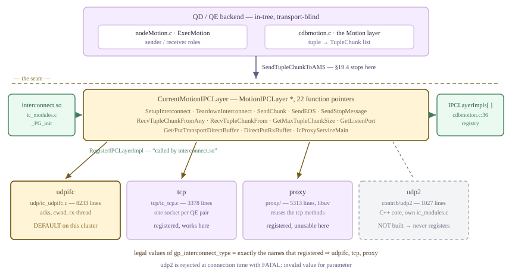

*接口边界。上方的执行器和 Motion 层不感知具体传输实现，只通过 `CurrentMotionIPCLayer` 调用；下方有四种实现，其中三种在本集群注册。*

### 19.5.1 通过函数表接入 {#1951-a-vtable-not-a-subsystem}

`MotionIPCLayer` 声明于 `src/include/cdb/ml_ipc.h`，包含两个身份字段（`ic_type`、`type_name`）和 22 个函数指针。进程级的选择状态位于 Motion 层顶部的两个全局变量中：`MotionIPCLayer *CurrentMotionIPCLayer`（`src/backend/cdb/motion/cdbmotion.c`），以及注册表 `static MotionIPCLayer *IPCLayerImpls[MAX_NUMBER_TYPES]`。各实现把自己加入注册表，后端没有任何代码预先知道它们的名称。

```c {title="src/backend/cdb/motion/cdbmotion.c — RegisterIPCLayerImpl()"}
/*
 * Called by interconnect.so to register a new IPC layer implement.
 */
void
RegisterIPCLayerImpl(MotionIPCLayer *impl)
{
	...
	IPCLayerImpls[CurrentIPCLayerImplNum++] = impl;
}
```

调用者是 `contrib/interconnect/ic_modules.c`，其中定义了三个静态 `MotionIPCLayer` 初始化器：`tcp_ipc_layer`、`proxy_ipc_layer`、`udpifc_ipc_layer`，并在 `_PG_init` 中全部注册。一个细节可以避免后续许多困惑：**`proxy_ipc_layer` 不是独立的传输实现。** 它的每个方法槽都是 `…TCP` 函数；ic-proxy 实际上是 `ic_tcp.c` *内部*的一组 `#ifdef ENABLE_IC_PROXY` 钩子，加上单独的代理进程。只有 `udpifc_ipc_layer` 具有自己的发送／接收路径。

模块必须在首个查询之前存在，那么 `interconnect.so` 是如何加载的？它并非通过 DBA 手工填写的 `shared_preload_libraries` 加载。Cloudberry 将一份*内置*预加载列表编译进服务器：

```c {title="src/include/utils/process_shared_preload_libraries.h"}
#ifdef ENABLE_PRELOAD_IC_MODULE
  "interconnect",
#endif
#ifdef ENABLE_IC_UDP2
  		"udp2",
#endif
#ifdef USE_PAX_STORAGE
		"pax",
#endif
```

该头文件在 `src/backend/utils/init/miscinit.c` 中作为数组初始化器被 `#include`（`process_shared_preload_libraries_array`），`expand_shared_preload_libraries_string()` 在加载前把它添加到用户设置之前。`postmaster.c` — `PostmasterMain()` 调用 `process_shared_preload_libraries()`，运行 `_PG_init`，从而完成三个注册；随后 `postmaster.c` — `PostmasterMain()` 调用 `InitializeCurrentMotionIPCLayer()`（`cdbmotion.c`），用已注册实现解析 `gp_interconnect_type`。SQL 中可以观察到结果：GUC 没有提及 Interconnect，但共享库已映射到每个后端。

*Interconnect 已加载，尽管没有人显式请求加载它。`/proc/<pid>/maps` 给出了真实情况。*

```sql
show shared_preload_libraries;

-- what is actually mapped into this backend?
select pg_backend_pid();
\! grep -oE "/[^ ]*postgresql/[a-z_0-9]*\.so" /proc/PID/maps | sort -u
```

```text {hl_lines="6" title="output"}
 shared_preload_libraries 
--------------------------
 pg_stat_statements
(1 row)

/usr/local/cloudberry-db/lib/postgresql/interconnect.so
/usr/local/cloudberry-db/lib/postgresql/pax.so
/usr/local/cloudberry-db/lib/postgresql/pg_stat_statements.so
```

这就带来了关键能力：`gp_interconnect_type` 是一个**字符串** GUC（`guc_gp.c` — `config_string`，上下文为 `PGC_BACKEND`），检查钩子为 `CheckGpInterconnectTypeStr`（`cdbmotion.c`），整个函数体只是遍历 `IPCLayerImpls[]`。没有任何静态名称列表。源码树中存在 `contrib/udp2/ic_udp2.c`（1027 行），它会注册 `udp2_ipc_layer`，但 `src/include/pg_config.h` 中 `ENABLE_IC_UDP2` 被 `#undef`，因此 `udp2` 从未预加载、从未注册，也就不是本集群上这个 GUC 的合法值：

*枚举是动态形成的：`udp2` 是源码树中的真实实现，仅仅因为没有注册，在这里就不是合法的 GUC 值。*

```bash
-- the three that registered
PGOPTIONS='-c gp_interconnect_type=tcp'    psql -p 7100 -c 'show gp_interconnect_type'
PGOPTIONS='-c gp_interconnect_type=proxy'  psql -p 7100 -c 'show gp_interconnect_type'

-- the one that exists in contrib/ but was not built
PGOPTIONS='-c gp_interconnect_type=udp2'   psql -p 7100 -c 'show gp_interconnect_type'
```

```text {hl_lines="10" title="output"}
 gp_interconnect_type 
----------------------
 tcp

 gp_interconnect_type 
----------------------
 proxy

psql: error: connection to server on socket "/tmp/.s.PGSQL.7100" failed:
FATAL:  invalid value for parameter "gp_interconnect_type": "udp2"
```

> [!NOTE]
> `gp_interconnect_type` 的上下文是 `PGC_BACKEND`，而非 `PGC_POSTMASTER`，因此**切换传输实现无需重启**，通过 `PGOPTIONS` 可为每次连接选择。本节所有传输对比，都是对同一运行中集群分别调用 `psql`。postmaster 一侧的 `InitializeCurrentMotionIPCLayer()` 还有一条更友好的错误路径：如果*启动*值未知，它会报告 `Invalid gp_interconnect_type: %s, valid values are: %s`（`cdbmotion.c` — `InitializeCurrentMotionIPCLayer()`），通过遍历注册表构造合法值列表。这清楚说明，枚举是在运行时组装的。

### 19.5.2 传输实现必须提供什么 {#1952-what-a-transport-must-provide}

22 个指针并非同等重要，约十二个构成主要契约。与 [§19.4](#194-motion-nodes) 的边界十分明确：Motion 层最后执行 `CurrentMotionIPCLayer->SendTupleChunkToAMS`，而这个符号本身也由模块提供，位于三种实现共享的 `contrib/interconnect/ic_common.c`。它将块列表交给 `doBroadcast` 或单条路由，再调用各传输实现的 `SendChunk`。

| 方法 | 传输实现必须完成的工作 |
| --- | --- |
| GetMaxTupleChunkSize | 告知 Motion 层数据块可以有多大。每条语句在 cdbmotion.c — createMotionLayerState 中调用一次，设置 Gp_max_tuple_chunk_size。块大小由传输实现决定，详见下文。 |
| GetListenPort | 公布可告知对端的端口，供 QD 写入查询切片表（[§19.3](#193-slice-tables--planslice--gang-mapping)）。 |
| InitMotionLayerIPC / CleanUpMotionLayerIPC | 每个进程一次的初始化：创建监听套接字、启动所需线程。后端初始化时，从 cdbutil.c — cdb_setup 及第 3556 行调用。 |
| SetupInterconnect / TeardownInterconnect | 每条语句建立与清理：根据查询切片表构建逐切片连接状态，无论结果如何都清理全部状态。 |
| SendTupleChunkToAMS | ic_common.c 中的共享入口。将 Motion ID 与路由解析为 MotionConn，处理广播分发，再委托具体实现。 |
| SendChunk | 具体传输实现的实际发送操作。发送方可能在这里阻塞。 |
| SendEOS / SendStopMessage | 向下游发送流结束，向上游发送停止。SendStopMessage 是 [§18.1](/cloudberry/core-internals/part-4-query-processing/ch18/#181-executor-framework--lifecycle) 中 ExecSquelchNode 的网络形式。 |
| RecvTupleChunkFromAny | 阻塞直到任意活跃对端有数据，保证路由之间公平。用于无序 Gather 或 Redistribute 的接收端。 |
| RecvTupleChunkFrom | 等待某条指定路由。有序（归并）Gather 每次需要一条特定路由（[§19.4](#194-motion-nodes)）。 |
| RecvTupleChunk / DirectPutRxBuffer | 从一个连接拉取下一个数据块，在 Motion 层用完后归还缓冲区。 |
| GetTransportDirectBuffer / PutTransportDirectBuffer | 允许序列化器直接写入传输层的待发送包缓冲区，省去一次 memcpy。这里三种实现共用同一套代码。 |
| DeregisterReadInterest | 路由已发送 EOS 或被停止后，将其从轮询集合移除。 |
| IcProxyServiceMain | 代理进程的主循环。未用 --enable-ic-proxy 构建时为 NULL；启用时，三个函数表中的该项都非 NULL。 |
| GetMotionConnTupleRemapper / GetMotionSentRecordTypmod | 为 [§19.4](#194-motion-nodes) 的 record typmod 重映射状态提供逐连接存储；传输层管理生命周期，Motion 层定义语义。 |

`GetMaxTupleChunkSize` 值得再看一次，因为它让传输层*向上*影响 Motion 层行为。两种实现都计算相同的量，即数据包预算减去自身头部，而头部相差 84 字节：

```c {title="contrib/interconnect/udp/ic_udpifc.c — GetMaxTupleChunkSizeUDP()"}
int GetMaxTupleChunkSizeUDP(void)
{ return Gp_max_packet_size - sizeof(struct icpkthdr) - TUPLE_CHUNK_HEADER_SIZE; }
```

```c {title="contrib/interconnect/tcp/ic_tcp.c — GetMaxTupleChunkSizeTCP()"}
int GetMaxTupleChunkSizeTCP(void)
{ return Gp_max_packet_size - PACKET_HEADER_SIZE - TUPLE_CHUNK_HEADER_SIZE; }
```

本平台上 `sizeof(icpkthdr)` 为 **88** 字节，`PACKET_HEADER_SIZE` 为 **4**（`ml_ipc.h`），`TUPLE_CHUNK_HEADER_SIZE` 也为 **4**（`tupchunk.h`）。因此，默认 `gp_max_packet_size=8192` 时，udpifc 最大数据块为 8100，tcp 为 8184，相差约 1%，查询基本察觉不到。缩小数据包后，差异就可以测量。将三行各含 30 098 序列化字节的数据汇集到 QD，用 `gp_log_interconnect=verbose` 报告块数：

*传输实现选择块大小，可以直接计数。相同的三个元组，经 UDP 使用 1956 字节的块，经 TCP 使用 2040 字节的块。*

```sql
create table m195_wide (id int, big text) distributed by (id);
insert into m195_wide select i,
  (select string_agg(md5(random()::text||i||j),'') from generate_series(1,940) j)
  from generate_series(1,3) i;          -- 30 080 incompressible chars each

-- same query, four transport/packet-size combinations
set gp_log_interconnect=verbose; set client_min_messages=log;
select id, big from m195_wide;
```

```text {hl_lines="4 8" title="output"}
##### type=udpifc gp_max_packet_size=8192 #####
LOG:  Interconnect seg-1 slice0 received from slice1: 3 tuples, 90354 total bytes, 90294 tuple bytes, 15 chunks.
##### type=udpifc gp_max_packet_size=2048 #####
LOG:  Interconnect seg-1 slice0 received from slice1: 3 tuples, 90498 total bytes, 90294 tuple bytes, 51 chunks.
##### type=tcp    gp_max_packet_size=8192 #####
LOG:  Interconnect seg-1 slice0 received from slice1: 3 tuples, 90354 total bytes, 90294 tuple bytes, 15 chunks.
##### type=tcp    gp_max_packet_size=2048 #####
LOG:  Interconnect seg-1 slice0 received from slice1: 3 tuples, 90486 total bytes, 90294 tuple bytes, 48 chunks.
```

计算完全吻合。数据包为 2048 字节时，udpifc 每块允许 2048−88−4 = 1956 字节，因此每个 30 098 字节元组需要 ⌈30098/1956⌉ = 16 块，3×16 = 48，再加每个发送方一个流结束块，总计 **51**。TCP 允许 2048−4−4 = 2040，因此 ⌈30098/2040⌉ = 15，45 + 3 = **48**。每行的 `total bytes − tuple bytes` 都等于 4 × 块数，这是通过实测得到的 `TUPLE_CHUNK_HEADER_SIZE`。数据包为 8192 时，两种传输都需要每元组 4 块，差异消失，所以通常无人注意。

### 19.5.3 每条语句都建立并清理连接 {#1953-setup-and-teardown-are-per-statement}

`SetupInterconnect` 有三处调用，都在执行器中：语句本身由 `execMain.c` 的 `standard_ExecutorStart()` 和 `execMain.c` 的 `standard_ExecutorStart()` 调用；另一处是 `nodeSubplan.c` 的 `ExecSetParamPlan()`，InitPlan 除自己的进程组外，还要建立*自己的* Interconnect（[§18.6](/cloudberry/core-internals/part-4-query-processing/ch18/#186-subqueries--other-nodes)）。清理与之对应，但格外谨慎：正常路径使用 `execUtils.c` — `mppExecutorFinishup()`，错误路径使用带 `hasErrors = true` 的 `execUtils.c` — `mppExecutorCleanup()`，因为无论发生什么，都必须回收套接字和接收线程。udpifc 的入口是 `SetupInterconnectUDP`（`ic_udpifc.c`）和 `TeardownUDPIFCInterconnect`；tcp 的入口是 `SetupInterconnectTCP`（`ic_tcp.c`）。设置 `gp_log_interconnect=debug` 会记录全过程，也是观察查询切片表如何变为套接字的最快方式：

*连接建立日志。每个 QE 从查询切片表获知对端主机／端口并发起连接，接收端只统计到达数量。内容有删节，仅展示四个切片中的一个。*

```sql
set gp_log_interconnect=debug;
set client_min_messages=debug1;
select count(*) from (select d.label, count(*) from m195_fact f
                      join m195_dim d on f.k=d.k group by d.label) s;
```

```text {hl_lines="1 10" title="output"}
DEBUG:  SetupUDPIFCInterconnect: queue depth, queue_depth=4, snd_queue_depth=2, mem_size=10, slices=4, packet_size=8192
DEBUG:  Setup recving connections: my slice 0, childId 1
DEBUG:  SetupUDPInterconnect will activate 3 incoming, 3 expect incoming, 0 outgoing, 0 expect outgoing routes for ic_instancce_id 1. Listening on ports=0/33254 sockfd=6.
...
DEBUG:  Interconnect seg0 slice2 setting up sending motion node  (seg0 slice2 pid=6959)
DEBUG:  Interconnect connecting to seg0 slice1 10.100.0.3:53109 pid=6953 sockfd=-1  (seg0 slice2 pid=6959)
DEBUG:  setupOutgoingUDPConnection: node 2 route 0 srccontent 0 dstcontent 0: 10.100.0.3:53109  (seg0 slice2 pid=6959)
DEBUG:  Interconnect connecting to seg1 slice1 10.100.0.3:43894 pid=6954 sockfd=-1  (seg0 slice2 pid=6959)
DEBUG:  Interconnect connecting to seg2 slice1 10.100.0.3:32981 pid=6955 sockfd=-1  (seg0 slice2 pid=6959)
DEBUG:  SetupUDPInterconnect will activate 3 incoming, 3 expect incoming, 3 outgoing, 3 expect outgoing routes for ic_instancce_id 1. Listening on ports=0/51184 sockfd=6.
```

这与 [§19.2](#192-the-dispatcher-gangs--async-dispatch) 中**进程组在同一会话内跨语句保留**不同，Interconnect 不会保留。每条语句获得新的 `ic_instance_id`，由 QD 分配并随查询切片表携带；每个数据包头部也都携带它，从而识别并丢弃上一条语句迟到的数据包。同一会话连续执行三个相同查询，启用 `gp_interconnect_log_stats=on` 后，可以看到相同的三个 QE pid，却有三个不同实例：

*相同进程，三个 Interconnect。进程组是会话资源，Interconnect 是语句资源。*

```sql
set gp_interconnect_log_stats=on;
set client_min_messages=log;
select count(*) from m195_fact;   -- x3, same session
```

```text {hl_lines="1 4 7" title="output"}
ic_instance_id 1 ic_id_last_teardown 1 ... (seg0 slice1 10.100.0.3:7102 pid=24530)
ic_instance_id 1 ic_id_last_teardown 1 ... (seg1 slice1 10.100.0.3:7103 pid=24531)
ic_instance_id 1 ic_id_last_teardown 1 ... (seg2 slice1 10.100.0.3:7104 pid=24532)
ic_instance_id 2 ic_id_last_teardown 2 ... (seg0 slice1 10.100.0.3:7102 pid=24530)
ic_instance_id 2 ic_id_last_teardown 2 ... (seg1 slice1 10.100.0.3:7103 pid=24531)
ic_instance_id 2 ic_id_last_teardown 2 ... (seg2 slice1 10.100.0.3:7104 pid=24532)
ic_instance_id 3 ic_id_last_teardown 3 ... (seg0 slice1 10.100.0.3:7102 pid=24530)
ic_instance_id 3 ic_id_last_teardown 3 ... (seg1 slice1 10.100.0.3:7103 pid=24531)
ic_instance_id 3 ic_id_last_teardown 3 ... (seg2 slice1 10.100.0.3:7104 pid=24532)
```

> [!NOTE]
> 有两个文档陷阱需要指出。（1）这里 `gp_interconnect_setup_timeout` 为 **7200** 秒，且只有 `ic_tcp.c` 的 `SetupTCPInterconnect()` 和 `ic_proxy_backend.c` 的 `ic_proxy_backend_on_connected()` 使用它；检索 `ic_udpifc.c` 找不到该参数，udpifc 通过普通的重传／死锁检查约束建立过程。（2）`SetupUDPIFCInterconnect` 的自动调优代码按 `Gp_interconnect_mem_size / (Gp_max_packet_size * sliceNum)` 重新计算队列深度，但 `gp_interconnect_mem_size` 的文档与设置单位是 *MB*，值为 10，而 `Gp_max_packet_size` 的单位是字节。因此商为 0，队列深度保持默认值，与上方 `DEBUG1` 日志完全一致。本集群上的自动调优没有实际效果。

### 19.5.4 UDPIFC：数据包 {#1954-udpifc-the-packet}

`contrib/interconnect/udp/ic_udpifc.c` 有 8233 行，比 TCP 实现和代理代码之和的两倍还多，额外代码几乎全部用于可靠性：序列号、确认、重传时间轮、拥塞窗口、乱序缓存，以及后台接收线程。这是在不可靠数据报之上构建的小型传输协议，应从头部 `icpkthdr`（`contrib/interconnect/udp/ic_udpifc.h`）开始理解。

<figure class="cloudberry-core-figure">
<div><div style="font-family:ui-monospace,SFMono-Regular,Menlo,monospace;font-size:12px;line-height:1.4;overflow-x:auto"> <div style="min-width:600px"> <div style="display:grid;grid-template-columns:52px repeat(4,1fr);gap:3px;margin-bottom:3px;color:#676d7b;font-size:10px;text-align:center"> <div style="text-align:right;padding-right:6px">字节</div><div>+0</div><div>+4</div><div>+8</div><div>+12</div></div> <div style="display:grid;grid-template-columns:52px repeat(4,1fr);gap:3px;margin-bottom:3px"> <div style="text-align:right;padding-right:6px;color:#676d7b;font-size:10px;line-height:26px">0</div> <div style="background:#f5edff;border:1px solid #cdb4db;border-radius:3px;padding:4px 2px;text-align:center;color:#2d2438">motNodeId</div> <div style="background:#f5edff;border:1px solid #cdb4db;border-radius:3px;padding:4px 2px;text-align:center;color:#2d2438">srcPid</div> <div style="background:#f5edff;border:1px solid #cdb4db;border-radius:3px;padding:4px 2px;text-align:center;color:#2d2438">srcListenerPort</div> <div style="background:#f5edff;border:1px solid #cdb4db;border-radius:3px;padding:4px 2px;text-align:center;color:#2d2438">dstPid</div></div> <div style="display:grid;grid-template-columns:52px repeat(4,1fr);gap:3px;margin-bottom:3px"> <div style="text-align:right;padding-right:6px;color:#676d7b;font-size:10px;line-height:26px">16</div> <div style="background:#f5edff;border:1px solid #cdb4db;border-radius:3px;padding:4px 2px;text-align:center;color:#2d2438">dstListenerPort</div> <div style="background:#f5edff;border:1px solid #cdb4db;border-radius:3px;padding:4px 2px;text-align:center;color:#2d2438">sessionId</div> <div style="background:#eafaf0;border:1px solid #cfead9;border-radius:3px;padding:4px 2px;text-align:center;color:#245c42">icId</div> <div style="background:#f5edff;border:1px solid #cdb4db;border-radius:3px;padding:4px 2px;text-align:center;color:#2d2438">recvSliceIndex</div></div> <div style="display:grid;grid-template-columns:52px repeat(4,1fr);gap:3px;margin-bottom:3px"> <div style="text-align:right;padding-right:6px;color:#676d7b;font-size:10px;line-height:26px">32</div> <div style="background:#f5edff;border:1px solid #cdb4db;border-radius:3px;padding:4px 2px;text-align:center;color:#2d2438">sendSliceIndex</div> <div style="background:#f5edff;border:1px solid #cdb4db;border-radius:3px;padding:4px 2px;text-align:center;color:#2d2438">srcContentId</div> <div style="background:#f5edff;border:1px solid #cdb4db;border-radius:3px;padding:4px 2px;text-align:center;color:#2d2438">dstContentId</div> <div style="background:#eafaf0;border:1px solid #cfead9;border-radius:3px;padding:4px 2px;text-align:center;color:#245c42">crc</div></div> <div style="display:grid;grid-template-columns:52px repeat(4,1fr);gap:3px;margin-bottom:3px"> <div style="text-align:right;padding-right:6px;color:#676d7b;font-size:10px;line-height:26px">48</div> <div style="background:#fff4d6;border:1px solid #735a16;border-radius:3px;padding:4px 2px;text-align:center;color:#5b4636"><span class="hl">flags</span></div> <div style="background:#fff4d6;border:1px solid #735a16;border-radius:3px;padding:4px 2px;text-align:center;color:#5b4636">len</div> <div style="background:#fff4d6;border:1px solid #735a16;border-radius:3px;padding:4px 2px;text-align:center;color:#5b4636"><span class="hl">seq</span></div> <div style="background:#fff4d6;border:1px solid #735a16;border-radius:3px;padding:4px 2px;text-align:center;color:#5b4636"><span class="hl">extraSeq</span></div></div> <div style="display:grid;grid-template-columns:52px repeat(2,1fr);gap:3px;margin-bottom:3px"> <div style="text-align:right;padding-right:6px;color:#676d7b;font-size:10px;line-height:26px">64</div> <div style="background:#eafaf0;border:1px solid #cfead9;border-radius:3px;padding:4px 2px;text-align:center;color:#245c42">send_time &#8212; uint64</div> <div style="background:#eafaf0;border:1px solid #cfead9;border-radius:3px;padding:4px 2px;text-align:center;color:#245c42">recv_time &#8212; uint64</div></div> <div style="display:grid;grid-template-columns:52px 1fr 3fr;gap:3px;margin-bottom:8px"> <div style="text-align:right;padding-right:6px;color:#676d7b;font-size:10px;line-height:26px">80</div> <div style="background:#eafaf0;border:1px solid #cfead9;border-radius:3px;padding:4px 2px;text-align:center;color:#245c42">retry_times</div> <div style="background:#f3f4f6;border:1px dashed #9ca3af;border-radius:3px;padding:4px 2px;text-align:center;color:#676d7b">尾部填充 7 字节 — 用于对齐</div></div> <div style="color:#676d7b;font-size:11px;letter-spacing:0.5px">&#8593;&#8212;&#8212;&#8212;&#8212;&#8212;&#8212;&#8212;&#8212; sizeof(icpkthdr) = 88 &#8212;&#8212;&#8212;&#8212;&#8212;&#8212;&#8212;&#8212;&#8593;</div> <div style="margin-top:10px;padding:8px 10px;background:#fff4d6;border:1px solid #735a16;border-radius:4px;color:#5b4636;font-size:11.5px"> <span class="hl">88</span> 头部 + <span class="hl">4</span> TupleChunk 头部 + 有效载荷 ≤ gp_max_packet_size <span class="hl">8192</span> &#8658; Gp_max_tuple_chunk_size = <span class="hl">8100</span> — 一个数据报，一次发送，无 IP 分片 </div> <div style="margin-top:8px;color:#6b5b8a;font-size:11px"> 淡紫色 = 路由标识 · 琥珀色 = 协议状态 · 绿色 = 完整性与计时 </div> </div></div></div>
<figcaption>`icpkthdr`：每个数据报前的 88 字节。包含十六个 32 位字段、两个时间戳、一个重试计数器，以及七字节尾部填充。</figcaption>
</figure>

前十一个字段全用于身份识别，这也是 udpifc 不需要连接的原因：到达 QE 单一监听套接字的数据报，携带足够的信息，包括 `motNodeId`、源和目标 pid 与端口、`sessionId`、`icId`、双方切片索引和 content ID，可在哈希表中准确匹配一条逻辑连接。增加 `crc` 是因为 UDP 自带的 16 位校验和不足以保护如此大的数据量。`flags` 是位掩码（`ic_udpifc.c` — `UDPIC_FLAGS_RECEIVER_TO_SENDER`–`UDPIC_FLAGS_FULL`），包含 `RECEIVER_TO_SENDER`、`ACK`、`STOP`、`EOS`、`NAK`、`DISORDER`、`DUPLICATE`、`CAPACITY`、`FULL`。因此，一个不带载荷的 88 字节头部，也可以表示确认、否定确认、乱序报告、流控配额，以及 [§18.1](/cloudberry/core-internals/part-4-query-processing/ch18/#181-executor-framework--lifecycle) 的停止消息。`seq`/`extraSeq` 随标志组合复用，头部注释列出了六种含义；对流控最重要的是，在 `ACK|CAPACITY` 中，`seq` 表示连续*缓存*的最高序列号，`extraSeq` 表示已*消费*的最高序列号。接收方由此在一个数据报中报告两个不同高水位：已经持有哪些数据，以及上方执行器实际消费了哪些数据。

### 19.5.5 UDPIFC 流量控制与 Motion 发送方的阻塞位置 {#1955-udpifc-flow-control-and-where-a-motion-sender-blocks}

两个 GUC 决定大小。`gp_interconnect_queue_depth`（**4**）是接收方逐连接的数据包环大小：`conn->pkt_q` 按此槽数分配（`ic_udpifc.c` — `cacheFuturePacket()`），数据包存入 `(pkt->seq - 1) % pkt_q_capacity`（`handleDataPacket()`）。这就是 `gp_interconnect_cache_future_packets=on` 的作用：乱序到达的数据包直接进入对应槽，而非被丢弃。`gp_interconnect_snd_queue_depth`（**2**）是*发送方*每条连接的数据包缓冲区额度，但发送方缓冲区是池化的：建立时，每条出站连接执行一次 `snd_buffer_pool.maxCount += Gp_interconnect_snd_queue_depth`（`startOutgoingUDPConnections()`）。因此，面向 R 个接收方的发送方总共拥有 2R 个缓冲区，并非每个对端固定两个。

配额是 `conn->capacity`，初始化为 `Gp_interconnect_queue_depth`（`startOutgoingUDPConnections()`），表示发送方认为该接收方环中还有多少空槽。每次发送递减，由 `ACK|CAPACITY` 恢复。其上还有真正的 TCP 式拥塞窗口：`snd_control_info` 保存 `cwnd`、`minCwnd` 和 `ssthresh`（`SendControlInfo`）；`cwnd` 初始每条连接一个，`minCwnd` 固定为该初始值（`startOutgoingUDPConnections()`、`SetupUDPIFCInterconnect_Internal()`）；收到未重传包的确认时增长，发生丢包时减半。所有条件在 `sendBuffers` 中汇合：

```c {title="contrib/interconnect/udp/ic_udpifc.c"}
while (conn->capacity > 0 && icBufferListLength(&conn->sndQueue) > 0)
{
	/* loss-based FC: respect the shared congestion window */
	if ((Gp_interconnect_fc_method == INTERCONNECT_FC_METHOD_LOSS || ...) &&
		(icBufferListLength(&conn->unackQueue) > 0 &&
		 unack_queue_ring.numSharedOutStanding >= (snd_control_info.cwnd - snd_control_info.minCwnd)))
		break;
	...
	conn->capacity--;
	icBufferListAppend(&conn->unackQueue, buf);
```

要仔细阅读这个判断条件，它实现了函数上方注释明确说明的公平规则：*每条*连接始终可以免费占用一个未确认缓冲区；只有连接的未确认队列已经超过一个条目时，才递增 `numSharedOutStanding`。首包之外，所有连接争用 `cwnd − minCwnd` 个共享槽。因此，面向 R 个接收方的发送方拥有 R 个免费槽，加上可增长到 R 的共享窗口，总数受现有 2R 个缓冲区限制。只有**一个**接收方的发送方，例如 Gather Motion 的 QE，无论如何都只能让两个包同时在途。

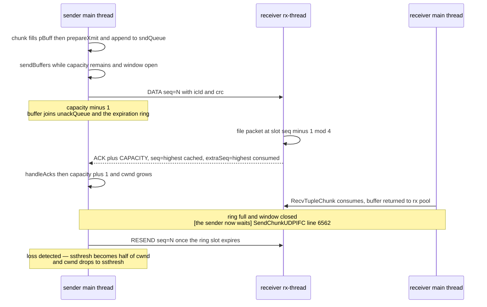

*一条连接的 udpifc 流控循环。发送方在循环中间阻塞，而这种阻塞正是需要 [§18.1](/cloudberry/core-internals/part-4-query-processing/ch18/#181-executor-framework--lifecycle) 和 [§18.4](/cloudberry/core-internals/part-4-query-processing/ch18/#184-join-nodes) 所述机制的原因。*

下面就是阻塞本身。`SendChunkUDPIFC`（`ic_udpifc.c`）将数据块聚合到当前数据包缓冲区，缓冲区满时必须获得一个*新的*缓冲区。如果池已空，即每个缓冲区都停留在某条连接的未确认队列中，下一个数据块就无处可放：

```c {title="contrib/interconnect/udp/ic_udpifc.c — SendChunkUDPIFC()"}
while (doCheckExpiration || (conn->curBuff = getSndBuffer(&conn->mConn)) == NULL)
{
	int timeout = (doCheckExpiration ? 0 : computeTimeout(&conn->mConn, retry));

	if (pollAcks(transportStates, pEntry->txfd, timeout))
		if (handleAcks(transportStates, &pEntry->entry, true))
			gotStops = true;
	checkExceptions(transportStates, &pEntry->entry, &conn->mConn, retry++, timeout);
	...
}
```

**这个循环就是本手册其他章节反复提到的机制。** 无法获得缓冲区的 Motion 发送方停留在 `pollAcks` 中，直到接收方确认才可能获得缓冲区；而接收方只有在执行器从环中消费数据后才会确认。因此，仅靠 4 个环槽和 2R 个包缓冲区，一个缓慢或停滞的消费者就能让相隔多个进程的生产者停止。[§18.1](/cloudberry/core-internals/part-4-query-processing/ch18/#181-executor-framework--lifecycle) 的 `ExecSquelchNode`，让不再读取的接收方，如 `LIMIT` 或构建侧为空的哈希连接，发送 `SendStopMessage`（`SendStopMessageUDPIFC()`），而不是直接沉默；[§18.4](/cloudberry/core-internals/part-4-query-processing/ch18/#184-join-nodes) 的 `prefetch_inner` 则避免连接阻塞自己的某个输入。两者都是*规避此循环阻塞的策略*。还要注意，循环等待时仍会调用 `checkExceptions`，执行到期检查、每四次重试一次的死锁检查，以及每 64 次重试一次的 `PostmasterIsAlive()` 探测。发现集群故障的正是发送方进程。

*实测窗口。`gp_interconnect_log_stats` 在清理时转储整个控制器；这里每个切片只保留一个发送方。*

```sql
set gp_interconnect_log_stats=on;
set client_min_messages=log;
select count(*) from m195_fact f1 join m195_fact f2 on f1.id = f2.k;
-- Redistribute Motion 3:3 (slice2, 3 receivers) under Gather Motion 3:1 (slice1, 1 receiver)
```

```text {hl_lines="3 4 6 9" title="output"}
LOG:  Interconnect State: isSender 1 isReceiver 0 snd_queue_depth 2 recv_queue_depth 4 Gp_max_packet_size 8192
      UNACK_QUEUE_RING_SLOTS_NUM 2000 TIMER_SPAN 5000 DEFAULT_RTT 20000 ...
      snd_pkt_count 447 retransmits 0 crc_errors 0 recv_pkt_count 0 recv_ack_num 668
      recv_queue_size_avg NaN capacity_avg 2.421171 freebuf_avg 1.218289
      mismatch_pkt_num 0 disordered_pkt_num 0 duplicated_pkt_num 0
      rtt/dev [338/200, 534.666667/261.000000, 705/311]  cwnd 6.000000   (seg0 slice2 pid=8005)

LOG:  Interconnect State: isSender 1 isReceiver 1 ... snd_pkt_count 1 recv_pkt_count 451 recv_ack_num 1
      capacity_avg NaN freebuf_avg 2.000000 rtt/dev [17518/4343, ...]  cwnd 2.000000   (seg0 slice1 pid=7999)
```

转储中的每个数字都能由源码推导。slice2 的每个发送方有 R = 3 条出站连接，因此 `snd_buffer_pool.maxCount` = 2 × 3 = 6，建立时 `ssthresh` 也设为该值，`cwnd` 随后增长并停在 **6.000000**。slice1 发送方 R = 1，`maxCount` = 2，`cwnd` 停在 **2.000000**。`capacity_avg 2.42` 是每次发送数据包时接收方剩余额度的平均值，满额为 4；`freebuf_avg 1.22` 是容量为 6 的池中空闲缓冲区的平均数。两者都很低：即使在零丢包的回环接口上，这个发送方在查询的大部分时间里也只差一两个包就会进入等待循环。`rtt` 单位为微秒：slice2 最小 338 µs、最大 705 µs；slice1→QD 链路约 17.5 毫秒，体现了 QD 自身的消费延迟。相比 `DEFAULT_RTT` 的 20 000 µs，估计器仍有充足调整空间；它使用指数滤波，RTT 移位系数为 1/8，偏差为 1/4，并限制在 `MIN_RTT` 100 µs 到 `MAX_RTT` 200 毫秒之间。

重传由**时间轮**驱动，而不是每包一个定时器：`UnackQueueRing` 有 `UNACK_QUEUE_RING_SLOTS_NUM` = 2000 个槽，每槽覆盖 `gp_interconnect_timer_period` = 5 毫秒。缓冲区按计算出的到期时间放入对应槽，`checkExpiration` 从上次检查位置遍历时间轮，重发经过的所有条目，从而限制一次突发重传的数量。到期间隔下限为 `gp_interconnect_min_rto` = 20 毫秒，上限为 1 秒。`checkNetworkTimeout` 产生两级故障报告：达到 `gp_interconnect_min_retries_before_timeout` = 100 次重试后，每条语句报告一次 `WARNING`（“interconnect may encountered a network error”）；只有同时达到 100 次重试**且**经过 `gp_interconnect_transmit_timeout` = 3600 秒，才报 `ERROR`。`gp_interconnect_debug_retry_interval` = 10 让每第十次重试在 `gp_log_interconnect=debug` 下记日志。接收端则全部运行在专用 pthread 中，即每个后端创建一次的 `rxThreadFunc`：轮询单一监听套接字、将包放入环、发送确认，并且*绝不能调用 `elog`*，只能使用 `write_log`，因为 elog 不是线程安全的。

| gp_interconnect_fc_method | 行为变化 |
| --- | --- |
| loss（默认） | 共享缓冲池；AIMD 拥塞窗口；通过时间轮重传；只要存在未确认包，超时即为 TIMER_CHECKING_PERIOD（20 毫秒）。低于 ssthresh 时，每个未重传包的确认使 cwnd += 1。 |
| capacity | 只做逐连接缓冲区计量，第 3043 行的 getSndBuffer 在 unackQueue + sndQueue 达到 snd_queue_depth 时拒绝分配；没有共享窗口，有自己的到期路径 checkExpirationCapacityFC（第 6370 行），每次重试采用指数增长的超时。较早也更简单的方案。 |
| loss_advance | 基于丢包，但窗口打开时以零超时轮询确认（第 6275、6473 行），接收环满时显式回复 UDPIC_FLAGS_FULL（第 7199 行）。慢启动时 cwnd += 2，目标是降低延迟。 |
| loss_timer | 基于丢包，额外维护显式的逐连接 RTO 列表（第 5011 行的 addtoRTOList），并在接收环满而丢包时唤醒被阻塞的主线程（第 7178 行）。目标是在倾斜情况下更快恢复。 |

这四个名称不在读者通常会先查找的头文件中，只在 `guc_gp.c` 的 `gp_interconnect_fc_methods` 中。但服务器会列出它们：非法值会产生 `HINT:  Available values: loss, capacity, loss_advance, loss_timer.`。三种 loss 变体共享上图的窗口机制，区别在于轮询的积极程度和接收方已满时的处理；`capacity` 是另一种算法，排查问题是否出在拥塞窗口时可以使用它。

### 19.5.6 ic-tcp：可靠性交给内核，连接数成倍增长 {#1956-ic-tcp-correctness-by-delegation-connections-by-multiplication}

`contrib/interconnect/tcp/ic_tcp.c`（3378 行）将困难的工作交给内核：每对发送方与接收方使用一个流套接字，每个包带 4 字节长度前缀，每条新连接发送一个 `RegisterMessage`（`sendRegisterMessage()`），供接受端把套接字映射到路由。这与 `icpkthdr` 为每个数据报解决的身份问题相同，只是每条连接解决一次。它没有序列号、确认或拥塞窗口；发送方在 `write()` 中阻塞，其余由内核处理。`gp_interconnect_tcp_listener_backlog` = **256** 决定 `listen()` 队列大小；某个切片预期的入站连接数超过它时，`SetupInterconnectTCP` 会直接警告（`SetupTCPInterconnect()`，提示同时检查该 GUC 和 `net.core.somaxconn`）。

代价是连接数量，而且可以直接观察。用游标保持一个 `Gather Motion 3:1` 查询打开，在不同传输实现下查看 QD 的套接字：

*相同查询、相同集群、两种传输。Gather Motion 的三个发送方，让 QD 使用三个 TCP 连接，或一个也不使用。*

```sql
BEGIN;
DECLARE m195_cur CURSOR FOR SELECT id FROM m195_fact ORDER BY id;
FETCH 1 FROM m195_cur;      -- interconnect now set up and idle
\! ss -tanp / ss -uanp for the QD pid, excluding the libpq dispatch sockets
```

```text {hl_lines="4 8 15" title="output"}
########## gp_interconnect_type = udpifc ##########
QD pid=11006 (session 209)
-- QD TCP sockets NOT to a segment libpq port = interconnect:
        (none)
-- QD TCP libpq dispatch sockets (to 7102/3/4): 6
-- QD UDP sockets:
    10.100.0.3:41788 0.0.0.0:*
    10.100.0.3:43355 0.0.0.0:*        <-- exactly 2, for the whole process

########## gp_interconnect_type = tcp ##########
QD pid=11046 (session 211)
-- QD TCP sockets NOT to a segment libpq port = interconnect:
     10.100.0.3:48749 -> 10.100.0.3:37558
     10.100.0.3:48749 -> 10.100.0.3:37556
     10.100.0.3:48749 -> 10.100.0.3:37554     <-- 3, one per sending QE
-- QD TCP libpq dispatch sockets (to 7102/3/4): 6
-- QD UDP sockets:  (none)
```

三个连接不算什么，真正重要的是规模计算。两个分别包含 S、R 个进程的切片之间，一个 `Redistribute Motion` 需要 S×R 个套接字：本例为 9，但在 100 个 Segment 上，一次 100:100 重分布就需要 10 000 个连接，每个都有自己的内核发送和接收缓冲区；一份含四个这种 Motion 的计划还会将其再翻四倍。udpifc 的套接字数量则不变：每个进程两个 UDP 套接字，一个监听、一个发送，与对端数量和计划无关。**UDPIFC 默认启用的原因正是这一点，而非吞吐量**。大型集群最终需要 ic-proxy，也是因为它从另一个维度再次压缩连接数。

*同一主机上交替使用不同传输实现，测量真实 3:3 重分布连接的墙上时间，各运行三次。这里是启用断言的构建和回环接口，只应比较比例，不应使用绝对数值。*

```sql
-- select count(*) from m195_fact f1 join m195_fact f2 on f1.id = f2.k;  -> 599400
-- alternating PGOPTIONS='-c gp_interconnect_type=<t>', \timing on
```

```text {hl_lines="5 6" title="output"}
udpifc  Time: 517.377 ms
tcp     Time: 576.854 ms
udpifc  Time: 440.263 ms
tcp     Time: 523.495 ms
udpifc  Time: 429.150 ms
tcp     Time: 500.028 ms
```

udpifc 始终领先，约为 1.15 倍，各次运行的差距稳定。但在单主机、三个 Segment 和回环接口的条件下，这几乎无法反映两种协议的实际特性。准确的结论是：这么小的集群上，选择传输实现*并非*性能决策；要观察 Interconnect 带来的差异，应关注连接数，而不是耗时。

### 19.5.7 ic-proxy：增加一跳，减少连接 {#1957-ic-proxy-fewer-connections-by-adding-a-hop}

ic-proxy 从另一个方向解决 S×R 问题。每台主机一个代理进程，将所有 QE 间的数据流复用到每对*主机*之间的一条连接上，因此物理连接数随主机数扩展，而非随 QE 数扩展；逻辑连接数仍完全由计划决定。它自己的 `README.ic-proxy.md` 对设计说明得很直白：“每两个 Segment 之间只需要一条网络连接……在高延迟网络中，其性能优于 ic-udp 模式。”

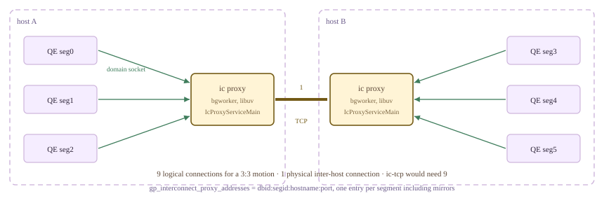

*ic-proxy 拓扑。跨两台主机的 3:3 Motion 仍有 9 条逻辑连接，但只有一条主机间 TCP 连接。后端通过 Unix 域套接字连接本机代理。*

实现上，代理位于 ic-tcp *下方*，所以 `proxy_ipc_layer` 复用了全部 TCP 方法。`SetupInterconnectTCP` 进入 `#ifdef ENABLE_IC_PROXY` 分支（`ic_tcp.c` — `SetupTCPInterconnect()`），将连接集合交给 `ic_proxy_backend_run_loop`；后者把域套接字文件描述符绑定到 libuv 管道，再由普通 `ic_tcp` 收发代码驱动。代理进程本身是后台工作进程（`src/backend/cdb/motion/ic_proxy_bgworker.c`，42 行：`ICProxyMain` 只调用 `CurrentMotionIPCLayer->IcProxyServiceMain()`）。用 `--enable-ic-proxy` 构建时，三层的函数表都存在该槽，否则为 `NULL`。其流控又是第三种设计：TCP 背压和 udpifc 丢包机制都不适用，因为许多逻辑连接共享一条物理连接，而且包到达后不能再随意丢弃。因此，README 描述了显式的 `unackSendPkt`/`unackRecvPkt` 计数器、暂停和恢复阈值，以及发送方只能在数据包边界暂停的规则。

这里无法实际测试上述机制，需要准确说明原因。本服务器使用 `--enable-ic-proxy` 构建（`src/include/pg_config.h` 定义了 `ENABLE_IC_PROXY`），因此 `proxy` 是合法 GUC 值，连接也能建立。但本集群没有 `ic proxy process`，`gp_interconnect_proxy_addresses` 为空。因此，包含 Motion 的查询不会立即失败，而是永远等待一个不会回应的代理：

*`proxy` 被接受，随后在建立过程中阻塞。可用 `statement_timeout` 限制等待并观察结果。*

```bash
PGOPTIONS='-c gp_interconnect_type=proxy' psql -p 7100 -d postgres
  -c "show gp_interconnect_type;"
  -c "set statement_timeout='15s'; select count(*) from m195_fact;"
```

```text {hl_lines="3 7" title="output"}
 gp_interconnect_type 
----------------------
 proxy
(1 row)

SET
ERROR:  canceling statement due to statement timeout
```

> [!NOTE]
> 代理缺失还有第二个更有意思的原因，每次 postmaster 启动时都能在 Coordinator 日志中看到：`background worker "ic proxy process": background workers without shared memory access are not supported`（`bgworker.c` — `SanityCheckBackgroundWorker()`）。`postmaster.c` 的 `PMAuxProcList` 条目声明 `bgw_flags = 0`，而 PostgreSQL 16 已移除对不访问共享内存的后台工作进程的支持。因此，在这份基于 PG16 的源码树中，代理工作进程在读取 `gp_interconnect_proxy_addresses` 之前，就已**在注册时被拒绝**。配置地址也无济于事。**本节未能在集群上测试 ic-proxy**，以上内容均来自源码和 README，只有下面一项测量来自完全不同的环境。

### 19.5.8 传输实现有自己的测试框架 {#1958-the-transport-has-a-test-harness-of-its-own}

将 Interconnect 从后端拆出，带来了 README 首先列出的好处：“测试、调试和基准测试更加方便。”`contrib/interconnect/test/` 是一个 CMake 项目，将*真实的* `ic_common.c`、`ic_tcp.c`、`ic_udpifc.c` 和全部十二个代理文件，与模拟后端一起编译。`elog_mock.c`（1024 行）提供错误子系统的桩实现，`ic_test_env.c`（411 行）模拟 `EState` 和查询切片表，`ic_interface_test.c`（345 行）通过 cmockery 驱动函数表，`ic_bench.c`（704 行）派生客户端和服务器，在固定时长内通过选定的 `MotionIPCLayer` 推送元组。数据库中能找到无需数据库即可测试的传输实现，并不常见。

它无法直接在当前源码树中编译：有四个错误，都在 `elog_mock.c`，也都属于同类接口漂移。PG16 的 `utils/elog.h` 已将 `write_csvlog`、`write_pipe_chunks` 和 `error_severity` 声明为 `extern`，而模拟实现仍声明为 `static`；`errdetail` 现在返回 `int`，模拟实现却返回 `void`。所有 Interconnect 和代理源文件都能正常编译。在源码树外的副本中修正这四处声明，就足以运行 `ic_bench`：

*在集群外运行 `ic_bench`，单客户端加单服务器，持续 10 秒，默认 MTU 1500，缓冲区 200 字节。包括本集群无法运行的 proxy 传输。*

```bash
# out-of-tree build of contrib/interconnect/test with the four elog_mock.c
# declarations reconciled with PG16's elog.h
./ic_bench -t 0 -i 10   # tcp
./ic_bench -t 1 -i 10   # udpifc
./ic_bench -t 2 -i 10   # proxy
```

```text {hl_lines="6" title="output"}
##### -t 0  tcp #####            ##### -t 1  udpifc #####         ##### -t 2  proxy #####
| Total time(s) |  10.000 |      | Total time(s) |  10.178 |      | Total time(s) |  10.000 |
| Loop times    | 2695493 |      | Loop times    |   37216 |      | Loop times    |  927160 |
| LPS(l/ms)     | 269.548 |      | LPS(l/ms)     |   3.657 |      | LPS(l/ms)     |  92.718 |
| Recv mbs      |    3670 |      | Recv mbs      |      43 |      | Recv mbs      |    1262 |
| TPS(mb/s)     | 367.084 |      | TPS(mb/s)     |   4.268 |      | TPS(mb/s)     | 126.267 |
| Recv counts   |18868451 |      | Recv counts   |  223296 |      | Recv counts   | 6490120 |
| Items ops/ms  |1886.838 |      | Items ops/ms  |  21.939 |      | Items ops/ms  | 649.024 |
```

TCP 领先 86 倍，看起来惊人，但这个基准*恰好*采用了 udpifc 机制无法发挥优势的配置，[§19.5.5](#1955-udpifc-flow-control-and-where-a-motion-sender-blocks) 已能推导其表现。一个客户端加一个服务器意味着一条逻辑连接，即 R = 1：`snd_buffer_pool.maxCount` = 2，`cwnd` 达到 2，`cwnd − minCwnd` = 1。发送方最多允许两个 1408 字节数据报在途，随后必须逐包等待确认，并对每个包计算 CRC。基于丢包的流控退化为近似停等协议。测试框架的 README 在另一套硬件上也报告了相同趋势：tcp 654、proxy 156、udpifc 5.0 MB/s，并附上恰当的限定：“较低 TPS 不代表协议更慢，也可能意味着协议占用的 CPU 时间较少……它满足 cbdb 要求的最高 TPS，同时比其他 Interconnect 类型占用更少 CPU。”udpifc 并非为单条流优化，而是为了让十万条流不耗尽机器的文件描述符。再考虑 `--enable-cassert` 构建，这些数据只代表一种合成负载下各传输实现的比例，仅此而已。

函数表带来的能力现在已经清楚：传输实现可以按连接选择，无需重启；实现可以存在于源码树并自行注册，未编译时直接缺席（`udp2`）；某个实现的后台工作进程可以因 PostgreSQL 升级而失效，却不影响另外两个可用实现（`proxy`）；传输实现还可以完全脱离集群编译、链接和执行基准测试。同一边界上还有反向作用的唯一向上接口：`GetMaxTupleChunkSize`，让网络层告诉执行器，一个元组片段最多可以多大。今天是 8100 字节，因为前面必须容纳 88 字节头部。Interconnect 的最后一部分，是网络直接暴露给*客户端*而非另一个执行器的特例，见 [§19.6](#196-parallel-retrieve-cursor--endpoint)。

*清理。本节所有传输切换都通过逐连接的 `PGOPTIONS` 或会话级 `SET` 完成，没有修改持久化 GUC，集群保持原状。*

```sql
drop table if exists m195_fact;
drop table if exists m195_dim;
drop table if exists m195_wide;
select relname from pg_class where relname like 'm195%';
show gp_interconnect_type;
```

```text {hl_lines="7" title="output"}
 relname 
---------
(0 rows)

 gp_interconnect_type 
----------------------
 udpifc
(1 row)
```

## 19.6 并行检索游标与端点 {#196-parallel-retrieve-cursor--endpoint}

本手册中的每份计划此前都以同样方式结束：三个 Segment 并行扫描、连接和聚合，然后通过 `Gather Motion 3:1` 将全部结果汇入一个进程，即 QD，再由它写入一个客户端套接字（[§13.1](/cloudberry/core-internals/part-4-query-processing/ch13/#131-the-simple-query-protocol)）。多数工作负载中，这个汇集口没有明显成本，因为真正需要的行很少。但客户端若需要*十亿*行，例如向 Spark 供数的连接器、机器学习训练加载器或批量导出，集群产生结果的速度就可能比单个 Coordinator 进程转发结果快数倍。第 [18](/cloudberry/core-internals/part-4-query-processing/ch18/) 章和第 19 章的 N 路机制，最终只剩单通道出口。

**并行检索游标**移除了这个汇集口。计划刻意保持**不汇集**：顶部不添加 Motion，每个 QE 保留自己的那部分结果，将元组暂存到**端点（endpoint）**中，即 Segment 自身地址空间内的小型共享内存队列。随后 N 个客户端连接分别附着到 N 个 Segment，并发拉取。这是 Cloudberry 中普通客户端能够直接作为正式客户端与 Segment 通信的唯一场景，也适合作为数据传输章节的结尾：这里让 Interconnect *退出了最终数据路径*。

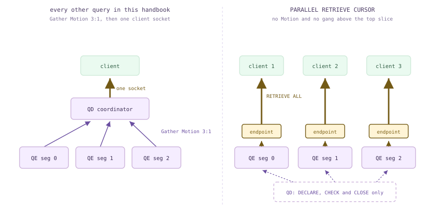

*汇集瓶颈及绕行路径。左侧是本手册其他查询的形态：三个发送方、一个接收方、一个套接字。右侧是并行检索游标：元组留在产生它们的位置，每个 Segment 持有一个端点，Coordinator 只保留控制职责。*

### 19.6.1 声明游标，以及有所缺失的计划 {#1961-declaring-one-and-the-plan-that-is-missing-something}

并行检索游标的声明与普通游标类似，但它**必须位于显式事务中**，且名称在该事务内唯一。这不只是管理上的要求：持有端点的 QE 就是该事务的进程组，持有的元组属于该事务的快照（[§10.5](/cloudberry/core-internals/part-3-transactions-mvcc-concurrency/ch10/#105-distributed-snapshots--the-distributed-log)）。事务一结束，结果就消失，这也是 `WITH HOLD` 被直接拒绝的原因（`analyze.c:3409`）。演示表包含分布在三个 Segment 上的九行：

*九行数据，按哈希分布。记住哪些 id 位于 Segment 0，稍后将手动从该 Segment 取出它们。*

```sql
CREATE TABLE m196_t (id int, v text) DISTRIBUTED BY (id);
INSERT INTO m196_t SELECT g, 'v'||g FROM generate_series(1,9) g;
SELECT gp_segment_id, count(*), string_agg(id::text, ',' ORDER BY id)
  FROM m196_t GROUP BY 1 ORDER BY 1;
```

```text {hl_lines="3" title="output"}
 gp_segment_id | count | string_agg
---------------+-------+------------
             0 |     5 | 2,3,4,7,8
             1 |     1 | 1
             2 |     3 | 5,6,9
(3 rows)
```

`EXPLAIN` 接受 `DECLARE` 本身，这是本节信息量最大的观察。将游标计划与同一个 `SELECT` 作为普通语句运行时的计划比较：

*游标计划与普通计划并排比较。前者少了两样东西：Gather Motion 和切片 0。*

```sql
BEGIN;
EXPLAIN (COSTS OFF, SLICETABLE ON) DECLARE c PARALLEL RETRIEVE CURSOR FOR SELECT * FROM m196_t;
ROLLBACK;
EXPLAIN (COSTS OFF, SLICETABLE ON) SELECT * FROM m196_t;
```

```text {hl_lines="5" title="output"}
BEGIN
                   QUERY PLAN
-------------------------------------------------
 Seq Scan on m196_t
 Endpoint: on all 3 segments
 Slice 0: Reader; root 0; parent -1; gang size 3
 Optimizer: Postgres query optimizer
(4 rows)

ROLLBACK
                     QUERY PLAN
-----------------------------------------------------
 Gather Motion 3:1  (slice1; segments: 3)
   ->  Seq Scan on m196_t
 Slice 0: Dispatcher; root 0; parent -1; gang size 0
 Slice 1: Reader; root 0; parent 0; gang size 3
 Optimizer: GPORCA
(5 rows)
```

并排阅读查询切片表（记法见 [§19.3](#193-slice-tables--planslice--gang-mapping)）。普通查询有两个切片：切片 0 是 *Dispatcher*，即 QD 自身，进程组大小为 0；切片 1 是向它供数的三个读取进程组成的组。游标只有**一个**切片，它是 `parent -1` 的 `Reader`，即读取进程组*本身就是*根。其上没有进程组，Interconnect 也就没有需要连接的对象（[§19.2](#192-the-dispatcher-gangs--async-dispatch)、[§19.5](#195-interconnect-implementations)）。额外的 `Endpoint:` 行由 `ExplainParallelRetrieveCursor`（`explain_gp.c`）打印。

第二处差异是优化器行：`GPORCA` 变成 `Postgres query optimizer`。这不是该查询的巧合，`CURSOR_OPT_PARALLEL_RETRIEVE` 正是 [§17.1](/cloudberry/core-internals/part-4-query-processing/ch17/#171-entry--dispatch) 所分析的入口判断条件之一，因此并行检索游标**始终**由 PostgreSQL 规划器规划。显式设置 `optimizer=on` 也无济于事，因为判断依据是游标选项，而不只是这个 GUC。

```c {title="src/backend/optimizer/plan/planner.c — standard_planner()"}
	if (optimizer &&
		GP_ROLE_DISPATCH == Gp_role &&
		IS_QUERY_DISPATCHER() &&
		(cursorOptions & CURSOR_OPT_SKIP_FOREIGN_PARTITIONS) == 0 &&
		(cursorOptions & CURSOR_OPT_PARALLEL_RETRIEVE) == 0)
	{
```

缺少 Gather 只由一个 `if` 决定。`planner.c` 的 `standard_planner()` 将选项记录为 `glob->is_parallel_cursor`；通常会在最便宜路径上附加 Motion-to-Entry 的位置，先检查这个标志。没有那次调用，就根本不会添加 Motion，顶层切片保持查询产生的分布位置（[§16.1](/cloudberry/core-internals/part-4-query-processing/ch16/#161-the-locus-model-cdbpathlocus)）。

```c {title="src/backend/cdb/cdbllize.c — cdbllize_adjust_top_path()"}
		if (query->commandType == CMD_SELECT || query->returningList)
		{
			if (!root->glob->is_parallel_cursor)
			{
				/*
				 * Query result needs to be brought back to the QD. Ask for
				 * a motion to bring it in. ...
```

因此，`DECLARE` 派发的计划会执行，然后*握着元组停下来*。各 QE 上的执行器识别出并行检索游标的根切片，用 `CreateTupleQueueDestReceiver` 创建 **64 KB 的 `shm_mq`**，即 PostgreSQL 并行工作进程之间使用的同一种元组队列，[§18.2](/cloudberry/core-internals/part-4-query-processing/ch18/#182-scan-nodes) 曾从另一侧介绍过它；接着在共享 `sharedEndpoints[]` 数组中占用一个槽，共 1024 槽（`cdbendpoint_private.h` — `MAX_ENDPOINT_SIZE`），然后才发出确认（`execMain.c` — `standard_ExecutorRun()`，`cdbendpoint.c` — `SetupEndpointExecState()`）。QD 的 `DECLARE` 要等全部确认到达才返回，由 `portalcmds.c` 的 `PerformCursorOpen()` 中的 `WaitEndpointsReady` 等待。握手过程如下：

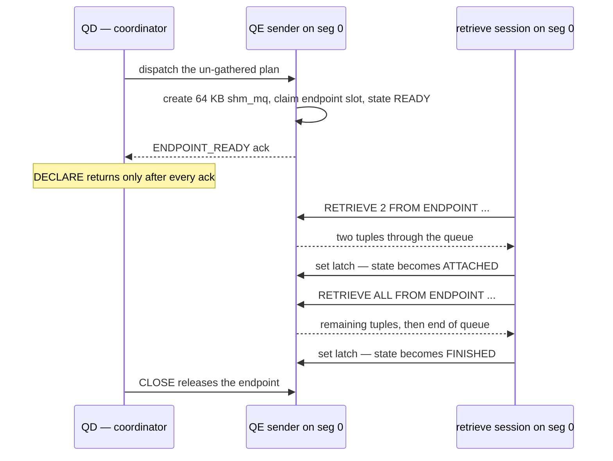

*声明、检索、释放。QE 发送方从不直接写套接字，而是写入 64 KB 队列，队列满时阻塞，与 Motion 发送方在发送队列满时阻塞完全一样（[§19.4](#194-motion-nodes)）。因此，事务必须保持打开。*

### 19.6.2 端点落在哪里 {#1962-where-the-endpoints-land}

游标得到多少端点、端点在哪里，完全由**计划顶部的分布位置**决定，再次使用 [§16.1](/cloudberry/core-internals/part-4-query-processing/ch16/#161-the-locus-model-cdbpathlocus) 的分布位置代数。`adjust_top_path_for_parallel_retrieve_cursor` 将分布位置转换为顶层切片的进程组类型，`GetParallelCursorEndpointPosition`（`cdbendpoint.c`）再将其转换为 `EXPLAIN` 打印的四类位置。

```c {title="src/backend/cdb/cdbllize.c — adjust_top_path_for_parallel_retrieve_cursor()"}
	if (CdbPathLocus_IsSingleQE(path->locus)
		|| CdbPathLocus_IsGeneral(path->locus)
		|| CdbPathLocus_IsEntry(path->locus))
	{
		slice->numsegments = 1;
		slice->gangType = GANGTYPE_ENTRYDB_READER;
	}
	else if (CdbPathLocus_IsSegmentGeneral(path->locus))
	{
		/* queries to replicated table run on a single segment. */
		slice->segindex = gp_session_id % path->locus.numsegments;
		slice->gangType = GANGTYPE_SINGLETON_READER;
	}
```

| 游标查询 | 计划顶部 | EXPLAIN 的 Endpoint 输出 | 端点 |
| --- | --- | --- | --- |
| SELECT * FROM m196_t | Seq Scan | on all 3 segments | 3 个，每个 Segment 一个 |
| … WHERE id = 1 | Seq Scan + Filter，直接派发 | on segments: contentid [1] | 1 个，只在 Segment 1 |
| … WHERE id IN (1,5) | Seq Scan + Filter，直接派发 | on segments: contentid [1, 2] | 2 个 |
| SELECT * FROM m196_r（复制表） | Seq Scan | on segment: contentid [n] | 1 个，位于 gp_session_id % 3 |
| SELECT 1 | Result | on coordinator | 1 个，位于 Coordinator |
| SELECT relname FROM pg_class LIMIT 3 | Limit + Seq Scan | on coordinator | 1 个 |
| SELECT * FROM m196_t ORDER BY id | Gather Motion 3:1，Merge Key: id | on coordinator | 1 个 |
| SELECT count(*) FROM m196_t | Gather Motion 上方的 Finalize Aggregate | on coordinator | 1 个 |

直接派发的两行最直观：`WHERE id = 1` 上的游标恰好获得一个端点，位于唯一可能保存该哈希值的 Segment（[§16.4](/cloudberry/core-internals/part-4-query-processing/ch16/#164-distributed-grouping--direct-dispatch)）。复制表则略特殊：它存在于*每个* Segment，因此规划器必须选一个，选择方式为 `gp_session_id % numsegments`。连续三个会话因此轮流落在集群的不同 Segment 上：

*在三个新的 Coordinator 会话中声明同一个游标。会话 145、146、147 分别落在 Segment 1、2、0；会话 ID 也出现在端点名称中间。*

```sql
-- run three times, in three separate psql sessions
BEGIN;
DECLARE m196_cr PARALLEL RETRIEVE CURSOR FOR SELECT * FROM m196_r;
SELECT current_setting('gp_session_id') AS sess, gp_segment_id, endpointname
  FROM gp_session_endpoints;
ROLLBACK;
```

```text {hl_lines="3" title="output"}
 sess | gp_segment_id |      endpointname
------+---------------+-------------------------
 145  |             1 | m196_cr0000009100000002
(1 row)

 sess | gp_segment_id |      endpointname
------+---------------+-------------------------
 146  |             2 | m196_cr0000009200000002
(1 row)

 sess | gp_segment_id |      endpointname
------+---------------+-------------------------
 147  |             0 | m196_cr0000009300000002
(1 row)
```

> [!NOTE]
> 表格最后四行说明了这项功能的实际边界：**并非总能生成不汇集的计划。** 全局 `ORDER BY`、`LIMIT`、最终聚合，凡是顶层节点必须在单个进程中看到全部 Segment 行的操作，仍以 `Gather Motion 3:1` 结束。此时，端点建立在元组已经汇集到的 *Coordinator 上*。这种游标仍完全可用，但只有一个端点，瓶颈仍在 Coordinator；能获得的并行度取决于计划的分布位置，`cdbendpoint.h` 的头部注释也明确如此说明。应将此功能用于结果能够保持分布的查询。

*计划以归并 Gather 结束的游标：一个端点，gp_segment_id 为 -1，端口 7100。可以从 Coordinator 检索，九行全部有序返回，但没有任何并行检索。*

```sql
BEGIN;
DECLARE m196_ord PARALLEL RETRIEVE CURSOR FOR SELECT id FROM m196_t ORDER BY id;
SELECT gp_segment_id, hostname, port, state, endpointname FROM gp_session_endpoints;

-- in another shell, against the COORDINATOR port:
--   PGPASSWORD=<token> PGOPTIONS='-c gp_retrieve_conn=true' --     psql -h cbdb-node1 -p 7100 -d postgres -c 'RETRIEVE ALL FROM ENDPOINT m196_ord0000004000000021'
```

```text {hl_lines="3" title="output"}
 gp_segment_id |  hostname  | port | state |       endpointname
---------------+------------+------+-------+--------------------------
           -1 | cbdb-node1 | 7100 | READY | m196_ord0000004000000021
(1 row)

 id
----
  1
  2
  3
  4
  5
  6
  7
  8
  9
(9 rows)
```

### 19.6.3 三个视图、一个名称与一个令牌 {#1963-three-views-a-name-and-a-token}

端点不是系统目录行，而是共享内存槽，通过三个函数及其包装视图暴露。**`gp_endpoints`** 在 Coordinator 上运行并执行派发，显示各会话的*全部*端点：超级用户可见全部，普通用户只见自己的；客户端驱动通过它获知连接位置。**`gp_session_endpoints`** 是按调用会话过滤的相同数据，程序用它寻找*自己的*游标。**`gp_segment_endpoints`** 则不同：由被查询的后端在本地回答，因此要通过 `gp_role=utility` 连接查询某个 Segment，并额外提供两个重要进程 ID：`senderpid` 是持有元组的 QE，`receiverpid` 是检索会话，无人附着时为 `-1`。

*从三个角度观察相同的三个端点。注意第二个查询：在无关会话中，gp_session_endpoints 为空，即使该用户是能够通过 gp_endpoints 看到全部三行的超级用户。*

```sql
-- (1) an unrelated coordinator session, while the cursor's transaction is open elsewhere
SELECT gp_segment_id, cursorname, sessionid, hostname, port, username, state, endpointname
  FROM gp_endpoints ORDER BY 1;

-- (2) the same session, asking about its own endpoints
SELECT count(*) AS rows_visible FROM gp_session_endpoints;

-- (3) a utility connection straight to segment 0
--   PGOPTIONS='-c gp_role=utility' psql -p 7102 -d postgres
SELECT senderpid, receiverpid, state, gp_segment_id, sessionid, username, endpointname, cursorname
  FROM gp_segment_endpoints;
```

```text {hl_lines="10" title="output"}
 gp_segment_id | cursorname | sessionid |  hostname  | port | username | state |       endpointname
---------------+------------+-----------+------------+------+----------+-------+--------------------------
             0 | m196_prc   |        18 | cbdb-node1 | 7102 | gpadmin  | READY | m196_prc0000001200000003
             1 | m196_prc   |        18 | cbdb-node1 | 7103 | gpadmin  | READY | m196_prc0000001200000003
             2 | m196_prc   |        18 | cbdb-node1 | 7104 | gpadmin  | READY | m196_prc0000001200000003
(3 rows)

 rows_visible
--------------
            0
(1 row)

 senderpid | receiverpid | state | gp_segment_id | sessionid | username |       endpointname       | cursorname
-----------+-------------+-------+---------------+-----------+----------+--------------------------+------------
     13060 |          -1 | READY |             0 |        18 | gpadmin  | m196_prc0000001200000003 | m196_prc
(1 row)
```

**端点名称**在所有 Segment 上相同，因为它由所有 QE 共享的数据生成。`generate_endpoint_name`（`cdbendpointutils.c`）拼接游标名、以 8 位十六进制表示的 `gp_session_id`，以及另 8 位十六进制的 `gp_command_count`。例如，`m196_prc0000001200000003` 可解析为游标 `m196_prc`、会话 `0x12` = 18、命令 `3`。名称足够唯一，因此同一会话中删除后重新声明同名游标，也不会与旧端点混淆。（`cdbendpoint_private.h` 的注释仍称第三部分为 Segment 索引，但其后相关提交的代码已使用 `gp_command_count`；应以代码为准。）

**认证令牌**允许外部连接接入。它由 `pg_strong_random` 生成 16 字节，在每个 QE 上按会话缓存（`cdbendpoint.c` — `create_endpoint_token()`），表示为 32 个十六进制字符。由于各 Segment 独立生成，它的粒度是 **（会话，Segment）**：同一游标在不同 Segment 上令牌不同，同一会话在同一 Segment 上的*所有*游标则共用令牌：

*同一事务中声明两个游标。六个端点，但只有三个不同令牌：一个令牌授权的是某个 Coordinator 会话在某个 Segment 上的检索会话，而不是单个游标。*

```sql
BEGIN;
DECLARE ca PARALLEL RETRIEVE CURSOR FOR SELECT id FROM m196_t;
DECLARE cb PARALLEL RETRIEVE CURSOR FOR SELECT id+1 FROM m196_t;
SELECT gp_segment_id, cursorname, auth_token FROM gp_session_endpoints ORDER BY 1,2;
```

```text {hl_lines="3 4" title="output"}
 gp_segment_id | cursorname |            auth_token
---------------+------------+----------------------------------
             0 | ca         | 8223ca4ca2b997d62d3c9cc4c78cbc1b
             0 | cb         | 8223ca4ca2b997d62d3c9cc4c78cbc1b
             1 | ca         | d2787bf004868e259316ff6bee482de9
             1 | cb         | d2787bf004868e259316ff6bee482de9
             2 | ca         | cae8681dc9c8e8309c5970df01803134
             2 | cb         | cae8681dc9c8e8309c5970df01803134
(6 rows)
```

令牌作为**密码**提供，这也是该功能一个容易让人意外的安全特性：检索连接完全不查询 `pg_hba.conf`。`ClientAuthentication` *首先*检查 `gp_retrieve_conn` 选项，在任何 HBA 查找之前返回。它只检查角色名是否等于游标所有者、令牌是否匹配本 Segment 上该角色某个存活端点的令牌，以及角色是否允许登录。

```c {title="src/backend/libpq/auth.c — ClientAuthentication()"}
	retrieve_conn_authenticated = false;
	if (cmd_options_include_retrieve_conn(port->cmdline_options) ||
		guc_options_include_retrieve_conn(port->guc_options))
	{
		retrieve_conn_authentication(port);
		retrieve_conn_authenticated = true;
		return;
	}
```

### 19.6.4 实际检索 {#1964-actually-retrieving}

客户端在启动包中设置 GUC **`gp_retrieve_conn=true`** 进入检索模式：psql 使用 `PGOPTIONS`，连接串使用 `options`；目标是 *Segment 的*端口，密码为端点令牌。该 GUC 为 `PGC_BACKEND`（`guc_gp.c` — `config_bool`），只能在连接时设置；随后 `postinit.c` — `InitPostgres()` 为会话强制设置 `Gp_role = GP_ROLE_UTILITY`。这种后端被刻意限制：唯一允许解析的语句是 `RETRIEVE`（`gram.y`），通过 `analyze.c:331` 的一次异或检查实施。下面是真实连接 Segment 0 的会话，取出前面看到分布在其上的 id：

*检索模式的 psql 连接端口 7102，手动读完 Segment 0：先取 2 行，再取剩余 3 行，最后为空。与开头记录的数据分布比较：依次为 2、3、4、7、8，路径中没有 Coordinator。*

```bash
$ PGPASSWORD=$ENDPOINT_TOKEN PGOPTIONS='-c gp_retrieve_conn=true'     psql -h cbdb-node1 -p 7102 -d postgres

SELECT current_setting('gp_retrieve_conn'), current_setting('gp_role');
RETRIEVE 2 FROM ENDPOINT m196_prc0000001200000003;
RETRIEVE ALL FROM ENDPOINT m196_prc0000001200000003;
RETRIEVE ALL FROM ENDPOINT m196_prc0000001200000003;
```

```text {hl_lines="11" title="output"}
ERROR:  This is a retrieve connection, but the query is not a RETRIEVE.

 gp_segment_id | id | v
---------------+----+----
             0 |  2 | v2
             0 |  3 | v3
(2 rows)

 gp_segment_id | id | v
---------------+----+----
             0 |  4 | v4
             0 |  7 | v7
             0 |  8 | v8
(3 rows)

 gp_segment_id | id | v
---------------+----+---
(0 rows)
```

该会话停在两次 `RETRIEVE` 之间时，集群其他位置都能看到端点状态，Segment 本地视图也已填入接收方 pid：

*检索中途，从无关的 Coordinator 会话及 Segment 0 的 utility 连接观察。QD 只有主动查询时才获知状态。*

```sql
-- unrelated coordinator session
SELECT gp_segment_id, state, endpointname FROM gp_endpoints ORDER BY 1;
-- utility connection to segment 0
SELECT senderpid, receiverpid, state, endpointname FROM gp_segment_endpoints;
-- in the cursor's own session
SELECT gp_wait_parallel_retrieve_cursor('m196_prc', 0);
```

```text {hl_lines="3" title="output"}
 gp_segment_id |  state   |       endpointname
---------------+----------+--------------------------
             0 | ATTACHED | m196_prc0000001200000003
             1 | READY    | m196_prc0000001200000003
             2 | READY    | m196_prc0000001200000003
(3 rows)

 senderpid | receiverpid |  state   |       endpointname
-----------+-------------+----------+--------------------------
     13060 |       13311 | ATTACHED | m196_prc0000001200000003
(1 row)

 gp_wait_parallel_retrieve_cursor
----------------------------------
 f
(1 row)
```

另外两个进程同时连接另外两个端口，读完另外两个 Segment，这正是此功能的意义。三个队列全部到达流结束后，端点报告 `FINISHED`，`senderpid` 变为 `-1`，表示 QE 已完成发送；Coordinator 的 `gp_wait_parallel_retrieve_cursor` 则返回 true：

*两个独立客户端进程并发读取两个 Segment，随后查看 Coordinator 视图。九行经过网络，没有一行经过 Coordinator。*

```bash
$ PGPASSWORD=$T1 PGOPTIONS='-c gp_retrieve_conn=true' psql -h cbdb-node1 -p 7103 -d postgres     -c "RETRIEVE ALL FROM ENDPOINT m196_prc0000001200000003" &
$ PGPASSWORD=$T2 PGOPTIONS='-c gp_retrieve_conn=true' psql -h cbdb-node1 -p 7104 -d postgres     -c "RETRIEVE ALL FROM ENDPOINT m196_prc0000001200000003" &

-- then, on the coordinator:
SELECT gp_segment_id, state, endpointname FROM gp_endpoints ORDER BY 1;
SELECT gp_wait_parallel_retrieve_cursor('m196_prc', 0);
```

```text {hl_lines="22" title="output"}
 gp_segment_id | id | v
---------------+----+----
             1 |  1 | v1
(1 row)

 gp_segment_id | id | v
---------------+----+----
             2 |  5 | v5
             2 |  6 | v6
             2 |  9 | v9
(3 rows)

 gp_segment_id |  state   |       endpointname
---------------+----------+--------------------------
             0 | FINISHED | m196_prc0000001200000003
             1 | FINISHED | m196_prc0000001200000003
             2 | FINISHED | m196_prc0000001200000003
(3 rows)

 gp_wait_parallel_retrieve_cursor
----------------------------------
 t
(1 row)
```

`gp_wait_parallel_retrieve_cursor(name, timeout)` 是 Coordinator 唯一的进度查询接口：`0` 表示轮询，`-1` 阻塞直到全部读完；检索端的任何错误都会在这里重新抛出，而非悄悄丢失。必须在声明游标的事务中调用它。两次轮询之间，QD 上的后台超时检查 `enable_parallel_retrieve_cursor_check_timeout` 持续检查 QE 端故障。它报告的五种状态来自 `cdbendpoint.h` 中的 `EndpointState` 枚举：

| 状态 | 含义 | 设置位置 |
| --- | --- | --- |
| READY | 已分配槽并创建 64 KB 队列，尚无人附着 | QE 发送方的 alloc_endpoint |
| RETRIEVING | 一个 RETRIEVE 正在读取队列 | cdbendpointretrieve.c 中的 start_retrieve |
| ATTACHED | 已有一个检索会话占用，但尚未读到末尾 | 按数量 RETRIEVE 后的 finish_retrieve |
| FINISHED | 队列已读到流结束 | 队列 EOF 时的 finish_retrieve |
| RELEASED | 检索方在完成前失败或消失，禁止再次附着 | cdbendpointretrieve.c 中的 retrieve_cancel_action |

### 19.6.5 使用规则与违反规则的后果 {#1965-the-rules-and-what-breaks-them}

这项功能约束非常严格，错误信息也十分清楚。一个端点只能由**一个**检索会话附着，`receiverPid` 是单个字段，而非列表。一旦该会话读完端点，其他会话就不能再访问它，但拥有它的会话可以继续发出 `RETRIEVE`，得到空结果。QD 端拒绝 `FETCH` 和 `MOVE`；解析时拒绝 `SCROLL` 和 `WITH HOLD`。下面每条都是此集群的真实输出：

*六种错误用法。DETAIL 行来自 validate_retrieve_endpoint（cdbendpointretrieve.c），值得仔细阅读，因为连接器会遇到所有这些情况。*

```sql
-- a second retrieve session, while the first is still ATTACHED
RETRIEVE ALL FROM ENDPOINT m196_prc0000001200000003;
-- a new session, after the endpoint was drained by another one
RETRIEVE ALL FROM ENDPOINT m196_prc0000001200000003;
-- a name nobody ever declared
RETRIEVE ALL FROM ENDPOINT m196_nosuch;
-- a RETRIEVE in a plain utility connection (no gp_retrieve_conn)
RETRIEVE ALL FROM ENDPOINT m196_prc0000001200000003;
-- a retrieve-mode connection with a token that is not a live endpoint's
psql -h cbdb-node1 -p 7102 ...
-- on the coordinator, in the declaring transaction
FETCH 1 FROM m196_prc;
DECLARE c SCROLL PARALLEL RETRIEVE CURSOR FOR SELECT 1;
DECLARE c PARALLEL RETRIEVE CURSOR WITH HOLD FOR SELECT 1;
DECLARE c PARALLEL RETRIEVE CURSOR FOR SELECT id FROM m196_t;   -- outside a transaction
```

```text {hl_lines="13" title="output"}
ERROR:  endpoint m196_prc0000001200000003 was already attached by receiver(pid: 13311)
DETAIL:  An endpoint can only be attached by one retrieving session.

ERROR:  another session (pid: 13311) used the endpoint and completed retrieving

ERROR:  the endpoint m196_nosuch does not exist for session id 18

ERROR:  This is not a retrieve connection, but the query is a RETRIEVE.

psql: error: connection to server at "cbdb-node1" (10.100.0.3), port 7102 failed:
FATAL:  Authentication failure (Wrong password or no endpoint for the user)

ERROR:  cannot specify 'FETCH' for PARALLEL RETRIEVE CURSOR
HINT:  Use 'RETRIEVE' statement on endpoint instead.

ERROR:  SCROLL is not allowed for the PARALLEL RETRIEVE CURSORs
DETAIL:  Scrollable cursors can not be parallel

ERROR:  DECLARE PARALLEL RETRIEVE CURSOR WITH HOLD ... is not supported
DETAIL:  Holdable cursors can not be parallel

ERROR:  DECLARE CURSOR can only be used in transaction blocks
```

最有说明力的故障是**客户端在检索中途离开**：部分读完的端点不能直接遗留，因为其 QE 仍可能阻塞在无人再读的队列上。因此，检索后端的退出回调会访问端点槽，将它标记为 `RELEASED`，并以自定义消息取消发送方。该错误会在 *Coordinator* 下一次查询进度时暴露。

*客户端从 Segment 0 检索一行后断开。Segment 0 上的端点变为 RELEASED，另外两个暂未受影响，但整个游标已经无法继续：Coordinator 下一次检查会中止事务，一并释放另外两个端点。*

```bash
$ PGPASSWORD=$T0 PGOPTIONS='-c gp_retrieve_conn=true' psql -h cbdb-node1 -p 7102 -d postgres     -c "RETRIEVE 1 FROM ENDPOINT m196_prc20000004000000003"      -- then exits

SELECT gp_segment_id, state, endpointname FROM gp_endpoints ORDER BY 1;
-- and in the declaring session:
SELECT gp_wait_parallel_retrieve_cursor('m196_prc2', 0);
CLOSE m196_prc2;
```

```text {hl_lines="8" title="output"}
 gp_segment_id | id
---------------+----
             0 |  2
(1 row)

 gp_segment_id |  state   |       endpointname
---------------+----------+---------------------------
             0 | RELEASED | m196_prc20000004000000003
             1 | READY    | m196_prc20000004000000003
             2 | READY    | m196_prc20000004000000003
(3 rows)

ERROR:  canceling MPP operation: "Endpoint retrieve session is quitting. All unfinished
parallel retrieve cursors on the session will be terminated."  (seg0 10.100.0.3:7102 pid=15994)
ERROR:  current transaction is aborted, commands ignored until end of transaction block
```

```c {title="src/backend/cdb/endpoint/cdbendpointretrieve.c — retrieve_cancel_action()"}
	if (endpoint != NULL &&
		endpoint->receiverPid == MyProcPid &&
		endpoint->state != ENDPOINTSTATE_FINISHED)
	{
		endpoint->receiverPid = InvalidPid;
		endpoint->state = ENDPOINTSTATE_RELEASED;
		if (endpoint->senderPid != InvalidPid)
		{
			SetBackendCancelMessage(endpoint->senderPid, msg);
			kill(endpoint->senderPid, SIGINT);
		}
	}
```

正常结束方式是 `CLOSE` 或事务结束。两者都会立即释放游标的全部端点，并取消正在进行的 `RETRIEVE`。在此之前，QE 一直持有元组等待；`DestroyEndpointExecState` 被刻意阻塞，让 Coordinator 在查询结束后仍能检查状态（`cdbendpoint.c`）。

*分别通过 CLOSE 和 COMMIT 释放。三个端点同步变为零个。*

```sql
BEGIN;
DECLARE m196_prc3 PARALLEL RETRIEVE CURSOR FOR SELECT id FROM m196_t;
SELECT count(*) AS endpoints FROM gp_endpoints WHERE cursorname='m196_prc3';
CLOSE m196_prc3;
SELECT count(*) AS endpoints FROM gp_endpoints WHERE cursorname='m196_prc3';
COMMIT;
```

```text {hl_lines="10" title="output"}
DECLARE PARALLEL RETRIEVE CURSOR
 endpoints
-----------
         3
(1 row)

CLOSE CURSOR
 endpoints
-----------
         0
(1 row)

COMMIT
```

### 19.6.6 与其他机制的关系，以及第三部分的收尾 {#1966-where-it-sits-and-the-end-of-part-iii}

将这些机制与本章其余内容对照，会发现形态十分熟悉。拥有端点的 QE 所做的事，与 Motion 发送方完全一样（[§19.4](#194-motion-nodes)）：执行一个切片，将元组推入有界队列，队列满时阻塞。因此，检索客户端停滞也会让 Segment 进程停滞，这种耦合与其他地方需要 `ExecSquelchNode` 和 `prefetch_inner` 的原因相同（[§18.1](/cloudberry/core-internals/part-4-query-processing/ch18/#181-executor-framework--lifecycle)、[§18.4](/cloudberry/core-internals/part-4-query-processing/ch18/#184-join-nodes)）。改变的是两端：*接收方*不再是对等 QE，而是独立的客户端进程；最后一跳因此是 Segment 自身共享内存中的 64 KB `shm_mq`，而非穿过 Interconnect 的 UDP 或 TCP 路由（[§19.5](#195-interconnect-implementations)）。可插拔 IPC 层完全不参与最后这一跳。顶层切片上方也没有进程组，所以派发器（[§19.2](#192-the-dispatcher-gangs--async-dispatch)）只保留控制职责：`DECLARE`、`CHECK`、`CLOSE`。

这些收益值得增加客户端复杂度吗？很少值得手工操作，因为此功能实际上面向**连接器**。必须有程序枚举 `gp_endpoints`，为每个端点向正确的主机和端口打开连接，提供正确令牌，同步推进 N 个游标，并处理任一工作进程死亡导致整个事务失败的情况。这是库应承担的工作，`src/test/examples/test_parallel_retrieve_cursor_*.c` 中的两个示例程序正是这种库的缩影。当消费者是分布式计算框架，已经有 N 台主机上的 N 个工作进程，例如 Spark、Flink 或训练数据加载器，让其并行度与集群匹配，就能将 Coordinator 从瓶颈变成控制通道。如果消费者只是最终仍要逐行迭代的单个进程，普通 `Gather Motion` 原本就不是瓶颈。

> [!NOTE]
> **第三部分到此结束。** 第 [15](/cloudberry/core-internals/part-4-query-processing/ch15/) 至 [17](/cloudberry/core-internals/part-4-query-processing/ch17/) 章构建计划并切分查询切片，第 [18](/cloudberry/core-internals/part-4-query-processing/ch18/) 章执行节点，本章在运行它们的进程之间传递元组，并在最后一节让这些元组无需再经汇集传输。还有一个问题尚未回答：第三部分分配的每个进程组、每条 Motion 队列和每个端点，似乎都假设我们独占整台机器，事实并非如此。**第 [21](/cloudberry/core-internals/part-6-resource-management/ch21/) 章**将讨论谁能使用多少资源：资源组、队列，以及决定哪些计划可以运行的资源计量。
