<!--
  Licensed to the Apache Software Foundation (ASF) under one
  or more contributor license agreements.  See the NOTICE file
  distributed with this work for additional information
  regarding copyright ownership.  The ASF licenses this file
  to you under the Apache License, Version 2.0 (the
  "License"); you may not use this file except in compliance
  with the License.  You may obtain a copy of the License at

    http://www.apache.org/licenses/LICENSE-2.0

  Unless required by applicable law or agreed to in writing,
  software distributed under the License is distributed on an
  "AS IS" BASIS, WITHOUT WARRANTIES OR CONDITIONS OF ANY
  KIND, either express or implied.  See the License for the
  specific language governing permissions and limitations
  under the License.
-->

<a id="20-high-availability--recovery"></a>

## 20.1 概述与恢复基础 {#201-overview--recovery-foundations}

### 20.1.1 两个故障域，共用一种预写式日志 {#2011-two-failure-domains-one-write-ahead-log}

Cloudberry 在两个相互独立的平面消除单点故障。**控制平面**由 Coordinator 和热备的 **Standby Coordinator** 组成；**数据平面**中的每个主 Segment 都配有一个**镜像**。两个平面都使用同一种 PostgreSQL 预写式日志，通过流复制传输。不过，Cloudberry 在此基础上增加了两个 MPP 特有的组件：决定*何时*进行故障切换的集群级故障检测器（**FTS**），以及能够处理*分布式*（两阶段）事务而不只是本地事务的恢复路径。

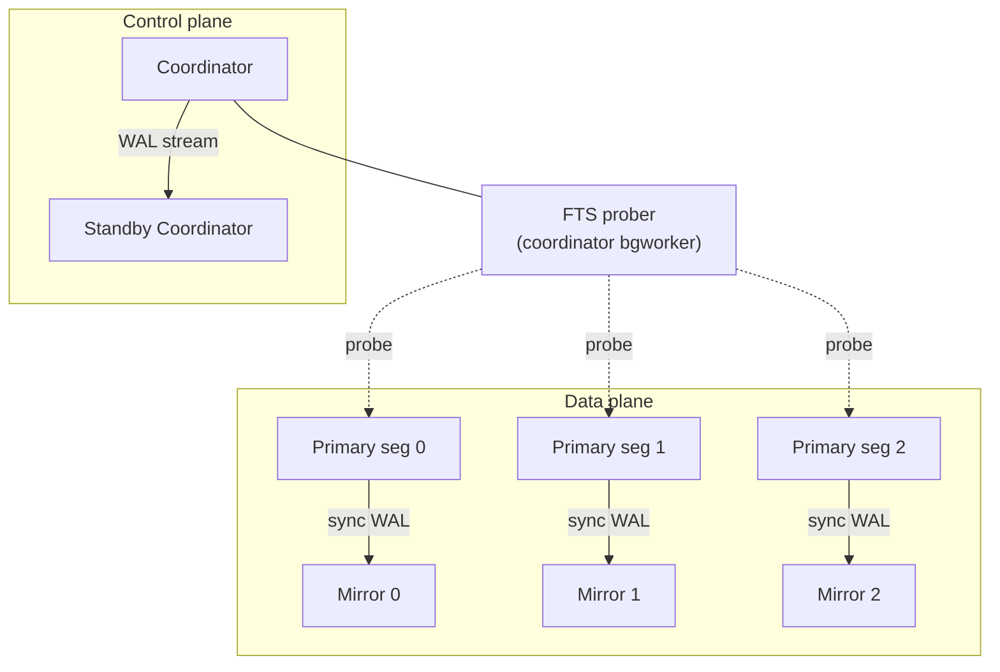

*集群高可用拓扑：每个主实例都有通过 WAL 流复制保持同步的镜像；Coordinator 上的 FTS 在每个周期探测所有主实例。*

### 20.1.2 故障模型：哪些部分可能出故障 {#2012-the-failure-model-what-can-actually-fail}

只有先明确*哪些部分可能出故障*，才能定义恢复机制。单个 PostgreSQL 节点面临三类经典故障；Cloudberry 的 MPP 架构又增加了两类，本章介绍的各个支柱分别应对这些故障：

- **事务失败**——语句出错，或客户端发出 `ROLLBACK`。不会丢失任何持久化数据，只是事务从未提交。由常规中止处理，无需恢复。
- **进程／系统崩溃**——后端、postmaster 或整个操作系统终止。内存状态（共享缓冲区、未刷盘的 WAL）丢失；磁盘文件仍在，但可能与最后确认的提交*不一致*。**崩溃恢复**（[§20.4](#204-system-recovery)）负责修复这一问题。
- **介质故障**——磁盘损坏或失效，数据字节已经丢失，本地重放无能为力。解决办法是在另一台机器上保留第二份副本，即通过复制保持最新的**镜像**或**备用实例**（[§20.3](#203-streaming-replication)）。
- **Segment／节点故障（MPP）**——整台 Segment 主机消失。集群必须*检测*到故障（**FTS**，[§20.5](#205-cluster-high-availability--fts)），并提升该 Segment 的镜像，使集群在故障节点尚未恢复时仍可用。
- **Coordinator 故障（MPP）**——Coordinator 本身是一个单点故障；持续接收 WAL 流的热备 **Standby Coordinator** 会被提升，接替其工作（[§20.4.7](#2047-standby-promotion-and-segment-recovery)）。

### 20.1.3 为什么运行中的数据库不能信任自己的数据文件 {#2013-why-a-live-database-cannot-trust-its-own-data-files}

为提高速度，每次更改首先进入内存中的**共享缓冲区**；后台写入进程和检查点进程延迟写回脏页，往往在产生更改的事务提交很久以后才写回，有时则在事务提交前就已写回。两种缓冲区管理策略决定了崩溃后磁盘上可能留下的状态：

- **STEAL**——Cloudberry *可以*淘汰并刷出属于**未提交**事务的脏页，以回收缓冲区。因此，崩溃后的数据文件可能包含从未提交的更改。
- **NO-FORCE**——提交时**不会**强制将数据页写入磁盘，只会强制刷写 WAL。因此，崩溃后的数据文件可能*缺少*已经向客户端确认提交的更改。

> [!NOTE]
> STEAL + NO-FORCE 是速度较快的组合，但会造成**双向**缺口：未提交的无效数据可能已在磁盘上，而已提交的有效数据可能尚未落盘。重启时弥合这一缺口正是恢复的职责，而预写式日志是唯一能够覆盖该缺口的记录。

### 20.1.4 WAL、检查点与仅重做模型 {#2014-wal-checkpoints-and-the-redo-only-model}

**预写式日志**（[§20.2](#202-write-ahead-logging-wal)）解决 NO-FORCE 带来的问题：每次更改都必须*先*写日志，之后才允许写入相应数据页，因此崩溃后重放日志便能重新应用未写入数据文件的已提交更改。重做具有**幂等性**：每个页保存最后应用到该页的 WAL 记录的 LSN，重放时跳过页上已经体现的记录即可。**检查点**（[§20.2.6](#2026-checkpoints-online-vs-shutdown-triggering-and-restartpoints)）限定了重放需要回溯的起点：逻辑上位于检查点 REDO 点之前的所有内容都保证已落盘，因此更旧的 WAL 可以丢弃。

教科书中的 **ARIES** 恢复包含三个阶段：*分析*、*重做*和*撤销*。最后一个阶段回滚 STEAL 允许写入磁盘的未提交更改。Cloudberry 与 PostgreSQL 一样，**只执行重做**，从不进行物理撤销。留在磁盘上的未提交更改不会造成问题，因为 **MVCC** 不会在 `pg_clog` 中将其事务标记为已提交，所以任何快照都看不到它们；`VACUUM` 稍后会回收失效的行版本。唯一有意保留的例外是处于**已准备**状态（阶段 1）的两阶段事务：恢复过程中会*保留*它，供分布式恢复确定最终结果（[§20.4.4](#2044-distributed-recovery--the-second-layer)、[§20.4.5](#2045-how-prepared-phase-1-transactions-survive-a-crash)）。

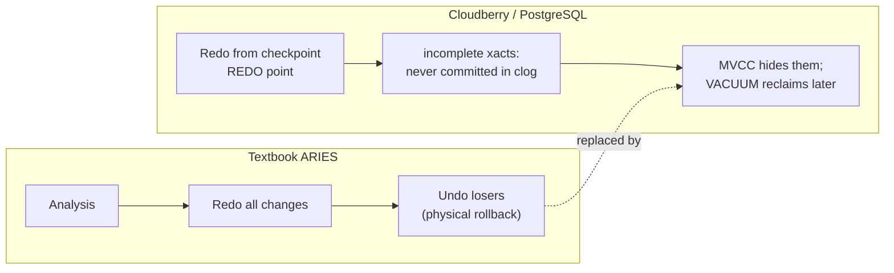

*为何没有撤销阶段：ARIES 回滚未完成的事务，而 Cloudberry 将其更改留在磁盘上，通过 MVCC + clog 使其不可见。*

### 20.1.5 内容路线：四个支柱 {#2015-roadmap-the-four-pillars}

本章其余部分按**依赖顺序**介绍实现上述理论的四个支柱：每个部分都建立在前一部分之上，各节结尾再衔接到下一节。（1）**WAL**（[§20.2](#202-write-ahead-logging-wal)）：作为一切重建工作的基础，提供持久化的重做记录，包括 Cloudberry 的分布式提交记录。（2）**流复制**（[§20.3](#203-streaming-replication)）：维护第二份副本，使*介质*或*节点*故障不造成数据丢失，并在镜像失效时关闭同步复制。（3）**系统恢复**（[§20.4](#204-system-recovery)）：单节点重做加上分布式事务协调恢复层。（4）**FTS**（[§20.5](#205-cluster-high-availability--fts)）：将检测到的故障转化为角色变更。下文每项论述都经过源代码阅读和确认；`file:line` 引用指向工作树。

## 20.2 预写式日志（WAL） {#202-write-ahead-logging-wal}

### 20.2.1 WAL 不变量与插入路径 {#2021-the-wal-invariant-and-the-insert-path}

Cloudberry 基本原样继承了 PostgreSQL 的 WAL 核心机制。每次修改首先形成一条 WAL 记录，通过固定的三次调用序列构造：

`XLogBeginInsert()` → `XLogRegisterData / XLogRegisterBuffer()` → `XLogInsert(rmid, info)`

*WAL 记录的结构*

- `XLogRecord`——长度 · xid · 前一条记录的 LSN · CRC · rmid + info
- `block data`——块引用 + 全页映像
- `main data`——资源管理器载荷

这条路径遵循两个不变量：

- **恢复期间不生成 WAL**——`XLogBeginInsert` 在重放时拒绝开始构造记录，报错为 *“cannot make new WAL entries during recovery.”*
- **先写 WAL，再写数据**——`XLogInsert` 强制执行预写规则：记录必须**先**进入持久存储，之后才允许写回其描述的脏数据页。

`info` 字节分为两部分：高 4 位是资源管理器操作码（事务管理器使用 `XLOG_XACT_OPMASK = 0xF0` 取出这些位），低位是记录专用标志。

> [!NOTE]
> 源代码：插入路径位于 `src/backend/access/transam/xloginsert.c`（`XLogBeginInsert()`）；操作码掩码位于 `src/include/access/xact.h`。

### 20.2.2 资源管理器与常见记录类型 {#2022-resource-managers-and-common-record-kinds}

每条 WAL 记录都带有一个 `xl_rmid` 字节，标识知道如何描述和重放该记录的*资源管理器*（rmgr）。重做时，启动进程根据此字节，通过以 `RmgrId` 为索引的固定表 `RmgrTable[]` 派发处理。每个表项都是由函数指针组成的 `RmgrData` 结构体；与本章最相关的是 `rm_redo`（重放记录）和 `rm_desc`/`rm_identify`（为 `pg_waldump` 呈现记录）。

```c {title="src/include/access/xlog_internal.h — RmgrData"}
typedef struct RmgrData
{
    const char *rm_name;
    void        (*rm_redo) (XLogReaderState *record);
    void        (*rm_desc) (StringInfo buf, XLogReaderState *record);
    const char *(*rm_identify) (uint8 info);
    void        (*rm_startup) (void);
    void        (*rm_cleanup) (void);
    void        (*rm_mask) (char *pagedata, BlockNumber blkno);
    void        (*rm_decode) (struct LogicalDecodingContext *ctx,
                              struct XLogRecordBuffer *buf);
} RmgrData;
```

该表通过 X 宏*定义*：`rmgr.c` 重新定义 `PG_RMGR`，为每个管理器生成一个初始化项，然后通过 `#include` 包含 `rmgrlist.h`。列表顺序至关重要：它确定各管理器的数字 ID，而这个 ID 会写入每条 WAL 记录，因此新管理器只能追加在末尾。

```c {title="src/backend/access/transam/rmgr.c — PG_RMGR"}
#define PG_RMGR(symname,name,redo,desc,identify,startup,cleanup,mask,decode) \
    { name, redo, desc, identify, startup, cleanup, mask, decode },

RmgrData    RmgrTable[RM_MAX_ID + 1] = {
#include "access/rmgrlist.h"
};
```

上游标准管理器覆盖核心引擎：`RM_XLOG_ID`（检查点、切换、FPI）、`RM_XACT_ID`（提交／中止／准备，[§20.2.5](#2025-transaction-records-prepare--commit--abort-and-their-redo)）、`RM_SMGR_ID`、`RM_CLOG_ID`、`RM_HEAP_ID`/`RM_HEAP2_ID`，索引管理器 `RM_BTREE_ID`/`RM_HASH_ID`/`RM_GIN_ID`/`RM_GIST_ID`/`RM_SPGIST_ID`/`RM_BRIN_ID`，以及 `RM_SEQ_ID`、`RM_STANDBY_ID`、`RM_RELMAP_ID` 等。Cloudberry 在上游列表之后**追加了三个自己的管理器**：

```c {title="src/include/access/rmgrlist.h"}
/* Cloudberry-specific resource managers */
PG_RMGR(RM_BITMAP_ID, "Bitmap", bitmap_redo, bitmap_desc, bitmap_identify, NULL, NULL, NULL, NULL)
PG_RMGR(RM_DISTRIBUTEDLOG_ID, "DistributedLog", DistributedLog_redo, DistributedLog_desc, DistributedLog_identify, NULL, NULL, NULL, NULL)
PG_RMGR(RM_APPEND_ONLY_ID, "Appendonly", appendonly_redo, appendonly_desc, appendonly_identify, NULL, NULL, NULL, appendonly_decode)
```

- `RM_BITMAP_ID`——磁盘位图索引访问方法的 WAL。
- `RM_DISTRIBUTEDLOG_ID`——分布式事务提交日志（本地 XID → 分布式 XID），通过 `DistributedLog_redo` 重做。
- `RM_APPEND_ONLY_ID`——AO／AOCO 存储的 WAL，通过 `appendonly_redo` 重做；还提供逻辑解码回调。

重做时，`GetRmgr(rmid)` 检查 ID 的范围；如果管理器未注册，则触发 `RmgrNotFound`（ERROR）。`rmgr.c` 还提供 `RegisterCustomRmgr`，供扩展在预留 ID 范围内注册管理器。

> [!NOTE]
> `rmgrlist.h` 的文件头警告：条目顺序决定持久化的 ID，修改“可能需要提高 XLOG_PAGE_MAGIC 的值”；重新排序或移除管理器会破坏磁盘上 WAL 的兼容性。

### 20.2.3 写入 WAL：缓冲区、刷盘与 WAL 写入进程 {#2023-writing-wal-buffers-flush-and-the-wal-writer}

WAL 首先驻留在共享的环形 *WAL 缓冲区*中（共 `wal_buffers` 个页，每页大小为 `XLOG_BLCKSZ`）。将记录持久化到磁盘分为三个阶段，共享内存中的两对 LSN 跟踪其进度：一对是*请求*（希望推进到哪里），另一对是*结果*（已经推进到哪里）：

```c {title="src/backend/access/transam/xlog.c — XLogwrtRqst"}
typedef struct XLogwrtRqst { XLogRecPtr Write; XLogRecPtr Flush; } XLogwrtRqst;
typedef struct XLogwrtResult { XLogRecPtr Write; XLogRecPtr Flush; } XLogwrtResult;
```

因此存在三个边界：**插入**位置（已预留空间的前沿，`Insert->CurrBytePos`）、**写入**位置（通过 `write()` 从缓冲区复制出来的位置）和**刷盘**位置（通过 `fsync` 实现持久化的位置）。WAL 规则要求：只有截至数据页 LSN 的 WAL 已到达*刷盘*边界，才允许写回该数据页。

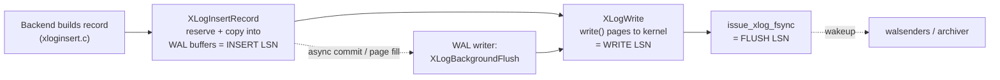

*插入 → 写入 → 刷盘的 LSN 推进过程。*

`XLogInsertRecord` 是底层插入函数：它在插入锁保护下预留空间（`ReserveXLogInsertLocation`）、填写 `xl_prev`、计算 CRC，再将字节复制到缓冲页；它有意**不**执行写入或刷盘。`XLogWrite`（`xlog.c`）将缓冲页送入内核，跨越段边界时打开相应段文件；写完一个段时，对其执行 fsync，唤醒 walsender，并通知归档进程：

```c {title="src/backend/access/transam/xlog.c — XLogWrite()"}
if (finishing_seg)
{
    issue_xlog_fsync(openLogFile, openLogSegNo, tli);
    WalSndWakeupRequest();
    LogwrtResult.Flush = LogwrtResult.Write;     /* end of page */
    if (XLogArchivingActive())
        XLogArchiveNotifySeg(openLogSegNo, tli);
```

`XLogFlush`（`xlog.c`）是供调用者将指定 LSN 持久化的入口，例如在报告同步提交之前调用。如果 `record <= LogwrtResult.Flush`，它会立即返回（其他调用者的 fsync 已经覆盖该位置，这是始终启用的组提交形式）；否则获取 `WALWriteLock`，推进写入请求，让一次 fsync 尽可能覆盖更多内容。经典的可选**组提交延迟**叠加在此基础上：当 `commit_delay > 0` 且活动后端足够多时，函数会短暂休眠，让更多后续提交共享同一次 fsync：

```c {title="src/backend/access/transam/xlog.c — XLogFlush()"}
if (CommitDelay > 0 && enableFsync &&
    MinimumActiveBackends(CommitSiblings))
{
    pg_usleep(CommitDelay);
    insertpos = WaitXLogInsertionsToFinish(insertpos);
}
```

**WAL 写入进程**（`walwriter.c`）使普通后端无需走 fsync 路径，并为*异步*提交延迟设定上限：其循环每隔 `wal_writer_delay` 调用一次 `XLogBackgroundFlush()`（`xlog.c`），至少按此频率刷盘，或在累计 `wal_writer_flush_after` 个块时刷盘。WAL 写入进程跟不上时，后端仍可自行写入／fsync。

> [!NOTE]
> **插入、写入与刷盘。** `XLogInsertRecord` 返回的结束 LSN 只能证明记录已进入 WAL *缓冲区*。要保证崩溃安全，记录必须到达*刷盘*边界；这正是同步提交通过 `XLogFlush` 等待的条件，也是 WAL 写入进程在有限延迟内为异步提交提供的保证。

### 20.2.4 WAL 文件操作：段、循环利用与归档 {#2024-wal-file-operations-segments-recycling-archiving}

*WAL 段文件名由 24 个十六进制数字组成*

- `TimelineID`——8 个十六进制数字
- `log id (segno high 32 bits)`——8 个十六进制数字
- `segment (segno low 32 bits)`——8 个十六进制数字

`pg_wal` 以固定大小的*段*文件保存物理日志。段大小由 `wal_segment_size` 指定，在 `initdb` 时设置，为 1 MB 到 1 GB 之间的 2 的幂。Cloudberry 将 PostgreSQL 的默认值 16 MB 改为 **64 MB**（`DEFAULT_XLOG_SEG_SIZE`），这也会影响检查点频率。64 位 `XLogRecPtr` 通过除法映射到 64 位 `XLogSegNo`；24 位十六进制文件名由时间线和段编号依次组成。`pg_wal/archive_status` 保存归档进程的 `.ready`/`.done` 标记。

新段由 `XLogFileInit`（`xlog.c`）→ `XLogFileInitInternal`（`xlog.c`）创建：先以临时名称 `xlogtemp.<pid>` 创建，在 `wal_init_zero` 开启时填零，执行 fsync，再原子安装。`InstallXLogFileSegment`（`xlog.c`）在 `ControlFileLock` 保护下完成原子放置，向前扫描未来的空闲槽位（`find_free`），并使用具有崩溃安全性的 `durable_rename`：

```c {title="src/backend/access/transam/xlog.c — InstallXLogFileSegment()"}
/* Find a free slot to put it in */
while (stat(path, &stat_buf) == 0)
{
    if ((*segno) >= max_segno) { LWLockRelease(ControlFileLock); return false; }
    (*segno)++;
    XLogFilePath(path, tli, *segno, wal_segment_size);
}
```

检查点期间，`RemoveOldXlogFiles`（`xlog.c`）回收早于仍需保留位置的段，但仅回收已归档的段（`XLogArchiveCheckDone`）。`RemoveXlogFile`（`xlog.c`）负责决定**循环利用还是删除**：如果开启了 `wal_recycle` 且后续仍需段文件，就将文件重命名到未来的槽位（无需填零）；否则通过 `durable_unlink` 删除：

```c {title="src/backend/access/transam/xlog.c — RemoveXlogFile()"}
if (wal_recycle && *endlogSegNo <= recycleSegNo &&
    XLogCtl->InstallXLogFileSegmentActive &&
    InstallXLogFileSegment(endlogSegNo, path, true, recycleSegNo, insertTLI))
{
    CheckpointStats.ckpt_segs_recycled++;
    (*endlogSegNo)++;
}
else { durable_unlink(path, LOG); CheckpointStats.ckpt_segs_removed++; }
```

**归档**基于标记文件实现（`xlogarchive.c`）。段写满后，`XLogArchiveNotify`（`xlogarchive.c`）在 `archive_status` 中创建空的 `<seg>.ready` 文件，并唤醒归档进程；归档进程复制该段，然后将标记重命名为 `<seg>.done`。只有存在 `.done` 标记后，才允许删除或循环利用该段。

> [!NOTE]
> **pg_wal 布局。** 段文件（24 个十六进制字符）直接位于 `pg_wal/` 下；`pg_wal/archive_status/` 保存 `.ready`/`.done` 握手标记。循环利用会将旧段重命名到后续位置，而不是删除后重新创建，因此稳定运行时 WAL 文件的周转几乎不产生填零 I/O。

### 20.2.5 事务记录：PREPARE／COMMIT／ABORT 及其重做 {#2025-transaction-records-prepare--commit--abort-and-their-redo}

*提交记录：固定头部后跟带有标志的可选子记录*

- `xl_xact_commit`——xact_time · 表空间
- `xinfo`——指示后面包含哪些部分
- `subxacts?`——HAS_SUBXACT
- `files to drop?`——HAS_RELFILELOCATORS
- `2PC xid/gid?`——HAS_TWOPHASE / GID
- `distrib xid?`——HAS_DISTRIB（CBDB）

所有事务完成记录都属于 `RM_XACT_ID`，类型放在 info 字节中：`XLOG_XACT_COMMIT`（0x00）、`XLOG_XACT_PREPARE`（0x10）、`XLOG_XACT_ABORT`（0x20）、`XLOG_XACT_COMMIT_PREPARED`（0x30）、`XLOG_XACT_ABORT_PREPARED`（0x40）；Cloudberry 的 `DISTRIBUTED_COMMIT`/`_FORGET` 也属于这一系列（[§20.2.7](#2027-the-distributed-commit-story-precisely) 及后续各节）。

提交记录由 `XactLogCommitRecord`（`xact.c`）构造：固定的 `xl_xact_commit` 头部（提交时间 + 表空间 OID）之后，是由 `xl_xinfo.xinfo` 标记的可选子记录，包括子事务、待删除的 relfilelocator、已删除的统计信息、失效消息、两阶段事务 XID/GID 和复制来源。磁盘上的头部被有意保持为最小形式：

```c {title="src/include/access/xact.h — xl_xact_commit"}
typedef struct xl_xact_commit
{
    TimestampTz xact_time;      /* time of commit */
    Oid tablespace_oid_to_delete_on_commit;
    /* xl_xact_xinfo follows default */
    /* xl_xact_subxacts follows if XINFO_HAS_SUBXACT */
    /* xl_xact_twophase follows if XINFO_HAS_TWOPHASE */
    /* twophase_gid follows if XINFO_HAS_GID ... */
} xl_xact_commit;
```

`XactLogAbortRecord`（`xact.c`，`XactLogCommitRecord()`）是对应的 `xl_xact_abort` 构造函数。**PREPARE** 记录有所不同：它由 `twophase.c` 中的 `EndPrepare`（`twophase.c`）从内存中的 2PC 数据块组装，并在将事务标记为已准备*之前*持久化刷盘：

```c {title="src/backend/access/transam/twophase.c — EndPrepare()"}
XLogBeginInsert();
for (record = records.head; record != NULL; record = record->next)
    XLogRegisterData(record->data, record->len);
gxact->prepare_end_lsn = XLogInsert(RM_XACT_ID, XLOG_XACT_PREPARE);
XLogFlush(gxact->prepare_end_lsn);
/* If we crash now, we have prepared: WAL replay will fix things */
```

已准备事务的提交部分复用同一个构造函数：`RecordTransactionCommitPrepared`（`twophase.c`）调用 `XactLogCommitRecord(...)`，传入两阶段事务的 XID+GID（使记录类型成为 `COMMIT_PREPARED`），随后刷盘；`RecordTransactionAbortPrepared` 采用对应的处理方式。**重做**时，`xact_redo`（`xact.c`，`xact_redo_abort()`）对 info 字节应用掩码并派发：`COMMIT`/`COMMIT_PREPARED` → `xact_redo_commit`（在 clog 中将事务树标记为已提交、应用提交时间戳、处理待删除文件和失效消息）；`ABORT`/`ABORT_PREPARED` → `xact_redo_abort`。`*_PREPARED` 变体还会通过 `PrepareRedoRemove` 移除 gxact 条目，而 `PREPARE` 则通过 `PrepareRedoAdd` 重建条目：

```c {title="src/backend/access/transam/xact.c — xact_redo()"}
else if (info == XLOG_XACT_COMMIT_PREPARED)
{
    xl_xact_commit *xlrec = (xl_xact_commit *) XLogRecGetData(record);
    xl_xact_parsed_commit parsed;
    ParseCommitRecord(XLogRecGetInfo(record), xlrec, &parsed);
    xact_redo_commit(&parsed, parsed.twophase_xid, record->EndRecPtr, ...);
    LWLockAcquire(TwoPhaseStateLock, LW_EXCLUSIVE);
    PrepareRedoRemove(parsed.twophase_xid, false);
    LWLockRelease(TwoPhaseStateLock);
}
```

> [!NOTE]
> 完成记录仅描述系统目录、clog 和文件方面的副作用，不含页内容，因此 `xact_redo` 断言不存在备份块；堆页和索引页的更改早已由各自的资源管理器单独记入日志流。分布式变体复用同一份 `xl_xact_commit` 载荷和 `xact_redo` 派发机制，因此这些单节点记录是 [§20.2.7](#2027-the-distributed-commit-story-precisely) 的结构基础。

### 20.2.6 检查点：在线与关闭、触发条件和重启点 {#2026-checkpoints-online-vs-shutdown-triggering-and-restartpoints}

*恢复从最后一个检查点的 REDO 点开始向前重放*

- `← older WAL`——已在数据文件中 · 可删除
- `REDO point`——checkPoint.redo
- `WAL after REDO →`——恢复时重放

*检查点*是 WAL 的持久化基准。它记录一个 **REDO 点**（LSN），并保证逻辑上在此之前的所有更改都已刷入数据文件，因此崩溃恢复永远不会重放早于最后一个检查点 REDO 点的 WAL：恢复读取 `pg_control` 中的检查点，定位到 `checkpoint.redo`，再向前重放。驱动函数是 `CreateCheckPoint()`（`xlog.c`）。磁盘上的记录体为 `CheckPoint` 结构体，其中 `redo` 是起点，其他字段保存集群级计数器，包括 CBDB 特有的 `nextGxid`：

```c {title="src/include/catalog/pg_control.h — CheckPoint"}
typedef struct CheckPoint
{
    XLogRecPtr  redo;           /* REDO start point */
    TimeLineID  ThisTimeLineID;
    ...
    FullTransactionId nextXid;
    DistributedTransactionId nextGxid;   /* next free gxid (CBDB) */
    Oid         nextOid;
    TransactionId oldestXid;
    /* IN XLOG RECORD, MORE DATA FOLLOWS FOR DTM CHECKPOINT */
} CheckPoint;
```

`CreateCheckPoint` 获取所有 WAL 插入锁，读取当前插入位置，设置 `checkPoint.redo = curInsert`，推进共享的 `RedoRecPtr`，然后释放锁，让后端在检查点刷盘期间继续插入 WAL。它收集计数器，调用 `CheckPointGuts()` 刷出所有脏缓冲区、SLRU 和 CLOG，通过 `getDtxCheckPointInfo()` 收集 CBDB DTX 载荷（[§20.4.4](#2044-distributed-recovery--the-second-layer)），最后写入记录。在线检查点与关闭检查点在磁盘上的*唯一*区别就是 info 字节：

```c {title="src/backend/access/transam/xlog.c — CreateCheckPoint()"}
XLogBeginInsert();
XLogRegisterData((char *) (&checkPoint), sizeof(checkPoint));
/* Cloudberry checkpoints have extra info */
XLogRegisterData((char *) dtxCheckPointInfo, dtxCheckPointInfoSize);
recptr = XLogInsert(RM_XLOG_ID,
                    shutdown ? XLOG_CHECKPOINT_SHUTDOWN : XLOG_CHECKPOINT_ONLINE);
XLogFlush(recptr);
```

**关闭**检查点将 `ControlFile->state = DB_SHUTDOWNING`→`DB_SHUTDOWNED`，禁止后续 WAL 写入，并在没有并发活动的情况下运行；**在线**检查点与业务流量并行运行，记录包含运行中事务的备用快照，并将缓存中尚未分配的 ID 额度计入计数器（`nextGxid += GxidCount`、`nextOid += oidCount`），以免恢复后的集群重复发放 ID。无论哪种检查点，最后都在 `ControlFileLock` 保护下写入 `pg_control`（`UpdateControlFile()`）；正是这次原子写入使检查点正式生效，随后循环利用旧 WAL（[§20.2.4](#2024-wal-file-operations-segments-recycling-archiving)）。

> [!NOTE]
> **保证：**一旦 `pg_control` 指向此检查点，恢复就可以从 `checkPoint.redo` 开始，并确信此前的所有更改都已在数据文件中；这正是旧 WAL 可以删除的原因。

**触发条件。** 专用的*检查点进程*（`CheckpointerMain`，`checkpointer.c`）在以下情况下执行检查点：共享内存中收到请求；经过了 `checkpoint_timeout` 时间（原因为 `TIME`）；或 WAL 量超过由 `max_wal_size` 推导出的阈值。最后一种情况在写入路径中由 `XLogCheckpointNeeded()` 检测，并调用 `RequestCheckpoint(CHECKPOINT_CAUSE_XLOG)`：

```c {title="src/backend/access/transam/xlog.c — XLogWrite()"}
if (IsUnderPostmaster && XLogCheckpointNeeded(openLogSegNo))
{
    (void) GetRedoRecPtr();
    if (XLogCheckpointNeeded(openLogSegNo))
        RequestCheckpoint(CHECKPOINT_CAUSE_XLOG);
}
```

- `CHECKPOINT_IS_SHUTDOWN`——关闭检查点
- `CHECKPOINT_END_OF_RECOVERY`——类似关闭检查点，在退出恢复时发出
- `CHECKPOINT_IMMEDIATE`——跳过分散执行的限速机制
- `CHECKPOINT_FORCE`——即使没有 WAL 活动也执行
- `CHECKPOINT_WAIT`——调用者阻塞等待完成
- `CHECKPOINT_CAUSE_XLOG` / `CHECKPOINT_CAUSE_TIME`——用于诊断的原因位

**重启点。** 处于恢复中的备用实例不能写自己的 WAL，因此在*重放*检查点记录时，改为通过 `CreateRestartPoint()`（`xlog.c`）创建*重启点*：复用被重放检查点的 REDO 点，执行同样的 `CheckPointGuts()` 刷盘，并更新 `pg_control`，这样恢复期间再次崩溃后，就能从此处重新开始重放。如果自上次重启点以来没有重放新的检查点，则跳过此操作。关键在于，重启点的 WAL 循环利用会将保留边界回退到*已重放*与*已接收* LSN 中较后的位置，确保不会删除 walreceiver 仍需使用的段，从而将检查点与流复制联系起来（[§20.3](#203-streaming-replication)）。

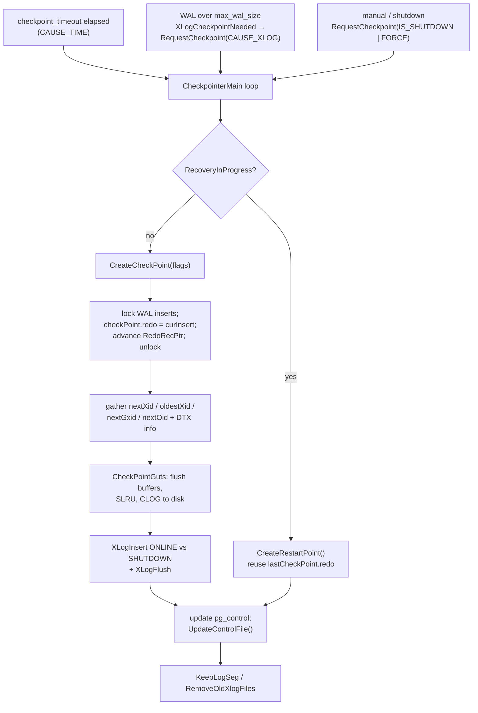

*检查点创建流程及其触发来源。*

### 20.2.7 分布式提交的确切过程 {#2027-the-distributed-commit-story-precisely}

决定分布式事务**何时**提交的*运行时*协议，即 QD 的 `DtxState` 和 QE 的 `DtxContext` 状态机，已在 [§12.2](/cloudberry/core-internals/part-3-transactions-mvcc-concurrency/ch12/#122-cloudberrys-2pc-cdbtm-dtxstate--dtxcontext) 讨论。本节介绍*持久化*部分：如何将该提交编码到 WAL 中，以及如何重放。

事务操作码恰好有九个（`src/include/access/xact.h`，`XLOG_XACT_COMMIT`）。注意，`XLOG_XACT_DISTRIBUTED_COMMIT`（`0x70`）**确实存在**，而且是独立的操作码：

```c {title="src/include/access/xact.h — XLOG_XACT_COMMIT — xact WAL opcodes"}
#define XLOG_XACT_COMMIT             0x00
#define XLOG_XACT_PREPARE            0x10
#define XLOG_XACT_ABORT              0x20
#define XLOG_XACT_COMMIT_PREPARED    0x30
#define XLOG_XACT_ABORT_PREPARED     0x40
#define XLOG_XACT_ASSIGNMENT         0x50
#define XLOG_XACT_INVALIDATIONS      0x60
#define XLOG_XACT_DISTRIBUTED_COMMIT 0x70
#define XLOG_XACT_DISTRIBUTED_FORGET 0x80
```

所有提交变体都由*同一个*构造函数 `XactLogCommitRecord()`（`src/backend/access/transam/xact.c`，`xactGetCommittedChildren()`）生成。它先选择操作码：已准备的分布式事务选择 `XLOG_XACT_DISTRIBUTED_COMMIT`，否则选择普通本地提交或已准备本地提交。全局 xid **不是**独立记录体，而是复用普通的 `xl_xact_commit` 布局，作为由 `xinfo` 标志控制的可选子记录携带：

```c {title="src/backend/access/transam/xact.c — XactLogCommitRecord()"}
/* include distributed xid if there's one */
if (distrib_xid != InvalidDistributedTransactionId)
{
    xl_xinfo.xinfo |= XACT_XINFO_HAS_DISTRIB;   /* (1U << 9), xact.h:212  */
    xl_distrib.distrib_xid = distrib_xid;       /* xl_xact_distrib, xact.h:272 */
}
...
if (xl_xinfo.xinfo & XACT_XINFO_HAS_DISTRIB)
    XLogRegisterData((char *) (&xl_distrib), sizeof(xl_xact_distrib));
```

因此，任何具有 gxid 的提交记录都会携带它。之所以有专用的 `0x70` 操作码，是因为 Coordinator 上已准备的分布式提交需要 [§20.2.4](#2024-wal-file-operations-segments-recycling-archiving) 所述的额外重做记账，而普通 Segment 提交若只是记录其分布式 xid，则不需要。

> [!NOTE]
> **更正（已通过代码确认）：**早期草稿曾声称不存在 `XLOG_XACT_DISTRIBUTED_COMMIT` 记录类型，这是错误的。操作码 `0x70` 确实存在（`xact.h`），并有自己的重做分支 `xact_redo_distributed_commit`。正确的说法是：分布式提交复用 `xl_xact_commit` 记录体，通过 `XACT_XINFO_HAS_DISTRIB` + `xl_xact_distrib` 携带 gxid；操作码标签负责触发 `redoDistributedCommitRecord()`。

### 20.2.8 分布式遗忘记录 {#2028-the-distributed-forget-record}

2PC 的阶段 2 会留下第二条记录：当所有 Segment 都确认了各自的 `COMMIT PREPARED` 后，Coordinator 写入独立的 `XLOG_XACT_DISTRIBUTED_FORGET`（`0x80`）记录，其中仅携带 gxid（来自 `doInsertForgetCommitted()`，`src/backend/cdb/cdbtm.c`）：

```c {title="src/backend/access/transam/xact.c — RecordDistributedForgetCommitted()"}
XLogRecPtr
RecordDistributedForgetCommitted(DistributedTransactionId gxid)
{
    xl_xact_distributed_forget xlrec;
    XLogRecPtr  recptr;

    xlrec.gxid = gxid;
    XLogBeginInsert();
    XLogRegisterData((char *) &xlrec, sizeof(xl_xact_distributed_forget));
    recptr = XLogInsert(RM_XACT_ID, XLOG_XACT_DISTRIBUTED_FORGET);
    if (synchronous_commit >= SYNCHRONOUS_COMMIT_REMOTE_APPLY)
        XLogFlush(recptr);
    return recptr;
}
```

### 20.2.9 重做与已提交 gxid 数组 {#2029-redo-and-the-committed-gxid-array}

`xact_redo()`（`xact.c`，`xact_redo_abort()`）根据操作码派发。`XLOG_XACT_DISTRIBUTED_COMMIT` 重放本地提交（如果有），然后调用 `redoDistributedCommitRecord(gxid)`；`XLOG_XACT_DISTRIBUTED_FORGET` 调用 `redoDistributedForgetCommitRecord(gxid)`。它们维护一组内存中的已提交但尚未遗忘的全局 xid，即 `shmCommittedGxidArray` / `*shmNumCommittedGxacts`；这**恰好就是恢复时必须推动完成 2PC 阶段 2 的未决分布式事务集合**（见 [§20.4.4](#2044-distributed-recovery--the-second-layer)）。

```c {title="src/backend/cdb/cdbdtxrecovery.c — redoDistributedForgetCommitRecord() (forget redo, excerpt)"}
void
redoDistributedForgetCommitRecord(DistributedTransactionId gxid)
{
    for (int i = 0; i < *shmNumCommittedGxacts; i++)
        if (gxid == shmCommittedGxidArray[i])
        {
            (*shmNumCommittedGxacts)--;                       /* swap-remove */
            if (i != *shmNumCommittedGxacts)
                shmCommittedGxidArray[i] = shmCommittedGxidArray[*shmNumCommittedGxacts];
            /* on a hot-standby QD, advance latestCompletedGxid for snapshots */
            return;
        }
}
```

> [!NOTE]
> [§20.2.2](#2022-resource-managers-and-common-record-kinds) 中的两个 Cloudberry rmgr 在此出现：分布式日志 SLRU 产生 `DISTRIBUTEDLOG_ZEROPAGE`/`_TRUNCATE`（由 `DistributedLog_redo` 重放）；AO 存储产生 `XLOG_APPENDONLY_INSERT`/`_TRUNCATE`，其 `appendonly_redo()` 在仅进行崩溃恢复的模式下跳过重放（`if (IsCrashRecoveryOnly) return;`，`cdbappendonlyxlog.c`），因为 AO 在关闭文件时执行 fsync，所以这些记录主要用于将 AO 数据发送到镜像。

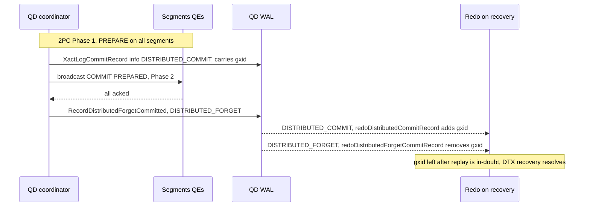

*分布式提交／遗忘记录的生命周期，以及重放如何重建未决事务集合。*

**衔接 [§20.3](#203-streaming-replication)。** WAL 使每次已提交更改都能*在同一节点上*恢复，但节点磁盘可能彻底失效，而重放要求日志仍保存在某处。因此，下一个支柱在 WAL 刷盘后立即将其流式传输到另一台机器：**流复制**。

## 20.3 流复制 {#203-streaming-replication}

### 20.3.1 walsender／walreceiver 与复制槽 {#2031-walsender--walreceiver-and-replication-slots}

主 Segment → 镜像，以及 Coordinator → Standby Coordinator，都由同一种 PostgreSQL 流复制驱动。镜像运行 **walreceiver**；主实例为每条连接启动一个 **walsender**。`WalSndLoop()`（`src/backend/replication/walsender.c`）通过 `XLogSendPhysical()` 发送已刷盘的 WAL；处于 `WALSNDSTATE_CATCHUP` 的发送进程只有在待发送数据全部发完后，才转为 `WALSNDSTATE_STREAMING`，代码注释明确将这一点与无数据丢失的故障切换联系起来。Cloudberry 会标记 Segment 复制的发送进程：`walsnd->is_for_gp_walreceiver = (strcmp(application_name, GP_WALRECEIVER_APPNAME) == 0)`（`walsender.c`，`InitWalSenderSlot()`）。

`WalReceiverMain()`（`src/backend/replication/walreceiver.c`）循环执行：`walrcv_receive()` → `XLogWalRcvProcessMsg()` 写入 WAL → `XLogWalRcvSendReply()` → `XLogWalRcvFlush()`（`WalReceiverMain()`）推进镜像的**刷盘 LSN**，主实例的同步复制逻辑等待的正是该位置。物理**复制槽**通过阻止 `restart_lsn` 前移，保留落后镜像仍需使用的 WAL；Cloudberry 内部的 Segment 复制槽为 `INTERNAL_WAL_REPLICATION_SLOT_NAME = "internal_wal_replication_slot"`（`src/include/replication/slot.h`）。

### 20.3.2 连接建立与执行流程 {#2032-connection-establishment-and-execution-flow}

备用实例上的流复制由两个协作进程驱动：**启动进程**重放 WAL，并决定何时需要流复制；**walreceiver** 连接主实例的 walsender 并拉取 WAL。二者仅通过共享结构体 `WalRcv` 通信，其 `walRcvState` 字段是一个小型状态机：`WALRCV_STOPPED` → `WALRCV_STARTING` → `WALRCV_STREAMING`，另有 `WALRCV_WAITING` / `WALRCV_RESTARTING` / `WALRCV_STOPPING`。

**步骤 1：启动进程请求流复制。** 启动进程需要本地找不到的 WAL 时，调用 `RequestXLogStreaming(tli, recptr, conninfo, slotname, ...)`（`walreceiverfuncs.c`）：在自旋锁保护下，将 conninfo、复制槽、起始 LSN 和时间线存入 `WalRcv` 并切换状态，向 postmaster 发送信号，要求派生 walreceiver（如果已有存活进程，则设置其 latch）：

```c {title="src/backend/replication/walreceiverfuncs.c — RequestXLogStreaming()"}
if (walrcv->walRcvState == WALRCV_STOPPED)
{ launch = true; walrcv->walRcvState = WALRCV_STARTING; }
else
    walrcv->walRcvState = WALRCV_RESTARTING;
walrcv->receiveStart = recptr;
walrcv->receiveStartTLI = tli;
if (launch)      SendPostmasterSignal(PMSIGNAL_START_WALRECEIVER);
else if (latch)  SetLatch(latch);
```

**步骤 2–3：walreceiver 读取指令并连接。** `WalReceiverMain()`（`walreceiver.c`）将共享状态改为 `WALRCV_STREAMING`，复制出 conninfo、复制槽和起始点，再调用 `walrcv_connect()`。`appname` 参数成为连接的 `application_name`；在 CBDB 中，若设置了 `cluster_name`，就使用其值（部署时为 `gp_walreceiver`）：

```c {title="src/backend/replication/walreceiver.c — WalReceiverMain()"}
/* Establish the connection to the primary for XLOG streaming */
wrconn = walrcv_connect(conninfo, false, false,
                        cluster_name[0] ? cluster_name : "walreceiver", &err);
if (!wrconn)
    ereport(ERROR, (errcode(ERRCODE_CONNECTION_FAILURE),
        errmsg("could not connect to the primary server: %s", err)));
```

`walrcv_connect` 派发到 `libpqrcv_connect()`（`libpqwalreceiver.c`），后者构造 libpq 连接，其中关键参数为 `replication=true`（表示*物理*复制连接，而不是逻辑复制使用的 `"database"`），并将 appname 用作 `fallback_application_name`：

```c {title="src/backend/replication/libpqwalreceiver/libpqwalreceiver.c — libpqrcv_connect()"}
keys[i] = "dbname";        vals[i] = conninfo;
keys[++i] = "replication"; vals[i] = logical ? "database" : "true";
keys[++i] = "fallback_application_name"; vals[i] = appname;
conn->streamConn = PQconnectStartParams(keys, vals, true);
```

> [!NOTE]
> 备用实例以 `application_name = gp_walreceiver` 建立连接，因此主实例的 walsender 看到该名称后会设置 `is_for_gp_walreceiver`（[§20.3.1](#2031-walsender--walreceiver-and-replication-slots)），将此连接纳入 Greenplum/Cloudberry FTS 的复制跟踪机制。

**步骤 4–5：识别系统并执行 START_REPLICATION。** walreceiver 发出 `IDENTIFY_SYSTEM`（交叉检查系统 ID，并确认主实例时间线等于或晚于自身的 `startpointTLI`），随后通过 `walrcv_startstreaming()` → `libpqrcv_startstreaming()` 发送 `START_REPLICATION [SLOT name] <LSN> TIMELINE <tli>` 命令。物理复制启动后返回 `PGRES_COPY_BOTH`：

```c {title="src/backend/replication/libpqwalreceiver/libpqwalreceiver.c — libpqrcv_startstreaming()"}
appendStringInfoString(&cmd, "START_REPLICATION");
if (options->slotname != NULL)
    appendStringInfo(&cmd, " SLOT "%s"", options->slotname);
appendStringInfo(&cmd, " %X/%X", LSN_FORMAT_ARGS(options->startpoint));
appendStringInfo(&cmd, " TIMELINE %u", options->proto.physical.startpointTLI);
res = libpqrcv_PQexec(conn->streamConn, cmd.data);   /* expect PGRES_COPY_BOTH */
```

**步骤 6：接收循环。** 进入流复制后，walreceiver 循环执行 `walrcv_receive()` → `XLogWalRcvProcessMsg`（对 `'w'` 数据写入 WAL，处理 `'k'` 保活消息），然后调用 `XLogWalRcvSendReply`（告知主实例已接收的 LSN）和 `XLogWalRcvFlush`（执行 fsync，推进备用实例的已刷盘 LSN）。没有可读数据时，它通过 `WaitLatchOrSocket` 等待：

```c {title="src/backend/replication/walreceiver.c — WalReceiverMain()"}
len = walrcv_receive(wrconn, &buf, &wait_fd);
if (len != 0)
{
    for (;;) {
        if (len > 0)  XLogWalRcvProcessMsg(buf[0], &buf[1], len - 1, startpointTLI);
        else if (len == 0) break;
        else if (len < 0) { endofwal = true; break; }   /* timeline ended */
        len = walrcv_receive(wrconn, &buf, &wait_fd);
    }
    XLogWalRcvSendReply(false, false);
    XLogWalRcvFlush(false, startpointTLI);     /* advance flushedUpto */
}
```

这里写入的已刷盘 LSN，正是 `CreateRestartPoint`（[§20.2.6](#2026-checkpoints-online-vs-shutdown-triggering-and-restartpoints)）通过 `GetWalRcvFlushRecPtr` 读取、用于判断哪些 WAL 段仍需保留的值，由此闭合了复制与检查点之间的联系。`len < 0` 表示主实例结束了 COPY 流（时间线结束）；循环交还控制权，等待启动进程发出新指令。

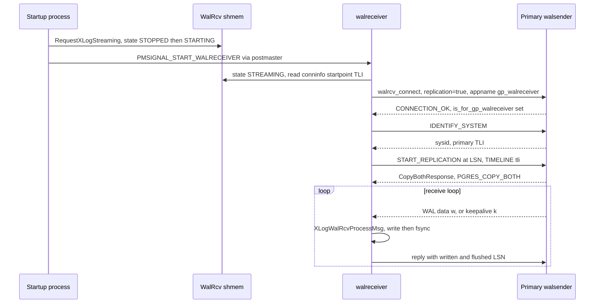

*walreceiver：连接主实例 → START_REPLICATION → 流式接收／刷盘循环。*

### 20.3.3 同步复制：等待镜像的刷盘 LSN {#2033-synchronous-replication--waiting-for-the-mirrors-flush-lsn}

同步提交会阻塞在 `SyncRepWaitForLSN(lsn, commit)`（`src/backend/replication/syncrep.c`）中：后端将自身入队，设置 `syncRepState = SYNC_REP_WAITING`，并在 latch 上等待，直到 walsender 确认该 LSN。负责唤醒的是 `SyncRepReleaseWaiters()`（`syncrep.c`）：它公布已确认的刷盘 LSN，并唤醒等待位置不大于此 LSN 的所有进程：

```c {title="src/backend/replication/syncrep.c — SyncRepWaitForLSN()"}
/* in SyncRepWaitForLSN: */
for (;;) {
    ResetLatch(MyLatch);
    if (MyProc->syncRepState == SYNC_REP_WAIT_COMPLETE) break;
    ...
}
```

```c {title="src/backend/replication/syncrep.c — SyncRepReleaseWaiters()"}
/* in SyncRepReleaseWaiters, when the standby's flush advances: */
if (walsndctl->lsn[SYNC_REP_WAIT_FLUSH] < flushPtr) {
    walsndctl->lsn[SYNC_REP_WAIT_FLUSH] = flushPtr;
    numflush = SyncRepWakeQueue(false, SYNC_REP_WAIT_FLUSH);
}
```

在默认的刷盘级别，这意味着客户端收到成功响应之前，提交已在主实例和镜像**两端**持久化，因此同步状态的镜像不会丢失任何已确认的提交。Cloudberry 通过设置 `synchronous_standby_names = "*"` 为 Segment 启用同步复制，并对 Coordinator 作特殊处理：在 `IS_QUERY_DISPATCHER()` 条件下，如果没有活动的 `is_for_gp_walreceiver` 备用实例，就**不会**阻塞（`syncrep.c`，`SyncRepWaitForLSN()`），因此缺少 Standby Coordinator 永远不会卡住提交。

### 20.3.4 与 FTS 的联系：镜像停机时禁用同步复制 {#2034-the-tie-to-fts--disabling-syncrep-when-a-mirror-is-down}

这是保障可用性的关键机制：镜像失效时，同步提交本会无限阻塞，因此 FTS 必须关闭复制的同步等待。`SyncRepWaitForLSN` 的快速退出条件取决于 `SYNC_STANDBY_DEFINED`，它跟踪 `synchronous_standby_names`。Cloudberry 通过程序切换此设置：`SetSyncStandbysDefined()` 将其设为 `"*"`，`UnsetSyncStandbysDefined()` 将其设为 `""`（`src/backend/replication/gp_replication.c`）。FTS 发送 `SYNCREP_OFF` 消息时，主实例会清除该 GUC 设置，使提交立即继续：

```c {title="src/backend/fts/ftsmessagehandler.c — HandleFtsWalRepSyncRepOff() (HandleFtsWalRepSyncRepOff)"}
ereport(LOG, (errmsg("turning off synchronous wal replication due to FTS request")));
UnsetSyncStandbysDefined();              /* synchronous_standby_names = "" */
GetMirrorStatus(&response, NULL);
SendFtsResponse(&response, FTS_MSG_SYNCREP_OFF);
```

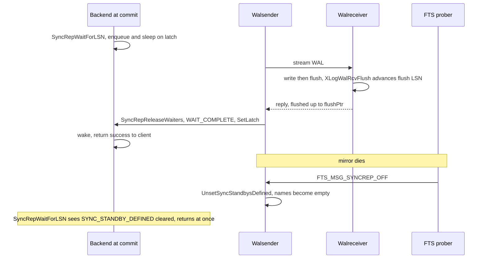

*同步复制的提交等待，以及镜像失效时 FTS 通过 SYNCREP_OFF 解除等待的路径。*

**衔接 [§20.4](#204-system-recovery)。** 复制保证存在第二份字节完全相同的 WAL 副本，但**不**保证这份副本已经*可用*：在日志重放完毕、未决事务处理完成之前，镜像的数据文件仍处于接收过程中的不一致状态。将流式接收的 WAL 重新变成一致、可以开放使用的数据库，就是**系统恢复**的工作。

## 20.4 系统恢复 {#204-system-recovery}

### 20.4.1 StartupXLOG 与控制文件中的 DBState 分支 {#2041-startupxlog-and-the-control-file-dbstate-switch}

单节点恢复由 `StartupXLOG()`（`src/backend/access/transam/xlog.c`）驱动。它首先根据 `ControlFile->state` 判断上次实例如何终止，然后读取检查点并初始化共享内存。只有 `DB_SHUTDOWNED` 和 `DB_SHUTDOWNED_IN_RECOVERY` 算作正常停止；其他状态都会设置 `didCrash = true`：

```c {title="src/backend/access/transam/xlog.c — StartupXLOG() (DBState switch, condensed)"}
switch (ControlFile->state)
{
    case DB_SHUTDOWNED:             /* clean — redo usually skipped       */
    case DB_SHUTDOWNED_IN_RECOVERY: /* standby cleanly stopped            */
    case DB_SHUTDOWNING:            /* shutdown interrupted -> crash       */
    case DB_IN_CRASH_RECOVERY:      /* crashed *while* recovering          */
    case DB_IN_ARCHIVE_RECOVERY:    /* crashed during archive/standby redo */
    case DB_IN_PRODUCTION:          /* crashed while live — common case    */
    default:                        /* FATAL: invalid cluster state        */
}
```

随后，检查点用于初始化 `ShmemVariableCache`，其中包括 **Cloudberry 特有的分布式 xid 计数器**；没有它，Coordinator 可能重复发放崩溃前已使用的 gxid：

```c {title="src/backend/access/transam/xlog.c — StartupXLOG()"}
ShmemVariableCache->nextXid  = checkPoint.nextXid;
ShmemVariableCache->nextGxid = checkPoint.nextGxid;   /* DistributedTransactionId */
...
StartupCLOG(); StartupMultiXact();                    /* SLRUs, after nextXid set */
```

确定最老的活动 xid 后，启动 `pg_subtrans` 和仅在 Segment 端使用的 `pg_distributedlog` SLRU；`DistributedLog_Startup()` 在 Coordinator 上不执行任何操作（`distributedlog.c`）。

### 20.4.2 重做循环与无效页跟踪 {#2042-the-redo-loop-and-invalid-page-tracking}

`PerformWalRecovery()`（`src/backend/access/transam/xlogrecovery.c`）定位到检查点 REDO 点并应用记录，通过 `GetRmgr(record->xl_rmid).rm_redo(xlogreader)` 将每条记录派发给对应资源管理器（`xlogrecovery.c`，`ApplyWalRecord()`）。如果关闭了 `full_page_writes`，记录可能引用某个页，而该页所属关系后来已被删除或截断；此时不会立即失败，而是由 `log_invalid_page()`（`src/backend/access/transam/xlogutils.c`）记下引用。在重放相应删除／截断记录时，`forget_invalid_pages()` 移除该引用；如果到达一致性点时仍有未解决的引用，`XLogCheckInvalidPages()`（`xlogutils.c`）会触发 **PANIC**，这意味着 WAL 不完整或已损坏。

### 20.4.3 崩溃恢复与归档／备用恢复；崩溃后 fsync 的差异 {#2043-crash-vs-archivestandby-recovery-the-crash-fsync-deviation}

两个空信号文件决定恢复模式（现在存在 `recovery.conf` 会导致致命错误）：`standby.signal` → 备用模式（Standby Coordinator 和 Segment 镜像的运行方式）；`recovery.signal` → 归档恢复／PITR；两者均不存在 → 普通崩溃恢复（`xlogrecovery.c`，`readRecoverySignalFile()`）。Cloudberry 在崩溃后的 fsync 处理上有意偏离上游：它不会对整个数据目录执行 fsync（其中可能有数百万个 AO／堆文件），而只同步 WAL 文件，并依靠全页写入映像在重做期间修复撕裂的数据页：

```c {title="src/backend/access/transam/xlog.c — StartupXLOG() (GPDB crash path)"}
if (ControlFile->state != DB_SHUTDOWNED &&
    ControlFile->state != DB_SHUTDOWNED_IN_RECOVERY)
{
    RemoveTempXlogFiles();
    if (access(BACKUP_LABEL_FILE, F_OK) != 0)
        SyncAllXLogFiles();                 /* WAL only, NOT full pgdata */
    if (Gp_role == GP_ROLE_DISPATCH)
        *shmCleanupBackends = true;         /* tell DTX recovery to clean QEs */
    didCrash = true;
}
```

### 20.4.4 分布式恢复：第二层 {#2044-distributed-recovery--the-second-layer}

本地重放使每个节点内部保持一致，但分布式事务需要跨多个节点提交。[§12.2](/cloudberry/core-internals/part-3-transactions-mvcc-concurrency/ch12/#122-cloudberrys-2pc-cdbtm-dtxstate--dtxcontext) 在*运行时*驱动 2PC 协议，而恢复必须重建并完成集群停止时尚未结束的工作。Cloudberry 分两层处理未决 2PC。**第 1 层（捕获与初始化）：**每个检查点通过 `getDtxCheckPointInfo()`（`src/backend/storage/ipc/procarray.c`）为进行中的 DTX 创建快照，即已提交的 gxid 加上带有 `includeInCkpt` 标志的进行中 dtx，放入检查点记录（调用位置为 `xlog.c` 中的 `CreateCheckPoint()`）。重放时，`redoDtxCheckPoint()` 将这些记录交给 `redoDistributedCommitRecord()`，初始化 `shmCommittedGxidArray`。

**第 2 层（协调恢复）：**专用的 `dtx recovery` 后台工作进程（注册于 `src/backend/postmaster/postmaster.c` 的 `PMAuxProcList`，通过 `DtxRecoveryStartRule` 限定只在 Coordinator 上运行）执行 `DtxRecoveryMain()` → `recoverTM()` → `recoverInDoubtTransactions()`（`src/backend/cdb/cdbdtxrecovery.c`），分两遍处理：

```c {title="src/backend/cdb/cdbdtxrecovery.c (recoverInDoubtTransactions, condensed)"}
/* Pass 1: finish the ones we KNOW committed (seeded from replay) */
for (i = 0; i < *shmNumCommittedGxacts; i++) {
    dtxFormGid(gid, shmCommittedGxidArray[i]);
    doNotifyCommittedInDoubt(gid);            /* re-broadcast COMMIT PREPARED */
    RecordDistributedForgetCommitted(shmCommittedGxidArray[i]);
}
*shmNumCommittedGxacts = 0;

/* Pass 2: anything else still prepared on a segment must be aborted */
htab = gatherRMInDoubtTransactions(0, true);  /* select gid from pg_prepared_xacts */
abortRMInDoubtTransactions(htab);             /* ROLLBACK PREPARED */
```

完成一次性处理后，该工作进程周期性调用 `AbortOrphanedPreparedTransactions()`，中止确实已成为孤立事务的已准备事务，同时跳过 gid 仍满足 `IsDtxInProgress()` 的事务，以处理后续故障留下的遗留事务。

### 20.4.5 已准备事务（阶段 1）如何跨越崩溃存续 {#2045-how-prepared-phase-1-transactions-survive-a-crash}

Segment 的 2PC 状态就是普通 PostgreSQL 已准备事务，通过 `XLOG_XACT_PREPARE` 记录和 `pg_twophase/<xid>` 状态文件实现持久化。`restoreTwoPhaseData()` 在重放前扫描磁盘文件；`PrepareRedoAdd()` 在重放过程中重建条目；`RecoverPreparedTransactions()`（`src/backend/access/transam/twophase.c`）在恢复结束时执行完整重载。关键是，它解析 Cloudberry GID，恢复**分布式** xid，并将本地分布式事务标记为活动状态：

```c {title="src/backend/access/transam/twophase.c — RecoverPreparedTransactions() (excerpt)"}
dtxDeformGid(gid, &distribXid);
localDistribXactData.state     = LOCALDISTRIBXACT_STATE_ACTIVE;
localDistribXactData.distribXid = distribXid;
MarkAsPreparingGuts(gxact, xid, gid, &localDistribXactData, ...);
```

这正是 Segment 通过 `pg_prepared_xacts` 暴露的状态；[§20.4.4](#2044-distributed-recovery--the-second-layer) 中 Coordinator 的 `gatherRMInDoubtTransactions()` 查询该视图，以决定提交还是中止。

### 20.4.6 DistributedLog 在恢复中的作用 {#2046-distributedlogs-role-in-recovery}

`pg_distributedlog`（Segment 端的 SLRU）将各个*本地* xid 映射到其提交时所属的*分布式* xid，这是重启后判断分布式快照可见性的基础。堆可见性使用 `pg_clog`（本地提交）；**分布式**可见性使用 `pg_distributedlog`（`DistributedLog_CommittedCheck()`，`distributedlog.c`），将本地 xid 转换成快照可以检查的分布式 xid。恢复在任何查询运行之前重建二者；在热备 Standby Coordinator 上，遗忘记录的重做还会推进 `latestCompletedGxid`，以确保持续重放期间分布式快照正确。

### 20.4.7 备用提升与 Segment 恢复 {#2047-standby-promotion-and-segment-recovery}

**Standby Coordinator** 完成重放并被提升后，`StartupXLOG` 在标记 `DB_IN_PRODUCTION` 之后调用 `UpdateCatalogForStandbyPromotion()`（`xlog.c`）→ `gp_activate_standby()`（`src/backend/utils/gp/segadmin.c`），交换 `gp_segment_configuration` 中新旧 Coordinator 的 dbid（该操作具有幂等性，因此能够承受提升中途的崩溃）。Segment **镜像**则由 FTS 提升（[§20.5](#205-cluster-high-availability--fts)）。

故障 Segment 使用 **`gprecoverseg`** 重建：**增量**恢复运行 `pg_rewind`（只复制发生分歧的块；旧数据目录完好时为默认方式），**完整**恢复运行 `pg_basebackup`，克隆整个目录。文件级恢复完成后，Segment 以 `standby.signal` 模式启动，通过流复制追赶进度；之后 FTS 将其重新标记为运行状态。

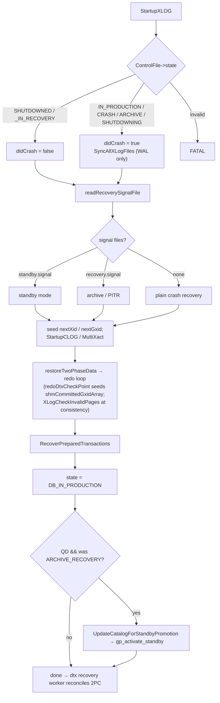

*StartupXLOG 决策流程：控制文件状态和信号文件选择恢复模式；分布式组件（nextGxid、DTX 检查点、备用提升）叠加在其上。*

**衔接 [§20.5](#205-cluster-high-availability--fts)。** 本地恢复和分布式恢复可以让*故障*节点重新保持一致，但前提是有组件*重启*它；在此之前，还必须有组件*判定*它发生故障，并在需要时先提升其镜像。做出这一决定的是集群的故障检测器 **FTS**，它将检测到的故障转化为角色变更。

## 20.5 集群高可用：FTS {#205-cluster-high-availability--fts}

### 20.5.1 进程模型、触发方式与关键 GUC {#2051-process-model-triggering-and-key-gucs}

**FTS（容错服务）**作为单个后台工作进程运行，**仅在 Coordinator 上启动**：`FtsProbeStartRule` 返回 `Gp_role == GP_ROLE_DISPATCH`（`src/backend/fts/fts.c`）。`FtsProbeMain` 公布自己的 PID，安装处理器，然后进入 `FtsLoop()`（`fts.c`）。每个周期将 `gp_segment_configuration` 读入 `CdbComponentDatabases`；如果存在镜像，则调用 `FtsWalRepMessageSegments()`。

触发方式为**定时 + 按需**：循环在 latch 上等待 `gp_fts_probe_interval`，但遇到故障的后端会调用 `FtsNotifyProber()`（发送 `PMSIGNAL_WAKEN_FTS`），强制立即启动一个周期。关键 GUC 如下（默认值来自 `src/backend/utils/misc/guc_gp.c`）：

- `gp_fts_probe_interval`——**60 秒**（10–3600）：完整探测周期的间隔。
- `gp_fts_probe_timeout`——**20 秒**（0–3600）：等待单个 Segment 响应的最长时间，超时后视为故障。
- `gp_fts_probe_retries`——**5**（0–100）：对故障采取行动之前的重试次数。
- `gp_fts_mark_mirror_down_grace_period`——**30 秒**：镜像断开连接后，在将其标记为停机之前保留的宽限时间。
- `gp_fts_replication_attempt_count`——**10**：walsender 重连尝试达到此次数后，忽略断开连接时间戳（避免反复崩溃重启的 walsender 无限延长宽限时间）。

### 20.5.2 探测协议与响应字段 {#2052-the-probe-protocol-and-the-response-fields}

消息类型恰好有三种，以 libpq 查询字符串发送；响应固定包含 5 个布尔值（`src/include/postmaster/fts_comm.h`）：

```c {title="src/include/postmaster/fts_comm.h — FTS_MSG_PROBE"}
#define FTS_MSG_PROBE        "PROBE"
#define FTS_MSG_SYNCREP_OFF  "SYNCREP_OFF"
#define FTS_MSG_PROMOTE      "PROMOTE"
```

```c {title="src/include/postmaster/fts_comm.h — Natts_fts_message_response"}
#define Natts_fts_message_response 5
#define Anum_fts_message_response_is_mirror_up        0
#define Anum_fts_message_response_is_in_sync          1
#define Anum_fts_message_response_is_syncrep_enabled  2
#define Anum_fts_message_response_is_role_mirror      3
#define Anum_fts_message_response_request_retry       4
```

Segment 在 `GetMirrorStatus`（`src/backend/replication/gp_replication.c`）中填写这些字段：**is_mirror_up**（GP walsender 正在追赶且具有有效的写入 LSN，或正在流式传输）、**is_in_sync**（运行中*且*正在流式传输 → 系统目录中 `mode='s'`）、**is_syncrep_enabled**（已设置 `SYNC_STANDBY_DEFINED`）、**is_role_mirror**（Segment 认为自己是镜像，用于检测未生效的 PROMOTE），以及 **request_retry**（镜像已停机，但仍处于宽限期，暂不标记为停机）。探测还会执行 `O_DIRECT` 磁盘读写检查（`checkIODataDirectory`），因此卡死的磁盘会使 PROBE 失败并触发故障切换。

### 20.5.3 非阻塞探测周期 {#2053-the-non-blocking-probe-cycle}

`FtsWalRepMessageSegments()` 为每对主实例与镜像构造一个 `fts_segment_info`，并通过**同一个 `poll()` 集合驱动全部实例**：每个 Segment 使用一个异步 libpq 连接，而不是各用一个线程或阻塞调用。因此，单个进程就能在有界延迟内并发探测 N 个 Segment：

```c {title="src/backend/fts/ftsprobe.c — FtsWalRepMessageSegments()"}
while (!allDone(&context) && FtsIsActive())
{
    ftsConnect(&context);    /* PQconnectStart / PQconnectPoll (async)   */
    ftsPoll(&context);       /* ONE poll(PollFds, nfds, 50ms) for all     */
    ftsSend(&context);       /* PQsendQuery the message when POLLOUT      */
    ftsReceive(&context);    /* parse 5x1 response, advance state         */
    processRetry(&context);
    is_updated |= processResponse(&context);  /* may flip roles in catalog */
}
```

`ftsCheckTimeout` 是独立于 poll 的实际时间保护：如果 Segment 尚未成功，且 `now - startTime > gp_fts_probe_timeout`，就强制进入失败状态，避免 TCP 层挂起拖住整个周期。

### 20.5.4 每个 Segment 的状态机 {#2054-the-per-segment-state-machine}

每个 Segment 都有一个小型状态机（状态定义在 `src/include/postmaster/ftsprobe.h`）：三个动作状态 `FTS_{PROBE,SYNCREP_OFF,PROMOTE}_SEGMENT`，对应的 `_RETRY_WAIT`、`_SUCCESS`、`_FAILED` 状态，以及终态 `FTS_RESPONSE_PROCESSED`。重试次数耗尽前**绝不**对故障采取行动；`processResponse` 中有断言 `AssertImply(IsFtsMessageStateFailed(state), retry_count == gp_fts_probe_retries)`（`ftsprobe.c`）。值得关注的升级处理如下：

- **探测成功，镜像停机，同步复制已启用，且不是宽限期内的重试** → 在系统目录中将镜像标记为停机，然后进入 `FTS_SYNCREP_OFF_SEGMENT`，解除卡在 `SyncRepWaitForLSN` 中的提交等待。
- **探测成功，但报告 `isRoleMirror`** → 上次 PROMOTE 未生效 → 重新发送 `FTS_PROMOTE_SEGMENT`。
- **探测失败，不是正常重启，且镜像已同步** → 在系统目录中切换角色（失效主实例 → `m`／停机，镜像 → `p`），交换指针，进入 `FTS_PROMOTE_SEGMENT`。
- **探测失败，镜像未同步** → **双重故障**：记录 `FTS double fault detected`，不执行提升，该 content 不可用。
- **软重试**：*成功*的探测带有 `request_retry` 且镜像存活时，会经由 `RETRY_WAIT` 循环重试；宽限期由 Segment 端执行（`is_probe_retry_needed`），而非由探测进程执行。

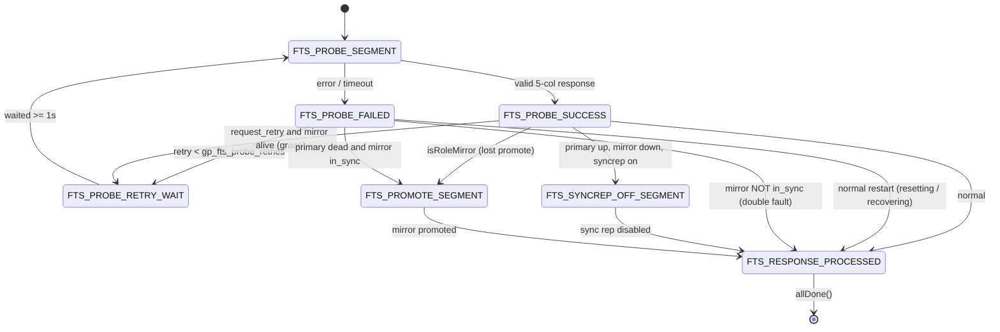

*FTS 的 Segment 状态机。失败后先经过 RETRY_WAIT（由 gp_fts_probe_retries 控制），再采取行动；成功响应可能进一步触发 SYNCREP_OFF 或 PROMOTE。*

### 20.5.5 系统目录写入内容与版本递增 {#2055-what-gets-written-to-the-catalog-and-the-version-bump}

系统目录写入由 `probeWalRepUpdateConfig()`（`src/backend/fts/fts.c`）执行：在同一事务中，向 `gp_configuration_history` 插入审计行，并切换 Segment 在 `gp_segment_configuration` 中对应元组的三个列：**role**（`p`/`m`）、**status**（`u`/`d`）、**mode**（`s`/`n`）。它还更新共享内存状态位图 `ftsProbeInfo->status[dbid]`，供查询派发的高频路径读取。发生任何变化时，`FtsLoop` 执行 `ftsProbeInfo->status_version++`；每次事务开始时都会将缓存的 `fts_version` 与之比较（`getFtsVersion()`）。如果不匹配，`cdbcomponent_updateCdbComponents()` 重建组件缓存，使 QD/QE 重新读取角色，在下一条语句中绕过失效的主实例。

### 20.5.6 镜像提升的完整流程 {#2056-mirror-promotion-end-to-end}

关键在于，**先更新系统目录，*再*发送 PROMOTE 消息**（`ftsprobe.c`，`processResponse()`），因此即使提升尚在进行，派发器也已停止使用失效的主实例。镜像在 `HandleFtsWalRepPromote()`（`src/backend/fts/ftsmessagehandler.c`）中处理 `FTS_MSG_PROMOTE`。此操作具有幂等性，仅在状态为 `DB_IN_ARCHIVE_RECOVERY` 时执行：调用 `UnsetSyncStandbysDefined()`，创建内部复制槽（使旧主实例稍后能够执行 `pg_rewind`），再调用 `SignalPromote()`，后者写入 `PROMOTE_SIGNAL_FILE` 并向 postmaster 发送信号；启动进程完成恢复，镜像以可写状态上线。

> [!NOTE]
> 这种镜像停机时的提升路径，正是回归修复**“确保 FTS 检测到镜像停机”**所强化的部分：探测必须可靠地观察到 `is_mirror_up = false`，关闭同步复制／故障切换逻辑才能确定地触发。

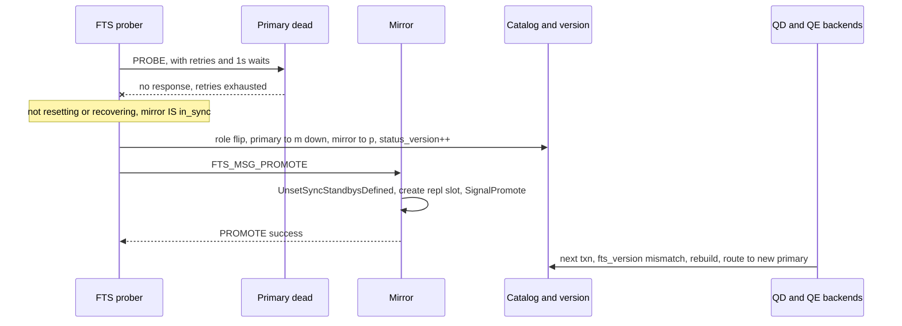

*故障切换：主实例探测失败（已重试，镜像已同步）时，先触发系统目录角色切换，再提升镜像。*

### 20.5.7 独立 gpfts + etcd {#2057-standalone-gpfts--etcd}

Cloudberry 还提供独立的 FTS 守护进程（`src/bin/gpfts/`），运行**相同**的探测状态机和消息协议。区别在于*领导权的来源*和*配置的存储位置*：gpfts 必须先获得分布式 **etcd** 锁才能探测（租约续期线程在续期失败时会退出整个进程，使处于网络分区中的 FTS 让出领导权）；它将整个配置序列化到 **etcd**，而不是写入 `gp_segment_configuration` 并递增共享内存中的版本号。使用方从 etcd 读回配置。决策逻辑相同，只有部署和存储方式不同。

## 20.6 一次故障的完整过程 {#206-a-failure-end-to-end}

### 20.6.1 场景：主 Segment 的主机在负载运行期间发生故障 {#2061-the-scenario-a-primary-segments-host-fails-under-load}

四个支柱齐备后，下面说明某个 Segment 主机在工作负载运行期间失效时，它们如何相互配合。时间线中的秒数仅作示意，但每次转换和每种机制都确实存在，并引用了此前介绍它的章节。

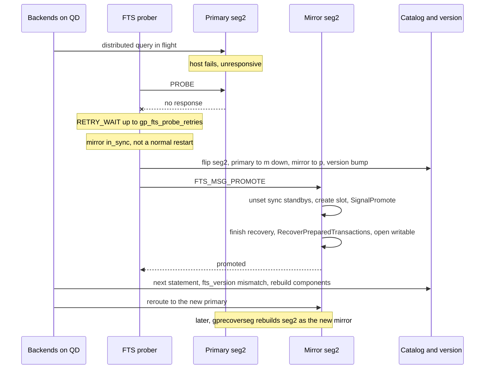

*一次 Segment 故障切换的完整过程：检测 → 重试 → 切换系统目录角色 → 提升镜像 → 重新路由 → 修复。*

### 20.6.2 逐阶段说明 {#2062-phase-by-phase}

- **t0：故障**——主 `seg2` 的主机停止响应，原因可能是断电、内核崩溃，或磁盘卡死；此时磁盘将无法通过探测的 `O_DIRECT` 读写检查（[§20.5.2](#2052-the-probe-protocol-and-the-response-fields)）。正在执行且访问 `seg2` 的查询报错，新的提交无法在该实例上完成。
- **t0–t5s：检测**——FTS 下一次探测 `seg2` 时未收到响应，因此该 Segment 的状态机从 PROBE 进入 `FTS_PROBE_FAILED`，随后经由 `RETRY_WAIT` 循环，最多重试 `gp_fts_probe_retries` 次，每次等待约 1 秒；短暂抖动不会直接触发故障处置（[§20.5.3](#2053-the-non-blocking-probe-cycle)、[§20.5.4](#2054-the-per-segment-state-machine)）。基于实际时间的 `gp_fts_probe_timeout` 保护防止 TCP 挂起拖住整个周期。
- **决策：提升，而非双重故障**——重试次数耗尽，这不是正常重启，且 `seg2` 的镜像报告**已同步**。因此，FTS 选择故障切换，而不宣告双重故障（[§20.5.4](#2054-the-per-segment-state-machine)）。
- **先写系统目录**——FTS 在发送 PROMOTE **之前**写入系统目录：失效主实例的角色变为 `m`、状态为停机，镜像的角色变为 `p`，并递增 `status_version`（[§20.5.5](#2055-what-gets-written-to-the-catalog-and-the-version-bump)、[§20.5.6](#2056-mirror-promotion-end-to-end)）。因此，即使提升尚在进行，派发器也已停止使用失效主实例。
- **提升**——FTS 发送 `FTS_MSG_PROMOTE`；镜像的 `HandleFtsWalRepPromote` 清除同步备用实例设置，创建内部复制槽（使旧主实例之后能执行 `pg_rewind`），并调用 `SignalPromote`。其启动进程完成恢复，镜像以**可写**状态开放（[§20.5.6](#2056-mirror-promotion-end-to-end)）。
- **新主实例的恢复**——完成恢复时运行 `RecoverPreparedTransactions`，重新载入该 Segment 持有的所有阶段 1 已准备 2PC 事务，并再次从 GID 中解析分布式 xid（[§20.4.5](#2045-how-prepared-phase-1-transactions-survive-a-crash)）。在集群层面，Coordinator 的 `dtx recovery` 工作进程协调处理未决分布式事务：提交已知已提交的事务，中止其余事务（[§20.4.4](#2044-distributed-recovery--the-second-layer)）。
- **重新路由**——每个 QD/QE 在下一条语句执行时，将缓存的 `fts_version` 与递增后的值比较。发现不匹配后，`cdbcomponent_updateCdbComponents()` 重建组件缓存，将工作路由到已提升的 Segment（[§20.5.5](#2055-what-gets-written-to-the-catalog-and-the-version-bump)）。
- **修复**——稍后，运维人员运行 `gprecoverseg`，选择**增量**恢复（`pg_rewind`，只复制发生分歧的块）或**完整**恢复（`pg_basebackup`）。重建后的 `seg2` 以新的**镜像**身份在 `standby.signal` 模式下启动，通过流复制追赶，随后 FTS 将其标记为运行状态（[§20.4.7](#2047-standby-promotion-and-segment-recovery)）。

### 20.6.3 为什么不会丢失已提交事务 {#2063-why-no-committed-transaction-is-lost}

此次故障切换不会丢失已确认提交，因为在告知客户端“已提交”**之前**，同步复制（[§20.3.3](#2033-synchronous-replication--waiting-for-the-mirrors-flush-lsn)）已将镜像的*刷盘* LSN 推进到每个已提交事务之后。因此，提升后的镜像已持有所有已确认的更改；恢复只需完成重放，并处理未决的 2PC 事务（[§20.4.4](#2044-distributed-recovery--the-second-layer)、[§20.4.5](#2045-how-prepared-phase-1-transactions-survive-a-crash)）。集群牺牲的是检测窗口内的*可用性*，其上限由 `gp_fts_probe_timeout` × `gp_fts_probe_retries` 决定，而不是*持久性*。

> [!NOTE]
> 如果故障发生时镜像**尚未**同步，FTS 会记录**双重故障**并使该 content 保持不可用，而不会提升过时的副本（[§20.5.4](#2054-the-per-segment-state-machine)）。这是有意牺牲可用性，确保集群不会以缺失数据的副本提供服务。

## 20.7 速查 {#207-quick-reference}

### 20.7.1 FTS 与恢复 GUC {#2071-fts-and-recovery-gucs}

默认值来自 `src/backend/utils/misc/guc_gp.c`；探测循环如何使用这些参数，见 [§20.5.1](#2051-process-model-triggering-and-key-gucs)。

*故障检测与 WAL／恢复的可调参数。*

| GUC | 默认值 | 范围 | 作用 |
| --- | --- | --- | --- |
| `gp_fts_probe_interval` | 60s | 10–3600 | 完整探测周期的间隔（[§20.5.1](#2051-process-model-triggering-and-key-gucs)）。 |
| `gp_fts_probe_timeout` | 20s | 0–3600 | 等待单个 Segment 响应的最长时间，超时后视为故障。 |
| `gp_fts_probe_retries` | 5 | 0–100 | 对故障采取行动之前的重试次数。 |
| `gp_fts_mark_mirror_down_grace_period` | 30s | — | 镜像断开连接后，在将其标记为停机之前保留的宽限时间。 |
| `gp_fts_replication_attempt_count` | 10 | — | Walsender 重连尝试达到此次数后，忽略过时的断开连接时间戳。 |
| `wal_segment_size` | 64MB | 1MB–1GB | WAL 段文件大小；CBDB 默认值为 64MB，PostgreSQL 为 16MB；在 initdb 时固定（[§20.2.4](#2024-wal-file-operations-segments-recycling-archiving)）。 |
| `synchronous_standby_names` | Segment 上为 `*` | — | 指定哪些备用实例必须确认；镜像失效时，FTS 将其清空（设为空字符串），以解除提交阻塞（[§20.3.4](#2034-the-tie-to-fts--disabling-syncrep-when-a-mirror-is-down)）。 |

### 20.7.2 事务 WAL 操作码（RM_XACT_ID） {#2072-transaction-wal-opcodes-rm_xact_id}

*九个 `RM_XACT_ID` info 字节操作码（[§20.2.7](#2027-the-distributed-commit-story-precisely)）。*

| 操作码 | 值 | 含义 |
| --- | --- | --- |
| `XLOG_XACT_COMMIT` | 0x00 | 本地提交（[§20.2.5](#2025-transaction-records-prepare--commit--abort-and-their-redo)）。 |
| `XLOG_XACT_PREPARE` | 0x10 | 2PC 阶段 1 准备。 |
| `XLOG_XACT_ABORT` | 0x20 | 本地中止。 |
| `XLOG_XACT_COMMIT_PREPARED` | 0x30 | 提交已准备事务。 |
| `XLOG_XACT_ABORT_PREPARED` | 0x40 | 中止已准备事务。 |
| `XLOG_XACT_ASSIGNMENT` | 0x50 | 子 xid → 顶层 xid 的分配。 |
| `XLOG_XACT_INVALIDATIONS` | 0x60 | 系统目录缓存失效消息。 |
| `XLOG_XACT_DISTRIBUTED_COMMIT` | 0x70 | Cloudberry 分布式提交，携带 gxid（[§20.2.7](#2027-the-distributed-commit-story-precisely)）。 |
| `XLOG_XACT_DISTRIBUTED_FORGET` | 0x80 | Cloudberry 分布式遗忘，表示 2PC 阶段 2 已完成（[§20.2.8](#2028-the-distributed-forget-record)）。 |

### 20.7.3 FTS 探测响应字段 {#2073-fts-probe-response-fields}

*固定包含 5 个布尔值的探测响应，由 `GetMirrorStatus` 填写（[§20.5.2](#2052-the-probe-protocol-and-the-response-fields)）。*

| 字段（Anum） | 设置条件 |
| --- | --- |
| `is_mirror_up` (0) | GP walsender 正在追赶且具有有效的写入 LSN，或正在流式传输。 |
| `is_in_sync` (1) | 镜像运行中*且*正在流式传输 → 系统目录中 `mode='s'`。 |
| `is_syncrep_enabled` (2) | 主实例已设置 `SYNC_STANDBY_DEFINED`。 |
| `is_role_mirror` (3) | Segment 认为自己是镜像，用于检测未生效的 PROMOTE。 |
| `request_retry` (4) | 镜像停机但仍在宽限期内，暂不标记为停机。 |

### 20.7.4 控制文件中的数据库状态（DBState） {#2074-control-file-database-states-dbstate}

*`StartupXLOG` 据以分支的 `ControlFile->state` 值（[§20.4.1](#2041-startupxlog-and-the-control-file-dbstate-switch)）。*

| 状态 | 启动时的含义 |
| --- | --- |
| `DB_SHUTDOWNED` | 正常停止，通常跳过重做。 |
| `DB_SHUTDOWNED_IN_RECOVERY` | 备用实例正常停止。 |
| `DB_SHUTDOWNING` | 关闭被中断 → 按崩溃处理。 |
| `DB_IN_CRASH_RECOVERY` | 恢复过程中再次崩溃。 |
| `DB_IN_ARCHIVE_RECOVERY` | 归档／备用重做期间崩溃。 |
| `DB_IN_PRODUCTION` | 运行期间崩溃，这是常见情况。 |
