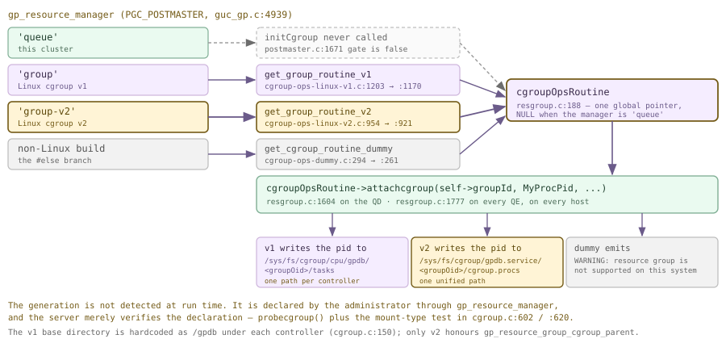
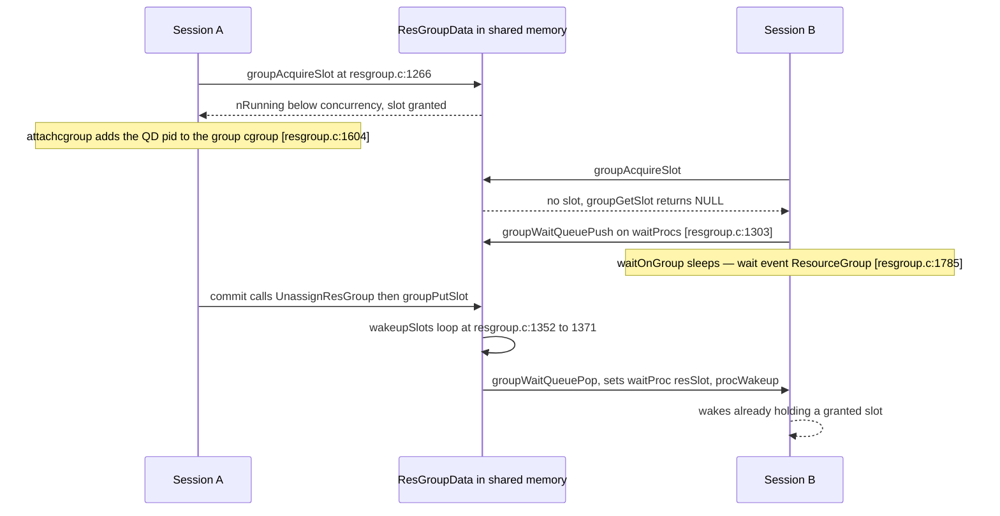
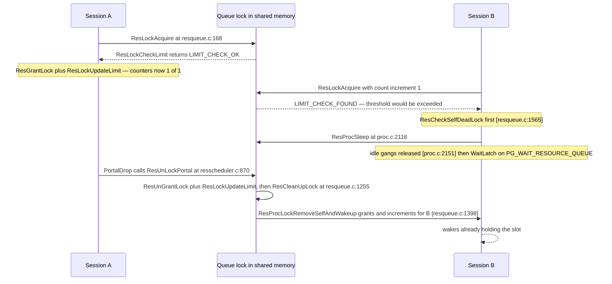

<style>
/*
 * Licensed to the Apache Software Foundation (ASF) under one
 * or more contributor license agreements.  See the NOTICE file
 * distributed with this work for additional information
 * regarding copyright ownership.  The ASF licenses this file
 * to you under the Apache License, Version 2.0 (the
 * "License"); you may not use this file except in compliance
 * with the License.  You may obtain a copy of the License at
 *
 *   http://www.apache.org/licenses/LICENSE-2.0
 *
 * Unless required by applicable law or agreed to in writing,
 * software distributed under the License is distributed on an
 * "AS IS" BASIS, WITHOUT WARRANTIES OR CONDITIONS OF ANY
 * KIND, either express or implied.  See the License for the
 * specific language governing permissions and limitations
 * under the License.
 */

/* Layout for the HTML-and-CSS figures, lifted from the handbook's own
   stylesheet so the figures render identically here. */

/* These four come from the handbook's own stylesheet; a consuming site has no
   such definitions, and an undefined custom property invalidates its whole
   declaration. Define them here, scoped to the figure.

   Deliberately NOT themed. The artwork below is light-only: band and tile
   backgrounds are hard-coded pastels, and the injected markup carries some 800
   more hard-coded light colours in inline styles. Giving --fg a dark-theme
   value paints near-white text onto a near-white band -- measured at 1.08:1,
   worse than the bug that replaced. The handbook's light values are correct in
   both themes; what changes for dark mode is the surface underneath. */
.cloudberry-core-figure {
  --border: #d8dee4;
  --soft:   #f6f8fa;
  --fg:     #1f2328;
  --muted:  #636c76;
  margin: 1.4rem 0;
}

/* Light-only artwork needs a light ground AND a dark ink, or it bleeds into a
   dark page. Setting only the ground is not enough: any text in these figures
   without its own inline colour inherits the site's near-white body colour, so
   it lands white-on-pastel -- measured at 1.03:1 across 184 text nodes. The
   colour has to be restored at the same place the ground is. */
[data-bs-theme='dark'] .cloudberry-core-figure > div {
  background: #ffffff;
  color: #1f2328;
  border-radius: 8px;
  padding: 10px;
}
/* Descendants that inherit rather than carry an inline colour. */
[data-bs-theme='dark'] .cloudberry-core-figure > div :not([style*="color"]) {
  color: inherit;
}
.cloudberry-core-figure figcaption {
  margin-top: .5rem;
  font-size: .9em;
  /* --ifm-color-emphasis-600 resolves to rgb(141,148,158) in the light theme,
     which is 3.06:1 on white -- below WCAG AA for the 37 figure captions.
     (The dark theme's value is fine, so only light is overridden.) */
  color: #636b75;
}
[data-bs-theme='dark'] .cloudberry-core-figure figcaption {
  color: #a6adb4;
}

/* Selective highlight: the handbook wraps a key token so it stands out.
   Scoped to the component. The class name .hl is two letters and this file
   lands in the consuming site's single global stylesheet, so an unscoped
   rule would style every page of that site. The standalone edition's
   figure.code / figure.session variants are dropped: those classes do not
   occur anywhere in this tree. */
.cloudberry-core-figure .hl { border-radius: 2px; font-weight: 700;
                   background: #fff8c5; color: #1f2328; padding: 0 2px; }

/* Layered module map and the banded brick figures. */
.cloudberry-core-figure .bricks { border:1px solid var(--border);border-radius:12px;overflow:hidden;background:var(--soft) }
.cloudberry-core-figure .bk-band { display:flex;align-items:stretch;border-top:1px solid var(--border) }
.cloudberry-core-figure .bk-band:first-child { border-top:none }
.cloudberry-core-figure .bk-lbl { flex:0 0 116px;display:flex;flex-direction:column;justify-content:center;gap:2px;padding:10px 13px }
.cloudberry-core-figure .bk-lbl b { font-size:12.5px;font-weight:800;color:var(--fg);line-height:1.2 }
.cloudberry-core-figure .bk-lbl span { font-size:9.5px;font-weight:700;color:var(--muted);text-transform:uppercase;letter-spacing:.5px }
.cloudberry-core-figure .bk-row { flex:1 1 auto;display:flex;flex-wrap:wrap;gap:7px;padding:9px 10px }
.cloudberry-core-figure .bk { flex:1 1 118px;min-width:104px;display:flex;flex-direction:column;justify-content:center;gap:2px; padding:8px 11px;border-radius:7px;border:1px solid;background:#fff;text-decoration:none;transition:.13s }
.cloudberry-core-figure .bk-t2 { font-size:12.5px;font-weight:700;line-height:1.25 }
.cloudberry-core-figure .bk-ch { font-size:10.5px;font-weight:700;font-variant-numeric:tabular-nums;opacity:.8 }
.cloudberry-core-figure a.bk:hover { transform:translateY(-2px);box-shadow:0 4px 12px #0000001f;text-decoration:none }
.cloudberry-core-figure .bk-q { background:#eef6ff }
.cloudberry-core-figure .bk-q .bk { border-color:#54aeff66;color:#0a3069;background:#ddf4ff }
.cloudberry-core-figure .bk-s { background:#eefcf2 }
.cloudberry-core-figure .bk-s .bk { border-color:#4ac26b80;color:#04260f;background:#dafbe1 }
.cloudberry-core-figure .bk-t { background:#fff6ef }
.cloudberry-core-figure .bk-t .bk { border-color:#fb8f4480;color:#5e2700;background:#fff1e5 }
.cloudberry-core-figure .bk-h { background:#fff4f3 }
.cloudberry-core-figure .bk-h .bk { border-color:#ff818280;color:#5c0011;background:#ffebe9 }
.cloudberry-core-figure .bk-r { background:#f3f5f8 }
.cloudberry-core-figure .bk-r .bk { border-color:#afb8c1;color:#1f2328;background:#eaeef2 }
@media (max-width: 560px) {
  .cloudberry-core-figure .bk-band { flex-direction:column }
  .cloudberry-core-figure .bk-lbl { flex-basis:auto;border-bottom:1px solid var(--border) }
}

</style>

<!--
  Licensed to the Apache Software Foundation (ASF) under one
  or more contributor license agreements.  See the NOTICE file
  distributed with this work for additional information
  regarding copyright ownership.  The ASF licenses this file
  to you under the Apache License, Version 2.0 (the
  "License"); you may not use this file except in compliance
  with the License.  You may obtain a copy of the License at

    http://www.apache.org/licenses/LICENSE-2.0

  Unless required by applicable law or agreed to in writing,
  software distributed under the License is distributed on an
  "AS IS" BASIS, WITHOUT WARRANTIES OR CONDITIONS OF ANY
  KIND, either express or implied.  See the License for the
  specific language governing permissions and limitations
  under the License.
-->


<a id="21-resource-management"></a>

## 21.1 资源组 {#211-resource-groups}

单节点 PostgreSQL 服务器遇到一个贪婪的查询，会损失一些吞吐量。MPP 集群遇到这样的查询，却可能拖垮一台*主机*：语句在每个 Segment 上展开为一个进程组，各进程全速读取，同机上的其他进程便无法继续推进。资源管理机制决定了*一条语句可以占用集群的多少资源*，Cloudberry 提供了两种相互独立的实现。**资源组**是现代实现，也是本节的主题；**资源队列**是旧版实现，将在 [§21.2](#212-resource-queues-legacy) 中介绍。

阅读本节时，要始终记住一个区别：资源组同时在两个截然不同的层面实施限制。并发和内存由*数据库*管理——通过共享内存中的计数器、等待队列，以及交给执行器的数值实现。CPU 核心和磁盘带宽由*内核*管理——通过 Linux 控制组实现，将纯文本写入 `/sys/fs/cgroup`。一个资源组对应一条系统目录记录，同时配置这两个层面；实现中值得探究的细节大多位于二者的衔接处。

### 21.1.1 两个限制层面与当前集群状态 {#2111-two-enforcement-planes-and-the-state-of-this-cluster}

先看问题的形态。本集群上的一条语句并不对应一个进程，而是一个 QD，加上每个切片在每个 Segment 上的一个 QE（[§1.3](/cloudberry/core-internals/#13-processes-and-memory)、[§1.4](/cloudberry/core-internals/#14-clients-the-wire-protocol--dispatch)、[§13.3](/cloudberry/core-internals/part-4-query-processing/ch13/#133-dispatch-from-coordinator-plan-to-segment-execution)）。“限制查询”因此必须意味着“同时限制每台主机上的*一组*进程”，而两个层面对这项工作的分工不同。槽位只获取**一次**，由 QD 在事务开始时获取（`xact.c` — `StartTransaction()`）。加入 cgroup 则发生 **N+1 次**：QD 加入自己的 pid（`resgroup.c` — `AssignResGroupOnMaster()`），每个 QE 在收到派发的资源组快照时也加入自己的 pid（`resgroup.c` — `SwitchResGroupOnSegment()`）。

<figure class="cloudberry-core-figure">
<div><div style="font-family:ui-monospace,SFMono-Regular,Menlo,monospace;font-size:12px;line-height:1.45"> <div style="border:1px solid #735a16;background:#fff4d6;border-radius:6px;padding:7px 11px;margin-bottom:11px"> <b>数据库层面</b> &nbsp;·&nbsp; 一条语句获取 &nbsp;<span class="hl">恰好一个槽位</span>&nbsp; 取自 <span style="color:#735a16">ResGroupData.nRunning</span>，仅在 Coordinator 上 &nbsp;·&nbsp; <span style="font-size:11px">resgroup.c:1138</span> </div> <div style="display:grid;grid-template-columns:repeat(4,1fr);gap:8px"> <div style="border:1px solid #cdb4db;background:#f5edff;border-radius:6px;padding:7px 9px"> <div style="font-weight:600">主机 A &nbsp;·&nbsp; QD</div> <div style="font-size:11px;color:#555;margin-top:3px">postgres pid 4171</div> <div style="font-size:10.5px;margin-top:6px;border-top:1px dashed #cdb4db;padding-top:5px">将 pid 写入<br/>gpdb.service/16385/cgroup.procs</div> </div> <div style="border:1px solid #cfead9;background:#eafaf0;border-radius:6px;padding:7px 9px"> <div style="font-weight:600">主机 B &nbsp;·&nbsp; QE seg0</div> <div style="font-size:11px;color:#555;margin-top:3px">postgres pid 5220</div> <div style="font-size:10.5px;margin-top:6px;border-top:1px dashed #cfead9;padding-top:5px">将 pid 写入<br/>gpdb.service/16385/cgroup.procs</div> </div> <div style="border:1px solid #cfead9;background:#eafaf0;border-radius:6px;padding:7px 9px"> <div style="font-weight:600">主机 C &nbsp;·&nbsp; QE seg1</div> <div style="font-size:11px;color:#555;margin-top:3px">postgres pid 5221</div> <div style="font-size:10.5px;margin-top:6px;border-top:1px dashed #cfead9;padding-top:5px">将 pid 写入<br/>gpdb.service/16385/cgroup.procs</div> </div> <div style="border:1px solid #cfead9;background:#eafaf0;border-radius:6px;padding:7px 9px"> <div style="font-weight:600">主机 D &nbsp;·&nbsp; QE seg2</div> <div style="font-size:11px;color:#555;margin-top:3px">postgres pid 5222</div> <div style="font-size:10.5px;margin-top:6px;border-top:1px dashed #cfead9;padding-top:5px">将 pid 写入<br/>gpdb.service/16385/cgroup.procs</div> </div> </div> <div style="font-size:11px;color:#555;margin-top:9px"> <b>内核层面</b> &nbsp;·&nbsp; 除 <i>concurrency</i> 和 <i>memory_quota</i> 外，每项能力都由<i>各主机上独立存在</i>的 cgroup 实施限制。因此，<code>cpu_max_percent</code> 表示&ldquo;<i>本机</i>的百分比&rdquo;，而非&ldquo;集群的百分比&rdquo;。本手册使用的演示集群中，四个进程恰好共用一台机器；图中展示的是一般情况。 </div> </div></div>
<figcaption>一个槽位，N+1 次加入 cgroup。数据库层面只计数一次；内核层面则必须在各主机上逐进程告知。</figcaption>
</figure>

实际采用哪种管理器，由一个字符串型 GUC 决定。它不是枚举，因此下面的 `enumvals` 为空；其上下文为 `PGC_POSTMASTER`，定义位于 `guc_gp.c`（`config_string`），并配有 check/assign/show 三个钩子（`guc.h`），其中 assign 钩子是 `gpvars_assign_gp_resource_manager_policy`（`cdbvars.c`）。该函数只接受三种取值；选择两种 group 取值中的任意一种时，还会自动设置 `gp_enable_resqueue_priority = false`（`cdbvars.c` — `gpvars_assign_gp_resource_manager_policy()`）：两个管理器在实现上就互斥，而不是靠使用策略来约束。

*本集群的管理器选择参数——字符串型 GUC，只能在 postmaster 启动时设置。*

```sql
SELECT name, setting, context, vartype, enumvals, extra_desc
  FROM pg_settings WHERE name = 'gp_resource_manager';

SET gp_resource_manager = 'group-v2';
```

```text {hl_lines="3" title="output"}
        name         | setting |  context   | vartype | enumvals |                      extra_desc
---------------------+---------+------------+---------+----------+-------------------------------------------------------
 gp_resource_manager | queue | postmaster | string  |          | Only support "queue", "group" and "group-v2" for now.
(1 row)

ERROR:  parameter "gp_resource_manager" cannot be changed without restarting the server
```

> [!NOTE]
> **请先阅读本提示，再阅读本节其余内容。** 这里的 `gp_resource_manager` 为 `queue`，必须重启集群才能修改，而重启超出了本手册演示的范围。因此，本机上的资源组**可以完整检查，但不实施限制**：系统目录是真实的，DDL 可以运行，视图也存在，源码就是这份源码——但不会获取任何槽位，也不会向任何 cgroup 写入内容。下文会明确说明各项内容来自检查还是实际限制。要启用资源组，必须满足三项要求：在每台主机的 `postgresql.conf` 中设置 `gp_resource_manager = 'group'` 或 `'group-v2'`，重启，以及预先创建一个 `gpadmin` 用户可写的 cgroup 层次结构；对于 v2，需要在 `cgroup2` 挂载点正下方创建由 `gp_resource_group_cgroup_parent` 指定的目录（这里是 `gpdb.service`）。本机无法满足第二项条件，[§21.1.3](#2113-the-cgroup-abstraction-layer) 将讨论这一点。

*即使重启，这里也无法使用 'group-v2'：CentOS 7 内核没有统一层次结构。*

```bash
$ grep cgroup /proc/self/mounts
$ grep -c cgroup2 /proc/self/mounts
$ ls -d /sys/fs/cgroup/*/gpdb*
$ uname -r
```

```text {hl_lines="9" title="output"}
tmpfs  /sys/fs/cgroup          tmpfs  rw,nosuid,nodev,noexec,relatime,mode=755 0 0
cgroup /sys/fs/cgroup/systemd  cgroup rw,...,name=systemd 0 0
cgroup /sys/fs/cgroup/blkio    cgroup rw,...,blkio 0 0
cgroup /sys/fs/cgroup/cpuacct,cpu cgroup rw,...,cpuacct,cpu 0 0
cgroup /sys/fs/cgroup/cpuset   cgroup rw,...,cpuset 0 0
cgroup /sys/fs/cgroup/memory   cgroup rw,...,memory 0 0
... (12 cgroup mounts, all mnt_type "cgroup")

0                            <-- no cgroup2 mount anywhere

ls: cannot access '/sys/fs/cgroup/*/gpdb*': No such file or directory

3.10.0-1160.119.1.el7.x86_64
```

### 21.1.2 资源组模型：一行能力配置 {#2112-the-group-model-one-row-of-capabilities}

资源组由一个名称和七项能力组成。每个集群都有三个内置组；这里虽然处于 `queue` 模式，它们也原封不动地存在：`default_group` 面向普通角色，`admin_group` 面向超级用户和预定义的 `pg_*` 角色，而 `system_group` 的 `concurrency = 0`，用于归集辅助后端的资源使用，不能准入任何语句。系统目录由两张表构成：`pg_resgroup` 保存名称，`pg_resgroupcapability` 按能力项各存一行，以一个小整数为键；`gp_toolkit.gp_resgroup_config` 再将这两张表转换为便于阅读的形式。

*三个内置组：先查看 gp_resgroup_config 转换后的形式，再查看两张原始表。*

```sql
SELECT * FROM gp_toolkit.gp_resgroup_config;

SELECT r.rsgname, c.reslimittype, c.value
  FROM pg_resgroup r JOIN pg_resgroupcapability c ON c.resgroupid = r.oid
 WHERE r.rsgname = 'default_group' ORDER BY c.reslimittype;
```

```text {hl_lines="3" title="output"}
 groupid |   groupname   | concurrency | cpu_max_percent | cpu_weight | cpuset | memory_quota | min_cost | io_limit
---------+---------------+-------------+-----------------+------------+--------+--------------+----------+----------
    6437 | default_group | 20          | 20              | 100        | -1     | -1           | 500    | -1
    6438 | admin_group   | 10          | 10              | 100        | -1     | -1           | 500      | -1
    6448 | system_group  | 0           | 10              | 100        | -1     | -1           | 500      | -1
(3 rows)

    rsgname    | reslimittype | value
---------------+--------------+-------
 default_group |            1 | 20        <-- concurrency
 default_group |            2 | 20        <-- cpu_max_percent
 default_group |            3 | 100       <-- cpu_weight
 default_group |            4 | -1        <-- cpuset
 default_group |            5 | -1        <-- memory_quota
 default_group |            6 | 500       <-- min_cost
 default_group |            7 | -1        <-- io_limit
(7 rows)
```

这些小整数就是 `ResGroupLimitType`（`pg_resgroup.h`）。它们使系统目录在跨版本时保持稳定，即使能力项的*名称*发生变化。本节描述的是现代 Cloudberry 的能力项集合；旧 Greenplum 资料使用的是另一套名称（`memory_limit`、`memory_shared_quota`、`memory_spill_ratio`），当前源码树已完全不再使用。在 C 代码中，同样的七个值位于 `ResGroupCaps`（`resgroup.h`），该结构按值复制到每个槽位，并派发给每个 QE。

| 能力项 | reslimittype | 管理内容（每台 Segment 主机） |
| --- | --- | --- |
| `concurrency` | 1 | 组内可以同时运行的语句数。事务在执行其他操作之前，先在 Coordinator 上获取一个槽位。`0` 表示不准入任何语句，`system_group` 就是如此。范围为 `[0, max_connections]`（`resgroupcmds.c` — `checkResgroupCapLimit()`）。 |
| `cpu_max_percent` | 2 | CPU 硬上限，以主机 CPU 的百分比表示；在 cgroup v1 下写入 `cpu.cfs_quota_us`（`cgroup-ops-linux-v1.c` — `setcpulimit_v1()`），在 v2 下写入 `cpu.max`（`cgroup-ops-linux-v2.c` — `setcpulimit_v2()`）。范围为 `[1, 100]`，也可设为 `-1` 以禁用上限。 |
| `cpu_weight` | 3 | 当 CPU 存在争用且不受上限约束时使用的比例份额；按 1024/100 缩放后，写入 `cpu.shares`（v1）或 `cpu.weight`（v2，`setcpuweight_v2()`）。范围为 `[1, 500]`，默认值为 `100`。 |
| `cpuset` | 4 | 显式指定的核心列表，例如 `'0-1'`，写入 `cpuset` 控制器。设置它会强制将 `cpu_max_percent` 设为 `-1`（`resgroupcmds.c` — `parseStmtOptions()`）——一个组要么绑定核心，要么限制 CPU 用量，不能兼有。 |
| `memory_quota` | 5 | 组的内存预算，单位为 MB。将其除以 `concurrency`，即可得到每条语句的 `query_mem`（`resgroup.c` — `ResourceGroupGetQueryMemoryLimit()`）。默认值 `-1` 表示“不设置组预算，使用 `statement_mem`”。 |
| `min_cost` | 6 | 规划器代价下限。代价低于此值的计划会完全脱离资源组，而不占用槽位。默认值为 `500`。 |
| `io_limit` | 7 | 按表空间设置的读写带宽和 IOPS 上限，写入 `io.max`。**仅限 cgroup v2**。`-1` 表示不限制。 |

在各组设置之上，还有两个主机级参数。这里需要说明它们，因为 `cpu_max_percent` 的绝对含义取决于这两个参数。`gp_resource_group_cpu_limit`（这里为 `0.9`）规定*整个数据库*可以消耗的机器 CPU 比例，用于设置父 cgroup 的配额（`cgroup-ops-linux-v1.c` — `init_cpu_v1()`，`cgroup-ops-linux-v2.c` — `init_cpu_v2()`）；`gp_resource_group_cpu_priority`（这里为 `10`）是父组权重的倍数（`v1:446`、`v2:226`），也就是 Cloudberry 整体与本机其他工作负载争用资源时的相对权重。因此，设置 `cpu_max_percent = 20` 的组请求的是数据库所占 90% CPU 中的 20%，而不是整台机器 CPU 的 20%。

`memory_quota` 从资源组一侧回答了 [§18.1](/cloudberry/core-internals/part-4-query-processing/ch18/#181-executor-framework--lifecycle) 特意留下的问题。该章展示了 `EXPLAIN ANALYZE` 的末尾信息——`Memory used:  128000kB` / `Memory wanted:  14040kB`——并说明内存授予一侧由第 21 章负责介绍。对于资源组，授予逻辑位于 `ResourceGroupGetQueryMemoryLimit`（`resgroup.c`）：如果 `memory_quota` 为 `-1`，它直接返回 `statement_mem`；否则返回 `memory_quota * 1024 * 1024 / concurrency`，若用户请求的 `statement_mem` 更高，则以它为下限。*本集群*的数值则来自资源队列路径，[§21.2](#212-resource-queues-legacy) 会完整追踪；两条路径的分叉只是一个 `if`，本节末尾会展示。

`min_cost` 值得单独说明，因为它是最容易出乎意料的能力项。在允许一条语句于整个事务期间占用槽位之前，会将计划的 `total_cost` 与它比较（`can_bypass_based_on_plan_cost`，`resgroup.c`）；代价更低的计划会归还槽位，并在不受管理的情况下运行。默认值为 `500`。以规划器的代价单位衡量，这个数值非常小；查看一张 200 000 行表上的实际计划就能清楚地看出这一点。

*min_cost = 500 实际排除了哪些查询。所有代价均来自 GPORCA；这些是在一台机器上比较所得的比例，并非基准测试。*

```sql
CREATE TABLE m211_t (id int, v text) DISTRIBUTED BY (id);
INSERT INTO m211_t SELECT g, 'x'||g FROM generate_series(1,200000) g;
ANALYZE m211_t;

EXPLAIN SELECT count(*) FROM m211_t;
EXPLAIN SELECT a.id FROM m211_t a JOIN m211_t b ON a.v = b.v ORDER BY a.id LIMIT 10;
```

```text {hl_lines="3" title="output"}
                                     QUERY PLAN
------------------------------------------------------------------------------------
 Finalize Aggregate  (cost=0.00..432.77 rows=1 width=8)
   ->  Gather Motion 3:1  (slice1; segments: 3)  (cost=0.00..432.77 rows=1 width=8)
         ->  Partial Aggregate  (cost=0.00..432.77 rows=1 width=8)
               ->  Seq Scan on m211_t  (cost=0.00..432.65 rows=66667 width=1)
 Optimizer: GPORCA
(5 rows)

                                     QUERY PLAN
------------------------------------------------------------------------------------
 Limit  (cost=0.00..925.74 rows=10 width=4)
   ->  Gather Motion 3:1  (slice1; segments: 3)  (cost=0.00..925.74 rows=10 width=4)
         ...
               ->  Sort  (cost=0.00..925.74 rows=66667 width=4)
                     ->  Hash Join  (cost=0.00..901.51 rows=66667 width=4)
                           ->  Redistribute Motion 3:3  (slice2; segments: 3)  ...
                           ->  Hash  (cost=434.98..434.98 rows=66667 width=7)
 Optimizer: GPORCA
(16 rows)
```

> [!NOTE]
> 在三个 Segment 上对 200 000 行执行完整扫描和聚合，代价为 **432.77**，低于默认的 `min_cost` 值 500，因此完全不会占用槽位。双表哈希连接再加排序的代价为 **925.74**，因此会占用槽位。这里并非说默认值不正确，而是说 `min_cost` 是一个*规划器代价*阈值，规划器代价与你实际希望限制的资源只有大致的关联。应像上面阅读两条 `EXPLAIN` 的结果那样，根据自身工作负载的实际计划来调节它，而不是凭对“小查询”的直觉。

### 21.1.3 cgroup 抽象层 {#2113-the-cgroup-abstraction-layer}

内核层面的所有操作都经过一层间接调用，这是该子系统中最值得研究的代码。`CGroupOpsRoutine`（`cgroup.h`）是一个包含 **26 个函数指针**的结构体，覆盖了资源组内核侧状态的整个生命周期：命名、探测、检查、初始化、调整相关 GUC、创建和销毁目录、加入和移出进程、加锁和解锁、设置与读取 CPU 上限、权重、使用量和核心集合，以及为 v2 新增的 IO 限制解析、应用、释放、读取、输出和清除。

```c {title="src/include/utils/cgroup.h — CGroupOpsRoutine"}
typedef struct CGroupOpsRoutine
{
	getcgroupname_function 	getcgroupname;
	probecgroup_function	probecgroup;
	checkcgroup_function 	checkcgroup;
	initcgroup_function 	initcgroup;
	adjustgucs_function 	adjustgucs;
	createcgroup_function 	createcgroup;
	/* ... attach/detach, lock/unlock, cpu, cpuset, memory ... */
	parseio_function		parseio;
	setio_function			setio;
	getiostat_function		getiostat;
} CGroupOpsRoutine;      /* 26 function pointers in all */
```



*通过 CGroupOpsRoutine 派发调用。管理员设置的 GUC 值在 postmaster 启动时选定三个虚函数表之一；此后内核层面的每项操作都通过这个唯一的全局指针调用。*

先关注其结构而非具体内容，因为本手册已是第三次展示这种手法。[§18.1.6](/cloudberry/core-internals/part-4-query-processing/ch18/#1816-tupletableslot-one-tuple-four-physical-forms) 介绍了 `TupleTableSlotOps`，这个虚函数表让同一个执行器可以调用 `slot_getsomeattrs`，而无须知道底层元组是堆元组、最小元组、虚拟元组还是 AO 列存形式。表访问方法在更低一层采用了同样的思路，使同一个 `ExecScan` 可以遍历堆关系或 AO 关系。`CGroupOpsRoutine` 又一次采用了这一思路，不过是向*外*扩展一层，让同一个资源管理器写入 CPU 限制，而不必知道挂载的是哪一代 Linux 控制组。三个互不相关的子系统采用了同一种模式：把变化封装在函数指针结构体之后，启动时选定一个结构体，让各调用点无须了解差异。认识这种模式，比单独理解这三个实例中的任何一个都更有价值。

接下来才是出人意料的部分。人们可能以为，这样的层次会先*探测*环境：查看 `/proc/self/mounts`，发现 `cgroup2` 文件系统，然后选择 v2。实际并非如此。`initCgroup`（`resgroup.c`）完全根据 GUC 选择，`else` 分支表明，这两个 Linux 虚函数表由管理员配置的字符串决定，而不是由内核报告的信息决定：

```c {title="src/backend/utils/resgroup/resgroup.c — initCgroup()"}
#ifdef __linux__
	if (Gp_resource_manager_policy == RESOURCE_MANAGER_POLICY_GROUP)
	{
		cgroupOpsRoutine = get_group_routine_v1();
		cgroupSystemInfo = get_cgroup_sysinfo_v1();
	}
	else
	{
		cgroupOpsRoutine = get_group_routine_v2();
		cgroupSystemInfo = get_cgroup_sysinfo_v2();
	}
#else
```

验证在选择之后进行，而且只是对已经作出的声明给出“是”或“否”。赋值之后立即运行 `probecgroup()`（`resgroup.c` — `initCgroup()`）；若返回 false，`initCgroup()` 就会报出 `elog(ERROR, "The control group is not well configured...")` 硬错误。由于这发生在 postmaster 中，服务器无法启动。两种探测实现都执行同样的两步：查找挂载目录，然后检查资源组所需的权限（`cgroup-ops-linux-v1.c` — `probecgroup_v1()`，`cgroup-ops-linux-v2.c` — `probecgroup_v2()`）。直到 `getCgroupMountDir`（`cgroup.c`）才真正查询内核；即便在那里，也是 GUC 决定哪个 `mnt_type` 字符串算作匹配：`getCgroupMountDir()` 中的 `"cgroup"` 或 `getCgroupMountDir()` 中的 `"cgroup2"`。v1 还会去掉末尾的控制器路径分量，将 `/sys/fs/cgroup/cpu` 变为 `/sys/fs/cgroup`。如果在 v1 主机上声明使用 v2，循环就找不到匹配项，探测失败，postmaster 拒绝启动。这里没有回退机制。

在本集群中，整条调用链提前一步就被跳过了。`initCgroup` 只有一处调用点，位于 `postmaster.c`（`PostmasterMain()`），受 `if (IsResGroupEnabled)` 保护；而在 `queue` 模式下，`IsResGroupEnabled()`（`resource_manager.h`）为 false。因此，`cgroupOpsRoutine` 从未被赋值，一直保持初始的 `NULL`（`resgroup.c`）。这个 NULL 可以直接观察到，因为有两个能力项必须*在执行 DDL 时*与内核交互，它们会检查该指针并拒绝执行：

*通过 DDL 暴露出的 NULL 全局指针。两条错误从不同角度反映了同一个事实。*

```sql
CREATE RESOURCE GROUP m211_io
  WITH (cpu_max_percent=10, io_limit='pg_default:rbps=100,wbps=200,riops=1000,wiops=max');

ALTER RESOURCE GROUP m211_rg SET cpuset '0-1';
```

```text {hl_lines="1" title="output"}
ERROR:  resource group must be enabled to use io limit feature
        -- resgroupcmds.c:1022:  if (cgroupOpsRoutine == NULL)

ERROR:  resource group must be enabled to use cpuset feature
        -- resgroup.c:3185, reached from EnsureCpusetIsAvailable
```

> [!NOTE]
> 这是一条已从头到尾验证的完整因果链，值得连起来再读一遍：`gp_resource_manager = 'queue'` &rarr; `IsResGroupEnabled()` 为 false（`resource_manager.h`）&rarr; 跳过 `initCgroup()`（`postmaster.c` — `PostmasterMain()`）&rarr; `cgroupOpsRoutine` 保持 NULL（`resgroup.c`）&rarr; 拒绝 `io_limit` 和 `cpuset` 的 DDL（`resgroupcmds.c` — `parseStmtOptions()`，`resgroup.c` — `EnsureCpusetIsAvailable()`）。由此还可推知：这里的 `io_limit` 字符串甚至不会传给解析器，因为 NULL 检查位于 `cgroupOpsRoutine->parseio()` *之前*。因此，[§21.1.6](#2116-io_limit-gets-its-own-grammar) 中的语法是从源码中阅读得来的，并未实际执行。

### 21.1.4 DDL 与未实施限制时的系统目录含义 {#2114-ddl-and-what-the-catalog-means-when-nothing-is-enforcing}

DDL 实现在 `resgroupcmds.c` 中，包括 `CreateResourceGroup`、`DropResourceGroup`、`AlterResourceGroup`；`GetResGroupIdForRole` 通过 `pg_authid.rolresgroup` 查询登录角色到资源组的映射。三种 DDL 都会作为实用语句派发给各 Segment（`CdbDispatchUtilityStatement`），使每台主机上的系统目录保持一致。随后三者都会分支：如果资源组已激活，还会操作共享内存和 cgroup 文件系统；否则输出警告并结束。这条警告是本节最能说明问题的输出。

*queue 模式下的资源组 DDL：系统目录写入成功，限制未生效，服务器会明确告知。*

```sql
CREATE RESOURCE GROUP m211_rg
  WITH (concurrency=4, cpu_max_percent=20, memory_quota=512, min_cost=2000);

SELECT groupid, groupname, concurrency, cpu_max_percent, cpu_weight,
       cpuset, memory_quota, min_cost, io_limit
  FROM gp_toolkit.gp_resgroup_config WHERE groupname = 'm211_rg';
```

```text {hl_lines="1" title="output"}
WARNING:  resource group is disabled
HINT:  To enable set gp_resource_manager=group
CREATE RESOURCE GROUP

 groupid | groupname | concurrency | cpu_max_percent | cpu_weight | cpuset | memory_quota | min_cost | io_limit
---------+-----------+-------------+-----------------+------------+--------+--------------+----------+----------
   50932 | m211_rg   | 4           | 20              | 100        | -1     | 512          | 2000     | -1
(1 row)
```

请仔细阅读这条警告，因为它描述的是一项设计决策，而不是缺陷。**系统目录是权威且可迁移的；是否实施限制则取决于运行模式。** 今天在 `queue` 集群上写入的组定义，可以经由 `pg_dump` 保留，也可以在升级后保留；只要有人切换 GUC 并重启，它就开始实施限制，无须重新编写定义。警告来自 `resgroupcmds.c`（`CreateResourceGroup()`）中 `if (IsResGroupActivated)` 的 `else` 分支。相比之下，验证*不会*推迟：无论处于何种模式，都会运行 `checkResgroupCapLimit`（`resgroupcmds.c`）和 `parseStmtOptions`，因此不合理的组定义从一开始就无法进入系统目录。

*两种模式下都会执行验证；角色分配展示了两个管理器如何在同一条 CREATE ROLE 中写入各自的信息。*

```sql
CREATE RESOURCE GROUP m211_bad WITH (concurrency=4, cpu_max_percent=0);
CREATE RESOURCE GROUP m211_bad WITH (cpu_max_percent=20, cpu_weight=99999);
CREATE RESOURCE GROUP m211_bad WITH (cpu_max_percent=20, foo=1);

ALTER RESOURCE GROUP m211_rg SET concurrency 8;
CREATE ROLE m211_u LOGIN RESOURCE GROUP m211_rg;
SELECT rrrolname, rrrsgname FROM gp_toolkit.gp_resgroup_role
 WHERE rrrolname LIKE 'm21%';
```

```text {hl_lines="15" title="output"}
ERROR:  cpu_max_percent range is [1, 100] or equals to -1
ERROR:  cpu_weight range is [1, 500]
ERROR:  option "foo" not recognized

ALTER RESOURCE GROUP

NOTICE:  resource queue required -- using default resource queue "pg_default"
WARNING:  resource group is disabled
HINT:  To enable set gp_resource_manager=group
CREATE ROLE

 rrrolname |   rrrsgname
-----------+---------------
 m212_u    | default_group
 m211_u    | m211_rg
(2 rows)
```

这条 `CREATE ROLE` 给出的两条诊断，最清楚地展示了两个管理器的共存。`NOTICE` 表明新角色被分配了默认资源*队列*，因为当前启用的是队列管理器；`WARNING` 表明显式请求的资源*组*已记录，但处于禁用状态。两条消息都属实，两套系统目录都已写入，而且集群中的每个角色都带有 `rolresgroup`，无论它是否会被实际采用；上面的 `gp_resgroup_role` 只是基于 `pg_authid` 的普通连接查询。（`m212_u` 属于 [§21.2](#212-resource-queues-legacy) 的演示；这里出现它，只是因为该视图涵盖所有角色。）删除资源组时，同样根据系统目录而不是运行模式作出判断：

*正在使用的组在任何模式下都不能删除。随后清理 m211_\* 对象。*

```sql
DROP RESOURCE GROUP m211_rg;
ALTER ROLE m211_u RESOURCE GROUP default_group;
DROP RESOURCE GROUP m211_rg;
DROP ROLE m211_u;
DROP TABLE m211_t;
```

```text {hl_lines="1" title="output"}
ERROR:  resource group is used by at least one role

WARNING:  resource group is disabled
HINT:  To enable set gp_resource_manager=group
ALTER ROLE

DROP RESOURCE GROUP
DROP ROLE
DROP TABLE
```

### 21.1.5 运行时准入控制 {#2115-admission-control-at-run-time}

本小节的一切都来自源码阅读，而非运行观察——本集群从不获取资源组槽位。入口是 `AssignResGroupOnMaster`（`resgroup.c`），由 `StartTransaction`（`xact.c`）在事务已经开始*之后*调用，因为判断会话属于哪个组需要读取 `pg_authid`。与之对应的是 `UnassignResGroup`（`RecordTransactionCommit()`），在提交或中止时执行。槽位本身是这里最小而又值得关注的对象：`ResGroupSlotData`（`resgroup.c`）基本只包含一个组指针、一个进程计数、一个空闲链表链接，以及七项能力值的按值副本。这个副本就是*快照*，因此运行期间执行 `ALTER RESOURCE GROUP` 不会改变正在运行的语句所遵循的规则。

```c {title="src/backend/utils/resgroup/resgroup.c — groupGetSlot()"}
	caps = &group->caps;

	/* First check if the concurrency limit is reached */
	if (group->nRunning >= caps->concurrency)
		return NULL;

	/* Now actually get a free slot */
	slot = slotpoolAllocSlot();
	initSlot(slot, group);
	group->nRunning++;

	return slot;
```



*槽位获取、排队与移交。所有操作都在以排他模式持有 ResGroupLock 时进行；等待者休眠时不持有该锁。*

等待队列严格遵循 FIFO，是直接挂在资源组上的一条 `PGPROC` 链接 `dclist`（`ResGroupData.waitProcs`，`resgroup.c`）。它的五个操作——`groupWaitQueuePush`、`groupWaitQueuePop`、`groupWaitQueueErase`、`groupWaitQueueIsEmpty` 和仅用于断言的 `groupWaitQueueValidate`——调用时都必须以排他模式持有 `ResGroupLock`。注意 `wakeupSlots` 的移交规则：唤醒者先替休眠者*获取*槽位，将其存入 `waitProc->resSlot`，然后才唤醒它，因此被唤醒的进程绝不会在竞争中输给后来者。`gp_resource_group_queuing_timeout`（`resgroup.c` — `waitOnGroup()`）限制休眠时长；这里的值为 `0`，表示无限等待。另一条路径由 SQL 函数 `pg_resgroup_move_query(sessionId, groupName)` 背后的 `ResGroupMoveQuery` 提供，可以把已在运行的会话移到另一个组，等待时长受 `gp_resource_group_move_timeout` 限制（`resGroupGiveSlotAway()`）。

Segment 一侧完成了 [§21.1.1](#2111-two-enforcement-planes-and-the-state-of-this-cluster) 中的 N+1 次操作，复用了 [§13.3](/cloudberry/core-internals/part-4-query-processing/ch13/#133-dispatch-from-coordinator-plan-to-segment-execution) 的派发机制，并未另起一套实现。QD 获取槽位后，将组 ID 和能力快照序列化到 `'M'` 派发消息中（`SerializeResGroupInfo`，`cdbdisp_query.c` — `buildGpQueryString()`）；每个 QE 在主循环中解包消息，并调用 `SwitchResGroupOnSegment`（`postgres.c` — `PostgresMain()`，实现在 `resgroup.c` 中）。该函数分配一个 Segment 本地槽位，并在 `SwitchResGroupOnSegment()` 中将*自身*的 pid 加入资源组的 cgroup。槽位计数以 Coordinator 一侧为准，cgroup 成员关系则由各主机分别维护；同一个能力结构体驱动着二者。

### 21.1.6 io_limit 的专用语法 {#2116-io_limit-gets-its-own-grammar}

七项能力中有六项是整数。第七项 `io_limit` 则是一门小语言：以分号分隔的表空间子句列表，每个子句指定一个表空间（名称、OID，或用 `*` 代表全部），然后列出以逗号分隔的四个键 `rbps`、`wbps`、`riops`、`wiops` 的设置；其值可以是整数，也可以是字面值 `max`。Cloudberry 没有手写解析器，而是为此提供了**专用的 bison 语法和 flex 扫描器**，并使用前缀让它们能与主 SQL 解析器共存于同一个二进制文件中：`io_limit_gram.y`（213 行，生成 1835 行）和 `io_limit_scanner.l`（124 行，生成 2483 行），运行时实现在 `cgroup_io_limit.c` 中。

```c {title="src/backend/utils/resgroup/io_limit_gram.y"}
%define api.pure true
%define api.prefix {io_limit_yy}
%error-verbose
...
%union {
	char *str;
	uint64 integer;
	IOconfig *ioconfig;
	TblSpcIOLimit *tblspciolimit;
	List *list;
}
...
%parse-param { IOLimitParserContext *context }
```

扫描器也值得看一眼，因为它*有状态*：看到 `:` 时，会执行 `BEGIN ts_param`（`io_limit_scanner.l`）；只有在该状态中，模式 `[wr](b|io)ps` 才会生成 `IO_KEY` 词法单元，单词 `max` 才会生成 `VALUE_MAX`。在该状态之外，同样的字符只是标识符；因此，合法命名为 `rbps` 的表空间仍然能够解析。错误信息会带上脱字符指示位置：`io_limit_yyerror` 报告 `errhint(" %s\n %*c", line, io_limit_yycolumn, '^')`，指向原始字符串中出错的列。

<figure class="cloudberry-core-figure">
<div><div style="font-family:ui-monospace,SFMono-Regular,Menlo,monospace;font-size:12px;line-height:1.5"> <div style="background:#fff4d6;border:1px solid #735a16;border-radius:6px;padding:8px 11px"> <span style="font-size:10.5px;color:#735a16">io_limit &nbsp;=&gt;</span>&nbsp; <span style="background:#e4d3f5;padding:1px 4px;border-radius:3px">pg_default</span><b>:</b><span style="background:#d8f0e2;padding:1px 4px;border-radius:3px">rbps</span>=<span style="background:#ffe3b3;padding:1px 4px;border-radius:3px">100</span><b>,</b><span style="background:#d8f0e2;padding:1px 4px;border-radius:3px">wbps</span>=<span style="background:#ffe3b3;padding:1px 4px;border-radius:3px">200</span><b>,</b><span style="background:#d8f0e2;padding:1px 4px;border-radius:3px">riops</span>=<span style="background:#ffe3b3;padding:1px 4px;border-radius:3px">1000</span><b>,</b><span style="background:#d8f0e2;padding:1px 4px;border-radius:3px">wiops</span>=<span style="background:#ffe3b3;padding:1px 4px;border-radius:3px">max</span> <div style="font-size:10px;color:#735a16;margin-top:5px"> <span style="background:#e4d3f5;padding:0 3px">ID</span> 或 <span style="background:#e4d3f5;padding:0 3px">NUMBER</span> 或 <span style="background:#e4d3f5;padding:0 3px">STAR</span> &nbsp;·&nbsp; <span style="background:#d8f0e2;padding:0 3px">IO_KEY</span>，仅在扫描器的 ts_param 状态内 &nbsp;·&nbsp; <span style="background:#ffe3b3;padding:0 3px">NUMBER</span> 或 <span style="background:#ffe3b3;padding:0 3px">VALUE_MAX</span> </div> </div> <div style="text-align:center;color:#6b5b8a;margin:7px 0;font-size:13px">&#9660;&nbsp; io_limit_parse &nbsp;&#8594;&nbsp; List *</div> <div style="display:grid;grid-template-columns:1fr 1fr;gap:9px"> <div style="border:1px solid #cdb4db;background:#f5edff;border-radius:6px;padding:8px 11px"> <div style="font-weight:600;color:#3a2b4a">TblSpcIOLimit</div> <div style="font-size:10.5px;color:#6b5b8a;margin-bottom:5px">cgroup_io_limit.h:57</div> <div>Oid&nbsp; tablespace_oid &nbsp;<span style="color:#735a16">= 1663</span></div> <div>List *bdi_list &nbsp;<span style="color:#555">&#8594; { makedev 8,16 }</span></div> <div>IOconfig *ioconfig &nbsp;<span style="color:#555">&#8594;</span></div> <div style="font-size:10.5px;color:#6b5b8a;margin-top:6px;border-top:1px dashed #cdb4db;padding-top:5px"> 表空间是一个目录；该目录可能跨越多个磁盘，因此 fill_bdi_list 会将其解析为内核所需的块设备 ID 集合。 </div> </div> <div style="border:1px solid #735a16;background:#fff4d6;border-radius:6px;padding:8px 11px"> <div style="font-weight:600;color:#5c4708">IOconfig</div> <div style="font-size:10.5px;color:#735a16;margin-bottom:5px">cgroup_io_limit.h:31 &nbsp;·&nbsp; 四个 uint64，按偏移读取</div> <div>uint64 rbps &nbsp;&nbsp;= 100</div> <div>uint64 wbps &nbsp;&nbsp;= 200</div> <div>uint64 riops &nbsp;= 1000</div> <div>uint64 wiops &nbsp;= <span class="hl">PG_UINT64_MAX</span> <span style="font-size:10px;color:#735a16">(max)</span></div> <div style="font-size:10.5px;color:#735a16;margin-top:6px;border-top:1px dashed #735a16;padding-top:5px"> 四者都使用 uint64 是有意为之：语法通过结构体内的<i>数组偏移</i>存储键（IOconfigFields，cgroup_io_limit.c:44），也用同样的方式检测重复的键。 </div> </div> </div> <div style="margin-top:9px;border:1px solid #cfead9;background:#eafaf0;border-radius:6px;padding:7px 11px;font-size:11.5px"> <b>setio_v2</b> 随后为每个设备写入一行 &nbsp;&#8594;&nbsp; <code>8:16 rbps=104857600 wbps=209715200 riops=1000 wiops=max</code> &nbsp;写入&nbsp; <code>/sys/fs/cgroup/gpdb.service/&lt;groupOid&gt;/io.max</code> &nbsp;<span style="color:#4a6b57">(cgroup-ops-linux-v2.c:890-891)</span> </div> </div></div>
<figcaption>语法解析的产物：一个 TblSpcIOLimit 的 List，其中每项将一个表空间与包含四个 uint64 字段的 IOconfig 配对，并附带该表空间实际所在的块设备。</figcaption>
</figure>

> [!NOTE]
> 图中隐含了两个边界。首先，**io_limit 仅限 cgroup v2**：v1 虚函数表中的每个 IO 项都是桩函数，会发出 `WARNING: resource group io limit only can be used in cgroup v2.`（`cgroup-ops-linux-v1.c` — `dumpio_v1()`），因为 v1 的 `blkio` 控制器没有 `io.max` 的对应机制。其次，带宽键的有效范围是 `[2, ULLONG_MAX/1024/1024]`，IOPS 键的范围是 `[2, UINT_MAX]`（`io_limit_value_validate`，`cgroup_io_limit.c`）。还要注意单位：`rbps`/`wbps` 以 **MB/s** 为单位，在写入 `io.max` 之前会乘以相应倍数，因此图中的 `rbps=100` 会变成 `104857600`。对应的回读路径是 `getiostat`，向 `gp_toolkit.gp_resgroup_iostats_per_host` 提供数据。

### 21.1.7 绕过机制与可观测接口 {#2117-bypass-valves-and-the-observability-surface}

如果 `SHOW work_mem` 或 `psql` 的制表符补全查询也要在整个事务期间占用一个槽位，那么并发上限 20 会严重妨碍使用。因此，资源组在两个时点提供了绕过机制。规划之前，`shouldBypassQuery`（`resgroup.c`）重新解析语句，放行 `SET`/`RESET`/`SHOW` 和仅访问系统目录的 `SELECT`。规划之后，`check_and_unassign_from_resgroup` 拿到完整计划，再检查一次；只要符合三个条件中的任何一个，就会*归还已持有的槽位*：代价低于 `min_cost`；或纯系统目录计划且启用了 `gp_resource_group_bypass_catalog_query`；或单 Segment 直接派发计划且启用了 `gp_resource_group_bypass_direct_dispatch`（`:3677-3678`）。显式 `BEGIN … END` 块不在此列，因为在块内释放的槽位以后不会再获取。

这两个 GUC 都默认设为 `on`。有必要具体说明它为什么重要，而不能把它当作无关紧要的细节。[§21.1.2](#2112-the-group-model-one-row-of-capabilities) 中的 `EXPLAIN SELECT * FROM m211_t WHERE id = 42` 生成了 `Gather Motion 1:1 (slice1; segments: 1)`：两个切片，其中第二个直接派发给恰好一个 Segment。这正是 `can_bypass_direct_dispatch_plan`（`resgroup.c`）匹配的计划形态。因此，在资源组管理的集群上，高频单键查找 OLTP 工作负载*默认*完全不受准入控制。这通常符合预期（这些查询只访问一个 Segment，一毫秒就能完成），但偶尔也会令人措手不及（每秒一万次并非没有开销）。可通过会话级 `SET` 关闭这一行为。

| GUC | 上下文 · 本集群取值 | 作用 |
| --- | --- | --- |
| `gp_resource_group_cgroup_parent` | postmaster · `gpdb.service` | `cgroup2` 挂载点下的顶层 cgroup **v2** 目录名称。v1 完全忽略它，将各控制器下的目录硬编码为 `/gpdb`（`cgroup.c` — `buildPathSafe()`）。 |
| `gp_resource_group_cpu_limit` | postmaster · `0.9` | 整个数据库可使用的主机 CPU 比例，用于设置父 cgroup 的配额。 |
| `gp_resource_group_cpu_priority` | postmaster · `10` | 父 cgroup 权重的倍数，决定 Cloudberry 如何与主机上的*其他* cgroup 争用资源。 |
| `gp_resource_group_bypass` | user · `off` | 会话级的全面绕过开关：所有语句都不受管理。它的检查钩子（`guc_gp.c` — `check_gp_resource_group_bypass()`）会在持有槽位时拒绝 `SET`；因此，在从不分配槽位的本集群中，设置总会成功。 |
| `gp_resource_group_bypass_catalog_query` | user · **`on`** | 对范围表完全由系统目录关系组成的计划释放槽位。 |
| `gp_resource_group_bypass_direct_dispatch` | user · **`on`** | 对单 Segment 直接派发计划释放槽位。 |
| `gp_resource_group_queuing_timeout` | user · `0` | 等待槽位的超时时间（毫秒），超时即报错。`0` 表示无限等待。 |
| `gp_resource_group_move_timeout` | user · `30000` | `pg_resgroup_move_query` 等待目标会话接受移动的最长毫秒数。 |

可观测接口是一组基于共享内存而非系统目录的 `gp_toolkit` 视图，这也正是它们大多在这里为空的原因：`gp_resgroup_status` 将 `pg_resgroup` 与返回集合的函数 `pg_resgroup_get_status`（`resgroup_helper.c`）连接，而该函数读取的共享内存资源组数组从未填充过。`(0 rows)` 如实反映了状态，并不意味着功能缺失。不过，其中有两个视图*并不*为空，因为它们读取的是其他位置：`gp_resgroup_role` 是普通的系统目录连接，`resgroup_session_level_memory_consumption` 则读取每个 Segment 的 `SessionState` vmem 统计；无论采用哪种管理器，这项统计都在运行（[§18.3](/cloudberry/core-internals/part-4-query-processing/ch18/#183-sort--aggregate-nodes)）。

*整组视图在 queue 模式下的真实结果。状态确实为空的地方，结果也为空。*

```sql
SELECT * FROM gp_toolkit.gp_resgroup_status;
SELECT * FROM gp_toolkit.gp_resgroup_status_per_host;
SELECT * FROM gp_toolkit.gp_resgroup_iostats_per_host;

SELECT sess_id, rsgid, rsgname, usename, segid, vmem_mb
  FROM gp_toolkit.resgroup_session_level_memory_consumption
 WHERE usename = 'gpadmin' AND datname = 'postgres' ORDER BY sess_id, segid;
```

```text {hl_lines="15" title="output"}
 groupid | groupname | num_running | num_queueing | num_queued | num_executed | total_queue_duration
---------+-----------+-------------+--------------+------------+--------------+----------------------
(0 rows)

 groupid | groupname | hostname | cpu_usage | memory_usage
---------+-----------+----------+-----------+--------------
(0 rows)

 rsgname | hostname | tablespace | rbps | wbps | riops | wiops
---------+----------+------------+------+------+-------+-------
(0 rows)

 sess_id | rsgid | rsgname  | usename | segid | vmem_mb
---------+-------+----------+---------+-------+---------
     236 |     0 | unknown | gpadmin |    -1 |      19
     236 |     0 | unknown  | gpadmin |     0 |      14
     236 |     0 | unknown  | gpadmin |     1 |      14
     236 |     0 | unknown  | gpadmin |     2 |      14
(4 rows)
```

最后一个结果提供了额外的观察机会。内存统计按 *Segment* 进行，并且是实时的：QD 对应 `segid = -1` 的一行，每个 QE 也各占一行。因此，可以直接看到 [§18.3](/cloudberry/core-internals/part-4-query-processing/ch18/#183-sort--aggregate-nodes) 描述的机制仍在运行，即使没有资源组可以归属；这正是 `rsgid = 0` / `rsgname = unknown` 的含义。在资源组模式下，可以通过这个视图观察组内语句的内存用量如何接近各自的 `memory_quota` 份额；如果配置了 `runaway_vmem_mb`，还可以看到失控查询检测器进入待触发状态。

这就回到了 [§18.1](/cloudberry/core-internals/part-4-query-processing/ch18/#181-executor-framework--lifecycle) 留下的问题。该章末尾的 `Memory used:` / `Memory wanted:` 信息取决于资源管理器授予的内存，而两种管理器的选择只是 `memquota.c` — `ResourceManagerGetQueryMemoryLimit()` 中的一个 `if`：`IsResQueueEnabled()` 走向 `ResourceQueueGetQueryMemoryLimit`，`IsResGroupEnabled()` 走向 `ResourceGroupGetQueryMemoryLimit`，两者都未启用的集群则直接返回 `statement_mem`。资源组模式下，结果为 `memory_quota / concurrency`，即把*组*预算分给组内槽位，因此提高组的并发数会自动缩小每条语句的份额。本集群走资源队列分支，`statement_mem` 为 128000 kB，末尾的数值来自 `gp_resqueue_memory_policy = eager_free`；**[§21.2](#212-resource-queues-legacy) 将从头到尾追踪这条路径，完整解释实际运行的机制。** 该节也会解释，为什么这里默认启用的管理器却被称为旧版。

## 21.2 资源队列（旧版） {#212-resource-queues-legacy}

[§21.1](#211-resource-groups) 描述了一种在本集群上可以完整检查、却不实施任何限制的资源管理器。本节介绍另一种，它*确实*在实施限制：`gp_resource_manager` 为 `queue`，这也是编译时默认值（`guc_gp.c` — `config_string`）。因此，这里每条由非超级用户角色运行的语句都经过了下面的机制。一项设计决策几乎可以解释其全部行为：资源队列并不是带有独立等待循环的调度器，而是**普通锁表中的一条记录**。要运行的语句先获取其队列上的锁；如果队列已满，它就像事务等待行锁一样等待——能在 `pg_locks` 中看到，有等待事件，受死锁检测器监控，并遵循 `lock_timeout`。从这里入手，因为一旦将槽位理解为锁，子系统的其余部分就不难理解了。

### 21.2.1 槽位就是锁 {#2121-a-slot-is-a-lock}

[§11.1](/cloudberry/core-internals/part-3-transactions-mvcc-concurrency/ch11/#111-heavyweight-relation-level-locks) 介绍了重量级锁管理器：以 `LOCKTAG` 为键的分区共享哈希表、每种锁方法的冲突矩阵，以及每个锁对象的 `waitProcs` 队列。资源队列没有另建一套平行机制，而是在默认锁方法和 `pg_advisory_*` 锁方法之外注册了**第三种锁方法**，复用相同的哈希表、分区锁和 `PGPROC` 等待链接。这里没有需要另行理解的调度器。

```c {title="src/backend/storage/lmgr/lock.c — resource_lockmethod"}
const LockMethodData resource_lockmethod = {
	MaxLockMode,        /* highest valid lock mode number */
	LockConflicts,
	lock_mode_names,
	...
};

const LockMethod LockMethods[] = {
	NULL, &default_lockmethod, &user_lockmethod, &resource_lockmethod
};
```

<figure class="cloudberry-core-figure">
<div><div style="font-family:ui-monospace,SFMono-Regular,Menlo,monospace;font-size:12px;line-height:1.5"> <div style="display:grid;grid-template-columns:1.15fr 1fr;gap:10px"> <div style="border:1px solid #cdb4db;background:#f5edff;border-radius:6px;padding:8px 11px"> <div style="font-weight:600;color:#3a2b4a">LOCKTAG &nbsp;<span style="font-size:10.5px;color:#6b5b8a">lock.h:310</span></div> <div style="margin-top:5px">locktag_field1 &nbsp;=&nbsp; <span class="hl">50940</span> &nbsp;<span style="color:#735a16;font-size:10.5px">m212_q 的 pg_resqueue.oid</span></div> <div>locktag_field2 &nbsp;=&nbsp; 0</div> <div>locktag_field3 &nbsp;=&nbsp; 0</div> <div>locktag_field4 &nbsp;=&nbsp; 0</div> <div style="margin-top:4px;border-top:1px dashed #cdb4db;padding-top:4px">locktag_type &nbsp;=&nbsp; <b>LOCKTAG_RESOURCE_QUEUE</b> <span style="font-size:10.5px;color:#6b5b8a">lock.h:163</span></div> <div>locktag_lockmethodid &nbsp;=&nbsp; <b>3</b> &nbsp;<span style="font-size:10.5px;color:#6b5b8a">RESOURCE_LOCKMETHOD, lock.h:128</span></div> <div style="font-size:10.5px;color:#6b5b8a;margin-top:6px">只使用一个字段，因此一个队列恰好对应一个锁对象，而队列中的每条语句都会争用它。</div> </div> <div style="border:1px solid #735a16;background:#fff4d6;border-radius:6px;padding:8px 11px"> <div style="font-weight:600;color:#5c4708">与表锁的区别</div> <div style="margin-top:5px">模式 &nbsp;&rarr;&nbsp; 始终为 <b>ExclusiveLock</b></div> <div style="font-size:10.5px;color:#735a16;margin-bottom:5px">README 称此做法&ldquo;过于激进&rdquo;，保留它是因为&ldquo;安全是<i>最初的</i>目标&rdquo;</div> <div>冲突检查 &nbsp;&rarr;&nbsp; <b>ResLockCheckLimit</b></div> <div style="font-size:10.5px;color:#735a16;margin-bottom:5px">resqueue.c:875 &mdash; 不查矩阵，而是判断&ldquo;该语句的增量是否会使共享计数器超过阈值&rdquo;</div> <div>休眠 &nbsp;&rarr;&nbsp; <b>ResProcSleep</b></div> <div style="font-size:10.5px;color:#735a16">proc.c:2116 &mdash; &ldquo;只是为资源锁修改过的 ProcSleep 版本&rdquo;</div> </div> </div> <div style="margin-top:10px;border:1px solid #cfead9;background:#eafaf0;border-radius:6px;padding:7px 11px;font-size:11.5px"> 由于使用了真实的锁方法 ID，<code>pg_locks</code> 输出的 <code>resource queue</code> 与 <code>relation</code> 和 <code>tuple</code> 来自同一张名称表（<code>lockfuncs.c:43</code>），<code>DescribeLockTag</code> 则将其格式化后写入服务器日志（<code>lmgr.c:1422</code>）。无须让这些接口专门识别资源队列，就能观察它们。 </div> </div></div>
<figcaption>锁表中的队列槽位。锁标签只携带队列 OID；模式始终为 ExclusiveLock；冲突检查被替换成了计数器检查。</figcaption>
</figure>

下面观察实际运行情况。队列 `m212_q` 设置了 `ACTIVE_STATEMENTS = 1`，唯一成员是非超级用户角色 `m212_u`。会话 A 获取槽位，并停留在 `pg_sleep` 中。随后，会话 B 提交一条 `count(*)`，它在队列空闲时只需 230 ms。以 `gpadmin` 连接的观察会话监视二者；由于它是超级用户，不受正在检查的队列限制。

*用一个快照观察整个机制：两个工具集视图、pg_stat_activity 和 pg_locks 描述的都是同一次等待。这是真实采集的结果；时间只用于同一 cassert 构建中的比例比较，不是基准测试。*

```sql
-- session A (as m212_u)
SELECT pg_sleep(10) FROM m212_t LIMIT 1;
-- session B (as m212_u), two seconds later
SELECT count(*) FROM m212_t;

-- observer (as gpadmin, superuser, therefore exempt)
SELECT rsqname, rsqcountlimit, rsqcountvalue, rsqwaiters, rsqholders
  FROM gp_toolkit.gp_resqueue_status WHERE rsqname = 'm212_q';
SELECT lorusename, lorlocktype, lormode, lorgranted, lorwaiteventtype, lorwaitevent
  FROM gp_toolkit.gp_locks_on_resqueue WHERE lorrsqname = 'm212_q' ORDER BY lorgranted DESC;
SELECT pid, sess_id, usename, wait_event_type, wait_event, substring(query,1,32) AS query
  FROM pg_stat_activity WHERE usename = 'm212_u' ORDER BY pid;
SELECT locktype, objid, mode, granted, pid
  FROM pg_locks WHERE locktype = 'resource queue' ORDER BY granted DESC;
```

```text {hl_lines="2" title="output"}
-- A:  Time: 10117.610 ms (00:10.118)
-- B:  Time: 8344.075 ms (00:08.344)      <-- 230 ms of work, 8.1 s of queueing

 rsqname | rsqcountlimit | rsqcountvalue | rsqwaiters | rsqholders
---------+---------------+---------------+------------+------------
 m212_q  |             1 |             1 |          1 |          1

 lorusename |  lorlocktype   |    lormode    | lorgranted | lorwaiteventtype | lorwaitevent
------------+----------------+---------------+------------+------------------+---------------
 m212_u     | resource queue | ExclusiveLock | t          | IPC              | Interconnect
 m212_u     | resource queue | ExclusiveLock | f          | ResourceQueue    | ResourceQueue

  pid  | sess_id | usename | wait_event_type |  wait_event   |              query
-------+---------+---------+-----------------+---------------+----------------------------------
 17850 |   17312 | m212_u  | IPC             | Interconnect  | SELECT pg_sleep(10) FROM m212_t
 17878 |   17313 | m212_u  | ResourceQueue   | ResourceQueue | SELECT count(*) FROM m212_t;

    locktype    | objid |     mode      | granted |  pid
----------------+-------+---------------+---------+-------
 resource queue | 50940 | ExclusiveLock | t       | 17850
 resource queue | 50940 | ExclusiveLock | f       | 17878
```

> [!NOTE]
> 看一下 `objid` 列：**50940** 就是 `m212_q` 在 `pg_resqueue` 中的 OID，因此 `gp_locks_on_resqueue` 只需把 `pg_stat_activity`、`pg_locks` 和 `pg_resqueue` 做三表连接，并使用 `pgl.objid = pgrq.oid` 条件即可。还要注意，*已授予*那一行的等待事件是 `IPC / Interconnect`：会话 A 根本没有在等待队列，而是在等待自己的进程组（[§19.2](/cloudberry/core-internals/part-4-query-processing/ch19/#192-the-dispatcher-gangs--async-dispatch)）。队列视图显示的是持有者，而不是休眠者。

两个实验可以确认，这确实是锁管理器，而非相似的另一套机制。首先，核心 PostgreSQL GUC `lock_timeout` 对资源队列一无所知，却能中止排队中的语句，因为 `ResProcSleep` 与 `ProcSleep` 走相同的 `enable_timeouts` 路径，启动 `DEADLOCK_TIMEOUT` 和 `LOCK_TIMEOUT`（`proc.c` — `ResProcSleep()`）。其次，会话可以与**自身**发生死锁：它在一个 portal 中持有槽位，又请求另一个槽位，打开的游标很容易造成这种情形。`ResCheckSelfDeadLock`（`resqueue.c`）汇总本后端在所有 portal 中的增量，并在休眠前拒绝请求。锁管理器唯一需要特别识别队列的地方，是*软*死锁路径：`CheckDeadLock` 重排等待队列以打破环路时，通常会重新运行 `ProcLockWakeup`；但对资源队列而言，这样做没有意义——只有持有者真正释放资源，才有进程能继续运行——因此代码会显式检查锁标签并跳过此调用（`deadlock.c` — `DeadLockCheck()`）。

*lock_timeout 中止排队中的语句；游标加第二条查询造成自身死锁。两条错误都来自标准锁机制。*

```sql
-- while session A holds the only slot, as m212_u:
SET lock_timeout = '2s';
SELECT count(*) FROM m212_t;

-- and, in a single session, with ACTIVE_STATEMENTS = 1:
BEGIN;
DECLARE m212_c CURSOR FOR SELECT * FROM m212_t ORDER BY id;
FETCH 2 FROM m212_c;
SELECT count(*) FROM m212_t;
ROLLBACK;
```

```text {hl_lines="13" title="output"}
SET
ERROR:  canceling statement due to lock timeout
Time: 2095.191 ms (00:02.095)

BEGIN
DECLARE CURSOR
 id | v
----+----
  1 | x1
  2 | x2
(2 rows)

ERROR:  deadlock detected, locking against self
DETAIL:  resource queue id: 50940, portal id: 0
ROLLBACK
```



*槽位的生命周期。唤醒者替休眠者授予锁并应用其增量，因此被唤醒的语句绝不会在竞争中输给后来者。*

### 21.2.2 六项设置，两张表 {#2122-six-knobs-two-tables}

队列由一个名称和六项设置组成。由于历史原因，这些设置以两种不同形式存储。`pg_resqueue` 通过普通列保存其中四项；另外两项作为键值行保存在 `pg_resqueuecapability` 中，以 `pg_resourcetype` 中的小整数为键。视图 `pg_resqueue_attributes` 通过 `UNION` 将两种形式重新组合起来，这是合理读取队列设置的方式。

*三张系统目录表，以及 Cloudberry 自带的唯一队列。注意，pg_resqueuecapability 只保存类型 5 和 6。*

```sql
SELECT oid, rsqname, rsqcountlimit, rsqcostlimit, rsqovercommit, rsqignorecostlimit
  FROM pg_resqueue ORDER BY oid;
SELECT restypid, resname, reshasdefault, reshasdisable, resdefaultsetting, resdisabledsetting
  FROM pg_resourcetype ORDER BY restypid;
SELECT * FROM pg_resqueuecapability ORDER BY resqueueid, restypid;
```

```text {hl_lines="3" title="output"}
  oid  |  rsqname   | rsqcountlimit | rsqcostlimit | rsqovercommit | rsqignorecostlimit
-------+------------+---------------+--------------+---------------+--------------------
  6055 | pg_default |          20 |           -1 | f             |                  0
 50940 | m212_q     |             1 |           -1 | f             |                  0

 restypid |      resname      | reshasdefault | reshasdisable | resdefaultsetting | resdisabledsetting
----------+-------------------+---------------+---------------+-------------------+--------------------
        1 | active_statements | t             | t             | -1                | -1
        2 | max_cost          | t             | t             | -1                | -1
        3 | min_cost          | t             | t             | -1                | 0
        4 | cost_overcommit   | t             | t             | -1                | -1
        5 | priority          | t             | f             | medium            |
        6 | memory_limit      | t             | t             | -1                | -1

 resqueueid | restypid | ressetting
------------+----------+------------
       6055 |        5 | medium
       6055 |        6 | -1
      50940 |        5 | medium
      50940 |        6 | -1
```

<figure class="cloudberry-core-figure">
<div><div style="font-family:ui-monospace,SFMono-Regular,Menlo,monospace;font-size:12px;line-height:1.5"> <div style="display:grid;grid-template-columns:1fr 1fr;gap:10px"> <div style="border:1px solid #cdb4db;background:#f5edff;border-radius:6px;padding:8px 11px"> <div style="font-weight:600;color:#3a2b4a">pg_resqueue &nbsp;<span style="font-size:10.5px;color:#6b5b8a">按列存储，每个队列一行</span></div> <div style="margin-top:6px">rsqname &nbsp;<span style="color:#555">m212_q</span></div> <div>rsqcountlimit &nbsp;<span style="color:#735a16">ACTIVE_STATEMENTS</span> &nbsp;&rarr;&nbsp; 类型 1</div> <div>rsqcostlimit &nbsp;<span style="color:#735a16">MAX_COST</span> &nbsp;&rarr;&nbsp; 类型 2</div> <div>rsqignorecostlimit &nbsp;<span style="color:#735a16">MIN_COST</span> &nbsp;&rarr;&nbsp; 类型 3</div> <div>rsqovercommit &nbsp;<span style="color:#735a16">COST_OVERCOMMIT</span> &nbsp;&rarr;&nbsp; 类型 4</div> </div> <div style="border:1px solid #735a16;background:#fff4d6;border-radius:6px;padding:8px 11px"> <div style="font-weight:600;color:#5c4708">pg_resqueuecapability &nbsp;<span style="font-size:10.5px;color:#735a16">键值行</span></div> <div style="margin-top:6px">(50940, <b>5</b>, <span style="color:#555">medium</span>) &nbsp;&rarr;&nbsp; <span style="color:#735a16">PRIORITY</span></div> <div>(50940, <b>6</b>, <span style="color:#555">-1</span>) &nbsp;&rarr;&nbsp; <span style="color:#735a16">MEMORY_LIMIT</span></div> <div style="font-size:10.5px;color:#735a16;margin-top:8px;border-top:1px dashed #735a16;padding-top:5px"> 与 §21.1 的 <code>pg_resgroupcapability</code> 采用相同的键值模式，这也是资源<i>组</i>将七项能力<i>全部</i>存放于此的原因。资源队列出现得比这种思路更早。 </div> </div> </div> <div style="text-align:center;color:#6b5b8a;margin:8px 0;font-size:13px">&#9660;&nbsp; 五个分支的 UNION &nbsp;&#9660;</div> <div style="border:1px solid #cfead9;background:#eafaf0;border-radius:6px;padding:8px 11px"> <div style="font-weight:600;color:#20402e">pg_resqueue_attributes &nbsp;<span style="font-size:10.5px;color:#4a6b57">(rsqname, resname, ressetting, restypid)</span></div> <div style="margin-top:5px;font-size:11.5px;color:#20402e"> m212_q &nbsp;<span class="hl">active_statements = 1</span> &nbsp;·&nbsp; max_cost = -1 &nbsp;·&nbsp; min_cost = 0 &nbsp;·&nbsp; cost_overcommit = 0 &nbsp;·&nbsp; priority = medium &nbsp;·&nbsp; memory_limit = -1 </div> <div style="font-size:10.5px;color:#4a6b57;margin-top:5px">四个分支读取 <code>pg_resqueue</code> 的列，并将其转换为 <code>text</code>；第五个分支连接 <code>pg_resqueuecapability</code> 与 <code>pg_resourcetype</code>。所有内容都变成文本，因此对 <code>ressetting</code> 进行算术运算前，需要先转换回相应类型。</div> </div> </div></div>
<figcaption>六项设置各自的实际存储位置。这种拆分并非有意设计，而是功能添加顺序造成的。</figcaption>
</figure>

| 设置 | 限制内容 | 特殊值的含义 |
| --- | --- | --- |
| `ACTIVE_STATEMENTS` | 集群范围内此队列可同时运行的语句数。只在 Coordinator 上计数，每准入一个 portal 增加 1。 | `-1` = 不限制。`0` 会被直接拒绝。 |
| `MAX_COST` | 已准入计划的 `total_cost` *总和*上限。一条语句的增量为 `ceil(plan->total_cost)`（`resscheduler.c` — `ResLockPortal()`）。 | `-1` = 不限制。在 DDL 中必须写成浮点数。 |
| `MIN_COST` | 代价下限：代价低于此值的计划完全不获取锁，也不计数（`resqueue.c` — `ResLockAcquire()`）。 | `0` = 所有计划都经过准入控制。 |
| `COST_OVERCOMMIT` | 当队列没有其他任务时，是否仍允许代价超过 `MAX_COST` 的单个计划运行，而不报错。 | `FALSE`（默认值）表示这样的计划总会报错。 |
| `PRIORITY` | 语句在优先级扫描器（[§21.2.6](#2126-the-priority-sweeper)）中的 CPU 权重：`MAX`、`HIGH`、`MEDIUM`、`LOW`、`MIN`。 | 没有禁用值；`resdisabledsetting` 为 null，默认值为 `medium`。 |
| `MEMORY_LIMIT` | 队列的内存预算，每条语句的 `query_mem` 都从中划分（[§21.2.5](#2125-from-statement_mem-to-operatormemkb)）。 | `-1` = 无预算；回退到 `statement_mem`。 |

DDL 是 `queue.c` 中的 `CREATE`/`ALTER`/`DROP RESOURCE QUEUE`（`CreateQueue()`、`AlterQueue()`、`DropQueue()`）；角色分配则通过 `CREATE ROLE … RESOURCE QUEUE q` 和 `ALTER ROLE … RESOURCE QUEUE q` 写入 `pg_authid.rolresqueue`。对单项取值的验证很充分，却不关注各项之间的关系：如果队列的 `MIN_COST` 高于 `MAX_COST`，每个计划要么低于下限而不受管理地运行，要么超过上限而报错，没有任何计划可以正常准入；但这样的定义仍会被接受，不作提示。`pg_default` 也不能删除，却并非因为它受到特殊保护，而只是因为集群中的每个角色都引用它。这也是这里每次执行 `CREATE ROLE` 都会输出 `NOTICE: resource queue required -- using default resource queue "pg_default"` 的原因。[§21.1](#211-resource-groups) 展示了在同一条 `CREATE ROLE` 中，这条通知与资源*组*警告一起出现的情形，最清楚地说明了两个管理器的共存。

*队列 DDL：哪些定义被拒绝，哪些被默默接受，以及为什么不能删除仍有关联角色的队列。*

```sql
CREATE RESOURCE QUEUE m212_bad WITH (PRIORITY=HIGH);
CREATE RESOURCE QUEUE m212_bad WITH (ACTIVE_STATEMENTS=0);
CREATE RESOURCE QUEUE m212_bad WITH (ACTIVE_STATEMENTS=1, MAX_COST=-2);
CREATE RESOURCE QUEUE m212_bad WITH (ACTIVE_STATEMENTS=1, PRIORITY=URGENT);
CREATE RESOURCE QUEUE m212_bad WITH (ACTIVE_STATEMENTS=1, FOO=1);
CREATE RESOURCE QUEUE m212_bad WITH (MAX_COST=1000, MIN_COST=2000);
DROP RESOURCE QUEUE m212_q;
DROP RESOURCE QUEUE pg_default;
```

```text {hl_lines="6" title="output"}
ERROR:  at least one threshold ("ACTIVE_STATEMENTS", "MAX_COST") must be specified
ERROR:  active threshold cannot be less than -1 or equal to 0
ERROR:  cost threshold cannot be less than -1 or equal to 0
ERROR:  Invalid parameter value "urgent" for resource type "PRIORITY"
ERROR:  option "foo" is not a valid resource type
CREATE QUEUE                      <-- MIN_COST above MAX_COST: accepted
ERROR:  resource queue "m212_q" is used by at least one role
ERROR:  resource queue "pg_default" is used by at least one role
```

`ALTER` 的实现已明显偏离自身文档，而偏离之处足够小，可以完整看清。`ResAlterQueue` 曾拒绝将阈值降到队列当前计数器值之下；MPP-4340 删除了这项检查，理由是队列的作用正是限制一个*已经*过载的系统（`resscheduler.c` — `ResAlterQueue()`）。这只留下了一种仍然有效的拒绝条件：当队列可能处于超额提交状态时，不允许关闭 `COST_OVERCOMMIT`（`ResAlterQueue()`）。但 `result` 被声明为 `bool`，而 `ALTERQUEUE_OVERCOMMITTED` 是 `ResAlterQueueResult`（`resscheduler.h`）的第三个成员，因此存入后变为 `1`，也就是 `ALTERQUEUE_SMALL_THRESHOLD`。调用方先检查这个值（`queue.c` — `AlterQueue()`），打印的便是*另一条*消息。因此，此函数唯一能产生的错误始终被错误地标记，而且指出的是一项已不存在的检查。

```c {title="src/backend/utils/resscheduler/resscheduler.c — ResAlterQueue()"}
	ResQueue		queue = ResQueueHashFind(queueid);
	bool			result = ALTERQUEUE_OK;      /* <-- bool, not the enum */
	...
			if (!overcommit && queue->overcommit &&
				(queue->limits[i].current_value > 0.1))
				result = ALTERQUEUE_OVERCOMMITTED;   /* :414 — enum value 2 */
	...
	return result;

/* live, one statement admitted, COST_OVERCOMMIT=TRUE:
 *   ALTER ... WITH (COST_OVERCOMMIT=FALSE);
 *   ERROR: thresholds cannot be less than current values  */
```

### 21.2.3 准入发生在哪里 {#2123-where-admission-happens}

第三部分以“仿佛整台机器都归我们独占”的方式分配了每个进程组和每个 Motion 队列（[§19.1](/cloudberry/core-internals/part-4-query-processing/ch19/#191-distributed-execution-principles)）；[§19.2](/cloudberry/core-internals/part-4-query-processing/ch19/#192-the-dispatcher-gangs--async-dispatch) 最后指出了缺失的一环：准入。这里就是准入发生的位置，而确切的位置比机制本身更重要。`ResLockPortal` 从 `PortalStart`（`pquery.c` — `ProcessQuery()`）中调用，因此槽位关联的是 [§13.1](/cloudberry/core-internals/part-4-query-processing/ch13/#131-the-simple-query-protocol) 中的 *portal*，而不是事务。获取槽位发生在解析、分析、重写和规划*之后*，但在 `ExecutorStart` *之前*。（资源组在这里有所不同：[§21.1](#211-resource-groups) 展示了它的槽位由 `StartTransaction` 获取，远早于计划生成；因此，资源组必须在规划后再次决定是否按代价放行，而资源队列只需作这一次决定。）子系统的 README 明确说明了原因：此调用“在规划完成后进行，因此可以访问计划结构的所有元素，从而能够根据代价控制资源”。按代价准入和确定内存大小都需要完整的 `PlannedStmt`；这之后的阶段则不再需要用它来作这些决定。

```c {title="src/backend/tcop/pquery.c — ProcessQuery()"}
	check_and_unassign_from_resgroup(queryDesc->plannedstmt);
	queryDesc->plannedstmt->query_mem = ResourceManagerGetQueryMemoryLimit(queryDesc->plannedstmt);
	if (Gp_role == GP_ROLE_DISPATCH || IS_SINGLENODE())
	{
		if (IsResQueueEnabled() && !superuser() && !IsResQueueLockedForPortal(portal))
		{
			if ((!ResourceSelectOnly || portal->sourceTag == T_SelectStmt) && stmt->canSetTag)
				ResLockPortal(portal, queryDesc);
			else
				queryDesc->plannedstmt->query_mem = 0;   /* not tracked */
		}
	}
```

这些代码决定了四件事。首先，无条件地计算 `query_mem`，因此即使语句不受准入控制，该值也存在。两种管理器通过同一个函数查询，所以 [§21.1](#211-resource-groups) 与本节两条路径的分叉，只是 `memquota.c`（`ResourceManagerGetQueryMemoryLimit()`）中的一个 `if`。超级用户从不进入队列。而且，准入先于 `PORTAL_ACTIVE`，后者先于 `ExecutorStart`，后者又先于进程组分配；因此，一条排队中的语句在集群任何位置都没有查询执行器进程。`ResourceCleanupIdleGangs` 从另一侧贯彻了同样的意图：后端即将在队列锁上休眠之前，会先销毁会话中先前语句留下的进程组（`proc.c` — `ResProcSleep()`），从而使等待准入不占用 Segment 进程。关于 QE 的这一结论可以直接验证。

*准入先于进程组分配：等待中的会话在任何 Segment 上都没有 QE。与本手册其他地方一样，通过实用模式访问 Segment。*

```sql
-- coordinator, while A runs and B waits on the queue
SELECT sess_id, pid, wait_event_type, substring(query,1,30) q
  FROM pg_stat_activity WHERE usename = 'm212_u' ORDER BY sess_id;

-- seg0:  PGOPTIONS='-c gp_role=utility' psql -p 7102 -d postgres
SELECT sess_id, count(*) AS qe_backends
  FROM pg_stat_activity WHERE usename = 'm212_u' GROUP BY sess_id ORDER BY sess_id;
```

```text {hl_lines="9" title="output"}
 sess_id |  pid  | wait_event_type |               q
---------+-------+-----------------+--------------------------------
   17423 | 29973 | IPC             | SELECT pg_sleep(12) FROM m212_
   17425 | 30014 | ResourceQueue   | SELECT count(*) FROM m212_t;

 sess_id | qe_backends
---------+-------------
   17423 |           1
(1 row)          <-- session 17425 has no QE on seg0 at all
```

哪些语句需要准入控制，由 `ResLockPortal` 中针对 `portal->sourceTag` 的 `switch` 决定。`SELECT` 和 `DECLARE CURSOR` 受控制；除非开启 `resource_select_only`（这里未开启），`INSERT`、`UPDATE` 和 `DELETE` 也受控制；而**其他一切都落入 `default: takeLock = false`**。这个放行范围很广。后来，`COPY` 和 `CREATE TABLE AS` 获得了各自的窄路径：`ResHandleUtilityStmt`（`resscheduler.c`）专门检查这两种节点类型，并将其引向 `ResLockUtilityPortal`。但所有其他实用语句，以及不带 `ANALYZE` 的 `EXPLAIN`，都不受管理。准入位置还带来一个容易忽视、难以调试的后果：规划阶段已经获取了关系锁，因此等待槽位的语句会在将要读取的每张表上持有 `AccessShareLock`，在整个等待期间阻塞这些表上的任何 `ALTER TABLE`、`TRUNCATE` 或 `VACUUM FULL`。下面可以观察到这两种影响。

*唯一的槽位由另一个会话持有时：SET、SHOW 和 EXPLAIN 顺利通过；SELECT 排队，并被保护性超时终止。*

```sql
-- as m212_u, while session A holds the only slot
SET statement_timeout = '2500ms';
SHOW statement_mem;
EXPLAIN SELECT count(*) FROM m212_t;
SELECT count(*) FROM m212_t;
```

```text {hl_lines="7" title="output"}
SET
Time: 12.978 ms

 statement_mem
---------------
 125MB
Time: 0.616 ms

                                     QUERY PLAN
------------------------------------------------------------------------------------
 Finalize Aggregate  (cost=0.00..449.11 rows=1 width=8)
   ->  Gather Motion 3:1  (slice1; segments: 3)  (cost=0.00..449.11 rows=1 width=8)
         ->  Partial Aggregate  (cost=0.00..449.11 rows=1 width=8)
               ->  Seq Scan on m212_t  (cost=0.00..447.87 rows=666667 width=1)
 Optimizer: GPORCA
Time: 48.536 ms

ERROR:  canceling statement due to statement timeout
Time: 2500.481 ms (00:02.500)
```

*等待者并非无所事事：它在队列锁上休眠时仍持有关系锁，正如子系统 README 所警告的那样。因此，长队列会延迟 DDL。*

```sql
SELECT l.pid, a.wait_event_type, l.locktype,
       coalesce(c.relname, l.objid::text) AS obj, l.mode, l.granted
  FROM pg_locks l JOIN pg_stat_activity a ON a.pid = l.pid
  LEFT JOIN pg_class c ON c.oid = l.relation
 WHERE a.usename = 'm212_u'
   AND (c.relname = 'm212_t' OR l.locktype = 'resource queue')
 ORDER BY l.pid, l.locktype;
```

```text {hl_lines="5" title="output"}
  pid  | wait_event_type |    locktype    |  obj   |      mode       | granted
-------+-----------------+----------------+--------+-----------------+---------
 28297 | IPC             | relation       | m212_t | AccessShareLock | t
 28297 | IPC             | resource queue | 50940  | ExclusiveLock   | t
 28321 | ResourceQueue   | relation       | m212_t | AccessShareLock | t
 28321 | ResourceQueue   | resource queue | 50940  | ExclusiveLock   | f
```

### 21.2.4 按代价准入 {#2124-cost-gating}

`ACTIVE_STATEMENTS` 计语句数量，`MAX_COST` 衡量语句代价。两者都属于同一个包含三项限制的数组：`RES_COUNT_LIMIT`、`RES_COST_LIMIT`、`RES_MEMORY_LIMIT`。每项都有阈值和实时计数器，`ResLockCheckLimit` 在每次获取锁时遍历这三项（`resqueue.c`），跳过阈值为特殊值 `-1` 的项。代价还有另外两项没有的行为：如果一条语句*自身*的增量已超过阈值，那么无论等多久也无法准入，因为再多其他语句完成也无济于事。检查逻辑将这种情况标记为 `will_overcommit`；当 `COST_OVERCOMMIT` 关闭时，返回 `LIMIT_CHECK_ERROR` 而非 `LIMIT_CHECK_FOUND`（`resqueue.c` — `ResLockCheckLimit()`），在 `ResLockAcquire()` 处立即报错，而不是陷入永无止境的等待。

*先将 MAX_COST 作为硬性限制，再作为软性限制。count(\*) 计划的代价为 449.11，队列上限为 100。*

```sql
ALTER RESOURCE QUEUE m212_q WITH (ACTIVE_STATEMENTS=-1, MAX_COST=100.0, COST_OVERCOMMIT=FALSE);
SELECT count(*) FROM m212_t;                 -- as m212_u

ALTER RESOURCE QUEUE m212_q WITH (COST_OVERCOMMIT=TRUE);
SELECT count(*) FROM m212_t;                 -- as m212_u, queue otherwise idle
```

```text {hl_lines="3" title="output"}
ALTER QUEUE

ERROR:  statement requires more resources than resource queue allows
DETAIL:  resource queue id: 50940, portal id: 0

ALTER QUEUE

  count
---------
 2000000
Time: 232.634 ms
```

`MIN_COST` 的作用相反，在实践中也更有用。在修改任何计数器*之前*就会检查它（`resqueue.c` — `ResLockAcquire()`）：如果计划的代价增量低于队列的 `ignorecostlimit`，`ResLockAcquire` 就会撤销已执行的所有操作，返回 `LOCKACQUIRE_NOT_AVAIL`，重置 portal 的 `queueId`，让语句完全在队列之外运行。选择这个值需要查看实际工作负载的真实计划，与 [§21.1](#211-resource-groups) 对资源组 `min_cost` 的讨论完全一致。

*MIN_COST = 500，ACTIVE_STATEMENTS = 1，且唯一槽位已被持有。代价为 449.11 的计划不等待，也从未出现在 pg_locks 中。*

```sql
ALTER RESOURCE QUEUE m212_q WITH (ACTIVE_STATEMENTS=1, MAX_COST=-1, MIN_COST=500.0);

-- session A holds the slot with a plan costing 518.44
-- session B, as m212_u, runs the plan costing 449.11:
SELECT count(*) FROM m212_t;

-- observer, while A still holds:
SELECT rsqname, rsqcountlimit, rsqcountvalue, rsqwaiters, rsqholders
  FROM gp_toolkit.gp_resqueue_status WHERE rsqname = 'm212_q';
SELECT count(*) AS resqueue_locks FROM pg_locks WHERE locktype = 'resource queue';
```

```text {hl_lines="4" title="output"}
  count
---------
 2000000
Time: 230.789 ms          <-- not queued at all

 rsqname | rsqcountlimit | rsqcountvalue | rsqwaiters | rsqholders
---------+---------------+---------------+------------+------------
 m212_q  |             1 |             1 |          0 |          1

 resqueue_locks
----------------
              1
```

### 21.2.5 从 statement_mem 到 operatorMemKB {#2125-from-statement_mem-to-operatormemkb}

这里补上了 [§18.1](/cloudberry/core-internals/part-4-query-processing/ch18/#181-executor-framework--lifecycle) 留下的一环。该节介绍了 `EXPLAIN ANALYZE` 末尾的 `Memory used:` / `Memory wanted:` 信息，并说明第 21 章将介绍内存授予一侧。[§18.3](/cloudberry/core-internals/part-4-query-processing/ch18/#183-sort--aggregate-nodes) 和 [§18.4](/cloudberry/core-internals/part-4-query-processing/ch18/#184-join-nodes) 随后发现，本集群上的 `work_mem` *不起作用*，每个算子的预算都已预先计算好，存放在 `Plan.operatorMemKB` 中。两条线索都在这里汇合为一个三步流程：队列的 `MEMORY_LIMIT` 生成语句的 `query_mem`，再由内存策略将 `query_mem` 分给计划中的算子。第一步是 `ResourceQueueGetQueryMemoryLimit`（`resqueue.c`）。如果 `MEMORY_LIMIT` 为 `-1`，它返回 `statement_mem`，到此结束。否则，它按两个比例中较小的一个来划分队列预算：语句占队列槽位的份额，以及语句占队列代价上限的份额；然后以 `statement_mem` 为结果下限，因此通过 `SET statement_mem` 请求更多内存总能生效。

```c {title="src/backend/utils/resscheduler/resqueue.c — ResourceQueueGetQueryMemoryLimit()"}
	double minRatio = Min( 1.0/ (double) numSlots, planCost / costLimit);
	minRatio = Min(minRatio, 1.0);

	uint64 queryMem = (uint64) resqLimitBytes * minRatio;

	/* If user requests more using statement_mem, grant that. */
	if (queryMem < (uint64) statement_mem * 1024L)
		queryMem = (uint64) statement_mem * 1024L;

	return queryMem;
```

<figure class="cloudberry-core-figure">
<div><div style="font-family:ui-monospace,SFMono-Regular,Menlo,monospace;font-size:12px;line-height:1.5"> <div style="display:grid;grid-template-columns:1fr auto 1fr auto 1fr;gap:6px;align-items:center"> <div style="border:1px solid #cdb4db;background:#f5edff;border-radius:6px;padding:8px 10px"> <div style="font-weight:600;color:#3a2b4a">队列</div> <div style="font-size:11px;color:#6b5b8a;margin-bottom:4px">pg_resqueuecapability 类型 6</div> <div>MEMORY_LIMIT &nbsp;<b>1500MB</b></div> <div>ACTIVE_STATEMENTS &nbsp;<b>4</b></div> <div>MAX_COST &nbsp;<b>-1</b></div> <div style="font-size:10.5px;color:#6b5b8a;margin-top:5px">槽位比例 0.250 &nbsp;·&nbsp; 代价比例 1.000</div> </div> <div style="text-align:center;color:#6b5b8a;font-size:16px">&#8594;</div> <div style="border:1px solid #735a16;background:#fff4d6;border-radius:6px;padding:8px 10px"> <div style="font-weight:600;color:#5c4708">PlannedStmt.query_mem</div> <div style="font-size:11px;color:#735a16;margin-bottom:4px">pquery.c:212 &nbsp;·&nbsp; resqueue.c:2483</div> <div><span class="hl">384000 kB</span></div> <div style="font-size:10.5px;color:#735a16;margin-top:5px">1500MB &times; min(0.250, 1.000)，以 statement_mem = 128000 kB 为下限</div> <div style="font-size:10.5px;color:#735a16;margin-top:4px">随计划派发给每个 QE</div> </div> <div style="text-align:center;color:#6b5b8a;font-size:16px">&#8594;</div> <div style="border:1px solid #cfead9;background:#eafaf0;border-radius:6px;padding:8px 10px"> <div style="font-weight:600;color:#20402e">Plan.operatorMemKB</div> <div style="font-size:11px;color:#4a6b57;margin-bottom:4px">execMain.c:292 &nbsp;·&nbsp; memquota.c:847</div> <div>Sort, HashAgg, Hash &hellip;</div> <div style="font-size:10.5px;color:#4a6b57;margin-top:5px">eager_free 将不会同时处于活动状态的算子分组，让各组共用预算；auto 则直接分摊。</div> <div style="font-size:10.5px;color:#4a6b57;margin-top:4px">非内存密集型节点获得固定的 gp_resqueue_memory_policy_auto_fixed_mem</div> </div> </div> <div style="margin-top:10px;border:1px solid #735a16;background:#fff9e8;border-radius:6px;padding:7px 11px;font-size:11.5px;color:#5c4708"> <b>再看最终输出：</b> &nbsp; <code>Memory used:</code> 位于 <code>EXPLAIN ANALYZE</code> 的末尾，它就是 <code>query_mem</code>，即授予值。<code>Memory wanted:</code> 是算子为避免溢出而需要的内存。第一个数值来自资源管理器，第二个来自执行器（§18.1）。 </div> </div></div>
<figcaption>生成 §18.1 末尾信息的整条链路，以及本集群在每一步实际报告的数值。</figcaption>
</figure>

只修改队列，就能改变整条链路的结果。下面，以 `m212_u` 运行同一条查询三次，唯一的区别是 `m212_q` 的定义。`Memory used:` 一行完全遵循公式；第一次运行精确复现了 [§18.1](/cloudberry/core-internals/part-4-query-processing/ch18/#181-executor-framework--lifecycle) 的 `128000kB`，因为当 `MEMORY_LIMIT = -1` 时，函数直接返回 `statement_mem`，不再进行其他处理。需要时，服务器还会说明计算过程：`gp_log_resqueue_memory` 为 `PGC_USERSET`，消息以 `NOTICE` 级别输出，因此普通会话可以观察自身内存授予值的计算过程，并看到它随后两次被使用：一次由 `ResLockPortal` 将其记录为语句的 `RES_MEMORY_LIMIT` 增量（`resscheduler.c`），另一次由 `standard_ExecutorStart` 将其交给配额策略（`execMain.c`）。

*一条查询，三种队列定义，三种授予值；随后展示同一授予值的计算过程。GPORCA 为三次运行生成的计划完全相同，只有末尾信息发生变化。*

```sql
EXPLAIN ANALYZE SELECT v, count(*) FROM m212_t GROUP BY v ORDER BY 2 DESC LIMIT 5;
-- run once per queue setting, as m212_u

SET gp_log_resqueue_memory = on;    -- then the same query, configuration (c)
SELECT v, count(*) FROM m212_t GROUP BY v ORDER BY 2 DESC LIMIT 5;
```

```text {hl_lines="3" title="output"}
-- (a) MEMORY_LIMIT = -1,      ACTIVE_STATEMENTS = 1
 * (slice1)  Executor memory: 48127K bytes avg x 3x(0) workers ...  Work_mem: 65681K bytes max, 81937K bytes wanted.
 Memory used:  128000kB          <-- = statement_mem, the §18.1 number
 Memory wanted:  164372kB
 Optimizer: GPORCA
 Execution Time: 1401.792 ms

-- (b) MEMORY_LIMIT = 1500MB,  ACTIVE_STATEMENTS = 1
 Memory used:  1536000kB           <-- 1500 x 1024, minRatio = 1.000
 Memory wanted:  164372kB

-- (c) MEMORY_LIMIT = 1500MB,  ACTIVE_STATEMENTS = 4
 Memory used:  384000kB            <-- 1536000 / 4, minRatio = 0.250
 Memory wanted:  164372kB

NOTICE:  numslots: 4, costlimit: -1.000000
NOTICE:  slotratio: 0.250, costratio: 1.000, minratio: 0.250
NOTICE:  query requested 384000KB              -- resscheduler.c:606, into the queue counter
NOTICE:  query requested 384000KB of memory    -- execMain.c:277, into the policy
```

继续之前，还有三个细节。`costlimit: -1.000000` 在归一化之前打印；禁用 `MAX_COST` 时，函数设置 `costLimit = planCost`，因此 `costratio` 恰好为 `1.000`。内存计数器与另外两个计数器一样，确实是队列限制：准入一条语句时，`gp_resqueue_status.rsqmemoryvalue` 的读数为 `1.31072e+08`，也就是以字节表示的 128000 kB。而 `gp_resqueue_memory_policy` 是 `PGC_SUSET`（`guc_gp.c` — `config_enum`），所以非超级用户可以观察计算过程，却不能修改驱动计算的策略。第三步由此解答了 [§18.3](/cloudberry/core-internals/part-4-query-processing/ch18/#183-sort--aggregate-nodes) 的疑问。`PolicyEagerFreeAssignOperatorMemoryKB`（`memquota.c`）遍历计划，为每个节点的 `operatorMemKB` 写入一个数值，并把不会同时处于活动状态的算子分组，使它们能共用预算；更简单的 `auto` 策略则直接把 `query_mem` 分给内存密集型节点（`memquota.c` — `PolicyAutoAssignWalker()`）。无论哪种方式，执行器开始运行时，**每个节点都已有自己的预算**；只有未发生上述分配的路径才会查询 `work_mem`：

```c {title="src/backend/executor/execUtils.c — PlanStateOperatorMemKB()"}
uint64 PlanStateOperatorMemKB(const PlanState *ps)
{
	uint64 result;
	if (ps->plan->operatorMemKB == 0)
	{
		/* There are some statements that do not go through the resource queue
		 * and these plans dont get decorated with the operatorMemKB. Someday,
		 * we should fix resource queues. */
		result = work_mem;
	}
	else
		result = ps->plan->operatorMemKB;
```

> [!NOTE]
> 这就完整回答了“为什么 `work_mem` 在这里不起作用”。它并未被忽略，而是作为一个回退值，供受资源管理的语句永远不会走到的分支使用。由于 `query_mem` 在 `pquery.c`（`ProcessQuery()`）中无条件计算——超级用户也一样，只不过其值就是 `statement_mem`——`operatorMemKB` 实际上始终非零，`work_mem` 便一直处于休眠状态。设置 `gp_resqueue_memory_policy = none` 会让它重新起效，但只有超级用户才能进行这项修改。

### 21.2.6 优先级扫描器 {#2126-the-priority-sweeper}

`ACTIVE_STATEMENTS`、`MAX_COST` 和 `MEMORY_LIMIT` 都在准入时起作用，语句一旦获准运行，它们便不再干预。`PRIORITY` 是唯一在执行*期间*起作用的设置，其机制与本章其他内容完全不同：没有锁，没有计数器，也没有 [§21.1](#211-resource-groups) 中描述的内核参与。Cloudberry 只是让低优先级后端休眠。每个 Segment 实例（包括 Coordinator）各运行一个名为 **sweeper（扫描器）** 的后台工作进程（`ps` 中能看到 `postgres: 7100, sweeper process`，以及 7102、7103、7104 各自对应的进程）。它每隔 `gp_resqueue_priority_sweeper_interval` 毫秒——这里是 1000——从 `getrusage` 读取每个活动后端的 CPU 消耗，再按其权重，将一个 `targetUsage` 比例写入该后端的共享内存条目（`BackoffSweeper`，`backoff.c`）。随后，各后端自行执行目标限制：`CHECK_FOR_INTERRUPTS` 递增一个滴答计数器；计数到期后，后端比较实际 CPU 比例与目标值，并调用 `pg_usleep` 休眠相应的差额时长（`backoff.c` — `BackoffBackendTickExpired()`，其中执行休眠）。

*扫描器看到的权重，来自一个 PRIORITY 为 LOW 的队列。超级用户观察会话的级别为 MAX，既不受优先级限制，也不受队列限制。*

```sql
SELECT rqpusename, rqpsession, rqppriority, rqpweight, substring(rqpquery,1,26) AS rqpquery
  FROM gp_toolkit.gp_resq_priority_statement ORDER BY rqpsession;

-- then ALTER RESOURCE QUEUE m212_q WITH (PRIORITY=MAX), and three seconds later:
SELECT * FROM gp_list_backend_priorities()
  AS t(session_id int, command_count int, priority text, weight int) ORDER BY 4 DESC, 1;
```

```text {hl_lines="3" title="output"}
 rqpusename | rqpsession | rqppriority | rqpweight |          rqpquery
------------+------------+-------------+-----------+----------------------------
 m212_u     |      17383 | LOW         |     200 | SELECT pg_sleep(14) FROM m
 m212_u     |      17384 | LOW         |       200 | SELECT count(*) FROM m212_
 gpadmin    |      17385 | MAX         |   1000000 | SELECT rqpusename, rqpsess

 session_id | command_count | priority | weight
------------+---------------+----------+---------
      17371 |             1 | MAX      | 1000000    <-- the observer
      17367 |             1 | LOW      |     200    <-- still LOW after the ALTER
      17368 |             1 | LOW      |     200
(3 rows)
```

上述输出中的两点需要明确说明。权重在**语句启动时创建快照**：`ResourceQueueGetPriorityWeight`（`backoff.c`）只读取一次队列能力项，因此 `ALTER RESOURCE QUEUE … PRIORITY` 只影响后续语句。要重新设置正在运行的语句的权重，可以使用 `gp_adjust_priority(session_id, command_count, priority)`（`backoff.c` — `gp_adjust_priority_value()`），它会作用于该会话在每个 Segment 上的所有后端。超级用户则无条件获得 `MAX`（`BackoffSuperuserStatementWeight`，`backoff.c`）；此值来自 `priority_map`（`backoff.c`），表中的五个名称就是 `PRIORITY` 唯一合法的值：`MAX` = 1000000、`HIGH` = 1000、`MEDIUM` = 500（`pg_default` 和 `gp_resqueue_priority_default_value` 的出厂默认值都是它）、`LOW` = 200、`MIN` = 100。`MAX` 与 `HIGH` 相差一千倍，这意味着一条 `MAX` 语句实际上就会抑制其他各处的退避，而每条超级用户语句都是 `MAX` 语句。

> [!NOTE]
> 该机制由三个 postmaster 级 GUC 管理，都必须重启才能修改。`gp_resqueue_priority`（`on`，对应 `guc_gp.c` — `config_bool` 中的 C 变量 `gp_enable_resqueue_priority`）是扫描器循环开始任何工作之前检查的开关（`backoff.c` — `BackoffSweeperLoop()`）；`gp_resqueue_priority_sweeper_interval`（`1000` ms）决定重新计算份额的频率；`gp_resqueue_priority_cpucores_per_segment`（`4`）则告诉扫描器，一个 Segment 有权使用多少 CPU，供 `numProcsPerSegment()` 以及由此计算的每个目标值使用。最后一项是*声明*，不是测量结果，正如 [§21.1](#211-resource-groups) 中 `gp_resource_manager` 声明 cgroup 代际一样。如果设置错误，计算每个份额时依据的就是一台并不存在的机器。这里不提供吞吐量比较：在四核、`--enable-cassert` 构建的环境中，基于休眠的 CPU 调节所得数值，更多反映的是这台机器，而非机制本身。

### 21.2.7 可观测接口与“旧版”之名 {#2127-the-observability-surface-and-the-word-legacy}

与 [§21.1](#211-resource-groups) 的资源组视图不同，这里的每个视图都有结果。其中三个通过 `pg_resqueue_status()` 读取实时共享内存：`gp_resqueue_status` 查看计数器，`gp_resq_activity` 和 `gp_resq_activity_by_queue` 查看谁在运行、谁在等待；一个读取锁表（`gp_locks_on_resqueue`）；两个读取退避数组（`gp_resq_priority_statement`、`gp_resq_priority_backend`）；`gp_resq_role` 则是普通的系统目录连接。此外，还有一项明显更新的设施：`pg_stat_resqueues` 由 **PG16 累计统计类型** `PGSTAT_KIND_RESQUEUE`（`pgstat.c` — `pgstat_kind_infos`）支撑，在 `pgstat_resqueue.c` 中有自己的刷写和重置回调，并在 `ResLockPortal` 的各个决策点设置了钩子。这是该子系统中唯一看起来像是本十年编写的部分。

*一次队列事件期间的 gp_toolkit 视图组，以及跨越该事件的累计计数器。rsqcostvalue 是获准计划的 ceil(total_cost)；rsqmemoryvalue 是其以字节表示的 query_mem。*

```sql
SELECT resqprocpid, resqrole, resqname, resqstatus FROM gp_toolkit.gp_resq_activity ORDER BY resqprocpid;
SELECT * FROM gp_toolkit.gp_resqueue_status ORDER BY rsqname;

SELECT queuename, queries_submitted, queries_admitted, queries_rejected, queries_completed,
       total_wait_time_secs, total_cost, total_memory_kb
  FROM pg_stat_resqueues WHERE queuename = 'm212_q';
-- then: one 8-second holder plus two queued count(*) statements, then re-read
```

```text {hl_lines="8" title="output"}
 resqprocpid | resqrole | resqname | resqstatus
-------------+----------+----------+------------
       22462 | m212_u   | m212_q   | running
       22480 | m212_u   | m212_q   | waiting

 queueid |  rsqname   | rsqcountlimit | rsqcountvalue | rsqcostlimit | rsqcostvalue | rsqmemorylimit | rsqmemoryvalue | rsqwaiters | rsqholders
---------+------------+---------------+---------------+--------------+--------------+----------------+----------------+------------+------------
   50940 | m212_q     |             1 |             1 |           -1 |          519 |             -1 |  1.31072e+08 |          1 |          1
    6055 | pg_default |            20 |             0 |           -1 |            0 |             -1 |              0 |          0 |          0

-- BEFORE
 queuename | queries_submitted | queries_admitted | queries_rejected | queries_completed | total_wait_time_secs | total_cost | total_memory_kb
-----------+-------------------+------------------+------------------+-------------------+----------------------+------------+-----------------
 m212_q    |                41 |               36 |                5 |                36 |                   62 |  113573405 |         5504000
-- AFTER
 m212_q    |                44 |               39 |                5 |                39 |                   68 |  113574824 |         5888000

-- deltas:  +3 submitted, +3 admitted, +3 completed, +6 s waited
--          total_cost   +1419 = 519 + 450 + 450   (ceil of each plan's total_cost)
--          total_memory +384000 = 3 x 128000 kB   (statement_mem, three times)
```

这个视图有一个值得指出的陷阱：`queries_rejected` 混合了两种截然不同的结果，因为语句因超过 `MAX_COST` 而*报错*时（`resscheduler.c` — `ResLockPortal()`），以及因代价低于 `MIN_COST` 而被直接放行时，都会调用 `pgstat_resqueue_rejected()`。因此，一个合理设置了 `MIN_COST` 的队列会显示很高、却完全无害的拒绝计数。还要注意，`pg_stat_reset()` 不会清除这些行：资源队列被标记为 `accessed_across_databases`（`pgstat.c` — `pgstat_kind_infos`），属于集群级对象，不在按数据库重置的管辖范围内。这引出了最后一个问题：为什么它被称为*旧版*管理器？不是因为它不能工作——上面演示的一切都有效，本集群运行的也正是它。原因从代码本身就能看出。`MAX_COST` 限制的是规划器代价，这个单位与管理员关心的资源指标只有大致的关联。它完全没有 CPU 或 IO 强制限制：`PRIORITY` 通过让进程休眠来调节 CPU，既无法约束失控查询，也没有对应的磁盘机制。`MEMORY_LIMIT` 按槽位数量划分预算，而不是按查询实际在做什么划分。锁模式选择 `ExclusiveLock`，因为用 README 的话说，“安全是*最初的*目标”；文中把“更精细的检测逻辑”列为显而易见的下一步，但这一步一直没有到来。`ALTERQUEUE_SMALL_THRESHOLD` 不可达。`pgstat_count_queue_wait` 及另外五个相关计数器在 `resqueue.c`（`ResLockAcquire()`、`ResLockRelease()`）中一直被注释掉。而 `execUtils.c`（`PlanStateOperatorMemKB()`）的一条代码注释写道：“总有一天，我们应该修好资源队列。”

资源组（[§21.1](#211-resource-groups)）逐一回应了这些问题：真正的 CPU 上限与权重，真正的 IO 限制，由组持有的内存预算，以及由内核执行限制。因此，它们是今后的发展方向。也正因如此，它们更难部署——所需代际的 cgroup 层次结构是这台 CentOS 7 机器无法提供的——而 `queue` 仍是编译时默认值。一个能在所有地方启动、却限制错了指标的管理器，仍胜过一个根本启动不了的管理器。除此之外，本章两种管理器的机制几乎处处不同，却都在回答唯一重要的问题：**谁可以使用多少资源。** 二者都将策略关联到角色，都为每条语句查询一次策略，都在共享内存中维护 FIFO 等待队列，而且都必须在语句向整个集群展开之前作出决定，因为在那之后，便没有协商的余地了。

到这里可以告一段落。本手册从磁盘上的字节开始：页面布局、元组头部、AO 与列式存储方案、索引和 vacuum（第一部分）。第二部分让这些字节能够安全共享，讨论了事务、快照、MVCC、锁管理器，以及 Cloudberry 在事务、MVCC 和锁这三方面的分布式扩展。第三部分将 SQL 字符串变成实际工作：解析、重写、两种优化器、切片与 Motion、进程组与 Interconnect，以及能够度量自身内存的执行器。第 [20](/cloudberry/core-internals/part-5-high-availability-recovery/ch20/) 章讨论这幅图景中的一台机器宕机时会发生什么。本章则讨论机器只是*繁忙*时会发生什么；在生产集群上，后者是两种紧急情况中更常见的一种。这些层次各自独立到可以逐一阅读，又彼此关联到最后一章不得不同时讨论其他所有层次：资源管理器所分配的，始终是前文介绍的存储、事务处理和查询处理所需的资源。
