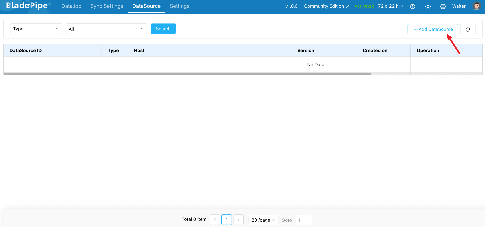
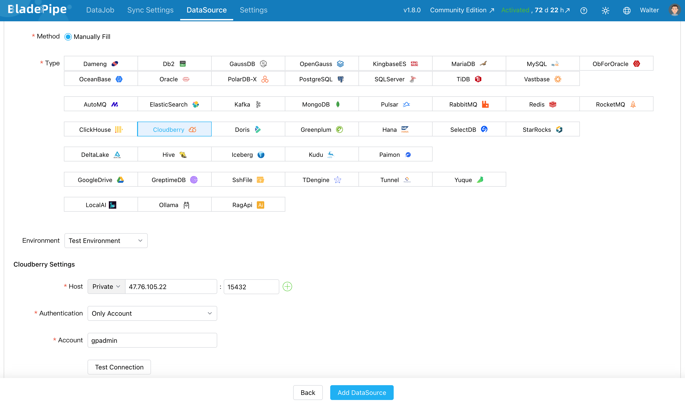
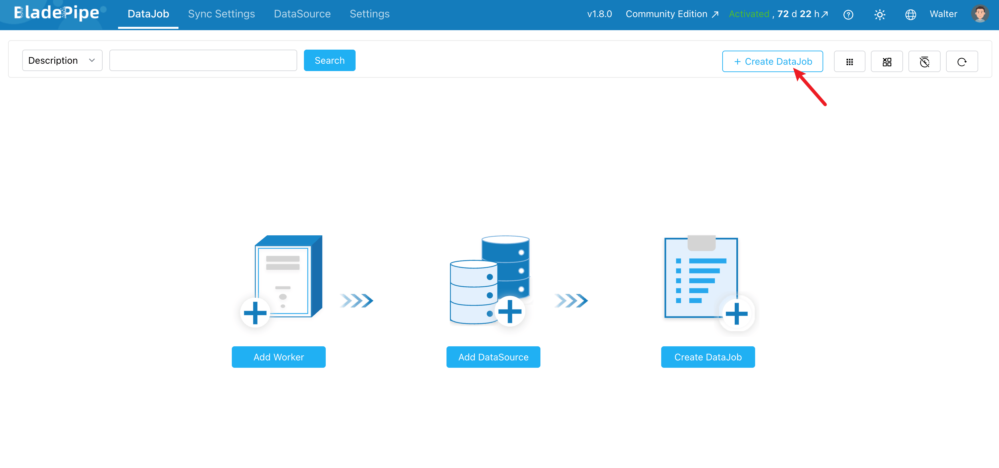
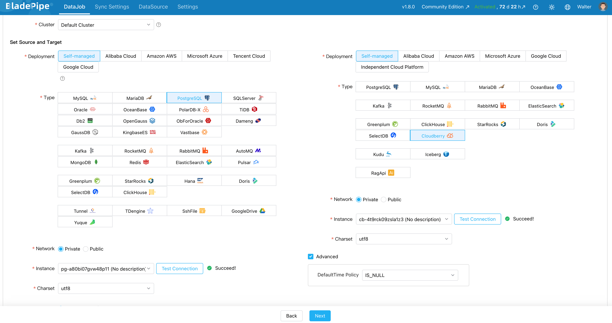
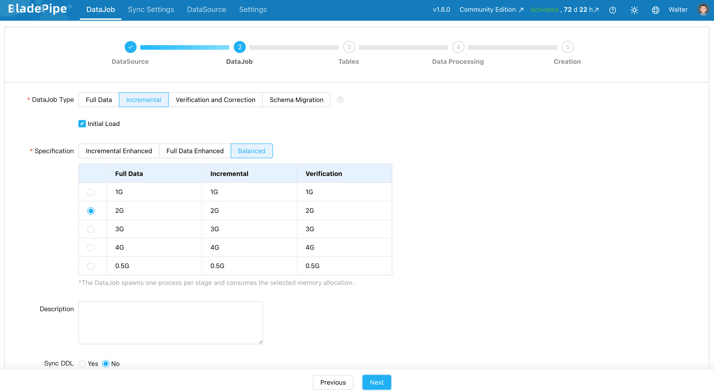
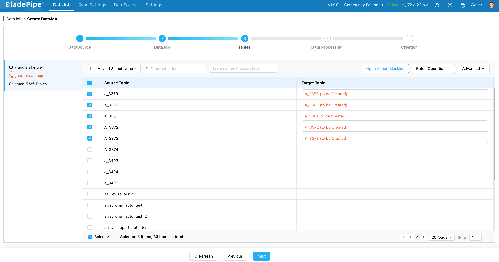
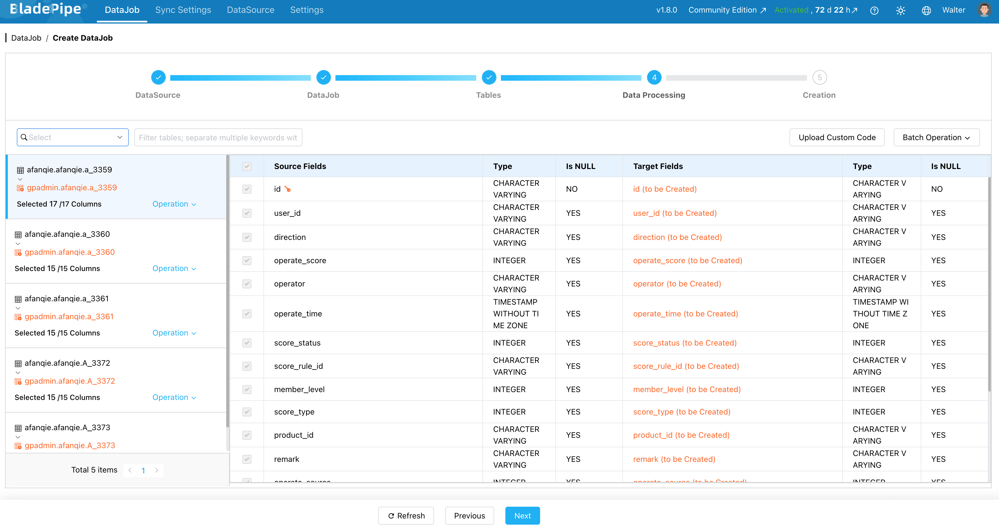
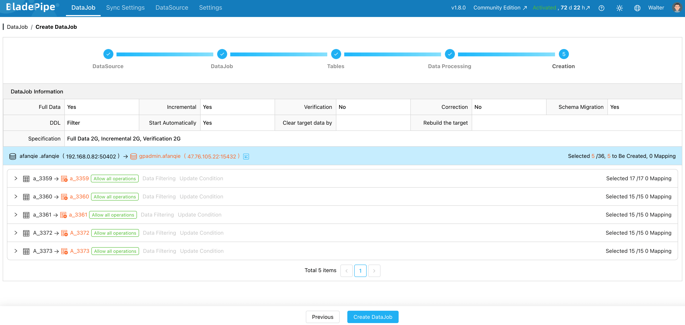
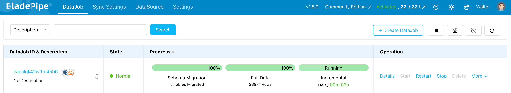

[BladePipe](https://www.bladepipe.com/) 是一款实时数据集成与变更数据捕获（CDC）平台。它可以帮助你在不同的数据库、数据仓库和数据湖之间构建数据流水线，无需编写代码；支持的数据库包括 Apache Cloudberry。

BladePipe 支持将数据从 PostgreSQL/Greenplum 传输到 Apache Cloudberry，功能包括：

- 模式迁移。
- 全量数据迁移。
- 增量数据同步。
- 数据校验与修正。
- 常见模式变更的 DDL 同步。

本文介绍如何将 PostgreSQL 数据同步到 Apache Cloudberry。

## 前提条件 {#prerequisites}

- 确保 PostgreSQL 账户具有[所需权限](https://www.bladepipe.com/docs/dataMigrationAndSync/datasource_func/PostgreSQL/privs_for_pg/)。
- Apache Cloudberry 已部署并运行。
- [BladePipe（v1.6.0 或更高版本）](https://www.bladepipe.com/docs/productOP/onPremise/installation/install_all_in_one_docker/)已安装且可以访问。

## 操作步骤 {#steps}

### 第 1 步：添加数据源 {#step-1-add-datasources}

1. 登录 BladePipe，进入 **DataSource（数据源）** > **Add DataSource（添加数据源）**。

2. 分别将 Apache Cloudberry 和 PostgreSQL 添加为数据源：
   - **Deployment（部署方式）**：选择 **Self-managed（自管理）**。
   - **Type（类型）**：选择 **Cloudberry** / **PostgreSQL**。
   - **Host（主机）**：输入数据库主机和端口。
   - **Account & Password（账户与密码）**：输入 Cloudberry / PostgreSQL 的用户名和密码。

3. 点击 **Test Connection（测试连接）**，然后点击 **Add DataSource（添加数据源）**。

### 第 2 步：创建数据任务 {#step-2-create-a-datajob}

1. 进入 **DataJob（数据任务）** > **Create DataJob（创建数据任务）**。

2. 选择 PostgreSQL 作为源数据源，Cloudberry 作为目标数据源。

3. 选择数据任务类型。对于同步任务，选择 **Incremental（增量）** 并启用 **Initial Load（初始加载）**。初始加载会迁移现有数据；初始加载完成后，增量同步会持续更新 Cloudberry 中的数据。

4. 选择要同步的表。可以选择全部表，也可以选择指定的表。

5. 选择要同步的列。在这一步还可以进行过滤、转换等数据处理。

6. 点击 **Create DataJob（创建数据任务）**，启动任务。

7. 可以在数据任务页面查看流水线的状态和进度。

