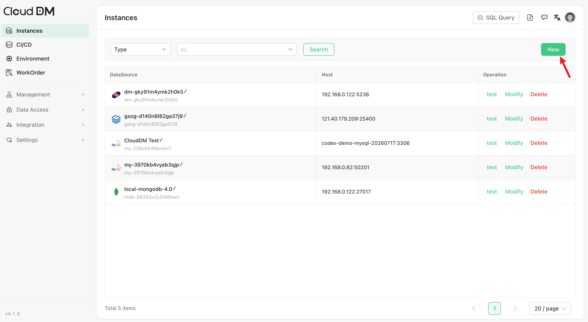
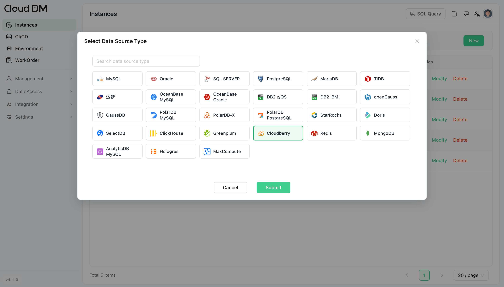
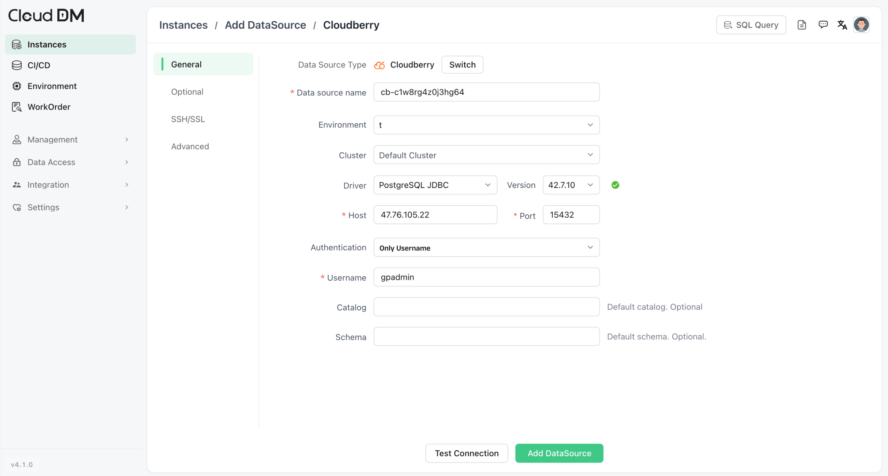
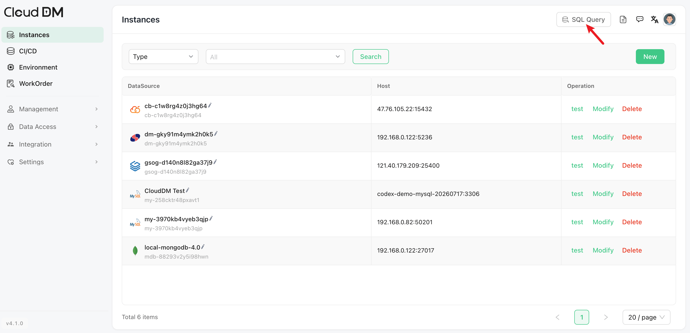
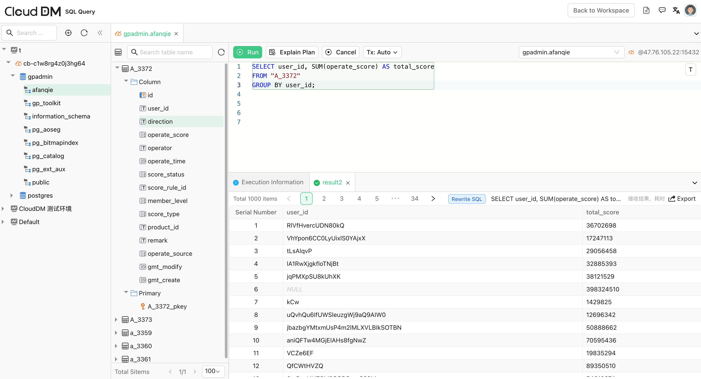
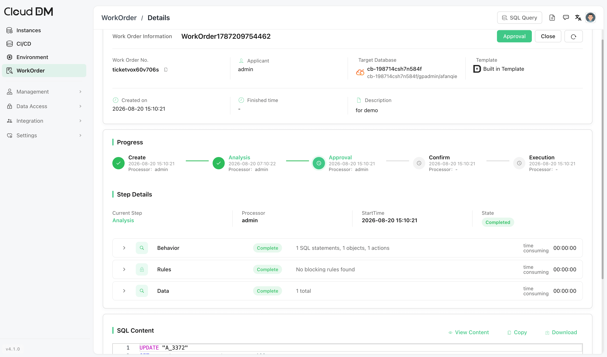
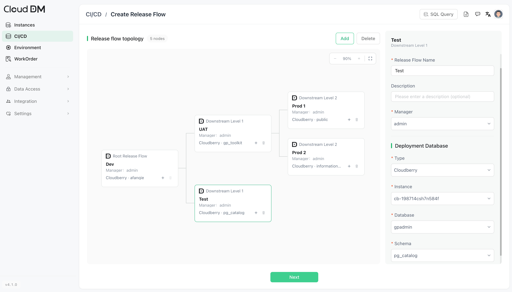
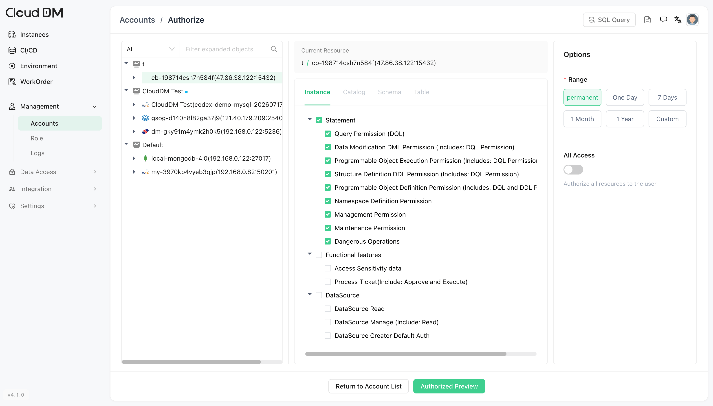

它提供 Web 控制台，支持 SQL 查询、数据库管理、访问控制、SQL 审计、审批流程和数据库 CI/CD。它支持 MySQL、Oracle、StarRocks、Apache Cloudberry 等多种数据库。

本文介绍如何将 CloudDM 连接到 Apache Cloudberry 并运行 SQL 查询。

## 前提条件 {#prerequisites}

- Apache Cloudberry 已部署并运行。
- 已在 `pg_hba.conf` 中正确配置数据库访问权限。
- [CloudDM（v4.1.0 或更高版本）](https://github.com/ClouGence/open-cdm)已安装且可以访问。

## 操作步骤 {#steps}

1. 登录 CloudDM 控制台，点击 **Back to Workspace（返回工作区）**。

2. 在左侧面板中点击 **Instances（实例）**，然后点击 **New（新建）**，添加数据库连接。

3. 选择 Cloudberry，点击 **Submit（提交）**。

4. 输入 Cloudberry 连接信息：
    - **Host（主机）**：输入 Cloudberry 实例的主机名或 IP 地址。
    - **Port（端口）**：输入端口。
    - **Authentication（认证）**：选择认证方式，并输入所需信息，例如用户名和密码。

    

5. 测试连接。Cloudberry 成功连接到 CloudDM 后，点击 **Add DataSource（添加数据源）**。

    如果测试失败，请检查 Cloudberry 的地址、端口、数据库用户、密码、网络访问和 `pg_hba.conf` 规则。

6. 进入 **SQL Query（SQL 查询）**。

7. 添加的 Cloudberry 实例会显示在左侧面板中，现在可以开始运行查询。

## 其他功能 {#other-features}

### 工单 {#work-orders}

CloudDM 支持通过工单管理生产数据库变更。团队可以通过受控流程提交、审批和执行变更。

### CI/CD {#cicd}

CloudDM 可以通过 Git Push、Web Hook 和 HttpCall 触发数据库 CI/CD 流程。团队可以将 SQL 检查、审批和执行纳入应用发布流程，并集中管理数据库变更脚本。

### 用户访问控制 {#user-access-control}

CloudDM 支持基于角色的访问控制（RBAC），用于团队协作。团队可以按角色授予访问权限，控制每个用户可使用的数据源和可执行的操作。

