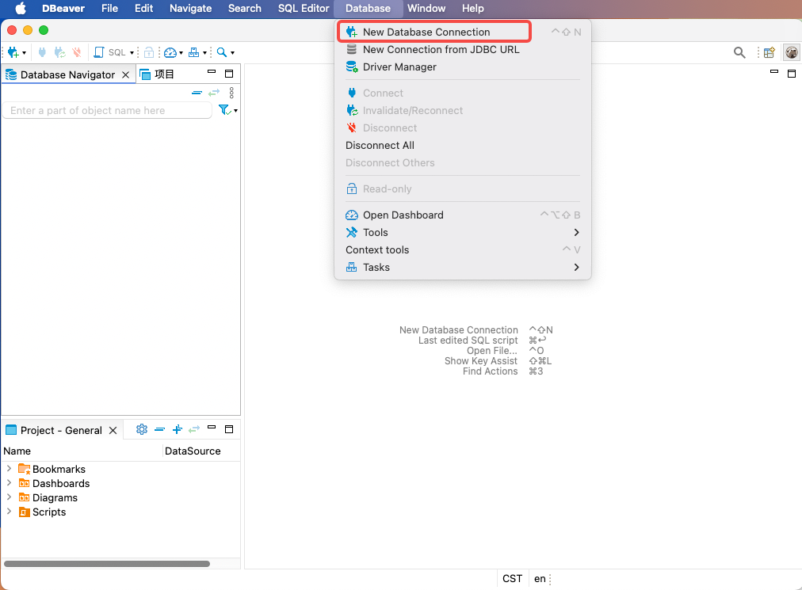
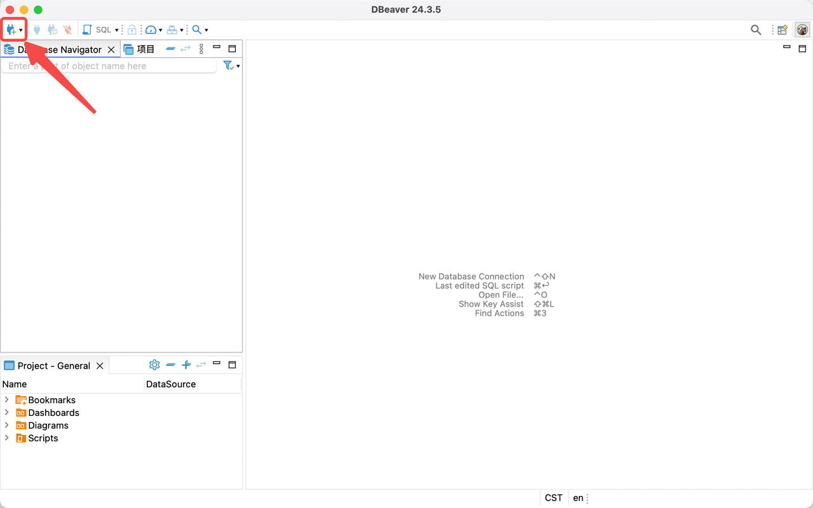
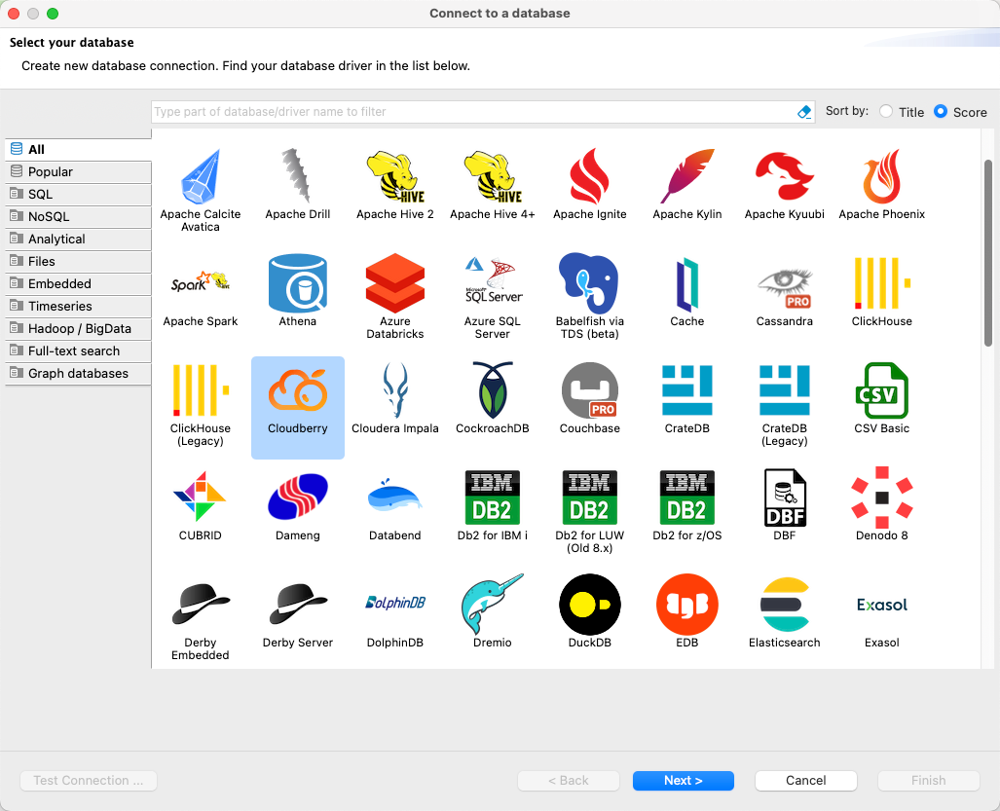
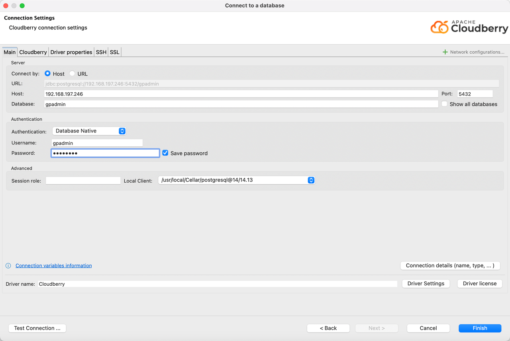
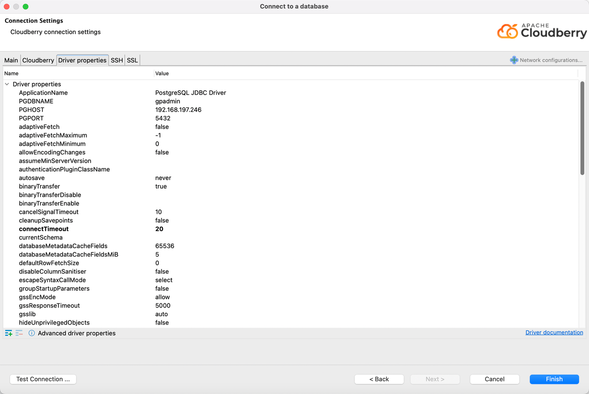
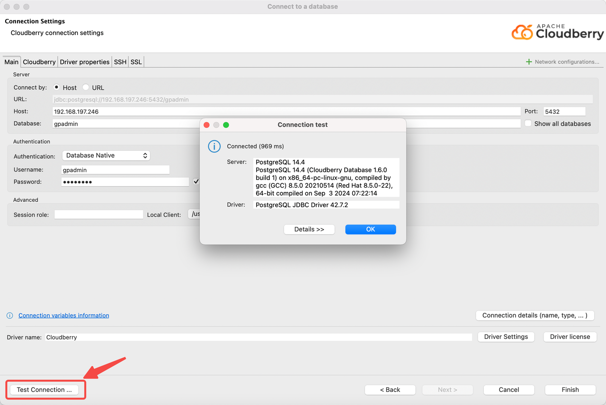
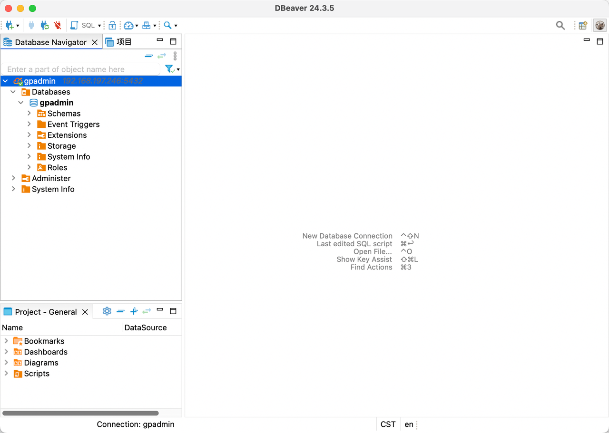

本文介绍如何在 DBeaver 与 Apache Cloudberry 数据库之间建立连接。

## 前提条件 {#prerequisites}

- Apache Cloudberry 已部署，且已在 `pg_hba.conf` 中正确设置数据库访问权限。
- 已安装 DBeaver v24.3.3 或更高版本。

## 操作步骤 {#steps}

1. 启动 DBeaver，通过以下任一方式开始创建数据库连接：

    - 在菜单栏中选择 **Database（数据库）** > **New Database Connection（新建数据库连接）**。

        

    - 点击左上角的加号（+）图标。

        

2. 在 **Select your database（选择数据库）** 对话框中找到并选择 **Cloudberry**，然后点击 **Next（下一步）**。

    

3. 在 **Connection Settings（连接设置）** 对话框的 **Main（主要）** 标签页中填写以下连接参数：

    - **Host（主机）**：输入 Cloudberry 数据库服务器的主机名或 IP 地址。
    - **Port（端口）**：输入数据库端口，例如 `5432`。
    - **Database（数据库）**：输入目标数据库名称。
    - **Username（用户名）**：输入具有访问权限的数据库用户名。
    - **Password（密码）**：输入对应的密码。

    

    切换到 **Driver properties（驱动属性）** 标签页，可以查看 Cloudberry 驱动属性，并通过点击 Value（值）列进行修改。

    

4. 验证并完成配置：点击 **Test Connection（测试连接）**。测试成功时会显示确认对话框。点击 **OK（确定）** 确认，再点击 **Finish（完成）**，完成设置。

    

5. 建立连接后，可以在左侧导航面板中看到创建的数据库连接，并通过 DBeaver 管理数据库。

    
