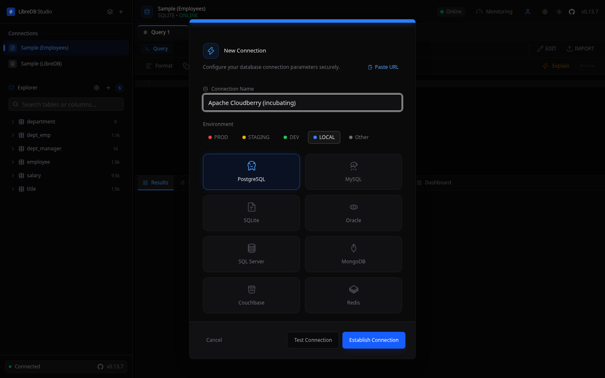
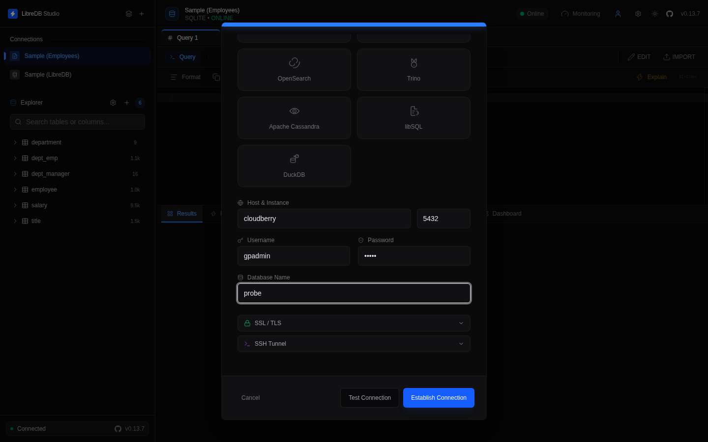
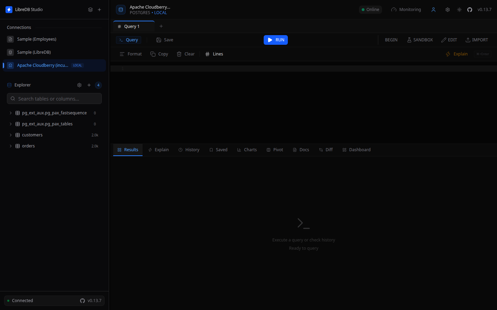
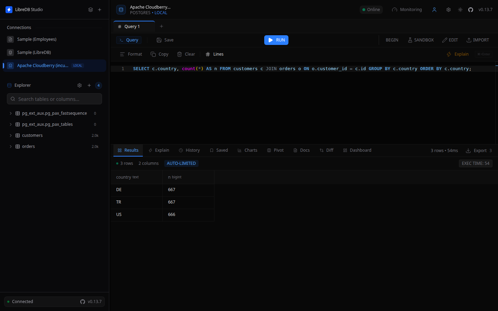

[LibreDB Studio](https://libredb.org) 是一款基于 Web 的开源 SQL IDE，包含查询编辑器、对象浏览器和监控仪表板。它在同一个工作区中支持 PostgreSQL、MySQL、Oracle、ClickHouse 等 17 种数据库引擎。它通过 PostgreSQL 网络协议连接 Apache Cloudberry，方式与连接 PostgreSQL 本身相同。

## 前提条件 {#prerequisites}

- Apache Cloudberry 已部署，且已在 `pg_hba.conf` 中正确设置数据库访问权限。以下步骤已在 Apache Cloudberry 2.1.0-incubating 上验证。
- LibreDB Studio 已安装并运行。它不是桌面版下载程序，而是通过容器、Helm chart 或 `npx @libredb/studio` 运行。
- 已准备好 Coordinator 主机、端口、数据库名称及用于连接的角色。

## 操作步骤 {#steps}

1. 在浏览器中打开 LibreDB Studio 并登录。

2. 点击 LibreDB Studio 标志旁边的 **+** 按钮，打开 **New Connection（新建连接）** 对话框。

3. 为连接命名，并选择 **PostgreSQL** 作为连接类型。Cloudberry 没有独立的连接类型：它使用 PostgreSQL 网络协议，因此应选择 PostgreSQL 驱动。

4. 填写 Coordinator 主机和端口，以及用户名、密码和数据库名称。

5. 点击 **Test Connection（测试连接）** 进行验证，再点击 **Establish Connection（建立连接）**。

连接会显示在侧边栏中，对象浏览器位于左侧。两个内部表 `pg_ext_aux.pg_pax_fastsequence` 和 `pg_ext_aux.pg_pax_tables` 会与你自己的表一起列出。

现在可以浏览模式，并在编辑器中运行查询，包括连接查询和聚合查询。

