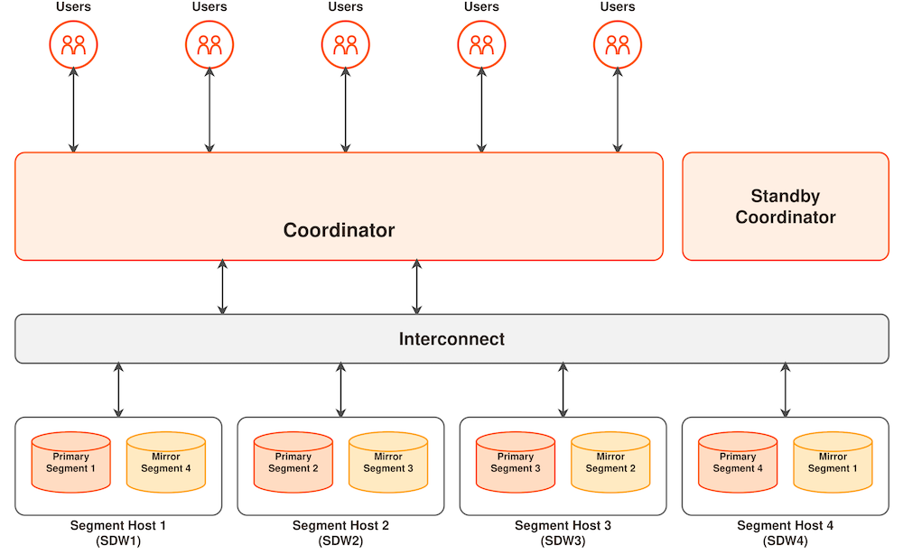

在大多数情况下，Apache Cloudberry 在 SQL 支持、特性、配置选项和面向用户的功能方面都与 PostgreSQL 相似。用户可以采用与独立 PostgreSQL 系统类似的方式使用 Apache Cloudberry。

Apache Cloudberry 采用大规模并行处理（MPP）架构，将数据和计算负载分布到多台服务器或主机上，以存储和处理海量数据。

MPP 也称为无共享（shared-nothing）架构，指由多台主机协作完成任务的系统。每台主机都有自己的处理器、内存、磁盘、网络资源和操作系统。Apache Cloudberry 采用这种高性能架构分散数据负载，并可并行利用全部系统资源处理查询。

从用户角度看，Apache Cloudberry 是一个完整的关系数据库管理系统（RDBMS）；从物理结构看，它包含多个 PostgreSQL 实例。为使这些独立的 PostgreSQL 实例协同工作，Apache Cloudberry 在数据存储、计算、通信和管理等层面执行分布式集群处理。Apache Cloudberry 隐藏了分布式系统的复杂细节，向用户呈现一个逻辑上的单一数据库，大幅减轻了开发和运维人员的工作负担。

Apache Cloudberry 的架构图如下：

- **Coordinator 节点**（或控制节点）是 Apache Cloudberry 系统的入口，负责接受客户端连接和 SQL 查询，并向数据节点实例分配任务。用户通过客户端程序（如 psql）或应用程序编程接口（API，如 JDBC、ODBC 或 libpq PostgreSQL C API）连接 Coordinator 节点，与 Apache Cloudberry 交互。
    - Coordinator 节点充当全局系统目录，包含一组记录 Apache Cloudberry 元数据的系统表。
    - Coordinator 节点不存储用户数据。用户数据仅存储在数据节点实例中。
    - Coordinator 节点负责验证客户端连接、处理 SQL 命令、在各个 Segment 之间分配工作负载、汇总各个 Segment 返回的结果，并将最终结果返回给客户端程序。
    - Apache Cloudberry 使用预写式日志（WAL）实现 Coordinator 与 Standby Coordinator 之间的镜像。在基于 WAL 的日志机制中，所有修改都先写入日志，再写入磁盘，从而确保正在执行的操作的数据完整性。

- **Segment**（或数据节点）实例是独立的 Postgres 进程，每个实例存储一部分数据，并执行查询中相应的部分。用户通过 Coordinator 节点连接数据库并提交查询请求时，每个 Segment 节点都会创建一个进程来处理该查询。用户定义的表及其索引分布在可用的 Segment 上，每个 Segment 节点保存不同的数据部分。数据处理进程在相应的 Segment 中运行。用户通过 Coordinator 与 Segment 交互，Segment 则运行在称为 Segment 主机的服务器上。

    一台 Segment 主机通常运行 2～8 个数据节点，具体取决于处理器、内存、存储、网络接口和工作负载。Segment 主机的配置需要均衡，因为在各个 Segment 之间均匀分布数据和工作负载，是 Apache Cloudberry 获得最佳性能的关键；这样可以让所有 Segment 同时开始处理任务，并同时完成工作。

- **Interconnect** 是 Apache Cloudberry 系统架构中的网络层，指 Coordinator 节点与各个 Segment 之间通信所依赖的网络基础设施，采用标准的以太网交换结构。

    出于性能考虑，建议使用 10 GB 或更快的网络。默认情况下，Interconnect 模块使用带流量控制的 UDP 协议（UDPIFC）通信，通过网络发送消息。Apache Cloudberry 执行的数据包校验超出了 UDP 本身提供的范围，因此其可靠性与 TCP 协议相当，而性能和可扩展性优于 TCP 协议。如果将 Interconnect 改为使用 TCP 协议，Apache Cloudberry 的扩展规模将限制在 1000 个 Segment 以内。默认使用 UDPIFC 协议时，不受此限制。

- Apache Cloudberry 使用多版本并发控制（MVCC）确保数据一致性。查询数据库时，每个事务只能看到一个数据快照，确保当前事务看不到其他事务对相同记录所做的修改。MVCC 以此提供数据库事务隔离。

    MVCC 尽量减少锁争用，以保障多用户环境中的性能，其实现方式是避免对数据库事务显式加锁。

    在并发控制中，MVCC 不会使查询（读）锁与写锁产生冲突，而且读写操作不会相互阻塞。这是 MVCC 相较于锁机制的最大优势。
