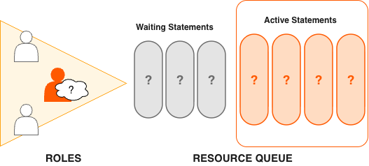
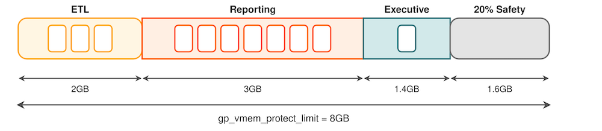
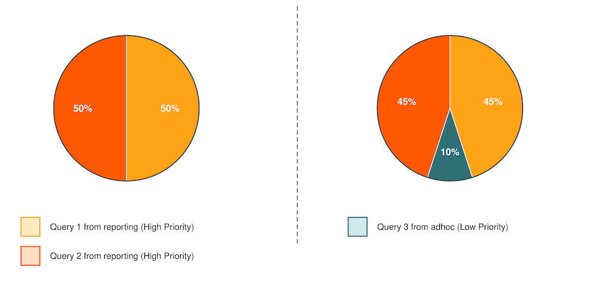
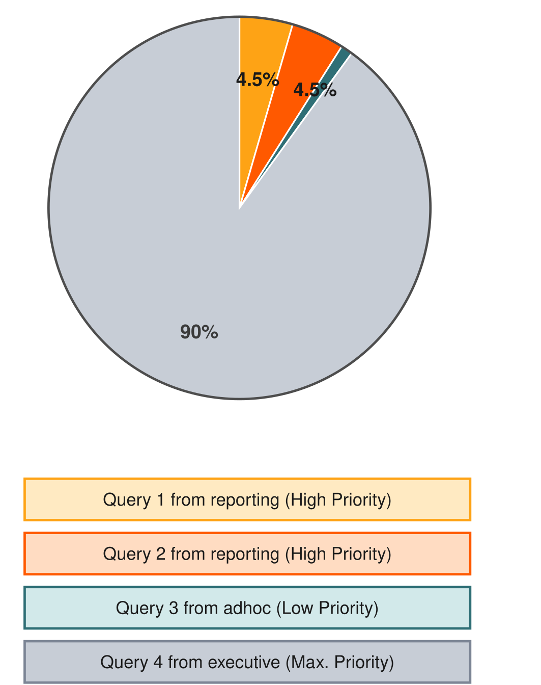

资源队列是管理 Apache Cloudberry 系统并发程度的一种工具。资源队列是使用 `CREATE RESOURCE QUEUE` SQL 语句创建的数据库对象。可以用它管理同时运行的活动查询数量、为不同类型查询分配的内存量，以及查询的相对优先级。资源队列还可以防止查询消耗过多资源而降低系统整体性能。

每个数据库角色都关联一个资源队列，多个角色可以共享同一个资源队列。通过 `CREATE ROLE` 或 `ALTER ROLE` 语句中的 `RESOURCE QUEUE` 短语为角色分配资源队列。如果未指定资源队列，角色会关联默认资源队列 `pg_default`。

用户提交查询执行时，系统会根据资源队列的限制评估查询。如果查询不会使队列超出资源限制，就会立即运行。如果查询会使队列超出限制（例如当前已用完最大活动语句槽位），查询必须等待队列资源释放后才能运行。查询按先进先出的顺序评估。启用查询优先级后，系统会定期评估活动工作负载，并根据查询优先级重新分配处理资源（参见[优先级的工作方式](#how-priorities-work)）。具有 `SUPERUSER` 属性的角色不受资源队列限制。无论所分配资源队列施加什么限制，超级用户查询都会立即运行。



资源队列定义了资源需求相近的查询类别。管理员应为组织中的不同工作负载类型创建资源队列。例如，可以为以下查询类别创建队列，对应不同的服务级别协议：

- ETL 查询
- 报表查询
- 管理层查询

资源队列具有以下特性：

- **`MEMORY_LIMIT`**：队列中所有查询使用的内存量（按每个 Segment 计算）。例如，在 ETL 队列中将 `MEMORY_LIMIT` 设为 2GB，表示 ETL 查询在每个 Segment 上最多使用 2GB 内存。

- **`ACTIVE_STATEMENTS`**：队列的*槽位*数量，即队列的最大并发度。所有槽位都被占用后，新查询必须等待。默认情况下，每个查询使用相等的内存量。

    例如，`pg_default` 资源队列的 `ACTIVE_STATEMENTS` = 20。

- **`PRIORITY`**：查询的相对 CPU 使用量。可设为以下级别之一：`LOW`、`MEDIUM`、`HIGH`、`MAX`。默认级别为 `MEDIUM`。查询优先级机制监控系统中所有正在运行的查询的 CPU 使用量，并调整各查询的 CPU 使用量，使其符合相应优先级。例如，可以将 `executive` 资源队列设为 `MAX` 优先级，其他队列设为 `MEDIUM`，确保管理层查询获得更多 CPU 份额。

- **`MAX_COST`**：查询计划代价限制。Apache Cloudberry 优化器为每个查询分配数值代价。如果代价超过资源队列设置的 `MAX_COST` 值，查询会因代价过高而被拒绝。

> [!NOTE]
> GPORCA 和基于 Postgres 的规划器使用不同的查询代价模型，对同一查询可能计算出不同代价。Apache Cloudberry 的资源队列资源管理方案既不会区分也不会对齐 GPORCA 与基于 Postgres 的规划器的代价，而是使用优化器返回的字面代价值来限制查询。

启用基于资源队列的资源管理时，应使用资源队列的 `MEMORY_LIMIT` 和 `ACTIVE_STATEMENTS` 限制，而不是配置基于代价的限制。即使使用 GPORCA，Apache Cloudberry 对某些查询仍可能回退到基于 Postgres 的规划器，因此使用基于代价的限制可能产生意外结果。

Apache Cloudberry 系统的默认配置只有一个名为 `pg_default` 的默认资源队列。`pg_default` 的 `ACTIVE_STATEMENTS` 为 20，不设置 `MEMORY_LIMIT`，`PRIORITY` 为 medium，也不设置 `MAX_COST`。这意味着所有查询都会被接受并立即运行，使用相同优先级且不受内存限制；但同时只能运行 20 个查询。

资源队列允许的并发查询数量取决于是否设置 `MEMORY_LIMIT` 参数：

- 如果资源队列未设置 `MEMORY_LIMIT`，每个查询分配的内存量为服务器配置参数 `statement_mem` 的值。资源队列可使用的最大内存为 `statement_mem` 与 `ACTIVE_STATEMENTS` 的乘积。
- 如果资源队列设置了 `MEMORY_LIMIT`，队列可并发运行的查询数受队列可用内存限制。

查询被系统接纳后，会分配一定内存，并为其生成查询计划树。树中的每个节点都是一个算子，例如排序或哈希连接。每个算子是独立的执行线程，至少分配 100KB，并获得总语句内存的一部分。如果计划包含大量算子，算子所需的最小内存可能超过可用内存，查询会因内存不足而被拒绝。算子会判断能否在已分配内存中完成任务，或者是否必须将数据溢出到工作文件中的磁盘。分配和控制各算子内存用量的机制称为“内存配额”。

通过资源队列提交的 SQL 语句并非全部都会根据队列限制进行评估。默认情况下，只有 `SELECT`、`SELECT INTO`、`CREATE TABLE AS SELECT` 和 `DECLARE CURSOR` 语句会被评估。如果服务器配置参数 `resource_select_only` 设为 `off`，`INSERT`、`UPDATE` 和 `DELETE` 语句也会被评估。

此外，在 `EXPLAIN ANALYZE` 命令执行期间运行的 SQL 语句不受资源队列约束。

## 资源队列示例 {#resource-queue-example}

默认资源队列 `pg_default` 最多允许 20 个活动查询，并为每个查询分配相同的内存量。这通常不足以满足生产系统的资源控制要求。要确保系统达到性能预期，可以定义不同的查询类别，并将其分配给按该类别适合的并发、内存和 CPU 资源配置的资源队列。

下图展示了 `gp_vmem_protect_limit` 设为 8GB 的 Apache Cloudberry 系统中的资源队列配置示例：



本例有三类特征和服务级别协议不同的查询，并为其配置了三个资源队列。部分 Segment 内存被预留作为安全余量。

|资源队列名称|活动语句|内存限制|每个查询的内存|
|-------------------|-----------------|------------|----------------|
|ETL|3|2GB|667MB|
|Reporting|7|3GB|429MB|
|Executive|1|1.4GB|1.4GB|

分配给队列的总内存为 6.4GB，即服务器配置参数 `gp_vmem_protect_limit` 定义的 Segment 总内存的 80%。预留 20% 的安全余量，可以容纳某些算子和查询实际使用超过资源队列分配量的情况。

有关命令语法和详细参考信息，请参见 [`CREATE RESOURCE QUEUE`](/cloudberry/reference/sql-stmts/create-resource-queue/)、[`CREATE ROLE`](/cloudberry/reference/sql-stmts/create-role/) 和 [`ALTER ROLE`](/cloudberry/reference/sql-stmts/alter-role/) 语句。

## 内存限制的工作方式 {#how-memory-limits-work}

在资源队列上设置 `MEMORY_LIMIT`，会设置通过该队列提交的所有活动查询在每个 Segment 实例上可消耗的最大内存。分配给每个查询的内存量等于队列内存限制除以活动语句限制。（应将内存限制与基于语句的队列结合使用，而非基于代价的队列。）例如，如果队列内存限制为 2000MB、活动语句限制为 10，则通过该队列提交的每个查询默认分配 200MB 内存。可以使用服务器配置参数 `statement_mem` 按查询覆盖默认分配值，但不能超过队列内存限制。查询开始运行后，会一直占用队列中分配给它的内存，即使实际执行过程中消耗的内存少于分配量。

可以使用服务器配置参数 `statement_mem` 覆盖当前资源队列设置的内存限制。在会话级，`statement_mem` 最多可以增加到资源队列的 `MEMORY_LIMIT`，使单个查询能够使用整个队列分配的内存，而不影响其他资源队列。

`statement_mem` 的值受配置参数 `max_statement_mem`（超级用户参数）限制。对于设置了 `MEMORY_LIMIT` 的资源队列中的查询，`statement_mem` 的最大值为 `min(MEMORY_LIMIT, max_statement_mem)`。查询被接纳时，其分配的内存会从 `MEMORY_LIMIT` 中扣除。如果 `MEMORY_LIMIT` 耗尽，同一资源队列中的新查询必须等待，即使 `ACTIVE_STATEMENTS` 尚未达到上限也一样。只有使用 `statement_mem` 覆盖资源队列分配的内存时，才可能出现这种情况。

例如，考虑名为 `adhoc` 的资源队列，其设置如下：

- `MEMORY_LIMIT` 为 1.5GB
- `ACTIVE_STATEMENTS` 为 3

默认情况下，提交到该队列的每条语句分配 500MB 内存。现在考虑以下事件序列：

1. 用户 `ADHOC_1` 提交查询 `Q1`，将 `STATEMENT_MEM` 覆盖为 800MB。系统接纳 `Q1` 语句。
2. 用户 `ADHOC_2` 提交查询 `Q2`，使用默认的 500MB。
3. `Q1` 和 `Q2` 仍在运行时，用户 `ADHOC3` 提交查询 `Q3`，使用默认的 500MB。

查询 `Q1` 和 `Q2` 已使用队列 1500MB 中的 1300MB。因此，`Q3` 必须等待 `Q1` 或 `Q2` 完成后才能运行。

如果队列未设置 `MEMORY_LIMIT`，在所有 `ACTIVE_STATEMENTS` 槽位都用完前，查询都可以被接纳，每个查询还可以设置任意高的 `statement_mem`。这可能导致资源队列使用无上限的内存。

有关资源队列内存限制及其他内存利用控制的配置，请参见[创建带内存限制的队列](#create-queues-with-memory-limits)。

### `statement_mem` 与低内存查询 {#statement_mem-and-low-memory-queries}

事实表明，较低的 `statement_mem` 设置（例如 1–3MB）可以提高低内存需求查询的性能。可以使用服务器配置参数 `statement_mem` 按查询覆盖该设置。例如：

```sql
SET statement_mem='2MB';
```

## 优先级的工作方式 {#how-priorities-work}

资源队列的 `PRIORITY` 设置与 `MEMORY_LIMIT`、`ACTIVE_STATEMENTS` 不同；后两者决定查询是否被队列接纳并最终运行，而 `PRIORITY` 在查询变为活动状态后生效。活动查询根据其资源队列的优先级设置共享可用 CPU 资源。当高优先级队列中的语句加入正在运行的语句组时，可能获得更多可用 CPU，从而减少较低优先级队列中已运行语句获得的份额。

查询的相对大小或复杂度不会影响 CPU 分配。如果一个简单、低代价查询与一个大型复杂查询同时运行，而两者优先级相同，它们会获得相等的可用 CPU 份额。新查询变为活动状态后，CPU 份额会重新计算，但优先级相同的查询仍会获得相等的 CPU 份额。

例如，管理员创建三个资源队列：`adhoc` 用于业务分析师提交的日常查询，`reporting` 用于计划报表作业，`executive` 用于管理层用户角色提交的查询。管理员希望计划报表作业不受不可预测的临时分析查询资源需求严重影响，同时确保管理层角色提交的查询获得较大的 CPU 份额。因此，将资源队列优先级设为：

- `adhoc`——低优先级
- `reporting`——高优先级
- `executive`——最高优先级

运行时，活动语句的 CPU 份额由这些优先级设置决定。如果 reporting 队列中的查询 1 和查询 2 同时运行，它们获得相等的 CPU 份额。临时查询变为活动状态后，会获得较小的 CPU 份额。由于 reporting 查询优先级相同，两者使用的确切份额会调整，但仍然相等：



> [!NOTE]
> 图中显示的百分比是近似值。高、低和最高优先级队列之间的 CPU 使用量不一定严格按这些比例计算。

管理层查询加入运行中的语句组后，CPU 使用量会根据其最高优先级设置进行调整。它可能比分析和报表查询简单，但在完成前会占用最大的 CPU 份额。



有关设置优先级的命令，请参见[设置优先级](#set-priority-levels)。

## 启用资源队列 {#enable-resource-queues}

安装 Apache Cloudberry 时，默认未启用任何资源管理策略。要使用资源队列，请设置服务器配置参数 `gp_resource_manager`：

1. 将服务器配置参数 `gp_resource_manager` 设为 `"queue"`：

    ```shell
    gpconfig -c gp_resource_manager -v "queue"
    ```

2. 重启 Apache Cloudberry：

    ```shell
    gpstop
    gpstart 
    ```

## 配置资源队列 {#configure-resource-queues}

创建任何资源组之前，先了解不同资源队列服务器配置参数及其用途。

1. 通用配置。

    - `max_resource_queues`——设置资源队列最大数量。
    - `max_resource_portals_per_transaction`——设置每个事务允许同时打开的游标最大数量。注意，打开的游标会占用资源队列中的活动查询槽位。
    - `resource_select_only`——设为 `on` 时，评估 `SELECT`、`SELECT INTO`、`CREATE TABLE AS``SELECT` 和 `DECLARE CURSOR` 命令；设为 `off` 时，也会评估 `INSERT`、`UPDATE` 和 `DELETE` 命令。
    - `resource_cleanup_gangs_on_wait`——在资源队列取得槽位前，清理空闲的 Segment 工作进程。
    - `stats_queue_level`——启用资源队列用量统计收集，可通过查询 pg_stat_resqueues 系统视图查看。

2. 内存使用。

    - `gp_resqueue_memory_policy`——启用 Apache Cloudberry 内存管理功能。

        在 Apache Cloudberry 中，分配算法 `eager_free` 利用了并非所有算子都会同时运行这一事实。查询计划被划分为多个阶段；每个阶段执行结束时，Apache Cloudberry 会主动释放上一阶段分配的内存，再将释放出的内存分配给新阶段。

        设为 `auto` 时，查询内存使用量由 `statement_mem` 和资源队列内存限制控制。

    - `statement_mem` 和 `max_statement_mem`——运行时为特定查询分配内存（覆盖资源队列分配的默认值）。数据库超级用户设置 `max_statement_mem`，防止普通数据库用户过度分配内存。
    - `gp_vmem_protect_limit`——设置所有查询进程可消耗的上限，不应超过 Segment 主机物理内存。Segment 主机在查询执行期间达到此上限时，导致超限的查询会被取消。
    - `gp_vmem_idle_resource_timeout` 和 `gp_vmem_protect_segworker_cache_limit`——用于释放 Segment 主机上由空闲数据库进程持有的内存。并发量较高的系统可能需要调整这些设置。
    - `shared_buffers`——设置 Cloudberry 服务器实例用于共享内存缓冲区的内存量。该值必须至少为 128 KB，且至少为 `max_connections` 的 16 KB 倍数；不能超过操作系统共享内存最大分配请求大小，Linux 上即 `shmmax`。

3. 查询优先级。以下参数都是本地参数，必须设置在 Coordinator 和所有 Segment 的 `postgresql.conf` 文件中：

    - `gp_resqueue_priority`——默认启用查询优先级功能。
    - `gp_resqueue_priority_sweeper_interval`——设置重新计算所有活动语句 CPU 使用量的间隔。默认值应足以应对典型数据库操作。
    - `gp_resqueue_priority_cpucores_per_segment`——指定 Segment 主机上每个 Segment 实例分配的 CPU 核数。如果 Segment 配置了主 Segment 与镜像 Segment 实例对，应在计算中使用主 Segment 实例数。该参数在 Coordinator 和 Segment 主机上的默认值都是 4。

        每台 Cloudberry 主机会从自己的 `postgresql.conf` 文件读取该参数值。该参数也影响 Coordinator 主机，后者应将其设为能够反映更高 CPU 核比例的值。例如，在每台 Segment 主机有 10 个 CPU 核、每台主机有 4 个主 Segment 的集群中，应将 `gp_resqueue_priority_cpucores_per_segment` 设为：

        - Coordinator 和 Standby Coordinator 主机上设为 `10`。通常，Coordinator 主机上只有一个 Coordinator Segment 实例运行。
        - 每台 Segment 主机上设为 `2.5`（10 个核除以 4 个主 Segment）。

        如果参数值设置不正确，CPU 可能无法充分利用，或查询优先级功能无法按预期工作。例如，如果 Segment 主机上的 Segment 实例数少于 CPU 核数，请确保相应调整此值。

        实际 CPU 核利用率取决于 Apache Cloudberry 并行化查询的能力，以及运行查询所需的资源。

        > [!NOTE]
        > 将操作系统可用的所有 CPU 核（包括虚拟 CPU 核）计入 CPU 核数量。

使用 `gpconfig` 工具查看或更改资源管理参数值。例如，查看某个参数的设置：

```shell
gpconfig --show gp_vmem_protect_limit
```

要在所有 Segment 实例上设置一个值、在 Coordinator 上设置另一个值：

```shell
gpconfig -c gp_resqueue_priority_cpucores_per_segment -v 2 -m 8
```

重启 Apache Cloudberry，使配置修改生效：

```shell
gpstop -r
```

## 创建资源队列 {#create-resource-queues}

为角色创建资源队列时，需要提供名称，设置活动查询限制，并可选地设置资源队列的查询优先级。使用 [`CREATE RESOURCE QUEUE`](/cloudberry/reference/sql-stmts/create-resource-queue/) 命令创建新的资源队列。

### 创建带活动查询限制的队列 {#create-queues-with-an-active-query-limit}

设置 `ACTIVE_STATEMENTS` 的资源队列会限制分配到该队列的角色可以运行的查询数。例如，创建名为 `adhoc`、活动查询限制为 3 的资源队列：

```sql
CREATE RESOURCE QUEUE adhoc WITH (ACTIVE_STATEMENTS=3);
```

这表示所有分配到 `adhoc` 资源队列的角色在任一时刻最多只能运行 3 个活动查询。如果该队列已有 3 个查询运行，来自该队列角色的第 4 个查询必须等待槽位释放后才能运行。

### 创建带内存限制的队列 {#create-queues-with-memory-limits}

设置 `MEMORY_LIMIT` 的资源队列会限制通过该队列提交的所有查询的内存量。总内存不应超过每个 Segment 的可用物理内存。按每个 Segment 的可用内存，将 `MEMORY_LIMIT` 设为 90%。例如，主机有 48 GB 物理内存和 6 个 Segment 实例时，每个 Segment 实例可用 8 GB。单个队列建议的 `MEMORY_LIMIT` 为 0.90*8=7.2 GB。如果系统创建了多个队列，其内存限制总和也必须为 7.2 GB。

与 `ACTIVE_STATEMENTS` 结合使用时，每个查询默认分配的内存为：`MEMORY_LIMIT / ACTIVE_STATEMENTS`。与 `MAX_COST` 结合使用时，每个查询默认分配的内存为：`MEMORY_LIMIT * (query_cost / MAX_COST)`。应将 `MEMORY_LIMIT` 与 `ACTIVE_STATEMENTS` 结合使用，而不是与 `MAX_COST` 结合使用。

例如，创建活动查询限制为 10、总内存限制为 2000MB 的资源队列（执行时每个查询分配 200MB Segment 主机内存）：

```sql
CREATE RESOURCE QUEUE myqueue WITH (ACTIVE_STATEMENTS=20, 
MEMORY_LIMIT='2000MB');
```

可以使用服务器配置参数 `statement_mem` 按查询覆盖默认内存分配，前提是不能超过 `MEMORY_LIMIT` 或 `max_statement_mem`。例如，为某个查询分配更多内存：

```sql
SET statement_mem='2GB';
SELECT * FROM my_big_table WHERE column='value' ORDER BY id;
RESET statement_mem;
```

一般而言，所有资源队列的 `MEMORY_LIMIT` 之和不应超过 Segment 主机物理内存。若多个队列中的工作负载交错运行，可以适当超额分配内存，但要注意：如果超过 Segment 主机内存限制（`gp_vmem_protect_limit`），查询可能在执行期间被取消。

### 设置优先级 {#set-priority-levels}

要控制资源队列对可用 CPU 资源的消耗，管理员可以分配适当的优先级。高并发导致 CPU 资源争用时，高优先级资源队列关联的查询和语句会比低优先级查询和语句获得更多可用 CPU 份额。

通过 `CREATE RESOURCE QUEUE` 和 `ALTER RESOURCE QUEUE` 命令的 `WITH` 参数创建或修改优先级设置。例如，为 `adhoc` 和 `reporting` 队列指定优先级：

```sql
ALTER RESOURCE QUEUE adhoc WITH (PRIORITY=LOW);
ALTER RESOURCE QUEUE reporting WITH (PRIORITY=HIGH);
```

创建最高优先级的 `executive` 队列：

```sql
CREATE RESOURCE QUEUE executive WITH (ACTIVE_STATEMENTS=3, PRIORITY=MAX);
```

启用查询优先级功能后，如果未显式指定，资源队列默认使用 `MEDIUM` 优先级。有关运行时如何评估优先级设置的更多信息，请参见[优先级的工作方式](#how-priorities-work)。

> [!TIP]
> 要让资源队列优先级作用于活动查询工作负载，必须通过设置相关服务器配置参数启用查询优先级功能。请参见[配置资源队列](#configure-resource-queues)。

## 将角色分配给资源队列 {#assign-roles-to-a-resource-queue}

创建资源队列后，必须将角色（用户）分配给适当的资源队列。如果没有显式分配，角色会进入默认资源队列 `pg_default`。默认资源队列的活动语句限制为 `20`，不设置代价限制，优先级为 medium。

使用 `ALTER ROLE` 或 `CREATE ROLE` 命令将角色分配给资源队列。例如：

```sql
ALTER ROLE `name` RESOURCE QUEUE `queue_name`;
CREATE ROLE `name` WITH LOGIN RESOURCE QUEUE `queue_name`;
```

一个角色在任一时刻只能分配给一个资源队列，因此可以使用 `ALTER ROLE` 初次分配或更改角色的资源队列。

资源队列必须按用户逐一分配。如果存在角色层次结构（例如组级角色），将资源队列分配给组不会向下传播到该组中的用户。

超级用户始终不受资源队列限制。无论所分配队列设置了什么限制，超级用户查询都会运行。

### 从资源队列移除角色 {#remove-a-role-from-a-resource-queue}

所有用户都必须分配到资源队列。如果未显式分配到特定队列，用户会进入默认资源队列 `pg_default`。如果要将角色从资源队列移除并放入默认队列，请将角色的队列分配改为 `none`。例如：

```sql
ALTER ROLE `role_name` RESOURCE QUEUE none;
```

## 修改资源队列 {#modify-resource-queues}

创建资源队列后，可以使用 `ALTER RESOURCE QUEUE` 命令更改或重置队列限制，也可以使用 `DROP RESOURCE QUEUE` 命令移除资源队列。要更改分配给资源队列的角色（用户），请参见[将角色分配给资源队列](#assign-roles-to-a-resource-queue)。

### 修改资源队列 {#alter-a-resource-queue}

`ALTER RESOURCE QUEUE` 命令用于修改资源队列限制。要修改限制，请指定队列的新值。例如：

```sql
ALTER RESOURCE QUEUE <adhoc> WITH (ACTIVE_STATEMENTS=5);
ALTER RESOURCE QUEUE <exec> WITH (PRIORITY=MAX);
```

要将活动语句数或内存限制重置为无限制，请输入 `-1`。要将最大查询代价重置为无限制，请输入 `-1.0`。例如：

```sql
ALTER RESOURCE QUEUE <adhoc> WITH (MAX_COST=-1.0, MEMORY_LIMIT='2GB');
```

也可以使用 `ALTER RESOURCE QUEUE` 命令更改与资源队列关联的查询优先级。例如，将队列设为最低优先级：

```sql
ALTER RESOURCE QUEUE <webuser> WITH (PRIORITY=MIN);
```

### 删除资源队列 {#drop-a-resource-queue}

`DROP RESOURCE QUEUE` 命令用于删除资源队列。要删除资源队列，该队列不能分配给任何角色，也不能有语句在队列中等待。有关清空资源队列的说明，请参见[从资源队列移除角色](#remove-a-role-from-a-resource-queue)和[清除资源队列中的等待语句](#clear-a-waiting-statement-from-a-resource-queue)。删除资源队列：

```sql
DROP RESOURCE QUEUE <name>;
```

## 监控资源队列状态 {#monitor-resource-queue-status}

监控资源队列状态包括以下任务：

### 查看排队语句和资源队列状态 {#view-queued-statements-and-resource-queue-status}

[`gp_toolkit.gp_resqueue_status`](/cloudberry/reference/sys-catalogs/gp_toolkit/#gp_resqueue_status) 视图允许管理员查看资源队列的状态和活动，包括某个资源队列中等待运行的查询数量，以及当前正在系统中运行的查询数量。查看系统中创建的资源队列、其限制属性和当前状态：

```sql
SELECT * FROM gp_toolkit.gp_resqueue_status;
```

### 查看资源队列统计信息 {#view-resource-queue-statistics}

如果希望长期跟踪资源队列的统计信息和性能，可以启用资源队列统计信息收集。在 Coordinator 的 `postgresql.conf` 文件中设置以下服务器配置参数：

```sql
stats_queue_level = on
```

启用后，可以使用 `pg_stat_resqueue` 系统视图查看收集到的资源队列用量统计信息。注意，启用此功能会带来轻微性能开销，因为通过资源队列提交的每个查询都必须跟踪。可在初始诊断和管理规划期间启用资源队列统计信息收集，之后再停用以持续运行。

有关在 Apache Cloudberry 中收集统计信息的更多信息，请参见 PostgreSQL 文档中的“统计信息收集器”部分。

### 查看分配给资源队列的角色 {#view-the-roles-assigned-to-a-resource-queue}

要查看分配给资源队列的角色，请查询 `pg_roles` 和 `gp_toolkt.gp_resqueue_status` 系统目录表：

```sql
SELECT rolname, rsqname FROM pg_roles, 
       gp_toolkit.gp_resqueue_status 
WHERE pg_roles.rolresqueue=gp_toolkit.gp_resqueue_status.queueid;
```

也可以为此查询创建视图，简化后续查询。例如：

```sql
CREATE VIEW role2queue AS
SELECT rolname, rsqname FROM pg_roles, pg_resqueue 
WHERE pg_roles.rolresqueue=gp_toolkit.gp_resqueue_status.queueid;
```

之后只需查询该视图：

```sql
SELECT * FROM role2queue;
```

### 查看资源队列中的等待查询 {#view-the-waiting-queries-for-a-resource-queue}

资源队列中的槽位被占用时，会记录在 `pg_locks` 系统目录表中。这里可以查看所有资源队列当前活动和等待中的查询。要检查语句是否正在排队（包括尚未等待的语句），还可以使用 [`gp_toolkit.gp_locks_on_resqueue`](/cloudberry/reference/sys-catalogs/gp_toolkit/#gp_locks_on_resqueue) 视图。例如：

```sql
SELECT * FROM gp_toolkit.gp_locks_on_resqueue WHERE lorwaiting='true';
```

如果查询没有返回结果，说明当前没有语句在资源队列中等待。

### 清除资源队列中的等待语句 {#clear-a-waiting-statement-from-a-resource-queue}

有时需要清除资源队列中的等待语句。例如，移除仍在队列中等待、尚未运行的查询；或停止已启动但运行时间过长的查询；也可能是停止处于事务中空闲、占用其他用户所需资源队列槽位的查询。为此，必须先确定要清除的语句及其进程 ID（pid），然后使用该进程 ID 调用 `pg_cancel_backend` 结束进程，如下所示。可以在第二个参数中传递可选消息，向进程说明取消原因。

例如，要查看所有资源队列中当前活动或等待的全部语句的进程信息，请运行以下查询：

```sql
SELECT rolname, rsqname, pg_locks.pid as pid, granted, state,
       query, datname 
FROM pg_roles, gp_toolkit.gp_resqueue_status, pg_locks,
     pg_stat_activity 
WHERE pg_roles.rolresqueue=pg_locks.objid 
AND pg_locks.objid=gp_toolkit.gp_resqueue_status.queueid
AND pg_stat_activity.pid=pg_locks.pid
AND pg_stat_activity.usename=pg_roles.rolname;
```

如果查询没有返回结果，说明当前没有语句在资源队列中。包含两条语句的资源队列示例输出如下：

```sql
rolname | rsqname |  pid  | granted | state  |         query          | datname 
--------+---------+-------+---------+--------+------------------------+--------- 
  sammy | webuser | 31861 | t       | idle   | SELECT * FROM testtbl; | namesdb
  daria | webuser | 31905 | f       | active | SELECT * FROM topten;  | namesdb
```

使用此输出确定要清除语句的进程 ID（pid）。要清除语句，请在 Coordinator 主机上以数据库超级用户 `gpadmin` 或 root 身份打开终端，取消相应进程。例如：

```sql
pg_cancel_backend(31905)
```

> [!NOTE]
> 不要使用操作系统的 `KILL` 命令。

### 查看活动语句的优先级 {#view-the-priority-of-active-statements}

`gp_toolkit` 管理模式提供 `gp_resq_priority_statement` 视图，列出当前正在运行的所有语句，并提供优先级、会话 ID 等信息。

该视图只能通过 `gp_toolkit` 管理模式访问。

### 重置活动语句的优先级 {#reset-the-priority-of-an-active-statement}

超级用户可以使用内置函数 `gp_adjust_priority(session_id, statement_count, priority)` 调整当前运行语句的优先级。使用该函数，超级用户可以提高或降低任意查询的优先级。例如：

```sql
SELECT gp_adjust_priority(752, 24905, 'HIGH')`
```

要获取该函数需要的会话 ID 和语句计数参数，超级用户可以使用 `gp_toolkit` 管理模式视图 `gp_resq_priority_statement`。从该视图读取函数参数所需的值：

- `session_id` 参数使用 `rqpsession` 列的值
- `statement_count` 参数使用 `rqpcommand` 列的值
- `rqppriority` 列是当前优先级。`priority` 可以指定为 `MAX`、`HIGH`、`MEDIUM` 或 `LOW` 字符串。

> [!NOTE]
> `gp_adjust_priority()` 函数只影响指定语句。同一资源队列中的后续语句仍使用该队列通常分配的优先级。
