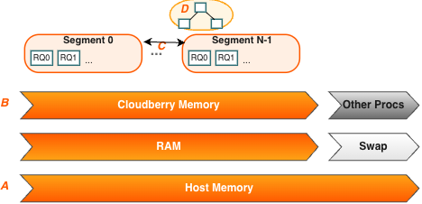

本节介绍 Segment 主机内存如何在各个 Segment 之间分配，以及管理员可以使用哪些选项配置内存。

Apache Cloudberry 的一台 Segment 主机运行多个 PostgreSQL 实例，它们共享主机内存。各个 Segment 配置相同，在并行处理查询时，会同时消耗相近数量的内存、CPU 和磁盘 I/O 资源。

为了获得最佳查询吞吐量，需要仔细管理内存配置。Apache Cloudberry 的各个层级都有内存配置选项：从操作系统参数，到通过资源队列和资源组管理资源，再到设置单个查询的内存分配量。

## Segment 主机内存概述 {#segment-host-memory-overview}

在 Apache Cloudberry Segment 主机上，可用主机内存由计算机上运行的所有进程共享，包括操作系统、Apache Cloudberry Segment 实例和其他应用程序进程。管理员必须确定哪些 Apache Cloudberry 进程及其他进程共享主机内存，并配置系统以高效利用内存。定期监控内存使用情况同样重要，这有助于发现 Apache Cloudberry 或其他进程消耗主机内存的方式是否发生变化。

下图展示了启用基于资源队列的资源管理时，Apache Cloudberry Segment 主机上的内存消耗情况。



从图的底部看起，标记为 `A` 的线表示主机总内存。`A` 正上方的线表明，主机总内存包括物理 RAM 和交换空间。

标记为 `B` 的线表明，全部可用内存必须由 Apache Cloudberry 和主机上的其他进程共享。非 Apache Cloudberry 进程包括操作系统和其他应用程序，例如系统监控代理。某些应用程序可能使用相当大的一部分内存，因此可能需要调整每台 Apache Cloudberry 主机的 Segment 数量或每个 Segment 的内存量。

标记为 `C` 的线上，每个 Segment 获得等量的 Apache Cloudberry 内存。

在 Segment 内部，当前启用的资源管理方案（资源队列或资源组）决定了运行 SQL 语句时如何分配内存。这些机制可以将业务需求转化为 Apache Cloudberry 系统中的执行策略，并防范可能降低性能的查询。有关资源组和资源队列的概述，请参见[资源管理](/cloudberry/performance/manage-resources/)。

## 配置 Segment 主机内存 {#configure-segment-host-memory}

主机内存是 Segment 主机上所有应用程序共享的总内存。可以使用以下任一方法配置主机内存量：

- 为节点增加 RAM，扩充物理内存。
- 分配交换空间，扩充虚拟内存。
- 调整内核参数 `vm.overcommit_ratio`，配置操作系统处理大额内存分配请求的方式。

物理 RAM 和操作系统配置通常由平台团队和系统管理员管理。有关建议的内核参数以及如何设置 `/etc/sysctl.conf` 文件中的参数，请参见[软件与硬件要求](/cloudberry/deployment/platform-requirements/)。

为操作系统和其他进程预留多少内存取决于工作负载。建议至少为操作系统预留 32GB 内存，但如果 Apache Cloudberry 的并发量较高，可能需要增加到 64GB。操作系统内存最大的使用者是 SLAB，其使用量随 Apache Cloudberry 并发量和套接字数量增加而增长。

内核参数 `vm.overcommit_memory` 应始终设为 2，这是对 Apache Cloudberry 唯一安全的取值。

内核参数 `vm.overcommit_ratio` 设置可供应用程序进程使用的 RAM 百分比，其余部分留给操作系统。Red Hat 的默认值为 50（50%）。设置过高可能导致为操作系统预留的内存不足，进而造成 Segment 主机故障或数据库故障。保留默认值 50 通常是安全的，但较为保守。设置过低则会减少 Apache Cloudberry 可用的内存，降低并发量，并限制同时运行的查询的复杂度。提高 `vm.overcommit_ratio` 时，务必始终为操作系统活动保留一部分内存。

要计算 `vm.overcommit_ratio` 的安全取值，先确定 Apache Cloudberry 进程可用的总内存 `gp_vmem`。

- 如果系统总内存小于 256 GB，使用以下公式：

    ```shell
    gp_vmem = ((SWAP + RAM) – (7.5GB + 0.05 * RAM)) / 1.7
    ```

- 如果系统总内存大于或等于 256 GB，使用以下公式：

    ```shell
    gp_vmem = ((SWAP + RAM) – (7.5GB + 0.05 * RAM)) / 1.17
    ```

其中，`SWAP` 是主机上的交换空间大小，单位为 GB；`RAM` 是主机安装的 RAM 大小，单位也是 GB。

使用 `gp_vmem` 按以下公式计算 `vm.overcommit_ratio`：

```sql
vm.overcommit_ratio = (RAM - 0.026 * gp_vmem) / RAM
```

## 配置 Apache Cloudberry 内存 {#configure-apache-cloudberry-memory}

Apache Cloudberry 内存是所有 Apache Cloudberry Segment 实例可用的内存总量。

搭建 Apache Cloudberry 集群时，需要确定每台主机运行的主 Segment 数量，以及每个 Segment 的内存分配量。根据 CPU 核数、物理 RAM 容量和工作负载特征，Segment 数量通常为 4 到 8 个。启用 Segment 镜像时，必须按发生故障期间主机上运行的最大主 Segment 数量分配内存。例如，使用默认分组镜像配置时，一台 Segment 主机故障会使保存该故障主机镜像的主机上实际运行的主 Segment 数量翻倍。如果将每台主机的镜像分散到多台其他主机上，可以降低这一最大值，从而为每个 Segment 分配更多内存。例如，采用每块 4 台主机、每台主机 8 个主 Segment 的块镜像配置时，一台主机故障后，该块内其他主机上的活动主 Segment 最多为 11 个，而默认分组镜像配置下最多为 16 个。

服务器配置参数 `gp_vmem_protect_limit` 指定为每个 Segment 分配的内存量。其估算方法是计算所有 Apache Cloudberry 进程可用的内存，再除以故障期间的最大主 Segment 数量。`gp_vmem_protect_limit` 设置过高可能导致查询失败。使用前面计算出的 `gp_vmem`，按以下公式计算 `gp_vmem_protect_limit` 的安全取值。

```shell
gp_vmem_protect_limit = gp_vmem / max_acting_primary_segments
```

其中，`max_acting_primary_segments` 表示由于主机或 Segment 故障而激活镜像 Segment 时，一台主机上可能运行的最大主 Segment 数量。

资源队列和资源组提供了额外的配置参数，可以进一步控制并细化查询的内存分配量。

## 内存配置计算示例 {#example-memory-configuration-calculations}

本节以具有以下规格的 Apache Cloudberry 系统为例，演示资源队列和资源组的内存计算：

- 总 RAM = 256GB
- 交换空间 = 64GB
- 每台主机有 8 个主 Segment 和 8 个镜像 Segment，每块有 4 台主机
- 故障期间，每台主机最多有 11 个主 Segment

该示例系统的 `vm.overcommit_ratio` 计算如下：

```shell
gp_vmem = ((SWAP + RAM) – (7.5GB + 0.05 * RAM)) / 1.7
        = ((64 + 256) - (7.5 + 0.05 * 256)) / 1.7
        = 176

vm.overcommit_ratio = (RAM - (0.026 * gp_vmem)) / RAM
                    = (256 - (0.026 * 176)) / 256
                    = .982
```

因此，应将示例系统的 `vm.overcommit_ratio` 设为 98。

`gp_vmem_protect_limit` 计算如下：

```shell
gp_vmem_protect_limit = gp_vmem / maximum_acting_primary_segments
                      = 176 / 11
                      = 16GB
                      = 16384MB
```

因此，应将示例系统的服务器配置参数 `gp_vmem_protect_limit` 设为 `16384`。
