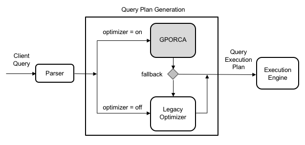

它具有较高的可扩展性，尤其在多核架构上能提供更高效的优化。对于支持的查询，Apache Cloudberry 默认使用 GPORCA 生成执行计划。

GPORCA 在以下方面显著提升查询性能：

- 分区表查询
- 包含公共表表达式（CTE）的查询
- 包含子查询的查询

在 Apache Cloudberry 中，GPORCA 与基于 PostgreSQL 的规划器共存。默认情况下，系统先尝试使用 GPORCA；如果 GPORCA 不支持某个查询，系统会自动回退到 PostgreSQL 优化器。

下图展示 GPORCA 在整体查询规划架构中的作用：



注意，启用 GPORCA 时，用于配置 PostgreSQL 规划器行为的所有服务器参数都会被忽略。只有系统回退到 PostgreSQL 优化器时，这些参数才生效。

## 启用或禁用 GPORCA {#enable-or-disable-gporca}

可以使用服务器配置参数 `optimizer` 启用或禁用 GPORCA。

虽然 GPORCA 默认启用，但仍可在系统、数据库、会话或查询级配置 `optimizer` 参数，控制是否使用 GPORCA。

> [!NOTE]
> - `optimizer` 参数启用或禁用 GPORCA。
> - `optimizer_control` 参数决定是否允许修改 `optimizer`。如果 `optimizer_control` 为 `off`，任何修改 `optimizer` 的尝试都会报错。要允许修改，请将 `optimizer_control` 设为 `on`。

### 在全系统启用 GPORCA {#enable-gporca-system-wide}

设置服务器参数 `optimizer`，可以在整个系统启用 GPORCA。

1. 以 Apache Cloudberry 管理员用户 `gpadmin` 身份登录主节点。

2. 运行以下 `gpconfig` 命令，将参数设为 `on`：

    ```shell
    gpconfig -c optimizer -v on --coordinatoronly
    ```

3. 重新加载配置，使修改生效，无需重启系统：

    ```shell
    gpstop -u
    ```

### 为数据库启用 GPORCA {#enable-gporca-for-a-database}

可以使用 `ALTER DATABASE` 命令为特定数据库启用 GPORCA。以下示例为 *test_db* 数据库启用 GPORCA：

```sql
ALTER DATABASE test_db SET optimizer = on;
```

### 为会话或查询启用 GPORCA {#enable-gporca-for-a-session-or-query}

可以使用 `SET` 命令在当前会话中启用 GPORCA。例如，通过 `psql` 连接 Apache Cloudberry 后，运行：

```sql
SET optimizer = on;
```

如果只想为单个查询启用 GPORCA，请在执行该查询前运行上述 `SET` 命令。

## 确定使用了哪个查询优化器 {#determine-which-query-optimizer-is-used}

启用 GPORCA（默认配置）时，可以检查 `EXPLAIN` 输出，判断 Apache Cloudberry 使用的是 GPORCA，还是已回退到 PostgreSQL 规划器。

最直接的方法是查看查询计划末尾：

- 计划末尾会标明使用的优化器。例如：

    - 如果计划由 GPORCA 生成，会显示：

        ```sql
        Optimizer: GPORCA
        ```

    - 如果计划由 PostgreSQL 规划器生成，会显示：

        ```sql
        Optimizer: Postgres-based planner
        ```

- 如果计划包含 `Dynamic <any> Scan` 等节点（例如 Dynamic Assert、Dynamic Sequence、Dynamic Index Scan），则由 GPORCA 生成。PostgreSQL 规划器不会生成这些节点类型。
- 对于分区表查询，GPORCA 的 `EXPLAIN` 输出只显示被剪枝的分区数量，不逐个列出。相比之下，PostgreSQL 规划器会列出每个被扫描的分区。

除 `EXPLAIN` 输出外，日志也会记录优化器类型。如果 GPORCA 不支持某个查询并回退到 PostgreSQL 规划器，系统会记录一条说明原因的 `NOTICE`。

还可以启用 `optimizer_trace_fallback` 参数，直接在 `psql` 中显示详细的回退原因。

> [!NOTE]
> 将服务器参数 `optimizer_trace_fallback` 设为 `on`，即可在 GPORCA 回退时，在命令行界面中查看详细原因。

### 示例 {#example}

以下示例展示启用 GPORCA 时，分区表查询的行为。

下面的 `CREATE TABLE` 语句创建按 `date` 列进行范围分区的表：

```sql
CREATE TABLE sales (trans_id int, date date, 
    amount decimal(9,2), region text)
   DISTRIBUTED BY (trans_id)
   PARTITION BY RANGE (date)
      (START (date '2016-01-01') 
       INCLUSIVE END (date '2017-01-01') 
       EXCLUSIVE EVERY (INTERVAL '1 month'),
   DEFAULT PARTITION outlying_dates );
```

GPORCA 生成的计划只显示选中的分区数量，不列出名称：

```sql
->  Partition Selector for sales (dynamic scan id: 1)  (cost=10.00..100.00 rows=50 width=4)
      Partitions selected:  13 (out of 13)
```

如果 GPORCA 不支持某个分区表查询，系统会自动回退到 PostgreSQL 优化器。此时，`EXPLAIN` 输出会列出所有访问的分区。例如：

```sql
->  Append  (cost=0.00..0.00 rows=26 width=53)
   ->  Seq Scan on sales2_1_prt_7_2_prt_usa sales2  (cost=0.00..0.00 rows=1 width=53)
   ->  Seq Scan on sales2_1_prt_7_2_prt_asia sales2  (cost=0.00..0.00 rows=1 width=53)
   ...
```

以下示例展示查询回退到 PostgreSQL 优化器时的日志输出：

运行以下查询：

```sql
EXPLAIN SELECT * FROM pg_class;
```

系统使用 PostgreSQL 规划器，并记录一条 `NOTICE` 消息，说明 GPORCA 未处理此查询的原因：

```sql
INFO:  GPORCA failed to produce a plan, falling back to Postgres-based planner
DETAIL:  Falling back to Postgres-based planner because GPORCA does not support the following feature: Non-default collation
```
