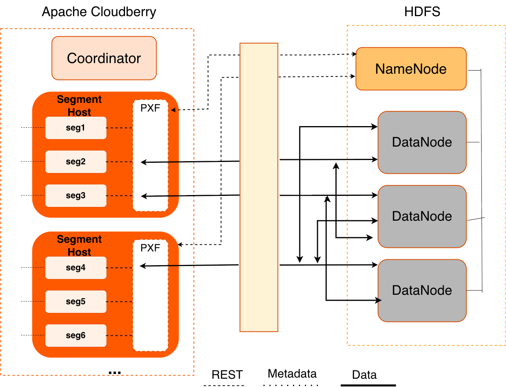

<!--
Licensed to the Apache Software Foundation (ASF) under one
or more contributor license agreements.  See the NOTICE file
distributed with this work for additional information
regarding copyright ownership.  The ASF licenses this file
to you under the Apache License, Version 2.0 (the
"License"); you may not use this file except in compliance
with the License.  You may obtain a copy of the License at

  http://www.apache.org/licenses/LICENSE-2.0

Unless required by applicable law or agreed to in writing,
software distributed under the License is distributed on an
"AS IS" BASIS, WITHOUT WARRANTIES OR CONDITIONS OF ANY
KIND, either express or implied.  See the License for the
specific language governing permissions and limitations
under the License.
-->

PXF 兼容 Cloudera、Hortonworks Data Platform 以及通用的 Apache Hadoop 发行版。PXF 安装时自带 HDFS、Hive 和 HBase 连接器。您可以使用这些连接器访问这些 Hadoop 发行版中各种格式的数据。

## 架构 {#architecture}

HDFS 是 Apache Hadoop 使用的主要分布式存储机制。当用户或应用程序对引用 HDFS 文件的 PXF 外部表执行查询时，Apache Cloudberry 的 Coordinator 主机会将查询分发给所有 Segment 实例。每个 Segment 实例会联系运行在其所在主机上的 PXF Service。PXF Service 在收到 Segment 实例的请求后：

1. 分配一个工作线程来处理该 Segment 实例的请求。
2. 调用 HDFS Java API，向 HDFS NameNode 请求该 HDFS 文件的元数据信息。

<span class="figtitleprefix">图：</span>PXF 到 Hadoop 的架构



PXF 工作线程代表某个 Segment 实例工作。工作线程使用其 Apache Cloudberry 的 `gp_segment_id` 以及元数据中描述的文件块信息，为自己分配查询数据的特定部分。这部分数据可能位于一个或多个 HDFS DataNode 上。

PXF 工作线程调用 HDFS Java API 读取数据，并将其交付给 Segment 实例。Segment 实例再将其负责的那部分数据交付给 Apache Cloudberry 的 Coordinator 主机。这一通信在各 Segment 主机和 Segment 实例之间并行进行。


## 前提条件 {#prerequisites}

在使用 PXF 处理 Hadoop 数据之前，请确保：

- 已配置 PXF，并且 PXF 正在每台 Apache Cloudberry 主机上运行。更多信息请参见[配置 PXF](/cloudberry/pxf/administering/configuring/)。
- 已配置您计划使用的 PXF Hadoop Connector。操作说明请参见[配置 PXF Hadoop Connector](/cloudberry/pxf/administering/configuring/hadoop-connectors/)。如果您计划访问存储在 Cloudera Hadoop 集群中的 JSON 格式数据，PXF 要求使用 Cloudera 5.8 或更高版本的 Hadoop 发行版。
- 如果启用了用户模拟（默认启用），请确保已向每个将访问这些 HDFS 文件和目录的 Apache Cloudberry 用户／角色名授予对相关 HDFS 文件和目录的读权限（视情况还需授予写权限），这些文件和目录将作为外部表在 Apache Cloudberry 中被访问。如果未启用用户模拟，则必须向 `gpadmin` 用户授予该权限。
- Apache Cloudberry 主机与外部 Hadoop 系统之间的时间保持同步。


## HDFS Shell 命令入门 {#hdfs-shell-command-primer}
PXF Hadoop 各主题中的示例会访问 HDFS 上的文件。您可以选择访问 HDFS 集群中已有的文件，也可以按照示例中的步骤创建新文件。

Hadoop 安装包含可直接与 HDFS 文件系统交互的命令行工具。这些工具支持典型的文件系统操作，包括复制和列出文件、更改文件权限等。您需要在安装了 Hadoop 客户端的系统上运行这些工具。默认情况下，Apache Cloudberry 主机不包含 Hadoop 客户端安装。

HDFS 文件系统命令的语法为 `hdfs dfs <options> [<file>]`。不带任何选项调用 `hdfs dfs` 时，会列出该工具支持的文件系统选项。

调用 `hdfs dfs` 命令的用户必须对 HDFS 数据存储具有读权限，才能列出并查看目录和文件内容；还必须具有写权限，才能创建目录和文件。

PXF Hadoop 各主题中使用的 `hdfs dfs` 选项如下：

| 选项  | 描述 |
|-------|-------------------------------------|
| `-cat`    | 显示文件内容。 |
| `-mkdir`    | 在 HDFS 中创建目录。 |
| `-put`    | 将文件从本地文件系统复制到 HDFS。 |

示例：

在 HDFS 中创建目录：

```shell
$ hdfs dfs -mkdir -p /data/pxf_examples
```

将文本文件从本地文件系统复制到 HDFS：

```shell
$ hdfs dfs -put /tmp/example.txt /data/pxf_examples/
```

显示位于 HDFS 中的文本文件的内容：

```shell
$ hdfs dfs -cat /data/pxf_examples/example.txt
```

## 连接器、数据格式与 Profile {#connectors-data-formats-and-profiles}

PXF Hadoop 连接器提供内置 Profile，以支持以下数据格式：

- Text
- CSV
- Avro
- JSON
- ORC
- Parquet
- RCFile
- SequenceFile
- AvroSequenceFile

PXF Hadoop 连接器提供以下 Profile，用于读取（在许多情况下也可写入）这些受支持的数据格式：

| 数据源 | 数据格式 | Profile 名称 | 外部数据包装器格式 | 支持的操作 |
|-------------|------|---------|-----|-----|
| HDFS | 以分隔符分隔的单行[文本](/cloudberry/pxf/access-hadoop/hdfs_text/#reading-text-data) | hdfs:text | text | 读、写 |
| HDFS | 以逗号分隔值的单行[文本](/cloudberry/pxf/access-hadoop/hdfs_text/#reading-text-data) | hdfs:csv | csv | 读、写 |
| HDFS | 以多字节或多字符分隔符分隔的单行 [csv](/cloudberry/pxf/access-hadoop/hdfs_text/#about-reading-data-containing-multi-byte-or-multi-character-delimiters) | hdfs:csv | csv | 读 |
| HDFS | 固定宽度单行[文本](/cloudberry/pxf/access-hadoop/hdfs_fixedwidth/) | hdfs:fixedwidth | | 读、写 |
| HDFS | 以分隔符分隔的[含带引号换行符的文本](/cloudberry/pxf/access-hadoop/hdfs_text/#reading-text-data-with-quoted-linefeeds) | hdfs:text:multi | text:multi | 读 |
| HDFS | [Avro](/cloudberry/pxf/access-hadoop/hdfs_avro/) | hdfs:avro | avro | 读、写 |
| HDFS | [JSON](/cloudberry/pxf/access-hadoop/hdfs_json/) | hdfs:json | json | 读、写 |
| HDFS | [ORC](/cloudberry/pxf/access-hadoop/hdfs_orc/) | hdfs:orc | orc | 读、写 |
| HDFS | [Parquet](/cloudberry/pxf/access-hadoop/hdfs_parquet/) | hdfs:parquet | parquet | 读、写 |
| HDFS | AvroSequenceFile | hdfs:AvroSequenceFile | AvroSequenceFile | 读、写 |
| HDFS | [SequenceFile](/cloudberry/pxf/access-hadoop/hdfs_seqfile/) | hdfs:SequenceFile | SequenceFile | 读、写 |
| [Hive](/cloudberry/pxf/access-hadoop/hive_pxf/) | 以 TextFile 存储 | hive, [hive:text](/cloudberry/pxf/access-hadoop/hive_pxf/#accessing-textfile-format-hive-tables) |  | 读 |
| [Hive](/cloudberry/pxf/access-hadoop/hive_pxf/) | 以 SequenceFile 存储 | hive |  | 读 |
| [Hive](/cloudberry/pxf/access-hadoop/hive_pxf/) | 以 RCFile 存储 | hive, [hive:rc](/cloudberry/pxf/access-hadoop/hive_pxf/#accessing-rcfile-format-hive-tables) | | 读 |
| [Hive](/cloudberry/pxf/access-hadoop/hive_pxf/) | 以 ORC 存储 | hive, [hive:orc](/cloudberry/pxf/access-hadoop/hive_pxf/#accessing-orc-format-hive-tables) | orc | 读 |
| [Hive](/cloudberry/pxf/access-hadoop/hive_pxf/) | 以 Parquet 存储 | hive | | 读 |
| [Hive](/cloudberry/pxf/access-hadoop/hive_pxf/) | 以 Avro 存储 | hive | | 读 |
| [HBase](/cloudberry/pxf/access-hadoop/hbase_pxf/) | 任意 | hbase | - | 读 |

### 选择 Profile {#choosing-the-profile}

PXF 提供多个 Profile 用于访问 Hadoop 上的文本和 Parquet 数据。在决定选择哪个 Profile 时，可以考虑以下几点。

在以下情况下选择 `hive` Profile：

- 数据位于 Hive 表中，而您事先不知道该表的底层文件类型。
- 数据位于 Hive 表中，并且该 Hive 表是分区表。

当文件为文本文件，并且您知道该文件在 HDFS 文件系统中的位置时，选择 `hdfs:text`、`hdfs:csv` Profile。

访问 ORC 格式数据时：

- 当文件为 ORC 文件，您知道该文件在 HDFS 文件系统中的位置，并且该文件不由 Hive 管理或者您不想使用 Hive Metastore 时，选择 `hdfs:orc` Profile。
- 当表为 ORC 表且由 Hive 管理，并且数据已分区或数据包含复杂类型时，选择 `hive:orc` Profile。

当文件为 Parquet 文件，您知道该文件在 HDFS 文件系统中的位置，并且希望利用对更多数据类型和运算符的扩展过滤条件下推支持时，选择 `hdfs:parquet` Profile。


### 为外部表指定 Profile {#specifying-the-profile-for-external-tables}

在 `CREATE EXTERNAL TABLE` 命令中指定 `pxf` 协议，以创建引用 Hadoop 文件或目录、HBase 表或 Hive 表的 Apache Cloudberry 外部表时，必须提供 Profile 名称。例如，以下命令创建一个使用默认服务器的外部表，并指定名为 `hdfs:text` 的 Profile 来访问 HDFS 文件 `/data/pxf_examples/pxf_hdfs_simple.txt`：

```sql
CREATE EXTERNAL TABLE pxf_hdfs_text(location text, month text, num_orders int, total_sales float8)
   LOCATION ('pxf://data/pxf_examples/pxf_hdfs_simple.txt?PROFILE=hdfs:text')
FORMAT 'TEXT' (delimiter=E',');
```

### 为外表指定 Profile {#specifying-the-profile-for-foreign-tables}

在 `CREATE FOREIGN TABLE` 命令中使用 `hdfs_pxf_fdw`、`hive_pxf_fdw` 或 `hbase_pxf_fdw` 外部数据包装器时，必须指定您在上文“前提条件”一节中配置的服务器名称。外表可以引用 Hadoop 文件或目录、HBase 表或 Hive 表。例如，以下命令使用 `hdfs_pxf_fdw` 外部数据包装器创建名为 `hadoop_server` 的外部服务器，然后创建一个外表，该外表使用 `text` 格式访问 HDFS 文件 `data/pxf_examples/pxf_hdfs_simple.txt`：

```sql
CREATE SERVER hadoop_server FOREIGN DATA WRAPPER hdfs_pxf_fdw;
CREATE USER MAPPING FOR CURRENT_USER SERVER hadoop_server;

CREATE FOREIGN TABLE pxf_parquet_s3 (location text, month text, num_orders int, total_sales float8)
SERVER hadoop_server
OPTIONS (
  resource 'data/pxf_examples/pxf_hdfs_simple.txt',
  format 'text',
  delimiter=E','
)
```
