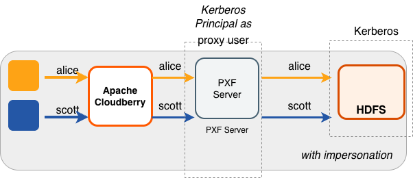
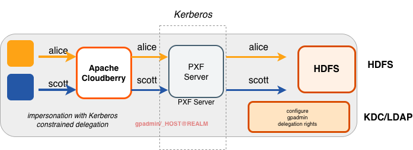
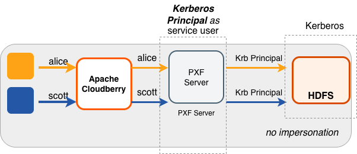
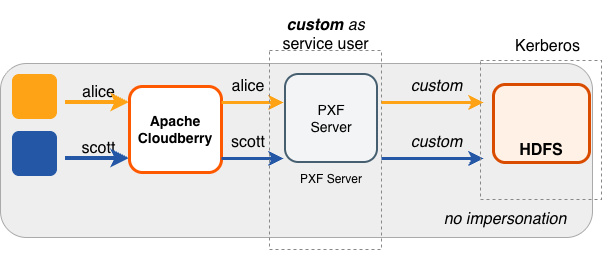

为 HDFS 文件系统启用 Kerberos 后，PXF 服务作为 HDFS 客户端，需要使用主体（principal）和 keytab 文件来认证对 HDFS 的访问。要在启用安全认证的 HDFS 上读取或写入文件，必须为 PXF 创建并部署 Kerberos 主体和 keytab，并确保 Kerberos 认证已启用且工作正常。

PXF 代表 Apache Cloudberry 最终用户访问启用安全认证的 Hadoop 集群。用户模拟（impersonation）是一种向远程系统呈现 Apache Cloudberry 最终用户身份的方式。在启用安全认证的 Hadoop 集群上，可以通过为 PXF 配置 Hadoop 代理用户（proxy user）或使用 Kerberos 约束委派来实现。

PXF 访问启用 Kerberos 安全认证的 Hadoop 时所使用的身份，取决于以下属性的设置：

| 属性 |  描述 | 默认值 |
|----------------|--------------|---------------|
| pxf.service.kerberos.principal | PXF Kerberos 主体名称。 | gpadmin/\_HOST@EXAMPLE.COM |
| pxf.service.user.impersonation | 启用/停用在远程系统上对 Apache Cloudberry 用户的模拟。 | `true` |
| pxf.service.kerberos.constrained-delegation | 启用/停用基于 S4U Kerberos 扩展的 Kerberos 约束委派。此选项使 Hadoop 管理员无需在 Hadoop 中创建代理用户配置，而是在 Active Directory（AD）或 Identity Policy Audit（IPA）服务器中完成委派配置。 | `false` |
| pxf.service.kerberos.ticket-renew-window| PXF 尝试续期/刷新 Kerberos 票据之前，票据须已经过的最短生存时间（以百分比表示）。取值范围为 0（PXF 为所有请求生成新票据）到 1（PXF 在票据完整生存期结束后才续期）。 | 0.8（80%） |
| pxf.service.user.name | （可选）在用户模拟已停用、且不希望使用 `pxf.service.kerberos.principal` 时，PXF 连接到远程启用 Kerberos 安全认证的集群所使用的用户名。 | 无 |

这些设置通过 `pxf-site.xml` 配置文件为 Hadoop PXF 服务器进行配置。有关该文件中配置属性的更多信息，请参阅[关于 pxf-site.xml 配置文件](/cloudberry/pxf/administering/configuring/cfg_server/#about-the-pxf-sitexml-configuration-file)。

**注意：** PXF 支持同时访问多个启用 Kerberos 安全认证的 Hadoop 集群。

## 关于 Kerberos 约束委派 {#about-kerberos-constrained-delegation}

Kerberos 约束委派是一项功能，管理员可以借此指定信任边界，限制应用程序代表用户执行操作的范围。如果希望在目录服务中管理用户模拟权限，而不必指定 Hadoop 代理用户，可以选择将 PXF 配置为使用 Kerberos 约束委派。有关 Kerberos 约束委派的更多信息，请参阅 Microsoft 的 [Service for User](https://docs.microsoft.com/en-us/openspecs/windows_protocols/ms-sfu/bde93b0e-f3c9-4ddf-9f44-e1453be7af5a)（S4U）Kerberos 协议扩展文档。

当 AD 或 IPA 服务器配置妥当并为 PXF 启用 Kerberos 约束委派后，PXF 服务会代表用户请求并获取 Kerberos 票据，并使用该票据访问 HDFS 文件系统。PXF 会将该票据缓存一天。

仅当使用 `hdfs:*` 或 `hive:*` profile 访问位于启用 Kerberos 安全认证的 Hadoop 集群中的数据时，PXF 才支持 Kerberos 约束委派。

默认情况下，PXF 停用 Kerberos 约束委派。要为特定 PXF 服务器启用 Kerberos 约束委派，必须在该服务器的 `pxf-site.xml` 配置文件中将 `pxf.service.kerberos-constrained.delegation` 设置为 `true`。

## 前提条件 {#prerequisites}

在配置 PXF 以访问启用安全认证的 HDFS 文件系统之前，请确保您已经：

- 确定是否计划让 PXF 使用 Kerberos 约束委派访问 Hadoop。

- 已为 Hadoop 集群配置 PXF 服务器，并且能够确定该服务器配置的名称。

- 已按照[配置 PXF](/cloudberry/pxf/administering/configuring/) 中的说明配置并启动 PXF。

- 已确认 Hadoop 集群启用了 Kerberos。

- 已确认 HDFS 配置参数 `dfs.block.access.token.enable` 设置为 `true`。可以在 Hadoop 集群中某台主机的 `hdfs-site.xml` 配置文件中找到该设置。

- 已记录每台 Apache Cloudberry 主机（\<gphost\>）以及 Kerberos 密钥分发中心（KDC）\<kdc-server\> 主机的主机名或 IP 地址。

- 已记录集群所在的 Kerberos \<realm\> 的名称。

- 如果**每台** Apache Cloudberry 主机上尚未安装 Kerberos 客户端软件包，则已安装。安装操作系统软件包需要超级用户权限。例如：

    ```shell
    root@gphost$ rpm -qa | grep krb
    root@gphost$ yum install krb5-libs krb5-workstation
    ```

当 PXF 使用 Kerberos 约束委派时，还须满足以下额外前提条件：

- AD 或 IPA 服务器中已启用 S4U。
- AD 或 IPA 服务器已配置为允许 PXF Kerberos 主体模拟最终用户。

## 使用场景与配置场景 {#use-cases-and-configuration-scenarios}

以下场景描述了使用 PXF 访问启用 Kerberos 安全认证的 Hadoop 集群时的使用场景及所需配置。

**注意**：这些场景假定 `gpadmin` 是 PXF 进程的所有者。

### 以 Apache Cloudberry 用户身份访问 Hadoop {#accessing-hadoop-as-the-apache-cloudberry-user}

#### 由 Kerberos 主体代理 {#proxied-by-the-kerberos-principal}

在此配置中，PXF 以由 Kerberos 主体代理的 Apache Cloudberry 用户身份访问 Hadoop。Kerberos 主体是 Hadoop 代理用户，并以 Apache Cloudberry 用户的身份访问 Hadoop。

这是 Hadoop PXF 服务器的默认配置。



下表列出了此使用场景所需的用户模拟和服务用户设置，以及 PXF 和 Hadoop 配置：

| 用户模拟 | 服务&nbsp;用户 |  PXF 配置 | Hadoop&nbsp;配置&nbsp;&nbsp;&nbsp;&nbsp;&nbsp;&nbsp;&nbsp; |
|----------------|-------------------|--------------------|-----------|
|  true          | Apache Cloudberry 用户 | 执行本主题中的[配置步骤](#procedures)。 | 按照[配置 Hadoop 代理](/cloudberry/pxf/administering/configuring/hadoop-connectors/pxfuserimpers/#configure-hadoop-proxying)中的说明，将 Kerberos 主体设置为 Hadoop 代理用户。 |

#### 使用 Kerberos 约束委派 {#using-kerberos-constrained-delegation}

在此配置中，PXF 使用 Kerberos 约束委派代表 Apache Cloudberry 用户请求并获取票据，并使用该票据访问 Hadoop。



下表列出了此使用场景所需的用户模拟和服务用户设置，以及 PXF 和目录服务配置；无需任何 Hadoop 配置：

| 用户模拟 | 服务&nbsp;用户 |  PXF 配置 | AD/IPA&nbsp;配置&nbsp;&nbsp;&nbsp;&nbsp;&nbsp;&nbsp; |
|----------------|-------------------|--------------------|-----------|
|  true          | Apache Cloudberry 用户 | 按照本主题中[配置步骤](#procedures)的说明，在 `pxf-site.xml` 中设置 PXF Kerberos 主体、keytab 文件及相关设置，并[启用 Kerberos 约束委派](#activating-kerberos-constrained-delegation)。 | 配置 AD 或 IPA，使 PXF Kerberos 主体具有针对 Apache Cloudberry 最终用户的委派权限。 |

### 以 Kerberos 主体身份访问 Hadoop {#accessing-hadoop-as-the-kerberos-principal}

在此配置中，PXF 以 Kerberos 主体的身份访问 Hadoop。由任何 Apache Cloudberry 用户发起的查询，在 Hadoop 一侧都显示为来自该 Kerberos 主体。



下表列出了此使用场景所需的用户模拟和服务用户设置，以及 PXF 和 Hadoop 配置：

| 用户模拟 | 服务&nbsp;用户 |  PXF 配置 | Hadoop&nbsp;配置&nbsp;&nbsp;&nbsp;&nbsp;&nbsp;&nbsp;&nbsp; |
|----------------|-------------------|--------------------|-----------|
|  false         | Kerberos 主体的身份 | 执行本主题中的[配置步骤](#procedures)，然后按照[配置 PXF 用户模拟](/cloudberry/pxf/administering/configuring/hadoop-connectors/pxfuserimpers/#configure-pxf-user-impersonation)中的说明关闭用户模拟。 | 无需配置。 |

### 以 &lt;custom> 用户身份访问 Hadoop {#accessing-hadoop-as-a-custom-user}

#### 由 Kerberos 主体代理 {#proxied-by-the-kerberos-principal-1}

在此配置中，PXF 以 \&lt;custom&gt; 用户（例如 `hive`）的身份访问 Hadoop。Kerberos 主体是 Hadoop 代理用户。由任何 Apache Cloudberry 用户发起的查询，在 Hadoop 一侧都显示为来自该 \&lt;custom&gt; 用户。



下表列出了此使用场景所需的用户模拟和服务用户设置，以及 PXF 和 Hadoop 配置：

| 用户模拟 | 服务&nbsp;用户 |  PXF 配置 | Hadoop&nbsp;配置&nbsp;&nbsp;&nbsp;&nbsp;&nbsp;&nbsp;&nbsp; |
|----------------|-------------------|--------------------|-----------|
|  false         |  \&lt;custom&gt;        | 执行本主题中的[配置步骤](#procedures)，按照[配置 PXF 用户模拟](/cloudberry/pxf/administering/configuring/hadoop-connectors/pxfuserimpers/#configure-pxf-user-impersonation)中的说明关闭用户模拟，并将 [Hadoop 用户](/cloudberry/pxf/administering/configuring/hadoop-connectors/pxfuserimpers/#configure-the-hadoop-user)配置为 \&lt;custom&gt; 用户名。 | 按照[配置 Hadoop 代理](/cloudberry/pxf/administering/configuring/hadoop-connectors/pxfuserimpers/#configure-hadoop-proxying)中的说明，将 Kerberos 主体设置为 Hadoop 代理用户。 |

**注意：** PXF 不支持以 &lt;custom> 用户模拟 Apache Cloudberry 用户的方式访问启用 Kerberos 安全认证的 Hadoop 集群。PXF 要求使用 Kerberos 主体来模拟 Apache Cloudberry 用户。

#### 使用 Kerberos 约束委派 {#using-kerberos-constrained-delegation-1}

在此配置中，PXF 使用 Kerberos 约束委派代表 \&lt;custom&gt; 用户请求并获取票据，并使用该票据访问 Hadoop。

下表列出了此使用场景所需的用户模拟和服务用户设置，以及 PXF 和目录服务配置；无需任何 Hadoop 配置：

| 用户模拟 | 服务&nbsp;用户 |  PXF 配置 | AD/IPA&nbsp;配置&nbsp;&nbsp;&nbsp;&nbsp;&nbsp;&nbsp; |
|----------------|-------------------|--------------------|-----------|
|  false          | \<custom\> | 按照本主题中[配置步骤](#procedures)的说明，在 `pxf-site.xml` 中设置 PXF Kerberos 主体、keytab 文件及相关设置，按照[配置 PXF 用户模拟](/cloudberry/pxf/administering/configuring/hadoop-connectors/pxfuserimpers/#configure-pxf-user-impersonation)中的说明停用用户模拟，[启用 Kerberos 约束委派](#activating-kerberos-constrained-delegation)，并将 [Hadoop 用户](/cloudberry/pxf/administering/configuring/hadoop-connectors/pxfuserimpers/#configure-the-hadoop-user)配置为 \&lt;custom&gt; 用户名。  | 配置 AD 或 IPA，使 PXF Kerberos 主体具有针对 \&lt;custom&gt; 用户名的委派权限。 |


## 配置步骤 {#procedures}

针对启用安全认证的 HDFS 配置 PXF 时，使用 [Microsoft Active Directory KDC 服务器](#configuring-pxf-with-a-microsoft-active-directory-kerberos-kdc-server)与使用 [MIT Kerberos KDC 服务器](#configuring-pxf-with-an-mit-kerberos-kdc-server)的步骤不同。


### 使用 Microsoft Active Directory Kerberos KDC 服务器配置 PXF {#configuring-pxf-with-a-microsoft-active-directory-kerberos-kdc-server}

使用 AD Kerberos KDC 服务器为启用安全认证的 HDFS 配置 PXF 时，需要在 KDC 服务器主机和 Apache Cloudberry Coordinator 主机上分别执行任务。

**执行以下步骤配置 Active Directory 域控制器**：

1. 启动 **Active Directory 用户和计算机**。
2. 展开林域，以及描述 Apache Cloudberry 用户域的顶级 UNIX 组织单位。
3. 选择 **Service Accounts**，右键单击，然后选择 **New->User**。
4. 输入名称，例如 `ServiceCloudberryPROD1`，并将登录名改为 `gpadmin`。请注意，登录名应符合 POSIX 标准，并与 Hadoop `core-site.xml` 中的 `hadoop.proxyuser.<name>.hosts/groups` 以及 Kerberos 主体相匹配。
5. 输入并确认 Active Directory 服务账户的密码。选中 **User cannot change password** 和 **Password never expires** 复选框，然后单击 **Next**。出于安全原因，如果不能选中 **Password never expires**，则每次更改服务账户密码时都需要重新生成 keytab 文件（步骤 7）。
6. 单击 **Finish** 完成新用户主体的创建。
7. 打开 Powershell 或命令提示符，运行 `ktpass` 命令生成 keytab 文件。例如：

    ```shell
    powershell#>ktpass -out pxf.service.keytab -princ gpadmin@EXAMPLE.COM -mapUser ServiceCloudberryPROD1 -pass ******* -crypto all -ptype KRB5_NT_PRINCIPAL
    ```

    使用 Active Directory 时，所有 Apache Cloudberry 主机共享同一个主体和 keytab 文件。

8. 将 `pxf.service.keytab` 文件复制到 Apache Cloudberry Coordinator 主机。

**在 Apache Cloudberry Coordinator 主机上执行以下步骤**：

1. 登录 Apache Cloudberry Coordinator 主机。例如：

    ```shell
    $ ssh gpadmin@<coordinator>
    ```

2. 确定 PXF Hadoop 服务器配置的名称，并进入该服务器配置目录。例如，如果服务器名为 `hdp3`：

    ```shell
    gpadmin@coordinator$ cd $PXF_BASE/servers/hdp3
    ```

3. 如果服务器配置中尚未包含 `pxf-site.xml` 文件，请将模板文件复制到该目录。例如：

    ```shell
    gpadmin@coordinator$ cp <PXF_INSTALL_DIR>/templates/pxf-site.xml .
    ```

4. 使用您选择的编辑器打开 `pxf-site.xml` 文件，并在需要时更新 keytab 和主体属性设置。指定 keytab 文件的位置和 Kerberos 主体，并替换为您的 realm。例如：

    ```xml
    <property>
        <name>pxf.service.kerberos.principal</name>
        <value>gpadmin@EXAMPLE.COM</value>
    </property>
    <property>
        <name>pxf.service.kerberos.keytab</name>
        <value>${pxf.conf}/keytabs/pxf.service.keytab</value>
    </property>
    ```

4. 保存文件并退出编辑器。

5. 同步 `$PXF_BASE` 中的 keytab。必须将 keytab 文件分发到 `$PXF_BASE/keytabs/`。找到 keytab 文件，并将其复制到 `$PXF_BASE` 运行时配置目录。所指定的复制命令因 Apache Cloudberry 版本而异。例如：

    如果源 Apache Cloudberry 集群运行的是 5.x 或 6.x 版本：

    ```shell
    gpadmin@coordinator$ gpscp -f hostfile_all pxf.service.keytab =:$PXF_BASE/keytabs/
    ```

    如果源 Apache Cloudberry 集群运行的是 7.x 版本：

    ```shell
    gpadmin@coordinator$ gpsync -f hostfile_all pxf.service.keytab =:$PXF_BASE/keytabs/
    ```

5. 设置 keytab 文件所需的权限。例如：

    ```shell
    gpadmin@coordinator$ gpssh -f hostfile_all chmod 400 $PXF_BASE/keytabs/pxf.service.keytab
    ```

6. 根据所选的 Hadoop 访问场景，[完成 PXF 配置](#completing-the-pxf-configuration)。

### 使用 MIT Kerberos KDC 服务器配置 PXF {#configuring-pxf-with-an-mit-kerberos-kdc-server}

使用 MIT Kerberos KDC 服务器为启用安全认证的 HDFS 配置 PXF 时，需要在 KDC 服务器主机和 Apache Cloudberry Coordinator 主机上分别执行任务。

**在 MIT Kerberos KDC 服务器主机上执行以下步骤**：

1.  以 `root` 用户身份登录 Kerberos KDC 服务器。

    ```shell
    $ ssh root@<kdc-server>
    root@kdc-server$ 
    ```

2. 如果 Apache Cloudberry 集群中**每台**主机上尚不存在 `/etc/krb5.conf` Kerberos 配置文件，请将 KDC 服务器主机上的该文件分发到每台主机。例如：

    ```shell
    root@kdc-server$ scp /etc/krb5.conf <gphost>:/etc/krb5.conf
    ```

3.  使用 `kadmin.local` 命令为**每台** Apache Cloudberry 主机创建一个 Kerberos PXF 服务主体。服务主体的形式应为 `gpadmin/<gphost>@<realm>`，其中 \<gphost\> 是该主机系统可经 DNS 解析的完全限定主机名（即 `hostname -f` 命令的输出）。

    例如，以下命令为 Kerberos realm `EXAMPLE.COM` 中名为 host1.example.com、host2.example.com 和 host3.example.com 的主机创建 Kerberos PXF 服务主体：

    ```shell
    root@kdc-server$ kadmin.local -q "addprinc -randkey -pw changeme gpadmin/host1.example.com@EXAMPLE.COM"
    root@kdc-server$ kadmin.local -q "addprinc -randkey -pw changeme gpadmin/host2.example.com@EXAMPLE.COM"
    root@kdc-server$ kadmin.local -q "addprinc -randkey -pw changeme gpadmin/host3.example.com@EXAMPLE.COM"
    ```

4.  为上一步创建的每个 PXF 服务主体生成一个 keytab 文件。可将 keytab 文件保存在任意方便的位置（本例使用目录 `/etc/security/keytabs`）。在后续步骤中，需要将 keytab 文件部署到各自对应的 Apache Cloudberry 主机上。例如：

    ```shell
    root@kdc-server$ kadmin.local -q "xst -norandkey -k /etc/security/keytabs/pxf-host1.service.keytab gpadmin/host1.example.com@EXAMPLE.COM"
    root@kdc-server$ kadmin.local -q "xst -norandkey -k /etc/security/keytabs/pxf-host2.service.keytab gpadmin/host2.example.com@EXAMPLE.COM"
    root@kdc-server$ kadmin.local -q "xst -norandkey -k /etc/security/keytabs/pxf-host3.service.keytab gpadmin/host3.example.com@EXAMPLE.COM"
    ```

    根据需要重复执行 `xst` 命令，为上一步创建的每个 PXF 服务主体生成 keytab。

5.  列出主体。例如：

    ```shell
    root@kdc-server$ kadmin.local -q "listprincs"
    ```

6.  将每个 PXF 服务主体的 keytab 文件复制到其对应的主机。例如，当 `PXF_BASE=/usr/local/cloudberry-pxf` 时，以下命令将步骤 4 中生成的各主体复制到主机上的 PXF 默认 keytab 目录：

    ```shell
    root@kdc-server$ scp /etc/security/keytabs/pxf-host1.service.keytab host1.example.com:/usr/local/cloudberry-pxf/keytabs/pxf.service.keytab
    root@kdc-server$ scp /etc/security/keytabs/pxf-host2.service.keytab host2.example.com:/usr/local/cloudberry-pxf/keytabs/pxf.service.keytab
    root@kdc-server$ scp /etc/security/keytabs/pxf-host3.service.keytab host3.example.com:/usr/local/cloudberry-pxf/keytabs/pxf.service.keytab
    ```

    请记下每台 PXF 主机上 keytab 文件在文件系统中的位置；后续配置步骤需要用到这一信息。

7. 更改 `pxf.service.keytab` 文件的属主和权限。这些文件必须仅由 `gpadmin` 用户拥有并可读。例如：

    ```shell
    root@kdc-server$ ssh host1.example.com chown gpadmin:gpadmin /usr/local/cloudberry-pxf/keytabs/pxf.service.keytab
    root@kdc-server$ ssh host1.example.com chmod 400 /usr/local/cloudberry-pxf/keytabs/pxf.service.keytab
    root@kdc-server$ ssh host2.example.com chown gpadmin:gpadmin /usr/local/cloudberry-pxf/keytabs/pxf.service.keytab
    root@kdc-server$ ssh host2.example.com chmod 400 /usr/local/cloudberry-pxf/keytabs/pxf.service.keytab
    root@kdc-server$ ssh host3.example.com chown gpadmin:gpadmin /usr/local/cloudberry-pxf/keytabs/pxf.service.keytab
    root@kdc-server$ ssh host3.example.com chmod 400 /usr/local/cloudberry-pxf/keytabs/pxf.service.keytab
    ```

**在 Apache Cloudberry Coordinator 主机上执行以下步骤**：

1. 登录 Coordinator 主机。例如：

    ```shell
    $ ssh gpadmin@<coordinator>
    ```

2. 确定需要 Kerberos 访问的 PXF Hadoop 服务器配置的名称。

3. 进入该服务器配置目录。例如，如果服务器名为 `hdp3`：

    ```shell
    gpadmin@coordinator$ cd $PXF_BASE/servers/hdp3
    ```

4. 如果服务器配置中尚未包含 `pxf-site.xml` 文件，请将模板文件复制到该目录。例如：

    ```shell
    gpadmin@coordinator$ cp <PXF_INSTALL_DIR>/templates/pxf-site.xml .
    ```

5. 使用您选择的编辑器打开 `pxf-site.xml` 文件，并在需要时更新 keytab 和主体属性设置。指定 keytab 文件的位置和 Kerberos 主体，并替换为您的 realm。*这些设置的默认值如下所示*：

    ```xml
    <property>
        <name>pxf.service.kerberos.principal</name>
        <value>gpadmin/_HOST@EXAMPLE.COM</value>
    </property>
    <property>
        <name>pxf.service.kerberos.keytab</name>
        <value>${pxf.conf}/keytabs/pxf.service.keytab</value>
    </property>
    ```

    PXF 会自动将 ` _HOST` 替换为主机的 FQDN。

6. 根据所选的 Hadoop 访问场景，[完成 PXF 配置](#completing-the-pxf-configuration)。

### 完成 PXF 配置 {#completing-the-pxf-configuration}

在 Apache Cloudberry Coordinator 主机上，根据所选的 Hadoop 访问场景完成 PXF 服务器的配置。请选择其中一种，因为*这些场景互斥*：

1. 如果希望以 Apache Cloudberry 用户身份访问 Hadoop：

    1. 按照[配置 PXF 用户模拟](/cloudberry/pxf/administering/configuring/hadoop-connectors/pxfuserimpers/#configure-pxf-user-impersonation)中的说明启用用户模拟（这是默认设置）。
    1. *如果希望使用 Kerberos 约束委派*，请为该服务器[启用](#activating-kerberos-constrained-delegation)它，并配置 AD 或 IPA，使 PXF Kerberos 主体具有针对 Apache Cloudberry 最终用户的委派权限。
    2. *如果没有启用 Kerberos 约束委派*，请按照[配置 Hadoop 代理](/cloudberry/pxf/administering/configuring/hadoop-connectors/pxfuserimpers/#configure-hadoop-proxying)中的说明，为 Kerberos 主体的*主要*（primary）部分配置代理。例如，如果主体是 `gpadmin/_HOST@EXAMPLE.COM`，则为 Hadoop 用户 `gpadmin` 配置代理。

1. 如果希望使用 Kerberos 主体的身份访问 Hadoop，请按照[配置 PXF 用户模拟](/cloudberry/pxf/administering/configuring/hadoop-connectors/pxfuserimpers/#configure-pxf-user-impersonation)中的说明停用用户模拟。

1. 如果希望以自定义用户身份访问 Hadoop：

    1. 按照[配置 PXF 用户模拟](/cloudberry/pxf/administering/configuring/hadoop-connectors/pxfuserimpers/#configure-pxf-user-impersonation)中的说明停用用户模拟。
    2. 按照[配置 Hadoop 用户](/cloudberry/pxf/administering/configuring/hadoop-connectors/pxfuserimpers/#configure-the-hadoop-user)中的说明配置自定义用户名。
    1. *如果希望使用 Kerberos 约束委派*，请为该服务器[启用](#activating-kerberos-constrained-delegation)它，并配置 AD 或 IPA，使 PXF Kerberos 主体具有针对该自定义用户的委派权限。
    3. *如果没有启用 Kerberos 约束委派*，请按照[配置 Hadoop 代理](/cloudberry/pxf/administering/configuring/hadoop-connectors/pxfuserimpers/#configure-hadoop-proxying)中的说明，为 Kerberos 主体的*主要*（primary）部分配置代理。例如，如果主体是 `gpadmin/_HOST@EXAMPLE.COM`，则为 Hadoop 用户 `gpadmin` 配置代理。

1. 将 PXF 配置同步到 Apache Cloudberry 集群：

    ```shell
    gpadmin@coordinator$ pxf cluster sync
    ```

### 启用 Kerberos 约束委派 {#activating-kerberos-constrained-delegation}

默认情况下，PXF 停用 Kerberos 约束委派。请执行以下步骤为 PXF 服务器配置 Kerberos 约束委派：

1. 以管理用户身份登录 Apache Cloudberry Coordinator 主机：

    ```shell
    $ ssh gpadmin@<coordinator>
    ```

1. 确定要更新的 Hadoop PXF 服务器配置的名称。

1. 进入该服务器配置目录。例如，如果服务器名为 `hdp3`：

    ```shell
    gpadmin@coordinator$ cd $PXF_BASE/servers/hdp3
    ```

1. 如果服务器配置中尚未包含 `pxf-site.xml` 文件，请将模板文件复制到该目录。例如：

    ```shell
    gpadmin@coordinator$ cp <PXF_INSTALL_DIR>/templates/pxf-site.xml .
    ```

1. 使用您选择的编辑器打开 `pxf-site.xml` 文件，找到 `pxf.service.kerberos-constrained.delegation` 属性，并按如下方式设置：

    ```xml
    <property>
        <name>pxf.service.kerberos-constrained.delegation</name>
        <value>true</value>
    </property>
    ```

1. 保存 `pxf-site.xml` 文件并退出编辑器。

1. 使用 `pxf cluster sync` 命令将 PXF Hadoop 服务器配置同步到 Apache Cloudberry 集群：

    ```shell
    gpadmin@coordinator$ pxf cluster sync
    ```
