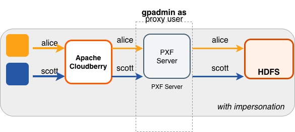
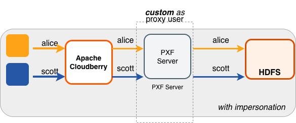
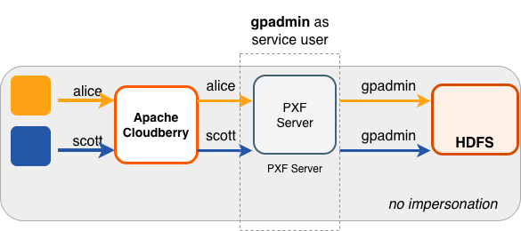
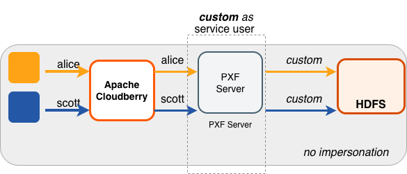

PXF 代表 Apache Cloudberry 最终用户访问 Hadoop 服务。模拟（Impersonation）是向远程系统呈现 Apache Cloudberry 最终用户身份的一种方式。在 PXF 中，可以通过配置 Hadoop 代理用户来实现这一点。当 Hadoop 服务通过 Kerberos 保护时，你还可以选择使用 Kerberos 约束委派进行模拟。

启用用户模拟（默认）时，PXF 使用登录 Apache Cloudberry 并执行使用 PXF 连接器的操作的 Apache Cloudberry 用户账户的身份来访问非安全的 Hadoop 服务。请注意，PXF 访问 Hadoop 服务时只使用用户的_登录_身份。例如，如果用户以 `jane` 身份登录 Apache Cloudberry，然后运行 `SET ROLE` 或 `SET SESSION AUTHORIZATION` 来切换为另一个用户身份，所有 PXF 请求仍使用 `jane` 身份访问 Hadoop 服务。启用用户模拟后，必须显式配置每个 Hadoop 数据源（HDFS、Hive、HBase），以允许 PXF 充当代理来模拟特定的 Hadoop 用户或组。

停用用户模拟时，PXF 以 PXF 进程所有者（通常是 `gpadmin`）或你指定的 Hadoop 用户身份运行所有 Hadoop 服务请求。这种行为无法针对不同的 Apache Cloudberry 用户控制对 Hadoop 服务的访问。它要求该用户有权访问 HDFS 中的所有文件和目录，以及 PXF 外部表定义中引用的 Hive 和 HBase 中的所有表。

你通过服务器配置文件 `pxf-site.xml` 为服务器配置 Hadoop 用户和 PXF 用户模拟设置。有关此文件中配置属性的更多信息，请参阅[关于 pxf-site.xml 配置文件](/cloudberry/pxf/administering/configuring/cfg_server/#about-the-pxf-sitexml-configuration-file)。

## 用例和配置场景 {#use-cases-and-configuration-scenarios}

Hadoop 的用户、用户模拟和代理配置取决于你如何使用 PXF 访问 Hadoop，以及 Hadoop 集群是否通过 Kerberos 保护。

以下场景介绍了使用 PXF 访问*非安全 Hadoop* 时的用例和所需配置。
如果使用 PXF 访问*受 Kerberos 保护的 Hadoop 集群*，请参阅*为安全 HDFS 配置 PXF* 主题中的[用例和配置场景](/cloudberry/pxf/administering/configuring/hadoop-connectors/pxf_kerbhdfs/#use-cases-and-configuration-scenarios)一节。

**注意**：这些场景假定 `gpadmin` 是 PXF 进程所有者。

### 以由 gpadmin 代理的 Apache Cloudberry 用户身份访问 Hadoop {#accessing-hadoop-as-the-apache-cloudberry-user-proxied-by-gpadmin}

这是 PXF 的默认配置。`gpadmin` 用户代表 Apache Cloudberry 用户代理 Apache Cloudberry 查询。Hadoop 中的有效用户是运行该查询的
Apache Cloudberry 用户。



下表列出了此用例的 `pxf.service.user.impersonation` 和 `pxf.service.user.name` 设置，以及所需的 PXF 和 Hadoop 配置：

| 用户模拟 | 服务用户&nbsp; |  PXF 配置 | Hadoop&nbsp;配置&nbsp;&nbsp;&nbsp;&nbsp;&nbsp;&nbsp;&nbsp; |
|----------------|-------------------|--------------------|-----------|
|  true           |  `gpadmin`        | 无；这是默认配置。 | 按照[配置 Hadoop 代理](#configure-hadoop-proxying)中的说明，将 `gpadmin` 用户设置为 Hadoop 代理用户。 |


### 以由 &lt;custom> 用户代理的 Apache Cloudberry 用户身份访问 Hadoop {#accessing-hadoop-as-the-apache-cloudberry-user-proxied-by-a-custom-user}

在此配置中，PXF 以由 `<custom>` 用户代理的 Apache Cloudberry 用户身份访问 Hadoop。由 Apache Cloudberry 用户发起的查询，在 Hadoop 一侧显示为来自 `<custom>` 用户。

当 Hadoop 已配置了代理用户，或者希望由 `gpadmin` 以外的用户代理 Apache Cloudberry 查询时，可能需要这种配置。



下表列出了此用例的 `pxf.service.user.impersonation` 和 `pxf.service.user.name` 设置，以及所需的 PXF 和 Hadoop 配置：

| 用户模拟 | 服务用户&nbsp; |  PXF 配置 | Hadoop&nbsp;配置&nbsp;&nbsp;&nbsp;&nbsp;&nbsp;&nbsp;&nbsp; |
|----------------|-------------------|--------------------|-----------|
|  true          |  `<custom>`        | 将 [Hadoop 用户配置](#configure-the-hadoop-user)为 `<custom>` 用户名。 | 按照[配置 Hadoop 代理](#configure-hadoop-proxying)中的说明，将 `<custom>` 用户设置为 Hadoop 代理用户。 |


### 以 gpadmin 用户身份访问 Hadoop {#accessing-hadoop-as-the-gpadmin-user}

在此配置中，PXF 以 `gpadmin` 用户身份访问 Hadoop。由任何 Apache Cloudberry 用户发起的查询，在 Hadoop 一侧都显示为来自 `gpadmin` 用户。



下表列出了此用例的 `pxf.service.user.impersonation` 和 `pxf.service.user.name` 设置，以及所需的 PXF 和 Hadoop 配置：

| 用户模拟 | 服务用户&nbsp; |  PXF 配置 | Hadoop&nbsp;配置&nbsp;&nbsp;&nbsp;&nbsp;&nbsp;&nbsp;&nbsp; |
|----------------|-------------------|--------------------|-----------|
|  false         |  `gpadmin`        | 按照[配置 PXF 用户模拟](#configure-pxf-user-impersonation)中的说明关闭用户模拟。 | 无需配置。 |

### 以 &lt;custom> 用户身份访问 Hadoop {#accessing-hadoop-as-a-custom-user}

在此配置中，PXF 以 \&lt;custom&gt; 用户身份访问 Hadoop。由任何 Apache Cloudberry 用户发起的查询，在 Hadoop 一侧都显示为来自 \&lt;custom&gt; 用户。



下表列出了此用例的 `pxf.service.user.impersonation` 和 `pxf.service.user.name` 设置，以及所需的 PXF 和 Hadoop 配置：

| 用户模拟 | 服务用户&nbsp; |  PXF 配置 | Hadoop&nbsp;配置&nbsp;&nbsp;&nbsp;&nbsp;&nbsp;&nbsp;&nbsp; |
|----------------|-------------------|--------------------|-----------|
|  false         |  \&lt;custom&gt;        |  按照[配置 PXF 用户模拟](#configure-pxf-user-impersonation)中的说明关闭用户模拟，并将 [Hadoop 用户配置](#configure-the-hadoop-user)为 \&lt;custom&gt; 用户名。 | 无需配置。 |


## 配置 Hadoop 用户 {#configure-the-hadoop-user}

默认情况下，PXF 使用 Apache Cloudberry 用户的身份访问 Hadoop。你可以按服务器配置 PXF，使其以其他用户身份访问 Hadoop。

请执行以下步骤配置 Hadoop 用户：

1. 以管理用户身份登录 Apache Cloudberry Coordinator 主机：

    ```shell
    $ ssh gpadmin@<coordinator>
    ```

2. 确定要更新的 Hadoop PXF 服务器配置的名称。

3. 进入服务器配置目录。例如，如果服务器名为 `hdp3`：

    ```shell
    gpadmin@coordinator$ cd $PXF_BASE/servers/hdp3
    ```

4. 如果服务器配置尚未包含 `pxf-site.xml` 文件，请将模板文件复制到该目录。例如：

    ```shell
    gpadmin@coordinator$ cp <PXF_INSTALL_DIR>/templates/pxf-site.xml .
    ```

5. 在你选择的编辑器中打开 `pxf-site.xml` 文件，并配置 Hadoop 用户名。停用用户模拟时，该名称标识 PXF 用于访问 Hadoop 系统的 Hadoop 用户身份。对非安全 Hadoop 集群启用用户模拟时，该名称标识 PXF 代理 Hadoop 用户。例如，如果要以用户 `hdfsuser1` 的身份访问 Hadoop，请取消该属性的注释并按如下方式设置：

    ```xml
    <property>
        <name>pxf.service.user.name</name>
        <value>hdfsuser1</value>
    </property>
    ```

    Hadoop 用户 `hdfsuser1` 必须存在于 Hadoop 集群中。

7. 保存 `pxf-site.xml` 文件并退出编辑器。

8. 使用 `pxf cluster sync` 命令，将 PXF Hadoop 服务器配置同步到 Apache Cloudberry 集群：

    ```shell
    gpadmin@coordinator$ pxf cluster sync
    ```


## 配置 PXF 用户模拟 {#configure-pxf-user-impersonation}

Hadoop 服务器默认启用 PXF 用户模拟。你可以按服务器配置 PXF 用户模拟。请执行以下步骤，为 Hadoop 服务器配置开启或关闭 PXF 用户模拟：

1. 进入服务器配置目录。例如，如果服务器名为 `hdp3`：

    ```shell
    gpadmin@coordinator$ cd $PXF_BASE/servers/hdp3
    ```

2. 如果服务器配置尚未包含 `pxf-site.xml` 文件，请将模板文件复制到该目录。例如：

    ```shell
    gpadmin@coordinator$ cp <PXF_INSTALL_DIR>/templates/pxf-site.xml .
    ```

3. 在你选择的编辑器中打开 `pxf-site.xml` 文件，并更新用户模拟属性设置。例如，如果此服务器配置不需要用户模拟，请将 `pxf.service.user.impersonation` 属性设置为 `false`：

    ```xml
    <property>
        <name>pxf.service.user.impersonation</name>
        <value>false</value>
    </property>
    ```

    如果需要用户模拟，请将其开启：

    ```xml
    <property>
        <name>pxf.service.user.impersonation</name>
        <value>true</value>
    </property>
    ```

3. 如果启用了用户模拟，且 Kerberos 约束委派处于停用状态（默认），则必须按照[配置 Hadoop 代理](#configure-hadoop-proxying)中的说明配置 Hadoop 代理。如果计划使用 Hive 和 HBase 服务，还必须配置 [Hive 用户模拟](#hive-user-impersonation)和 [HBase 用户模拟](#hbase-user-impersonation)。

4. 保存 `pxf-site.xml` 文件并退出编辑器。

5. 使用 `pxf cluster sync` 命令，将 PXF Hadoop 服务器配置同步到 Apache Cloudberry 集群：

    ```shell
    gpadmin@coordinator$ pxf cluster sync
    ```


## 配置 Hadoop 代理 {#configure-hadoop-proxying}

当 Hadoop 服务器配置启用了 PXF 用户模拟，且 Kerberos 约束委派处于停用状态（默认）时，必须配置 Hadoop，允许 PXF 代理 Apache Cloudberry 用户。此配置涉及设置某些 `hadoop.proxyuser.*` 属性。请按以下步骤设置 PXF Hadoop 代理用户：

1. 登录 Hadoop 集群并使用文本编辑器打开 `core-site.xml` 配置文件，或使用 Ambari 或其他 Hadoop 集群管理器来添加或编辑本步骤中描述的 Hadoop 属性值。

2. 设置属性 `hadoop.proxyuser.<name>.hosts`，指定允许发出代理请求的 PXF 主机名列表。将 `<name>` 替换为 PXF 代理 Hadoop 用户。PXF 代理 Hadoop 用户就是你在上述步骤中配置的 `pxf.service.user.name`；如果使用 Kerberos 认证连接 Hadoop，则代理用户身份是 Kerberos 主体的 *primary* 部分。如果没有显式配置 `pxf.service.user.name`，则代理用户是启动 PXF 的操作系统用户。使用逗号分隔的列表提供多个 PXF 主机名。例如，如果 PXF 代理用户名为 `hdfsuser2`：

    ```xml
    <property>
        <name>hadoop.proxyuser.hdfsuser2.hosts</name>
        <value>pxfhost1,pxfhost2,pxfhost3</value>
    </property>
    ```

3. 设置属性 `hadoop.proxyuser.<name>.groups`，指定以 Hadoop 用户 `<name>` 身份运行的 PXF 可以模拟的 HDFS 组列表。应将此列表限制为仅包含需要通过 PXF 访问 HDFS 数据的那些组。例如：

    ```xml
    <property>
        <name>hadoop.proxyuser.hdfsuser2.groups</name>
        <value>group1,group2</value>
    </property>
    ```

4. 必须重启 Hadoop，`core-site.xml` 的更改才能生效。

5. 将更新后的 `core-site.xml` 文件复制到 Apache Cloudberry Coordinator 主机上的 PXF Hadoop 服务器配置目录 `$PXF_BASE/servers/<server_name>`，并将配置同步到 Standby Coordinator 主机和每台 Apache Cloudberry Segment 主机。

## Hive 用户模拟 {#hive-user-impersonation}

PXF Hive 连接器使用 Hive MetaStore 确定 Hive 表的 HDFS 位置，然后直接访问底层 HDFS 文件。Hive 不需要特定的用户模拟配置，因为 `core-site.xml` 中的 Hadoop 代理配置同样适用于以这种方式访问的 Hive 表。


## HBase 用户模拟 {#hbase-user-impersonation}

要使用户模拟能够与 HBase 配合工作，必须在 HBase 配置中启用 `AccessController` 协处理器并重启集群。有关所需的 `hbase-site.xml` 配置设置，请参阅 Apache HBase 参考指南中的 [61.3 Server-side Configuration for Simple User Access Operation](http://hbase.apache.org/book.html#hbase.secure.configuration)。
