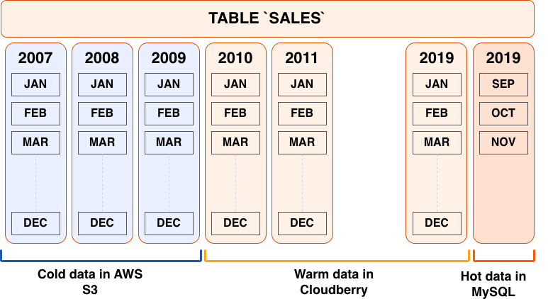

<!--
Licensed to the Apache Software Foundation (ASF) under one
or more contributor license agreements.  See the NOTICE file
distributed with this work for additional information
regarding copyright ownership.  The ASF licenses this file
to you under the Apache License, Version 2.0 (the
"License"); you may not use this file except in compliance
with the License.  You may obtain a copy of the License at

  http://www.apache.org/licenses/LICENSE-2.0

Unless required by applicable law or agreed to in writing,
software distributed under the License is distributed on an
"AS IS" BASIS, WITHOUT WARRANTIES OR CONDITIONS OF ANY
KIND, either express or implied.  See the License for the
specific language governing permissions and limitations
under the License.
-->

随着数据存储和云服务的爆炸式增长，数据如今分散在众多互不相同的系统中，并以各种格式存放。数据通常会按其所在位置、对其执行的操作以及访问频率来分类：实时或事务型（热）、较少访问（温）或归档（冷）。

下图描述了一个记录多年月度销售额的数据源。实时运营数据存储在 MySQL 中；用于分析和商业智能操作的数据存储在 Apache Cloudberry 中；很少访问的归档数据则存放在 AWS S3 中。

当外部系统中存在多个相关的数据集时，在远端对这些数据集执行关联并仅返回结果，通常比应对代价高昂的完整数据加载所需的时间和存储空间更高效。*Apache Cloudberry 平台扩展框架（PXF）* 是一个提供并行、高吞吐数据访问和联邦查询处理的 Apache Cloudberry 扩展，能够提供这一能力。

借助 PXF，您可以使用 Apache Cloudberry 和 SQL 查询以下异构数据源：

- Hadoop、Hive 和 HBase
- Azure Blob Storage 和 Azure Data Lake Storage Gen2
- AWS S3
- MinIO
- Google Cloud Storage
- SQL 数据库，包括 Apache Ignite、Hive、MySQL、ORACLE、Microsoft SQL Server、DB2 和 PostgreSQL（通过 JDBC）
- 网络文件系统

以及以下数据格式：

- Avro、AvroSequenceFile
- JSON
- ORC
- Parquet
- RCFile
- SequenceFile
- 文本（纯文本、带分隔符、含嵌入换行符、定宽）

## 基本用法 {#basic-usage}

您使用 PXF 将外部数据源中的数据映射到 Apache Cloudberry *外部表*定义。之后，您就可以使用该 PXF 外部表和 SQL 来：

- 对外部数据执行查询，被引用的数据仍保留在远端系统上。
- 将外部数据的一个子集加载到 Apache Cloudberry 中。
- 对驻留在 Apache Cloudberry 表中的本地数据以及通过 PXF 外部表引用的远端数据运行复杂查询。
- 向外部数据源写入数据。

请查阅 [PXF 简介](/cloudberry/pxf/intro/)，了解重要 PXF 概念的概要说明。

## 开始配置 PXF {#get-started-configuring-pxf}

Apache Cloudberry 管理员负责管理 PXF、Apache Cloudberry 用户权限以及外部数据源配置。相关任务包括：

- [安装](/cloudberry/pxf/administering/configuring/about_pxf_dir/)、[配置](/cloudberry/pxf/administering/configuring/)、[启动](/cloudberry/pxf/administering/cfginitstart_pxf/)、[监控](/cloudberry/pxf/administering/monitor_pxf/)和[排查](/cloudberry/pxf/troubleshooting/) PXF 服务的问题。
- 管理 PXF [升级](/cloudberry/pxf/upgrade/)。
- 为每个外部数据源[配置](/cloudberry/pxf/administering/configuring/cfg_server/)并发布一个或多个服务器定义。该定义指定外部数据源的位置以及访问凭据。
- 向 Apache Cloudberry 用户[授予](/cloudberry/pxf/administering/using_pxf/)访问 PXF 和 PXF 外部表的权限。

## 开始使用 PXF {#get-started-using-pxf}

Apache Cloudberry 用户[创建](/cloudberry/pxf/intro/#creating-an-external-table)一个引用外部数据源中的文件或其他数据的 PXF 外部表，并使用该外部表在 Apache Cloudberry 中查询或加载外部数据。具体任务取决于外部数据存储：

- 数据位于 Hadoop 时，请参阅[使用 PXF 访问 Hadoop](/cloudberry/pxf/access-hadoop/)。
- 数据位于对象存储时，请参阅[使用 PXF 访问 Azure、Google Cloud Storage、MinIO 和 S3 对象存储](/cloudberry/pxf/access-objectstores/)。
- 数据位于外部 SQL 数据库时，请参阅[使用 PXF 访问 SQL 数据库](/cloudberry/pxf/access-jdbc/)。
