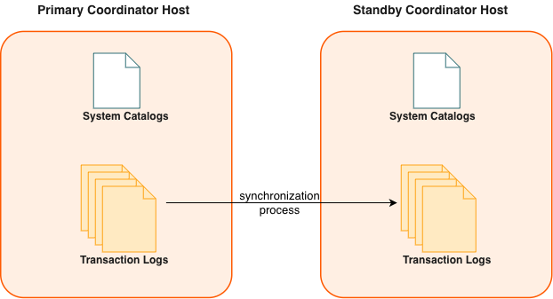

The backup coordinator instance, called the *standby coordinator*, serves as a warm standby if the primary coordinator becomes nonoperational. You create a standby coordinator from the primary coordinator while the primary is online.

When you enable coordinator mirroring for an existing system, the primary coordinator continues to provide service to users while a snapshot of the primary coordinator instance is taken. While the snapshot is taken and deployed on the standby coordinator, changes to the primary coordinator are also recorded. After the snapshot has been deployed on the standby coordinator, the standby coordinator is synchronized and kept current using Write-Ahead Logging (WAL)-based streaming replication. Apache Cloudberry WAL replication uses the `walsender` and `walreceiver` replication processes. The `walsender` process is a primary coordinator process. The `walreceiver` is a standby coordinator process.

Because the coordinator does not house user data, only system catalog tables are synchronized between the primary and standby coordinators. When these tables are updated, the replication logs that capture the changes are streamed to the standby coordinator to keep it current with the primary. During WAL replication, all database modifications are written to replication logs before being applied, to ensure data integrity for any in-process operations.

This is how Apache Cloudberry handles a coordinator failure.

- If the primary coordinator fails, the Apache Cloudberry system shuts down and the coordinator replication process stops. The administrator runs the `gpactivatestandby` utility to have the standby coordinator take over as the new primary coordinator. Upon activation of the standby coordinator, the replicated logs reconstruct the state of the primary coordinator at the time of the last successfully committed transaction. The activated standby coordinator then functions as the Apache Cloudberry coordinator, accepting connections on the port specified when standby coordinator was initialized. See [Recovering a Failed Coordinator](/cloudberry/sys-admin/high-availability/recover-a-failed-coordinator/).
- If the standby coordinator fails or becomes inaccessible while the primary coordinator is active, the primary coordinator tracks database changes in logs that are applied to the standby coordinator when it is recovered.

These Apache Cloudberry system catalog tables contain mirroring and replication information.

- The catalog table [`gp_segment_configuration`](/cloudberry/reference/sys-catalogs/sys-tables/gp-segment-configuration/) contains the current configuration and state of primary and mirror segment instances and the coordinator and standby coordinator instance.
- The catalog view `gp_stat_replication` contains replication statistics of the `walsender` processes that are used for Apache Cloudberry coordinator and segment mirroring.
