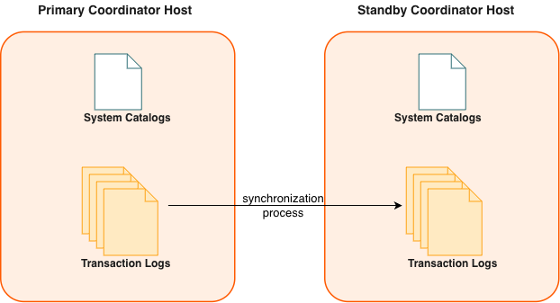

作为备份的 Coordinator 实例称为 *Standby Coordinator*，在主 Coordinator 无法运行时充当温备。可以在主 Coordinator 在线期间，从主 Coordinator 创建 Standby Coordinator。

为现有系统启用 Coordinator 镜像时，会为主 Coordinator 实例创建快照，同时主 Coordinator 继续为用户提供服务。创建快照并将其部署到 Standby Coordinator 期间，主 Coordinator 上的变更也会被记录下来。快照部署到 Standby Coordinator 后，通过基于预写式日志（WAL）的流复制完成同步并持续保持最新状态。Apache Cloudberry 的 WAL 复制使用 `walsender` 和 `walreceiver` 复制进程。`walsender` 是主 Coordinator 上的进程，`walreceiver` 是 Standby Coordinator 上的进程。

由于 Coordinator 不存储用户数据，主 Coordinator 与 Standby Coordinator 之间只同步系统目录表。这些表更新时，记录变更的复制日志会以流式方式发送给 Standby Coordinator，使其与主 Coordinator 保持同步。在 WAL 复制过程中，所有数据库修改都会先写入复制日志，再应用修改，以确保正在执行的操作的数据完整性。

Apache Cloudberry 按以下方式处理 Coordinator 故障：

- 如果主 Coordinator 故障，Apache Cloudberry 系统会关闭，Coordinator 复制进程停止。管理员运行 `gpactivatestandby` 工具，使 Standby Coordinator 接管并成为新的主 Coordinator。激活 Standby Coordinator 时，会利用复制日志重建主 Coordinator 在最后一次成功提交事务时的状态。激活后的 Standby Coordinator 随即充当 Apache Cloudberry Coordinator，在初始化 Standby Coordinator 时指定的端口上接受连接。参见[恢复故障 Coordinator](/cloudberry/sys-admin/high-availability/recover-a-failed-coordinator/)。
- 如果主 Coordinator 正常运行时，Standby Coordinator 故障或无法访问，主 Coordinator 会在日志中记录数据库变更，待 Standby Coordinator 恢复后再应用这些变更。

以下 Apache Cloudberry 系统目录表包含镜像与复制信息：

- 目录表 [`gp_segment_configuration`](/cloudberry/reference/sys-catalogs/sys-tables/gp-segment-configuration/) 包含主 Segment、镜像 Segment、Coordinator 和 Standby Coordinator 实例的当前配置及状态。
- 目录视图 `gp_stat_replication` 包含 `walsender` 进程的复制统计信息，这些进程用于 Apache Cloudberry 的 Coordinator 和 Segment 镜像。
