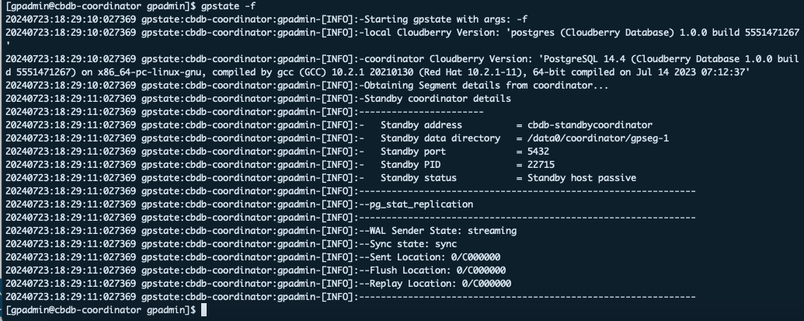
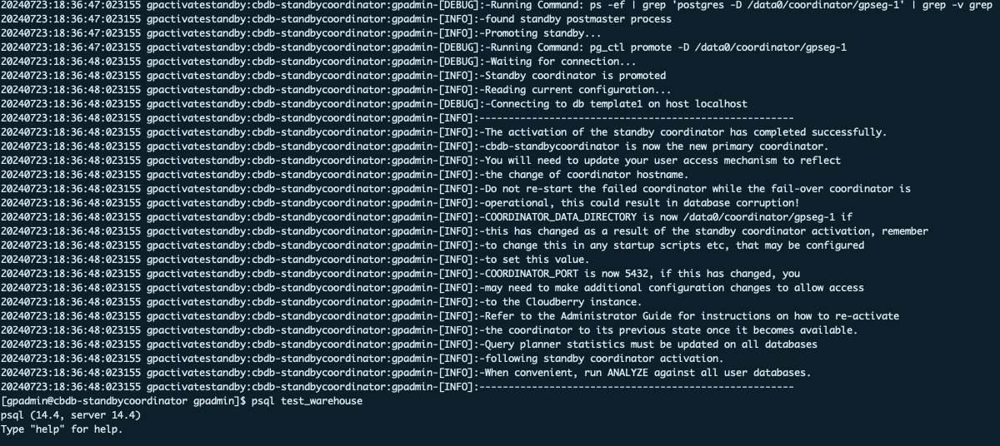

本节介绍如何配置 Coordinator 镜像，以确保 Coordinator 节点顺利完成故障切换。

## Coordinator 镜像概述 {#overview-of-coordinator-mirroring}

除了正常工作的主 Coordinator 节点，还可以在 CBDB 集群中添加 Standby Coordinator，在主 Coordinator 所在主机宕机时接管系统。

主 Coordinator 和 Standby Coordinator 应部署在不同主机上，使集群能够容忍单台主机故障。客户端连接主 Coordinator，查询也只能在主 Coordinator 上运行。Standby Coordinator 通过基于预写式日志（WAL）的流复制，与主 Coordinator 保持同步。

如果 Coordinator 故障，管理员需要运行 `gpactivatestandby` 工具，使 Standby Coordinator 接管并成为新的主 Coordinator。可以为 Coordinator 和 Standby Coordinator 配置虚拟 IP 地址，使当前 Coordinator 变化时，客户端程序无需改用其他网络地址。如果 Coordinator 主机故障，可将虚拟 IP 地址切换到实际承担 Coordinator 角色的主机。

## 配置 Coordinator 镜像 {#configure-coordinator-mirroring}

按以下步骤为 CBDB 集群启用和激活 Coordinator 镜像：

### 前提条件 {#prerequisites}

确保已在不同于主 Coordinator 所在主机的另一台主机上配置 Standby Coordinator。具体而言，应确保在 Standby Coordinator 主机上完成以下配置：

- 创建 `gpadmin` 系统用户
- 安装 Cloudberry RPM 软件包
- 设置环境变量
- 交换 SSH 密钥
- 创建数据目录，以及需要的表空间目录

> [!NOTE]
> 如果按照[准备部署](/cloudberry/deployment/prepare-to-deploy/)和[使用 RPM 软件包手动部署 Apache Cloudberry](/cloudberry/deployment/install_cloudberry/)中的步骤部署集群，则集群中已配置了 Standby Coordinator 主机（ `scdw`）。

### 第 1 步：启用 Standby Coordinator {#step-1-enable-the-standby-coordinator}

首先需要使用 `gpinitstandby` 工具启用 Standby Coordinator：

1. 在当前活动的主 Coordinator（`scdw`）主机上运行 `gpinitstandby` 工具，为 CBDB 集群添加 Standby Coordinator 主机。例如：

    ```shell
    $ gpinitstandby -s scdw
    ```

    `-s` 选项指定 Standby Coordinator 的主机名。

    初始化完成后会显示以下消息：`-Successfully created standby coordinator on scdw`。

2. 可以使用 `gpstate` 工具的 `-f` 选项，显示 Standby Coordinator 主机的详细信息。

    ```
    $ gpstate -f
    ```

    Standby Coordinator 的状态应为 `passive`，WAL 发送进程的状态应为 `streaming`，如下图所示：

    

### 第 2 步：激活 Standby Coordinator {#step-2-activate-the-standby-coordinator}

如果主 Coordinator 故障，CBDB 集群将无法访问，WAL 复制也会停止。可以使用 `gpactivatestandby` 激活 Standby Coordinator。激活时，CBDB 会重建 Coordinator 主机在最后一次成功提交事务时的状态。

激活 Standby Coordinator 的步骤如下：

1. 在要激活的 Standby Coordinator 主机上运行 `gpactivatestandby` 工具。例如：

    ```shell
    $ export PGPORT=5432
    $ gpactivatestandby -d /data0/coordinator/gpseg-1
    ```

    其中，`-d` 指定要激活的 Coordinator 主机的数据目录。

    > [!NOTE]
    > - 运行 `gpactivatestandby` 前，务必先运行 `gpstate -f`，确认 Standby Coordinator 已与当前 Coordinator 节点同步。如果已同步，`gpstate -f` 输出的最后一行应类似于：`20230607:06:50:06:004205 gpstate:test1-m:gpadmin-[INFO]:--Sync state: sync`
    >
    > - 激活可能需要一些时间。等待系统提示继续，然后在终端中输入 `Y` 确认。

    激活后，Standby Coordinator 成为 CBDB 集群中活动的主 Coordinator。此时可通过连接该 Standby Coordinator 访问 CBDB 集群。

    

2. 工具执行完成后，可以使用 `gpstate` 的 `-b` 选项显示系统状态摘要：

    ```shell
    $ gpstate -b
    ```

    Coordinator 状态应为 `Active`。未配置 Standby Coordinator 时，命令会将其状态显示为 `No coordinator standby configured`。如果已配置新的 Standby Coordinator，其状态为 `Passive`。

### 第 3 步：恢复后重新配置 Coordinator 镜像 {#step-3-restore-coordinator-mirroring-after-a-recovery}

为恢复系统而激活 Standby Coordinator 后，它就成为主 Coordinator。如果该实例与原 Coordinator 主机具备相同的能力和可靠性，可以继续将其作为主 Coordinator 运行。

必须初始化新的 Standby Coordinator，才能继续提供 Coordinator 镜像；除非已在激活上一个 Standby Coordinator 时完成此操作。

按以下步骤，将发生故障的原主 Coordinator 配置为 Standby Coordinator：

1. 确保原 Coordinator 主机已能可靠运行。

2. 在原主 Coordinator 主机上，移动或删除数据目录 `gpseg-1`。以下示例将该目录移至 `backup_gpseg-1`：

    ```shell
    $ mv /data0/coordinator/gpseg-1 /data0/coordinator/backup_gpseg-1
    ```

    Standby Coordinator 配置成功后，即可删除备份目录。

3. 在原 Coordinator 主机上初始化 Standby Coordinator。例如，在当前 Coordinator 主机 `scdw` 上运行以下命令：

    ```shell
    $ gpinitstandby -s scdw
    ```

4. 初始化完成后，检查 Standby Coordinator `scdw` 的状态。运行带 `-f` 选项的 `gpstate` 检查 Standby Coordinator 状态：

    ```shell
    $ gpstate -f
    ```

    Standby Coordinator 的状态应为 `passive`，WAL 发送进程的状态应为 `streaming`。
