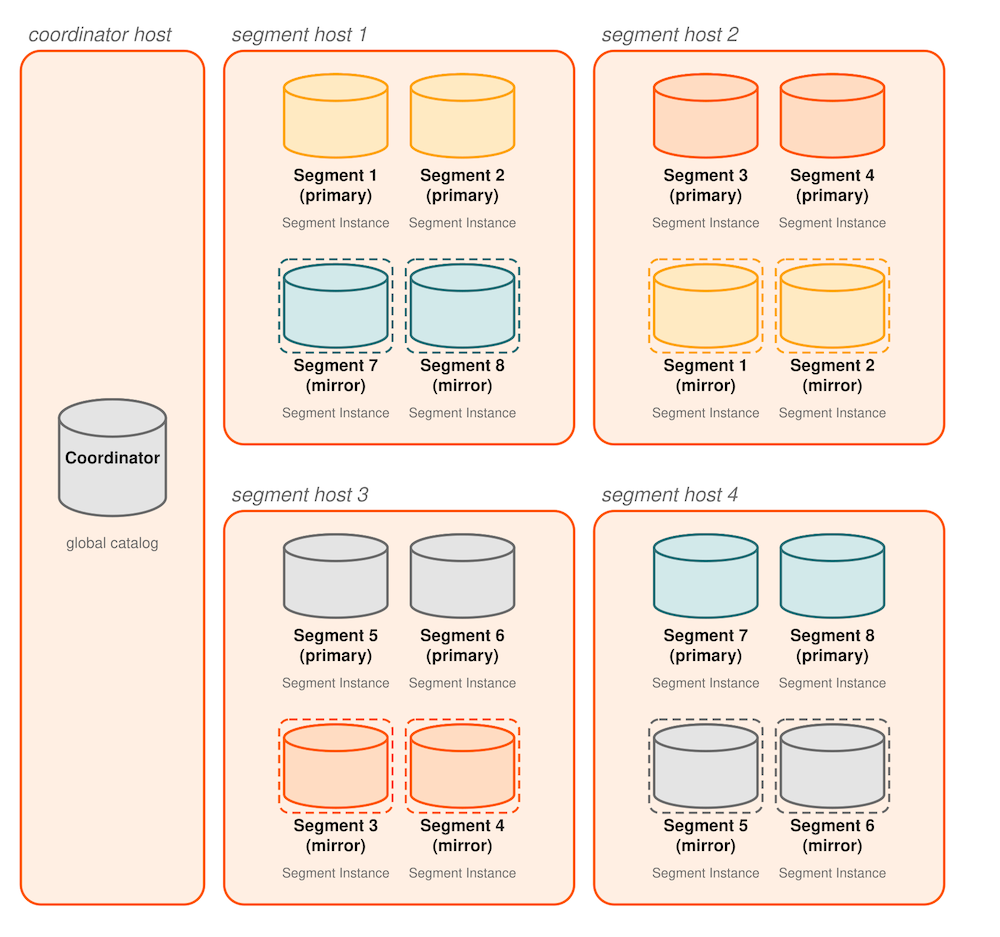
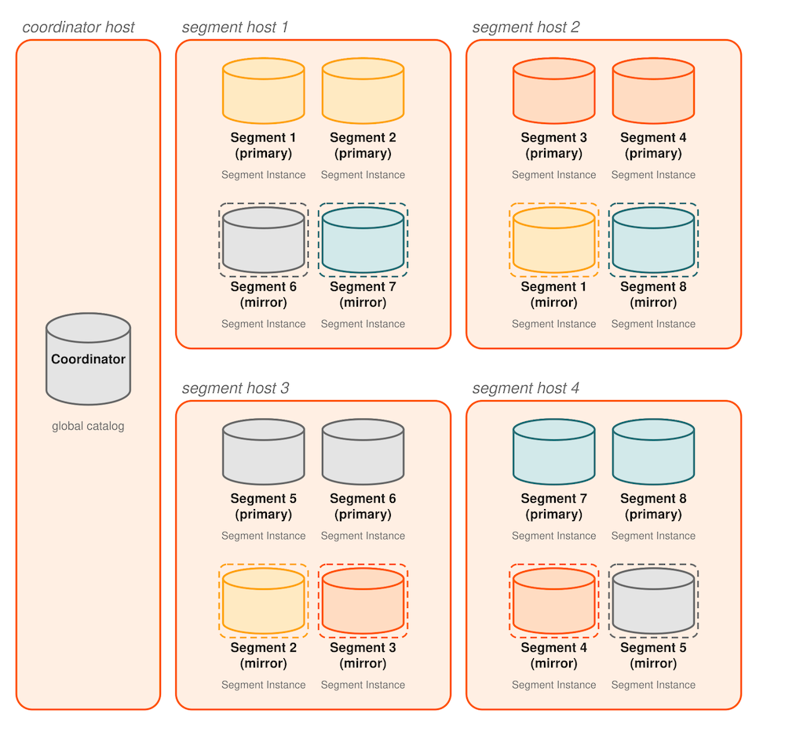

每个主 Segment 都有一个对应的镜像 Segment。主 Segment 实例接收 Coordinator 发来的请求，修改 Segment 数据，然后将变更复制到对应镜像。如果 Apache Cloudberry 检测到主 Segment 故障或不可用，就会将其镜像 Segment 的角色改为主 Segment，并将不可用的原主 Segment 角色改为镜像 Segment。故障发生时正在执行的事务会回滚，必须重新启动。随后，管理员必须恢复镜像 Segment，使其与当前主 Segment 同步，再交换主 Segment 与镜像 Segment 的角色，使两者恢复为首选角色。

如果未启用 Segment 镜像，任何 Segment 实例故障都会导致 Apache Cloudberry 系统关闭。管理员必须手动恢复所有故障 Segment，才能恢复 Apache Cloudberry 的运行。

为现有系统启用 Segment 镜像时，会为主 Segment 创建快照，同时主 Segment 实例继续为用户提供服务。创建快照并将其部署到镜像 Segment 实例期间，主 Segment 的变更也会被记录下来。快照部署到镜像 Segment 后，通过基于预写式日志（WAL）的流复制完成同步并持续保持最新状态。Apache Cloudberry 的 WAL 复制使用 `walsender` 和 `walreceiver` 复制进程。`walsender` 是主 Segment 上的进程，`walreceiver` 是镜像 Segment 上的进程。

数据库发生变更时，记录变更的日志会以流式方式发送给镜像 Segment，使其与对应主 Segment 保持同步。在 WAL 复制过程中，数据库变更会先写入日志，再应用变更，以确保正在执行的操作的数据完整性。

Apache Cloudberry 检测到主 Segment 故障时，WAL 复制进程停止，镜像 Segment 自动启动并成为活动的主 Segment。如果主 Segment 正常运行时，镜像 Segment 故障或无法访问，主 Segment 会在日志中记录数据库变更，待镜像恢复后再应用这些变更。关于 Segment 故障检测和恢复过程，参见 [Apache Cloudberry 如何检测 Segment 故障](/cloudberry/sys-admin/high-availability/detect-a-failed-segment/)和[从 Segment 故障中恢复](/cloudberry/sys-admin/high-availability/recover-from-segment-failures/)。

以下 Apache Cloudberry 系统目录表包含镜像与复制信息：

- 目录表 [`gp_segment_configuration`](/cloudberry/reference/sys-catalogs/sys-tables/gp-segment-configuration/) 包含主 Segment、镜像 Segment、Coordinator 和 Standby Coordinator 实例的当前配置及状态。
- 目录视图 gp_stat_replication 包含 `walsender` 进程的复制统计信息，这些进程用于 Apache Cloudberry 的 Coordinator 和 Segment 镜像。

## Segment 镜像配置 {#about-segment-mirroring-configurations}

镜像 Segment 实例可以按不同配置部署到集群主机上。最佳实践是将主 Segment 与对应镜像放在不同主机上。每台主机上的主 Segment 数量和镜像 Segment 数量必须相同。使用 Apache Cloudberry 工具 [`gpinitsystem`](/cloudberry/reference/sys-utilities/gpinitsystem/) 或 [`gpaddmirrors`](/cloudberry/reference/sys-utilities/gpaddmirrors/) 创建 Segment 镜像时，可以指定组镜像（默认）或分散镜像配置。使用 `gpaddmirrors` 时，还可以通过 `gpaddmirrors` 配置文件创建自定义镜像配置，并在命令行中指定该文件。

在系统初始化期间启用镜像时，*组镜像*是默认配置。每台主机上所有主 Segment 的镜像都部署到另一台主机上。如果一台主机故障，承担该主机镜像的主机上，活动主 Segment 的数量会翻倍。下图展示了组镜像配置。

系统初始化期间可以指定*分散镜像*。这种配置将每台主机的镜像分散到多台主机上，使任意一台主机故障时，其他每台主机最多只有一个镜像被提升为活动的主 Segment。只有主机总数大于每台主机上的 Segment 数量时，才能使用分散镜像。下图展示了 Segment 分散镜像配置中的镜像分布。

> [!NOTE]
> 创建或扩容系统时，必须确保主机数量满足镜像配置要求。例如，创建采用分散镜像的系统时，主机总数必须大于每台主机上的 Segment 实例数；扩容采用组镜像的系统时，至少需要两台新主机。有关 Segment 镜像配置，参见 [Segment 镜像配置](/cloudberry/tutorials/best-practices/high-availability-best-practices/#configure-segment-mirroring)。有关启用了 Segment 镜像的系统扩容，参见[规划镜像 Segment](/cloudberry/sys-admin/expand-cluster/plan-system-expansion/)。
